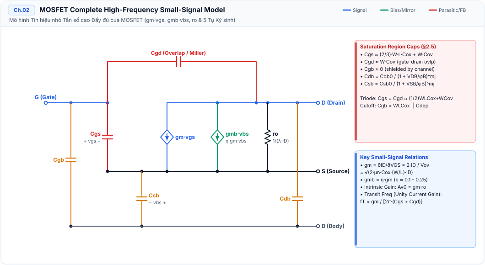

---
{
  "id": "concept-mos-capacitances-small-signal",
  "kind": "concept",
  "domain": "foundations",
  "title_vi": "Điện dung ký sinh, mô hình tín hiệu nhỏ đầy đủ, tụ MOS và FinFET (MOS Capacitances, Small-Signal Model, MOS Varactor & FinFET)",
  "title_en": "MOS Device Capacitances, Complete Small-Signal Model, MOS Capacitor, and FinFET Basics",
  "summary": "Giải phẫu toàn bộ các thành phần điện dung vật lý (oxit kênh, chồng lấn Cov, tiếp giáp đáy Cj và thành bên Cjsw) qua các vùng hoạt động, hiệu quả gập ngón giảm CDB và RG, mô hình tín hiệu nhỏ đồng nhất NMOS/PMOS, tần số chuyển tiếp fT, đặc tuyến C–V của tụ MOS và cấu trúc 3D FinFET.",
  "diagram": "../../diagrams/mos-small-signal-caps.svg",
  "razavi_refs": [
    {
      "chapter": 2,
      "section": "2.4.1-2.6",
      "pages": "26-38, 41-42",
      "equations": ["2.40", "2.41", "2.42", "2.43", "2.44", "2.53", "2.54", "2.55", "2.56"]
    }
  ],
  "glossary_codes": ["T043", "T046", "T103", "T104", "T297", "T303", "T309", "T310", "T311", "T312", "T313", "T314", "T315", "T316", "T318", "T319", "T320", "T334", "T341", "T365", "T371", "T414"],
  "process_agnostic": true,
  "roles": {
    "intrinsic_and_overlap_gate_caps": "CGS và CGD quyết định điện dung tải ngõ vào, hiệu ứng nhân tụ Miller và đường truyền thẳng tần số cao",
    "junction_depletion_caps": "CDB và CSB nạp/xả trực tiếp tại nút cực máng và cực nguồn theo điện áp phân cực ngược với đế/giếng",
    "folded_multifinger_geometry": "Chia transistor rộng thành nhiều ngón chung vùng máng để cắt giảm gần một nửa CDB và giảm mạnh điện trở cổng RG",
    "finfet_3d_channel": "Cổng bao quanh 3 mặt vây silic tăng khả năng kiểm soát tĩnh điện cho tiến trình dưới 20nm với độ rộng lượng tử hóa theo số vây"
  },
  "symptoms_addressed": [
    "pmos-small-signal-current-direction-confusion",
    "excessive-drain-capacitance-and-gate-resistance-in-wide-transistors",
    "wrong-cgs-cgd-values-across-cutoff-triode-saturation",
    "misunderstanding-mos-varactor-cv-dip"
  ],
  "limitations": [
    "meyer-piecewise-cap-model-causes-discontinuities-and-charge-nonconservation-in-transient-spice",
    "finfet-prohibits-arbitrary-continuous-width-selection"
  ],
  "checklists": ["common-mos"]
}
---

## 1. Bản chất Nguyên lý, Sơ đồ Mạch & Vai trò Từng Nhánh Cấu trúc

Để dự đoán chính xác đáp ứng tần số cao, thời gian xác lập và xuyên nhiễu xung nhịp của vi mạch tương tự, mô hình dòng–áp tĩnh phải được bổ sung đầy đủ **các điện dung ký sinh của linh kiện (device parasitic capacitances)** giữa bốn cực G, D, S, B (bỏ qua điện dung trực tiếp giữa S và D vì rất nhỏ — Chú thích 8, tr. 27). Từ mặt cắt vật lý và hình chiếu bằng của MOSFET (Razavi Chương 2, §2.4.1–2.4.2, Hình 2.29–2.32), toàn bộ tụ ký sinh bắt nguồn từ **4 cơ chế vật lý độc lập**:



1. **Điện dung lớp oxit giữa cổng và kênh dẫn ($C_1 = W L_{\text{eff}} C_{ox}$):** Là thành phần điện dung bản chất của trường điều khiển cổng; cách nó phân bổ về cực nguồn hay cực máng thay đổi mạnh theo vùng hoạt động!
2. **Điện dung vùng nghèo giữa kênh và đế ($C_2 = W L_{\text{eff}} \sqrt{q\epsilon_{\text{si}} N_{\text{sub}} / (4\Phi_F)}$):** Nối từ dưới mặt phân cách oxit xuống cực thân B khi chưa có lớp nghịch đảo che chắn.
3. **Điện dung chồng lấn cổng–nguồn và cổng–máng (Overlap Capacitance — $C_3 = C_4 = W C_{ov}$):** Do vùng $n^+$ khuếch tán ngang dưới gờ cổng polysilicon một đoạn $L_D$ kết hợp các đường sức điện trường rìa (fringing fields), không thể tính đơn giản bằng $W L_D C_{ox}$ mà được đặc trưng bởi tham số đơn vị chiều rộng $C_{ov}$ ($\text{fF}/\mu\text{m}$, ký hiệu SPICE là `CGSO`, `CGDO`), **luôn tồn tại ở mọi vùng hoạt động**.
4. **Điện dung tiếp giáp nguồn–thân và máng–thân (Junction Capacitance — $C_{SB}, C_{DB}$):** Tạo bởi diode tiếp giáp $pn$ phân cực ngược giữa vùng pha tạp $n^+$ (diện tích đáy $W \times E$, trong đó $E \approx 3\text{–}4\,L_{\min}$ là chiều rộng tối thiểu để mở cửa sổ tiếp xúc kim loại *contact window*) và đế $p$. Phải tách thành hai thành phần:
   - **Điện dung đáy tiếp giáp (Bottom-plate capacitance — $C_j$, đơn vị $\text{F/m}^2$):** Nhân với diện tích đáy $A_D, A_S$.
   - **Điện dung thành bên (Sidewall capacitance — $C_{jsw}$, đơn vị $\text{F/m}$):** Nhân với chu vi vùng khuếch tán $P_D, P_S$ (do thành bên tiếp giáp với lớp cấy chặn kênh / rãnh cách ly STI có nồng độ pha tạp khác đáy). Cả hai đều giảm phi tuyến khi điện áp phân cực ngược $V_R$ tăng:
     $$C_j(V_R) = \frac{C_{j0}}{\left(1 + \dfrac{V_R}{\Phi_B}\right)^{m_j}}, \qquad m_j \approx 0.3\text{–}0.5$$

---

## 2. Hệ Phương trình Cốt lõi & Tư duy "Nhìn Mạch Đọc Nhanh" (Analysis by Inspection)

### 2.1. Bảng Phân bố Điện dung Cực ($C_{GS}, C_{GD}, C_{GB}$) Qua 3 Vùng Hoạt động
Sự xuất hiện hoặc biến mất của lớp nghịch đảo dẫn điện làm thay đổi hoàn toàn sự phân bố điện dung cổng (§2.4.2, Hình 2.34, tr. 29–30):

| Điện dung cực | Vùng Ngắt (Cutoff: $V_{GS} < V_{TH}$) | Vùng Triode Sâu ($V_{DS} \approx 0$) | Vùng Bão hòa ($V_{DS} \ge V_{GS} - V_{TH}$) |
|---|---|---|---|
| **$C_{GS}$** | $W C_{ov}$ | $\dfrac{1}{2} W L_{\text{eff}} C_{ox} + W C_{ov}$ | $\dfrac{2}{3} W L_{\text{eff}} C_{ox} + W C_{ov}$ |
| **$C_{GD}$** | $W C_{ov}$ | $\dfrac{1}{2} W L_{\text{eff}} C_{ox} + W C_{ov}$ | $W C_{ov}$ |
| **$C_{GB}$** | $\dfrac{(W L_{\text{eff}} C_{ox})\,C_d}{W L_{\text{eff}} C_{ox} + C_d}$ | $\approx 0$ *(kênh che chắn cổng–thân)* | $\approx 0$ *(kênh che chắn cổng–thân)* |

*Giải thích vật lý hệ số $2/3$ và $0$ ở vùng bão hòa:* Trong vùng triode sâu ($V_D \approx V_S$), kênh dẫn đồng nhất nên một thay đổi $\Delta V_G$ rút điện tích bằng nhau từ S và D ($\frac{1}{2}WLC_{ox}$ mỗi bên). Khi sang vùng bão hòa, kênh bị thắt tại đầu máng nên $V_D$ bị tách khỏi kênh (khiến $C_{GD}$ chỉ còn đúng tụ chồng lấn $W C_{ov}$ — nhưng hãy coi chừng: khi gắn trong tầng khuếch đại đảo có độ lợi $-A_v$, tụ $C_{GD}$ nhỏ bé này sẽ bị **nhân Miller** lên $(1 + A_v)C_{GD}$ ở Chương 6!). Trong khi đó, hiệu thế dọc kênh giảm tuyến tính về $V_{TH}$ từ nguồn tới điểm thắt kênh, tích phân điện tích toàn kênh cho $\frac{2}{3}W L_{\text{eff}} C_{ox}$ gắn với $V_{GS}$. Ở cả triode lẫn bão hòa, lớp nghịch đảo đóng vai trò tấm chắn tĩnh điện ngăn đường sức từ cổng xuyên xuống đế nên $C_{GB} \approx 0$.

### 2.2. Phép Gập Ngón (Folded Multi-Finger Structure) Cắt Giảm $C_{DB}$ và $R_G$
Xét một transistor rộng $W$ được vẽ thẳng 1 ngón so với gập đôi thành 2 ngón chiều rộng $W/2$ dùng chung vùng cực máng ở giữa (Ví dụ 2.10, Hình 2.33 & Hình 2.38, Phương trình 2.40–2.43, tr. 29 & 33):
- **Cấu trúc 1 ngón thẳng:**
  $$C_{DB,\text{1f}} = C_{SB,\text{1f}} = W E C_j + 2(W + E)C_{jsw}, \qquad R_{G,\text{1f}} = R_{G0}$$
- **Cấu trúc gập 2 ngón (chung cực máng ở giữa):**
  $$C_{DB,\text{2f}} = \frac{W}{2} E C_j + 2\!\left(\frac{W}{2} + E\right)C_{jsw} \approx \frac{1}{2} C_{DB,\text{1f}}!$$
  $$C_{SB,\text{2f}} = W E C_j + 2(W + 2E)C_{jsw}, \qquad R_{G,\text{2f}} = \left(\frac{R_{G0}}{2}\right) \parallel \left(\frac{R_{G0}}{2}\right) = \frac{R_{G0}}{4}!$$
  Gập thành $M$ ngón (với $M$ chẵn) cắt giảm gần **một nửa diện tích tiếp giáp cực máng** (cực kỳ lợi cho cực tần số cao tại nút ngõ ra!) và giảm điện trở phân bố cổng polysilicon theo **$1/M^2$** (giảm nhiễu nhiệt cổng $4kT R_G$).

### 2.3. Tần số Chuyển tiếp Nội tại $f_T$ (Transit / Unity Current-Gain Frequency)
Định nghĩa $f_T$ là tần số tại đó độ lợi dòng ngắn mạch tín hiệu nhỏ $|i_d / i_g|$ của transistor phân cực bão hòa giảm xuống bằng $1$ (Bài tập 2.13, Phương trình 2.55–2.56, tr. 41–42):

$$f_T = \frac{g_m}{2\pi (C_{GS} + C_{GD})} \approx \frac{\mu_n (V_{GS} - V_{TH})}{2\pi \cdot \frac{2}{3} L^2} \;\; \left(\text{hoặc xấp xỉ luật bình phương } \frac{\mu_n (V_{GS} - V_{TH})}{2\pi L^2} \text{ khi lấy } C_{\text{tot}} \approx WLC_{ox}\right)$$

*(Lưu ý quan trọng từ Bài tập 2.13a,b: $f_T$ **không phụ thuộc** vào tụ tiếp giáp $C_{DB}$ vì đầu ra bị nối tắt AC khi đo ngắn mạch, và cũng **độc lập với điện trở cổng $R_G$**! Biểu thức $f_T \propto (V_{GS} - V_{TH})/L^2$ cho thấy: giảm $L$ tăng vọt tốc độ theo $1/L^2$, nhưng nếu ép $V_{OV}$ xuống rất nhỏ để cứu khoảng dự trữ điện áp thì $f_T$ sẽ sụt giảm tương ứng!).*

### 2.4. Đặc tuyến $C\text{–}V$ của Tụ MOS (MOS Varactor) & Cấu trúc 3D FinFET
- **MOSFET làm Tụ điện / Varactor (§2.6 Phụ lục B, Hình 2.45–2.46, tr. 37–38):** Khi nối chung S–D–B của NMOS làm một cực và G làm cực kia:
  - Khi $V_{GS} < 0$ âm sâu (**vùng tích lũy — accumulation**): lỗ trống từ đế $p$ bị hút tụ dày đặc sát mặt oxit tạo bản cực thứ hai cách cổng đúng $t_{ox} \Rightarrow C_{\text{unit}} \approx C_{ox}$ (cực đại).
  - Khi $V_{GS}$ tăng qua $0$ vào $0 < V_{GS} < V_{TH}$ (**vùng nghèo / nghịch đảo yếu**): lỗ trống bị đẩy lùi nhưng chưa có lớp electron nghịch đảo $\Rightarrow$ tụ giảm xuống mức tối thiểu $C_{ox} \parallel_{\text{series}} C_{\text{dep}} = \frac{C_{ox}C_{\text{dep}}}{C_{ox} + C_{\text{dep}}}$ (tạo hố trũng chữ U trên đường cong $C\text{–}V$!).
  - Khi $V_{GS} > V_{TH}$ (**nghịch đảo mạnh**): lớp electron tràn từ S/D vào phủ mặt oxit $\Rightarrow$ điện dung tăng trở lại bằng $C_{ox}$. Đặc tính điện dung biến thiên theo điện áp này chính là cơ sở của **varactor MOS** điều chỉnh tần số bộ dao động LC ở Chương 15!
- **Cấu trúc FinFET 3 chiều (§2.5 Phụ lục A, Hình 2.42–2.44, tr. 36–37):** Dưới nút công nghệ $\sim 20\,\text{nm}$, cổng bao quanh **3 mặt** của vách silic thẳng đứng (chiều rộng vây $W_F \approx 6\,\text{nm}$, chiều cao vây $H_F \approx 50\,\text{nm}$), cho bề rộng kênh hiệu dụng của 1 vây:
  $$W_{\text{1-fin}} = W_F + 2 H_F$$
  Do $W_F$ và $H_F$ bị khóa cố định bởi quy trình công nghệ để kiểm soát CLM và điện trở nối tiếp, người thiết kế **không thể chọn $W$ liên tục tùy ý** mà chỉ có thể ghép nguyên $N_{\text{fin}}$ vây song song: $W_{\text{tot}} = N_{\text{fin}}(W_F + 2 H_F)$! Nhờ cổng kẹp chặt điện trường từ hai bên vách, FinFET triệt giảm mạnh điều biến chiều dài kênh và rò dưới ngưỡng, đưa đặc tuyến tiến gần quy luật bình phương trở lại.

### 2.5. Ví dụ Định lượng Đầy đủ Các Tụ & $f_T$ Khi Gập Ngón (Bài tập 2.15 & Bảng 2.1 Razavi, tr. 35 & 42)
Xét NMOS bão hòa kích thước lớn $W = 50\,\mu\text{m}$, $L_{\text{drawn}} = 0.5\,\mu\text{m}$, dòng tĩnh $I_D = 1\,\text{mA}$, chiều rộng vùng tiếp xúc S/D là $E = 1.5\,\mu\text{m}$ với bộ thông số Bảng 2.1 ($t_{ox} = 9\,\text{nm} \Rightarrow C_{ox} = \frac{3.9 \times 8.854 \times 10^{-12}}{9\times 10^{-9}} = 3.84\,\text{fF}/\mu\text{m}^2$, $L_D = 0.08\,\mu\text{m} \Rightarrow L_{\text{eff}} = 0.5 - 0.16 = 0.34\,\mu\text{m}$, $\mu_n C_{ox} \approx 134.4\,\mu\text{A/V}^2$, $C_{ov} = 0.4\,\text{fF}/\mu\text{m}$, $C_{j0} = 0.56\,\text{fF}/\mu\text{m}^2$, $C_{jsw0} = 0.35\,\text{fF}/\mu\text{m}$ tại $V_R \approx 0$):
1. **Độ hỗ dẫn và các tụ cực cổng:**
   $$g_m = \sqrt{2 \times 134.4\,\mu\text{A/V}^2 \times \frac{50}{0.34} \times 1\,\text{mA}} \approx 6.29\,\text{mS}$$
   $$C_{GS} = \frac{2}{3}(50)(0.34)(3.84) + 50(0.4) = 43.5\,\text{fF} + 20.0\,\text{fF} = 63.5\,\text{fF}, \qquad C_{GD} = 50(0.4) = 20.0\,\text{fF}$$
   *(Chú ý: ngay ở $L = 0.5\,\mu\text{m}$, riêng tụ chồng lấn $W C_{ov} = 20\,\text{fF}$ đã bằng gần một nửa tụ kênh $\frac{2}{3}W L_{\text{eff}} C_{ox} = 43.5\,\text{fF}$!).*
2. **So sánh tụ tiếp giáp cực máng $C_{DB}$ trước và sau khi gập đôi (Hình 2.33b):**
   - Nếu **không gập** ($nf = 1$):
     $$C_{DB,\text{1f}} = (50 \times 1.5)(0.56) + 2(50 + 1.5)(0.35) = 42.0 + 36.05 = 78.05\,\text{fF}$$
   - Nếu **gập 2 ngón chung cực máng** ($nf = 2$, vùng máng giữa rộng $W/2 = 25\,\mu\text{m}$):
     $$C_{DB,\text{2f}} = (25 \times 1.5)(0.56) + 2(25 + 1.5)(0.35) = 21.0 + 18.55 = 39.55\,\text{fF} \quad (\text{giảm } 49.3\%!)$$
3. **Tần số chuyển tiếp nội tại:**
   $$f_T = \frac{g_m}{2\pi(C_{GS} + C_{GD})} = \frac{6.29\,\text{mS}}{2\pi(63.5 + 20.0)\,\text{fF}} \approx 12.0\,\text{GHz}$$
   Phép tính mẫu này cho thấy rõ: $C_{DB}$ lớn tương đương toàn bộ $C_{GS} + C_{GD}$ nếu không gập ngón, và việc chia ngón chẵn chung vùng cực máng cắt bỏ gần $40\,\text{fF}$ tải ký sinh miễn phí ngay tại nút ra!

---

## 3. Bất biến Cấu trúc & Các Bẫy Lỗi Kinh điển (Structural Invariants & Traps)

- **[INV-CAP-01] Bất biến Đẳng cấu Tuyệt đối giữa Sơ đồ Tín hiệu Nhỏ của PMOS và NMOS (§2.4.3, Hình 2.41, tr. 34):** Đây là chỗ sinh viên và cả kỹ sư cực kỳ hay vẽ sai dấu! Dù trên schematic PMOS được vẽ lật ngược (cực nguồn S ở trên nối $V_{DD}$, cực máng D ở dưới), nhưng khi thế cổng $V_G$ tăng thêm $+\Delta v_g$ ($v_{gs} > 0$), $|V_{SG}|$ của PMOS giảm nên độ lớn dòng lỗ trống chảy từ S xuống D **giảm đi** — tương đương hoàn toàn với một dòng tín hiệu nhỏ $g_m v_{gs}$ **chảy từ D lên S** (tức là mũi tên nguồn phụ thuộc $g_m v_{gs}$ vẫn hướng từ **S sang D** nếu xét theo định nghĩa chuẩn: dòng đi vào cực D và đi ra cực S bằng $+g_m v_{gs} + g_{mb} v_{bs} + v_{ds}/r_o$, **giống hệt 100% mô hình NMOS**!). *Quy tắc vàng: Không bao giờ đổi dấu thành $-g_m v_{gs}$ cho PMOS!*
- **[INV-CAP-02] Bất biến Bảo toàn Điện tích trong Mô phỏng Quá độ (Chương 17 §17.3.6, Hình 17.16):** Mô hình tụ từng khúc của Meyer (Bảng 2.1 Level 1) không bảo toàn điện tích khi $V_{GS}, V_{DS}$ quét qua ranh giới vùng hoạt động (gây hiện tượng "mất tích điện ảo / sụt áp droop" trên nút tụ thả nổi trong mô phỏng `tran`!). Mọi mô phỏng mạch chuyển mạch tụ (`sampled-and-clocked`) bắt buộc phải dùng mô hình bảo toàn điện tích dựa trên biến trạng thái điện tích cực $Q_G, Q_D, Q_S, Q_B$ (như BSIM3v3 / BSIM4).

- **[TRAP-CAP-01] Bẫy Vẽ Transistor Rộng $W = 200\,\mu\text{m}$ Bằng 1 Ngón Duy nhất (`nf = 1`):** Nếu quên chia ngón trên Virtuoso Schematic, hai thảm họa xảy ra đồng thời: (1) $C_{DB}$ tăng gấp đôi làm tụt cực ngõ ra, và (2) điện trở cổng polysilicon $R_G$ tăng lên hàng trăm–nghìn $\Omega$, bơm nhiễu nhiệt khổng lồ vào cực cổng và tạo cực RC nội tại làm sập dự trữ pha!
- **[TRAP-CAP-02] Bẫy Bỏ sót Tụ Đảo Chiều S/D khi Quét Điện áp Lớn (Ví dụ 2.11, Hình 2.35–2.36, tr. 30–31):** Khi điện áp một cực quét vượt qua cực kia, vai trò Source và Drain đảo ngược khiến cặp tụ $(C_{GS}, C_{GD})$ nhảy tráo giá trị giữa $\frac{2}{3}WLC_{ox} + WC_{ov}$ và $WC_{ov}$!
- **[TRAP-CAP-03] Bẫy Dùng Tụ MOS Thường ở Vùng Gần $V_{GS} \approx 0\text{–}V_{TH}$ Làm Tụ Bù Tuyến tính:** Tại lân cận $0 < V_{GS} < V_{TH}$, điện dung tụ MOS sụt hố sâu và biến thiên cực mạnh theo điện áp. Nếu dùng MOSFET làm tụ bù Miller $C_c$ hoặc tụ lọc nguồn decoupling, bắt buộc phải đảm bảo phân cực tĩnh luôn giữ $V_{GS} \gg V_{TH}$ (hoặc dùng tụ MIM/MOM kim loại tuyến tính ở Chương 18–19).

---

## 4. Lộ trình Nâng cấp Cấu trúc & Bát giác Đánh đổi (Upgrade Paths & Design Octagon)

Từ mô hình tín hiệu nhỏ đầy đủ 5 tụ ký sinh này, các bài toán động học và thiết kế hệ thống mở ra trực tiếp:
- **Khi tụ $C_{GD}$ bị nhân Miller ở tầng nguồn chung làm thắt cổ chai băng thông và đẻ ra RHP zero $+g_m / C_{GD}$:** Phân tích chi tiết tại `law-miller-theorem-and-rhp-zero` và nâng cấp cấu trúc sang `topo-cascode-stage` (kẹp cố định điện thế cực máng transistor đầu vào nhờ trở kháng thấp $\sim 1/g_{m2}$ để triệt hiệu ứng Miller, xem `concept-high-freq-cs-cg-cascode`).
- **Khi $C_{GS}$ của cặp tải gương dòng tạo cực phụ và cặp cực–zero doublet làm chậm xác lập:** Xem `concept-diffpair-mirror-pole-doublet`.
- **Khi sử dụng đặc tuyến phi tuyến $C(V)$ của tụ MOS chế độ tích lũy để điều chỉnh tần số dao động:** Nâng cấp sang varactor MOS trong bộ dao động LC tại `topo-vco-tuning-and-phase-noise`.
- **Khi chuyển từ sơ đồ nguyên lý sang bố trí hình học nhiều ngón và đối xứng trọng tâm giảm $R_G, C_{DB}$:** Xem `tech-common-centroid-sti-wpe-layout`.

---

## 5. Thích ứng Đa Tiến trình (90nm / 65nm / 45nm) & Cách Kiểm chứng trong Cadence / Spectre

Trên các tiến trình **90nm / 65nm / 45nm**:
1. **Tỷ trọng tụ chồng lấn & tụ rìa ($C_{ov} + C_f$) tăng vọt so với tụ kênh $WLC_{ox}$:** Khi $L_{\min}$ co xuống $45\,\text{nm}$, thành phần $W C_{ov}$ (cộng tụ rìa giữa vách cổng poly/metal và tiếp điểm S/D cao) có thể chiếm tới **$30\%\text{–}45\%$ tổng $C_{GG}$**, và tỷ số $C_{GD}/C_{GS}$ trong vùng bão hòa không còn nhỏ không đáng kể ($\sim 0.05$) như kênh dài mà lên tới **$0.25\text{–}0.35$**! Hệ quả: hiệu ứng nhân tụ Miller và truyền thẳng qua $C_{GD}$ ở 65nm/45nm nghiêm trọng hơn rất nhiều so với tính tay kênh dài.
2. **Dòng rò xuyên hầm qua cổng (Gate Tunneling Leakage — $I_G$):** Ở 65nm và đặc biệt là 45nm có $t_{ox} \approx 1.2\text{–}1.8\,\text{nm}$ (trước khi sang High-$\kappa$ Metal Gate ở 28nm), dòng rò cổng DC $I_G$ không còn bằng không tuyệt đối nếu diện tích $W \times L$ rất lớn (như tụ bù MOS hàng chục $\text{pF}$), có thể làm trôi điểm phân cực nút trở kháng siêu cao! Do đó ở 45nm/65nm, tụ bù $C_c$ hoặc tụ giữ mẫu ưu tiên dùng tụ **MOM (Metal-Oxide-Metal)** hoặc **MIM** thay vì tụ cổng MOS mỏng.

**Cách kiểm chứng tụ ký sinh & chia ngón trong Cadence Virtuoso IC617 / Spectre:**
- **Bắt buộc kích hoạt CDF Callback khi sửa $W, L, nf, m$ bằng script SKILL:** Khi thay đổi chiều rộng tổng hoặc số ngón `fingers` (`nf`), phải gọi `PasCdfFormInit` / callback của PDK để các thuộc tính diện tích/chu vi tiếp giáp `ad`, `as`, `pd`, `ps` (hoặc `nrd`, `nrs`) tự động tính lại theo công thức gập ngón chia sẻ cực máng; nếu `ad, pd` giữ giá trị mặc định sai, mô phỏng AC sẽ báo băng thông ảo cao hoặc thấp gấp nhiều lần thực tế!
- **Đọc trực tiếp ma trận điện dung nội tại từ `dcOpInfo` của BSIM4:** Trong Spectre, chú ý BSIM4 xuất các đạo hàm điện tích không đối xứng `cgg`, `cgs`, `cgd`, `cgb`, `cdd`, `cdb`, `css`, `csb` (lưu ý dấu âm của điện dung xuyên đạo hàm $\partial Q_i / \partial V_j$ khi $i \neq j$, lấy trị tuyệt đối $|\texttt{cgd}|, |\texttt{cgs}|, |\texttt{cdd}|$). Tính nhanh $f_T$ thực tế tại điểm làm việc ngay trong ADE Calculator:
  $$f_{T,\text{sim}} = \frac{\text{OP}(\text{"/M1"}, \text{"gm"})}{2\pi \cdot \text{abs}(\text{OP}(\text{"/M1"}, \text{"cgg"}))}$$

**Bảng Giải mã Các Trường Điện dung Trong `dcOpInfo` Của Spectre (BSIM4) Tránh Nhầm Lẫn Giữa Nội tại & Ngoại vi:**

| Tên tham số trong `dcOpInfo` | Ý nghĩa vật lý trong BSIM4 | Có bao gồm tụ chồng lấn (`CGSO/CGDO`) và tụ tiếp giáp (`CJ/CJSW`) chưa? |
|---|---|---|
| `cgg`, `cgs`, `cgd`, `cgb` | Đạo hàm điện tích cực cổng **nội tại** $\partial Q_{G,\text{int}}/\partial V_j$ | **Thường CHƯA cộng đủ** tụ chồng lấn/rìa ngoại vi tùy cờ `capMod` của PDK! |
| `cgsov`, `cgdov`, `cgbov` | Điện dung chồng lấn & điện trường rìa cổng–nguồn / cổng–máng / cổng–thân | Thành phần chồng lấn thuần túy ($W C_{ov} + C_{\text{fringe}}$) |
| `cbd`, `cbs` *(hoặc `cjd`, `cjs`)* | Điện dung vùng nghèo tiếp giáp máng–thân và nguồn–thân ($A_D C_j + P_D C_{jsw}$) | Phụ thuộc trực tiếp vào `ad, as, pd, ps` do CDF callback sinh ra! |
| **Tổng điện dung thực tại nút (`captab`)** | Tổng toàn bộ tụ nội tại + chồng lấn + tiếp giáp + dây nối tại từng net của mạch | **ĐẦY ĐỦ NHẤT!** Bật tùy chọn `captab` (`infoname=captab`, `timed=no`) trong `dc` của Spectre để in tổng điện dung chính xác tại mọi nút mạch! |

```ocean
; Mẹo vàng trong Spectre: bật bảng tổng kết điện dung nút (Node Capacitance Table)
; Trong ADE -> Simulation -> Options -> Analog -> Check "captab" (Node Capacitance Table)
; Hoặc tính tổng tụ cổng thực tế của M1 trong Calculator:
Cgg_tot = abs(OP("/M1" "cgg")) + abs(OP("/M1" "cgsov")) + abs(OP("/M1" "cgdov"))
Cd_tot  = abs(OP("/M1" "cdd")) + abs(OP("/M1" "cgdov")) + abs(OP("/M1" "cbd"))
fT_real = OP("/M1" "gm") / (2 * 3.14159265 * Cgg_tot)
```

---

## 6. Mốc Đối chiếu Sách Razavi & Thuật ngữ Chuẩn CLB

- **Sách gốc Razavi (2nd Ed.):**
  - Chương 2: §2.4.1 *MOS Device Layout* (tr. 26–27, Hình 2.29–2.30, Ví dụ 2.9), §2.4.2 *MOS Device Capacitances* (tr. 27–31, Phương trình 2.40–2.43, Hình 2.31–2.36, Ví dụ 2.10–2.11, Ghi chú FinFET tr. 28), §2.4.3 *MOS Small-Signal Model* (tr. 31–34, Hình 2.37–2.41), §2.4.4 *MOS SPICE Models* (tr. 34–35, Bảng 2.1), §2.4.5 *NMOS Versus PMOS Devices* (tr. 35), §2.5 *Appendix A: FinFETs* (tr. 36–37, Hình 2.42–2.44), §2.6 *Appendix B: Behavior of a MOS Device as a Capacitor* (tr. 37–38, Hình 2.45–2.46), Bài tập 2.13 (tr. 41–42, Phương trình 2.55–2.56 cho $f_T$).
  - Chương 17: §17.3.1 (Phương trình 17.34–17.36 làm trơn tụ Meyer), §17.3.6 *Charge and Capacitance Modeling* (tr. 707–708, Hình 17.16 lỗi không bảo toàn điện tích).
- **Thuật ngữ chuẩn CLB Vi Mạch (`THUẬT NGỮ CHUẨN.md`):**
  - `T303` / `T366`: **Các điện dung ký sinh của linh kiện**; `T309`–`T313`: $C_{GS}$ (**điện dung cổng–nguồn**), $C_{GD}$ (**điện dung cổng–máng**), $C_{GB}$ (**điện dung cổng–thân**), $C_{DB}$ (**điện dung máng–thân**), $C_{SB}$ (**điện dung nguồn–thân**).
  - `T316`: *overlap capacitance* $\rightarrow$ **Điện dung chồng lấn**; `T319`: *bottom-plate capacitance* $\rightarrow$ **Điện dung đáy tiếp giáp** ($C_j$); `T320`: *sidewall capacitance* $\rightarrow$ **Điện dung thành bên** ($C_{jsw}$).
  - `T365` / `T371`: **Mô hình tín hiệu nhỏ đầy đủ** và **Mô hình tín hiệu nhỏ của PMOS**; `T043`: *FinFET* $\rightarrow$ **Transistor hiệu ứng trường dạng vây**; `T414`: **Đặc tuyến điện dung–điện áp ($C\text{–}V$)**.
- **Bảng tóm tắt đối chiếu ưu/nhược điểm NMOS so với PMOS từ §2.4.5 (tr. 35):**
  - Độ linh động và khả năng dẫn dòng: $\mu_n \approx 2\text{–}3\,\mu_p \Longrightarrow$ cùng kích thước và dòng tĩnh, NMOS cho $g_m$ cao hơn, diện tích/tụ ký sinh nhỏ hơn và $f_T$ cao hơn rõ rệt.
  - Trở kháng ra tín hiệu nhỏ: NMOS thường có hệ số điều biến chiều dài kênh $\lambda_n < \lambda_p$ (Bảng 2.1: $\lambda_n = 0.1\,\text{V}^{-1}$ so với $\lambda_p = 0.2\,\text{V}^{-1}$), cho nguồn dòng và độ lợi nội tại $g_m r_o$ tốt hơn.
  - Hai lợi thế độc quyền giúp PMOS không thể thiếu trong mạch tương tự:
    1. Mỗi PMOS có thể đặt trong **giếng $n$-well độc lập** để nối tắt cực thân vào cực nguồn ($B\text{–}S$), triệt tiêu hoàn toàn hiệu ứng thân mà không tốn diện tích giếng $n$ sâu.
    2. PMOS có **nhiễu nhấp nháy $1/f$ (flicker noise) thấp hơn NMOS** (Chú thích 11, tr. 35 & Chương 7), trở thành lựa chọn số một cho cặp vi sai đầu vào của các bộ khuếch đại chính xác tần số thấp!
  - Ghi chú FinFET (`N003` & §2.5): Ở các thế hệ FinFET dưới $20\,\text{nm}$, ngoài việc độ rộng bị lượng tử hóa theo bội số nguyên của $W_F + 2 H_F$, các tiếp điểm cực cổng và nguồn/máng phải đặt dạt ra ngoài vùng lõi vây (Hình 2.44), làm điện dung rìa 3D giữa cột tiếp xúc kim loại và mặt bên cổng (`C_fringe_3D`) trở thành thành phần ký sinh đáng kể cần trích xuất PEX sau layout.
