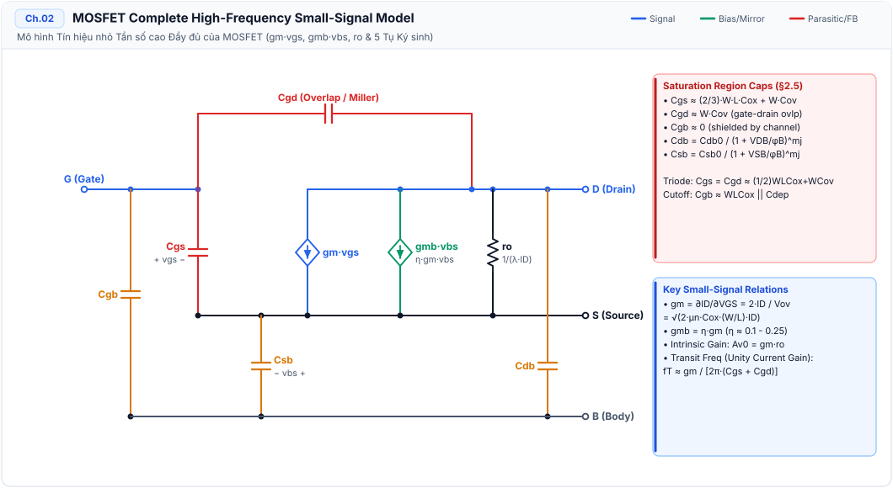

---
{
  "id": "concept-mos-junction-and-gate-capacitances-regions",
  "kind": "concept",
  "domain": "foundations",
  "title_vi": "Điện dung Cổng và Tiếp giáp MOSFET qua Các Vùng Hoạt động & Mô hình Meyer vs. Bảo toàn Điện tích (MOS Capacitances Across Regions & Charge Models)",
  "title_en": "MOS Gate and Junction Capacitances Across Operating Regions: Voltage Dependence and Meyer vs. Charge-Based Models",
  "summary": "Bóc tách bốn nguồn gốc vật lý của tụ ký sinh MOSFET (oxit cổng WLCox, vùng nghèo Cdep, chồng lấn WCov và tiếp giáp đáy/thành bên CDB, CSB), quy luật biến thiên phi tuyến của CGS, CGD, CGB qua ba vùng Ngắt – Triode – Bão hòa, kỹ thuật gập ngón cắt nửa CDB, và ranh giới giữa mô hình tụ tập trung đối xứng Meyer với mô hình bảo toàn điện tích bất đối xứng Ward–Dutton trong mạch chuyển mạch.",
  "diagram": "../../diagrams/mos-small-signal-caps.svg",
  "razavi_refs": [
    {
      "chapter": 2,
      "section": "2.4.1-2.4.2, 2.6",
      "pages": "26-31, 37-38",
      "equations": ["2.40", "2.41", "2.42", "2.43"]
    }
  ],
  "glossary_codes": ["T103", "T107", "T116", "T121", "T139", "T141", "T142", "T154", "T185", "T188", "T198"],
  "process_agnostic": true,
  "roles": {
    "gate_channel_oxide_cap": "Điện dung bản phẳng W*L_eff*Cox phân phối động giữa cực nguồn, cực máng và cực thân tùy theo trạng thái tồn tại và thắt nghẽn của lớp nghịch đảo",
    "overlap_and_fringing_cap": "Điện dung chồng lấn cổng–nguồn/máng W*Cov hầu như không đổi theo vùng hoạt động nhưng bị nhân Miller lên (1 + |Av|) lần trên đường truyền tín hiệu",
    "pn_junction_depletion_cap": "Điện dung vùng nghèo tiếp giáp n+/p dưới đáy (Cj) và thành bên STI/cổng (Cjsw) giảm phi tuyến khi tăng điện áp phân cực ngược VR, có thể cắt giảm mạnh nhờ layout đa ngón gập",
    "ward_dutton_transcapacitance": "Ma trận điện dung vi phân bảo toàn điện tích dQi/dVj bất đối xứng (Cgd != Cdg) ngăn chặn lỗi tạo điện tích giả trong mô phỏng mạch tụ chuyển mạch"
  },
  "symptoms_addressed": [
    "wrong-pole-estimation-using-saturation-cgs-cgd-for-triode-switch",
    "excessive-drain-junction-capacitance-from-single-stripe-layout",
    "mos-varactor-capacitance-dip-near-threshold-voltage",
    "charge-non-conservation-drift-in-legacy-meyer-spice-simulations"
  ],
  "limitations": [
    "piecewise-hand-formulas-exhibit-discontinuous-derivatives-at-region-boundaries",
    "short-channel-outer-fringing-capacitance-comparable-to-intrinsic-wlcox",
    "meyer-reciprocal-capacitors-violate-charge-conservation-in-switched-capacitor-loops"
  ],
  "checklists": ["common-mos"]
}
---

## 1. Bản chất Nguyên lý, Sơ đồ Mạch & Vai trò Từng Nhánh Cấu trúc

Nếu card `concept-mos-capacitances-small-signal` cung cấp bức tranh tổng quan mô hình tín hiệu nhỏ ở vùng bão hòa và tần số $f_T$, thì trong thiết kế thực chiến (từ công tắc lấy mẫu đi qua vùng ngắt $\to$ triode, varactor MOS trong VCO Chương 15, mạch bù Miller có tải triode cho tới phân tích quá độ bước nhảy lớn), các **điện dung ký sinh (`T103`, parasitic capacitances)** của MOSFET **thay đổi kịch liệt cả về giá trị lẫn nút kết nối** khi điện áp trên bốn cực $(G, S, D, B)$ dịch chuyển! Razavi (Chương 2, §2.4.1–§2.4.2, tr. 26–31 và §2.6 *Appendix B: Behavior of MOS Device as a Capacitor*, tr. 37–38) chỉ ra rằng giữa mỗi cặp trong 4 cực của MOSFET đều tồn tại một điện dung phụ thuộc điện áp (tạo thành 5 tụ chính $C_{GS}, C_{GD}, C_{GB}, C_{SB}, C_{DB}$, bỏ qua $C_{SD}$ trực tiếp giữa S và D vì bị vùng đế chắn giữa), bắt nguồn từ **4 cơ chế vật lý độc lập** trên mặt cắt dọc (Hình 2.32a, tr. 28):



1. **Điện dung oxit cổng bản phẳng (`T142`, gate-oxide capacitor):** Giữa cực cổng polysilicon/kim loại và bề mặt kênh dẫn cách nhau bởi **bề dày lớp oxit cổng (`T121`, $t_{ox}$)**, hình thành tổng điện dung nội tại $C_1 = W L_{\text{eff}} C_{ox}$, với $C_{ox} = \epsilon_{ox}/t_{ox}$ là **điện dung oxit cổng trên một đơn vị diện tích (`T154`)**.
2. **Điện dung vùng nghèo dưới kênh dẫn (`T141`, depletion-region capacitor):** Giữa bề mặt silic dưới cổng và thân đế $p$-substrate tồn tại **vùng nghèo (`T139`, depletion region)** có bề dày phụ thuộc thế bề mặt, tạo thành tụ nối đất $C_2 = W L_{\text{eff}} C_{\text{dep}} = W L_{\text{eff}} \sqrt{\frac{q \epsilon_{\text{si}} N_{\text{sub}}}{4\Phi_F}}$.
3. **Điện dung chồng lấn và điện trường rìa ($C_{ov}$):** Do khuếch tán ngang $L_D$ của cực nguồn/máng lấn vào dưới mép cổng cộng thêm đường sức điện trường rìa (*fringing field*) xuyên qua thành vách cách điện (*spacer*), giữa cổng với nguồn và giữa cổng với máng luôn có tụ cố định trên mỗi đơn vị chiều rộng: $C_3 = W C_{ov}$ (thường $C_{ov} \approx L_D C_{ox}$ cộng phần rìa, cỡ $0{,}2\text{–}0{,}4\,\text{fF}/\mu\text{m}$ trên các tiến trình submicron/nanomet).
4. **Điện dung tiếp giáp $p\text{–}n$ của cực nguồn và cực máng với đế (`T107`, $C_{SB}, C_{DB}$):** Mỗi vùng khuếch tán $n^+$ có kích thước ngang $W \times E$ nằm trong đế $p$ tạo thành hai mặt tiếp giáp phân cực ngược độc lập: **mặt đáy phẳng** diện tích $A_D = W \cdot E$ (điện dung đơn vị diện tích $C_j$, đơn vị $\text{fF}/\mu\text{m}^2$) và **bốn vách thành bên** chu vi $P_D = 2(W + E)$ tiếp giáp với rãnh cách ly nông STI hoặc vùng cấy chặn kênh nặng $p^+$ (điện dung đơn vị chiều dài $C_{jsw}$, đơn vị $\text{fF}/\mu\text{m}$).

---

## 2. Hệ Phương trình Cốt lõi & Tư duy "Nhìn Mạch Đọc Nhanh" (Analysis by Inspection)

### 2.1. Phụ thuộc Điện áp của Tụ Tiếp giáp $C_{DB}, C_{SB}$ & Kỹ thuật Gập Ngón Layout (Ví dụ 2.10)
Mọi tiếp giáp $p\text{–}n$ phân cực ngược bởi hiệu thế $V_R \ge 0$ (với NMOS: $V_{R,D} = V_{DB} = V_D - V_B$ và $V_{R,S} = V_{SB} = V_S - V_B$) đều có bề dày vùng nghèo giãn rộng khi $V_R$ tăng, làm điện dung đơn vị giảm theo hàm lũy thừa ngược:

$$C_j(V_R) = \frac{C_{j0}}{\left(1 + \dfrac{V_R}{V_{bi}}\right)^{m_j}}, \qquad C_{jsw}(V_R) = \frac{C_{jsw0}}{\left(1 + \dfrac{V_R}{V_{bi,\text{sw}}}\right)^{m_{jsw}}}$$

trong đó $V_{bi} = \frac{kT}{q}\ln\!\left(\frac{N_A N_D}{n_i^2}\right) \approx 0{,}7\text{–}0{,}9\,\text{V}$ là thế tiếp xúc nội tại và hệ số phân bố tạp chất $m_j \approx 0{,}33\text{–}0{,}5$ ($m = 1/2$ cho tiếp giáp đột ngột, $m = 1/3$ cho tiếp giáp biến thiên tuyến tính).

**Đòn bẩy Layout Gập đôi Transistor (Folded Structure — Ví dụ 2.10, Hình 2.33, Phương trình 2.40–2.43, tr. 29):**
Xét một transistor rộng $W$, chiều dài vùng tiếp xúc nguồn/máng tối thiểu bằng $E$:
- **Nếu vẽ một dải thẳng duy nhất rộng $W$ (Hình 2.33a):** Cực nguồn và cực máng đối xứng hoàn toàn, mỗi cực chịu trọn diện tích $W E$ và chu vi $2(W + E)$ (Phương trình 2.40):
  $$C_{DB,\text{single}} = C_{SB,\text{single}} = W E C_j + 2(W + E) C_{jsw}$$
- **Nếu tách thành 2 ngón song song rộng $W/2$ chung một vùng cực máng ở giữa và hai vùng cực nguồn ở hai bên (Hình 2.33b):** Hai ngón ghép song song giữ nguyên $100\%$ tỉ số $(W/2 + W/2)/L = W/L$, nhưng vùng máng dùng chung nay chỉ có bề rộng $W/2$! Kết quả (Phương trình 2.41–2.43):
  $$C_{DB,\text{folded}} = \frac{W}{2} E C_j + 2\!\left(\frac{W}{2} + E\right) C_{jsw} = \frac{1}{2} W E C_j + (W + 2E) C_{jsw}$$
  $$C_{SB,\text{folded}} = 2\left[\frac{W}{2} E C_j + 2\!\left(\frac{W}{2} + E\right) C_{jsw}\right] = W E C_j + 2(W + 2E) C_{jsw}$$
  Khi $W \gg E$, cấu trúc gập ngón chẵn **cắt giảm gần một nửa ($50\%$) điện dung tiếp giáp cực máng $C_{DB}$** tại nút tín hiệu tần số cao mà không tốn thêm bất kỳ công suất tĩnh nào! (Tổng quát với $N_f$ ngón chẵn dùng chung máng: diện tích máng giảm đi xấp xỉ $\frac{1}{2}$ lần so với dải đơn).

### 2.2. Bảng Biến thiên Chính xác của $C_{GS}, C_{GD}, C_{GB}$ Qua 4 Chế độ Phân cực (Hình 2.34 & Phụ lục §2.6)
Chìa khóa để không bao giờ phải học vẹt bảng điện dung là tự hỏi: **"Lớp hạt tải nghịch đảo dưới cổng đang có mặt ở đâu để che chắn điện trường cổng khỏi đế $B$, và đầu nào ($S$ hay $D$) cấp điện tích cho nó?"**

| Vùng hoạt động (với NMOS) | Điều kiện điện áp | $C_{GS}$ | $C_{GD}$ | $C_{GB}$ | Cơ chế vật lý giải thích tức thì |
|---|---|---|---|---|---|
| **1. Tích lũy (Accumulation — §2.6, tr. 37)** | $V_{GB} < V_{FB} < 0$ | $W C_{ov}$ | $W C_{ov}$ | $W L_{\text{eff}} C_{ox}$ | Lỗ trống đa số từ đế $p$ tràn sát mặt oxit như bản cực kim loại, nối thẳng cổng xuống thân qua trọn vẹn $W L_{\text{eff}} C_{ox}$! |
| **2. Ngắt / Nghèo (Cutoff / Depletion — Hình 2.34)** | $V_{FB} < V_{GS} < V_{TH}$ | $W C_{ov}$ | $W C_{ov}$ | $\dfrac{W L_{\text{eff}} C_{ox} C_{\text{dep}}}{C_{ox} + C_{\text{dep}}}$ | Chưa có kênh dẫn nối S–D; đường sức từ cổng xuyên qua $C_{ox}$ nối tiếp thẳng xuống tụ vùng nghèo đế $C_{\text{dep}}$ (§2.4.2, Hình 2.32a, tr. 28–29). |
| **3. Triode sâu (Deep Triode — $V_{DS} \approx 0$)** | $V_{GS} > V_{TH}$, $V_{DS} \ll V_{OV}$ | $\dfrac{1}{2} W L_{\text{eff}} C_{ox} + W C_{ov}$ | $\dfrac{1}{2} W L_{\text{eff}} C_{ox} + W C_{ov}$ | $\approx 0$ | Kênh dẫn đồng đều che chắn hoàn toàn đế $B$ ($C_{GB} \to 0$); nhích cổng $\Delta V_G$ rút điện tích chia đều $50\%\text{–}50\%$ từ cả S lẫn D! |
| **4. Bão hòa (Saturation — Hình 2.34)** | $V_{GS} > V_{TH}$, $V_{DS} \ge V_{OV}$ | $\dfrac{2}{3} W L_{\text{eff}} C_{ox} + W C_{ov}$ | $W C_{ov}$ | $\approx 0$ | Kênh bị thắt nghẽn tại đầu máng nên $\Delta V_D$ bị cô lập khỏi kênh ($C_{GD}$ nội tại $= 0$, chỉ còn chồng lấn $W C_{ov}$); thế kênh giảm dần từ S tới điểm thắt cho tích phân điện tích bằng đúng $\frac{2}{3} W L_{\text{eff}} C_{ox}$! |

**Ví dụ Minh họa Tuyệt đẹp của Razavi (Ví dụ 2.11, Hình 2.35–2.36, tr. 30–31):**
Cho NMOS $M_1$ có $V_{TH} = 0{,}3\,\text{V}$ (bỏ qua $\lambda, \gamma$), cực cổng (ký hiệu nút $E$) giữ cố định ở $V_E = +2\,\text{V}$, một đầu kênh (nút $N$) nối cố định ở $+1\,\text{V}$, đầu kia (nút $F$) quét điện thế $V_X$ từ $0\,\text{V}$ lên $+3\,\text{V}$:
- Khi $V_X < 1\,\text{V}$ (ví dụ $V_X \approx 0\,\text{V}$): nút $F$ có thế thấp hơn nút $N$ ($+1\,\text{V}$), nên **$F$ là Source, $N$ là Drain**! Ta có $V_{GS} = 2 - V_X > 1\,\text{V} > V_{TH}$ và $V_{GD} = 2 - 1 = 1\,\text{V} > V_{TH} = 0{,}3\,\text{V}$ $\implies$ transistor nằm trong **vùng Triode**! Khi $V_X \to 1\,\text{V}$ ($V_{DS} \approx 0$), tụ cổng chia đều sang hai đầu $C_{EN} \approx C_{EF} = \frac{1}{2} W L C_{ox} + W C_{ov}$, tụ tiếp giáp $C_{FB}$ đạt cực đại tại $V_X = 0$ rồi giảm dần, còn $C_{NB}$ giữ hằng số (do nút $N$ cố định ở $+1\,\text{V}$).
- Khi $V_X$ vượt qua $+1\,\text{V}$ tiến lên $+3\,\text{V}$: vai trò hoán đổi tức khắc (Hình 2.36a) — **$N$ ($+1\,\text{V}$) trở thành Source cố định ($V_{GS} = 2 - 1 = 1{,}0\,\text{V} > V_{TH}$), còn $F$ ($V_X$) trở thành Drain**! Ngay khi $V_X \ge V_G - V_{TH} = 2 - 0{,}3 = 1{,}7\,\text{V}$, transistor đi vào **vùng Bão hòa** (Hình 2.36b,c), làm $C_{EF}$ (nay là $C_{GD}$!) giảm về sàn chồng lấn $W C_{ov}$, trong khi $C_{EN}$ (nay là $C_{GS}$!) tiến lên $\frac{2}{3} W L C_{ox} + W C_{ov}$, đồng thời tụ tiếp giáp $C_{FB}$ tiếp tục giảm theo $(1 + V_X / V_{bi})^{-m_j}$!

### 2.3. Mô hình Tụ Tập trung Đối xứng Meyer vs. Mô hình Bảo toàn Điện tích Ward–Dutton (BSIM)
Khi mô phỏng mạch trên SPICE/Spectre, làm thế nào để định nghĩa "điện dung" khi điện tích cực cổng $Q_G$, cực máng $Q_D$, cực nguồn $Q_S$ và cực thân $Q_B$ (với $Q_G + Q_D + Q_S + Q_B = 0$) cùng phụ thuộc phi tuyến vào nhiều điện áp cực?
1. **Mô hình Meyer cổ điển (1971 — Tụ hai đầu đối xứng $C_{ij} = C_{ji}$):** Biểu diễn nội tại bằng 3 tụ hai đầu đặt giữa các nút $C_{GS}(V_{GS}, V_{DS})$, $C_{GD}(V_{GS}, V_{DS})$, $C_{GB}(V_{GB})$. Trong vùng bão hòa, vì $C_{GD,\text{int}} = 0$, mô hình Meyer ngụ ý:
   - Nhích $V_D$ không làm đổi $Q_G$ ($\frac{\partial Q_G}{\partial V_D} = 0$ — **Đúng vật lý** vì kênh đã thắt nghẽn!).
   - Nhích $V_G$ cũng không làm đổi $Q_D$ ($\frac{\partial Q_D}{\partial V_G} = 0$ — **SAI vật lý**!). Thực tế, khi tăng $V_G$, tổng điện tích toàn kênh $Q_{\text{ch}}$ tăng lên, mà sự phân chia điện tích kênh giữa cực nguồn ($Q_S$) và cực máng ($Q_D$, thông thường $Q_D / Q_{\text{ch}} = 40\%$ theo phân rã Ward–Dutton trong vùng bão hòa!) buộc cực máng cũng phải cung cấp một phần dòng dịch chuyển điện tích! Hậu quả chí mạng: trong mạch tụ chuyển mạch (*switched-capacitor*, Chương 13), tích phân dòng qua tụ Meyer trên một chu kỳ khép kín $\oint C(V)\,dV \neq 0$ sinh ra **"điện tích ma" (charge non-conservation)** làm trôi điện áp nút giữ mẫu giả tạo!
2. **Mô hình Dựa trên Điện tích (Charge-Based Ward–Dutton trong BSIM3v3 / BSIM4):** Simulator lưu biến trạng thái trực tiếp là 4 hàm điện tích trạng thái $Q_G, Q_D, Q_S, Q_B$ thỏa mãn $\sum Q_k \equiv 0$, nên dòng quá độ $i_k(t) = \frac{dQ_k}{dt}$ **bảo toàn điện tích tuyệt đối ở mọi bước thời gian**! Khi tuyến tính hóa thành ma trận điện dung tín hiệu nhỏ $C_{ij} \triangleq -\frac{\partial Q_i}{\partial V_j}$ ($i \neq j$), ma trận này trở nên **bất đối xứng (non-reciprocal transcapacitance)**: trong vùng bão hòa, $C_{GD} = -\frac{\partial Q_G}{\partial V_D} \approx W C_{ov}$ rất nhỏ, nhưng **$C_{DG} = -\frac{\partial Q_D}{\partial V_G} \approx \frac{4}{15} W L C_{ox} + W C_{ov}$ lớn hơn nhiều**!

---

## 3. Bất biến Cấu trúc & Các Bẫy Lỗi Kinh điển (Structural Invariants & Traps)

- **[INV-CAP-01] Bất biến Bảo toàn Trần Oxit Tổng ($C_{GS,\text{int}} + C_{GD,\text{int}} + C_{GB,\text{int}} \le W L_{\text{eff}} C_{ox}$):** Dù MOSFET chuyển qua bất kỳ vùng hoạt động nào, tổng điện dung nội tại nhìn từ cực cổng không bao giờ vượt quá điện dung hình học bản phẳng $W L_{\text{eff}} C_{ox}$ (đạt tối đa $W L C_{ox}$ ở vùng tích lũy và vùng triode sâu $\frac{1}{2} + \frac{1}{2} = 1$, giảm xuống $\frac{2}{3} W L C_{ox}$ ở vùng bão hòa, và thấp nhất $W L (C_{ox}\parallel C_{\text{dep}})$ ở vùng nghèo gần ngưỡng).
- **[INV-CAP-02] Hố Trũng Điện dung Cổng của MOS Capacitor / Varactor (§2.6, Hình 2.45–2.46, tr. 37–38):** Khi nối chung $S = D = B$ để dùng MOSFET làm tụ decoupling hoặc varactor điều chỉnh tần số VCO, đặc tuyến $C_G(V_{GS})$ **không phẳng** mà có một hố trũng sâu ngay dưới $V_{TH}$ (rơi xuống $\frac{W L C_{ox} C_{\text{dep}}}{C_{ox} + C_{\text{dep}}}$)! Do đó, muốn dùng NMOS làm tụ lọc nguồn ổn định trên $V_{DD}$, phải đảm bảo $V_{DD} \gg V_{TH}$ (hoặc dùng varactor MOS chế độ tích lũy *accumulation-mode* trong giếng $n$-well để tránh vùng chuyển tiếp gập ghềnh).

- **[TRAP-CAP-01] Bẫy Áp Nhầm Công thức Bão hòa ($C_{GD} = W C_{ov}$) Cho Transistor Đang Ở Triode!**
  Khi một transistor khuếch đại bị thiếu dự trữ điện áp sập vào vùng triode, không chỉ độ lợi $|A_v|$ tụt thê thảm mà **$C_{GD}$ của nó lập tức nhảy vọt từ $W C_{ov}$ lên $\frac{1}{2} W L C_{ox} + W C_{ov}$ (tăng gấp $5\text{–}15$ lần nếu $L$ dài!)**, làm tăng tải điện dung nghiêm trọng lên tầng lái phía trước! Tương tự, một công tắc lấy mẫu đang đóng (`Ron` vùng triode sâu) luôn gánh $\frac{1}{2} W L C_{ox} + W C_{ov}$ ở mỗi bên S và D chứ không phải $\frac{2}{3}$ và $0$!
- **[TRAP-CAP-02] Bẫy Bỏ Quên Sự Tăng Đột biến Của $C_{GD}$ Qua Hiệu ứng Miller (`law-miller-theorem-and-rhp-zero`):** Trong vùng bão hòa, tuy $C_{GD} = W C_{ov}$ trông nhỏ hơn nhiều so với $C_{GS} = \frac{2}{3} W L C_{ox} + W C_{ov}$, ở tầng nguồn chung có độ lợi $|A_v| = 30$, hiệu ứng Miller nhân $C_{GD}$ lên $(1 + 30) W C_{ov}$ khiến phần $C_{GD}$ chiếm hơn $70\%$ tổng tụ ngõ vào!
- **[TRAP-CAP-03] Bẫy Đọc Dấu Âm của Điện dung Hỗ tương BSIM4 Trong `dcOpInfo`:** Trong Cadence Spectre, BSIM4 định nghĩa $c_{ij} = \frac{\partial Q_i}{\partial V_j}$, nên với $i \neq j$ các giá trị `cgs`, `cgd`, `cgb` in ra mang **dấu âm** (ví dụ `cgs = -18.4f`), còn tự dung `cgg = -(cgs + cgd + cgb)` mang **dấu dương**! Lấy trực tiếp `pv("M1" "cgs")` không có `abs()` cộng vào công thức hằng số thời gian $RC$ sẽ trừ bớt tụ và tính sai cực lệch hàng chục phần trăm!

---

## 4. Lộ trình Nâng cấp Cấu trúc & Bát giác Đánh đổi (Upgrade Paths & Design Octagon)

Từ nền tảng vật lý điện dung theo vùng hoạt động này, người thiết kế điều khiển trực tiếp trục **Speed** và **Linearity** trên `concept-analog-design-octagon`:
- **Từ vật lý tụ ký sinh đến mô hình tần số cao & cực–zero mạch khuếch đại:**
  - Ghép với hỗ dẫn $g_m, g_{mb}, r_O$ tạo nên sơ đồ tương đương tần số cao đầy đủ tại `concept-mos-capacitances-small-signal`.
  - Giải thích định lượng sự nhân tụ Miller $C_{GD}$ và zero nửa mặt phẳng phải $+g_m / C_{GD}$ tại `law-miller-theorem-and-rhp-zero`, cũng như cách triệt hiệu ứng Miller bằng tầng cổng chung và tầng cascode tại `law-cascode-and-cg-high-frequency-poles`.
  - Định lượng sự suy giảm $\text{CMRR}(j\omega)$ ở tần số cao do tụ tiếp giáp nút đuôi $C_{\text{tail}} = C_{DB,\text{tail}} + 2 C_{SB1,2}$ tại `law-diff-pair-frequency-response-cmrr-rolloff`.
- **Từ biến thiên phi tuyến của điện dung đến mạch lấy mẫu & dao động:**
  - Biến thiên $C_{GS}, C_{GD}$ từ vùng triode sâu ($\frac{1}{2} W L C_{ox} + W C_{ov}$) sang vùng ngắt ($W C_{ov}$) khi tắt xung nhịp chính là cơ chế sinh ra **phun điện tích kênh (charge injection)** và **xuyên nhiễu xung nhịp (clock feedthrough)** qua bộ chia tụ $\frac{W C_{ov}}{W C_{ov} + C_H}$ tại `tech-charge-injection-and-bottom-plate-sampling`.
  - Sự phụ thuộc điện áp $C_j(V_R)$ và đường cong $C_G(V_{GS})$ được khai thác chủ động làm phần tử tinh chỉnh tần số trong LC-VCO tại `topo-vco-tuning-and-phase-noise`, nhưng cũng gây méo hài bậc chẵn/lẻ trên nút trở kháng cao nếu thiếu đối xứng vi sai (`law-differential-nonlinearity-and-feedback`).

---

## 5. Thích ứng Đa Tiến trình (90nm / 65nm / 45nm) & Cách Kiểm chứng trong Cadence / Spectre

### 5.1. Sự Đảo Ngôi Của Tụ Rìa & Tiếp giáp Ở Tiến trình 90nm / 65nm / 45nm
Trên các công nghệ **90nm, 65nm và 45nm**, tỷ trọng giữa các thành phần tụ thay đổi căn bản so với công nghệ $0{,}5\,\mu\text{m}$ cổ điển (Bảng 2.1 của Razavi):
1. **Khi dùng kênh ngắn $L \approx L_{\min}$ ($40\text{–}90\,\text{nm}$), tụ chồng lấn + điện trường rìa $W C_{ov}$ XẤP XỈ BẰNG tụ kênh nội tại $\frac{2}{3} W L C_{ox}$!** Cụ thể ở công nghệ 65nm/45nm, $C_{ov,\text{tot}} \approx 0{,}30\text{–}0{,}40\,\text{fF}/\mu\text{m}$, trong khi với $L = 60\,\text{nm}$ và $C_{ox} \approx 15\,\text{fF}/\mu\text{m}^2$, phần nội tại $\frac{2}{3} L C_{ox} \approx 0{,}60\,\text{fF}/\mu\text{m}$ — nghĩa là $C_{GD} / C_{GS}$ không còn là $5\text{–}10\%$ nữa mà vọt lên tới **$30\text{–}40\%$**, làm hiệu ứng Miller dữ dội hơn gấp bội!
2. **Tụ thành bên STI và cấy Halo ($C_{jsw}, C_{jswg}$) thống trị tụ tiếp giáp:** Do cấy tạp chất Halo/Pocket nồng độ cao sát mép cổng để chống DIBL (`law-short-channel-effects`), thành bên phía dưới cổng (`cjswg`) ở 65nm/45nm lớn hơn nhiều so với thành bên giáp STI. Do đó, chia transistor thành **số ngón chẵn `nf = 2, 4, 8, ...` dùng chung vùng máng** không phải là tùy chọn thẩm mỹ mà là **quy tắc bắt buộc** để cứu băng thông nút gập Folded-Cascode và nút ra OTA!

### 5.2. Quy trình Trích xuất Đầy đủ 5 Tụ Tín hiệu Nhỏ & Tự dung Nút Trong Cadence Spectre
Trong BSIM4 trên Spectre, tổng điện dung của một linh kiện nhìn vào cực cổng là `cgg`, nhìn vào cực máng là `cdd` + tụ tiếp giáp `capbd`, và nhìn vào cực nguồn là `css` + tụ tiếp giáp `capbs` (lưu ý quan trọng: trong BSIM4, `cdd` chỉ chứa phần nội tại kênh + chồng lấn/rìa oxit, còn **tụ vùng nghèo tiếp giáp $p\text{–}n$ được báo cáo riêng ở tham số `capbd` và `capbs`**!).

```ocean
; Mẫu Script OCEAN trích xuất chính xác đầy đủ bộ tụ nội tại + chồng lấn + tiếp giáp BSIM4:
cgs_tot = abs(pv("/M1" "cgs"   ?result "dcOpInfo")) ; Đã gồm intrinsic + CGSO/fringing trong BSIM4
cgd_tot = abs(pv("/M1" "cgd"   ?result "dcOpInfo")) ; Đã gồm intrinsic + CGDO/fringing
cdg_tot = abs(pv("/M1" "cdg"   ?result "dcOpInfo")) ; Bất đối xứng Ward-Dutton (khác cgd_tot ở bão hòa!)
cgb_tot = abs(pv("/M1" "cgb"   ?result "dcOpInfo"))
cdb_junc = pv("/M1" "capbd"    ?result "dcOpInfo")  ; Tụ tiếp giáp p-n cực máng - thân CDB!
csb_junc = pv("/M1" "capbs"    ?result "dcOpInfo")  ; Tụ tiếp giáp p-n cực nguồn - thân CSB!
c_drain_total = pv("/M1" "cdd" ?result "dcOpInfo") + cdb_junc

printf("M1 Caps: Cgs=%.2ffF | Cgd=%.2ffF (Cdg=%.2ffF) | Cgb=%.2ffF | Cdb=%.2ffF | Total Drain=%.2ffF\n"
       cgs_tot*1e15 cgd_tot*1e15 cdg_tot*1e15 cgb_tot*1e15 cdb_junc*1e15 c_drain_total*1e15)
```

| Sai lầm phổ biến khi đọc OP Spectre | Hiện tượng sai lệch gặp phải | Cách đọc đúng trong IC617 / Spectre BSIM4 |
|---|---|---|
| Chỉ đọc `cdd` để ước lượng cực ngõ ra $\omega_{p,\text{out}}$ | Tính ra băng thông mô phỏng tay cao hơn thực tế `ac` từ $30\%\text{–}80\%$! | Luôn cộng **`cdd + capbd`** của mọi transistor nối vào nút ngõ ra (hoặc bật `captab` in tổng điện dung nút `Node Capacitance Table`)! |
| Quên đặt tham số hình học `ad, as, pd, ps` (hoặc `nf`) trên schematic | Schematic báo băng thông rất cao vì `ad = 0 => capbd = 0` trong một số model chưa tự nội suy! | Luôn điền đúng số ngón chẵn `nf` trên CDF của PDK để callback tự tính `ad, pd` sát thực tế gập ngón trước cả khi chạy PEX. |

---

## 6. Mốc Đối chiếu Sách Razavi & Thuật ngữ Chuẩn CLB

### 6.1. Đối chiếu Sách Gốc Razavi (2nd Edition)
- **Chương 2:**
  - §2.4.1 *MOS Device Layout* (tr. 26–27, Hình 2.29–2.30, Ví dụ 2.9 — cấu trúc hình học nhìn từ trên và mặt cắt đứng).
  - §2.4.2 *MOS Device Capacitances* (tr. 27–31, Hình 2.31–2.36): phân tích 4 thành phần $C_1, C_2, C_3, C_4$; Ví dụ 2.10 & Phương trình (2.40)–(2.43) so sánh tụ tiếp giáp $C_{DB}, C_{SB}$ giữa cấu trúc thẳng và cấu trúc gập đôi (*folded structure*); đồ thị biến thiên $C_{GS}, C_{GD}$ theo $V_{GS}$ qua vùng Ngắt – Triode – Bão hòa (Hình 2.34); Ví dụ 2.11 (Hình 2.35–2.36) quét thế nút làm đảo vai trò S–D và chuyển vùng tụ.
  - §2.4.4 *MOS SPICE Models* (tr. 34–35, Bảng 2.1 tham số `CJ`, `CJSW`, `MJ`, `MJSW`, `CGDO`, `CGSO`, `CGBO`).
  - §2.6 *Appendix B: Behavior of a MOS Device as a Capacitor* (tr. 37–38, Hình 2.45–2.46 — đặc tuyến $C\text{–}V$ từ tích lũy qua vùng nghèo sang nghịch đảo).
- **Chú giải Biên tập & Hiệu đính CLB (`Nội bộ/Chương 02/Nguồn dựng/anomalies.json`):**
  - **Ghi chú B (tr. 26–27, Hình 2.29):** Trong thân bài tác giả gọi hai hình là *bird's-eye view* và *vertical cross section*, chú thích Hình 2.29 ghi gọn *bird's-eye and vertical views*.
  - **Ghi chú D (tr. 35, Bảng 2.1):** Bảng 2.1 thông số SPICE có dòng số liệu cho `CGDO` nhưng in khuyết hàng số liệu cho `CGSO` dù phần giải thích bên dưới nêu cả hai (do đối xứng vật lý $C_{GSO} = C_{GDO} = C_{ov}$).
  - **Chú thích chân trang 9 (tr. 29):** Thành bên tiếp giáp nằm ngay dưới mép kênh cổng thực tế có mật độ tạp chất khác ba thành bên giáp vùng cách ly trường (trong BSIM4 được tách riêng thành `CJSWG` so với `CJSW`).

### 6.2. Bảng Thuật ngữ Chuẩn CLB Vi Mạch Sử dụng trong Thẻ
| Mã CLB | Thuật ngữ Tiếng Anh | Thuật ngữ Tiếng Việt Chuẩn | Ghi chú Ngữ cảnh |
|---|---|---|---|
| `T103` | Parasitic capacitances | Các điện dung ký sinh | Toàn bộ các tụ nội tại, chồng lấn và tiếp giáp giới hạn tốc độ mạch |
| `T142` | Gate-oxide capacitor | Tụ điện oxit cổng | Điện dung bản phẳng $W L_{\text{eff}} C_{ox}$ giữa cổng và kênh |
| `T154` | Gate-oxide capacitance per unit area | Điện dung oxit cổng trên một đơn vị diện tích, $C_{ox}$ | $C_{ox} = \epsilon_{ox}/t_{ox}$ ($\approx 17{,}25\,\text{fF}/\mu\text{m}^2$ tại $t_{ox} = 2\,\text{nm}$) |
| `T141` | Depletion-region capacitor | Tụ điện tương đương của vùng nghèo | Mắc nối tiếp dưới $C_{ox}$ khi transistor tắt hoặc nghèo |
| `T107` | pn junction | Tiếp giáp $p\text{–}n$ | Tạo tụ vùng nghèo $C_{DB}, C_{SB}$ phụ thuộc phi tuyến điện áp ngược |
| `T188` | Deep triode region | Vùng triode sâu | Kênh dẫn đối xứng chia đều $\frac{1}{2} W L C_{ox}$ sang S và D |
| `T198` | Saturation region | Vùng bão hòa | Thắt kênh tại đầu máng đưa $C_{GS} \to \frac{2}{3} W L C_{ox} + W C_{ov}$, $C_{GD} \to W C_{ov}$ |
