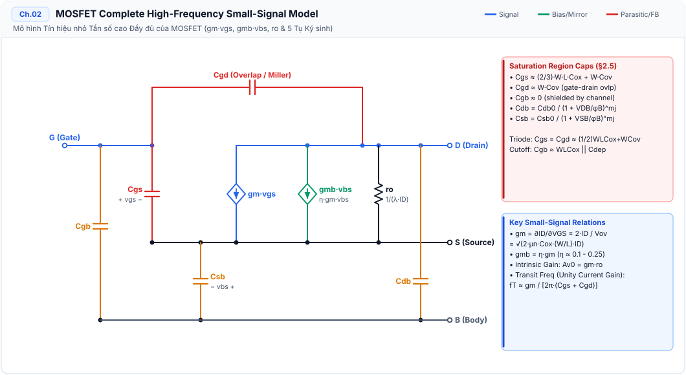

---
{
  "id": "concept-mos-transconductance-and-body-effect",
  "kind": "concept",
  "domain": "foundations",
  "title_vi": "Độ hỗ dẫn, hiệu ứng thân, điều biến chiều dài kênh và sự dẫn dưới ngưỡng (MOS Transconductance & Second-Order Effects)",
  "title_en": "MOS Transconductance, Body Effect, Channel-Length Modulation, and Subthreshold Conduction",
  "summary": "Ba biểu thức tương đương của độ hỗ dẫn gm theo từng biến cố định, cùng ba hiệu ứng bậc hai sống còn quyết định độ lợi và giới hạn công suất tương tự: hiệu ứng thân (gamma, gmb = eta*gm), điều biến chiều dài kênh (lambda, ro) và dẫn mũ dưới ngưỡng (gm = ID / (zeta*VT)).",
  "diagram": "../../diagrams/mos-small-signal-caps.svg",
  "razavi_refs": [
    {
      "chapter": 2,
      "section": "2.2.3-2.3, 2.4.3",
      "pages": "19-26, 31-33",
      "equations": ["2.17", "2.18", "2.19", "2.20", "2.21", "2.22", "2.23", "2.27", "2.28", "2.29", "2.30", "2.31", "2.33", "2.34", "2.35", "2.44", "2.48", "2.49", "2.53", "2.54"]
    }
  ],
  "glossary_codes": ["T091", "T168", "T237", "T239", "T245", "T253", "T257", "T258", "T270", "T278", "T283", "T284", "T351", "T355", "T360", "T394", "T456", "T544", "T810"],
  "process_agnostic": true,
  "roles": {
    "primary_gate_transconductor": "Nguồn dòng phụ thuộc gm*vgs chuyển đổi biến thiên điện áp cổng–nguồn thành dòng tín hiệu cực máng",
    "back_gate_body_transconductor": "Cổng phụ phía đế tạo hỗ dẫn thân gmb*vbs = eta*gm*vbs mỗi khi cực nguồn không nối cứng với cực thân",
    "output_conductance_clm": "Điện trở ra hữu hạn ro = 1/(lambda*ID) biểu diễn độ nghiêng vùng bão hòa và đặt trần cho độ lợi nội tại gm*ro"
  },
  "symptoms_addressed": [
    "wrong-gm-scaling-assumption-when-sweeping-w-or-id",
    "unexpected-gain-loss-and-level-shift-in-source-follower",
    "finite-stage-gain-and-mirror-current-copy-error",
    "subthreshold-gm-saturation-at-large-width"
  ],
  "limitations": [
    "constant-lambda-approximation-fails-across-wide-vds-in-nanometer-cmos",
    "square-law-gm-formulas-require-gmid-revision-under-velocity-saturation"
  ],
  "checklists": ["common-mos", "single-stage"]
}
---

## 1. Bản chất Nguyên lý, Sơ đồ Mạch & Vai trò Từng Nhánh Cấu trúc

Trong mạch tương tự, MOSFET bão hòa đóng vai trò **bộ chuyển đổi điện áp sang dòng điện (V/I converter / transconductor)**. Đại lượng đo độ nhạy chuyển đổi biến thiên điện áp cổng–nguồn thành biến thiên dòng máng được gọi là **độ hỗ dẫn (transconductance — $g_m$)** (§2.2.3, tr. 19). Tuy nhiên, một MOSFET thực tế không phải nguồn dòng điều khiển lý tưởng một chiều, mà chịu sự chi phối trực tiếp của **ba hiệu ứng vật lý bậc hai** (§2.3, tr. 20–26) xuất hiện ngay trong sơ đồ tín hiệu nhỏ cơ sở:



1. **Hiệu ứng thân / hiệu ứng cổng sau (Body Effect / Back-Gate Effect — Hình 2.22–2.25):** Khi điện thế cực nguồn $V_S$ tăng cao hơn điện thế đế $V_B$ ($V_{SB} > 0$ ở NMOS), vùng nghèo dưới kênh mở rộng, tích lũy nhiều ion nhận âm bất động $Q_{\text{dep}}$ hơn. Do cực cổng phải cân bằng lượng điện tích nghèo tăng thêm này trước khi hút được electron tạo lớp nghịch đảo, điện áp ngưỡng $V_{TH}$ **tăng lên**. Về mặt tín hiệu nhỏ, cực thân hoạt động hệt như một **cực cổng thứ hai (back gate)** bơm thêm dòng $g_{mb} v_{bs}$ cùng chiều với $g_m v_{gs}$!
2. **Điều biến chiều dài kênh (Channel-Length Modulation, CLM — Hình 2.26–2.27):** Khi $V_{DS} > V_{DS,\text{sat}}$, điểm thắt kênh (pinch-off) dịch dần về phía cực nguồn một đoạn $\Delta L$, làm chiều dài kênh dẫn thực sự co ngắn còn $L' = L - \Delta L$. Kênh ngắn hơn khiến dòng $I_D$ tăng nhẹ theo $V_{DS}$, sinh ra điện trở ra tín hiệu nhỏ hữu hạn $r_o$ mắc song song giữa D và S — nguyên nhân gốc giới hạn **độ lợi nội tại (intrinsic gain — $g_m r_o$)** của mọi bộ khuếch đại và gây sai số sao chép dòng ở gương dòng.
3. **Sự dẫn dưới ngưỡng / nghịch đảo yếu (Subthreshold Conduction / Weak Inversion — Hình 2.28):** Kênh dẫn không tắt đột ngột tại $V_{GS} = V_{TH}$. Khi $V_{GS} \lesssim V_{TH}$, hạt tải khuếch tán qua rào thế nguồn–kênh (tương tự BJT!) tạo ra dòng $I_D$ phụ thuộc **hàm mũ** vào $V_{GS}$. Hiện tượng này một mặt gây dòng rò tĩnh khi tắt, mặt khác đặt **trần vật lý tối thượng cho tỷ số $g_m / I_D$** khi ta cố tăng mãi bề rộng $W$ ở dòng $I_D$ cố định.

---

## 2. Hệ Phương trình Cốt lõi & Tư duy "Nhìn Mạch Đọc Nhanh" (Analysis by Inspection)

### 2.1. Ba Biểu thức Vàng của Độ hỗ dẫn $g_m$ và Quy tắc Chọn Đúng Công thức
Trong vùng bão hòa kênh dài (bỏ qua CLM bậc một), đạo hàm dòng máng theo $V_{GS}$ tại $V_{DS}$ cố định cho ba công thức hoàn toàn tương đương đại số (Phương trình 2.17–2.20, tr. 19):

$$g_m \triangleq \left.\frac{\partial I_D}{\partial V_{GS}}\right|_{V_{DS}} = \mu_n C_{ox}\frac{W}{L}(V_{GS} - V_{TH}) = \sqrt{2 \mu_n C_{ox}\frac{W}{L} I_D} = \frac{2 I_D}{V_{GS} - V_{TH}}$$

*(Nhận xét thú vị của Razavi tr. 19: $g_m$ trong vùng bão hòa bằng đúng nghịch đảo điện trở dẫn $1/R_{on}$ trong vùng triode sâu ở cùng $V_{GS} - V_{TH}$! Ngược lại, nếu transistor rơi vào vùng triode ở Phương trình 2.21–2.22, hỗ dẫn sụt xuống chỉ còn $g_{m,\text{tri}} = \mu_n C_{ox}\frac{W}{L}V_{DS} < g_{m,\text{sat}}$).*

**Mẹo đọc nhanh — Tại sao có tới 3 công thức và dùng công thức nào khi nào? (Hình 2.20, tr. 19–20):**
Mỗi biểu thức chứa **đúng 2 trong 3 biến thiết kế** $\{W/L,\, I_D,\, V_{OV}\}$. Khi phân tích xu hướng thay đổi một biến, **bắt buộc chọn công thức chỉ chứa biến đang đổi và biến được giữ hằng định**:
- **Giữ $W/L$ không đổi**, tăng $V_{OV}$ (tức tăng $I_D$): dùng $g_m = \mu_n C_{ox}(W/L)V_{OV}$ và $g_m = \sqrt{2\mu_n C_{ox}(W/L)I_D} \Rightarrow g_m \propto V_{OV} \propto \sqrt{I_D}$.
- **Giữ $I_D$ không đổi** (ngân sách công suất cố định!), tăng $W/L$ (làm giảm $V_{OV}$): dùng $g_m = \sqrt{2\mu_n C_{ox}(W/L)I_D}$ và $g_m = \frac{2I_D}{V_{OV}} \Rightarrow g_m \propto \sqrt{W/L} \propto \frac{1}{V_{OV}}$. *(Chú ý: nếu nhìn nhầm vào công thức đầu tiên, người mới học hay tưởng lầm rằng giảm $V_{OV}$ làm giảm $g_m$, quên mất $W/L$ đã tăng nhanh hơn theo $1/V_{OV}^2$!).*
- **Giữ $V_{OV}$ không đổi** (giữ nguyên khoảng dự trữ điện áp và mật độ dòng $I_D/(W/L)$), nhân đôi đồng thời $W/L$ và $I_D$: dùng $g_m = \frac{2I_D}{V_{OV}} \Rightarrow g_m$ **tăng tuyến tính bậc một** theo $I_D$ và $W/L$ (quy luật bất biến đúng cho cả kênh ngắn 40nm, Xem Chương 11 Ví dụ 11.2!).

### 2.2. Hiệu ứng thân ($\gamma$) và Hỗ dẫn thân ($g_{mb} = \eta g_m$)
Sự phụ thuộc của điện áp ngưỡng vào thế nguồn–thân $V_{SB} = V_S - V_B$ được cho bởi Phương trình 2.23 (tr. 21):

$$V_{TH} = V_{TH0} + \gamma\left(\sqrt{2\Phi_F + V_{SB}} - \sqrt{|2\Phi_F|}\right), \qquad \gamma = \frac{\sqrt{2 q \epsilon_{\text{si}} N_{\text{sub}}}}{C_{ox}}$$

Hệ số hiệu ứng thân $\gamma$ thường nằm quanh $0.3\text{–}0.4\,\text{V}^{1/2}$ (tỷ lệ thuận với $\sqrt{N_{\text{sub}}}$ và tỷ lệ nghịch với $C_{ox}$). Khi $V_{BS} = -V_{SB}$ biến thiên tín hiệu nhỏ quanh điểm phân cực, đạo hàm theo $V_{BS}$ sinh ra **độ hỗ dẫn thân (body transconductance — Phương trình 2.49–2.54, tr. 32–33)**:

$$g_{mb} \triangleq \frac{\partial I_D}{\partial V_{BS}} = g_m \frac{\gamma}{2\sqrt{2\Phi_F + V_{SB}}} = \eta g_m$$

với hệ số tỷ lệ $\eta = g_{mb}/g_m$ điển hình khoảng $0.15\text{–}0.3$ (thường lấy $\eta \approx 0.2\text{–}0.25$) và **giảm dần khi $V_{SB}$ phân cực ngược lớn hơn**!
- *Mẹo kiểm tra nhanh khi nào $g_{mb}$ tham gia vào mạch:* Nhìn vào **cực nguồn (S)** và **cực thân (B)**: nếu cả hai đều đứng yên về mặt AC (ví dụ tầng nguồn chung CS có S nối GND, B nối GND $\Rightarrow v_{bs} = 0$), nguồn dòng $g_{mb}v_{bs} = 0$ biến mất hoàn toàn! Ngược lại, hễ **cực nguồn mang tín hiệu xoay chiều mà cực thân nối đất/nguồn cố định** (như mạch bám nguồn SF, tầng cổng chung CG, transistor cascode trên, tải NMOS nối diode), $v_{bs} = -v_s \neq 0 \Rightarrow$ dòng $g_{mb}(-v_s)$ chảy song song với $g_m(-v_s)$, làm tổng điện dẫn nhìn vào cực nguồn tăng từ $g_m$ thành **$(g_m + g_{mb}) = (1 + \eta)g_m$**!

### 2.3. Điều biến chiều dài kênh ($\lambda$), Điện trở ra ($r_o$) và Độ lợi nội tại ($g_m r_o$)
Xấp xỉ bậc một $\Delta L / L = \lambda V_{DS}$ với $\lambda \propto 1/L$ cho phương trình dòng bão hòa (Phương trình 2.27, 2.30–2.31, 2.44–2.48):

$$I_D \approx \frac{1}{2}\mu_n C_{ox}\frac{W}{L}(V_{GS} - V_{TH})^2 (1 + \lambda V_{DS}), \qquad r_o \triangleq \left(\frac{\partial I_D}{\partial V_{DS}}\right)^{-1} = \frac{1 + \lambda V_{DS}}{\lambda I_D} \approx \frac{1}{\lambda I_D}$$

Từ đó suy ra **độ lợi nội tại (intrinsic gain)** của một transistor đơn lẻ (Bài tập 2.2–2.3, tr. 38):

$$A_{v,\text{int}} = g_m r_o \approx \frac{2 I_D}{V_{OV}} \cdot \frac{1}{\lambda I_D} = \frac{2}{\lambda V_{OV}} \propto \frac{L}{V_{OV}} \quad \text{hoặc} \quad g_m r_o = \frac{\sqrt{2\mu_n C_{ox}(W/L)}}{\lambda \sqrt{I_D}} \propto \sqrt{\frac{W \cdot L}{I_D}}$$

*Hệ quả thiết kế sống còn (Ví dụ 2.7, tr. 24):* Ở cùng dòng $I_D$ và cùng $V_{OV}$, nếu ta nhân đôi đồng thời cả $W$ lẫn $L$ ($2W / 2L$), tỷ số $W/L$ giữ nguyên nên $V_{OV}$ và $g_m$ không đổi, nhưng $\lambda \propto 1/L$ giảm một nửa $\Rightarrow$ **$r_o$ và độ lợi nội tại $g_m r_o$ tăng gấp đôi**!

### 2.4. Sự dẫn dưới ngưỡng, Độ dốc $S$ và Điểm chuyển tiếp Nghịch đảo Yếu – Mạnh
Khi $V_{GS} < V_{TH}$ và $V_{DS} > 3\text{–}4\,V_T$ ($\approx 100\,\text{mV}$), dòng cực máng tuân theo luật hàm mũ (Phương trình 2.33, tr. 24 & Phương trình 17.16–17.18, tr. 695):

$$I_D = I_0 \exp\!\left(\frac{V_{GS}}{\zeta V_T}\right) \quad \text{với } V_T = \frac{kT}{q} \approx 26\,\text{mV tại } 300\,\text{K}, \quad \zeta = 1 + \frac{C_d}{C_{ox}} \approx 1.3\text{–}1.6$$

*(Chú ý ký hiệu: Chương 2 in $\xi$ hoặc $\zeta$, Chương 17 §17.2.1 chuẩn hóa $\zeta = 1 + C_d/C_{ox}$).* Từ đó suy ra hai hằng số vật lý bất biến:
1. **Độ hỗ dẫn cực đại trong vùng dưới ngưỡng:**
   $$g_{m,\text{sub}} = \frac{\partial I_D}{\partial V_{GS}} = \frac{I_D}{\zeta V_T} \quad \Longrightarrow \quad \left(\frac{g_m}{I_D}\right)_{\max} = \frac{1}{\zeta V_T} \approx 25\text{–}30\,\text{V}^{-1}$$
   luôn thấp hơn BJT ($g_m/I_C = 1/V_T \approx 38.5\,\text{V}^{-1}$) do hệ số chia tụ cổng–đế $\zeta > 1$.
2. **Độ dốc dưới ngưỡng (Subthreshold Slope — $S$):** Điện áp cổng cần giảm để dập dòng máng đi 10 lần (1 decade):
   $$S = (\ln 10)\,\zeta V_T \approx 2.3\,\zeta V_T \approx 80\text{–}100\,\text{mV/dec}$$
3. **Điểm ranh giới quy ước giữa Nghịch đảo Mạnh và Nghịch đảo Yếu (Phương trình 2.34–2.35, tr. 25):** Cho hai biểu thức $g_m$ bằng nhau $I_D/(\zeta V_T) = 2I_D / V_{OV,1}$ thu được ngưỡng chuyển tiếp bất biến:
   $$V_{OV,1} = 2\zeta V_T \approx 75\text{–}80\,\text{mV}$$

### 2.5. Giải tích Điển hình từ Razavi: Khóa Ngắt do Hiệu ứng Thân & Đạo hàm Mật độ Dòng (Ví dụ 2.4, 2.8 & 2.12)
1. **Cực nguồn âm sâu hay dương cao tự khóa tắt MOSFET như thế nào? (Ví dụ 2.4, Hình 2.24, tr. 21–22):**
   Xét NMOS $M_1$ có cổng cố định $V_G = 1.2\,\text{V}$, đế nối nguồn âm cố định $V_B = -8.83\,\text{V}$ (hoặc tương đương $V_{SB}$ dương lớn), $V_{TH0} = 0.3\,\text{V}$, $\gamma = 0.4\,\text{V}^{1/2}$, $2\Phi_F = 0.7\,\text{V}$. Khi $V_{SB}$ tăng tới $8.83\,\text{V}$, điện áp ngưỡng phình lên:
   $$V_{TH} = 0.3 + 0.4\left(\sqrt{0.7 + 8.83} - \sqrt{0.7}\right) = 0.3 + 0.4(3.087 - 0.837) = 1.2\,\text{V} = V_G$$
   khiến transistor bị **khóa ngắt hoàn toàn** dù $V_{GS}$ danh định lên tới $1.2\,\text{V}$! Ở nguồn thấp $1.0\,\text{V}$, chỉ cần $V_{SB} = 0.5\,\text{V}$ cũng đã làm $V_{TH}$ dâng thêm $\Delta V_{TH} \approx 0.4(\sqrt{1.2} - \sqrt{0.7}) \approx 104\,\text{mV}$ — nuốt trọn $10\%$ nguồn cấp!
2. **Sự đối lập giữa xu hướng $g_m(I_1)$ và $g_{mb}(I_1)$ trong tải nối diode (Ví dụ 2.12, Hình 2.40, tr. 33–34):**
   Cho NMOS $M_1$ có cổng nối $V_{DD}$, cực nguồn nối xuống đất qua nguồn dòng điều chỉnh được $I_1$ (nút nguồn $X$ có thế $V_X = V_{DD} - V_{GS1}$). Khi tăng dòng $I_1$:
   - Độ hỗ dẫn chính $g_m = \sqrt{2\mu_n C_{ox}(W/L)I_1}$ tăng theo $\sqrt{I_1}$.
   - Đồng thời do $V_{GS1}$ tăng nên điện thế nút nguồn $V_X = V_{SB1}$ **giảm xuống**, làm mẫu số $\sqrt{2\Phi_F + V_{SB1}}$ trong $g_{mb} = g_m \frac{\gamma}{2\sqrt{2\Phi_F + V_{SB1}}}$ nhỏ lại $\Rightarrow$ **$g_{mb}$ tăng nhanh hơn cả $\sqrt{I_1}$**!
3. **Quy tắc chọn công thức $V_{GS}$ theo Mật độ dòng $I_D/W$ (Ví dụ 2.8, Phương trình 2.36–2.39, tr. 25–26):**
   Khi giảm dần $I_D$ ở $W/L$ cố định, phương trình luật bình phương tiên đoán sai rằng $V_{GS}$ không bao giờ xuống dưới $V_{TH}$. Trên thực tế, tại giao vùng quanh $V_{OV} \approx 2\zeta V_T \approx 80\,\text{mV}$, đường cong nối trơn sang miền logarit $V_{GS} = \zeta V_T \ln\!\left(\frac{I_D}{\alpha W/L}\right)$ (với hằng số dòng dưới ngưỡng $\alpha$ có thứ nguyên $\text{A}$, sao cho $I_0 = \alpha W/L$ cùng đơn vị dòng điện với $I_D$), cho phép $V_{GS}$ giảm xuống dưới $V_{TH}$ khi mật độ dòng $I_D/W$ cực nhỏ!

---

## 3. Bất biến Cấu trúc & Các Bẫy Lỗi Kinh điển (Structural Invariants & Traps)

- **[INV-GM-01] Trần Vật lý Tuyệt đối của Hỗ dẫn trên một Đơn vị Dòng ($g_m \le I_D / (\zeta V_T)$):** Không một kích thước $W/L$ lớn cỡ nào có thể tạo ra $g_m > I_D / (\zeta V_T)$! Ví dụ (Chương 11 §11.4.2, tr. 469): với $I_D = 1\,\text{mA}$ và $\zeta \approx 1.5$ ở nhiệt độ phòng, $g_m$ không bao giờ vượt quá $\approx 25.6\,\text{mS}$; mọi yêu cầu $g_m = 40\,\text{mS}$ với $I_D = 1\,\text{mA}$ đều nằm trong vùng bất khả thi vật lý (unachievable $g_m$ region, Hình 11.15).
- **[INV-GM-02] Không Bao giờ Dùng $V_{DS}$ Làm Biến Đặt Dòng Phân cực (Razavi tr. 24):** Dù $I_D$ có phụ thuộc $V_{DS}$ qua $(1 + \lambda V_{DS})$, dòng tĩnh của MOSFET luôn phải được ấn định bởi $V_{GS}$ (hoặc vòng hồi tiếp đặt $V_{GS}$); mọi sự thay đổi của $I_D$ theo $V_{DS}$ là sai số cần triệt tiêu (bằng chọn $L$ dài hơn hoặc bọc cascode).
- **[INV-GM-03] Chiều Dương Tương đương giữa Cổng Chính và Cổng Thân:** Tăng điện thế thân $V_B$ (làm $V_{BS}$ dương lên, như kỹ thuật phân cực thuận nhẹ thân PMOS ở Ví dụ 2.5 tr. 22 cho thiết kế áp siêu thấp!) làm **giảm $|V_{TH}|$** và **tăng dòng $I_D$** — cùng chiều tác dụng với việc tăng $V_{GS}$ (lưu ý tuyệt đối không phân cực thuận tiếp giáp thân–nguồn quá $\sim 0.3\text{–}0.4\,\text{V}$ kẻo bật diode ký sinh và gây chốt ký sinh latch-up!).

- **[TRAP-GM-01] Bẫy Đứt gãy Đạo hàm tại Biên Triode – Bão hòa trong Mô hình Đơn giản (Phương trình 2.28–2.29, tr. 23):** Ghép thô $(1 + \lambda V_{DS})$ chỉ vào phương trình bão hòa tạo bước nhảy dòng $\lambda V_{DS,\text{sat}}$ tại biên triode; đồng thời ở vùng triode không hề có thắt kênh nên không có CLM (Ví dụ 2.6).
- **[TRAP-GM-02] Bẫy Bỏ quên Hiệu ứng Thân trong Mạch Bám Nguồn NMOS & Tải Diode NMOS:** Trên quy trình $p$-substrate đơn giếng chuẩn, mọi NMOS đều buộc phải nối thân xuống GND. Khi dùng NMOS làm mạch bám nguồn (`topo-source-follower`), hiệu ứng thân không những làm sụt độ lợi xuống $g_m/(g_m + g_{mb}) = 1/(1+\eta) \approx 0.8$, mà vì $\eta(V_{SB})$ phụ thuộc phi tuyến vào mức ra $V_{\text{out}}$ (Hình 2.25c), nó còn bơm **méo hài phi tuyến mạnh** vào tín hiệu!
- **[TRAP-GM-03] Bẫy Rò Tĩnh Hệ thống Lớn và Đánh thủng Xuyên thủng (Punchthrough — tr. 25–26):** Chọn linh kiện ngưỡng cực thấp (`LVT`, $V_{TH} \approx 0.2\text{–}0.25\,\text{V}$) giúp tăng headroom nhưng khi $V_{GS} = 0$, dòng tắt chỉ giảm được $\sim 10^{2.5\text{–}3}$ lần, gây rò tĩnh lớn hoặc làm trôi điện áp trên tụ giữ mẫu (`sampled-and-clocked`). Ngoài ra, đặt $V_{DS}$ vượt ngưỡng định mức làm hai vùng nghèo S–D chạm nhau gây **xuyên thủng (punchthrough)** hoặc đánh thủng oxit cổng không thể phục hồi.

---

## 4. Lộ trình Nâng cấp Cấu trúc & Bát giác Đánh đổi (Upgrade Paths & Design Octagon)

Ba tham số $g_m$, $g_{mb}$ và $r_o$ quyết định trực tiếp lộ trình tiến hóa cấu trúc ở các chương sau:
- **Khi $r_o$ đơn lẻ quá thấp làm sụt Gain và gương dòng lệch lớn:** Không thể tăng mãi $L$ vì tụ cổng $WLC_{ox}$ tăng theo $L^2$ (ở cùng $W/L$) làm sập **Speed** trên Bát giác `concept-analog-design-octagon`! Giải pháp cấu trúc là bọc thêm tầng che chắn cực máng: `topo-cascode-stage` hoặc `topo-lvccml-wide-swing-mirror` để nhân trở kháng ra lên $(1 + (g_m + g_{mb})r_o)r_o \approx g_m r_o^2$ (trong đó chính $g_{mb}$ của transistor cascode lại **hỗ trợ tăng thêm trở kháng ra**!).
- **Khi hiệu ứng thân $g_{mb}$ phá hỏng độ lợi & độ tuyến tính của tầng đệm:** Chuyển từ NMOS SF trên nền đế chung sang PMOS SF đặt trong giếng $n$-well riêng nối tắt $B\text{–}S$ (`topo-source-follower`), hoặc dùng cấu trúc hồi tiếp khuếch đại đệm đơn vị (`topo-folded-cascode-ota`).
- **Khi cần định cỡ chính xác ở vùng chuyển tiếp nghịch đảo vừa ($V_{OV} \approx 50\text{–}150\,\text{mV}$) trên 90nm/65nm/45nm:** Thay ba phương trình luật bình phương bằng phương pháp đường cong chuẩn hóa theo $g_m/I_D$ và mật độ dòng tại `tech-nanometer-vdsmin-gmid-sizing`.

---

## 5. Thích ứng Đa Tiến trình (90nm / 65nm / 45nm) & Cách Kiểm chứng trong Cadence / Spectre

Khi chuyển sang **90nm / 65nm / 45nm**:
1. **Đại lượng $g_m / I_D$ trở thành "ngôn ngữ chung" bất biến tiến trình:** Bất kể ở 180nm, 90nm, 65nm hay 45nm, đồ thị hiệu suất hỗ dẫn $g_m/I_D$ theo mức độ nghịch đảo luôn đi từ sàn $\sim 5\text{–}8\,\text{V}^{-1}$ (nghịch đảo mạnh / bão hòa vận tốc), qua vùng tối ưu cân bằng tốc độ – hiệu suất $\sim 12\text{–}16\,\text{V}^{-1}$ (nghịch đảo vừa — *moderate inversion*), đến trần tiệm cận $\frac{1}{\zeta V_T} \approx 24\text{–}28\,\text{V}^{-1}$ (dưới ngưỡng).
2. **$r_o$ không còn tỷ lệ đơn giản với $1/I_D$ ở $V_{DS}$ cao hoặc cực thấp:** Do hiệu ứng DIBL (Chương 17 §17.2.5), $r_o = 1/\texttt{gds}$ phụ thuộc mạnh vào cả $L$ lẫn $V_{DS}$ thực tế trên linh kiện; ở $L_{\min}$ của 45nm, $g_m r_o$ chỉ đạt $\sim 6\text{–}10$, buộc các nguồn dòng và nhánh cascode cần độ lợi cao phải tăng $L$ lên $2 L_{\min} \dots 4 L_{\min}$ (ví dụ $80\text{–}160\,\text{nm}$ hoặc $180\text{–}300\,\text{nm}$).

**Cách kiểm chứng trực tiếp trong Cadence Virtuoso IC617 / Spectre:**
- Sau phép phân tích `dcOp`, truy xuất trực tiếp 4 thông số điểm làm việc thực của BSIM4 cho từng instance `M_x`:
  - `gm` ($\partial I_D/\partial V_{GS}$), `gmb` hoặc `gmbs` ($\partial I_D/\partial V_{BS}$), `gds` ($\partial I_D/\partial V_{DS} = 1/r_o$), và `id`.
- Tính ngay 3 tỷ số chẩn đoán không phụ thuộc PDK trong Calculator / OCEAN / Python PSF reader:
  $$\text{Efficiency} = \frac{\texttt{gm}}{|\texttt{id}|}\;(\text{V}^{-1}), \qquad A_{\text{int}} = \frac{\texttt{gm}}{\texttt{gds}}, \qquad \eta_{\text{actual}} = \frac{\texttt{gmbs}}{\texttt{gm}}$$
- Kiểm tra an toàn điện áp cực (SOA): xác minh $|V_{GS}|, |V_{GD}|, |V_{DS}|, |V_{SB}| \le V_{DD,\max}$ của loại oxit đang dùng (`core thin-oxide` vs `I/O thick-oxide`) bằng tính năng `assert` / Device Check trong Spectre.

**Bảng Quy chiếu Nhanh Tác động của $g_m$, $g_{mb}$ và $r_o$ Trong Các Cấu trúc Mạch Cốt lõi:**

| Cấu trúc mạch | Vai trò của $g_m$ | Vai trò của $g_{mb} = \eta g_m$ | Vai trò của $r_o = 1/g_{ds}$ |
|---|---|---|---|
| **Tầng nguồn chung (CS)** *(S nối GND, B nối GND)* | Tạo dòng tín hiệu $-g_m v_{\text{in}}$ nâng độ lợi | **$g_{mb}$ bị triệt tiêu hoàn toàn** ($v_{bs} = 0$) | Song song tải ra, đặt trần độ lợi $g_m r_o$ |
| **Tải nối diode NMOS** *(D nối G, B nối GND)* | Đặt trở kháng tải thấp $\approx 1/g_m$ | **Cộng thêm vào tải** $\rightarrow R_{\text{diode}} = \frac{1}{g_m + g_{mb}} \parallel r_o$, làm **giảm** độ lợi xuống $\frac{g_{m1}}{g_{m2}(1+\eta_2)}$ | Ảnh hưởng nhỏ vì $r_o \gg 1/g_m$ |
| **Mạch bám nguồn (SF)** *(B nối GND trên $p$-sub)* | Kéo cực nguồn bám theo cổng | **Có hại kép:** hạ độ lợi còn $\le \frac{1}{1+\eta} \approx 0.8$ và gây méo hài do $\eta(V_{\text{out}})$ phi tuyến | Song song tải ra |
| **Tầng cổng chung (CG) & Lá chắn Cascode** | Thu dòng tại cực nguồn với trở kháng thấp $\sim 1/g_m$ | **Có lợi cho nâng trở kháng ra:** $R_{\text{out}} = [1 + (g_{m2} + g_{mb2})r_{o2}]r_{o1} + r_{o2}$! | Nhân hệ số khuếch đại trở kháng cascode |

**Mẫu Biểu thức OCEAN Trích xuất Bộ Tham số Bậc hai Từ Spectre:**
```ocean
gm_val   = pv("/M1" "gm"   ?result "dcOpInfo")
gmbs_val = pv("/M1" "gmbs" ?result "dcOpInfo")
gds_val  = pv("/M1" "gds"  ?result "dcOpInfo")
id_val   = abs(pv("/M1" "id" ?result "dcOpInfo"))
gm_id    = gm_val / id_val
eta_val  = gmbs_val / gm_val
ro_ohm   = 1.0 / gds_val
av_intr  = gm_val / gds_val
```

---

## 6. Mốc Đối chiếu Sách Razavi & Thuật ngữ Chuẩn CLB

- **Sách gốc Razavi (2nd Ed.):**
  - Chương 2: §2.2.3 *MOS Transconductance* (tr. 19–20, Phương trình 2.17–2.22, Hình 2.20, Ví dụ 2.3), §2.3 *Second-Order Effects* (tr. 20–26: *Body Effect* Phương trình 2.23–2.26 & Ví dụ 2.4–2.5; *Channel-Length Modulation* Phương trình 2.27–2.32 & Ví dụ 2.6–2.7; *Subthreshold Conduction* Phương trình 2.33–2.39 & Ví dụ 2.8; *Voltage Limitations* tr. 26), §2.4.3 *MOS Small-Signal Model* (tr. 31–33, Phương trình 2.44–2.54).
- **Thuật ngữ chuẩn CLB Vi Mạch (`THUẬT NGỮ CHUẨN.md`):**
  - `T091`: *transconductance* $\rightarrow$ **Độ hỗ dẫn / Hỗ dẫn** ($g_m$, đơn vị $\text{S}$ hoặc $1/\Omega$, phân biệt với hỗ dẫn tổng tầng $G_m$).
  - `T239`: *body effect* $\rightarrow$ **Hiệu ứng thân**; `T355`: *body transconductance* $\rightarrow$ **Độ hỗ dẫn thân** ($g_{mb}$).
  - `T257` / `T258`: *channel-length modulation* $\rightarrow$ **Điều biến chiều dài kênh** và hệ số $\lambda$; `T394`: *intrinsic gain* $\rightarrow$ **Độ lợi nội tại** ($g_m r_o$).
  - `T270` / `T278` / `T456`: *subthreshold conduction* $\rightarrow$ **Sự dẫn dưới ngưỡng**, **Độ dốc dưới ngưỡng** ($S$), **Hệ số không lý tưởng dưới ngưỡng** ($\zeta$ / $\xi$).
