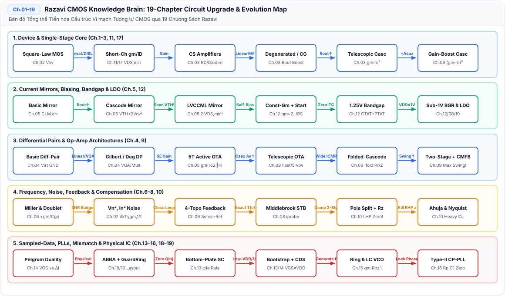

---
{
  "id": "tech-channel-length-and-opamp-scaling",
  "kind": "technique",
  "domain": "foundations",
  "title_vi": "Chọn chiều dài kênh L, tổng hợp Op-Amp nanomet và điều chỉnh tỉ lệ thiết kế Op-Amp (Channel Length Selection & Nanometer Op-Amp Scaling)",
  "title_en": "Channel Length Selection, Nanometer Op-Amp Synthesis, and Linear Op-Amp Scaling",
  "summary": "Nghệ thuật chọn chiều dài kênh L cân bằng giữa độ lợi nội tại gm*ro và tốc độ fT (Chương 11 §11.4.5–11.6), giải phẫu lý do Telescopic 1V hụt độ lợi để tiến hóa sang Op-Amp hai tầng phản hồi tụ, và kỹ thuật chia nhỏ công suất bằng phép nhân tỉ lệ tuyến tính (Op-Amp Scaling) theo hệ số alpha.",
  "diagram": "../../diagrams/upgrade-evolution-map.svg",
  "razavi_refs": [
    {
      "chapter": 11,
      "section": "11.4.5-11.7",
      "pages": "472-507",
      "equations": ["11.10", "11.11", "11.12", "11.13", "11.14", "11.15", "11.16", "11.17", "11.18", "11.19", "11.20", "11.21", "11.22", "11.23", "11.24"]
    }
  ],
  "glossary_codes": ["T050", "T059", "T060", "T063", "T065", "T094", "T095", "T394", "T1455", "T1976", "T1988"],
  "process_agnostic": true,
  "roles": {
    "selective_channel_length_assignment": "Đặt L_min cho đường tín hiệu cần tốc độ cao / Cin nhỏ, và tăng L lên 2x–8x L_min cho nhánh cascode & nguồn dòng quyết định Rout",
    "two_stage_gain_swing_decoupling": "Tách tầng 1 cascode biên độ nhỏ (~50 mVpp) lấy độ lợi ~50 khỏi tầng 2 nguồn chung lấy dải dao động lớn 1 Vpp dưới nguồn 1 V",
    "linear_opamp_power_scaling": "Chia đồng thời mọi bề rộng W và dòng phân cực I cho alpha (giữ nguyên L, VGS, VDS,min, A0 và Swing) rồi chỉnh Rz -> alpha*Rz để giảm công suất 8x"
  },
  "symptoms_addressed": [
    "single-stage-cascode-cannot-simultaneously-meet-gain-and-swing-at-1v",
    "increasing-input-pair-length-raises-cin-and-hurts-closed-loop-gain-error",
    "overdesigned-speed-wasting-excessive-static-power",
    "large-signal-gain-droop-and-cascode-pole-settling-degradation"
  ],
  "limitations": [
    "fixed-load-capacitance-scales-down-bandwidth-by-alpha-under-power-downscaling",
    "downscaling-w-and-id-by-alpha-increases-thermal-noise-power-and-offset-variance-by-alpha"
  ],
  "checklists": ["common-mos", "single-stage", "differential-pair"]
}
---

## 1. Bản chất Nguyên lý, Sơ đồ Mạch & Vai trò Từng Nhánh Cấu trúc

Sau khi nắm vững cách định cỡ bề rộng $W$ tại một chiều dài kênh $L$ cố định (`tech-nanometer-vdsmin-gmid-sizing`), câu hỏi kiến trúc lớn tiếp theo ở công nghệ nanomet là: **Chọn chiều dài kênh $L$ bằng bao nhiêu cho từng transistor trong mạch, và làm sao tổng hợp một bộ khuếch đại đạt đồng thời Độ lợi cao, Dải dao động rộng, Xác lập nhanh với Công suất tối thiểu dưới nguồn $1\,\text{V}$?**

Trong nửa sau Chương 11 (§11.4.5–11.7, tr. 472–507), Razavi dẫn dắt một nghiên cứu thiết kế hoàn chỉnh trên công nghệ CMOS $40\,\text{nm}$, $V_{DD} = 1\,\text{V}$ với bộ chỉ tiêu thực tế khắc nghiệt: độ lợi vòng kín $4$ với sai số tĩnh $\le 1\%$ (đòi hỏi độ lợi vòng hở $A_0 > 500$), dải dao động vi sai ngõ ra $1\,\text{V}_{pp}$ ($0.5\,\text{V}_{pp}$ mỗi nhánh đơn), tải tụ $C_L = 1\,\text{pF}$, và thời gian xác lập $0.5\%$ trong $5\,\text{ns}$ với công suất nhỏ nhất có thể.



Hành trình tổng hợp đó phơi bày **ba quy luật thiết kế cấp hệ thống** có giá trị vượt thời gian cho mọi nút 90nm, 65nm, 45nm và nhỏ hơn:
1. **Phân bổ Chiều dài Kênh $L$ Không Đồng nhất Theo Vai trò Nút (§11.4.5 & Ví dụ 11.15):** Không bao giờ đặt cùng một $L$ cho mọi transistor! Cặp đầu vào cần $C_{\text{in}}$ nhỏ và $f_T$ cao thì ưu tiên $L$ ngắn ($1\text{–}2\,L_{\min}$); ngược lại, các transistor quyết định trực tiếp trở kháng ngõ ra (như cascode NMOS ở tầng 1 hoặc nguồn dòng tải ở tầng 2) phải được kéo dài lên $2\text{–}8\,L_{\min}$ để khôi phục $r_o$.
2. **Tại sao Telescopic 1 tầng thất bại dưới nguồn $1\,\text{V}$ và Cách Tầng 2 Giải cứu Tầng 1 (§11.5.1–11.5.2):** Khi bắt 1 tầng Telescopic (`topo-telescopic-cascode-opamp`) gánh cả $0.5\,\text{V}_{pp}$ dải ra đơn cực dưới nguồn $1\,\text{V}$, phần dư $0.5\,\text{V}$ chia cho 5 transistor xếp chồng chỉ còn **đúng $100\,\text{mV}$ mỗi transistor** — đẩy tất cả vào sát rìa gối bão hòa, làm $r_o$ sụt thảm hại khiến độ lợi vi sai chỉ đạt $30\text{–}54$ (thấp hơn mục tiêu $500$ gần 10 lần!). Chuyển sang **Op-Amp hai tầng (`topo-two-stage-opamp`)**, nhờ tầng 2 có độ lợi $\sim 10\text{–}12$, biên độ dao động yêu cầu tại ngõ ra tầng 1 giảm xuống chỉ còn **$50\,\text{mV}_{pp}$**, giải phóng ngay $0.95\,\text{V}$ cho ngăn xếp 5 tầng ($V_{DS} = 150\text{–}200\,\text{mV}$/transistor), giúp tầng 1 đạt gọn độ lợi $\sim 50$ và tổng hai tầng vượt mốc $500\text{–}700$!
3. **Chiến lược "Đạt Độ lợi & Swing trước — Ép Công suất sau bằng Phép nhân tỉ lệ Op-Amp" (§11.6.4 & §11.7):** Thay vì tự trói tay ngay từ đầu bằng dòng tĩnh quá nhỏ, hãy thiết kế một nguyên mẫu dư tốc độ với ngân sách dòng thoải mái (ví dụ $2\,\text{mW}$ đạt $t_s = 0.8\,\text{ns} \ll 5\,\text{ns}$), rồi áp dụng **điều chỉnh tỉ lệ thiết kế bộ khuếch đại thuật toán (Op Amp Scaling)** chia toàn bộ bề rộng $W$ và dòng phân cực $I_D$ cho hệ số $\alpha = 8$ để cắt công suất xuống còn $370\,\mu\text{W}$ mà **không hề làm suy suyển Độ lợi $A_0$ hay Dải dao động**!

---

## 2. Hệ Phương trình Cốt lõi & Tư duy "Nhìn Mạch Đọc Nhanh" (Analysis by Inspection)

### 2.1. Quy luật Chọn Chiều dài Kênh $L$ và Bẫy Tỉ lệ $L_{\text{eff}}$ (§11.4.5, tr. 472)
Khi tăng chiều dài vẽ trên layout từ $L_{\min}$ lên $k \cdot L_{\min}$ (và nhân $W$ tương ứng để giữ nguyên dòng $I_D$ cùng $V_{OV}$), độ lợi nội tại $g_m r_o$ tăng lên (nhờ giảm CLM và DIBL), nhưng diện tích kênh $W \cdot L$ tăng theo $k^2$ làm tần số chuyển tiếp $f_T \propto 1/L^2$ giảm mạnh! Đặc biệt, do sự khuếch tán ngang vùng nguồn/máng $2L_D$:

$$L_{\text{eff}}(L_{\text{drawn}}) = L_{\text{drawn}} - 2 L_D \quad \Longrightarrow \quad \frac{L_{\text{eff}}(2 L_{\min})}{L_{\text{eff}}(L_{\min})} = \frac{2 L_{\min} - 2 L_D}{L_{\min} - 2 L_D} = 2 + \frac{2 L_D}{L_{\min} - 2 L_D} \neq 2$$

Cộng thêm hiệu ứng kênh ngắn đảo ngược (RSCE do cấy halo làm thay đổi $V_{TH}(L)$ ở Chương 17 §17.2.1), việc nhân đôi đồng thời $(W_{\text{drawn}}, L_{\text{drawn}})$ **không giữ hằng định tuyệt đối $I_D$ và $g_m$** — bắt buộc phải dựng riêng họ đường cong tham chiếu cho một vài giá trị $L_{\text{drawn}}$ rời rạc chuẩn (ví dụ $1\times,\, 2\times,\, 4\times,\, 8\times\,L_{\min}$).

### 2.2. Truyền đạt Vòng kín Phản hồi Tụ, Sai số Tĩnh & Hằng số Thời gian (§11.6.1, Phương trình 11.14–11.24)
Khi đóng vòng khuếch đại vi sai dùng mạng hồi tiếp tụ điện $C_1, C_2$ (Hình 11.51, tránh cực ký sinh đầu vào của điện trở lớn $R_1, R_2$ trong Hình 11.47!):
1. **Hệ số hồi tiếp thực tế $\beta$ và Sai số độ lợi tĩnh (Phương trình 11.17, tr. 497):** Điện dung ngõ vào của Op-Amp $C_{\text{in}}$ chia áp trực tiếp làm suy giảm hệ số hồi tiếp:
   $$\beta = \frac{C_2}{C_1 + C_2 + C_{\text{in}}}, \qquad \frac{V_{\text{out}}}{V_{\text{in}}} \approx -\frac{C_1}{C_2}\left(1 - \frac{C_1 + C_2 + C_{\text{in}}}{C_2}\cdot\frac{1}{A_0}\right) = -\frac{C_1}{C_2}\left(1 - \frac{1}{\beta A_0}\right)$$
   Để sai số độ lợi tĩnh nhỏ hơn $\varepsilon_{\max}$ (ví dụ $1\% = 0.01$), độ lợi vòng hở tối thiểu phải thỏa mãn:
   $$A_0 \ge \frac{1}{\beta \,\varepsilon_{\max}} = \frac{C_1 + C_2 + C_{\text{in}}}{C_2 \,\varepsilon_{\max}}$$
   *Nhìn nhanh cực kỳ sâu sắc (trang 501):* Muốn tăng $A_0$ cho tầng 1, **không nên tăng chiều dài $L$ (và $W$) của cặp transistor đầu vào $M_{1,2}$** vì làm vậy sẽ làm $C_{\text{in}}$ tăng vọt, kéo giảm $\beta$ và tự triệt tiêu lợi ích tăng $A_0$ trong tích $\beta A_0$! Thay vào đó, hãy tăng $L$ (và $W$) của **cặp cascode $M_{3,4}$** — vừa nâng trực tiếp $R_{\text{out1}}$, vừa giữ nguyên $C_{\text{in}}$ nhỏ gọn!
2. **Quan hệ Thời gian Xác lập $t_s$ và Băng thông Vòng kín (Phương trình 11.20–11.22, tr. 498–499):** Để đáp ứng bậc thang tuyến tính bậc một đạt độ chính xác sai số động $\delta$ (ví dụ $\delta = 0.5\% = 0.005$ trong thời gian $t_s$):
   $$t_s = \tau \ln\!\left(\frac{1}{\delta}\right) \;\; \left(= 5.3\tau \text{ cho } 0.5\%, \text{ hoặc } 4.6\tau \text{ cho } 1\%\right) \quad \Longrightarrow \quad f_{-3\text{dB,CL}} = \frac{1}{2\pi \tau}$$
   Với OTA một tầng hỗ dẫn $G_m$, hằng số thời gian vòng kín là:
   $$\tau = \frac{1}{\beta} \cdot \frac{C_{L,\text{tot}}}{G_m}, \qquad C_{L,\text{tot}} = C_L + \frac{C_2(C_1 + C_{\text{in}})}{C_2 + C_1 + C_{\text{in}}}$$
3. **Bù tần số theo Hệ số Hồi tiếp $\beta < 1$ thay vì Bù Thừa cho $\beta = 1$ (Phương trình 11.23–11.24, tr. 499–500):** Khi mạch luôn làm việc ở độ lợi đóng cố định (ví dụ $C_1/C_2 = 4 \Rightarrow \beta \approx 1/5$), chỉ cần $|\beta H(j\omega_{p2})| \le 1$ thay vì $|H(j\omega_{p2})| \le 1$, cho phép đẩy cực chủ đạo sau bù $\omega'_{p1}$ lên cao gấp $1/\beta$ lần:
   $$\omega'_{p1} \approx \frac{\omega_{p2}}{\beta A_0} \quad \Longrightarrow \quad C_c \text{ giảm đi } \frac{1}{\beta}\text{ lần, tăng vọt tốc độ và diện tích!}$$

### 2.3. Định luật Điều chỉnh Tỉ lệ Thiết kế Op-Amp (Linear Op-Amp Scaling — §11.6.4, Hình 11.60, tr. 502–505)
Giả sử một Op-Amp hai tầng bù Miller + $R_z$ đang dư tốc độ. Ta chia đồng thời **mọi bề rộng $W_i$ và mọi dòng phân cực $I_{D,i}$ cho cùng hệ số $\alpha > 1$**, giữ nguyên mọi chiều dài $L_i$, điện áp phân cực cổng và tải tụ ngoài $C_L$ cố định:
- **Công suất tiêu tán & diện tích tích cực:** giảm đi đúng **$\alpha$ lần** ($P' = P/\alpha$).
- **Mọi điện áp phân cực $V_{GS}$, khoảng dự trữ $V_{DS,\min}$ và Dải dao động ngõ ra:** **GIỮ NGUYÊN 100%**!
- **Mọi hỗ dẫn $g_{m,i}$ giảm $\alpha$ lần, mọi điện trở ra $r_{o,i}$ tăng $\alpha$ lần $\Longrightarrow$ Độ lợi DC tầng 1, tầng 2 và toàn mạch $A_0$:** **GIỮ NGUYÊN 100%** ($g'_m r'_o = (g_m/\alpha)(\alpha r_o) = g_m r_o$)!
- **Cách điều chỉnh mạng bù $(C_c, R_z)$ khi $C_L$ cố định:**
  1. Cực thứ hai tại ngõ ra $\omega_{p2} \approx g_{m2} / C_L$ bị giảm đi $\alpha$ lần ($\omega'_{p2} = \omega_{p2}/\alpha$) do $g'_{m2} = g_{m2}/\alpha$ trong khi $C_L$ không co nhỏ theo!
  2. Để bảo toàn dự trữ pha ($\text{PM}$), cực chủ đạo sau bù $\omega'_{p1} \approx \frac{1}{R_1 (g_{m2} R_2) C_c}$ cũng phải giảm đi $\alpha$ lần. Vì $g_{m2} R_2 = \text{const}$ còn $R'_1 = \alpha R_1$ đã tự tăng $\alpha$ lần, nên **tụ bù $C_c$ về nguyên lý bậc một giữ nguyên giá trị cũ** (hoặc giảm nhẹ khi tối ưu lại với tụ nội tại đã co nhỏ)!
  3. Để zero trái $\omega_z = \frac{1}{(R_z - 1/g_{m2})C_c}$ tiếp tục bám theo và khử đúng $\omega'_{p2} = \omega_{p2}/\alpha$, **điện trở khử zero phải nhân lên $\alpha$ lần**: $R'_z \approx \alpha R_z$!
- **Cái giá phải trả trên Bát giác Thiết kế:** Thời gian xác lập tăng $\sim \alpha$ lần, mật độ phổ công suất nhiễu nhiệt $\overline{V_n^2} \propto 1/g_m$ **tăng $\alpha$ lần**, và phương sai điện áp lệch không Pelgrom $\sigma_{V_{OS}}^2 \propto 1/(WL)$ **tăng $\alpha$ lần**!

### 2.4. Giải phẫu Con số Tiến hóa Thiết kế Op-Amp 40nm, 1V Của Razavi (§11.5–11.6, tr. 473–507)
Bảng tổng kết chuỗi 5 bước lặp thiết kế của Razavi minh họa sinh động cách một chuyên gia xử lý từng nút thắt vật lý mà không vặn mò tham số ngẫu nhiên:

| Vòng lặp thiết kế | Cấu hình & Thao tác chính | Độ lợi hở $A_0$ | Tốc độ / Thời gian xác lập | Công suất $P$ | Bài học nguyên lý rút ra |
|---|---|---|---|---|---|
| **Vòng 1** *(Hình 11.21)* | Telescopic 1 tầng, $V_{DS} = 100\,\text{mV}$/tầng, $L_{1,2}=40\,\text{nm}$, $L_{3..8}=80\,\text{nm}$ | $30 \rightarrow 54$ *(Thất bại < 500!)* | Rất nhanh | $2.0\,\text{mW}$ | Ngăn xếp 5 tầng ăn hết $0.5\,\text{V}$, mỗi con còn $100\,\text{mV}$ làm sập $r_o$ |
| **Vòng 2** *(Hình 11.40–11.45)* | Chuyển sang **Op-Amp 2 tầng** (Tầng 1 Telescopic swing nhỏ $50\,\text{mV}_{pp}$ + Tầng 2 CS PMOS-in), bù $C_c = 0.8\,\text{pF}, R_z = 450\,\Omega$ | $\approx 700$ tại tâm; $>500$ tới $530\,\text{mV}_{pp}$ | $f_u = 1.9\,\text{GHz}$, $\text{PM} = 65^\circ$ | $2.0\,\text{mW}$ | Tầng 2 gánh swing giải phóng $V_{DS} = 150\text{–}200\,\text{mV}$ cho tầng 1! |
| **Vòng 3** *(Hình 11.56–11.59)* | Phản hồi tụ $C_1 = 1\,\text{pF}, C_2 = 0.25\,\text{pF}$ ($\beta \approx 1/5$); kéo dài cascode NMOS $M_{3,4}$ lên $180\,\mu\text{m}/0.16\,\mu\text{m}$; tối ưu $C_c = 0.3\,\text{pF}, R_z = 700\,\Omega$ | $> 520$ (sai số vòng kín $< 1\%$) | $t_s \approx 0.8\,\text{ns} \ll 5\,\text{ns}$ *(Dư 6× tốc độ!)* | $2.0\,\text{mW}$ | Tăng $L$ ở cascode $M_{3,4}$ nâng $A_0$ mà không làm tăng $C_{\text{in}}$! |
| **Vòng 4** *(Hình 11.61–11.62)* | **Op-Amp Scaling $\alpha = 8$:** chia mọi $W$ và $I_D$ đi $8$ lần, chỉnh $C_c = 0.15\,\text{pF}, R_z = 9\,\text{k}\Omega$ | Giữ nguyên $\approx 518$ (tín hiệu nhỏ) | $t_s \approx 4.5\,\text{ns}$ (tín hiệu nhỏ) | **$370\,\mu\text{W}$** *(Giảm >5×!)* | Co giãn tuyến tính bảo toàn 100% Gain và Swing khi cắt công suất |
| **Vòng 5** *(Hình 11.64–11.65)* | Kiểm tra bước nhảy lớn $\pm 0.5\,\text{V}$: $A_0$ sụt còn $403 \rightarrow$ gấp đôi $W,L$ của $M_{3,4}$ lên $45\,\mu\text{m}/0.32\,\mu\text{m}$ + **bù qua cascode** ($50\,\text{fF} + 8\,\text{k}\Omega$) | Đạt sai số $< 1\%$ trên toàn dải $1\,\text{V}_{pp}$ | **$t_s < 5.0\,\text{ns}$** đầy dải lớn! | **$370\,\mu\text{W}$** | Kéo dài cascode ở dòng nhỏ đẩy cực nguồn xuống $1.15\,\text{GHz}$, giải cứu bằng bù Ahuja/cascode! |

### 2.5. Công thức Cảm biến CMFB Bằng Cặp Bám Nguồn Bổ sung (§11.5.1, Phương trình 11.10–11.13, tr. 480)
Khi dải dao động ngõ ra quá lớn làm mạch bám nguồn NMOS đơn lẻ bị tắt ở nửa chu kỳ âm, Razavi ghép song song cặp bám nguồn NMOS ($M_{21,22}$ dịch mức xuống $V_1 = V_{CM} - V_{GS,N}$) và cặp bám nguồn PMOS ($M_{23,24}$ dịch mức lên $V_2 = V_{CM} + |V_{GS,P}|$) qua mạng điện trở trung bình hóa $R_N, R_P$:

$$V_{\text{tot}} = V_{CM} + \frac{R_N |V_{GS23,24}| - R_P V_{GS21,22}}{R_N + R_P} \quad \xrightarrow{\;\frac{R_N}{R_P} = \frac{V_{GS,N}}{|V_{GS,P}|}\;} \quad V_{\text{tot}} = V_{CM}$$

khôi phục trung thực mức chế độ chung $V_{CM} = (V_X + V_Y)/2$ trên toàn dải dao động mà không đặt tải điện trở nhỏ trực tiếp lên nút ra trở kháng cao!

---

## 3. Bất biến Cấu trúc & Các Bẫy Lỗi Kinh điển (Structural Invariants & Traps)

- **[INV-SCL-01] Bất biến Duy trì Hồi tiếp Vi sai Khi Đo Độ ổn định Vòng CMFB (Ví dụ 11.8, Hình 11.34–11.35, tr. 483–484):** Khi mở vòng kiểm tra độ ổn định của hồi tiếp chế độ chung (`tech-common-mode-feedback-cmfb`), **bắt buộc phải giữ nguyên mạng hồi tiếp vi sai đang đóng** và gắn transistor giả `Md` sao chép đúng tải cổng `MT` tại điểm cắt! Nếu tháo rời mạng hồi tiếp vi sai, tổng trở và cực tại nút ra nhìn từ đường đồng pha sẽ thay đổi, cho kết quả dự trữ pha CMFB sai lệch.
- **[INV-SCL-02] Bất biến Đo Trở kháng Ngõ ra Nhánh Vi sai (Ví dụ 11.10, Hình 11.39, tr. 488–489):** Nếu đặt nguồn dòng thử AC $1\,\text{A}$ từ một ngõ ra đơn $X$ xuống đất trong khi giữ hai cổng đầu vào nối đất AC, dòng thử chạy qua $r_{o3}$ xuống cực nguồn cặp vi sai sẽ thấy $M_1$ bị suy biến nguồn bởi $1/g_{m2}$ của nhánh bên kia thay vì thấy đất ảo, làm **ước lượng thừa (overestimate) trở kháng ra**! *Cách đo đúng:* hoặc nối tụ AC cực lớn từ nút đuôi chung xuống đất tại tần số đo, hoặc mắc nguồn dòng thử vi sai giữa $X$ và $Y$ rồi chia đôi điện áp thu được!

- **[TRAP-SCL-01] Bẫy Cực Ký sinh Ngõ vào Do Điện trở Hồi tiếp Quá Lớn (Hình 11.46–11.47, tr. 493–495):** Một Op-Amp có $\text{PM} = 65^\circ$ khi thử vòng hở vẫn bị **rung dao động dữ dội (ringing)** khi đóng vòng bằng điện trở $R_1 = 50\,\text{k}\Omega, R_2 = 100\,\text{k}\Omega$ vì điện trở tương đương $(R_1 \parallel R_2) = 33.3\,\text{k}\Omega$ ghép với $C_{\text{in}} \approx 50\,\text{fF}$ tạo thêm một cực vòng lặp mới toanh tại $95\,\text{MHz}$ ngay dưới tần số cắt! (Khắc phục bằng tụ bù song song $C_F$ trên $R_2$ tạo zero khử cực — Bài tập 11.14, hoặc chuyển sang phản hồi tụ điện!).
- **[TRAP-SCL-02] Bẫy Sụt Độ lợi Tín hiệu Lớn và Cực Nút Nguồn Cascode Khi Kéo Dài $L_{\text{cas}}$ (§11.6.5, Ví dụ 11.16, Hình 11.63–11.65, tr. 505–507):** Đạt sai số $< 1\%$ với bước thử nhỏ $25\,\text{mV}$ chưa chắc đạt ở bước thử lớn đầy dải $1\,\text{V}_{pp}$ vì tại đỉnh biên độ $\pm 0.5\,\text{V}$, $|V_{DS}|$ thu hẹp làm $A_0$ sụt từ $518$ xuống $403$! Nếu chữa bằng cách tăng gấp đôi $W$ và $L$ của cascode NMOS lên $45\,\mu\text{m}/0.32\,\mu\text{m}$ ở dòng nhỏ $56.5\,\mu\text{A}$ (đẩy nó vào vùng dưới ngưỡng có $C_{GS} \approx 144\,\text{fF}$), cực phụ tại nút nguồn cascode tụt xuống $1.15\,\text{GHz}$ làm chậm thời gian xác lập — lúc này phải kết hợp **bù qua ngõ cascode (cascode compensation — Hình 11.65)**!

---

## 4. Lộ trình Nâng cấp Cấu trúc & Bát giác Đánh đổi (Upgrade Paths & Design Octagon)

Thẻ kỹ thuật này tổng hợp trực tiếp lộ trình tiến hóa từ linh kiện lên hệ thống Op-Amp hoàn chỉnh:
- **Từ định cỡ linh kiện đơn lẻ lên chọn $L$ tối ưu:** Nhận đầu vào từ `tech-nanometer-vdsmin-gmid-sizing` và quy luật suy giảm $r_o$ của `law-short-channel-effects`.
- **Dẫn đường lựa chọn kiến trúc Op-Amp theo Điện áp nguồn & Swing:** Giải thích định lượng vì sao dưới nguồn $\le 1.0\,\text{V}$, `topo-telescopic-cascode-opamp` và `topo-folded-cascode-ota` nhường chỗ cho `topo-two-stage-opamp` kết hợp `tech-common-mode-feedback-cmfb`.
- **Nối sang kỹ thuật bù tần số cao cấp và mạch chuyển mạch tụ:** Từ bù Miller + $R_z$ (`tech-miller-pole-splitting`) tiến lên bù qua nhánh cascode (`tech-miller-rhp-zero-nulling-and-cascode-comp`), và thay thế điện trở phân cực DC $R_F = 40\,\text{M}\Omega$ phi thực tế trên chip bằng công tắc đặt lại theo chu kỳ trong `topo-switched-capacitor-amplifiers-integrators`.

---

## 5. Thích ứng Đa Tiến trình (90nm / 65nm / 45nm) & Cách Kiểm chứng trong Cadence / Spectre

**Bảng quy chiếu chọn $L$ thực chiến theo vai trò nhánh mạch trên 90nm / 65nm / 45nm:**
- **Cặp vi sai đầu vào (`M1, M2`):** Chọn $L \approx 1.5\text{–}2\,L_{\min}$ ($130\text{–}180\,\text{nm}$ ở 90nm; $100\text{–}130\,\text{nm}$ ở 65nm; $60\text{–}90\,\text{nm}$ ở 45nm) — tránh vùng rơi dốc $V_{TH}$ mạnh nhất ở đúng $L_{\min}$ để cải thiện độ khớp cặp Pelgrom mà vẫn giữ $C_{\text{in}}$ rất nhỏ!
- **Cascode quyết định độ lợi (`M3, M4` / `M5, M6`) & Nguồn dòng tải tầng 2:** Chọn $L \approx 2\text{–}6\,L_{\min}$ (kiểm tra cực nút trong $\omega_{p,\text{cas}} \approx g_{m,\text{cas}}/C_{\text{cas}} > 3 \times \text{GBW}$!).
- **Gương dòng phân cực tĩnh & Nguồn dòng đuôi (`ISS`):** Chọn $L \approx 4\text{–}10\,L_{\min}$ ($0.35\text{–}0.8\,\mu\text{m}$) vì cực cổng chỉ mang áp DC nên tụ $C_{GS}$ lớn không làm giảm băng thông tín hiệu (thậm chí còn giúp lọc nhiễu nguồn!), trong khi tăng vọt $r_o = R_{SS}$ (tăng CMRR) và giảm nhiễu $1/f$ lẫn sai số sao chép dòng!

**Quy trình Kiểm định 4 Phép Thử Bắt buộc trong Cadence Spectre (theo đúng §11.5–11.6 của Razavi):**
1. **Quét `dc` vi sai đầu vào đầy dải:** Vẽ đồng thời điện áp các nút nội bộ ($V_A, V_B, V_X, V_Y$) VÀ đạo hàm độ lợi tức thời `deriv(V(outp) - V(outn))` để xác nhận $A_v(V_{\text{out}}) \ge A_{0,\min}$ trên **toàn bộ dải $\pm V_{\text{swing,peak}}$** (không chỉ tại $0\,\text{V}$!).
2. **Phân tích `stb` Kép (DM Loop + CMFB Loop):** Đặt `diffstbprobe` kiểm tra đồng thời dự trữ pha vi sai (`mode = diff`) VÀ dự trữ pha chế độ chung (`mode = comm`, trong khi vòng vi sai vẫn đóng nguyên vẹn!).
3. **Bước nhảy `tran` Tín hiệu Nhỏ ($\Delta V_{\text{out}} \approx 50\text{–}100\,\text{mV}$):** Phóng đại cửa sổ $\pm 0.5\%$ quanh giá trị tiệm cận để đo chính xác thời gian xác lập tuyến tính và phát hiện đuôi chậm do doublet.
4. **Bước nhảy `tran` Đầy Dải ($\Delta V_{\text{out}}$ từ $-0.5\,\text{V}$ lên $+0.5\,\text{V}$):** Gán điều kiện đầu lệch vi sai để buộc ngõ ra quét trọn biên độ đỉnh–đỉnh (như Hình 11.63 của Razavi), kiểm tra cả sai số tĩnh cuối hành trình lẫn slewing.

**Mẫu Hàm SKILL / Tham số Hóa Hệ số Tỉ lệ `alpha` Trong ADE Để Thực hiện Op-Amp Scaling Tức thì:**
Thay vì gõ tay từng con số bề rộng trên 20 transistor rồi dễ quên nhân hệ số cho một nhánh gương dòng gây lệch CMFB, trong Virtuoso Schematic hãy tham số hóa mọi transistor lõi bằng biến thiết kế toàn cục `scale_inv = 1 / alpha`:
```ocean
; Khai báo biến thiết kế trong ADE Explorer để co giãn công suất Op-Amp trong 1 giây:
desVar("alpha" 8.0)              ; Hệ số cắt giảm công suất (1.0 = nguyên mẫu, 8.0 = giảm 8x công suất)
desVar("Iref_base" 25u)          ; Dòng tham chiếu gốc -> nhánh thực nhận Iref_base / alpha
desVar("Cc_val" 0.15p)           ; Tụ bù Miller tinh chỉnh sau co giãn
desVar("Rz_base" 950)            ; Điện trở khử zero gốc -> tự nhân alpha: Rz = Rz_base * alpha

; Trên mỗi MOSFET lõi, đặt số bội m = max(1, round(M_proto / alpha)) giữ nguyên W_finger và L_drawn!
; Kiểm tra bảo toàn Gain & Swing trước và sau khi tăng alpha từ 1 -> 8:
foreach(a_val list(1.0 2.0 4.0 8.0)
  desVar("alpha" a_val)
  run('dc 'ac 'tran)
  printf("alpha=%.0f : Power=%.0f uW | A0=%.1f | ts_1pct=%.2f ns\n"
         a_val abs(IDC("/VDD/PLUS"))*VAR("VDD")*1e6 ymax(abs(deriv(v("/Vout_diff" ?result "dc"))))
         settlingTime(VT("/Vout_diff") 0 20n 1.0 "percent"))
)
```

*Lưu ý thực hành về lượng tử hóa ngón (Chú thích 13 của Razavi, tr. 504):* Sau khi chia cho $\alpha = 8$ ra các con số lẻ như $113\,\mu\text{A}$ hay $W = 5.1\,\mu\text{m}$, trong thực tế thiết kế vi mạch ta luôn làm tròn về bội số nguyên của ngón đơn vị chuẩn (ví dụ $115\,\mu\text{A}$ và $5.0\,\mu\text{m}$ gồm $5$ ngón $1\,\mu\text{m}$) để bảo toàn sự khớp cặp hình học hoàn hảo giữa nhánh lõi và nhánh phân cực!

---

## 6. Mốc Đối chiếu Sách Razavi & Thuật ngữ Chuẩn CLB

- **Sách gốc Razavi (2nd Ed.):**
  - Chương 11: §11.4.5 *Choice of Channel Length* (tr. 472), §11.5.1 *Telescopic Op Amp* (tr. 473–487, Phương trình 11.10–11.13, Hình 11.19–11.37, Ví dụ 11.6–11.9), §11.5.2 *Two-Stage Op Amp* (tr. 487–495, Hình 11.38–11.47, Ví dụ 11.10–11.11), §11.6 *High-Speed Amplifier & Op Amp Scaling* (tr. 495–507, Phương trình 11.14–11.24, Hình 11.48–11.65, Ví dụ 11.12–11.16), §11.7 *Summary* (tr. 507).
- **Chú giải hiệu đính học thuật CLB (`Nội bộ/Chương 11/Nguồn dựng/content.json` — cực kỳ quan trọng khi đọc sách gốc!):**
  - `NG11-04` (tr. 472): Bản gốc viết tỉ số tăng $L_{\text{eff}}$ từ $L_{\min}-2L_D$ lên $2L_{\min}-2L_D$ là "nhỏ hơn 2", nhưng thực tế đại số với $0 < 2L_D < L_{\min}$ cho tỉ số bằng $2 + 2L_D/(L_{\min}-2L_D) > 2$!
  - `NG11-07` (tr. 487): Bản in đầu mục ghi nhầm "folded cascade", câu kế tiếp ghi chuẩn "folded-cascode topology" (**cấu trúc cascode gấp**).
  - `NG11-08` (tr. 491, Hình 11.42a): Nhãn hình in nhầm $41\,\mu\text{m}/80\,\mu\text{m}$; kích thước đúng theo thiết kế ở tr. 489 và Hình 11.40 là $41\,\mu\text{m}/80\,\text{nm}$.
  - `NG11-09` (tr. 495) & `NG11-12` (tr. 500): Chỉ tiêu "5 nS" hiểu đúng là $5\,\text{ns}$ (nanosecond); ký hiệu "$R_2$" tăng lên $950\,\Omega$ ở tr. 500 hiểu đúng là điện trở bù nối tiếp **$R_z = 950\,\Omega$** (như vẽ đúng trong Hình 11.56).
  - Mã thuật ngữ CLB: `T059` (**Điều chỉnh tỉ lệ thiết kế bộ khuếch đại thuật toán** — *Op Amp Scaling*), `T050` / `T1455` (**Phép nhân tỉ lệ tuyến tính bằng cách điều chỉnh chiều rộng transistor**), `T063` (**Dự trữ pha**).
- **Đối chiếu thêm các chú giải hiệu đính `NG11-05`, `NG11-10`, `NG11-11` & `NG11-14` (`Nội bộ/Chương 11/Nguồn dựng/content.json`):**
  - `NG11-05` (tr. 473): Khi ước tính nhanh khả năng đạt $A_0 = 500$ của Telescopic với $g_{m1,2} \approx 19\,\text{mS}$, tổng trở ngõ ra cần vượt $26\,\text{k}\Omega$, nhưng thực tế $(g_{m3,4}r_{o3,4})r_{o1,2}$ chỉ đạt $\approx 5.3\,\text{k}\Omega$ (thiếu hụt $5$ lần ngay cả khi tải PMOS lý tưởng!).
  - `NG11-10` (tr. 497, Ví dụ 11.12): Phân biệt rõ hệ số hồi tiếp không thứ nguyên $\beta = \frac{R_1}{R_1 + R_2}$ với điện áp hồi tiếp trả về cổng $\beta V_{\text{out}}$; độ lợi vòng là $\beta A_0 \approx 100$ làm giảm trở kháng ra đóng vòng $100$ lần và mở rộng băng thông $100$ lần.
  - `NG11-11` (tr. 500): Tại sao sách chia $170\,\text{MHz}/125 = 1.36\,\text{MHz}$ thay vì chia cho $\beta A_0 = 100$? Vì trong mạch phản hồi tụ thực tế có thêm tụ đầu vào $C_{\text{in}}$ và biên dự phòng độ lợi $A_0 > 500$ (Phương trình 11.17 & trang 501 yêu cầu $A_0 > 520\text{–}600$), nên tỉ số hiệu dụng lấy xấp xỉ $125$.
  - `NG11-14` (tr. 506, Hình 11.65b): Với dải dao động vi sai tổng $1\,\text{V}_{pp}$ đi từ $-0.5\,\text{V}$ lên $+0.5\,\text{V}$ (giá trị cuối đạt $\approx +490\,\text{mV}$ do sai số tĩnh $1\%$), cửa sổ xác lập $1\%$ được tính chuẩn theo toàn bộ biên độ bước nhảy $\pm 1\,\text{V}/100 = \pm 10\,\text{mV}$ quanh $490\,\text{mV}$ (tức dải $480\text{–}500\,\text{mV}$), đạt xác lập hoàn toàn dưới $5\,\text{ns}$ tại công suất chỉ $370\,\mu\text{W}$!
