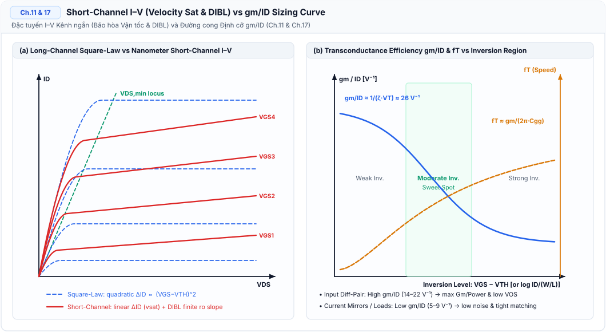

---
{
  "id": "tech-nanometer-vdsmin-gmid-sizing",
  "kind": "technique",
  "domain": "foundations",
  "title_vi": "Phương pháp định cỡ transistor công nghệ nanomet theo VDS,min và gm/ID (Nanometer Transistor Sizing via VDS,min & gm/ID)",
  "title_en": "Nanometer MOSFET Sizing Methodology Using Reference Device, VDS,min, and gm/ID",
  "summary": "Quy trình thực chiến của Razavi (Chương 11 §11.1–11.4.4) thay thế công thức luật bình phương lỗi thời bằng nguyên lý bất biến mật độ dòng ID/W và hiệu suất hỗ dẫn gm/ID trên transistor tham chiếu để giải quyết 4 bài toán định cỡ hạt nhân ở 90nm, 65nm và 45nm.",
  "diagram": "../../diagrams/short-channel-iv-gmid.svg",
  "razavi_refs": [
    {
      "chapter": 11,
      "section": "11.1-11.4.4",
      "pages": "459-472",
      "equations": ["11.1", "11.2", "11.3", "11.4", "11.5", "11.6", "11.7", "11.8", "11.9"]
    }
  ],
  "glossary_codes": ["T050", "T091", "T092", "T168", "T207", "T208", "T284", "T1827", "T1831", "T1838", "T1844", "T1988"],
  "process_agnostic": true,
  "roles": {
    "reference_transistor_characterization": "Một linh kiện chuẩn W_REF/L được mô phỏng BSIM một lần duy nhất để lập bản đồ ID–VDS, gm–ID, gm/ID và rO",
    "current_density_invariant_scaling": "Ghép K linh kiện tham chiếu song song (nhân W và ID lên K lần) bảo toàn tuyệt đối VGS, VDS,min và tỷ số gm/ID",
    "four_canonical_sizing_solvers": "Hệ thuật toán 4 trường hợp cho phép tìm ngay W và điểm phân cực từ (ID, VDS,min), (gm, ID), (gm, VDS,min) hoặc (gm)"
  },
  "symptoms_addressed": [
    "hand-calculated-w-over-l-wildly-wrong-in-90nm-65nm-45nm",
    "random-trial-and-error-width-sweeping",
    "impossible-gm-request-exceeding-subthreshold-limit",
    "excessive-vdsat-crushing-low-voltage-output-swing"
  ],
  "limitations": [
    "requires-one-time-pdk-reference-curve-extraction-per-channel-length",
    "narrow-width-sti-wpe-effects-cause-slight-deviation-if-unit-finger-width-changes"
  ],
  "checklists": ["common-mos", "single-stage", "current-mirror", "differential-pair"]
}
---

## 1. Bản chất Nguyên lý, Sơ đồ Mạch & Vai trò Từng Nhánh Cấu trúc

Khi bước vào các tiến trình **90nm, 65nm và 45nm / 40nm** dưới nguồn cấp $V_{DD} \approx 0.9\text{–}1.2\,\text{V}$, phép tính tay cổ điển $W/L = 2I_D / [\mu C_{ox}(V_{GS} - V_{TH})^2]$ sụp đổ hoàn toàn vì ba lý do thực tế mà Razavi chỉ rõ ngay mở đầu Chương 11 (§11.1–11.2, Hình 11.1–11.6, tr. 459–462):
1. **Không còn một hằng số $\mu C_{ox}$ hay $\lambda$ duy nhất:** Bão hòa vận tốc ($v_{\text{sat}}$) và suy giảm độ linh động trường dọc ($\theta$) làm $I_D$ lệch xa đường parabol, $g_m$ bão hòa dần (thậm chí giảm khi $V_{GS} - V_{TH} > 0.5\,\text{V}$!), còn $r_o$ biến thiên mạnh theo $V_{DS}$ do CLM và DIBL.
2. **Khái niệm $V_{TH}$ và $V_{GS} - V_{TH}$ mất ranh giới rõ ràng:** Trên đường cong $I_D\text{–}V_{DS}$ thực của transistor $40\,\text{nm}$ (Hình 11.2), ngay cả khi $V_{GS} - V_{TH} = 350\,\text{mV}$, dòng máng đã uốn gối bão hòa sớm (*knee point*) ở dưới $V_{DS} = 200\,\text{mV}$! Thứ mà mạch điện thực sự cần để bảo toàn dải dao động không phải hiệu số trừu tượng $V_{GS} - V_{TH}$, mà là **điện áp máng–nguồn tối thiểu để duy trì bão hòa và $r_o$ đủ lớn**, ký hiệu là **$V_{DS,\min}$**!
3. **Làm sao thiết kế có phương pháp mà không biến thành "mò kim đáy bể" trong SPICE?** Câu trả lời thiên tài của Razavi tại §11.3–11.4 (Ví dụ 11.2–11.3, tr. 464–466) dựa trên một **Định lý Bất biến Vật lý Tuyệt đối** đúng cho **mọi mô hình transistor phi tuyến bất kỳ** (kể cả BSIM4, PSP hay FinFET!):



> **Định lý Co giãn Tuyến tính Bảo toàn Mật độ Dòng (Ví dụ 11.2, Hình 11.8):** Đặt $K$ transistor giống hệt nhau (cùng chiều dài $L$, cùng chiều rộng đơn vị $W_{\text{REF}}$, cùng $V_{GS}$ và $V_{DS}$) mắc **song song** với nhau hoàn toàn tương đương một transistor có chiều rộng $W = K \cdot W_{\text{REF}}$. Khi đó:
> - Dòng cực máng nhân lên đúng $K$ lần: $I_D = K \cdot I_{D,\text{REF}}$
> - Độ hỗ dẫn nhân lên đúng $K$ lần: $g_m = K \cdot g_{m,\text{REF}}$
> - Điện trở ra chia nhỏ đi đúng $K$ lần: $r_o = r_{o,\text{REF}} / K$
> - Các điện dung cực nhân lên đúng $K$ lần: $C_{ij} = K \cdot C_{ij,\text{REF}}$
> - **Mọi đại lượng chuẩn hóa đều BẤT BIẾN 100%:** mật độ dòng $J_D = I_D / W$, điện áp phân cực $(V_{GS}, V_{DS,\min})$, **hiệu suất hỗ dẫn $g_m / I_D$**, **độ lợi nội tại $g_m r_o$**, và **tần số chuyển tiếp $f_T$** giữ nguyên không đổi!

Nhờ định lý này, ta chỉ cần mô phỏng **một transistor tham chiếu duy nhất** $(W_{\text{REF}}, L)$ một lần cho mỗi chiều dài kênh $L$, sau đó giải mọi bài toán định cỡ bằng phép chiếu hình học chính xác trên mặt phẳng $(I_D, g_m)$!

---

## 2. Hệ Phương trình Cốt lõi & Tư duy "Nhìn Mạch Đọc Nhanh" (Analysis by Inspection)

### 2.1. Sáu Kịch bản Điều chỉnh Tỉ lệ Hỗ dẫn (Transconductance Scaling — Hình 11.7, tr. 463–464)
Giữa bốn biến $\{W/L,\, I_D,\, V_{DS,\min} \text{ (hoặc } V_{OV}\text{)},\, g_m\}$, việc biết **2 biến bất kỳ trong 3 biến hiệu năng $\{I_D, V_{DS,\min}, g_m\}$** sẽ khóa cứng hoàn toàn 2 biến còn lại (bài toán quá ràng buộc — *overconstrained*, Bảng 11.1, tr. 466):
- Giữ $V_{DS,\min}$ không đổi, tăng $W$ và $I_D$ cùng hệ số $K$ (Hình 11.7a / 11.7e): đi dọc **tia thẳng qua gốc tọa độ** trên mặt phẳng $(I_D, g_m)$ có hệ số góc $g_m / I_D = \text{const}$ (Hình 11.9b,c).
- Giữ $I_D$ không đổi, tăng $W$ để giảm $V_{OV}$ và tăng $g_m$ (Hình 11.7c,f): hiệu suất $g_m/I_D$ tăng dần nhưng bị **chặn đứng bởi trần dưới ngưỡng**:
  $$\left(\frac{g_m}{I_D}\right)_{\max} = \frac{1}{\zeta V_T} \approx \frac{1}{1.5 \times 26\,\text{mV}} \approx 25.6\,\text{V}^{-1} \quad (\text{tại } T = 300\,\text{K})$$

### 2.2. Bốn Bài toán Định cỡ Hạt nhân của Razavi (§11.4.1–11.4.4, Bảng 11.1, tr. 466–472)

Giả sử với chiều dài kênh $L$ đã chọn, ta đã dựng sẵn bộ đường cong của transistor tham chiếu $W_{\text{REF}}$ (ví dụ $W_{\text{REF}} = 5\,\mu\text{m}$):

#### Bài toán I: Cho trước $(I_D,\, V_{DS,\min})$ $\longrightarrow$ Tìm $W$ và $g_m$ (§11.4.1, Hình 11.10–11.11)
*Ngữ cảnh:* Đã ấn định dòng nhánh từ ngân sách công suất và ấn định $V_{DS,\min}$ từ ngân sách khoảng dự trữ điện áp (ví dụ nguồn dòng đuôi, transistor cascode, tầng ra).
1. Kẻ đường thẳng đứng $V_{DS} = V_{DS,\min}$ trên họ đặc tuyến $I_{D,\text{REF}}\text{–}V_{DS}$ của linh kiện tham chiếu.
2. Chọn đường cong $V_{GS}$ cao nhất mà tại $V_{DS} = V_{DS,\min}$ điểm làm việc vẫn nằm bên phải điểm uốn gối (*knee point*, đảm bảo bão hòa khỏe và $r_o$ chưa sụt); đọc giá trị dòng tham chiếu $I_{D,\text{REF}}$ và hỗ dẫn $g_{m,\text{REF}}$ tương ứng. *(Mẹo tối ưu $g_m$: chọn đường cong có gối sát $V_{DS,\min}$ thay vì chọn $V_{OV}$ quá lớn làm tụt $g_m/I_D$!).*
3. Nhân tỉ lệ chiều rộng theo hệ số dòng $K = I_D / I_{D,\text{REF}}$:
   $$W = W_{\text{REF}} \cdot \frac{I_D}{I_{D,\text{REF}}}, \qquad g_m = g_{m,\text{REF}} \cdot \frac{I_D}{I_{D,\text{REF}}}, \qquad r_o = r_{o,\text{REF}} \cdot \frac{I_{D,\text{REF}}}{I_D}$$
- *Cách sửa khi $g_m$ thu được chưa đủ lớn (Bảng 11.1):* Phải nới ngân sách tăng $I_D$ (và tăng $W$ tương ứng), hoặc giảm tiếp $V_{OV}$ (tăng thêm $W$ ở cùng $I_D$ nếu chưa chạm vùng dưới ngưỡng).

#### Bài toán II: Cho trước $(g_{m1},\, I_{D1})$ $\longrightarrow$ Tìm $W$ và $V_{DS,\min}$ (§11.4.2, Hình 11.14–11.16)
*Ngữ cảnh:* Cặp vi sai đầu vào cần đạt $g_{m1}$ (để thỏa mãn nhiễu nhiệt $4kT\gamma/g_{m1}$ hoặc băng thông $\text{GBW} = g_{m1}/C_L$) dưới giới hạn dòng tối đa $I_{D1}$.
1. **Kiểm tra điều kiện khả thi vật lý ngay lập tức:** Tính tỷ số yêu cầu $(g_{m1} / I_{D1})$. Nếu $\frac{g_{m1}}{I_{D1}} \ge \frac{1}{\zeta V_T}$ (nằm trong miền xám bất khả thi của Hình 11.15), **dừng ngay**: không có kích thước $W$ nào đạt được, bắt buộc phải tăng $I_{D1}$!
2. Nếu khả thi: trên đồ thị $g_{m,\text{REF}}$ theo $I_{D,\text{REF}}$ (hoặc tra trực tiếp đường cong chuẩn hóa $g_m/I_D$ theo $I_D/W$!), kẻ tia thẳng từ gốc $(0,0)$ đi qua $(I_{D1}, g_{m1})$ (tức tìm điểm trên đường cong tham chiếu có đúng tỷ số $\frac{g_{m,\text{REF}}}{I_{D,\text{REF}}} = \frac{g_{m1}}{I_{D1}}$).
3. Đọc tọa độ giao điểm $(I_{D,\text{REF}}, g_{m,\text{REF}})$ và điện áp gối $V_{DS,\min,\text{REF}}$ tại điểm đó, rồi suy ra:
   $$W = W_{\text{REF}} \cdot \frac{I_{D1}}{I_{D,\text{REF}}} = W_{\text{REF}} \cdot \frac{g_{m1}}{g_{m,\text{REF}}}$$
- *Cách sửa khi $V_{DS,\min,\text{REF}}$ tìm được quá lớn làm thiếu headroom (Hình 11.16):* Chọn lại một điểm thứ hai $(I_{D2}, g_{m2})$ trên đường cong tham chiếu có $V_{DS,\min,2}$ thấp bằng mức cho phép, rồi nhân rộng theo dòng $W' = W_{\text{REF}} \cdot (I_{D1}/I_{D2})$ — khi đó ta vừa giữ đúng dòng $I_{D1}$ và khoảng dự trữ $V_{DS,\min,2}$, vừa nhận được hỗ dẫn mới $g'_{m1} > g_{m1}$!

#### Bài toán III: Cho trước $(g_{m1},\, V_{DS,\min})$ $\longrightarrow$ Tìm $W$ và $I_D$ (§11.4.3, Hình 11.17)
*Ngữ cảnh:* Đã khóa $g_{m1}$ (từ yêu cầu nhiễu/độ lợi) và khóa trần $V_{DS,\min}$ (từ yêu cầu dải dao động), chưa chốt dòng $I_D$.
1. Tra đồ thị tham chiếu tại điểm phân cực ứng với gối bão hòa $V_{DS,\min}$ để đọc ngay cặp $(g_{m,\text{REF}},\, I_{D,\text{REF}})$.
2. Nhân tỉ lệ theo hệ số hỗ dẫn $K = g_{m1} / g_{m,\text{REF}}$:
   $$W = W_{\text{REF}} \cdot \frac{g_{m1}}{g_{m,\text{REF}}}, \qquad I_D = I_{D,\text{REF}} \cdot \frac{g_{m1}}{g_{m,\text{REF}}}$$
- *Cách sửa khi dòng $I_D$ suy ra vượt quá ngân sách công suất $I_{D,\max}$:* Quay về **Bài toán II** với cặp đầu vào $(g_{m1},\, I_{D,\max})$, chấp nhận giảm $V_{OV}$ (tăng $g_m/I_D$) bằng một bề rộng $W$ lớn hơn (và tụ ký sinh lớn hơn)!

#### Bài toán IV: Chỉ cho trước $(g_{m1})$ $\longrightarrow$ Chọn hợp lý $I_D, V_{DS,\min}, W$ (§11.4.4, Hình 11.18)
*Ngữ cảnh:* Thiết kế sơ bộ tầng khuếch đại chỉ biết $g_{m1}$ cần đạt.
1. Chọn một mức $V_{DS,\min}$ hợp lý khởi đầu cân bằng giữa tốc độ $f_T$ và khoảng dự trữ điện áp (ví dụ $150\text{–}200\,\text{mV}$, tương ứng $g_m/I_D \approx 10\text{–}15\,\text{V}^{-1}$ ở vùng nghịch đảo vừa).
2. Đọc $(I_{D,\text{REF}}, g_{m,\text{REF}})$ trên đường cong tham chiếu và nhân tỉ lệ theo $g_{m1}/g_{m,\text{REF}}$; nếu $I_D$ hơi cao thì hạ điểm chọn về $100\text{–}150\,\text{mV}$ rồi lặp lại một bước là hội tụ.

### 2.3. Minh họa Số Học Từng Bước Từ Sách Razavi (Ví dụ 11.4 & 11.5 — CMOS 40nm, $V_{DD} = 1\,\text{V}$, tr. 468–469)
Cho tầng nguồn chung $M_1$ tải điện trở $R_D$ chạy nguồn $V_{DD} = 1.0\,\text{V}$ (Hình 11.12) với ngân sách công suất $P = 1\,\text{mW}$, dải dao động ngõ ra đỉnh–đỉnh $0.8\,\text{V}_{pp}$, chọn $L_1 = 40\,\text{nm}$. Hỏi bề rộng $W_1$ cần thiết, hỗ dẫn $g_{m1}$ đạt được (có đạt nổi $1/(50\,\Omega) = 20\,\text{mS}$ không?), và điện trở ra $r_{o1}$ bằng bao nhiêu?
1. **Chuyển đổi chỉ tiêu mạch sang biến linh kiện $(I_D, V_{DS,\min})$:**
   - Công suất $1\,\text{mW}$ trên nguồn $1\,\text{V} \Longrightarrow I_{D1} = 1\,\text{mA}$.
   - Ngõ ra cần dao động từ $1.0\,\text{V}$ xuống $0.2\,\text{V}$ để đạt $0.8\,\text{V}_{pp} \Longrightarrow M_1$ phải giữ bão hòa xuống tới **$V_{DS,\min} = 200\,\text{mV}$** (đây chính là **Bài toán I**!).
2. **Tra đặc tuyến Transistor Tham chiếu ($W_{\text{REF}}/L_{\min} = 5\,\mu\text{m}/40\,\text{nm}$, Hình 11.10, 11.11 & 11.13):**
   - Tại $V_{DS} = 200\,\text{mV}$ và đường cong $V_{GS} - V_{TH} = 200\,\text{mV}$, linh kiện tham chiếu có:
     $$I_{D,\text{REF}} \approx 100\,\mu\text{A}, \qquad g_{m,\text{REF}} \approx 1.5\,\text{mS}, \qquad r_{o,\text{REF}} \approx 8\,\text{k}\Omega$$
3. **Nhân tỉ lệ bảo toàn mật độ dòng với hệ số $K = \frac{1\,\text{mA}}{100\,\mu\text{A}} = 10$:**
   $$W_1 = 10 \times 5\,\mu\text{m} = 50\,\mu\text{m}, \qquad g_{m1} = 10 \times 1.5\,\text{mS} = 15\,\text{mS} = \frac{1}{67\,\Omega}, \qquad r_{o1} = \frac{8\,\text{k}\Omega}{10} = 800\,\Omega$$
4. **Kết luận thiết kế cực kỳ sáng tỏ:**
   - Độ lợi nội tại bất biến $g_{m1} r_{o1} = 15\,\text{mS} \times 0.8\,\text{k}\Omega = 12$ (bằng đúng $1.5\,\text{mS} \times 8\,\text{k}\Omega$ của linh kiện tham chiếu!).
   - Với $I_D = 1\,\text{mA}$ và chọn $V_{OV} = 200\,\text{mV}$, $g_{m1}$ chỉ đạt $15\,\text{mS} < 20\,\text{mS}$. Muốn nâng $g_{m1}$ lên $20\,\text{mS}$ mà không tăng công suất $1\,\text{mA}$ (tức đòi $g_m/I_D = 20\,\text{V}^{-1} < 25.6\,\text{V}^{-1}$, khả thi!), ta áp dụng ngay phần sửa đổi của Bảng 11.1: giảm $V_{OV}$ xuống thấp hơn $200\,\text{mV}$ bằng cách tăng $W_1$ vượt trên $50\,\mu\text{m}$ theo đúng **Bài toán II**!

---

## 3. Bất biến Cấu trúc & Các Bẫy Lỗi Kinh điển (Structural Invariants & Traps)

- **[INV-GMID-01] Bất biến Phân vùng $g_m/I_D$ Theo Vai trò Cấu trúc (Universal Role-Based Sizing Law):**
  - **Cặp vi sai đầu vào (`input_pair`) & Tầng khuếch đại chính:** Cần tối đa hóa $g_m$ trên mỗi mA dòng và giảm điện áp lệch không $V_{OS}$ $\longrightarrow$ đặt ở **nghịch đảo vừa đến yếu** ($g_m/I_D \approx 14\text{–}22\,\text{V}^{-1}$, $V_{DS,\min} \approx 80\text{–}130\,\text{mV}$).
  - **Nguồn dòng tĩnh, Gương dòng & Tải chủ động (`current_mirror / active_load`):** Cần giảm $g_{m,\text{load}}$ (để triệt nhiễu nhiệt cộng vào tín hiệu và giảm sai lệch dòng do $\Delta V_{TH}$ theo Pelgrom!) và tăng $r_o$ $\longrightarrow$ đặt ở **nghịch đảo mạnh** ($g_m/I_D \approx 6\text{–}10\,\text{V}^{-1}$, $V_{DS,\min} \approx 180\text{–}300\,\text{mV}$ nếu đủ headroom, kết hợp $L$ dài!).
  - **Transistor Cascode che chắn (`cascode_shield`):** Cần $f_T$ cao để đẩy cực nút gập/nguồn cascode ra xa $\text{GBW}$ và tốn ít headroom $\longrightarrow$ đặt ở $V_{DS,\min} \approx 100\text{–}150\,\text{mV}$, $L \approx 1\text{–}2\,L_{\min}$.
- **[INV-GMID-02] Phụ thuộc của Đường cong Tham chiếu vào $V_{DS}$ Tĩnh (Chú thích 5, tr. 472):** Do DIBL và CLM ở tiến trình nanomet, đường cong $g_{m,\text{REF}}\text{–}I_{D,\text{REF}}$ thay đổi nhẹ theo $V_{DS}$. Luôn trích xuất đường cong tham chiếu tại $V_{DS}$ gần với điện áp làm việc thực tế của nhánh mạch (ví dụ $V_{DS} = 150\,\text{mV}$ cho ngăn xếp cascode chặt, hoặc $V_{DS} = V_{DD}/2$ cho tầng đơn).

- **[TRAP-GMID-01] Bẫy Chia Ngón Khác Bề rộng Đơn vị $W_{\text{finger}}$ Giữa Linh kiện Thực và Linh kiện Tham chiếu:** Trong 90nm/65nm/45nm, hiệu ứng ứng suất rãnh nông STI (LOD) và hiệu ứng kênh hẹp làm $V_{TH}, \mu$ phụ thuộc vào bề rộng **mỗi ngón đơn vị $W_f$** và khoảng cách tới mép active `SA, SB`! Nếu linh kiện tham chiếu vẽ $1$ ngón $5\,\mu\text{m}$ còn linh kiện trong mạch dùng $50$ ngón $1\,\mu\text{m}$, tỷ lệ nhân $10\times$ sẽ lệch $5\%\text{–}12\%$! *Cách phòng tuyệt đối:* Cố định một bề rộng ngón chuẩn (ví dụ $W_f = 1\,\mu\text{m}$ hoặc $2\,\mu\text{m}$), dựng linh kiện tham chiếu bằng $nf_{\text{REF}} = 5$ ngón, và khi nhân tỉ lệ trong mạch chỉ việc **nhân số ngón `nf` hoặc hệ số nhân `m`**!
- **[TRAP-GMID-02] Bẫy Đẩy Cặp Đầu vào Sâu Quá Đà Vào Dưới Ngưỡng Khi Cần Tốc Độ GHz:** Khi $g_m/I_D \to 25\,\text{V}^{-1}$, mật độ dòng $I_D/W$ rơi theo hàm mũ khiến bề rộng $W$ (và tụ cổng $C_{GS}, C_{GD}$) phình to gấp $10\text{–}20$ lần, đánh sập $f_T$ xuống vài trăm MHz và làm cực ký sinh đầu vào phá hỏng dự trữ pha vòng kín!

---

## 4. Lộ trình Nâng cấp Cấu trúc & Bát giác Đánh đổi (Upgrade Paths & Design Octagon)

Phương pháp định cỡ `tech-nanometer-vdsmin-gmid-sizing` là cầu nối thực thi nối lý thuyết linh kiện với toàn bộ các khối mạch phức tạp:
- **Nâng cấp trực tiếp sang bước chọn chiều dài kênh $L$ và co giãn công suất toàn bộ Op-Amp:** Nếu sau khi giải xong 4 bài toán trên ở $L = L_{\min}$ mà điện trở ra $r_o = r_{o,\text{REF}}/K$ quá thấp không đủ độ lợi mục tiêu, chuyển ngay sang `tech-channel-length-and-opamp-scaling` (§11.4.5–11.6).
- **Kết hợp với Đối ngẫu Định cỡ Mismatch & Nhiễu:** Phối hợp chặt với `law-pelgrom-mismatch-and-sizing-duality` (tại sao cặp đầu vào và gương dòng phải chọn hai đầu đối lập của trục $g_m/I_D$) và `law-stage-and-mirror-noise-rules`.
- **Ứng dụng trực tiếp để định cỡ các cấu trúc chủ lực:** `topo-lvccml-wide-swing-mirror`, `topo-five-transistor-ota`, `topo-telescopic-cascode-opamp`, `topo-folded-cascode-ota`, `topo-two-stage-opamp` và `topo-cmos-ldo-regulator`.

---

## 5. Thích ứng Đa Tiến trình (90nm / 65nm / 45nm) & Cách Kiểm chứng trong Cadence / Spectre

Điểm mạnh vô song của phương pháp này là **cùng một kịch bản thiết kế chạy giống hệt nhau 100% trên 90nm, 65nm và 45nm** mà không cần biết $\mu_n, C_{ox}, \theta, v_{\text{sat}}$ bên trong file model `.scs` bằng bao nhiêu!

**Quy trình Thực thi 3 Bước bằng Spectre / SKILL cho mọi PDK (gpdk090 / gpdk045 / TSMC 65nm):**
1. **Tạo Bảng Tra Chuẩn hóa (`LUT`) bằng 1 Netlist Spectre Siêu gọn:**
   - Dựng 1 NMOS và 1 PMOS có kích thước ngón đơn vị chuẩn $W_f = 1\,\mu\text{m}$, $nf_{\text{REF}} = 5$ ($W_{\text{REF}} = 5\,\mu\text{m}$, đồng nhất với transistor tham chiếu $5\,\mu\text{m}$ của Razavi), quét `L` trên tập lưới $\{L_{\min},\, 1.5 L_{\min},\, 2 L_{\min},\, 4 L_{\min},\, 8 L_{\min}\}$ và quét `VGS` bước $10\,\text{mV}$ tại `VDS = VDD/2` (và `VDS = 0.15V`).
   - Xuất các cột chuẩn hóa bất biến bề rộng: `gm_id = gm/id`, `jd = id/W_REF` ($\text{A}/\mu\text{m}$), `av0 = gm/gds`, `ft = gm/(2*pi*abs(cgg))`, `vdsat`.
2. **Giải Tức thì Bất kỳ Nhánh Mạch Nào:**
   - Ví dụ cần thiết kế cặp đầu vào PMOS ở **65nm** (hoặc **45nm**) có $g_m = 8\,\text{mS}$ với dòng nhánh $I_D = 500\,\mu\text{A}$:
     - Tính $\frac{g_m}{I_D} = \frac{8\,\text{mS}}{0.5\,\text{mA}} = 16\,\text{V}^{-1} < 25.6\,\text{V}^{-1}$ (hợp lệ, vùng nghịch đảo vừa).
     - Tra hàng có `gm_id = 16` tại $L = 2 L_{\min}$: đọc ngay mật độ dòng chuẩn `jd` (ví dụ $4\,\mu\text{A}/\mu\text{m}$), `vdsat` ($\approx 95\,\text{mV}$) và `av0` ($\approx 18$).
     - Tính tổng bề rộng $W = \frac{I_D}{\texttt{jd}} = \frac{500\,\mu\text{A}}{4\,\mu\text{A}/\mu\text{m}} = 125\,\mu\text{m} \longrightarrow$ đặt chính xác $W_f = 1\,\mu\text{m}$, `nf = 5`, `m = 25` (ghép $25$ ô đơn vị chuẩn $5$ ngón, tổng $125$ ngón đơn vị bảo toàn tuyệt đối môi trường STI/WPE của linh kiện tham chiếu!).
3. **Kiểm định lại bằng `dcOp` trong Virtuoso:** Chạy mô phỏng mạch hoàn chỉnh, xác nhận sai số `gm` và `id` thực tế so với bảng tra nhỏ hơn $2\text{–}3\%$ ngay từ lần chạy đầu tiên!

**Mẫu Bảng Tra Chuẩn Hóa Điển hình & Script Trích xuất `gm/ID` Trong Spectre/OCEAN:**
```ocean
; Quét VGS từ 0.15V đến VDD trên transistor tham chiếu W_REF = 5um (nf=5, W_f=1um)
analysis('dc ?dev "/Vgs" ?param "dc" ?start 0.15 ?stop 1.0 ?step 0.01)
run()

id_vec    = abs(getData("Mref:id"    ?result "dc"))
gm_vec    = getData("Mref:gm"        ?result "dc")
gds_vec   = getData("Mref:gds"       ?result "dc")
cgg_vec   = abs(getData("Mref:cgg"   ?result "dc"))
vdsat_vec = abs(getData("Mref:vdsat" ?result "dc"))

; Các đường cong chuẩn hóa hoàn toàn độc lập bề rộng W:
gm_over_id = gm_vec / id_vec
jd_uA_um   = (id_vec / 5.0) * 1e6
intr_gain  = gm_vec / gds_vec
fT_GHz     = (gm_vec / (2 * 3.14159265 * cgg_vec)) / 1e9

; Đổi trục X từ VGS sang gm_over_id bằng hàm waveVsWave trong ViVA / Calculator:
jd_vs_gmid = waveVsWave(?x gm_over_id ?y jd_uA_um)
ft_vs_gmid = waveVsWave(?x gm_over_id ?y fT_GHz)
av_vs_gmid = waveVsWave(?x gm_over_id ?y intr_gain)
```

| Mức chọn $g_m/I_D$ ($\text{V}^{-1}$) | Miền vật lý kênh dẫn | $V_{DS,\min}$ điển hình | $I_D / W$ tương đối | $f_T$ tương đối | Vị trí ứng dụng chuẩn mực trong mạch |
|---|---|---|---|---|---|
| **$6 \dots 9\,\text{V}^{-1}$** | Nghịch đảo mạnh (*Strong inversion*) | $200\text{–}320\,\text{mV}$ | Rất cao (nhỏ gọn $W$) | Cực đại | Gương dòng chính xác, nguồn dòng tải/đuôi, mạch cao tần RF |
| **$11 \dots 16\,\text{V}^{-1}$** | Nghịch đảo vừa (*Moderate inversion — Điểm ngọt!*) | $110\text{–}170\,\text{mV}$ | Trung bình | Khá cao ($40\%\text{–}65\%\,f_{T,\max}$) | Cặp đầu vào Op-Amp tốc độ cao, transistor lá chắn Cascode |
| **$18 \dots 24\,\text{V}^{-1}$** | Nghịch đảo yếu / Dưới ngưỡng (*Weak inversion*) | $75\text{–}105\,\text{mV}$ | Rất thấp ($W$ rất lớn) | Thấp ($< 15\%\,f_{T,\max}$) | Cặp vi sai đầu vào công suất siêu thấp ($\mu\text{W}$), giảm cực đại $V_{OS}$ |

---

## 6. Mốc Đối chiếu Sách Razavi & Thuật ngữ Chuẩn CLB

- **Sách gốc Razavi (2nd Ed.):**
  - Chương 11: *Nanometer Design Studies*, §11.1 *Transistor Design Considerations* (tr. 459–460, Hình 11.1–11.2), §11.2 *Deep-Submicron Effects* (tr. 460–463, Phương trình 11.1–11.6, Ví dụ 11.1), §11.3 *Transconductance Scaling* (tr. 463–465, Phương trình 11.7–11.9, Hình 11.7–11.9, Ví dụ 11.2–11.3), §11.4 *Transistor Design* (tr. 466–472, Bảng 11.1, §11.4.1–11.4.4, Hình 11.10–11.18, Ví dụ 11.4–11.5).
- **Chú giải hiệu đính học thuật CLB (`Nội bộ/Chương 11/Nguồn dựng/content.json` & `THUẬT NGỮ CHUẨN.md`):**
  - `NG11-01`: Lưu ý ở tr. 464 tác giả dùng thay thế linh hoạt $V_{DS,\min}$, $V_{D,\text{sat}}$ và $V_{GS} - V_{TH}$ trong lập luận tỉ lệ, nhưng trên đặc tuyến thực 40nm (tr. 460–461, 467) linh kiện bão hòa sớm ngay khi $V_{DS} < V_{GS} - V_{TH}$, nên thiết kế thực tế phải neo theo điểm gối $V_{DS,\min}$.
  - `NG11-02`: Ở §11.4.1 (tr. 466–467), câu dẫn ghi "three steps" nhưng nội dung trình bày đầy đủ Bước 1 đến Bước 4.
  - `NG11-03`: Ở cuối §11.4.3 (tr. 471), khi dòng vượt ngân sách và quay về Bài toán II thiết kế cho $(g_{m1}, I_{D,\max})$ bằng cách tăng $W$ giảm $V_{OV}$, linh kiện rộng hơn sẽ đạt đúng $g_{m1}$ ở dòng thấp hơn chứ không phải bị giảm hỗ dẫn dưới mục tiêu $g_{m1}$.
  - Mã thuật ngữ: `T092` (**Điều chỉnh tỉ lệ hỗ dẫn**), `T050` (**Phép nhân tỉ lệ tuyến tính** giữ mật độ dòng), `T168` / `T284` (**Mật độ dòng theo chiều rộng kênh** $I_D/W$), `T207` ($V_{DS,\min}$).
