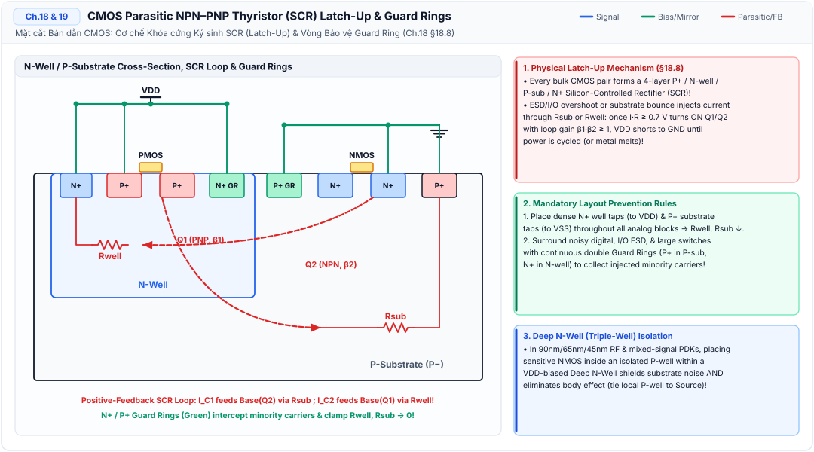

---
{
  "id": "concept-cmos-fabrication-wells-and-process-steps",
  "kind": "concept",
  "domain": "nonideal-and-physical",
  "title_vi": "Quy trình Chế tạo Vi mạch CMOS: Quang khắc, Oxy hóa, Cấy Ion Nghiêng, Rãnh Nông STI, Salicide và Cấu trúc Đa Giếng (CMOS Fabrication & Wells)",
  "title_en": "CMOS IC Fabrication Sequence: Wafer Growth, Photolithography, Oxidation, Tilted Ion Implantation, STI, Salicide, and Twin/Triple-Well Isolation",
  "summary": "Giải phẫu trình tự vật lý chế tạo một vi mạch CMOS từ tinh thể silic đơn Czochralski đến tầng kim loại hoàn chỉnh: quang khắc tia cực tím và chi phí mặt nạ, oxy hóa nhiệt cổng vài chục Angstrom đối chiếu cách ly rãnh nông STI, cấy ion hồ sơ giếng lùi nồng độ (retrograde well) và nghiêng phiến 7–9 độ chống hiệu ứng xuyên kênh tinh thể (channeling), ủ nhiệt kích hoạt tạp chất, cổng tự căn chỉnh kèm vách ngăn LDD và phủ silicide tự căn chỉnh (salicide), chống ăn xuyên tiếp xúc nhôm (spiking) và phân cấp cách ly N-Well, Twin-Well, Deep N-Well (Triple-Well).",
  "diagram": "../../diagrams/latchup-and-guard-rings.svg",
  "razavi_refs": [
    {
      "chapter": 18,
      "section": "18.1-18.7.1",
      "pages": "712-722",
      "equations": []
    }
  ],
  "glossary_codes": [
    "T024",
    "T048",
    "T084",
    "T129",
    "T130",
    "T131",
    "T132",
    "T134",
    "T737",
    "T1112",
    "T1118",
    "T1466",
    "T2051",
    "T2056",
    "T2188",
    "T2189",
    "T2190",
    "T2196"
  ],
  "process_agnostic": true,
  "roles": {
    "czochralski_wafer_and_epi": "Phiến đơn tinh thể silic đường kính 200–300 mm pha tạp p+ điện trở suất thấp (~0.05–0.1 Ohm.cm) phủ lớp biểu mô p-epi làm nền cơ khí và điện học chống chốt nguồn.",
    "photolithography_and_sti": "Chuỗi phủ cản quang, chiếu UV qua mặt nạ quang học và khắc rãnh nông nhồi oxit (STI) định hình biên giới vùng hoạt động (Active/OD) và ngăn rò dòng trường giữa các linh kiện.",
    "tilted_ion_implantation_and_anneal": "Chùm ion năng lượng điều khiển độ sâu tạo hồ sơ giếng lùi nồng độ, nghiêng góc 7–9 độ tránh xuyên kênh mạng tinh thể rồi ủ nhiệt ~1000 °C khôi phục liên kết mạng.",
    "self_aligned_gate_spacer_salicide": "Cổng polysilicon khắc trước làm mặt nạ tự căn chỉnh cho cấy nguồn/máng, vách ngăn oxit định hình vùng LDD và cho phép phủ hợp kim kim loại–silic tự căn chỉnh hạ điện trở mặt.",
    "multi_well_hierarchy": "Kiến trúc giếng đơn N-well, giếng đôi độc lập Twin-well và giếng ba lớp Deep N-well (Triple-well) quyết định khả năng cô lập cực thân NMOS khỏi đế chung."
  },
  "symptoms_addressed": [
    "orientation-dependent-offset-from-tilted-source-drain-ion-implantation",
    "parasitic-field-inversion-leakage-between-adjacent-active-diffusions",
    "high-poly-and-diffusion-sheet-resistance-without-self-aligned-silicide",
    "junction-short-circuit-due-to-large-window-aluminum-contact-spiking",
    "inability-to-isolate-analog-nmos-bulk-in-standard-single-nwell-cmos"
  ],
  "limitations": [
    "thermal-annealing-causes-lateral-dopant-diffusion-creating-gate-overlap-capacitance",
    "sti-trench-refill-induces-compressive-mechanical-stress-shifting-mobility-and-vth",
    "deep-nwell-and-silicide-block-options-add-mask-steps-and-wafer-fabrication-cost"
  ],
  "checklists": [
    "common-mos",
    "layout-and-matching",
    "esd-pad-and-substrate"
  ]
}
---

## 1. Bản chất Nguyên lý, Sơ đồ Mạch & Vai trò Từng Nhánh Cấu trúc

Mỗi đa giác màu vẽ trên màn hình Cadence Virtuoso Layout không phải là một hình học trừu tượng, mà là bản chỉ dẫn trực tiếp cho hơn **30 đến 50 vòng lặp vật lý–hóa học ở cấp độ nguyên tử** diễn ra nối tiếp nhau trên phiến bán dẫn (Razavi Chương 18 §18.1–18.7.1, tr. 712–722). Mọi hiện tượng "bí ẩn" làm đau đầu kỹ sư thiết kế tương tự — tại sao xoay một transistor $180^\circ$ lại làm lệch $V_{OS}$ hàng milivôn, tại sao chiều dài kênh hiệu dụng $L_{\text{eff}}$ luôn ngắn hơn chiều dài vẽ $L_{\text{drawn}}$ một lượng bất định $2 L_D$, tại sao không được phép vẽ một lỗ tiếp xúc lớn duy nhất, hay tại sao transistor nằm gần rìa vùng hoạt động lại đổi độ linh động — đều bắt nguồn trực tiếp từ **6 công đoạn chế tạo nền tảng (`FEOL` & `BEOL`)**:



1. **Nuôi Tinh thể Phiến Silic (`Czochralski Wafer Processing` — §18.2):** Nhúng mầm tinh thể vào silic nóng chảy và kéo xoay chậm để tạo thỏi đơn tinh thể hình trụ (`ingot`) đường kính $\ge 300\text{ mm}$ ($12\text{ inch}$) gần như không có khuyết tật mạng, cưa mỏng dày $\sim 500\text{–}1000\,\mu\text{m}$ và đánh bóng hóa–cơ. Đa số công nghệ CMOS hiện đại dùng phiến đế $p^+$ pha tạp nặng ($\rho \approx 0.05\text{–}0.1\,\Omega\cdot\text{cm}$) phủ lớp biểu mô `p-epi` mỏng để triệt nguy cơ `Latch-Up` (`T2190`).
2. **Quang khắc (`Photolithography` — §18.3, Hình 18.2–18.3):** Chuyển từng lớp bản vẽ (`N-well`, `Active/OD`, `Poly`, `Contact`, `Metal k`...) thành mặt nạ thủy tinh thạch anh (`photomask`) khắc bằng chùm tia điện tử. Mỗi chu trình quang khắc gồm 3 bước: phủ lớp nhựa nhạy sáng (`photoresist` âm bản hoặc dương bản) $\to$ căn chỉnh mặt nạ và chiếu tia cực tím sâu (`DUV 193nm immersion` / `EUV`) $\to$ rửa trôi phần cản quang mềm để lộ đúng cửa sổ silic cần tác động.
3. **Oxy hóa Nhiệt & Cách ly Rãnh Nông (`Thermal Oxidation & FOX/STI` — §18.4, Hình 18.4):** Đưa phiến silic vào lò oxy/hơi nước tinh khiết ở $\sim 1000\,^\circ\text{C}$ để mọc lớp $\text{SiO}_2$ cổng có độ đồng đều kinh ngạc (chênh lệch dưới vài $\text{\AA}$ trên suốt $20\text{ cm}$ đường kính phiến!). Giữa các transistor riêng biệt, thay vì mọc oxit trường dày kiểu cũ (`LOCOS / FOX` gây mỏ chim ăn lẹm bề rộng kênh), các tiến trình từ `0.25um` đến nanomet khắc rãnh sâu $\sim 300\text{–}400\text{ nm}$ vào silic và lấp đầy bằng $\text{SiO}_2$ lắng đọng hóa học rồi mài phẳng CMP — tạo thành **cách ly rãnh nông (`Shallow Trench Isolation — STI`, `T2189`)**.
4. **Cấy Ion Năng lượng Cao, Góc Nghiêng $7^\circ\text{–}9^\circ$ & Ủ Nhiệt (`Ion Implantation & Annealing` — §18.5, Hình 18.5–18.7):** Gia tốc các ion tạp chất (Boron loại $p$, Phosphorus/Arsenic loại $n$) bắn xuyên vào mặt phiến: cường độ và thời gian quyết định **liều lượng (`dose`)**, còn động năng chùm tia quyết định **độ sâu (`projected range`)**. Để vá lại mạng tinh thể bị bắn vỡ và kích hoạt hạt tải, phiến phải được **ủ nhiệt (`annealing`, ở $\sim 1000\,^\circ\text{C}$ hoặc ủ xung nhiệt nhanh `RTA` vài giây)**.
5. **Lắng đọng Hóa học `CVD`, Ăn mòn `RIE`, Cổng Tự căn chỉnh & Phủ `Salicide` (§18.6–18.7.1, Hình 18.8–18.12):** Lắng đọng polysilicon pha tạp bằng `LPCVD`, khắc cổng **trước** khi cấy nguồn/máng để đạt tính tự căn chỉnh, tạo vách ngăn oxit (`sidewall spacer`) cho vùng máng pha tạp nhẹ (`LDD`) và tạo hợp kim kim loại–silic tự căn chỉnh (`CoSi2` / `NiSi` — **`salicide`**), rồi mở ma trận lỗ tiếp xúc (`contacts`) và chồng nhiều tầng kim loại `Cu/Al` phân cách bởi điện môi phẳng hóa.
6. **Phân cấp Ba Thế hệ Giếng Bán dẫn (`N-Well` $\to$ `Twin-Well` $\to$ `Deep N-Well / Triple-Well` — `T2188`):** Định hình môi trường cực thân độc lập cho PMOS và NMOS trên cùng một phiến đế.

---

## 2. Hệ Phương trình Cốt lõi & Tư duy "Nhìn Mạch Đọc Nhanh" (Analysis by Inspection)

### 2.1. Định luật Điện trở Mặt ($R_\square$), Khuếch tán Ngang $L_D$ và Vai trò Sống còn của `Salicide` (§18.1 & §18.7.1)
Mọi lớp vật liệu dẫn điện chế tạo trên phiến đều có bề dày $t$ và điện trở suất $\rho$ bị khóa chặt bởi quy trình nhà máy; kỹ sư layout chỉ điều khiển được tỷ số chiều dài trên chiều rộng $N_\square = L / W$:

$$R = \frac{\rho L}{W t} = R_\square \left(\frac{L}{W}\right), \qquad R_\square \equiv \frac{\rho}{t} \;\; [\Omega/\square]$$

Khi thực hiện ủ nhiệt kích hoạt tạp chất nguồn/máng ở $\sim 1000\,^\circ\text{C}$, các nguyên tử tạp chất khuếch tán đẳng hướng sang ngang chui xuống dưới mép cổng một đoạn $L_D$ mỗi bên (`side diffusion`), làm chiều dài kênh hiệu dụng rút ngắn còn:

$$L_{\text{eff}} = L_{\text{drawn}} - 2 L_D, \qquad C_{GD,\text{ov}} = C_{GS,\text{ov}} = W \cdot C_{ox} \cdot L_D$$

- **Tại sao không được đổi $L$ khi nhân tỉ lệ gương dòng?** Vì $2 L_D$ biến thiên ngẫu nhiên giữa các lô phiến nên tỷ số $\frac{L_{\text{drawn,1}} - 2 L_D}{L_{\text{drawn,2}} - 2 L_D} \neq \frac{L_{\text{drawn,1}}}{L_{\text{drawn,2}}}$! Mọi linh kiện khớp nhau bắt buộc giữ **cùng một $L_{\text{drawn}}$** và nhân tỉ lệ qua số ngón chiều rộng $W$!
- **Cơ chế Vách ngăn `Oxide Spacer` & `Salicide` (Hình 18.10):** Polysilicon và vùng khuếch tán $n^+/p^+$ thuần túy có $R_\square \approx 50\text{–}300\,\Omega/\square$, quá lớn cho xung nhịp GHz và gây nhiễu nhiệt cổng $4 k T R_G$ khổng lồ. Bằng cách đắp lớp oxit rồi ăn mòn dị hướng thẳng đứng, hai sườn cổng poly giữ lại vách ngăn cách điện dày vài chục nanomet: (1) dùng làm mặt nạ tự nhiên để cấy sâu $n^+/p^+$ cách xa kênh, để lại vùng chuyển tiếp nhẹ `LDD` giảm điện trường đỉnh cực máng chống hạt tải nóng (`hot-carrier effect`); và (2) khi phủ kim loại chuyển tiếp (Cobalt/Nickel) rồi nung nóng, kim loại chỉ phản ứng hóa học với Silic trần trên đỉnh cổng và mặt S/D (không phản ứng với vách oxit $\text{SiO}_2$!), rửa sạch phần thừa sẽ để lại lớp **`salicide`** có $R_\square \approx 3\text{–}10\,\Omega/\square$ mà không hề gây chập cực cổng xuống cực nguồn!

### 2.2. Ba Hệ quả Vật lý Trực tiếp từ Bước Cấy Ion lên Thiết kế Tương tự (§18.5, Hình 18.5–18.7)
1. **Hồ sơ Giếng Lùi Nồng độ (`Retrograde N-Well Profile` — Hình 18.5b):**
   Thay vì khuếch tán nhiệt từ mặt xuống (nồng độ cao nhất ở bề mặt), cấy ion năng lượng cao đặt đỉnh nồng độ pha tạp nằm sâu dưới đáy giếng n. Lợi ích kép tuyệt vời:
   - *Ở đáy sâu:* Điện trở suất thấp kéo điện trở giếng $R_W$ tụt mạnh, khóa chặt khả năng kích hoạt thyristor `Latch-Up` (§18.8);
   - *Ở sát bề mặt kênh:* Nồng độ tạp chất vừa phải giúp hạ thấp điện dung tiếp giáp nguồn/máng–giếng ($C_{SB}, C_{DB}$) của các transistor PMOS!
2. **Cấy Chặn Kênh Trường (`Channel-Stop / Field Implant` — Hình 18.6):**
   Một sợi dây polysilicon hoặc kim loại điện áp cao chạy vắt ngang qua lớp oxit trường giữa hai transistor NMOS lân cận $M_1, M_2$ tạo thành một **"MOSFET trường ký sinh" (`parasitic field-oxide transistor`)**. Nếu điện áp trên dây vượt ngưỡng trường $V_{TH,\text{field}}$, một kênh nghịch đảo hình thành dưới đáy oxit trường nối thông rò rỉ cực máng của $M_1$ sang $M_2$! Để triệt tiêu, nhà máy cấy bổ sung tạp chất $p$ dưới đáy vùng cách ly để đẩy $V_{TH,\text{field}} \gg V_{DD,\max}$ (tuy nhiên phần tạp chất này tràn nhẹ vào hai mép biên kênh làm phát sinh hiệu ứng kênh hẹp).
3. **Góc Cấy Nghiêng $7^\circ\text{–}9^\circ$ Chống Xuyên Kênh Mạng Tinh thể (`Crystal Channeling` — Hình 18.7):**
   Mạng tinh thể kim cương của silic có các "hành lang trống" dọc theo trục tinh thể $\langle 100 \rangle$. Nếu bắn chùm ion vuông góc $0^\circ$ thẳng dọc trục, các ion lao tuốt xuống độ sâu bất định mà không va chạm hạt nhân (`channeling`). Do đó trên dây chuyền thực tế, phiến wafer **luôn được nghiêng một góc $\theta_{\text{tilt}} \approx 7^\circ\text{–}9^\circ$** so với chùm tia!
   - **Hệ quả sống còn lên Layout Cặp Vi sai:** Vì cổng polysilicon có chiều cao hữu hạn che khuất một bên góc bắn nghiêng (`shadowing effect`), vùng chồng lấp và hồ sơ pha tạp của **cực nguồn và cực máng trở nên BẤT ĐỐI XỨNG hình học**! Nếu vẽ $M_1$ có dòng chảy từ Trái $\to$ Phải còn $M_2$ lật gương dòng chảy từ Phải $\to$ Trái (hoặc xoay $90^\circ$), hai transistor sẽ có $V_{TH}, C_{GD}$ và $r_O$ lệch nhau hệ thống ngay từ trong lò cấy ion!

### 2.3. Hiện tượng Ăn xuyên Tiếp xúc Nhôm (`Contact Spiking` — Hình 18.12) & Ma trận Lỗ Thông Cố định
Tại sao mọi bộ luật DRC đều **cấm tuyệt đối** việc vẽ một cửa sổ tiếp xúc (`contact` / `via`) hình chữ nhật lớn tùy ý, mà bắt buộc phải rải thành hàng chục ô vuông nhỏ kích thước cố định chính xác (ví dụ $0.06\,\mu\text{m} \times 0.06\,\mu\text{m}$ ở `45nm`)?
- Về mặt luyện kim (§18.7.1, Hình 18.12a): Nhôm (`Al`) có ái lực hòa tan Silic ở nhiệt độ xử lý sau kim loại hóa; trên một cửa sổ tiếp xúc diện tích rộng, silic từ vùng khuếch tán mỏng ($x_j \sim 50\text{–}100\text{ nm}$) khuếch tán ồ ạt lên kim loại để lại các mũi kim nhôm đâm nhọn xuyên qua tiếp giáp $n^+/p\text{-sub}$ gây **chập mạch hoàn toàn cực nguồn/máng xuống đế (`junction spiking`)**! Chia nhỏ thành ma trận các lỗ vi mô kích thước đồng nhất kèm lớp màng chắn khuếch tán (`Ti/TiN` hoặc `Ta/TaN` đối với đồng `Cu` Damascene) vừa ngăn triệt để ăn xuyên vừa đảm bảo quá trình ăn mòn khô `RIE` mở thủng đều mọi lỗ có cùng tỷ lệ sâu/rộng (`aspect ratio`) trên toàn mặt phiến!

---

## 3. Bất biến Cấu trúc & Các Bẫy Lỗi Kinh điển (Structural Invariants & Traps)

- **`[INV-FAB-01]` Bất biến Đồng Hướng Dòng Chảy (`Unidirectional Current Flow`) chống Bóng che Cấy Ion Nghiêng:**
  Trong mọi cặp vi sai, gương dòng chính xác và mảng linh kiện tâm chung (`tech-common-centroid-sti-wpe-layout`), các ngón tương ứng của $M_1$ và $M_2$ bắt buộc đặt **cùng phương trục $(X/Y)$** VÀ giữ đối xứng chiều cực nguồn $\to$ cực máng (hoặc dùng số ngón chẵn chia sẻ vùng S/D đối xứng hai chiều sao cho một nửa số ngón chảy Trái $\to$ Phải và một nửa chảy Phải $\to$ Trái cân bằng hoàn toàn bóng che góc cấy $7^\circ\text{–}9^\circ$!).
- **`[INV-FAB-02]` Bất biến Đặt Tiếp xúc Cổng Polysilicon Trên Vùng Cách ly STI (Không Đặt Đè Lên Kênh Dẫn):**
  Ở các tiến trình truyền thống (Razavi §18.7.1 tr. 721), cửa sổ tiếp xúc `Contact` nối vào cổng poly bắt buộc phải kéo ra nằm trên vùng oxit cách ly `FOX/STI` bên ngoài vùng hoạt động `Active/OD`: ăn mòn plasma mở lỗ tiếp xúc ngay trên đỉnh oxit cổng mỏng vài nanomet sẽ tạo ứng suất cơ học và khuyết tật đánh thủng oxit cổng!
- **`[TRAP-FAB-01]` Bẫy Ứng suất Cơ học Rãnh Nông `STI` (`LOD`) Khi Thay thế `LOCOS`:**
  Mặc dù cách ly rãnh nông `STI` xóa bỏ hoàn toàn "mỏ chim" thu hẹp bề rộng của `LOCOS`, sự chênh lệch hệ số giãn nở nhiệt giữa rãnh $\text{SiO}_2$ cứng và đảo silic xung quanh trong lúc ủ nhiệt gây ra **ứng suất nén cơ học mạnh dọc theo chiều dài vùng Active** (`Length of Diffusion — LOD`, Razavi §19.2.3): nó làm tăng độ linh động lỗ trống của PMOS nhưng làm giảm độ linh động điện tử của NMOS khi khoảng cách từ cổng đến mép STI ($S_A, S_B$) nhỏ hơn $1\text{–}2\,\mu\text{m}$! Quên đặt ngón giả (`dummy fingers`) kéo dài đảo Active ở hai đầu dãy sẽ làm các ngón ngoài rìa lệch hẳn $I_D$ và $V_{TH}$ so với ngón ở giữa!
- **`[TRAP-FAB-02]` Bẫy Tán xạ Biên Màng Cản quang (`Well Proximity Effect — WPE`):**
  Trong bước cấy ion giếng sâu năng lượng cao dùng lớp cản quang dày hàng micromet làm mặt nạ (§18.3, §19.2.4), các ion đập vào vách thẳng đứng của lớp cản quang bị tán xạ chéo găm vào bề mặt silic trong phạm vi $\sim 1\,\mu\text{m}$ tính từ bờ giếng `N-well`, làm dịch chuyển $V_{TH}$ tới $10\text{–}30\text{ mV}$. Do đó tuyệt đối không đặt cặp transistor khớp nhau nằm sát mép giếng!
- **`[TRAP-FAB-03]` Bẫy Đánh đồng "Giếng Đôi (`Twin-Well`)" với khả năng Tách Cực Thân NMOS:**
  Nhiều sinh viên nghe tên công nghệ **`Twin-Well` (`giếng đôi`)** liền tưởng rằng có thể nối cực thân của NMOS vào cực nguồn để khử hiệu ứng thân! **Hoàn toàn sai:** trong quy trình `Twin-Well` trên nền đế chung loại $p$ (`p-substrate`), các giếng $p$ (`P-well`) tiếp xúc ohmic trực tiếp với đế $p^+$ bên dưới mà không có tiếp giáp khóa ngược ngăn cách — mọi `P-well` vẫn bị chập chung điện thế xuống $GND$ toàn chip! Chỉ khi nâng cấp lên quy trình **Ba Giếng (`Triple-Well / Deep N-Well`)** có lớp giếng $n$ chìm bọc kín đáy và vách bên của giếng $p$ cục bộ thì cực thân NMOS mới thực sự được cô lập!

---

## 4. Lộ trình Nâng cấp Cấu trúc & Bát giác Đánh đổi (Upgrade Paths & Design Octagon)

Trong **Bát giác Thiết kế (`concept-analog-design-octagon`)**, lựa chọn tùy chọn mặt nạ công nghệ (`Process Options`) quyết định trực tiếp trần cách ly nhiễu, độ khớp linh kiện và giá thành sản xuất loạt lớn:
- **Từ Mặt cắt Chế tạo sang Phòng chống Chốt nguồn & Nhiễu Đế:** Các tham số vật lý từ công đoạn cấy giếng và biểu mô trong thẻ này là đầu vào trực tiếp cho định luật khóa SCR `law-cmos-wells-and-latchup-guard-rings` và các kỹ thuật chắn nhiễu hỗn hợp `tech-substrate-noise-coupling-and-shielding`.
- **Từ Chế tạo Hạt nhân sang Linh kiện Thụ động & Đường Dây:** Nối tiếp sang quy trình chế tạo điện trở chặn silicide / tụ điện tuyến tính tại `concept-integrated-resistors-and-capacitors-cmos` và hệ thống tầng kim loại `tech-interconnect-rc-electromigration-and-ir-drop`.

| Kiến trúc Giếng CMOS | Cấu trúc Mặt cắt Dọc | Khả năng Cô lập Cực Thân (`Bulk`) | Chi phí Mặt nạ & Ứng dụng Điển hình |
| :--- | :--- | :--- | :--- |
| **Giếng Đơn (`Single N-Well` trên đế $p$)** | Đế $p$ làm thân trực tiếp cho NMOS; chỉ cấy đảo `N-well` cho PMOS | PMOS cô lập được theo từng đảo `N-well`; toàn bộ NMOS chung thân $GND$ | Thấp nhất; pha tạp kênh NMOS bị ràng buộc bởi nền đế $p$ |
| **Giếng Đôi (`Twin-Well` trên đế $p^+/\text{epi}$)** | Cấy độc lập cả `P-well` (cho NMOS) và `N-well` (cho PMOS) trên nền $p$ | Tối ưu hóa độc lập $V_{TH}$ cho cả NMOS/PMOS, **NHƯNG `P-well` vẫn thông điện với đế $p$!** | Chuẩn mặc định của mọi công nghệ logic số hiện đại |
| **Giếng Ba Lớp (`Triple-Well / Deep N-Well`)** | Chôn lớp `Deep N-well` nối $V_{DDA}$ bao bọc hoàn toàn một `Isolated P-well` bên trong | **Cô lập hoàn toàn cả NMOS lẫn PMOS!** Cho phép nối $V_B = V_S$ ($V_{SB}=0$) và chắn nhiễu đế $> 40\text{ dB}$ | Thêm 1 mặt nạ năng lượng cao + tốn diện tích vành giếng; **bắt buộc** cho RF/Mixed-Signal SoC |

---

## 5. Thích ứng Đa Tiến trình (90nm / 65nm / 45nm) & Cách Kiểm chứng trong Cadence / Spectre

### 5.1. Sự Chuyển dịch Vật liệu Công nghệ từ `180nm` xuống `90nm / 65nm / 45nm`
1. **Chuyển từ Dây Nhôm Khắc Trừ (`Subtractive Al`) sang Đồng Khảm Đúp (`Dual-Damascene Cu`) + Điện môi `Low-k`:**
   Từ nút `130nm/90nm` trở xuống, đồng (`Cu`, điện trở suất thấp hơn nhôm $\sim 35\%$ và bền di cư điện tử hơn) thay thế nhôm ở các tầng kim loại nội. Vì đồng không thể khắc khô plasma dễ dàng như nhôm, nhà máy khắc rãnh vào lớp điện môi trước, mạ đầy đồng rồi **mài phẳng hóa–cơ (`CMP — Chemical-Mechanical Polishing`)**. Quá trình mài `CMP` đòi hỏi **mật độ che phủ kim loại/active/poly đồng đều (`Metal/OD/Poly Density Rules`, thường $25\%\text{–}75\%$)** trên mọi cửa sổ mặt bằng để mặt phiến không bị mài lõm (`dishing`), buộc kỹ sư tương tự phải chèn vùng chặn kim loại giả (`dummy fill exclusion`) trên đỉnh cuộn cảm VCO và giàn tụ nhạy cảm!
2. **Chuyển từ Cổng `Polysilicon + SiON` sang `High-k + Metal Gate (HKMG)` ở `45nm/28nm`:**
   Xóa bỏ hiện tượng vùng nghèo bên trong cực cổng poly (`poly depletion`) và giảm mạnh dòng rò cổng, nhưng áp đặt luật hướng cổng cực kỳ nghiêm ngặt (tất cả cổng `Poly` ở `45nm/28nm` chỉ được chạy theo **một phương duy nhất** Bắc–Nam trên toàn chip, cấm vẽ cổng gấp khúc chữ L hay xoay $90^\circ$!).

### 5.2. Quy trình Kiểm chứng Tuân thủ Quy tắc Công nghệ trên Cadence Virtuoso / Calibre
Khi chuyển hóa sơ đồ nguyên lý sang layout vật lý trên tiến trình `90nm/65nm/45nm`:
1. **Kiểm tra Phân biệt Kết nối Giếng `Triple-Well` trong Schematic & `Calibre LVS`:**
   - Trên Virtuoso Schematic, khi dùng transistor NMOS giếng sâu (thường mang tên model `nch_dnw` hoặc có thêm chân thứ 5 là `dnw` / vòng biểu tượng bao quanh), bắt buộc nối rõ ràng chân `b` vào cực nguồn cục bộ (hoặc `GNDA_iso`) và chân `dnw` vào `VDDA` sạch.
2. **Kiểm tra Luật Mật độ Cân bằng `CMP Density` & Khoảng cách Giếng Năng lượng Cao:**
   - Các lớp cấy năng lượng cao như `DNW` và `N-well` có bán kính tán xạ ngang lớn nên khoảng cách tối thiểu giữa hai đảo `DNW` khác điện thế rất lớn ($\sim 2\text{–}5\,\mu\text{m}$); gộp chung các transistor cùng điện thế thân vào một đảo `DNW` duy nhất có vành tiếp xúc `N-well` bao khép kín để tiết kiệm diện tích.

```spice
// Kiem tra dung chung kich thuoc L_drawn va cung loai gieng tren Netlist Spectre
// Quy tac vang: Gương dong I_out = 4 * I_ref bat buoc nhan qua he so m (khong doi L!)
M_ref (d_ref d_ref gnd_iso gnd_iso dnw_vdd) nch_dnw w=2u l=500n nf=2 m=1 sa=0.5u sb=0.5u
M_out (d_out d_ref gnd_iso gnd_iso dnw_vdd) nch_dnw w=2u l=500n nf=2 m=4 sa=0.5u sb=0.5u

// Kiem tra phan cuc nguoc an toan cho ca hai tiep giap cua Deep N-Well:
// (1) P-sub (0V) -> DNW (VDDA): V(dnw_vdd) > 0
// (2) Isolated P-well (gnd_iso) -> DNW (VDDA): V(dnw_vdd) - V(gnd_iso) > 0.5V
chk_dnw_iso assert expr="(v(dnw_vdd) - v(gnd_iso))" min=0.4 level=error \
    info="VI PHAM VAT LY GIENG BA LOP: Gieng P cuc bo khong duoc khoa nguoc so voi Deep N-Well!"
```

---

## 6. Mốc Đối chiếu Sách Razavi & Thuật ngữ Chuẩn CLB

| Mục Sách Razavi (2nd Ed.) | Trang & Hình vẽ | Nội dung Đối chiếu Trọng tâm | Mã Thuật ngữ Chuẩn CLB |
| :--- | :--- | :--- | :--- |
| **§18.1–18.2 Wafer & $R_\square$** | Tr. 712–714, Fig. `18.1` | Mặt cắt CMOS tổng quát, định nghĩa điện trở mặt $R_\square = \rho/t$ ($\Omega/\square$) và phương pháp kéo đơn tinh thể Czochralski ($0.05\text{–}0.1\,\Omega\cdot\text{cm}$) | `T024` (MOS bổ sung CMOS), `T084` / `T1112` (đế bán dẫn silic), `T1118` (công nghệ CMOS) |
| **§18.3–18.4 Litho & Oxide** | Tr. 714–716, Fig. `18.2–18.4` | Tách lớp đa giác layout thành mặt nạ quang khắc UV, cản quang âm/dương, chi phí mặt nạ và mọc nhiệt oxit cổng mỏng vs oxit trường `FOX/STI` | `T048` (bố trí hình học), `T2189` (cách ly rãnh nông — STI) |
| **§18.5 Ion Implantation** | Tr. 716–717, Fig. `18.5–18.7` | Cấy giếng n hồ sơ lùi nồng độ (`retrograde`), cấy chặn kênh trường, ủ nhiệt $1000\,^\circ\text{C}$ gây khuếch tán ngang và nghiêng $7^\circ\text{–}9^\circ$ chống `channeling` | `T129` (giếng bán dẫn), `T130` / `T1466` (giếng n), `T737` (chiều dài hiệu dụng), `T2051` (công nghệ giếng n) |
| **§18.6–18.7.1 Active CMOS** | Tr. 718–722, Fig. `18.8–18.12` | Lắng đọng `CVD`, ăn mòn `RIE`, cổng tự căn chỉnh, vách ngăn oxit + phủ `salicide`, ma trận tiếp xúc nhỏ chống ăn xuyên `spiking` và hệ giếng `Twin/Deep N-well` | `T131` (giếng p), `T132` (giếng n sâu), `T2188` (quy trình giếng N / giếng đôi / giếng N sâu), `T2196` (LOD & WPE) |
