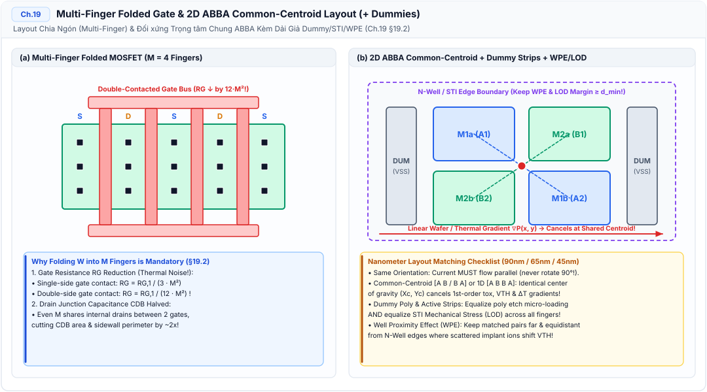

---
{
  "id": "concept-integrated-resistors-and-capacitors-cmos",
  "kind": "concept",
  "domain": "nonideal-and-physical",
  "title_vi": "Điện trở và Tụ điện Tích hợp trên Chip CMOS: Chặn Silicide, Phi tuyến Vùng nghèo, Hằng số Thời gian Kênh Tụ MOS & Tụ MOM/MIM (Integrated Passives)",
  "title_en": "Monolithic CMOS Resistors and Capacitors: Silicide-Block Poly, N-Well Depletion Nonlinearity, MOS Cap Channel RC, and MOM/MIM Bottom-Plate Rules",
  "summary": "Phân tích định lượng và quy tắc bố cục mặt bằng cho mọi phần tử thụ động tích hợp trong CMOS: điện trở polysilicon chặn silicide (RPO) có hai đầu silicide hạ điện trở tiếp xúc và ghép bù hệ số nhiệt so với điện trở giếng n bị vùng nghèo bóp nghẹt gây sai lệch tới 60% trên thang chia áp; sai số tích phân điện tích phi tuyến và hằng số thời gian kênh phân bố L^2/(12*mu*VOV) của tụ cổng MOS; cấu trúc tụ kim loại tuyến tính MOM đan ngón ngang và MIM điện môi chuyên dụng cùng định luật đấu bản cực đáy ký sinh CP.",
  "diagram": "../../diagrams/common-centroid-multifinger.svg",
  "razavi_refs": [
    {
      "chapter": 18,
      "section": "18.7.2",
      "pages": "721-727",
      "equations": ["18.1", "18.2", "18.3", "18.4"]
    },
    {
      "chapter": 19,
      "section": "19.2.6",
      "pages": "746-753",
      "equations": ["19.10", "19.11", "19.12", "19.13"]
    }
  ],
  "glossary_codes": [
    "T319",
    "T857",
    "T1080",
    "T1213",
    "T1687",
    "T1923",
    "T1953",
    "T2014",
    "T2029",
    "T2056",
    "T2125",
    "T2131",
    "T2194",
    "T2195"
  ],
  "process_agnostic": true,
  "roles": {
    "unsilicided_poly_resistor": "Dải polysilicon dùng mặt nạ chặn silicide ở thân giữa để đạt R_sheet ~ 50–1000 Ohm/sq tuyến tính cao, tụ ký sinh thấp (~90 aF/um^2) và giữ silicide ở hai đầu tiếp xúc.",
    "nwell_and_diffused_resistors": "Các dải bán dẫn cấy trong đế/giếng chịu biến thiên chiều sâu vùng nghèo theo điện áp ngược gây phi tuyến mạnh và tụ tiếp giáp lớn xuống đế.",
    "mos_decoupling_capacitor": "MOSFET nối chung cực nguồn–máng phân cực sâu trong vùng nghịch đảo mạnh (hoặc tích lũy trong giếng n) đạt mật độ điện dung cao nhất tiến trình cho lọc nguồn cấp.",
    "mom_interdigitated_finger_cap": "Mạng các ngón kim loại đan xen ngang và xếp chồng nhiều tầng khai thác điện dung thông lượng bên (lateral flux) ở tiến trình nanomet mà không tốn thêm mặt nạ.",
    "mim_parallel_plate_cap": "Tụ bản phẳng kẹp lớp điện môi mỏng chuyên dụng giữa hai tầng kim loại trên cao đạt mật độ khá cao, siêu tuyến tính và tỷ lệ tụ ký sinh bản đáy xuống đế nhỏ nhất."
  },
  "symptoms_addressed": [
    "severe-gain-nonlinearity-and-ratio-shift-from-nwell-resistor-depletion-pinchoff",
    "resistor-ratio-error-from-serpentine-corners-and-high-nanometer-contact-resistance",
    "charge-transfer-harmonic-distortion-when-using-mos-capacitors-in-sc-amplifiers",
    "poor-high-frequency-power-supply-decoupling-due-to-long-channel-mos-cap-esr",
    "signal-attenuation-and-substrate-noise-injection-from-inverted-bottom-plate-connection"
  ],
  "limitations": [
    "absolute-sheet-resistance-and-mom-capacitance-still-vary-by-10-to-25-percent-across-wafers",
    "high-precision-unit-arrays-with-dummies-and-balanced-wiring-consume-significant-silicon-area",
    "mim-and-high-resistance-poly-layers-require-optional-analog-fabrication-masks"
  ],
  "checklists": [
    "common-mos",
    "layout-and-matching",
    "switched-capacitor",
    "bandgap-and-bias"
  ]
}
---

## 1. Bản chất Nguyên lý, Sơ đồ Mạch & Vai trò Từng Nhánh Cấu trúc

Một nghịch lý cốt lõi của ngành công nghiệp bán dẫn là các quy trình CMOS tiên tiến vốn được tối ưu hóa trước hết cho hàng tỷ cổng logic số chỉ cần hai phần tử đóng cắt NMOS và PMOS, trong khi mạch tương tự và hỗn hợp chính xác cao (Bandgap `topo-bandgap-reference-core`, bộ khuếch đại suy biến/hồi tiếp, bộ lọc tụ chuyển mạch `topo-switched-capacitor-integrator-parasitic-insensitive`, `SAR ADC` `topo-sar-adc-charge-redistribution-architecture`) lại sống dựa vào **tỷ số siêu tuyến tính và sự ổn định nhiệt của điện trở và tụ điện thụ động** (Razavi §18.7.2, tr. 721–727 & §19.2.6, tr. 746–753). Trên phiến silicon nguyên khối, không tồn tại điện trở hay tụ điện "hai chân lý tưởng": mọi phần tử đều mang sai số dung sai tuyệt đối từ $\pm 10\%$ đến $\pm 40\%$ giữa các phiến, hệ số nhiệt (`TCR` / `TCC`), hệ số điện áp (`VCR` / `VCC`), điện trở nối tiếp ký sinh và đặc biệt là **điện dung ký sinh ghép xuống đế bán dẫn (`bottom-plate capacitance` — `T319`)**.



Hệ sinh thái phần tử thụ động trong một PDK CMOS hỗn hợp tương tự–số bao gồm 5 cấu trúc vật lý đặc trưng:
1. **Điện trở Polysilicon Chặn Silicide (`Unsilicided / Silicide-Block Poly Resistor` — Hình 18.13 & 19.29):** Dùng mặt nạ `RPO/SAB` che phần thân dải poly khỏi bước phủ silicide để giữ điện trở mặt $R_\square \approx 50\text{–}300\,\Omega/\square$ (hoặc pha tạp nhẹ chuyên dụng `High-Resistance Poly` đạt $1\text{–}2\text{ k}\Omega/\square$), trong khi **vẫn giữ lại silicide ở hai đầu mút** để hạ thấp điện trở tiếp xúc kim loại–bán dẫn. Đây là tiêu chuẩn vàng cho mọi mạch tương tự chính xác.
2. **Điện trở Giếng N, Khuếch tán $n^+/p^+$, Poly Phủ Silicide & Kim loại (`Diffused / N-Well / Metal Resistors` — Hình 18.14–18.16, 19.31–19.34):** Tận dụng các lớp sẵn có của quy trình số thuần túy nhưng đánh đổi nặng nề giữa mật độ điện trở và tính phi tuyến vùng nghèo tiếp giáp $p\text{–}n$.
3. **Tụ điện Cổng `MOS` (`Inversion / Accumulation MOS Capacitor` — Hình 18.17–18.20):** Nối chung cực nguồn và cực máng làm một bản cực đối diện với cực cổng qua lớp oxit mỏng nhất toàn tiến trình ($t_{ox}$), cho mật độ điện dung cao gấp $4\text{–}10$ lần tụ kim loại nhưng phi tuyến mạnh theo điện áp phân cực và bị giới hạn tần số bởi điện trở kênh dẫn.
4. **Tụ Kim loại Đan Ngón Thông lượng Ngang (`MOM — Metal-Oxide-Metal Interdigitated Finger Capacitor` — Hình 18.21, 19.35):** Xếp chồng nhiều tầng kim loại chuẩn ($M_1 \dots M_7$) và đan xen các ngón cực dương–âm sát nhau ở khoảng cách tối thiểu nanomet để thu cả điện dung bản phẳng dọc lẫn điện dung trường rìa ngang khổng lồ với độ tuyến tính tuyệt hảo mà không tốn thêm mặt nạ chế tạo.
5. **Tụ Kim loại–Điện môi–Kim loại Chuyên dụng (`MIM Capacitor`):** Chèn một lớp điện môi mỏng mật độ cao ($\text{Si}_3\text{N}_4$ hoặc $\text{High-k}$, đạt $1\text{–}4\text{ fF}/\mu\text{m}^2$) kẹp ngay giữa hai tầng kim loại trên đỉnh (ví dụ `Metal 8` và `Metal 8.5 / CTM`), cách rất xa đế bán dẫn nên giảm thiểu tối đa điện dung ký sinh bản đáy $C_P/C \approx 1\%\text{–}3\%$.

---

## 2. Hệ Phương trình Cốt lõi & Tư duy "Nhìn Mạch Đọc Nhanh" (Analysis by Inspection)

### 2.1. Giải tích Độ Phi tuyến Khủng khiếp của Điện trở Giếng N (Ví dụ 19.3, Phương trình 19.10–19.13)
Tại sao cấm tuyệt đối việc dùng điện trở giếng n (`N-well resistor`, $R_\square \approx 1\text{ k}\Omega/\square$) làm thang chia áp ADC hay điện trở hồi tiếp tuyến tính? Xét thang điện trở 128 bậc (Hình 19.33) chạy từ $V_1$ lên $V_2$ trên nền đế $p$ nối đất ($0\text{ V}$). Tiếp giáp ngược giữa giếng n (pha tạp $N_{\text{well}}$, chiều sâu hình học $t_0$) và đế $p$ mở rộng vùng nghèo có bề rộng $x_d(V_R) = \sqrt{\frac{2\epsilon_{\text{si}}(\phi_B + V_R)}{q N_{\text{well}}}}$, ăn lẹm trực tiếp vào chiều dày dẫn điện hiệu dụng $t_{\text{eff}}(V_R) = t_0 - x_d(V_R)$ (tương tự hiệu ứng kẹp kênh JFET!). Tỷ số giữa điện trở bậc trên cùng $R_{128}$ (ở thế cao $V_2$) so với bậc dưới cùng $R_1$ (ở thế thấp $V_1$) theo phương trình (19.10)–(19.13) là:

$$\frac{R_{128}}{R_1} = \frac{t_0 - \sqrt{\dfrac{2\epsilon_{\text{si}}}{q N_{\text{well}}}(\phi_B + V_1)}}{t_0 - \sqrt{\dfrac{2\epsilon_{\text{si}}}{q N_{\text{well}}}(\phi_B + V_2)}} \approx 1 + \frac{1}{t_0}\sqrt{\frac{2\epsilon_{\text{si}}}{q N_{\text{well}}}\phi_B}\left(\sqrt{1 + \frac{V_2}{\phi_B}} - \sqrt{1 + \frac{V_1}{\phi_B}}\right)$$

*(Lưu ý dấu vật lý chuẩn: ở điện thế dương cao hơn $V_2 > V_1$, vùng nghèo nở rộng hơn làm thiết diện dẫn hẹp hơn $\implies R_{128} > R_1$!)* Với số liệu điển hình trong sách Razavi ($t_0 = 2\,\mu\text{m}$, $N_{\text{well}} = 10^{16}\text{ cm}^{-3}$, $\phi_B = 0.7\text{ V}$), sự sai lệch giữa $R_{128}$ và $R_1$ vọt lên tới **gần $60\%$**! Hơn thế nữa, do khuếch tán biên sâu hàng micromet, ngay cả ở cùng điện áp, $R_\square$ của giếng n cũng biến thiên mạnh theo bề rộng $W$ (từ $\sim 800\,\Omega/\square$ ở $W = 1\,\mu\text{m}$ xuống $\sim 600\,\Omega/\square$ ở $W = 5\,\mu\text{m}$, Hình 19.31).

### 2.2. Điện trở Đầu Tiếp xúc, Ghép Bù Hệ số Nhiệt Zero-TC và Lập Tỷ số Phân số (Ví dụ 19.2)
Với một thanh điện trở polysilicon chặn silicide có chiều dài vùng chặn $L$ và chiều rộng $W$ (Hình 19.29a), tổng điện trở thực tế gồm điện trở thân cộng hai đầu tiếp xúc (`contact/interface resistance`, mỗi lỗ tiếp xúc $80\text{ nm} \times 80\text{ nm}$ ở `40nm` nặng tới $30\text{–}40\,\Omega$!):

$$R_{\text{total}}(T) = \left[R_{\square 0}\frac{L}{W} + \frac{2 R_{\text{end}}}{W}\right] \cdot \left[1 + \text{TC}_1 (T - T_0) + \text{TC}_2 (T - T_0)^2\right]$$

- **Mẹo Nhân Đôi Kích thước Hạ Sai số Tiếp xúc (Hình 19.29b):** Khi tăng gấp đôi cả $W$ lẫn $L$ ($2W, 2L$), tỷ số $L/W$ không đổi nhưng số lỗ tiếp xúc đặt được ở hai đầu tăng gấp đôi khiến thành phần bất định $2 R_{\text{end}}/(2W)$ giảm một nửa!
- **Ghép Nối tiếp Bù Nhiệt Độ (`Composite Zero-TC Resistor`):** Poly pha tạp $p^+$ thường có $\text{TC}_1 \approx +0.1\%/^\circ\text{C}$ trong khi loại poly pha tạp $n^+$ hoặc `HR-poly` có $\text{TC}_1 < 0$ (ví dụ $-0.1\%/^\circ\text{C}$, §19.2.6 tr. 748). Mắc nối tiếp hai đoạn $R_A + R_B$ sao cho $R_A \text{TC}_{1A} + R_B \text{TC}_{1B} = 0$ tạo ra điện trở tổng gần như bất biến theo nhiệt độ cho mạch phân cực `Constant-Gm` (`topo-constant-gm-bias-and-supply-sensitivity`)! *(Cẩn trọng: vì $R_A$ và $R_B$ dùng hai mặt nạ cấy khác nhau nên chúng biến thiên quy trình độc lập, không dùng cách trộn này cho hai vế của một tỷ số cần khớp tuyệt đối!)*
- **Kỹ thuật Quy đổi Tỷ số Lẻ sang Phân số Đơn vị Nguyên (Ví dụ 19.2, Hình 19.28b):** Cần tỷ số $R_2 / R_1 = 5.34$ trong lõi Bandgap với $n = 25$: tuyệt đối không vẽ hai thanh có chiều dài lẻ khác nhau! Ta xấp xỉ $5.34 \approx \frac{16}{3} = 5.333$: xây dựng từ **19 thanh đơn vị giống hệt nhau $R_u$**, trong đó $R_1 = \frac{1}{3} R_u$ gồm **3 thanh mắc song song** đặt ngay chính giữa tâm mảng, còn $R_2 = 16 R_u$ gồm **4 nhánh đối xứng hai bên (mỗi nhánh 4 thanh mắc nối tiếp)** kèm hai thanh giả `Dummy` khóa ở hai bìa ngoài!

### 2.3. Méo Truyền Điện tích và Hằng số Thời gian Nội tại $\tau \propto L^2$ của Tụ Cổng MOS (Ví dụ 18.1, PT 18.1–18.4)
1. **Tại sao Tụ MOS phá hỏng mạch Nhân Đôi Điện áp SC? (Ví dụ 18.1, Hình 18.18):**
   Trong mạch nhân đôi `Multiply-by-Two` (`topo-switched-capacitor-unity-and-multiplying-amps`), tụ $C_1$ nạp tới $V_{in}$ ở pha lấy mẫu rồi xả hết về hiệu điện thế $0\text{ V}$ sang tụ tuyến tính $C_2$ ở pha khuếch đại. Nếu $C_1$ là tụ cổng MOS, khi hiệu áp ngang qua $C_1$ giảm xuống dưới $V_{TH}$, kênh dẫn biến mất làm điện dung sụt mạnh trên đường xả; tổng điện tích truyền sang $C_2$ chỉ bằng diện tích dưới đường cong $C_1(V)$ (PT 18.1):
   $$V_{out} = V_{in} + \frac{1}{C_2}\int_{0}^{V_{in}} C_1(V)\,dV \neq 2 V_{in}$$
   gây suy hao độ lợi và méo hài nghiêm trọng!
2. **Điện trở Nối tiếp Kênh dẫn & Quy tắc Vẽ Ngón Rộng–Ngắn cho Tụ Lọc Nguồn MOS (Hình 18.19–18.20, PT 18.2–18.4):**
   Khi dòng xoay chiều chạy vào cực cổng tụ MOS, dòng hạt tải trong kênh rút ra hai phía cực nguồn và cực máng đối xứng, nhìn thấy hai nửa điện trở kênh mắc song song $(R_{\text{tot}}/2) \parallel (R_{\text{tot}}/2) = R_{\text{tot}}/4$ với $R_{\text{tot}} = [\mu C_{ox}(W/L)(V_{GS} - V_{TH})]^{-1}$ và $C_{ch} = W L C_{ox}$:

   $$\tau_{\text{lumped}} = \frac{R_{\text{tot}}}{4} C_{ch} = \frac{L^2}{4\mu(V_{GS} - V_{TH})}, \qquad \tau_{\text{distributed}} = \frac{L^2}{12\mu(V_{GS} - V_{TH})}$$

   Để tụ đạt hệ số phẩm chất cao ($R_S < \frac{0.1}{\omega C}$), **chiều dài kênh $L$ phải ngắn tối đa**! Một tụ lọc nguồn `decap` $10\text{ pF}$ vẽ thành một khối vuông khổng lồ $L = 30\,\mu\text{m}$ sẽ tự biến thành điện trở ở hàng trăm MHz và hoàn toàn vô dụng trước xung chuyển mạch nhanh; bắt buộc phải băm nhỏ thành hàng trăm ngón rộng và ngắn ($L \approx 0.2\text{–}0.5\,\mu\text{m}$) mắc song song!

### 2.4. Định luật Đấu Bản Cực Đáy cho Tụ Tuyến tính `MOM` / `MIM` (Ví dụ 18.2 & 19.4, Hình 18.22, 19.35–19.38)
Xếp chồng càng nhiều tầng kim loại từ trên cao xuống thấp (`Metal 9` xuống `Metal 1` + `Poly`, Hình 19.35d) giúp mật độ điện dung tăng gấp $9$ lần (từ $\sim 38\text{ aF}/\mu\text{m}^2$ một cặp lên $> 350\text{ aF}/\mu\text{m}^2$, hoặc $1.5\text{–}2.5\text{ fF}/\mu\text{m}^2$ khi đan ngón ngang `MOM` ở `65nm/45nm`), nhưng khoảng cách từ lớp kim loại đáy xuống đế thu hẹp lại kéo tỷ số ký sinh bản đáy $C_P / C$ tăng từ $5\%$ lên $20\%$!
- Trong Ví dụ 18.2 (Hình 18.22), ghép AC qua tụ $C_C$ vào cổng bộ khuếch đại có tụ vào $C_{in}$:
  - **Đấu đúng (Bản đáy $C_P$ quay về nguồn phát $R_{out}$, bản đỉnh nối $C_{in}$ — Hình 18.22a):** Độ lợi truyền áp đạt $\frac{C_C}{C_C + C_{in}}$ (hoàn toàn miễn nhiễm với $C_P$, chỉ làm tăng nhẹ hằng số thời gian tại nút lái).
  - **Đấu ngược (Bản đáy $C_P$ nối vào nút cổng $C_{in}$ — Hình 18.22b):** Bộ chia áp tụ bị đè xuống thành $\frac{C_C}{C_C + C_{in} + \alpha_p C_C} < \frac{1}{1 + \alpha_p}$; với $\alpha_p = 0.25$, dù tăng $C_C \to \infty$ tín hiệu vẫn mất vĩnh viễn $\ge 20\%$ biên độ kèm theo bơm thẳng nhiễu đế bán dẫn vào ngõ vào bộ khuếch đại!

---

## 3. Bất biến Cấu trúc & Các Bẫy Lỗi Kinh điển (Structural Invariants & Traps)

- **`[INV-PAS-01]` Bất biến Cấm Vẽ Khúc Cua Ngoằn ngoèo (`No Serpentine Corners`) cho Điện trở Chính xác (Hình 19.30):**
  Một góc vuông $90^\circ$ trong đường ngoằn ngoèo (`serpentine`) chỉ đóng góp khoảng $\sim 0.56\,R_\square$ do dòng điện dồn cục ở góc trong và rất nhạy với độ bo góc quang khắc! Điện trở chính xác cao bắt buộc phải tách thành **các thanh thẳng song song bằng nhau** nối đầu bằng cầu kim loại `Metal 1` có số lượng lỗ tiếp xúc giống hệt nhau ở mọi thanh (Hình 19.30a).
- **`[INV-PAS-02]` Bất biến Bề rộng Tối thiểu Chống Biến thiên Ăn mòn Biên (`Minimum Width >= 3x–5x DRC Min`):**
  Không bao giờ dùng bề rộng tối thiểu của luật DRC ($W_{\min} \approx 0.06\text{–}0.15\,\mu\text{m}$) cho điện trở lập tỉ số: sai số ăn mòn cạnh $\Delta W$ cố định vài nanomet sẽ gây lệch hàng phần trăm! Luôn chọn $W_{\text{unit}} \ge 1.0\text{–}2.0\,\mu\text{m}$ cho điện trở Bandgap/DAC.
- **`[TRAP-PAS-01]` Bẫy Điện dung Dây Nối Phá Vỡ Tỷ số Mảng Tụ Nhỏ `C-DAC` (Hình 19.37–19.38):**
  Khác với transistor và điện trở, một tụ đơn vị $C_u = 2\text{–}5\text{ fF}$ trong `SAR ADC` (`topo-sar-adc-charge-redistribution-architecture`) nhỏ tới mức chỉ cần một đoạn dây kim loại dài $10\,\mu\text{m}$ chạy gần bản cực đỉnh đi ngang qua bản cực đáy đã cộng thêm $0.2\text{–}0.5\text{ fF}$ điện dung ký sinh giao thoa (`routing crossover capacitance`), phá nát hoàn toàn tỷ số nhị phân $C_1/C_2 = 8$ dù các ô tụ vẽ đối xứng tâm chung hoàn hảo (Hình 19.38)! Phải định tuyến bản đỉnh và bản đáy ở hai tầng kim loại tách biệt đối xứng hình cây hoặc bọc lồng chắn đất cân bằng cho từng ô đơn vị!
- **`[TRAP-PAS-02]` Bẫy Đặt Đường Dây Kim loại Chạy Ngang Trên Đỉnh Điện trở Poly Chính xác:**
  Đặt thanh nguồn hoặc dây xung nhịp chạy trên đỉnh thân điện trở poly không silicide vừa bơm nhiễu dung kháng phân bố vừa gây hiệu ứng cổng trường (`back/top-gate modulation`) làm điều chế nồng độ hạt tải bề mặt của dải poly biến thiên theo điện áp dây trên đỉnh! Luôn giữ vùng không gian trống bên trên mảng điện trở tham chiếu.
- **`[TRAP-PAS-03]` Bẫy Sụp Đổ Điện dung Tụ MOS Lọc Nguồn Khi Điện áp Phân cực Rơi Vào Vùng Nghèo:**
  Nếu dùng tụ cổng NMOS thường (`n+` trong đế `p`) làm tụ nối tắt tại một nút phân cực nội chỉ có $V_{\text{bias}} = 0.35\text{ V} < V_{TH}$, tụ rơi đúng vào đáy thung lũng vùng nghèo khiến điện dung thực tế tụt mất $70\%$! Với nút điện áp thấp hơn $V_{TH}$, phải đổi sang dùng **tụ MOS chế độ tích lũy (`Accumulation-mode MOS cap`: `n+` đặt trong `N-well`)** hoặc đảo cực bản cổng/kênh thích hợp.

---

## 4. Lộ trình Nâng cấp Cấu trúc & Bát giác Đánh đổi (Upgrade Paths & Design Octagon)

Trong **Bát giác Thiết kế (`concept-analog-design-octagon`)**, lựa chọn loại điện trở và tụ điện là bài toán cân bằng ba chiều giữa **Diện tích Mặt bằng (`Area`)**, **Độ Tuyến tính / Độ Khớp (`Linearity & Matching`)** và **Ký sinh Tần số Cao (`Bottom-Plate Cap & ESR`)**:
- **Ứng dụng trực tiếp vào Tham chiếu & Phân cực:** Mạng điện trở đơn vị `RPO Poly` tâm chung quyết định độ chính xác không chỉnh (`untrimmed accuracy`) của `topo-bandgap-reference-core` và `topo-constant-gm-bias-and-supply-sensitivity`.
- **Ứng dụng trực tiếp vào Mạch Lấy mẫu & Chuyển đổi Dữ liệu:** Tụ `MOM`/`MIM` cùng quy tắc đấu bản cực đáy là nền tảng vật lý cho bộ khuếch đại `topo-switched-capacitor-unity-and-multiplying-amps`, bộ tích phân miễn nhiễm ký sinh `topo-switched-capacitor-integrator-parasitic-insensitive` và mảng chia điện tích `topo-sar-adc-charge-redistribution-architecture`.

| Hạng mục Thiết kế | Tụ Cổng `MOS` (Đa ngón ngắn) | Tụ Đan ngón `MOM` (`M3–M7` chuẩn) | Tụ Bản phẳng `MIM` (Mặt nạ riêng) |
| :--- | :--- | :--- | :--- |
| **Mật độ điện dung ($\text{fF}/\mu\text{m}^2$)** | **Rất cao ($5\text{–}15$)** | Khá cao ở nanomet ($1.0\text{–}2.5$) | Cao vừa ($1.0\text{–}4.0$) |
| **Hệ số điện áp (`VCC`) & Độ tuyến tính** | Kém (phi tuyến mạnh theo $V_{GS}$) | **Xuất sắc ($< 20\text{–}50\text{ ppm/V}$)** | **Xuất sắc ($< 20\text{–}50\text{ ppm/V}$)** |
| **Tỷ số ký sinh bản đáy $C_P / C$** | $10\%\text{–}20\%$ (tụ tiếp giáp S/D) | $3\%\text{–}10\%$ (giảm khi bỏ `M1/M2`) | **Thấp nhất ($1\%\text{–}3\%$ ở tầng đỉnh)** |
| **Chi phí mặt nạ & Dòng rò DC** | 0 mặt nạ phụ; **chú ý rò cổng $I_G$ ở core!** | **0 mặt nạ phụ**; dòng rò $= 0$ tuyệt đối | Tốn thêm 1–2 mặt nạ; dòng rò $\approx 0$ |
| **Vai trò tối ưu trên chip** | Tụ lọc nguồn DC `decap` (ưu tiên loại I/O) | **Chuẩn chủ lực cho SC, SAR C-DAC, PLL** ở $\le 65\text{nm}$ | Chuẩn cho RF LC tank, SC/ADC ở $\ge 90\text{nm}$ |

---

## 5. Thích ứng Đa Tiến trình (90nm / 65nm / 45nm) & Cách Kiểm chứng trong Cadence / Spectre

### 5.1. Quy tắc Thích ứng Phần tử Thụ động ở `90nm / 65nm / 45nm`
1. **Tối ưu Tầng Kim loại cho Tụ `MOM` Pcell (`start_metal` $\to$ `end_metal`):**
   Trong các bộ PDK `65nm/45nm`, Pcell tụ `momcap` cho phép chọn tầng kim loại bắt đầu và kết thúc:
   - Với **tụ lọc vòng PLL $C_1, C_2$** cần tiết kiệm diện tích và một đầu nối cố định xuống đất: chọn chồng tối đa các tầng mỏng khít `M1` $\to$ `M6` để cực đại hóa mật độ điện dung.
   - Với **tụ hồi tiếp/lấy mẫu SC tốc độ cao hoặc tụ ghép AC RF** nhạy ký sinh bản đáy $C_P$: nâng tầng bắt đầu lên `M3` hoặc `M4` (`M4` $\to$ `M7`) để tăng khoảng cách $h$ xuống đế bán dẫn, ép $C_P / C < 3\%$!
2. **Định cỡ Thanh Điện trở Đơn vị (`Unit Resistor Sizing`):**
   Chọn $W_{\text{unit}} \ge 1.5\,\mu\text{m}$, $L_{\text{unit}} \ge 8\text{–}15\,\mu\text{m}$ trên lớp `rppolywo` (hoặc `rnhpoly` không silicide) sao cho điện trở thân $\ge 50\times$ điện trở hai đầu tiếp xúc, luôn đặt vòng tiếp xúc đế `p+ sub tap` nối đất cố định bên dưới/xung quanh mảng điện trở để định nghĩa điện thế tụ ký sinh xuống đế đồng nhất.

### 5.2. Phác đồ Kiểm chứng Dung sai Tuyệt đối, Phi tuyến Điện áp và Ký sinh Bản đáy trong Spectre
Nhiều kỹ sư chỉ chạy góc `TT/SS/FF` của MOSFET mà quên rằng trong PDK công nghiệp, phần tử thụ động nằm trong các `section` góc riêng biệt (`res_min / res_max`, `cap_min / cap_max`)! Luôn phải kiểm tra tổ hợp chéo (`MOS_FF + RES_MIN + CAP_MIN` cho băng thông vọt cực đại gây mất ổn định, và `MOS_SS + RES_MAX + CAP_MAX` cho thời gian xác lập chậm nhất!):

```spice
// Spectre Verification: Kiem chung dung sai Cheo (Cross-Corners) + Huong dau Ban cuc Day Tu MOM
simulator lang=spectre
// Nho bat day du section goc cua ca MOSFET, Resistor (res_max/min) va Capacitor (cap_max/min)!
// include "models.scs" section=ss_mos
// include "models.scs" section=max_res
// include "models.scs" section=max_cap

// Mang ty so R2/R1 = 16/3 bang 19 thanh don vi giong het nhau (Razavi Ex. 19.2):
// R_unit: w=2u, l=12u (khong bao gio doi W, L giua R1 va R2!)
R1_unit (v_mid vx sub_gnd) rppolywo w=2u l=12u m=3
// R2 gom 4 nhanh mac noi tiep (hoac dung bus noi tiep 16 thanh don vi cung huong)

// Kiem tra huong ban cuc Tu MOM 3 chan: (plus = Top Plate sach, minus = Bottom Plate, sub = Substrate)
// DAU DUNG trong SC / AC Coupling: minus (Bottom Plate) quay ve phia nguon lai tro khang thap!
C_feedback (v_virtual_gnd v_opamp_out sub_gnd) momcap w=10u l=10u start_layer=3 end_layer=6
```

---

## 6. Mốc Đối chiếu Sách Razavi & Thuật ngữ Chuẩn CLB

| Mục Sách Razavi (2nd Ed.) | Trang, Hình & Phương trình | Nội dung Đối chiếu Trọng tâm | Mã Thuật ngữ Chuẩn CLB |
| :--- | :--- | :--- | :--- |
| **§18.7.2 Passive Devices** | Tr. 721–727, Eq. `(18.1)–(18.4)`, Ex. `18.1–18.2`, Fig. `18.13–18.22` | Điện trở poly chặn silicide vs giếng n; méo tích phân điện tích tụ MOS, hằng số thời gian kênh $\frac{L^2}{4\mu V_{OV}}$ và quy tắc đấu bản đáy $C_P$ | `T319` (điện dung đáy tiếp giáp), `T857` (tụ điện), `T2014` (điện trở), `T2056` (đế bán dẫn loại p) |
| **§19.2.6 Resistors Layout** | Tr. 746–750, Eq. `(19.10)–(19.13)`, Ex. `19.2–19.3`, Fig. `19.26–19.34` | Tổng hợp tỷ số lẻ $16/3$ từ các thanh đơn vị, nhân đôi $W, L$ giảm điện trở tiếp xúc, tránh góc ngoằn ngoèo và chứng minh sai số $60\%$ của thang điện trở giếng n | `T2125` (các tỉ số điện trở), `T2131` (hệ số nhiệt của điện trở), `T1953` (giá trị linh kiện thụ động), `T1080` (nhiễu nhiệt điện trở) |
| **§19.2.6 Capacitors & Diodes** | Tr. 750–753, Ex. `19.4`, Fig. `19.35–19.39` | Tụ kẹp nhiều tầng kim loại tăng mật độ $9\times$, bố cục tâm chung kèm vòng tụ giả, nhạy cảm điện dung dây nối và bẫy PNP ký sinh của diode trong giếng n | `T2194` (bố trí cài răng lược và đồng tâm chung), `T2195` (phần tử giả), `T1687` (tụ bù) |
