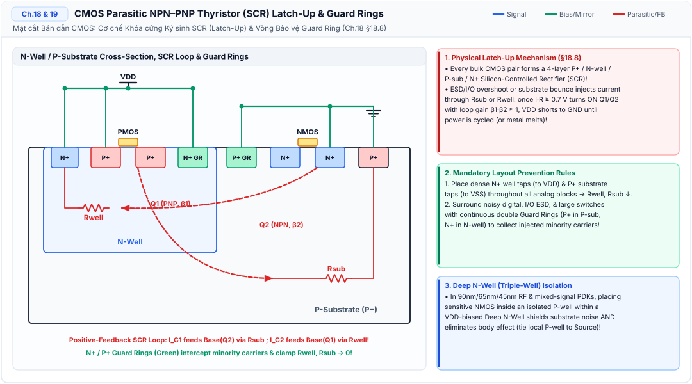

---
{
  "id": "law-cmos-wells-and-latchup-guard-rings",
  "kind": "law",
  "domain": "nonideal-and-physical",
  "title_vi": "Định luật Mặt cắt Vật lý Giếng CMOS, Phần tử Thụ động, Hiệu ứng Anten & Chống Chốt Ký sinh Latch-Up (CMOS Wells, Antenna & Latch-Up)",
  "title_en": "Physical CMOS Wells, Passive Cross-Sections, Antenna Oxide Breakdown, and SCR Latch-Up Prevention",
  "summary": "Giải phẫu mặt cắt công nghệ CMOS (đế bán dẫn p, giếng n lùi nồng độ, giếng ba lớp Deep N-well, cổng tự căn chỉnh và silicide, điện trở/tụ thụ động và điện dung đáy ký sinh), cơ chế tích điện plasma gây thủng oxit cổng (hiệu ứng Anten) và vòng hồi tiếp dương thyristor SCR gây chốt nguồn Latch-Up cùng quy tắc vòng bảo vệ Guard Ring.",
  "diagram": "../../diagrams/latchup-and-guard-rings.svg",
  "razavi_refs": [
    {
      "chapter": 18,
      "section": "18.1, 18.5, 18.7",
      "pages": "712-713, 716-729",
      "equations": ["18.1", "18.2", "18.4", "18.10", "18.11"]
    },
    {
      "chapter": 18,
      "section": "18.8",
      "pages": "730-731",
      "equations": []
    },
    {
      "chapter": 19,
      "section": "19.1.1-19.1.2, 19.3",
      "pages": "734-736, 761-762",
      "equations": []
    }
  ],
  "glossary_codes": [
    "T024",
    "T084",
    "T129",
    "T130",
    "T131",
    "T132",
    "T134",
    "T008",
    "T319",
    "T1184",
    "T2052",
    "T2056"
  ],
  "process_agnostic": true,
  "roles": {
    "p_substrate_and_wells": "Đế bán dẫn loại p chung (hoặc hệ giếng đôi / giếng n sâu ba lớp) định hình nền cách ly p-n ngược và quyết định cực thân (bulk) của mọi NMOS/PMOS.",
    "passive_resistors_and_caps": "Điện trở poly chặn silicide / khuếch tán / giếng n và tụ MOS / MOM / MIM mang điện trở mặt R_sheet cùng điện dung đáy tiếp giáp ký sinh xuống đế.",
    "plasma_antenna_jumper_diode": "Cầu nhảy kim loại lên lớp trên cùng hoặc diode phân cực ngược bảo vệ oxit cổng mỏng khỏi điện tích ion plasma trong quá trình ăn mòn khô RIE.",
    "parasitic_scr_bjt_pair": "Cặp BJT ký sinh PNP dọc/ngang trong giếng n và NPN ngang trong đế p nối chéo cực góp – cực gốc tạo mạch thyristor hồi tiếp dương chốt cứng VDD xuống GND.",
    "substrate_taps_and_guard_rings": "Lưới tiếp xúc p+ nối đất, n+ nối VDD mật độ cao và vòng bảo vệ kép thu hút hạt tải thiểu số, hạ điện trở đế/giếng để khóa chặt điều kiện kích hoạt Latch-Up."
  },
  "symptoms_addressed": [
    "catastrophic-vdd-to-gnd-scr-latchup-burnout",
    "fabrication-gate-oxide-breakdown-antenna-violation",
    "bottom-plate-parasitic-capacitance-gain-attenuation",
    "nwell-resistor-voltage-nonlinearity-and-substrate-coupling",
    "substrate-noise-injection-into-analog-nmos-bulk"
  ],
  "limitations": [
    "standard-p-substrate-ties-all-regular-nmos-bulks-to-global-ground",
    "deep-nwell-and-double-guard-rings-consume-substantial-silicon-area",
    "silicide-block-poly-and-mim-caps-require-extra-analog-masks"
  ],
  "checklists": [
    "common-mos",
    "layout-and-matching",
    "switched-capacitor"
  ]
}
---

## 1. Bản chất Nguyên lý, Sơ đồ Mạch & Vai trò Từng Nhánh Cấu trúc

Trên sơ đồ nguyên lý, kỹ sư thường vẽ MOSFET, điện trở và tụ điện như những phần tử lơ lửng độc lập trong chân không; nhưng trên phiến bán dẫn thực tế của công nghệ **MOS bổ sung (`CMOS` — `T024`)**, mọi linh kiện đều cùng chung sống bên trong một khối đơn tinh thể **đế bán dẫn (`substrate` — `T084`)** có độ dày vài trăm micromet (Razavi Chương 18). Mọi vùng pha tạp khác dấu đặt cạnh nhau tự động hình thành các tiếp giáp diode p–n, tụ vùng nghèo phụ thuộc điện áp và đặc biệt là các transistor lưỡng cực BJT ký sinh bốn lớp `p–n–p–n`. Do đó, hiểu thấu mặt cắt vật lý dọc (`cross-section`) của phiến wafer là ranh giới sống còn giữa một thiết kế chỉ chạy trên SPICE và một con chip silicon sống sót ngoài đời thực!



Mặt cắt vật lý tổng quát của công nghệ CMOS hiện đại được tổ chức thành 5 cấu trúc thành phần cốt lõi:
1. **Hệ Đế và Giếng Bán dẫn (`Wells` — `T129`):** Trên nền **đế bán dẫn loại p (`p-type substrate` — `T2056`)** nối tiềm năng thấp nhất ($GND$), các transistor NMOS được cấy trực tiếp hoặc đặt trong **giếng p (`P-well` — `T131`)**, còn PMOS bắt buộc nằm trong đảo **giếng n (`N-well` — `T130`)** nối tiềm năng cao nhất ($V_{DD}$) để khóa ngược tiếp giáp giếng–đế. Ở các tiến trình hỗn hợp tương tự–số tiên tiến, lớp **giếng n sâu (`Deep n-well` — `T132`, cấu trúc `Triple-Well`)** được cấy chìm bên dưới một giếng p cục bộ, cho phép tách rời hoàn toàn cực thân (`bulk`) của NMOS nhạy cảm khỏi đế p ồn ào chung của toàn chip (cho phép nối $V_{SB} = 0$ để triệt hiệu ứng thân!).
2. **Cấu trúc Linh kiện Tích cực Tự căn chỉnh (`Self-Aligned Gate`, Spacer LDD & Silicide — §18.7.1):** Cổng polysilicon được khắc **trước** khi cấy ion nguồn/máng $n^+/p^+$ để biên kênh dẫn tự căn chỉnh chính xác tuyệt đối với mép cổng (Hình 18.9). Sau đó, lớp vách ngăn oxit (`oxide sidewall spacer`) được tạo ở sườn cổng để định hình vùng máng pha tạp nhẹ (`LDD` giảm điện trường đỉnh cực máng) và cho phép phủ hợp chất kim loại–silic tự căn chỉnh (**`salicide` — `silicidation`**, Hình 18.10), kéo điện trở mặt của cổng poly và vùng S/D từ vài chục $\Omega/\square$ xuống chỉ còn vài $\Omega/\square$ mà không gây chập cổng–nguồn. Các lỗ tiếp xúc (`contact windows`) bắt buộc chia thành ma trận ô kích thước cố định nhỏ để tránh hiện tượng kim loại ăn xuyên thủng tiếp giáp xuống đế (**`contact spiking`**, Hình 18.12).
3. **Mặt cắt Điện trở & Tụ điện Thụ động (§18.7.2):** Gồm điện trở poly chặn silicide (`silicide-block poly`), điện trở khuếch tán, điện trở giếng n và các tụ điện cổng `MOS`, tụ kim loại đan ngón/xếp lớp `MOM` hoặc tụ điện môi chuyên dụng `MIM` — tất cả đều gánh **điện dung đáy tiếp giáp (`bottom-plate capacitance` — `T319`)** ghép xuống đế.
4. **Hiệu ứng Anten (`Antenna Effect` — `T008`, §19.1.2):** Đường dây kim loại hoặc poly diện tích lớn nối vào cổng MOS thu gom ion tự do trong buồng khắc plasma khô (`RIE`), tích áp tĩnh điện chọc thủng vĩnh viễn lớp oxit cổng siêu mỏng ngay trên dây chuyền chế tạo.
5. **Mạng Thyristor Ký sinh `SCR` & Vòng Bảo vệ (`Latch-Up & Guard Rings` — §18.8, §19.3):** Cặp **transistor lưỡng cực pnp (`T2052`)** ký sinh $Q_1$ và transistor lưỡng cực npn ký sinh $Q_2$ móc chéo thông qua điện trở giếng $R_W$ và điện trở đế $R_{\text{sub}}$ tạo **hồi tiếp dương (`positive feedback` — `T1184`)**, đòi hỏi mạng tiếp xúc đế/giếng dày đặc và vòng bảo vệ `Guard Ring` để triệt tiêu.

**Bảng Quy tắc Phân cực Ba Lớp Giếng (`Triple-Well / Deep N-Well Biasing Hierarchy`):**
Khi sử dụng cấu trúc `Deep N-well` (`DNW`) để cô lập một transistor NMOS tương tự nằm trong giếng p cục bộ (`Isolated P-well — IPW`) trên nền đế chung `P-sub`:
- **Đế chung (`P-sub`):** Luôn nối cố định vào mức điện thế thấp nhất toàn chip ($V_{\text{sub}} = GND_{\text{min}}$).
- **Lồng giếng n sâu (`DNW` + thành bên `N-well` bao kín):** Bắt buộc nối vào một đường nguồn dương sạch ($V_{\text{DNW}} = V_{DDA}$) để khóa ngược đồng thời tiếp giáp ngoài `DNW / P-sub` lẫn tiếp giáp trong `IPW / DNW`.
- **Giếng p cục bộ (`IPW` — cực thân của NMOS):** Được phép nối trực tiếp vào cực nguồn riêng của NMOS ($V_{\text{IPW}} = V_S \le V_{\text{DNW}} - 0.5\text{ V}$) để triệt tiêu hoàn toàn hiệu ứng thân ($V_{SB} = 0 \implies \Delta V_{TH,\text{body}} = 0$) và chắn đứng nhiễu số từ `P-sub` qua lồng chắn AC `DNW`!

## 2. Hệ Phương trình Cốt lõi & Tư duy "Nhìn Mạch Đọc Nhanh" (Analysis by Inspection)

### 2.1. Điện trở Mặt ($R_{\square}$), Các Phần tử Thụ động và Định luật Đấu Bản Cực Tụ Ký sinh
Với một dải vật liệu dẫn điện đồng nhất chiều dài $L$, chiều rộng $W$ và bề dày cố định $t$ do công nghệ ấn định, điện trở của dải được tính gọn bằng tích số ô vuông $N_{\square} = L / W$ với **điện trở mặt (`sheet resistance` — §18.1, tr. 713)**:

$$R = \frac{\rho L}{W \cdot t} = R_{\square} \left(\frac{L}{W}\right), \qquad \text{với } R_{\square} \equiv \frac{\rho}{t} \;\; [\Omega/\square]$$

- **So sánh nhanh các loại điện trở CMOS (§18.7.2 & §19.2.6):**
  - *Poly chặn silicide (`Silicide-Block / RPO Poly`, Hình 18.13):* $R_{\square} \approx 50\text{–}300\ \Omega/\square$ (biến thiên PVT $\pm 20\%$, hệ số nhiệt $\pm 0.1\%/^\circ\text{C}$), tuyến tính cao, tụ ký sinh xuống đế rất nhỏ ($\sim 90\text{ aF}/\mu\text{m}^2$ đáy + $100\text{ aF}/\mu\text{m}$ rìa), hai đầu giữ lại silicide để hạ điện trở tiếp xúc — **lựa chọn chuẩn mực số 1 cho mạch tương tự**.
  - *Giếng n (`N-well Resistor`, Hình 18.14–18.16):* $R_{\square} \approx 1\text{ k}\Omega/\square$ nhưng sai số tiến trình lên tới $\pm 40\%$, hệ số nhiệt lớn ($+0.2\text{ đến }+0.5\%/^\circ\text{C}$), tụ vùng nghèo xuống đế rất lớn và **cực kỳ phi tuyến theo điện áp** vì bề rộng vùng nghèo $x_d = \sqrt{2\epsilon_{\text{si}}(\phi_B + V_R)/(q N_{\text{well}})}$ ăn lẹm thiết diện dẫn điện (Razavi Ví dụ 19.3 chứng minh thang chia áp từ $1\text{ V}\to 2\text{ V}$ bằng giếng n có thể lệch tới $60\%$!). Chỉ dùng ở nơi giá trị tuyệt đối và độ tuyến tính không quan trọng (như điện trở cách ly phân cực AC lớn $R_1$ trong Hình 18.15).
- **Tụ điện MOS vs. Tụ Tuyến tính `MOM`/`MIM` (§18.7.2, Eq. 18.1–18.4):**
  - *Tụ cổng MOS:* Có mật độ $C_{ox}$ lớn nhất nhưng phi tuyến mạnh theo áp ($Q = \int C_1(V)\,dV$, Eq. 18.1) và mang điện trở nối tiếp kênh dẫn làm hằng số thời gian nội tại tăng theo bình phương chiều dài kênh: $\tau_{\text{lumped}} = \frac{R_{\text{tot}}}{4} C_{ch} = \frac{L^2}{4\mu(V_{GS} - V_{TH})}$ (Eq. 18.4, hoặc tính phân bố chính xác là $\frac{L^2}{12\mu V_{OV}}$). Do đó tụ lọc nguồn (`decoupling MOS cap`) bắt buộc vẽ thành **nhiều ngón rộng và ngắn song song** (Hình 18.20) để ép $R_S < \frac{0.1}{\omega C}$.
  - *Tụ kim loại `MOM`/`MIM` & Quy tắc Bản cực Đáy (Ví dụ 18.2, Hình 18.22):* Cấu trúc kẹp nhiều tầng kim loại đạt độ tuyến tính tuyệt hảo nhưng chịu tụ ký sinh bản đáy xuống đế $C_P = \alpha_p C$ ($\alpha_p \approx 5\%\text{–}20\%$). Khi ghép AC nối tiếp tụ $C_C$ vào ngõ vào bộ khuếch đại có tụ vào $C_{in}$: nếu quay **bản cực đáy ($C_P$) về phía nguồn phát trở kháng thấp $R_{out}$**, hệ số truyền đạt là $\frac{C_C}{C_C + C_{in}}$ (không bị $C_P$ chia áp!); ngược lại nếu sơ ý nối **bản cực đáy vào nút cổng nhạy cảm $C_{in}$**, hàm truyền sụt còn $\frac{C_C}{C_C + C_{in} + C_P}$ — thậm chí nếu $\alpha_p \ge 0.25$, không một giá trị $C_C$ lớn đến đâu có thể giữ suy hao dưới $20\%$!

- **Bảng Đối chiếu Kỹ thuật Toàn diện các Phần tử Thụ động Tích hợp CMOS (§18.7.2 & §19.2.6):**

| Loại Linh kiện Thụ động | Thông số Điển hình ($R_{\square}$ / Mật độ $C$) | Sai số Tiến trình & Hệ số Nhiệt (`TC`) | Tính Phi tuyến Điện áp | Ký sinh Đáy xuống Đế ($C_P$) & Ứng dụng Chuẩn |
| :--- | :--- | :--- | :--- | :--- |
| **Điện trở Poly Chặn Silicide (`RPO/SAB`)** | $50\text{–}300\ \Omega/\square$ | $\pm 20\%$; $\text{TC} \approx \pm 0.1\%/^\circ\text{C}$ (có loại `HR-Poly` gần $0$) | **Rất thấp** (đặc biệt khi $L$ dài) | $\sim 90\text{ aF}/\mu\text{m}^2$; **chuẩn số 1** cho Bandgap, suy biến $R_S$, hồi tiếp |
| **Điện trở Poly / Khuếch tán Phủ Silicide** | $5\text{–}30\ \Omega/\square$ | $\pm 25\%\text{–}30\%$; $\text{TC} \approx +0.2\text{ đến }+0.4\%/^\circ\text{C}$ | Thấp (poly) / Trung bình (tiếp giáp $n^+/p^+$) | Trung bình–cao ($C_j$ ở $n^+/p^+$); dùng làm điện trở hạn dòng ESD, thang áp nhỏ |
| **Điện trở Giếng N (`N-Well Resistor`)** | $\sim 1\text{ k}\Omega/\square$ (phụ thuộc bề rộng $W$!) | $\pm 40\%$; $\text{TC} \approx +0.2\text{ đến }+0.5\%/^\circ\text{C}$ | **Rất nặng** (vùng nghèo ăn lẹm thiết diện tới $60\%$!) | **Rất lớn** & phân bố; chỉ dùng cho treo phân cực AC trở lớn không cần chính xác |
| **Tụ Cổng `MOS` (Nghịch đảo / Tích lũy)** | $5\text{–}15\text{ fF}/\mu\text{m}^2$ (cao nhất tiến trình) | $< \pm 5\%$ ($t_{ox}$ kiểm soát cực chặt!) | **Mạnh** theo $V_{GS}$ + điện trở kênh $\tau \propto L^2$ | $C_{DB}, C_{SB} \approx 10\%\text{–}20\%$; dùng làm **tụ lọc nguồn trên chip (`decap`)** và varactor |
| **Tụ Kim loại `MOM` / `MIM` Tuyến tính** | $0.5\text{–}2.5\text{ fF}/\mu\text{m}^2$ (`MOM` đa tầng / `MIM`) | $\pm 10\%\text{–}20\%$ (nhưng khớp tỷ số $\sim 0.05\%\text{–}0.1\%$!) | **Siêu tuyến tính** ($\text{VCC} < 50\text{ ppm/V}$) | $C_P \approx 5\%\text{–}20\%\,C$ (tối ưu ở tầng kim loại cao $M_6\text{–}M_9$); **bắt buộc** cho mạch SC/ADC |

- **Phương trình Thực nghiệm Điện dung Đường Dây Kim loại Trên Đế Dẫn điện (§18.7.3 Eq. 18.11):**
  Với một sợi dây kim loại bề rộng $W$, bề dày $t$ đặt cách mặt đế một lớp điện môi dày $h$ (Hình 18.24), khi $W$ thu hẹp tương đương $h$, thành phần điện dung trường rìa hai sườn (`fringing capacitance`) lớn ngang ngửa điện dung bản phẳng song song. Điện dung tổng trên mỗi đơn vị chiều dài tuân theo công thức thực nghiệm Barke (sai số chỉ vài phần trăm):

$$C_{\text{wire/length}} = \epsilon_{ox}\left[\frac{W}{h} + 0.77 + 1.06\left(\frac{W}{h}\right)^{0.25} + 1.06\left(\frac{t}{h}\right)^{0.5}\right]$$

  Điều này giải thích tại sao thu nhỏ bề rộng dây $W$ xuống dưới $h$ không còn giúp giảm điện dung đường dây tỷ lệ thuận theo $W$ nữa, trong khi điện trở nối tiếp lại tăng vọt!

### 2.2. Định luật Đánh thủng Oxit Cổng do Hiệu ứng Anten (`Antenna Effect` — §19.1.2)
Trong công đoạn khắc khô bằng plasma (`plasma / RIE etching`) cho lớp kim loại $M_k$ (hoặc poly), dòng ion mang điện chiếu vào diện tích mặt bên/mặt trên $A_{\text{ant}}$ của dải kim loại đang lơ lửng (vì đường nối về cực nguồn/máng ở lớp kim loại cao hơn chưa được chế tạo!). Toàn bộ dòng thu gom ion $I_{\text{plasma}} = J_{\text{plasma}} A_{\text{ant}}$ buộc phải thoát qua diện tích oxit cổng mỏng $A_{\text{gate}} = W L$ của MOSFET gắn với nó (Hình 19.8a), dựng lên điện trường xuyên hầm Fowler–Nordheim tỷ lệ thuận với **tỷ số Anten (`Antenna Ratio — AR`)**:

$$\text{AR} = \frac{A_{\text{ant}}}{A_{\text{gate}}} \le \text{AR}_{\max,\text{DRC}}, \qquad E_{ox} = \frac{V_{\text{gate}}}{t_{ox}} > E_{\text{crit}} \approx 10^7\text{ V/cm} \;\; (\text{tức chỉ } \sim 1.5\text{–}2.0\text{ V cho } t_{ox} = 15\text{–}20\text{ \AA}!)$$

Hai giải pháp vật lý chuẩn hóa để triệt tiêu hoàn toàn vi phạm Anten DRC:
1. **Cầu nhảy Kim loại (`Metal Jumper`, Hình 19.8b):** Cắt đứt đường dây kim loại dài $M_1$ ngay sát cực cổng và bắc một đoạn cầu ngắn nhảy lên lớp kim loại trên cao $M_{k+1}$ (hoặc lớp kim loại đỉnh) rồi mới đi xuống lại; nhờ đó trong suốt lúc khắc $M_1$, mảnh dây lớn hoàn toàn cách ly khỏi cực cổng!
2. **Diode Xả Tĩnh điện Bảo vệ (`Tie-Down Antenna Diode`):** Nối thêm một tiếp giáp diode nhỏ $n^+/p\text{-sub}$ (hoặc $p^+/n\text{-well}$) phân cực ngược ngay tại cực cổng. Trong buồng khắc plasma nhiệt độ cao ($300\text{–}400^\circ\text{C}$) và chiếu sáng UV, dòng rò ngược/thuận của diode này tạo đường thoát điện tích an toàn xuống đế, còn khi chip vận hành bình thường trong dải $[0, V_{DD}]$, diode luôn khóa ngược và chỉ cộng thêm vài femtofarad điện dung nhỏ.

### 2.3. Điều kiện Kích hoạt Hồi tiếp Dương `Latch-Up` và Nguyên lý Khóa SCR (§18.8)
Xét mặt cắt CMOS cạnh nhau trên Hình 18.26: cực nguồn $p^+$ của PMOS (nối $V_{DD}$), giếng n và đế p tạo thành BJT dọc/ngang $Q_1$ (`PNP`, hệ số khuếch đại dòng $\beta_{\text{PNP}}$); đối xứng lại, cực nguồn $n^+$ của NMOS (nối $GND$), đế p và giếng n tạo thành BJT ngang $Q_2$ (`NPN`, hệ số $\beta_{\text{NPN}}$). Điểm chí tử là **cực góp của $Q_1$ chính là cực gốc của $Q_2$ (nút đế $X$, nối đất qua điện trở khối $R_{\text{sub}}$)** và **cực góp của $Q_2$ chính là cực gốc của $Q_1$ (nút giếng $Y$, nối $V_{DD}$ qua điện trở giếng $R_W$)**!

Khi một xung dòng nhiễu quá độ $I_{\text{trig}}$ bơm vào đế hoặc giếng làm sụt áp rơi $I_{\text{sub}} R_{\text{sub}} \ge V_{BE,\text{on}} \approx 0.65\text{ V}$ (hoặc $I_W R_W \ge 0.65\text{ V}$), cả $Q_1$ và $Q_2$ bắt đầu dẫn khuếch đại tạo vòng hồi tiếp dương tái sinh (`SCR thyristor`). Điều kiện cần về độ lợi dòng lưỡng cực và điều kiện đủ độ lợi vòng (khi bỏ qua dòng rẽ qua $R_W, R_{\text{sub}} \to \infty$) để sập bẫy chốt nguồn là:

$$\beta_{\text{NPN}} \cdot \beta_{\text{PNP}} \ge 1, \qquad \text{và chính xác với } R_W, R_{\text{sub}} \text{ hữu hạn:} \quad T_{\text{SCR}} = \beta_{\text{NPN}} \beta_{\text{PNP}} \left(\frac{R_{\text{sub}}}{R_{\text{sub}} + r_{\pi,\text{NPN}}}\right)\left(\frac{R_W}{R_W + r_{\pi,\text{PNP}}}\right) \ge 1$$

Một khi $T_{\text{SCR}} \ge 1$ và $V_{DD}$ lớn hơn điện áp giữ (`holding voltage` $V_H \approx V_{BE} + V_{CE,\text{sat}} \approx 0.9\text{ V}$), hai BJT khóa cứng nhau trong vùng bão hòa sâu ngay cả khi xung kích hoạt $I_{\text{trig}}$ đã biến mất, rút dòng ngắn mạch hàng trăm miliampe làm cháy dây kim loại hoặc hỏng chip cho tới khi rút nguồn cấp! Để đập tan vòng hồi tiếp dương này từ gốc:
- **Về phía công nghệ chế tạo:** Cấy giếng n theo **hồ sơ lùi nồng độ (`retrograde profile`, §18.5 Hình 18.5b)** có đỉnh pha tạp nằm sâu dưới đáy để hạ thấp $R_W$, đồng thời dùng wafer đế $p^+$ điện trở suất thấp ($\sim 0.05\text{–}0.1\ \Omega\cdot\text{cm}$) phủ lớp biểu mô mỏng `p-epi` để ghim chặt thế đế.
- **Về phía thiết kế mặt bằng (`Layout Prevention`):** (1) Đặt dày đặc các tiếp xúc đế $p^+$ (`substrate taps` nối $GND$) và tiếp xúc giếng $n^+$ (`well taps` nối $V_{DD}$) tuân thủ nghiêm ngặt khoảng cách tối đa từ mọi kênh dẫn tới tap để ép $R_{\text{sub}} \to 0, R_W \to 0$ sao cho $I_{\text{trig}} R < 0.3\text{ V}$; (2) Giãn khoảng cách giữa khối NMOS và khối PMOS dòng lớn để kéo dài độ rộng vùng gốc ngang, ép $\beta_{\text{NPN}} \ll 1$; và (3) Bao bọc toàn bộ khối đệm ngõ ra số (`I/O buffers`), mạch bảo vệ ESD và khối chuyển mạch công suất bằng **Vòng bảo vệ Kép (`Double Guard Rings` — Hình 19.55)**: vòng trong thu gom hạt tải đa số/thiểu số ngay tại nguồn phát, kết hợp vành đai **giếng n nối $V_{DD}$ sạch** làm bức tường sâu chặn đứng dòng hạt tải thiểu số điện tử trôi dọc bề mặt đế sang vùng tương tự!

## 3. Bất biến Cấu trúc & Các Bẫy Lỗi Kinh điển (Structural Invariants & Traps)

- **`[INV-PHY-01]` Bất biến Khóa Ngược Mọi Tiếp giáp Đế – Giếng:** Trong mọi trạng thái quá độ, khởi động hay đóng ngắt tải, điện thế của mọi đế p / giếng p cục bộ phải không vượt quá cực nguồn/máng $n^+$ quá $0.3\text{ V}$ ($V_{B,\text{NMOS}} \le \min(V_S, V_D)$) và điện thế mọi giếng n phải không tụt thấp hơn cực nguồn/máng $p^+$ ($V_{W,\text{PMOS}} \ge \max(V_S, V_D)$).
- **`[INV-PHY-02]` Bất biến Hướng Đấu Bản cực Đáy Tụ Hai Cực:** Mọi tụ điện tích hợp trên chip đều là **phần tử ba cực bất đối xứng** (bản đỉnh, bản đáy và tụ ký sinh $C_P$ nối xuống đế); bản đáy luôn phải đấu vào nút có trở kháng thấp hoặc nút điện áp cố định, tuyệt đối không đấu vào nút đất ảo (`virtual ground`) hay nút tích phân trở kháng cao.
- **`[TRAP-PHY-01]` Bẫy Quên Tác dụng BJT Ký sinh của "Diode Nổi trong Giếng N" (§19.2.6 Hình 19.39):** Nhiều kỹ sư muốn tạo một diode phân cực thuận lơ lửng nên cấy vùng $p^+$ bên trong một `N-well` độc lập. Sai lầm chết người: cấu trúc `p+ / N-well / P-sub` chính là một **transistor PNP dọc ký sinh (`native pnp`, `T2062`)** có cực góp là toàn bộ đế p nối đất! Khi phân cực thuận tiếp giáp $p^+/n\text{-well}$, phần lớn dòng điện không chảy ra chân âm $n^+$ mà **bơm thẳng $\beta_{\text{PNP}} / (1 + \beta_{\text{PNP}})$ dòng hạt tải xuống đế p**, vừa làm sai lệch dòng mạch chính vừa có nguy cơ kích nổ `Latch-Up` vùng lân cận!
- **`[TRAP-PHY-02]` Bẫy Kích Nổ `Latch-Up` từ Sụt Áp Cảm kháng Dây Hàn Bộ Đệm I/O (§18.8 tr. 731):** Khi một bộ đệm ngõ ra số cỡ lớn xả dòng đột ngột qua cảm kháng dây hàn đất $L_{\text{bond}}\,dI/dt$, điện thế chân nguồn $n^+$ trên chip giật âm xuống dưới $-0.7\text{ V}$ so với đế p (hoặc bật vọt lên trên $V_{DD} + 0.7\text{ V}$ khi kéo tải cảm), làm phân cực thuận trực tiếp diode nguồn/máng–đế và phun lũ hạt tải thiểu số kích nổ ngay lập tức vòng SCR!
- **`[TRAP-PHY-03]` Bẫy "Nối Thả Nổi Giếng N" (`Floating Well`) hoặc Quên Tap Cục bộ:** Để quên kết nối `n+ well tap` (hoặc đặt tap cách transistor hàng chục micromet) làm $R_W \to \infty$: chỉ cần dòng dịch điện dung $C_{DB}\,dV_{\text{drain}}/dt$ vài chục microampe ở sườn xung nhanh cũng đủ đẩy cực gốc của $Q_1$ bật dẫn và kích hoạt `Latch-Up`.
- **`[TRAP-PHY-04]` Bẫy Gắn Diode Bảo vệ Anten Vào Nút Lấy mẫu Giữ Điện tích Rò Thấp:** Dùng diode xả Anten tại cổng một bộ khuếch đại liên tục là hoàn toàn tốt, nhưng nếu gắn bừa diode Anten lên nút giữ áp lâu dài của mạch tụ chuyển mạch / cổng phụ `Auto-Zeroing` (`tech-dynamic-offset-cancellation-az-cds`), dòng rò ngược của diode đó ở $125^\circ\text{C}$ sẽ làm trôi sập điện áp lưu trữ! Ở các nút giữ điện tích nhạy rò, bắt buộc sửa Anten bằng **cầu nhảy kim loại (`Metal Jumper`)** thay vì chèn diode!

## 4. Lộ trình Nâng cấp Cấu trúc & Bát giác Đánh đổi (Upgrade Paths & Design Octagon)

Trong **Bát giác Thiết kế (`concept-analog-design-octagon`)**, cách ly vật lý đế/giếng đánh đổi trực tiếp **Diện tích Mặt bằng & Số Mặt nạ Công nghệ (`Cost/Area`)** lấy **Độ Bền vững Khử Nhiễu (`PSRR/Isolation`)** và **Độ Tin cậy Sống còn (`Reliability`)**:
- **Từ Giếng Chuẩn sang Giếng N Sâu Ba Lớp (`Deep N-Well`):** Khi các tầng nhạy hiệu ứng thân hoặc nhạy nhiễu đế như bộ bám nguồn, cặp vi sai NMOS `topo-basic-differential-pair`, công tắc lấy mẫu dải rộng `topo-bootstrapped-sampling-switch`, hoặc bộ dao động trong chip hỗn hợp bị nhiễu số xuyên qua đế p làm hỏng, nâng cấp lên mặt cắt `Deep N-well` (khóa vòng giếng n sâu lên $V_{DD}$ sạch để làm lồng chắn tĩnh điện dưới đáy giếng p cục bộ).
- **Bảo vệ Tham chiếu Bandgap & Tụ Chuyển mạch:** Trong `topo-bandgap-reference-core`, chính transistor PNP dọc ký sinh (`p+ / N-well / P-sub`) được khai thác hợp pháp với cực góp nối đất làm phần tử sinh $V_{BE}$, nhưng bắt buộc bao bọc bằng vòng `Guard Ring` để dòng hạt tải phun xuống đế không rò sang các mạch lân cận; còn trong mạch SC dùng `tech-charge-injection-and-bottom-plate-sampling`, cấu trúc mặt cắt tụ `MOM`/`MIM` quy định trực tiếp chiều đấu bản đáy chống suy hao.
- **Kết hợp Quy tắc Khoảng cách Giếng vào Khớp Linh kiện:** Mọi thiết kế bố trí `N-well` và vòng bảo vệ trong thẻ này phải tuân thủ đồng thời khoảng lùi biên giếng chống tán xạ ion `WPE` và ứng suất `STI` được quy định chi tiết tại `tech-common-centroid-sti-wpe-layout`.

## 5. Thích ứng Đa Tiến trình (90nm / 65nm / 45nm) & Cách Kiểm chứng trong Cadence / Spectre

### 5.1. Thích ứng Đa Tiến trình (`90nm` / `65nm` / `45nm`)
1. **Sự biến thiên Nguy cơ `Latch-Up` và `Antenna` khi Thu nhỏ Kích thước:**
   - Ở `45nm` lõi điện áp cực thấp $V_{DD} = 0.9\text{–}1.0\text{ V}$, biên dự trữ so với điện áp giữ $V_H \approx 0.85\text{–}0.95\text{ V}$ của SCR hẹp lại giúp vùng lõi $1.0\text{ V}$ ít bị chốt giữ hơn công nghệ cũ $3.3\text{ V}$, **NHƯNG** các khối giao tiếp `I/O` dày oxit ($1.8\text{ V} / 2.5\text{ V} / 3.3\text{ V}$) nằm chung trên cùng một đế bán dẫn với khoảng cách thiết kế thu hẹp lại cực kỳ nhạy nổ `Latch-Up`! Do đó PDK `90nm/65nm/45nm` áp đặt bộ luật kiểm tra khoảng cách I/O-to-Core và mật độ tap khắt khe riêng biệt.
   - Ngược lại, oxit cổng lõi ở `65nm/45nm` mỏng tới mức tương đương $1.2\text{–}1.6\text{ nm}$ (và chuyển sang điện môi `High-k Metal Gate` từ `45nm/28nm`) với chồng kim loại $8\text{–}10$ lớp khiến **vi phạm Anten tích lũy qua nhiều bước khắc kim loại (`Cumulative Antenna Ratio`)** tăng vọt; luôn định tuyến dây dài ở lớp cao rồi mới hạ via xuống cổng ở chặng cuối cùng hoặc gắn cell diode bảo vệ chuẩn của thư viện foundry.
2. **Tụ `MOM` Đa tầng Kim loại Thay thế `MIM`:** Từ `65nm/45nm`, khoảng cách ngang giữa các đường kim loại tầng thấp ($M_1\text{–}M_5$) hẹp tới $60\text{–}100\text{ nm}$ cho phép tụ đan ngón ngang/dọc **`MOM` (`Lateral Flux / Woven Finger Capacitor`)** đạt mật độ $1.5\text{–}2.5\text{ fF}/\mu\text{m}^2$ bằng kim loại chuẩn mà không tốn thêm chi phí mặt nạ `MIM`!

### 5.2. Quy trình Kiểm chứng Vật lý trong Cadence Virtuoso / Calibre / Assura
1. **Kiểm tra Luật Thiết kế Vật lý, Tap & Latch-Up (`Calibre DRC` & `PERC`):**
   - Chạy bộ luật **`DRC` đầy đủ + bộ luật chuyên biệt `Latch-Up / ESD`** (`LUP.*` rules): kiểm tra khoảng cách tối đa từ mọi kênh dẫn Active (`OD`) đến tiếp xúc đế/giếng (`Well/Substrate Tap Max Distance`, thường $\le 15\text{–}25\ \mu\text{m}$ cho mạch nội và $\le 5\ \mu\text{m}$ kèm `Double Guard Ring` liên tục khép kín $360^\circ$ quanh I/O & mạch đóng cắt dòng lớn).
2. **Kiểm tra Độc lập Bộ Luật Anten (`Calibre / Assura Antenna Deck`):**
   - Luôn bật deck kiểm tra **Antenna DRC** riêng (nhiều kỹ sư chỉ chạy DRC hình học cơ bản mà quên tick chọn `Antenna` rule deck cho tới tận lúc tape-out!). Nếu báo lỗi tỷ số diện tích tích lũy trên một net cổng, sửa bằng cách nâng đoạn dây gần cổng lên lớp kim loại trên cao (`Metal Jumper`) cho các nút nhạy rò hoặc chèn diode bảo vệ chuẩn cho các cổng điều khiển/ngõ vào liên tục.
3. **Đối chiếu Sơ đồ – Mặt bằng (`LVS` Cực Thân 4 Cực & Kiểm tra Kết nối Giếng Mềm `Soft-Connect`):**
   - Trong `Calibre LVS`, bắt buộc bật kiểm tra **`erc` / `Soft-Connect Check`** và trích xuất chính xác chân thứ tư (`Bulk`) của từng transistor (đặc biệt trong `Deep N-well` khi có nhiều giếng p cục bộ mang điện thế khác nhau) để phát hiện sớm lỗi nối nhầm giếng n lên áp thấp, lỗi nối chập hai miền đất `GNDA`–`GNDD` qua đế bán dẫn chung, hoặc lỗi đảo chiều bản cực đỉnh–đáy của tụ `MOM`/`MIM` trong netlist sau trích xuất **`PEX` (`R+C+CC`)**.
4. **Kiểm chứng Dòng Tiếp giáp Thân (`Bulk/Well Diode Current`) trong Mô phỏng Quá độ Spectre:**
   - Ngay cả trước và sau bố cục, luôn cài đặt cảnh báo kiểm tra tiếp giáp phân cực thuận trong Spectre (`checklimit` / `assert`) khi chạy khởi động nguồn `VDD ramp`, đóng ngắt tải lớn hoặc xung quá áp ngõ vào/ngõ ra để đảm bảo không một diode nguồn/máng–giếng nào bị phân cực thuận vượt ngưỡng kích hoạt SCR:
```spice
// Canh bao tu dong trong Spectre neu tiep giap Source/Drain - Bulk/Well bi phan cuc thuan > 0.35 V
chk_fwd_nmos assert mod=nch expr="(v(b) - min(v(s), v(d)))" max=0.35 level=error \
    info="NGUY CO LATCH-UP: Tiep giap n+/p-sub bi phan cuc thuan vuot 0.35 V!"
chk_fwd_pmos assert mod=pch expr="(max(v(s), v(d)) - v(b))" max=0.35 level=error \
    info="NGUY CO LATCH-UP: Tiep giap p+/n-well bi phan cuc thuan vuot 0.35 V!"
// Kiem tra dong cuc than tuc thoi tren cac driver ngo ra lon:
// abs(i("M_driver:b" ?result "tran")) < 10uA
```
5. **Danh mục Ký duyệt Vật lý Cấp độ Chip (`Tape-Out Physical Checklist`):**
   - Mọi khối `I/O`, mạch bảo vệ `ESD`, công tắc nguồn `LDO/Buck` và bộ đệm xung nhịp biên độ lớn đều có **Vòng bảo vệ kép (`p+ Guard Ring` nối `GNDD/VSS_IO` + `N-Well Guard Ring` nối `VDDD/VDD_IO`)** khép kín liên tục với mật độ lỗ tiếp xúc tối đa.
   - Mọi tụ `MOM`/`MIM` trong bộ chia áp SC, bộ tích phân và mạch bù tần số đều đã kiểm tra hướng chân bản cực đáy (`Bottom Plate` nối phía trở kháng thấp / ngõ ra op-amp, `Top Plate` nối nút tổng đất ảo).
   - Toàn bộ báo cáo `DRC`, `LVS (0 soft-connects)`, `ERC (0 floating wells)`, `Antenna DRC` và `Latch-Up/PERC` đạt **0 lỗi** trước khi xuất tệp `GDSII/OASIS`.

## 6. Mốc Đối chiếu Sách Razavi & Thuật ngữ Chuẩn CLB

| Mục Sách Razavi (2nd Ed.) | Trang & Phương trình | Nội dung Đối chiếu Trọng tâm | Mã Thuật ngữ Chuẩn CLB |
| :--- | :--- | :--- | :--- |
| **§18.1, §18.5 & §18.7.1 Active CMOS** | Tr. 712–722, Fig. `18.5`, `18.8–18.12` | Mặt cắt đế p / giếng n lùi nồng độ, điện trở mặt $R_{\square}$, cổng tự căn chỉnh, spacer, silicide và chống ăn xuyên tiếp xúc | `T024` (MOS bổ sung CMOS), `T084` (Đế bán dẫn), `T129` (Giếng bán dẫn), `T130` (Giếng n), `T132` (Giếng n sâu) |
| **§18.7.2 Passive Devices** | Tr. 721–727, Eq. `(18.1)–(18.4)`, Ex. `18.1–18.2` | Điện trở poly chặn silicide vs giếng n; tụ MOS vs tụ kim loại tuyến tính và quy tắc đấu bản cực đáy $C_P$ | `T319` (Điện dung đáy tiếp giáp), `T2056` (đế bán dẫn loại p) |
| **§18.8 Latch-Up & §19.3 Guard Rings** | Tr. 730–731, 761–762, Fig. `18.26`, `19.55` | Cặp BJT ký sinh PNP–NPN tạo vòng hồi tiếp dương SCR $\beta_1 \beta_2 \ge 1$, kích hoạt do nhiễu I/O và phòng chống bằng tap + Guard Ring | `T1184` (hồi tiếp dương), `T2052` (transistor lưỡng cực pnp), `T134` (Kết nối đế) |
| **§19.1.1–19.1.2 Rules & Antenna** | Tr. 734–736, Fig. `19.7–19.8` | Bốn nhóm luật hình học DRC và cơ chế tích điện plasma đánh thủng oxit cổng (hiệu ứng Anten + cầu nhảy kim loại) | `T008` (Anten), `T131` (Giếng p) |
