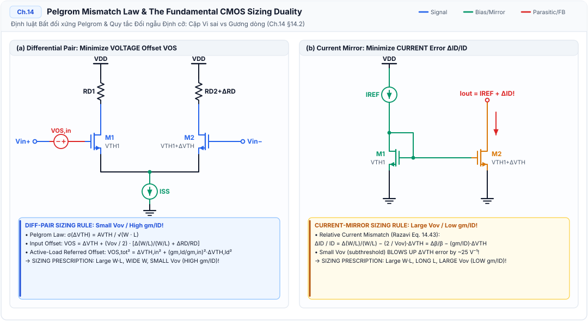

---
{
  "id": "law-differential-imbalance-hd2-and-cm-nonlinearity",
  "kind": "law",
  "domain": "nonideal-and-physical",
  "title_vi": "Định luật Mất cân xứng Vi sai sinh Méo hài Bậc hai (HD2), Điểm Nén 1-dB và Phi tuyến Chế độ Chung",
  "title_en": "Quantitative HD2 Emergence under Differential Mismatch, 1-dB Compression Point, and Common-Mode Nonlinearity Laws",
  "summary": "Định luật giải tích liên kết trực tiếp sai lệch ngẫu nhiên/bố cục (ΔR/R, Δ(W/L)/(W/L), ΔVTH) với sự phá vỡ tính đối xứng lẻ f(-x) = -f(x) làm xuất hiện méo hài bậc chẵn HD2 trong mạch vi sai; kết hợp công thức điểm nén độ lợi 1-dB từ hệ số bậc ba α3/α1, cơ chế dòng đuôi phi tuyến/tụ đuôi Ctail biến nhiễu chế độ chung thành méo vi sai và định nghĩa CMRR tổng quát theo độ trôi điện áp lệch ∂VOS/∂VCM.",
  "diagram": "../../diagrams/pelgrom-mismatch-duality.svg",
  "razavi_refs": [
    {
      "chapter": 14,
      "section": "14.1.1-14.1.6",
      "pages": "576-591",
      "equations": ["14.1", "14.5", "14.7", "14.8", "14.9", "14.10", "14.11", "14.13", "14.15", "14.19", "14.22", "14.25", "14.29", "14.35", "14.42", "14.52", "14.64"]
    },
    {
      "chapter": 14,
      "section": "14.2.1, 14.2.4",
      "pages": "593-598, 603-604",
      "equations": ["14.78", "14.79", "14.86", "14.87", "14.88", "14.96", "14.97", "14.98", "14.99"]
    }
  ],
  "glossary_codes": [
    "T022",
    "T052",
    "T057",
    "T558",
    "T586",
    "T593",
    "T620",
    "T688",
    "T788",
    "T905",
    "T2150",
    "T2151",
    "T2152",
    "T2153",
    "T2154",
    "T2155",
    "T2156"
  ],
  "process_agnostic": true,
  "roles": {
    "odd_symmetric_differential_core": "Cặp vi sai lý tưởng thỏa mãn hàm lẻ f(-x) = -f(x) triệt tiêu hoàn toàn mọi hệ số đa thức bậc chẵn (α2 = α4 = 0), chỉ để lại méo bậc ba HD3 quyết định điểm nén 1-dB.",
    "asymmetry_perturbation_vector": "Vector sai lệch hình học và vật lý {ΔRD/RD, Δ(W/L)/(W/L), ΔVTH, ΔCL/CL} phá vỡ đối xứng hai nửa mạch, giữ lại phần dư bậc hai Δα2·Vin^2/4 gây méo hài HD2 hữu hạn.",
    "tail_node_rectification_path": "Nút nguồn chung của cặp vi sai hoạt động như bộ chỉnh lưu toàn sóng dao động ở tần số 2ω; khi tổng trở nguồn dòng đuôi Z_tail(j2ω) giảm vì tụ ký sinh C_tail và hai nhánh lệch nhau, dòng 2ω biến thẳng thành HD2 ở ngõ ra.",
    "cm_to_offset_sensitivity_bridge": "Mối liên hệ tương đương giữa tỷ số khử đồng pha CMRR và đạo hàm điện áp lệch quy về ngõ vào theo mức chế độ chung ∂VOS,in / ∂Vin,CM (Razavi §14.2.4)."
  },
  "symptoms_addressed": [
    "unexpected-high-hd2-dominating-thd-in-nominally-fully-differential-amplifier-or-adc-driver",
    "gain-compression-and-signal-clipping-well-before-rail-to-rail-voltage-limits",
    "hd2-worsening-at-20db-per-decade-at-high-input-frequencies-due-to-tail-capacitance",
    "large-common-mode-swing-inducing-nonlinear-differential-distortion-in-single-ended-to-diff-stages"
  ],
  "limitations": [
    "negative-feedback-suppresses-hd2-and-hd3-only-within-loop-bandwidth-where-loop-gain-is-high",
    "increasing-vov-reduces-gm-nonlinearity-hd3-but-sacrifices-voltage-headroom-and-increases-resistor-mismatch-vos",
    "post-layout-routing-capacitance-asymmetry-reintroduces-high-frequency-hd2-even-with-perfect-transistor-matching"
  ],
  "checklists": [
    "common-mos",
    "differential-pair",
    "layout-and-matching",
    "feedback-and-stb"
  ]
}
---

## 1. Bản chất Nguyên lý, Sơ đồ Mạch & Vai trò Từng Nhánh Cấu trúc

Một trong những lý do cốt tử khiến toàn bộ các hệ thống vi mạch tương tự hiệu năng cao (từ bộ lái ADC 14–16 bit, bộ lọc tụ chuyển mạch đến máy thu phát RF) đều chấp nhận gấp đôi số nhánh linh kiện để dùng kiến trúc **vi sai toàn phần (`fully differential`)** là định lý **triệt tiêu hài bậc chẵn nhờ đối xứng lẻ (`even-order harmonic cancellation`, `T2151`, Razavi §14.1.2, trang 579)**: nếu hai nửa mạch hoàn toàn giống hệt nhau và nhận tín hiệu đối xứng ngược pha $x_1 = +V_{in}/2$, $x_2 = -V_{in}/2$, đặc tuyến truyền đạt hiệu $y(V_{in}) = f(+V_{in}/2) - f(-V_{in}/2)$ bắt buộc là một hàm lẻ nghiêm ngặt $y(-V_{in}) = -y(V_{in})$, xóa sổ tuyệt đối mọi thành phần bậc chẵn ($\alpha_2 = \alpha_4 = 0 \implies \text{HD}_2 = 0$)!

Thế nhưng khi đo phổ FFT của một con chip silicon thực tế hoặc chạy mô phỏng Monte Carlo + trích xuất ký sinh sau bố cục (`PEX`), kỹ sư thường xuyên bàng hoàng thấy **vạch hài bậc hai $\text{HD}_2$ trồi lên cao ngang ngửa hoặc thậm chí vượt mặt cả $\text{HD}_3$**, đặc biệt ở tần số cao hoặc khi tín hiệu ngõ vào có kèm gợn chế độ chung! Chương 14 của Razavi (§14.1 & §14.2.1, §14.2.4, trang 576–604) giải mã trọn vẹn bức tranh định lượng từ méo biên độ lớn, điểm nén độ lợi cho tới cơ chế sai lệch linh kiện ($\Delta W/W$, $\Delta R/R$, $\Delta V_{TH}$) và biến thiên chế độ chung tái sinh $\text{HD}_2$:



Hệ thống quy luật vật lý này xoay quanh **4 cơ chế tương tác trực tiếp**:
1. ** Khai triển Đa thức Tín hiệu Lớn, Độ lệch Chuẩn hóa & Điểm Nén $1\text{-dB}$ (§14.1.1, Hình 14.3–14.5, PT 14.1–14.10)**: Mô tả sự suy giảm độ lợi khả dụng (compression) khi biên độ vào tiến tới giới hạn $V_{OV}$ của transistor và liên kết trực tiếp tỉ số $\alpha_3 / \alpha_1$ với sai số phi tuyến đỉnh (INL của bộ khuếch đại), $\text{HD}_3$ và điểm nén $A_{1\text{dB}}$.
2. **Sự Tái sinh Định lượng của $\text{HD}_2$ dưới Bất đối xứng Tĩnh và Động (§14.2.1, Hình 14.29, PT 14.87)**: Khi hai nửa mạch lệch nhau bởi $\Delta R_D / R_D$, $\Delta(W/L)/(W/L)$ hoặc $\Delta V_{TH}$, hai hệ số bậc hai $\alpha_{2,1} \neq \alpha_{2,2}$ không còn tự khử hết mà để lại thành phần hiệu $\Delta\alpha_2 = \alpha_{2,1} - \alpha_{2,2}$ tỉ lệ trực tiếp với độ lệch linh kiện!
3. **Hiệu ứng Chỉnh lưu Bậc hai tại Nút Nguồn Chung & Suy thoái $\text{HD}_2$ Tần số Cao**: Điện thế nút đuôi $V_P$ của cặp vi sai lắc lư ở tần số gấp đôi $2\omega$ theo định luật bình phương; ở tần số cao, tụ ký sinh nguồn dòng đuôi $C_{\text{tail}}$ hút dòng $2\omega$ lớn rồi phân chia bất đối xứng qua hai nhánh lệch nhau, làm $\text{HD}_2$ xấu đi $+20\text{ dB/dec}$ theo tần số!
4. **Phi tuyến Chế độ Chung & Định nghĩa CMRR Mở rộng theo $\partial V_{OS}/\partial V_{CM}$ (§14.2.4, Hình 14.40, PT 14.96–14.99)**: Khi mức đồng pha ngõ vào $V_{in,CM}$ quét rộng (như trong bộ so sánh đơn điệu, tầng đầu vào không đảo hoặc mạch lấy mẫu), sự thay đổi dòng đuôi làm dịch chuyển trực tiếp điện áp lệch $V_{OS}(V_{in,CM})$, biến dao động đồng pha thành méo phi tuyến vi sai ở ngõ ra!

---

## 2. Hệ Phương trình Cốt lõi & Tư duy "Nhìn Mạch Đọc Nhanh" (Analysis by Inspection)

### 2.1. Khai triển Taylor, Điểm Nén $1\text{-dB}$, Sai số Tuyến tính Đỉnh & So sánh Đơn đầu vs Vi sai (§14.1.1–14.1.2, PT 14.1–14.22)
Xét một mạch không nhớ yếu phi tuyến có đặc tuyến vào–ra $y(t) \approx \alpha_1 x(t) + \alpha_2 x^2(t) + \alpha_3 x^3(t)$ được kích thích bởi tín hiệu hình sin $x(t) = A\cos\omega t$. Dùng đẳng thức lượng giác hạ bậc (PT 14.8–14.9):

$$y(t) = \frac{\alpha_2 A^2}{2} + \left(\alpha_1 A + \frac{3\alpha_3 A^3}{4}\right)\cos\omega t + \frac{\alpha_2 A^2}{2}\cos(2\omega t) + \frac{\alpha_3 A^3}{4}\cos(3\omega t)$$

Từ biểu thức này ta đọc ngay **4 chỉ số cốt lõi của mọi bộ khuếch đại tương tự/RF**:
1. **Dịch điểm làm việc DC do tự chỉnh lưu bậc hai**: $\Delta y_{\text{DC}} = \frac{1}{2}\alpha_2 A^2$.
2. **Độ lợi hiệu dụng ở biên độ lớn & Điểm nén $1\text{-dB}$ ($A_{1\text{dB}}$)**: Trong hầu hết các mạch thực tế ($\alpha_1 \alpha_3 < 0$, đặc tuyến bão hòa nén `compressive`), hệ số hài cơ bản bị co lại thành $A_{v,\text{eff}}(A) = \alpha_1\left(1 + \frac{3\alpha_3}{4\alpha_1}A^2\right)$. Điểm biên độ ngõ vào mà tại đó độ lợi giảm mất $1\text{ dB}$ ($20\log_{10}(0.89125) = -1\text{ dB}$, tức còn $89.125\%$ so với $\alpha_1$) là:
   $$1 - \frac{3}{4}\left|\frac{\alpha_3}{\alpha_1}\right| A_{1\text{dB}}^2 = 10^{-1/20} \approx 0.89125 \implies A_{1\text{dB}} = \sqrt{0.145\,\left|\frac{\alpha_1}{\alpha_3}\right|} \approx 0.38\,\sqrt{\left|\frac{\alpha_1}{\alpha_3}\right|}$$
3. **Méo hài tỉ đối $\text{HD}_2$, $\text{HD}_3$ và Độ lệch phi tuyến cực đại Ví dụ 14.1 (PT 14.7 & PT 14.10)**:
   Khi méo còn nhỏ ($|\frac{3\alpha_3}{4\alpha_1}A^2| \ll 1$):
   $$\text{HD}_2 \approx \frac{1}{2}\left|\frac{\alpha_2}{\alpha_1}\right| A, \qquad \text{HD}_3 \approx \frac{1}{4}\left|\frac{\alpha_3}{\alpha_1}\right| A^2, \qquad \left(\frac{\Delta y}{y_{\max}}\right)_{\text{peak, odd}} \approx \frac{1}{3\sqrt{3}}\left|\frac{\alpha_3}{\alpha_1}\right| x_{\max}^2 = \frac{4}{3\sqrt{3}}\,\text{HD}_3(x_{\max})$$
4. **Định lượng Ưu thế của Cặp Vi sai so với Tầng CS Đơn đầu (Hình 14.6, PT 14.12–14.22)**:
   - Tầng nguồn chung đơn đầu MOSFET luật bình phương phân cực tại $V_{OV}$: $I_D = \frac{1}{2}\mu_n C_{ox}\frac{W}{L}(V_{OV} + v_{in})^2 \implies \alpha_1 = g_m R_D$, $\alpha_2 = \frac{g_m R_D}{2 V_{OV}}$, $\alpha_3 = 0$ (chỉ xét bậc hai chủ đạo) $\implies \text{HD}_{2,\text{SE}} = \frac{A}{4 V_{OV}}$ (ví dụ $V_{OV} = 200\text{ mV}, A = 40\text{ mV} \Rightarrow \text{HD}_2 = 5\% = -26\text{ dB}$ rất tệ!).
   - Cặp vi sai đối xứng cùng độ lợi và tổng dòng ($I_{SS} = 2I$, mỗi transistor có cùng $V_{OV}$, PT 14.15–14.22): $\Delta I_D = \frac{1}{2}\mu_n C_{ox}\frac{W}{L}\,V_{in}\sqrt{4 V_{OV}^2 - V_{in}^2} \approx g_m V_{in} - \frac{g_m}{8 V_{OV}^2}V_{in}^3$ (tức $|\alpha_3/\alpha_1| = \frac{1}{8 V_{OV}^2}$) $\implies$ **$\text{HD}_2 = 0$** và:
     $$\text{HD}_{3,\text{diff}} = \frac{1}{4}\left|\frac{\alpha_3}{\alpha_1}\right| A^2 = \frac{A^2}{32\,V_{OV}^2}, \qquad A_{1\text{dB,diff}} = \sqrt{0.145 \times 8}\,V_{OV} \approx 1.08\,V_{OV} \;\; \left(< \sqrt{2}\,V_{OV}\right)$$
     Ở cùng $V_{OV} = 200\text{ mV}, A = 40\text{ mV}$: $\text{HD}_{3,\text{diff}} = \frac{0.04^2}{32 \times 0.2^2} = 0.125\% = -58.1\text{ dB}$ — tốt hơn **$32\text{ dB}$ ($40\times$)** so với mạch đơn đầu ($-26\text{ dB}$)! Và nếu có thêm vòng hồi tiếp âm độ lợi vòng $\beta \alpha_1 \gg 1$ (§14.1.3 PT 14.35), méo hài tiếp tục được nén đi $(1 + \beta \alpha_1)$ lần ở cùng biên độ ngõ ra!

### 2.2. Định luật Tái sinh $\text{HD}_2$ Dưới Sai lệch Mismatch $\frac{\Delta R_D}{R_D}$, $\frac{\Delta(W/L)}{W/L}$ và $\Delta V_{TH}$ (§14.2.1, PT 14.78–14.88)
Bây giờ hãy phá vỡ đối xứng lý tưởng như Hình 14.29 của Razavi: giả sử hai nửa đường truyền vi sai có hàm truyền cá nhân $y_1 = \alpha_1 x_1 + \alpha_2 x_1^2 + \alpha_3 x_1^3$ và $y_2 = \beta_1 x_2 + \beta_2 x_2^2 + \beta_3 x_2^3$ với tín hiệu vào cân bằng $x_1 = +\frac{1}{2}A\cos\omega t$, $x_2 = -\frac{1}{2}A\cos\omega t$ ($V_{in,\text{diff}} = x_1 - x_2 = A\cos\omega t$). Điện áp vi sai ngõ ra $y_{\text{diff}} = y_1 - y_2$ là (mở rộng từ PT 14.87–14.88 với $x_1 = -x_2 = \frac{1}{2}A\cos\omega t$):

$$y_1 - y_2 = \frac{\alpha_1 + \beta_1}{2}\,A\cos\omega t + \frac{\alpha_2 - \beta_2}{4}\,A^2\left[\frac{1 + \cos(2\omega t)}{2}\right] + \frac{\alpha_3 + \beta_3}{8}\,A^3\left[\frac{3\cos\omega t + \cos(3\omega t)}{4}\right]$$

Đặt độ lệch tương đối của hệ số bậc hai là $\frac{\Delta\alpha_2}{\alpha_2} \equiv \frac{\alpha_2 - \beta_2}{\alpha_2}$ (với $\beta_1 \approx \alpha_1$), tỉ số méo hài bậc hai tại ngõ ra vi sai là:

$$\text{HD}_{2,\text{diff}} = \frac{\left|\dfrac{\alpha_2 - \beta_2}{8}\,A^2\right|}{\left|\dfrac{\alpha_1 + \beta_1}{2}\,A\right|} \approx \frac{1}{8}\,\left|\frac{\Delta\alpha_2}{\alpha_1}\right|\,A = \frac{1}{4}\left|\frac{\Delta\alpha_2}{\alpha_2}\right|\cdot\left(\frac{1}{2}\left|\frac{\alpha_2}{\alpha_1}\right|\frac{A}{2}\right)$$

Áp dụng trực tiếp vào cặp vi sai tải điện trở có sai lệch tải $R_{D1,2} = R_D \pm \frac{\Delta R_D}{2}$, sai lệch hình học $(W/L)_{1,2} = (W/L) \pm \frac{\Delta(W/L)}{2}$ và sai lệch ngưỡng $\Delta V_{TH}$ (với nguồn dòng đuôi thực có trở kháng hữu hạn $Z_{SS}(j2\omega)$):
1. **Do lệch tải $\Delta R_D / R_D$ cộng hưởng với dòng đuôi bậc hai tại $2\omega$**: Ngay cả khi $M_1, M_2$ khớp nhau $100\%$, nút nguồn chung $V_P$ vẫn dao động một thành phần bậc hai $v_P(2\omega) \approx \frac{A^2}{16 V_{OV}}\cos(2\omega t)$! Qua tổng trở đuôi $Z_{SS}(j2\omega) = R_{SS} \parallel \frac{1}{j 2\omega C_{\text{tail}}}$, thành phần $v_P(2\omega)$ sinh ra dòng đồng pha bậc hai $i_{\text{tail}}(2\omega) = \frac{v_P(2\omega)}{Z_{SS}(j2\omega)}$ chia đều hai nhánh $\frac{1}{2}i_{\text{tail}}(2\omega)$, rồi nhân với hai điện trở lệch nhau $R_{D1} - R_{D2} = \Delta R_D$ tạo thẳng điện áp vi sai hài bậc hai:
   $$\left|\text{HD}_{2,\text{diff}}(2\omega)\right|_{\text{tail+load}} \approx \frac{A}{32\,V_{OV}\,g_m |Z_{SS}(j2\omega)|}\,\left|\frac{\Delta R_D}{R_D}\right| \xrightarrow{\omega \text{ cao}} \frac{\omega C_{\text{tail}}\,A}{16\,g_m V_{OV}}\,\left|\frac{\Delta R_D}{R_D}\right|$$
   *Nhìn công thức thấy ngay quy luật thực tế trên phòng lab*: ở tần số cao, tụ ký sinh $C_{\text{tail}}$ làm $|Z_{SS}(j2\omega)|$ sụt $-20\text{ dB/dec}$, kéo **$\text{HD}_2$ tăng vọt $+20\text{ dB/dec}$**!
2. **Do lệch ngưỡng $\Delta V_{TH}$ và lệch $\Delta(W/L)/(W/L)$ gây lệch điểm làm việc tĩnh**: Khi $\Delta V_{TH} = V_{OS,\text{pair}} \neq 0$ (mà vòng ngoài chưa khử dòng lệch DC trong cặp đầu vào), hai nhánh mang dòng tĩnh lệch nhau $\Delta I_D = g_m V_{OS}$, dịch chuyển điểm làm việc ra khỏi tâm đối xứng lẻ của hàm bậc ba ($\alpha_3(x + V_{OS})^3 = \alpha_3 x^3 + 3\alpha_3 V_{OS} x^2 + \dots$ với $|\alpha_3/\alpha_1| = \frac{1}{8 V_{OV}^2}$!), sinh ra hệ số bậc hai hiệu dụng $\alpha_{2,\text{eff}} = 3\alpha_3 V_{OS}$ và:
   $$\left|\text{HD}_{2,\text{diff}}\right|_{\text{offset-shift}} = \frac{1}{2}\left|\frac{3\alpha_3 V_{OS}}{\alpha_1}\right| A = \frac{3\,|V_{OS}|\,A}{16\,V_{OV}^2}$$
   Ví dụ: với $V_{OV} = 150\text{ mV}$, $A = 100\text{ mV}$ và độ lệch ngẫu nhiên chưa khử $V_{OS} = 6\text{ mV}$, chỉ riêng sự lệch tâm điểm làm việc đã đẻ ra $\text{HD}_2 = \frac{3 \times 0.006 \times 0.1}{16 \times 0.15^2} = 0.50\% = -46.0\text{ dBc}$, xóa sổ độ tuyến tính bậc chẵn 12-bit!

### 2.3. Phi tuyến Chế độ Chung & Định nghĩa CMRR theo Độ trôi Offset (§14.2.4, PT 14.96–14.99)
Trong §14.2.4 (Hình 14.40), Razavi đưa ra góc nhìn cực kỳ sắc bén nối liền CMRR của Chương 4 với Mismatch của Chương 14: khi mức chế độ chung ngõ vào thay đổi $\Delta V_{in,CM}$ tại ngõ vào vi sai bằng $0$, biến thiên ngõ ra vi sai chính là biến thiên điện áp lệch ngõ ra $\Delta V_{OS,\text{out}} = A_{CM\text{-}DM}\,\Delta V_{in,CM}$ (PT 14.96–14.98). Khi độ lợi vi sai $A_{DM}$ gần như hằng định theo $V_{in,CM}$ (chẳng hạn hiệu ứng thân bất đối xứng $\Delta\gamma$ làm đổi $\Delta V_{TH}(V_{in,CM})$ như Hình 14.40b), ta có đẳng thức trực tiếp $\frac{1}{\text{CMRR}} = \left|\frac{\partial V_{OS,\text{in}}}{\partial V_{in,CM}}\right|$ (PT 14.99); còn tổng quát với nguồn dòng đuôi hữu hạn $r_{O,\text{tail}}$ ($2 g_m r_{O,\text{tail}} \gg 1$, $g_m = I_{SS}/V_{OV}$) nơi $\Delta I_{SS} \approx \frac{\Delta V_{in,CM}}{r_{O,\text{tail}}}$ điều chế đồng thời cả dòng nhánh lẫn $g_m$ (Chương 4 PT 4.44–4.53 & Chương 14 PT 14.86, 14.98):

$$\frac{1}{\text{CMRR}} = \left|\frac{A_{CM\text{-}DM}}{A_{DM}}\right| = \frac{1}{|A_{DM}|}\left|\frac{\partial V_{OS,\text{out}}}{\partial V_{in,CM}}\right| \approx \frac{1}{2\,g_m r_{O,\text{tail}}}\left|\frac{\Delta R_D}{R_D} + \frac{\Delta(W/L)}{W/L} - \frac{\Delta V_{TH}}{V_{OV}}\right| \quad \left(\text{hay } \left|\frac{\partial V_{OS,\text{in}}}{\partial V_{in,CM}}\right| \text{ khi } A_{DM} = \text{const}\right)$$

Và nếu $\Delta V_{in,CM}(t) = A_{CM}\cos\omega t$ có biên độ lớn làm $r_{O,\text{tail}}(V_{DS,\text{tail}})$ biến thiên phi tuyến (ví dụ trong cấu hình khuếch đại không đảo hoặc công tắc lấy mẫu thiếu bootstrap), sự phụ thuộc phi tuyến $V_{OS,\text{in}}(V_{in,CM})$ sẽ bơm thẳng cả $\text{HD}_2$ lẫn $\text{HD}_3$ vào tín hiệu vi sai!

---

## 3. Bất biến Cấu trúc & Các Bẫy Lỗi Kinh điển (Structural Invariants & Traps)

- **[INV-HD2-01] Bất biến Kiểm chứng $\text{HD}_2$ Bắt buộc trên Monte Carlo Mismatch + Trích xuất Ký sinh `PEX` (Không bao giờ tin `TT` Schematic!)**:
  Trên mô phỏng schematic danh định góc `TT` không có nhiễu ngẫu nhiên, SPICE đặt hai nhánh vi sai bằng nhau đến 15 chữ số thập phân nên báo cáo $\text{HD}_2 = -180\text{ dBc}$! Con số đó hoàn toàn vô nghĩa vật lý! Muốn biết $\text{HD}_2$ và $\text{IIP}_2$ thực sự của silicon, bắt buộc phải bật **Monte Carlo `mismatch`** (lấy phân vị $3\sigma$ xấu nhất của $\text{HD}_2$) VÀ bật netlist sau bố cục **`PEX (R+C+CC)`** để bắt cả bất đối xứng điện dung đường dây $\Delta C_L$ ở tần số cao!
- **[INV-HD2-02] Bất biến Giảm Điện dung Ký sinh Nút Đuôi $C_{\text{tail}}$ song hành với Tăng $r_{O,\text{tail}}$**:
  Ở DC, nguồn dòng đuôi kênh dài diện tích khổng lồ cho $r_{O,\text{tail}}$ rất cao (tốt cho CMRR tần số thấp); nhưng nếu vẽ transistor nguồn dòng đuôi quá to nối trực tiếp vào nút nguồn chung của cặp vi sai, điện dung tiếp giáp máng $C_{DB,\text{tail}}$ khổng lồ sẽ nối tắt nút đuôi xuống đất ở tần số cao, làm bùng phát $\text{HD}_2$ và sụp đổ CMRR! Giải pháp chuẩn: dùng **tầng chắn cascode nhỏ gọn có $f_T$ cao** đặt giữa nguồn dòng đuôi lớn và nút đuôi cặp vi sai!
- **[TRAP-HD2-01] Bẫy Chuyển đổi Đơn đầu sang Vi sai (`Single-Ended-to-Differential` — Balun Chủ động) Thiếu Cân bằng Pha & Biên độ**:
  Khi lái một bên cặp vi sai bằng $V_{in}$ còn bên kia treo cố định ở $V_{CM}$, ngõ vào thực chất là tổng của $\pm\frac{1}{2}V_{in}$ (vi sai) CỘNG VỚI $+\frac{1}{2}V_{in}$ (chế độ chung bằng một nửa tín hiệu!). Ở tần số cao khi tổng trở đuôi $Z_{SS}(j\omega)$ giảm, hai nhánh không còn mang dòng đối xứng $i_{d1} \neq -i_{d2}$, làm biên độ/pha hai ngõ ra lệch nhau và sinh $\text{HD}_2$ cực lớn ngay cả khi linh kiện khớp hoàn hảo!
- **[TRAP-HD2-02] Bẫy Mâu thuẫn Chọn $V_{OV}$ giữa Tuyến tính Bậc ba ($\text{HD}_3$) và Mismatch Điện trở ($\Delta R_D$)**:
  Nhìn công thức $\text{HD}_{3,\text{diff}} = \frac{A^2}{32 V_{OV}^2}$, tăng $V_{OV}$ giúp giảm mạnh $\text{HD}_3$; nhưng nhìn công thức PT (14.78), tăng $V_{OV}$ lại nhân bội đóng góp offset của $\frac{\Delta R_D}{R_D}$ và thu hẹp khoảng dao động ngõ ra làm tầng tải chạm vùng triode sớm hơn (gây nén cứng `hard clipping`)! Khi cần $\text{HD}_3 < -80\text{ dBc}$ ở nguồn thấp $1.0 \dots 1.2\text{ V}$, thay vì đẩy $V_{OV}$ quá cao, hãy dùng **suy biến cực nguồn tuyến tính $R_S$** kết hợp vòng hồi tiếp âm độ lợi lớn (`law-differential-nonlinearity-and-feedback`).

---

## 4. Lộ trình Nâng cấp Cấu trúc & Bát giác Đánh đổi (Upgrade Paths & Design Octagon)

Trong `concept-analog-design-octagon`, quản trị méo hài bậc chẵn $\text{HD}_2$ và bậc lẻ $\text{HD}_3$ liên kết chặt chẽ trục **Độ Tuyến tính (`Linearity`)**, **Khoảng Dao động (`Swing`)**, **Công suất (`Power`)** và **Diện tích Khớp hình học (`Matching Area`)**:
- **Song hành cùng**: `law-differential-nonlinearity-and-feedback` (nén $\text{HD}_3$ bằng suy biến và hồi tiếp âm) và `law-pelgrom-mismatch-and-sizing-duality` (nén $\sigma(V_{OS})$ theo $1/\sqrt{W L}$).
- **Lộ trình khử triệt để $\text{HD}_2$ và phi tuyến CM**:
  1. **Khử $\text{HD}_2$ do lệch điểm làm việc tĩnh $V_{OS}$**: Dùng bố cục tâm chung 2D `ABBA` có ngón giả (`tech-common-centroid-sti-wpe-layout`) kết hợp tự động khử lệch hoặc điều biến băm (`tech-chopper-stabilization-vs-autozeroing`).
  2. **Khử $\text{HD}_2$ do biến thiên chế độ chung trong cấu hình lấy mẫu / khuếch đại**: Chuyển từ cấu hình không đảo (chịu biến thiên $V_{in,CM} = V_{in}$) sang **cấu hình đảo có đất ảo cố định (`inverting virtual-ground`)** như trong `topo-switched-capacitor-integrator-parasitic-insensitive`, và dùng `topo-bootstrapped-sampling-switch` cho công tắc đầu vào!
  3. **Khử $\text{HD}_2$ tần số cao tại nút đuôi**: Bọc cascode cho nguồn dòng đuôi (`topo-cascode-current-mirror`) hoặc tách thành cặp nguồn dòng đuôi kết hợp tụ nối ghép ở cấu hình suy biến điện trở.

| Nguồn Gốc Vật lý Sinh Méo | Thành phần Hài Chủ đạo | Quy luật Phụ thuộc Biên độ & Tần số | Biện pháp Khắc phục Gốc rễ |
| :--- | :--- | :--- | :--- |
| **Phi tuyến đặc tuyến lẻ $I_D(V_{GS})$ cặp vi sai** | **$\text{HD}_3$** (bậc lẻ) | $\propto (A / V_{OV})^2$; tăng khi $A(j\omega)$ vòng hở giảm | Tăng $V_{OV}$, thêm suy biến $R_S$, tăng độ lợi vòng $\beta A(j\omega)$ |
| **Lệch tĩnh $V_{OS}$ dịch tâm hàm bậc ba** | **$\text{HD}_2$** (bậc chẵn) | $\propto |V_{OS}| \cdot A / V_{OV}^2$ ngay từ tần số thấp | Tăng diện tích $W L$ Pelgrom, Auto-Zeroing / DC offset trim |
| **Lệch tải $\Delta R_D, \Delta C_L$ + Tụ đuôi $C_{\text{tail}}$** | **$\text{HD}_2$** tần số cao | $\propto \omega C_{\text{tail}} \cdot |\Delta R / R| \cdot A / (g_m V_{OV})$ | Chắn cascode giảm $C_{\text{tail}}$, đi dây tải vi sai đối xứng tuyệt đối |
| **Quét đồng pha lớn làm đổi $r_{O,\text{tail}}(V_{CM})$** | **$\text{HD}_2$ & $\text{HD}_3$** | Tăng mạnh khi $V_{in,CM}$ tiến gần ranh giới ICMR | Chuyển sang cấu hình đảo cố định $V_{CM}$, dùng đuôi cascode |

---

## 5. Thích ứng Đa Tiến trình (90nm / 65nm / 45nm) & Cách Kiểm chứng trong Cadence / Spectre

### 5.1. Đặc thù Quản trị $\text{HD}_2$ và Điểm Nén trên 90nm / 65nm / 45nm
1. **Phi tuyến Điện trở Ngõ ra $r_O(V_{DS})$ Lấn át Phi tuyến Hỗ dẫn $g_m(V_{GS})$**:
   Ở công nghệ kênh dài cũ, méo hài chủ yếu sinh ra từ hàm căn bậc hai $g_m(V_{GS})$ của cặp đầu vào; nhưng ở `65nm`/`45nm` dưới nguồn $1.0 \dots 1.2\text{ V}$, sự biến thiên kịch liệt của $r_O(V_{DS})$ do DIBL và CLM khi ngõ ra quét lớn trở thành **thủ phạm số 1 gây sập $A_{1\text{dB}}$ và sinh $\text{HD}_3$ / $\text{HD}_2$**! Do đó các tầng đệm lái ADC độ tuyến tính cao ($> 75 \dots 85\text{ dB}$ SFDR) bắt buộc giữ dự trữ tối thiểu $V_{DS} - V_{DS,\min} \ge 120 \dots 150\text{ mV}$ ở đỉnh biên độ quét cho tầng ngõ ra!
2. **Đối xứng Ký sinh Đường Dây Sau Layout (`Symmetric Differential Routing`)**:
   Một sự lệch điện dung tải chỉ $\Delta C_L = 15\text{ fF}$ giữa hai ngõ ra `Vout+` và `Vout-` ở $100\text{ MHz}$ đã tạo ra lệch tổng trở tải $|\Delta Z_L / Z_L|$ vài phần trăm, đủ đánh sập $\text{HD}_2$ xuống $-55\text{ dBc}$! Luôn đi cặp dây vi sai song song cùng tầng kim loại, cùng chiều dài, có đường giả (`dummy wire`, Hình 19.41) cân bằng điện dung rìa hai phía.

### 5.2. Phác đồ Đo Lường $\text{HD}_2$ Thống kê ($3\sigma$ Monte Carlo PSS/HB) & Điểm Nén $1\text{-dB}$ trong Spectre
```spice
// Phac do kiem chung do tuyen tinh toan dien trong SpectreRF (PSS / Harmonic Balance + Monte Carlo):
// 1. Do diem nen 1-dB (P1dB / A1dB) bang phep quet bien do nguon sin Vin_amp trong PSS:
pss_1db pss fund=10M harms=15 errpreset=conservative sweep param=vin_amp start=1m stop=500m step=10m

// 2. Do phan bo thong ke HD2 va HD3 thuc te tren 100 mau Monte Carlo Mismatch (bat buoc!):
//    HD2_dBc = db20( harmonic(v(vout_p, vout_n), 2) / harmonic(v(vout_p, vout_n), 1) )
//    HD3_dBc = db20( harmonic(v(vout_p, vout_n), 3) / harmonic(v(vout_p, vout_n), 1) )
mc_hd montecarlo numruns=100 variations=mismatch seed=12345 {
    pss_dist pss fund=20M harms=15 errpreset=conservative maxstep=200p
}

// 3. Kiem tra CMRR tong quat theo dao ham d(VOS_in)/d(VCM) (Razavi §14.2.4 Eq. 14.99):
dc_cm_vos dc param=vcm_in start=0.2 stop=0.9 step=10m
```

---

## 6. Mốc Đối chiếu Sách Razavi & Thuật ngữ Chuẩn CLB

- **Sách gốc Razavi (2nd Ed.)**: Chương 14 (*Nonlinearity and Mismatch*):
  - **§14.1.1–14.1.3** (trang 576–583, Hình `14.1`–`14.8`, PT `14.1`–`14.36`, Ví dụ `14.1`): Định nghĩa độ lệch phi tuyến chuẩn hóa, méo hài $\text{HD}_2, \text{HD}_3, \text{THD}$, tính chất đối xứng lẻ triệt hài chẵn của mạch vi sai và tác dụng nén phi tuyến của hồi tiếp âm.
  - **§14.1.4–14.1.6** (trang 583–591, Hình `14.9`–`14.20`, PT `14.37`–`14.64`, Ví dụ `14.2`–`14.3`): Phi tuyến tụ điện, phi tuyến mạch lấy mẫu và các kỹ thuật tuyến tính hóa hỗ dẫn.
  - **§14.2.1** (trang 593–598, Hình `14.24`–`14.29`, PT `14.68`–`14.88`, Ví dụ `14.4`–`14.5`): Đạo xuất phương trình $V_{OS,\text{in}}$ của cặp vi sai, sai lệch dòng gương dòng và **phương trình `(14.87)` chứng minh sự xuất hiện của méo bậc chẵn hữu hạn do sai lệch giữa hai đường truyền vi sai**.
  - **§14.2.4** (*Alternative Definition of CMRR*, trang 603–604, Hình `14.40`, PT `14.96`–`14.99`): Chứng minh đẳng thức vật lý giữa nghịch đảo CMRR và độ biến thiên điện áp lệch ngõ vào theo mức chế độ chung $\partial V_{OS,\text{in}}/\partial V_{CM}$.
- **Đối chiếu Thuật ngữ Chuẩn CLB (`terms-vi-en.json`)**:
  - `T057` / `T052`: `nonlinearity` / `mismatch` — **tính phi tuyến** / **sai lệch linh kiện**.
  - `T2150` / `T2151` / `T2152`: `harmonic distortion` / `even-order harmonic cancellation` / `fractional harmonic distortion, HD2 / HD3` — **méo hài** / **triệt tiêu hài bậc chẵn nhờ đối xứng vi sai** / **méo hài bậc hai / bậc ba tỉ đối ($\text{HD}_2 / \text{HD}_3$)**.
  - `T2153` / `T2154` / `T2155` / `T2156`: `Pelgrom's law` / `sizing duality` / `random offset voltage` / `systematic offset voltage` — **định luật Pelgrom** / **đối ngẫu định cỡ** / **điện áp lệch không ngẫu nhiên** / **điện áp lệch không hệ thống**.
