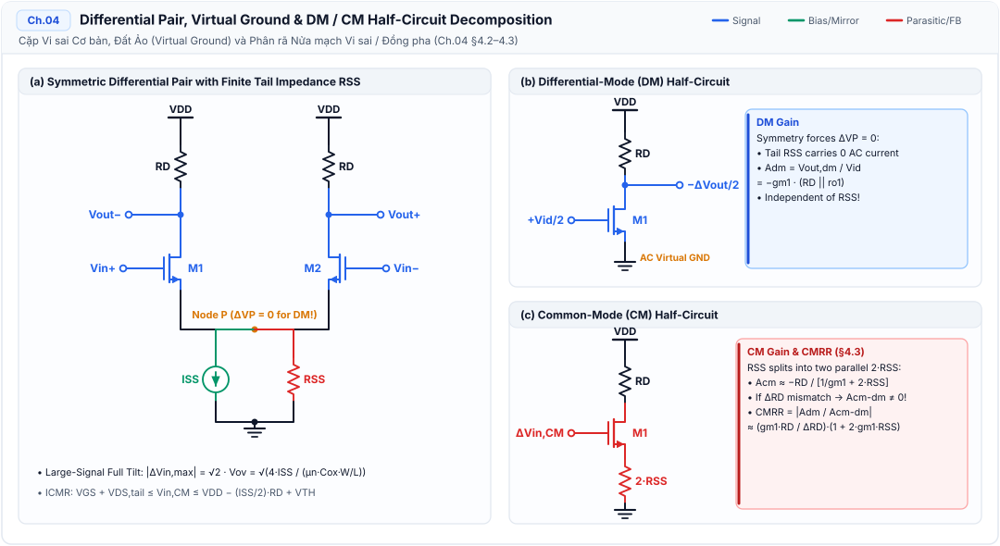

---
{
  "id": "law-differential-nonlinearity-and-feedback",
  "kind": "law",
  "domain": "nonideal-and-physical",
  "title_vi": "Định luật Tính phi tuyến Vi sai, Triệt Hài Chẵn & Tuyến tính hóa Hồi tiếp (Differential Nonlinearity & Feedback Linearization)",
  "title_en": "Differential Nonlinearity, Even-Harmonic Cancellation, and Feedback Linearization",
  "summary": "Quy luật khai triển đa thức méo hài HD2/HD3, chứng minh cơ chế đối xứng lẻ triệt tiêu toàn bộ sóng hài bậc chẵn trong mạch vi sai cân bằng, định luật nén méo hài bằng hồi tiếp âm và các kỹ thuật tuyến tính hóa CMOS.",
  "diagram": "../../diagrams/diff-pair-half-circuit.svg",
  "razavi_refs": [
    {
      "chapter": 14,
      "section": "14.1.1-14.1.3",
      "pages": "576-583",
      "equations": ["14.1", "14.7", "14.9", "14.10", "14.11", "14.15", "14.22", "14.35", "14.36"]
    },
    {
      "chapter": 14,
      "section": "14.1.4-14.1.6",
      "pages": "583-591",
      "equations": ["14.37", "14.44", "14.49", "14.50", "14.61", "14.64"]
    },
    {
      "chapter": 14,
      "section": "14.2.1",
      "pages": "593-598",
      "equations": ["14.87", "14.88"]
    }
  ],
  "glossary_codes": [
    "T057",
    "T786",
    "T1430",
    "T1511",
    "T1512",
    "T1228",
    "T812",
    "T051",
    "T081",
    "T636",
    "T052",
    "T087"
  ],
  "process_agnostic": true,
  "roles": {
    "single_ended_stage": "Tầng khuếch đại đơn cực không đối xứng phát sinh mạnh sóng hài bậc hai HD2 tỷ lệ thuận với biên độ tín hiệu trên điện áp vượt ngưỡng.",
    "balanced_differential_pair": "Lõi vi sai đối xứng lẻ triệt tiêu hoàn toàn mọi thành phần hài bậc chẵn (alpha2 = 0), chỉ để lại sóng hài bậc lẻ mà chủ đạo là HD3.",
    "negative_feedback_loop": "Vòng hồi tiếp âm toàn cục nén độ biến thiên độ lợi tín hiệu nhỏ theo mức tín hiệu vào, chia nhỏ méo hài tại cùng dải dao động ngõ ra theo hệ số (1 + beta*A0).",
    "passive_cap_and_switch": "Tụ phụ thuộc điện áp C(V) và điện trở kênh công tắc lấy mẫu Ron(Vin) gây méo tích phân điện tích và méo điều chế pha phụ thuộc tần số.",
    "local_linearizer": "Mạng suy biến nguồn bằng điện trở/MOS vùng triode, cặp lệch chéo (multi-tanh) hoặc hồi tiếp dòng cục bộ làm phẳng độ hỗ dẫn hiệu dụng Gm."
  },
  "symptoms_addressed": [
    "high-hd2-single-ended-distortion",
    "large-signal-gm-compression-hd3",
    "voltage-dependent-capacitor-sc-nonlinearity",
    "sampling-switch-ron-tracking-distortion",
    "open-loop-gain-variation-over-swing"
  ],
  "limitations": [
    "differential-pair-burns-2x-static-power-for-equal-gain",
    "device-and-phase-mismatch-resurrects-hd2",
    "global-feedback-linearization-collapses-near-gbw",
    "source-degeneration-trades-off-gain-headroom-and-thermal-noise"
  ],
  "checklists": [
    "common-mos",
    "differential-pair",
    "switched-capacitor",
    "layout-and-matching"
  ]
}
---

## 1. Bản chất Nguyên lý, Sơ đồ Mạch & Vai trò Từng Nhánh Cấu trúc

Trong thiết kế mạch tương tự (`analog design`) độ chính xác cao, **tính phi tuyến (nonlinearity — `T057`)** không chỉ là hiện tượng xén đỉnh bão hòa ở tín hiệu rất lớn, mà bản chất vật lý của nó là **sự biến thiên của độ lợi tín hiệu nhỏ (small-signal gain — độ dốc $\partial V_{out}/\partial V_{in}$) theo mức tức thời của tín hiệu vào**. Khi một bộ khuếch đại (`amplifier`, `T002`) mang tính phi tuyến yếu (`mildly nonlinear`) làm việc quanh điểm phân cực tĩnh, đặc tuyến truyền đạt vào–ra tín hiệu lớn (`large-signal input-output characteristic`, `T765`) được khai triển thành chuỗi đa thức Taylor quanh gốc tín hiệu:

$$y(t) = \alpha_1 x(t) + \alpha_2 x^2(t) + \alpha_3 x^3(t) + \cdots$$

Trong đó $\alpha_1$ là độ lợi tín hiệu nhỏ tại $x \approx 0$, các hệ số bậc chẵn ($\alpha_2, \alpha_4, \dots$) đặc trưng cho sự bất đối xứng giữa nửa chu kỳ dương và nửa chu kỳ âm, còn các hệ số bậc lẻ ($\alpha_3, \alpha_5, \dots$) đặc trưng cho hiện tượng nén độ lợi (`gain compression` khi $\alpha_1 \alpha_3 < 0$) hoặc giãn độ lợi đối xứng ở hai biên dải dao động điện áp (`voltage swing`, `T095`). Hệ quả trực tiếp trong miền tần số là sự xuất hiện của **méo dạng (distortion — `T786`)** dưới dạng **các thành phần hài (harmonics — `T1512`)** bội số nguyên lần tần số cơ bản.



Phân tích cấu trúc tổng quát của bài toán kiểm soát méo phi tuyến trong CMOS bao gồm 5 cơ chế vật lý gắn liền với từng nhánh mạch:
1. **Nhánh đơn cực (Single-Ended CS Stage):** Tầng nguồn chung (`common-source stage`, `T023`) chịu chi phối trực tiếp của quy luật bình phương (`square law`, `T083`) hoặc phi tuyến độ linh động bất đối xứng; dòng máng tăng nhanh ở nửa chu kỳ dương và co hẹp ở nửa chu kỳ âm, sinh ra sóng hài bậc hai $HD_2$ rất lớn.
2. **Nhánh cặp vi sai cân bằng (Balanced Differential Pair):** Hai nhánh $M_1, M_2$ chia sẻ nguồn dòng đuôi $I_{SS}$ tạo nên hàm truyền lẻ tuyệt đối $f(-x) = -f(x)$. Khi đảo dấu $V_{in}$, vai trò $M_1$ và $M_2$ hoán đổi hoàn hảo làm triệt tiêu toàn bộ **sóng hài bậc chẵn (even-order harmonics — `T1430`)**, chỉ còn tồn tại sóng hài bậc lẻ mà thành phần thống trị là $HD_3$.
3. **Vòng hồi tiếp âm toàn cục (Global Negative Feedback — `T1358`, `T812`):** Mạng hồi tiếp $\beta$ cảm nhận ngõ ra và trừ ngược về ngõ vào, giữ cho biên độ sai lệch thực tế đặt lên lõi khuếch đại chỉ còn bằng $\approx V_{out}/A_0$, nhờ đó ép độ lợi vòng kín bám sát $1/\beta$ và thực hiện **giảm tính phi tuyến (nonlinearity reduction — `T1228`)**.
4. **Nhánh phần tử thụ động & chuyển mạch lấy mẫu (Capacitor & Switch Nonlinearity):** Trong mạch tụ chuyển mạch (`switched-capacitor circuit`, `T087`), tụ điện có điện dung phụ thuộc áp $C(V)$ làm sai lệch tích phân bảo toàn điện tích, trong khi công tắc MOS có điện trở dẫn $R_{on}(V_{in})$ biến thiên tuần hoàn gây điều chế pha tín hiệu theo thời gian.
5. **Nhánh tuyến tính hóa cục bộ (Local Linearization Networks — `T1346`):** Khi tốc độ cao không cho phép đóng vòng hồi tiếp toàn cục nhiều tầng do giới hạn dự trữ pha, kỹ sư dùng suy biến nguồn (`source degeneration`, `T081`), cặp lệch chéo (`cross-coupled offset pairs`), tải phi tuyến nghịch đảo (`post-correction`), hoặc vòng hồi tiếp dòng cục bộ quanh điện trở $R_S$ để giữ $V_{GS}$ cố định.

## 2. Hệ Phương trình Cốt lõi & Tư duy "Nhìn Mạch Đọc Nhanh" (Analysis by Inspection)

### 2.1. Sai số Đường thẳng Đầu–Cuối, Hài bậc $n$ và Hệ số Méo hài Tổng ($\text{THD}$)
Xét đặc tuyến đối xứng lẻ $y = \alpha_1 x + \alpha_3 x^3$ trên đoạn $[-x_{\max}, +x_{\max}]$ (Razavi Ví dụ 14.1). Đường thẳng nối hai điểm mút có phương trình $y_1 = (\alpha_1 + \alpha_3 x_{\max}^2)x$. Độ lệch cực đại $|\Delta y| = |y - y_1|$ xảy ra tại $x = \pm x_{\max}/\sqrt{3}$, cho sai số phi tuyến tương đối chuẩn hóa theo biên độ đỉnh-đỉnh $2 y_{\max}$:

$$\frac{\Delta y}{y_{\max}} \approx \frac{\alpha_3}{3\sqrt{3}\alpha_1} x_{\max}^2 \quad (\text{khi } |\alpha_3 x_{\max}^2| \ll |\alpha_1|)$$

Khi kích thích hình sin $x(t) = A \cos\omega t$, khai triển lượng giác $\cos^2\omega t = \frac{1}{2}(1 + \cos 2\omega t)$ và $\cos^3\omega t = \frac{1}{4}(3\cos\omega t + \cos 3\omega t)$ cho:

$$y(t) = \frac{\alpha_2 A^2}{2} + \left(\alpha_1 A + \frac{3\alpha_3 A^3}{4}\right)\cos\omega t + \frac{\alpha_2 A^2}{2}\cos(2\omega t) + \frac{\alpha_3 A^3}{4}\cos(3\omega t) + \cdots$$

Từ đây đọc nhanh quy luật bậc mũ: **biên độ sóng hài bậc $n$ tăng xấp xỉ theo lũy thừa $A^n$** (cụ thể, tăng $A$ thêm $1\text{ dB}$ làm hài bậc 2 tăng $2\text{ dB}$, hài bậc 3 tăng $3\text{ dB}$). Với phi tuyến yếu ($|\frac{3}{4}\alpha_3 A^2| \ll |\alpha_1|$), tỷ số biên độ hài bậc 2, hài bậc 3 và **tổng méo hài (THD — Total Harmonic Distortion)** tính theo tỷ số công suất (Razavi Eq. 14.10) là:

$$HD_2 = \frac{A_{HD2}}{A_F} \approx \left|\frac{\alpha_2 A}{2\alpha_1}\right|, \qquad HD_3 = \frac{A_{HD3}}{A_F} \approx \left|\frac{\alpha_3 A^2}{4\alpha_1}\right|, \qquad \text{THD}_{\text{power}} = \frac{(\alpha_2 A^2 / 2)^2 + (\alpha_3 A^3 / 4)^2}{(\alpha_1 A + 3\alpha_3 A^3 / 4)^2}$$

*(Lưu ý thực hành: Razavi Eq. 14.10 và 14.49 định nghĩa $\text{THD}$ theo tỷ số công suất; trong bảng thông số công nghiệp và hàm `thd()` của Cadence Spectre, giá trị phần trăm thường báo cáo theo căn bậc hai biên độ hiệu dụng $\text{THD}_{\text{rms}} = \sqrt{HD_2^2 + HD_3^2 + \cdots}$, nhưng quy đổi ra decibel $10\log_{10}(\text{THD}_{\text{power}}) = 20\log_{10}(\text{THD}_{\text{rms}})$ là hoàn toàn trùng khớp: $-80\text{ dB} \equiv 0.01\%$ biên độ cho âm thanh CD, $-60\text{ dB} \equiv 0.1\%$ cho video).*

### 2.2. Phép Chứng minh Triệt Hài Chẵn của Cặp Vi sai so với Tầng Đơn cực
So sánh tầng CS đơn cực ($M_0$, dòng tĩnh $I$, tải $R_D$) và cặp vi sai ($M_1, M_2$, dòng đuôi $I_{SS} = 2I$, mỗi nhánh mang dòng tĩnh $I$, tải $R_D$) được thiết kế có **cùng độ lợi tín hiệu nhỏ** $|A_v| = g_m R_D$ và nhận cùng tín hiệu $V_{in}(t) = V_m \cos\omega t$ với $V_m \ll V_{OV} = V_{GS} - V_{TH}$:
- **Tầng CS đơn cực:** $I_{D0} = \frac{1}{2}\mu_n C_{ox}\frac{W}{L}(V_{OV} + V_m\cos\omega t)^2$ sinh ra sóng hài bậc hai trực tiếp (Eq. 14.15):

$$HD_{2,\text{CS}} = \frac{A_{HD2}}{A_F} = \frac{V_m}{4(V_{GS} - V_{TH})}$$

- **Cặp vi sai cân bằng:** Hiệu dòng máng tuân theo phương trình chính xác Chương 4 (Eq. 14.16–14.22):

$$\Delta I_D = I_{D1} - I_{D2} = \frac{1}{2}\mu_n C_{ox}\frac{W}{L} V_{in}\sqrt{4 V_{OV}^2 - V_{in}^2} \approx g_m V_{in}\left(1 - \frac{V_{in}^2}{8 V_{OV}^2}\right)$$

Thay $V_{in} = V_m \cos\omega t$ và tách $\cos^3\omega t = \frac{3}{4}\cos\omega t + \frac{1}{4}\cos(3\omega t)$, toàn bộ các số hạng bậc chẵn biến mất hoàn toàn ($HD_{2,\text{diff}} = 0$), và thành phần hài bậc ba còn lại chỉ bằng:

$$HD_{3,\text{diff}} = \frac{A_{HD3}}{A_F} \approx \frac{V_m^2}{32(V_{GS} - V_{TH})^2}$$

**Nhận thức định lượng sắc bén:** Tại $V_m = 0.2 V_{OV}$, tầng CS bị méo $HD_2 = 5\%$ ($-26\text{ dB}$), trong khi cặp vi sai chỉ méo $HD_3 = 0.125\%$ ($-58\text{ dB}$ — nhỏ hơn $40$ lần!). Dù cặp vi sai tiêu thụ công suất gấp đôi ($I_{SS} = 2I$), nếu đem dòng $2I$ đó cấp cho tầng CS đơn cực (giữ nguyên $W/L$, tăng $V_{OV}$ lên $\sqrt{2}$ lần), $HD_2$ của tầng CS chỉ giảm được vỏn vẹn $\sqrt{2}$ lần xuống $3.54\%$! Nếu hai nhánh vi sai bị **sai lệch linh kiện (mismatch — `T052`)** làm $\alpha_2 \neq \beta_2$, đối xứng lẻ vỡ và hài chẵn tái xuất hiện theo độ lệch hệ số (Eq. 14.88):

$$y_1 - y_2 = (\alpha_1 + \beta_1)x_1 + (\alpha_2 - \beta_2)x_1^2 + (\alpha_3 + \beta_3)x_1^3 \implies A_{HD2,\text{mismatch}} = \frac{|\alpha_2 - \beta_2|}{2} A^2 = \frac{|\alpha_2 - \beta_2|}{8} V_m^2$$
*(với $x_1(t) = -x_2(t) = A\cos\omega t$ theo ký hiệu Razavi PT 14.88, tức biên độ vi sai $V_m = 2A$).*

### 2.3. Định luật Nén Méo Hài bằng Hồi tiếp Âm (So sánh Cùng $V_{in}$ và Cùng $V_{out}$)
Xét bộ khuếch đại vòng hở $y = \alpha_1 x_e + \alpha_2 x_e^2$ đóng hồi tiếp âm hệ số $\beta$ sao cho tín hiệu sai lệch $x_e = x(t) - \beta y(t)$ (Eq. 14.23–14.36). Giả thiết $x(t) = V_m\cos\omega t$ và $y(t) \approx a\cos\omega t + b\cos(2\omega t)$, cân bằng điều hòa cho $a \approx \frac{\alpha_1}{1 + \beta\alpha_1}V_m$ và $b(1 + \beta\alpha_1) = \frac{\alpha_2}{2}\left(\frac{a}{\alpha_1}\right)^2$, dẫn tới hai góc nhìn bắt buộc phải phân biệt:
1. **Tại cùng biên độ ngõ vào $V_m$:** Biên độ hài hai $b = \frac{\alpha_2 V_m^2}{2(1 + \beta\alpha_1)^3}$ nên tỷ số $HD_2 = \frac{b}{a} = \frac{\alpha_2 V_m}{2\alpha_1(1 + \beta\alpha_1)^2}$ giảm đi $(1 + \beta\alpha_1)^2$ lần (tổng quát với bậc ba: $\alpha_{3,\text{closed}} \approx \frac{\alpha_3}{(1 + \beta\alpha_1)^4}$ nếu $\alpha_2 = 0$), nhưng biên độ ngõ ra $a$ cũng bị thu nhỏ đi $(1 + \beta\alpha_1)$ lần!
2. **Tại cùng dải dao động ngõ ra yêu cầu $a = V_{out,\text{pk}}$ (chuẩn so sánh công bằng trong thiết kế):** Thay trực tiếp $x_{e,\text{pk}} \approx \frac{a}{\alpha_1} = \frac{V_{out,\text{pk}}}{\alpha_1}$ vào phương trình cân bằng hài, ta thu được kết quả cốt lõi:

$$\left.\frac{b}{a}\right|_{\text{same } V_{out}} = \frac{\alpha_2 V_{out,\text{pk}}}{2\alpha_1^2} \cdot \frac{1}{1 + \beta\alpha_1} = \frac{HD_{2,\text{open}}(V_{out,\text{pk}})}{1 + \beta A_0}, \qquad \left.HD_{3,\text{closed}}\right|_{\text{same } V_{out}} \approx \frac{HD_{3,\text{open}}(V_{out,\text{pk}})}{1 + \beta A_0}$$

Như vậy, **ở cùng biên độ ngõ ra, hồi tiếp âm chia nhỏ méo hài đúng bằng thừa số độ nhạy vòng $(1 + \beta A_0)$** (với $A_0 \equiv \alpha_1$, $\beta A_0$ là độ lợi vòng `loop gain`, `T051`). Hơn nữa, nếu độ lợi vòng hở giảm đơn điệu theo biên độ tín hiệu (Fig. 14.8), độ lệch phi tuyến vòng kín $\Delta y_2$ luôn nhỏ hơn sai số độ lợi tĩnh $\Delta y_1 \approx \frac{y_{\max}}{\beta A_0}$, cho phép chặn trên độ phi tuyến bằng điều kiện đủ $\frac{1}{\beta A_0} < \epsilon$.

### 2.4. Phi tuyến Tụ điện $C(V)$, Công tắc Lấy mẫu $R_{on}(V_{in})$ và Các Mạch Tuyến tính hóa
- **Phi tuyến tụ điện (§14.1.4):** Với tụ phụ thuộc áp $C(V) = C_0(1 + \alpha_1 V + \alpha_2 V^2 + \cdots)$, điện tích phụ thuộc toàn bộ **lịch sử tích phân điện áp** $Q(V_1) = \int_0^{V_1} C(V)\,dV$ (Eq. 14.37). Trong mạch khuếch đại SC không đảo độ lợi danh định $M = C_1/C_2$, bảo toàn điện tích $Q_1(V_{in0}) = Q_2(V_{out})$ sinh ra méo bậc hai (Eq. 14.44):

$$V_{out} \approx M V_{in0} + (1 - M)\frac{M\alpha_1}{2} V_{in0}^2$$

- **Phi tuyến công tắc lấy mẫu (§14.1.5):** Khi công tắc MOS bám tín hiệu $V_{in} = V_0 + V_0\cos\omega_0 t$ trên tụ $C_1$ ở miền $\omega_0 R_{on} C_1 \ll 1$, điện trở dẫn biến thiên tuần hoàn $R_{on}(t) = R_0 + R_1\cos\omega_0 t + R_2\cos(2\omega_0 t) + \cdots$ gây dịch pha tức thời $\Delta\phi(t) = -R_{on}(t)C_1\omega_0$, tạo hài bậc hai biên độ $\frac{1}{2}V_0 R_1 C_1\omega_0$, hài bậc ba $\frac{1}{2}V_0 R_2 C_1\omega_0$ và tổng méo công suất (Eq. 14.49):

$$\text{THD}_{\text{power}} = \frac{R_1^2 + R_2^2}{4} C_1^2 \omega_0^2$$

- **Tuyến tính hóa vòng hở / cục bộ (§14.1.6):**
  1. *Suy biến nguồn bằng điện trở (`resistive degeneration`, `T636`):* $G_m = \frac{g_m}{1 + g_m R_S} \to \frac{1}{R_S}$ khi $g_m R_S \gg 1$ (Eq. 14.50); mức tuyến tính hóa quyết định bởi tích không thứ nguyên $g_m R_S$ chứ không phải $R_S$ đứng riêng. Ở cặp vi sai, tách hai nguồn dòng đuôi $I_{SS}/2$ kẹp điện trở nổi $2R_S$ (Fig. 14.12b) cứu được khoảng dự trữ áp $I_{SS}R_S/2$ so với dùng một nguồn đuôi (Fig. 14.12a), nhưng làm tăng bình phương nhiễu quy về ngõ vào thêm $2 I_n^2 R_S^2$.
  2. *Suy biến bằng MOS vùng triode kép Krummenacher (Fig. 14.14):* Dùng hai MOSFET $M_3, M_4$ nối cổng chéo lên cổng $M_1, M_2$ với tỷ lệ vàng $(W/L)_{1,2} \approx 7(W/L)_{3,4}$ để mở rộng vùng $G_m$ phẳng ngay cả khi một nhánh suy biến chớm sang bão hòa.
  3. *Cặp vi sai lệch chéo (Multi-tanh, Fig. 14.15) & Hậu hiệu chỉnh nghịch đảo (Fig. 14.18):* Ghép song song hai cặp vi sai bất đối xứng ngược chiều ($W:2W$ và $2W:W$) để cộng hai đỉnh $G_m(\Delta V_{in})$ lệch nhau thành đáy phẳng; hoặc dùng tải MOS mắc diode có hàm ngược $V = f^{-1}(I)$ cho độ lợi $A_v = \sqrt{(W/L)_{1,2}/(W/L)_{3,4}}$ độc lập dòng phân cực (Eq. 14.61, giới hạn bởi hiệu ứng thân $\gamma$).
  4. *Mạch hỗ dẫn hồi tiếp dòng cục bộ (Fig. 14.19):* Mắc vòng hồi tiếp âm cục bộ $M_3, M_4$ quanh $M_1, M_2$ ép dòng máng $I_{D1}, I_{D2}$ và $V_{GS1,2}$ đứng yên, buộc toàn bộ áp vi sai $V_{in}$ đặt nguyên vẹn lên $R_S$ ($I_{\text{sig}} = V_{in}/R_S$), sau đó sao chép qua $M_5, M_6$ vào tải $R_D$ đạt $V_{out} = \frac{2R_D}{R_S}V_{in}$ siêu tuyến tính (Eq. 14.64).

## 3. Bất biến Cấu trúc & Các Bẫy Lỗi Kinh điển (Structural Invariants & Traps)

- **`[INV-NL-01]` Bất biến Đối xứng lẻ và Triệt Hài Chẵn:** Một cấu trúc vi sai hoàn toàn cân bằng ($f(-x) = -f(x)$) được kích thích vi sai thuần túy bắt buộc có $\alpha_{2k} = 0$ tại ngõ ra vi sai. Mọi sự xuất hiện của $HD_2$ vượt sàn nhiễu mô phỏng là bằng chứng trực tiếp của bất đối xứng tĩnh (mismatch $V_{TH}, W/L, R_D$) hoặc bất đối xứng động (lệch pha $\theta$, lệch tụ ký sinh đường dây).
- **`[INV-NL-02]` Bất biến Lũy thừa Bậc Hài (Slope Invariant):** Ở vùng phi tuyến yếu trước điểm nén bão hòa, công suất hài bậc $n$ tăng theo $n$ lần tốc độ tăng công suất tín hiệu cơ bản ($3\text{ dB/dB}$ cho hài bậc 3 $\implies$ độ dốc $HD_3$ là $+2\text{ dB/dB}$, tức tăng biên độ vào $2\times$ làm $HD_3$ xấu đi $4\times$ hay $+12\text{ dB}$).
- **`[INV-NL-03]` Bất biến Tích phân Điện tích Tụ Phi tuyến:** Điện tích trên tụ biến thiên theo điện áp luôn là diện tích dưới đường cong $Q(V) = \int_0^V C(u)\,du$. Tuyệt đối không được viết $Q(V_1) = C(V_1) V_1$.
- **`[INV-NL-04]` Bất biến Nhân tố Suy biến $g_m R_S$:** Khả năng làm phẳng $G_m$ của tầng suy biến nguồn phụ thuộc vào độ lợi vòng cục bộ $g_m R_S$; tăng $R_S$ bằng cách giảm dòng $I_D$ khiến $g_m$ tụt tương ứng sẽ không cải thiện thêm độ tuyến tính nếu tích $g_m R_S$ không đổi.
- **`[TRAP-NL-01]` Bẫy So sánh Sai Hệ quy chiếu Hồi tiếp ($V_{in}$ cố định vs $V_{out}$ cố định):** Nhìn công thức $b/a \propto 1/(1+\beta\alpha_1)^2$ (Eq. 14.36) rồi kết luận hồi tiếp giảm méo theo bình phương độ lợi vòng trong bộ khuếch đại công suất/driver là sai lầm kinh điển: công thức đó giữ $V_m$ cố định nên ngõ ra bị nhỏ đi $(1+\beta\alpha_1)$ lần. Để giữ nguyên biên độ ngõ ra $V_{out}$, ta phải tăng $V_m$ lên $(1+\beta\alpha_1)$ lần, nên $HD_2$ và $HD_3$ thực tế giảm theo bậc nhất $1/(1+\beta\alpha_1)$!
- **`[TRAP-NL-02]` Bẫy Sụp đổ Độ lợi Vòng ở Tần số Cao:** Hồi tiếp âm chỉ nén hài hiệu quả khi độ lợi vòng $|T(j\omega)| = |\beta A(j\omega)|$ còn lớn tại cả tần số cơ bản $\omega_0$ lẫn tần số hài $2\omega_0, 3\omega_0$. Khi tần số tín hiệu tiến gần băng thông công tác làm $|\beta A(j3\omega_0)| \to 0$, khả năng nén $HD_3$ của op-amp biến mất hoàn toàn và hiện tượng giới hạn tốc độ biến thiên áp (`slew rate`) bùng phát méo nặng.
- **`[TRAP-NL-03]` Bẫy Lệch Pha Tần số Cao Tái sinh $HD_2$ (Razavi Problem 14.16):** Ngay cả khi hai nửa mạch vi sai khớp linh kiện tuyệt đối ($\alpha_j = \beta_j$), nếu đường đi tín hiệu $x_1(t) = A\cos\omega t$ và $x_2(t) = -A\cos(\omega t + \theta)$ bị lệch pha nhỏ $\theta$ do bố cục dây bất đối xứng, hiệu bình phương $x_1^2 - x_2^2 \approx A^2 \theta \sin(2\omega t)$ sẽ sinh ra $HD_2$ tăng tỷ lệ với tần số!
- **`[TRAP-NL-04]` Bẫy Công tắc CMOS Bù Vẫn Tạo Hài Bậc Ba $HD_3$:** Dùng công tắc truyền dẫn CMOS song song NMOS+PMOS giúp san phẳng $R_{on}$ tốt hơn NMOS đơn, nhưng do suy giảm độ linh động theo điện trường dọc, $R_{on}(V_{in})$ đạt cực đại ở giữa nguồn $V_{DD}/2$. Khi tín hiệu quét từ $0 \to V_{DD}$, $R_{on}(t)$ dao động với tần số **gấp đôi** tần số tín hiệu ($R_1 \approx 0$, nhưng $R_2 \neq 0$), trộn với $\omega_0$ đẻ thẳng ra sóng hài bậc ba $HD_3 = \frac{1}{2}R_2 C_1 \omega_0$!
- **`[TRAP-NL-05]` Bẫy Dùng Tụ Cổng MOS cho Chuyển Điện tích Chính xác:** Tụ MOS dùng lớp nghịch đảo có mật độ điện dung rất cao nhưng đường cong $C\text{–}V$ biến thiên mạnh ngay cả trong vùng nghịch đảo mạnh (Ví dụ 18.1), gây méo hài nghiêm trọng nếu lắp làm tụ tỷ số $C_1, C_2$ trong mạch SC thay vì tụ kim loại–kim loại (`MOM`/`MIM`).

## 4. Lộ trình Nâng cấp Cấu trúc & Bát giác Đánh đổi (Upgrade Paths & Design Octagon)

Trong **Bát giác Thiết kế Tương tự (`concept-analog-design-octagon`)**, độ tuyến tính (`Linearity`) xung khắc trực diện với Độ lợi (`Gain`), Nhiễu (`Noise`), Công suất (`Power`), và Khoảng dự trữ Điện áp (`Voltage Swing`):
- **Từ Đơn cực sang Vi sai Cân bằng:** Khi tầng đơn cực bị giới hạn bởi $HD_2$, nâng cấp sang `topo-basic-differential-pair` để triệt tiêu toàn bộ hài bậc chẵn, đổi lại gấp đôi dòng tĩnh và nhiễu nhiệt ngõ vào tăng từ $4kT\gamma/g_m$ lên $8kT\gamma/g_m$. Để bảo toàn tính đối xứng lẻ trên mặt bằng silicon, bắt buộc ràng buộc với `law-pelgrom-mismatch-and-sizing-duality` và `tech-common-centroid-sti-wpe-layout`.
- **Từ Cặp Vi sai Cơ bản sang Suy biến Nguồn:** Khi biên độ vi sai ngõ vào tiến gần $V_{OV}$ làm $HD_3 \approx V_m^2/(32 V_{OV}^2)$ vượt ngưỡng cho phép, nâng cấp sang `topo-cs-source-degeneration` hoặc `topo-degenerated-diffpair-and-gilbert` để mở rộng dải tuyến tính theo hệ số $(1 + g_m R_S)$, chấp nhận giảm độ lợi hiệu dụng và cộng thêm nhiễu nhiệt $4kT R_S$ từ điện trở suy biến.
- **Từ Tuyến tính hóa Cục bộ sang Hồi tiếp Toàn cục Độ lợi lớn:** Khi yêu cầu méo hài siêu thấp ($\text{THD} < -70\text{ dB}$ đến $-90\text{ dB}$ ở dải tần thấp–trung), đặt lõi OTA độ lợi cao như `topo-folded-cascode-ota` bên trong các cấu hình hồi tiếp chuẩn của `concept-feedback-four-topologies` với tụ tuyến tính kim loại `MOM`/`MIM`.
- **Từ Công tắc CMOS Bù sang Công tắc Bootstrapped ở Áp thấp:** Khi $\text{THD}$ của tầng lấy mẫu đầu vào ADC bị chặn bởi $\frac{1}{2}R_2 C_1 \omega_0$ của công tắc CMOS, nâng cấp trực tiếp lên `topo-bootstrapped-sampling-switch` kết hợp kỹ thuật lấy mẫu bản cực đáy `tech-charge-injection-and-bottom-plate-sampling` để giữ $V_{GS} = V_{DD}$ cố định, triệt tiêu cả biến thiên $R_{on}(V_{in})$ lẫn điện tích kênh phụ thuộc tín hiệu.

## 5. Thích ứng Đa Tiến trình (90nm / 65nm / 45nm) & Cách Kiểm chứng trong Cadence / Spectre

### 5.1. Chiến lược Thích ứng Đa Tiến trình (`90nm` / `65nm` / `45nm`)
Khi thu nhỏ chiều dài kênh xuống `90nm`, `65nm` và `45nm` theo phương pháp luận `tech-nanometer-vdsmin-gmid-sizing`, bài toán tuyến tính biến đổi sâu sắc ở 3 khía cạnh:
1. **Phi tuyến nội tại kênh ngắn:** Ngay cả khi bão hòa vận tốc làm đặc tuyến $I_D\text{–}V_{GS}$ có vẻ "tuyến tính hơn" quy luật bình phương ở $V_{OV}$ lớn, hiện tượng suy giảm độ linh động theo điện trường dọc $\mu_{\text{eff}} = \mu_0 / [1 + \theta(V_{GS} - V_{TH})]$ (Problem 14.11) lại trực tiếp sinh ra số hạng bậc ba $\alpha_3 \neq 0$ ngay trong tầng đơn cực, và sự phụ thuộc mạnh của điện trở ra $r_o(V_{DS})$ vào hiệu ứng DIBL/SCBE ở cực máng trở thành nguồn gây $HD_3$ thống trị tại ngõ ra biên độ lớn! Che chắn áp cực máng bằng tầng cascode là biện pháp thiết yếu để bảo vệ độ tuyến tính ngõ ra.
2. **Suy giảm $g_m r_o$ và Thu hẹp $V_{DD}$:** Nguồn cấp giảm xuống $1.2\text{ V}\text{–}1.0\text{ V}$ khiến việc đốt áp rơi DC trên điện trở suy biến $I_{SS}R_S/2$ không còn khả thi (phải ưu tiên cấu trúc điện trở nổi $2R_S$ giữa hai nguồn dòng đuôi $I_{SS}/2$). Đồng thời, $g_m r_o$ nội tại giảm xuống $8\text{–}15$ làm suy giảm thừa số nén hài $(1 + \beta A_0)$ của op-amp một tầng, đòi hỏi kiến trúc cascode tăng cường độ lợi hoặc hai tầng khi cần $\text{THD} < -70\text{ dB}$.
3. **Lựa chọn vùng $g_m/I_D$:** Ở vùng nghịch đảo yếu (`subthreshold`, $g_m/I_D > 20\text{ V}^{-1}$), cặp vi sai tuân theo hàm $\tanh[V_{in}/(2\zeta V_T)]$ (Problem 14.10) có dải tuyến tính cố định rất hẹp ($\sim 2\zeta V_T \approx 65\text{ mV}$). Để nâng điểm nén $HD_3$ cho mạch đầu vào tín hiệu lớn mà không dùng hồi tiếp, phải hạ $g_m/I_D$ xuống vùng nghịch đảo mạnh ($8\text{–}12\text{ V}^{-1}$) để tăng $V_{OV}^*$ hoặc kết hợp suy biến nguồn.

### 5.2. Quy trình Kiểm chứng Định lượng trong Cadence Virtuoso / Spectre
1. **Phân tích Quá độ + DFT Đồng bộ Chu kỳ (`Coherent Transient + DFT`) — Chống Rò Phổ Tuyệt đối:**
   - Chạy `tran` với cấu hình độ chính xác cao `errpreset=conservative`, bước tích phân tối đa `maxstep = T_in / 128` để nhiễu số của bộ giải vi phân không lấn át hài $-90\text{ dB}$.
   - Chọn tần số tín hiệu vào thỏa mãn điều kiện **lấy mẫu đồng bộ nguyên tố cùng nhau**: $f_{in} = \frac{M_{\text{cycles}}}{N_{\text{FFT}}} f_{\text{sample}}$ (ví dụ: $N_{\text{FFT}} = 1024$ điểm trên cửa sổ đo $T_{\text{win}}$ sau khi bỏ qua $5\text{–}10$ chu kỳ quá độ đầu để mạch xác lập hoàn toàn, chọn số chu kỳ lẻ nguyên tố $M_{\text{cycles}} = 17$ hoặc $31$). Dùng cửa sổ chữ nhật (`Rectangular` trong hàm Calculator `dft(v("/Vout_diff") t_start t_stop 1024 "Rectangular" 0 "default" 1)`) để vạch phổ rơi chính xác vào một bin duy nhất mà không bị bè phổ.
   - Đo trực tiếp $HD_2 = 20\log_{10}(|V(2f_{in})| / |V(f_{in})|)$, $HD_3 = 20\log_{10}(|V(3f_{in})| / |V(f_{in})|)$ và dùng hàm `thd()` kiểm tra độ dốc $HD_3$ theo biên độ vào (phải đạt dốc $+2\text{ dB/dB}$ khi quét biên độ nhỏ).
2. **Phân tích Trạng thái Xác lập Tuần hoàn SpectreRF (`pss` + `pac` / `hb`):**
   - Với mạch liên tục thời gian đa tông (kiểm tra méo xuyên điều chế bậc ba $\text{IM}_3$ và điểm cắt bậc ba $\text{IIP}_3$) hoặc mạch tụ chuyển mạch SC có xung nhịp $f_{clk}$, chạy `pss` (chế độ Shooting cho SC switch hoặc Harmonic Balance `hb` cho mạch liên tục tuyến tính cao) kèm `pac` để trích xuất trực tiếp $HD_2, HD_3, \text{IM}_3$ ở dải động $> 100\text{ dB}$ nhanh hơn `tran` hàng chục lần.
3. **Kiểm tra Tái sinh $HD_2$ dưới Monte Carlo Mismatch & Trích xuất Ký sinh PEX:**
   - Một sơ đồ nguyên lý vi sai lý tưởng luôn báo cáo $HD_2 < -130\text{ dB}$ (ảo tưởng đối xứng toán học!). Bắt buộc chạy **Monte Carlo (`variation=mismatch`, $N = 200$ mẫu)** kết hợp netlist sau trích xuất điện dung–điện trở ký sinh (`Calibre PEX` / `Quantus QRC` chế độ `R+C+CC`) để xác nhận phân bố $3\sigma$ của $HD_2$ thực tế khi có sai lệch linh kiện và lệch pha đường dây.
4. **Mẫu Khai báo `Coherent DFT` & `SpectreRF PSS` Đo Chính xác $HD_2, HD_3, \text{THD}$:**
```spice
// Thiet lap tan so dong bo chu ky: N_FFT = 1024, T_win = 10.24 us (f_bin = 97.65625 kHz)
// Chon M_cycles = 17 nguyen to cung nhau -> f_in = 17 * 97.65625 kHz = 1.66015625 MHz
parameters f_in=1.66015625M v_pk=100m
tran_hd tran stop=15.36u errpreset=conservative maxstep=4n strobeperiod=10n
// Hoac dung Harmonic Balance / PSS cho mach lien tuc da tong do IIP3 & HD2/HD3 > 110 dB:
hb_lin  hb  funds=[f_in]  maxharms=[15]  errpreset=conservative
// ADE Calculator (lay cua so 10.24 us cuoi sau khi bo qua 5.12 us xac lap):
// Spec_dB = db20(dft(v("/Vout_p") - v("/Vout_n"), 5.12u, 15.36u, 1024, "Rectangular", 0, "default", 1))
// HD2_dBc = value(Spec_dB, 2*f_in) - value(Spec_dB, f_in)
// HD3_dBc = value(Spec_dB, 3*f_in) - value(Spec_dB, f_in)
```

## 6. Mốc Đối chiếu Sách Razavi & Thuật ngữ Chuẩn CLB

| Mục Sách Razavi (2nd Ed.) | Trang & Phương trình | Nội dung Đối chiếu Trọng tâm | Mã Thuật ngữ Chuẩn CLB |
| :--- | :--- | :--- | :--- |
| **§14.1.1 General Considerations** | Tr. 576–579, Eq. `(14.1)–(14.10)`, Ex. `14.1` | Đa thức Taylor, độ lệch đường thẳng mút $\Delta y / y_{\max}$, $HD_2$, $HD_3$ và $\text{THD}$ | `T057` (Tính phi tuyến), `T786` (méo dạng), `T1512` (các thành phần hài) |
| **§14.1.2 Differential Circuits** | Tr. 579–581, Eq. `(14.11)–(14.22)` | Đối xứng lẻ triệt tiêu hài chẵn; so sánh $HD_{2,\text{CS}}$ với $HD_{3,\text{diff}}$ tại cùng $|A_v|$ | `T1430` (sóng hài bậc chẵn), `T1511` (méo dạng ngõ ra), `T083` (Quy luật bình phương) |
| **§14.1.3 Negative Feedback** | Tr. 581–583, Eq. `(14.23)–(14.36)`, Fig. `14.8` | Nén méo hài bằng hồi tiếp âm $(1 + \beta A_0)$ và chặn trên phi tuyến bằng sai số độ lợi | `T1228` (giảm tính phi tuyến), `T812` (hồi tiếp âm), `T051` (Độ lợi vòng) |
| **§14.1.4–14.1.5 Cap & Switch** | Tr. 583–585, Eq. `(14.37)–(14.49)` | Tích phân điện tích $Q = \int C(V)\,dV$ trong mạch SC và điều chế pha bởi $R_{on}(t)$ | `T087` (Mạch tụ chuyển mạch), `T074` (Lấy mẫu), `T414` (Đặc tuyến C–V) |
| **§14.1.6 Linearization & §14.2.1** | Tr. 585–591, 597–598, Eq. `(14.50)–(14.64)`, `(14.88)` | Suy biến nguồn $R_S$/MOS triode, cặp lệch chéo, hậu hiệu chỉnh và $HD_2$ do sai lệch linh kiện | `T081` (suy biến nguồn), `T636` (suy giảm bằng điện trở), `T052` (Sai lệch linh kiện) |
