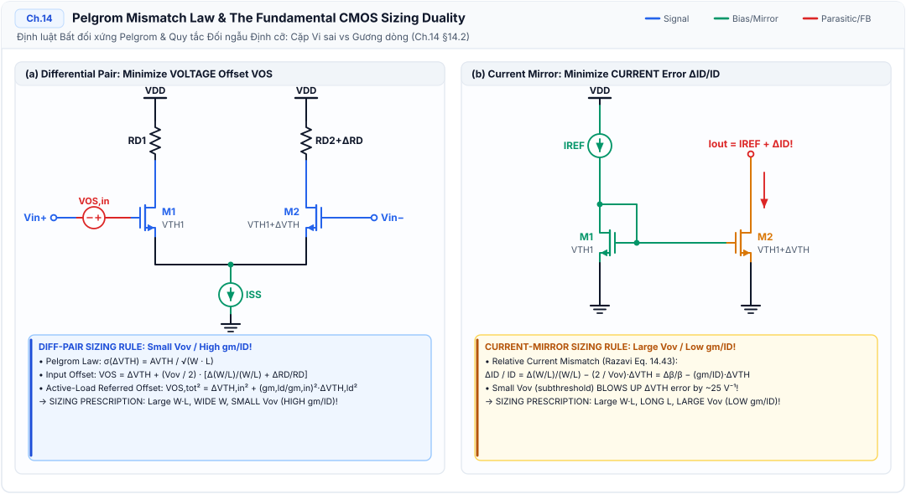

---
{
  "id": "law-pelgrom-mismatch-and-sizing-duality",
  "kind": "law",
  "domain": "nonideal-and-physical",
  "title_vi": "Định luật Pelgrom về Sai lệch Linh kiện & Tính Đối ngẫu Kích thước Cặp Vi sai – Gương Dòng (Pelgrom's Law & Sizing Duality)",
  "title_en": "Pelgrom's Mismatch Law and the Differential-Pair vs. Current-Mirror Sizing Duality",
  "summary": "Quy luật trung bình hóa không gian nghịch đảo căn diện tích 1/sqrt(WL) của Pelgrom, dẫn xuất chính xác điện áp lệch quy về ngõ vào VOS,in, định luật đối ngẫu kích thước giữa cặp vi sai (VOV nhỏ, gm/ID cao) với gương dòng/tải tích cực (VOV lớn, L dài, gm/ID thấp) và suy giảm CMRR dưới sai lệch linh kiện.",
  "diagram": "../../diagrams/pelgrom-mismatch-duality.svg",
  "razavi_refs": [
    {
      "chapter": 14,
      "section": "14.2-14.2.1",
      "pages": "591-598",
      "equations": ["14.67", "14.68", "14.69", "14.78", "14.79", "14.82", "14.86", "14.100"]
    },
    {
      "chapter": 14,
      "section": "14.2.4",
      "pages": "603-604",
      "equations": ["14.96", "14.97", "14.99"]
    }
  ],
  "glossary_codes": [
    "T052",
    "T620",
    "T788",
    "T2058",
    "T655",
    "T688",
    "T659",
    "T649",
    "T663",
    "T661",
    "T026",
    "T1852"
  ],
  "process_agnostic": true,
  "roles": {
    "input_differential_pair": "Cặp so sánh/chuyển đổi điện áp thành dòng điện: cần diện tích cổng W*L lớn và điện áp vượt ngưỡng VOV nhỏ (gm/ID cao) để cực tiểu hóa VOS,in.",
    "current_mirror_and_active_load": "Nguồn sao chép dòng điện và tải tích cực: cần diện tích W*L lớn, chiều dài kênh L dài và VOV lớn (gm/ID thấp) để cực tiểu hóa sai số dòng tương đối Delta_ID/ID và hệ số quy đổi gm_load/gm_in.",
    "passive_resistor_load": "Tải điện trở ghép cặp chịu sai lệch tương đối Delta_RD/RD, đóng góp vào điện áp lệch ngõ vào với trọng số tỷ lệ thuận VOV/2.",
    "tail_and_substrate_bias": "Nguồn dòng đuôi trở kháng hữu hạn và cực thân (bulk) chịu hiệu ứng thân; sai lệch hệ số hiệu ứng thân Delta_gamma làm dịch chuyển VOS,in theo mức chế độ chung VCM,in, gây suy giảm CMRR."
  },
  "symptoms_addressed": [
    "excessive-dc-input-referred-offset-voltage",
    "inaccurate-current-mirror-copy-ratio",
    "active-load-dominating-ota-offset-and-noise",
    "cmrr-degradation-from-asymmetry-and-body-effect",
    "cascade-dc-saturation-from-amplified-offset"
  ],
  "limitations": [
    "pelgrom-10x-offset-reduction-demands-100x-gate-area-and-capacitance",
    "large-active-load-vov-reduces-output-voltage-swing-headroom",
    "pelgrom-covers-only-random-local-mismatch-not-systematic-vds-or-gradient-errors"
  ],
  "checklists": [
    "common-mos",
    "differential-pair",
    "current-mirror",
    "layout-and-matching"
  ]
}
---

## 1. Bản chất Nguyên lý, Sơ đồ Mạch & Vai trò Từng Nhánh Cấu trúc

Trong chế tạo vi mạch thực tế, hai linh kiện được thiết kế hoàn toàn giống nhau và đặt cạnh nhau trên cùng một đế bán dẫn vẫn luôn tồn tại **sai lệch linh kiện (mismatch — `T052`)**. Điều tối quan trọng về mặt khái niệm (theo chuẩn thuật ngữ CLB) là phải phân biệt rạch ròi nguyên nhân vật lý với hệ quả mạch điện: **`mismatch` (`T052`)** là sự không đồng nhất về thông số vật lý – hình học giữa các phần tử ($V_{TH}$, $\mu C_{ox}$, $W$, $L$, $R$), còn **độ lệch (`offset` — `T620`)** hay **điện áp lệch quy về ngõ vào (`input-referred offset voltage` — `T788`)** là sai số điện áp/dòng điện một chiều xuất hiện ở cấp độ mạch do các sai lệch linh kiện đó gây ra.

Về bản chất thống kê, sai lệch linh kiện gồm hai thành phần độc lập phải xử lý bằng hai công cụ khác nhau:
- **Sai lệch hệ thống (Systematic Mismatch):** Phát sinh từ lỗi cấu trúc mạch bất đối xứng (như $V_{DS1} \neq V_{DS2}$ qua điều biến chiều dài kênh $\lambda$), gradien nhiệt độ/công nghệ vĩ mô hoặc bất đối xứng bố trí hình học (`layout`, `T048`). Sai lệch hệ thống có giá trị trung bình $\mu \neq 0$ và **không thể triệt tiêu chỉ bằng cách phóng to diện tích linh kiện**.
- **Sai lệch ngẫu nhiên cục bộ (Random Microscopic Mismatch):** Phát sinh từ biến thiên vi mô mang tính thống kê Poisson/Gauss ở quy mô nguyên tử: thăng giáng ngẫu nhiên số hạt pha tạp trong vùng nghèo kênh dẫn (`Random Dopant Fluctuation — RDF`), độ nhám biên đường cổng polysilicon (`Line-Edge Roughness — LER`) và thăng giáng bề dày oxit cổng $t_{ox}$. Khi ghép nối tiếp và song song $N$ ô transistor đơn vị kích thước $W_0 \times L_0$ thành một transistor diện tích lớn $W \times L = N(W_0 L_0)$ (Razavi Hình 14.21–14.23), các biến thiên độc lập tự **trung bình hóa theo không gian**, làm độ lệch chuẩn giảm tỷ lệ nghịch với $\sqrt{N}$, tức tỷ lệ nghịch với $\sqrt{WL}$!



Sơ đồ nguyên lý minh họa sự tương phản vai trò cấu trúc giữa hai khối nền tảng nhất của IC tương tự:
1. **Nhánh Cặp Vi sai Ngõ vào ($M_1, M_2$ — So sánh Điện áp):** Nhận tín hiệu áp vi sai tại cực cổng và yêu cầu $I_{D1} = I_{D2}$ khi $V_{in} = 0$; mọi bất đối xứng ngưỡng $\Delta V_{TH1,2}$ cộng thẳng $1:1$ vào $V_{OS,in}$.
2. **Nhánh Tải Điện trở ($R_1, R_2$) hoặc Tải Gương Dòng Tích cực ($M_3, M_4$):** Đóng vai trò nguồn dòng/tải chuyển đổi dòng thành áp. Bất đối xứng dòng của nhánh tải bị chia cho độ hỗ dẫn ngõ vào $g_{m1,2}$ khi quy ngược về cực cổng $M_{1,2}$, dẫn tới **quy tắc định cỡ ngược chiều hoàn toàn** so với cặp vi sai ngõ vào!

## 2. Hệ Phương trình Cốt lõi & Tư duy "Nhìn Mạch Đọc Nhanh" (Analysis by Inspection)

### 2.1. Định luật Diện tích Nghịch đảo Căn Bậc Hai của Pelgrom (Razavi Eq. 14.68–14.69)
Với hai transistor danh định giống hệt nhau và đặt gần nhau trên chip (bỏ qua số hạng khoảng cách khi đã bố trí đối xứng tâm chung), độ lệch chuẩn của **sai lệch điện áp ngưỡng (`threshold voltage mismatch` — `T688`)** và hệ số dòng $\beta = \mu C_{ox}\frac{W}{L}$ tuân theo **Định luật Pelgrom**:

$$\sigma(\Delta V_{TH}) = \frac{A_{VTH}}{\sqrt{W L}}, \qquad \sigma\!\left(\frac{\Delta \beta}{\beta}\right) = \frac{A_{\beta}}{\sqrt{W L}} \quad \left(\text{hoặc } \Delta\!\left(\mu C_{ox}\frac{W}{L}\right) = \frac{A_K}{\sqrt{W L}}\right)$$

Trong đó $A_{VTH}$ (đơn vị $\text{mV}\cdot\mu\text{m}$, tỷ lệ thuận với bề dày oxit cổng $t_{ox} \approx 0.1\text{ mV}\cdot\mu\text{m}/\text{\AA}$) và $A_{\beta}$ (đơn vị $\%\cdot\mu\text{m}$) là các hằng số công nghệ đo từ thực nghiệm silicon. Hệ quả diện tích cực kỳ khắc nghiệt (Ví dụ 14.4): ở công nghệ $40\text{ nm}$ với $A_{VTH} = 4\text{ mV}\cdot\mu\text{m}$ và $L = 40\text{ nm}$, để ép $\sigma(\Delta V_{TH}) \le 2\text{ mV}$ cần tới $W = A_{VTH}^2 / (L \cdot \Delta V_{TH}^2) = 100\ \mu\text{m}$ ($W/L = 2500$)! **Muốn giảm offset ngẫu nhiên $10$ lần, phải trả giá diện tích cổng $WL$ và điện dung cổng $C_{gg} = W L C_{ox}$ lớn gấp $100$ lần!**

### 2.2. Dẫn xuất Chính xác $V_{OS,in}$ của Cặp Vi sai Tải Thụ động và Tải Gương Dòng Tích cực
- **Cặp vi sai tải điện trở ($M_1, M_2$ và $R_1, R_2$ — Eq. 14.72–14.79):** Định nghĩa $V_{OS,in} = V_{GS1} - V_{GS2}$ là điện áp vi sai cần đặt vào cổng để ép $V_{out} = 0$, tức buộc $I_{D1} R_1 = I_{D2} R_2 \implies \frac{\Delta I_D}{I_D} \approx -\frac{\Delta R_D}{R_D}$. Khai triển vi phân bậc nhất $V_{GS} = V_{TH} + \sqrt{2I_D / \beta}$ với $V_{OV} = V_{GS} - V_{TH}$ tại cân bằng cho biểu thức tất định và phương sai thống kê (khi các nguồn sai lệch không tương quan):

$$V_{OS,in} = \frac{V_{OV}}{2}\left[\frac{\Delta R_D}{R_D} + \frac{\Delta\beta}{\beta}\right] - \Delta V_{TH}, \qquad \sigma^2(V_{OS,in}) = \sigma^2(\Delta V_{TH}) + \left(\frac{V_{OV}}{2}\right)^2\left[\sigma^2\!\left(\frac{\Delta R_D}{R_D}\right) + \sigma^2\!\left(\frac{\Delta\beta}{\beta}\right)\right]$$

- **Cặp vi sai tải nguồn dòng / gương dòng PMOS ($M_1, M_2$ NMOS ngõ vào, $M_3, M_4$ PMOS tải — Ví dụ 14.5, Eq. 14.80–14.82):** Áp dụng tư duy tương tự nguồn nhiễu tĩnh tần số cực thấp (`Analysis by Inspection`): cặp NMOS có độ lệch nội tại $V_{OS,N}$ nằm ngay tại cổng vào, còn cặp tải PMOS có độ lệch nội tại $V_{OS,P}$ được khuếch đại ra ngõ ra theo $g_{m3,4}(r_{oN}\parallel r_{oP})$ rồi chia cho độ lợi chính $g_{m1,2}(r_{oN}\parallel r_{oP})$ khi quy về ngõ vào, tức nhân trọng số $\frac{g_{m3,4}}{g_{m1,2}}$:

$$V_{OS,in} = \Delta V_{TH1,2} + \frac{g_{m3,4}}{g_{m1,2}}\Delta V_{TH3,4} + \frac{V_{OV1,2}}{2}\left[\left(\frac{\Delta\beta}{\beta}\right)_{1,2} + \left(\frac{\Delta\beta}{\beta}\right)_{3,4}\right]$$

*(Kiểm chứng đại số: Vì hai cặp mang cùng dòng nhánh $I_D$, tỷ số $\frac{g_{m3,4}}{g_{m1,2}} = \frac{2I_D/|V_{OV3,4}|}{2I_D/V_{OV1,2}} = \frac{V_{OV1,2}}{|V_{OV3,4}|}$, nên số hạng $\frac{g_{m3,4}}{g_{m1,2}} \cdot \frac{|V_{OV3,4}|}{2}\left(\frac{\Delta\beta}{\beta}\right)_{3,4}$ trong Eq. 14.82 rút gọn chính xác thành $\frac{V_{OV1,2}}{2}\left(\frac{\Delta\beta}{\beta}\right)_{3,4}$! Phương sai tổng tính bằng tổng bình phương các số hạng độc lập).*

### 2.3. Sai lệch Dòng Tương đối của Gương Dòng & ĐỊNH LUẬT ĐỐI NGẪU KÍCH THƯỚC
Xét hai transistor gương dòng $M_1, M_2$ chung áp cổng–nguồn $V_{GS}$ (Hình 14.28, Eq. 14.83–14.86). Lấy vi phân toàn phần $I_D = \frac{1}{2}\beta(V_{GS} - V_{TH})^2$ và chuẩn hóa theo dòng trung bình $I_D$ (với $\frac{2}{V_{OV}} = \frac{g_m}{I_D}$):

$$\frac{\Delta I_D}{I_D} = \frac{\Delta\beta}{\beta} - \frac{2\,\Delta V_{TH}}{V_{GS} - V_{TH}} = \frac{\Delta\beta}{\beta} - \left(\frac{g_m}{I_D}\right)\Delta V_{TH}$$

Nếu chèn thêm điện trở suy biến nguồn $R_{S1}, R_{S2}$ vào chân gương dòng (Problem 14.15, Eq. 14.100), sai lệch dòng được nén xuống $(1 + g_m R_S)$ lần miễn là điện trở khớp nhau tốt ($\Delta R_S$ nhỏ):

$$\frac{\Delta I_D}{I_D} = \frac{1}{1 + g_m R_S}\left[\frac{\Delta\beta}{\beta} - \frac{2\,\Delta V_{TH}}{V_{GS} - V_{TH}} - g_m \Delta R_S\right]$$

Đối chiếu công thức $V_{OS,in}$ và $\Delta I_D / I_D$ xác lập **Định luật Đối ngẫu Kích thước Cốt lõi (Fundamental Sizing Duality)** xuyên suốt toàn bộ thiết kế vi mạch tương tự:

| Tiêu chí Thiết kế | **Cặp Vi sai Ngõ vào (`Input Diff-Pair`)** | **Gương Dòng & Tải Tích cực (`Mirrors & Active Loads`)** |
| :--- | :--- | :--- |
| **Đại lượng cần tối thiểu hóa** | Điện áp lệch ngõ vào $\sigma(V_{OS,in})$ | Sai số dòng $\sigma(\Delta I_D / I_D)$ & trọng số tải $\frac{g_{m,\text{load}}}{g_{m,\text{in}}}$ |
| **Diện tích cổng $W \times L$** | **Lớn** (giảm $A_{VTH}/\sqrt{WL}$ và $A_\beta/\sqrt{WL}$) | **Lớn** (giảm $\Delta V_{TH,\text{load}}$ và $\Delta\beta_{\text{load}}/\beta_{\text{load}}$) |
| **Điện áp vượt ngưỡng $V_{OV}$** | **NHỎ** ($V_{OV}$ thấp $\implies$ dập tắt số hạng $\frac{V_{OV}}{2}\frac{\Delta\beta}{\beta}$ và tăng $g_{m,\text{in}}$) | **LỚN** ($|V_{OV,\text{load}}|$ cao $\implies$ dập tắt $\frac{2\Delta V_{TH}}{V_{OV}}$ và ép $\frac{g_{m,\text{load}}}{g_{m,\text{in}}} = \frac{V_{OV,\text{in}}}{|V_{OV,\text{load}}|} \ll 1$) |
| **Vùng hiệu suất $g_m / I_D$ (`T1852`)** | **$g_m / I_D$ CAO** ($16\text{–}22\text{ V}^{-1}$, nghịch đảo yếu/trung bình) | **$g_m / I_D$ THẤP** ($5\text{–}9\text{ V}^{-1}$, nghịch đảo mạnh) |
| **Tỷ lệ khung $W / L$ và chiều dài $L$** | **$W$ rất lớn, $L$ ngắn – vừa phải** (tối ưu tốc độ $f_T$ và $g_{m,\text{in}}$) | **$L$ DÀI, $W/L$ nhỏ** (tăng $r_o$, giảm nhiễu $1/f$ và giữ $|V_{OV}|$ lớn ở cùng $I_D$) |

### 2.4. Định nghĩa Tương đương của $\text{CMRR}$ theo Độ nhạy Offset với Mức Chế độ Chung (§14.2.4)
Khi mức điện áp chế độ chung ngõ vào thay đổi một lượng $\Delta V_{CM,in}$ (giữ $V_{in,\text{diff}} = 0$), mọi sự dịch chuyển ở ngõ ra vi sai $\Delta V_{out}$ chính là sự biến thiên của điện áp lệch ngõ ra $\Delta V_{OS,out}$. Do đó độ lợi chuyển đổi chế độ chung sang vi sai là $A_{CM\text{–}DM} = \frac{\Delta V_{OS,out}}{\Delta V_{CM,in}}$, và **tỷ số khử chế độ chung (`CMRR` — `T661`)** mang ý nghĩa vật lý trực quan (Eq. 14.96–14.99):

$$\text{CMRR} = \left|\frac{A_{DM}}{A_{CM\text{–}DM}}\right| = \left|\frac{\Delta V_{CM,in}}{\Delta V_{OS,out} / A_{DM}}\right| = \left|\frac{\Delta V_{CM,in}}{\Delta V_{OS,in}}\right| = \left|\frac{\partial V_{OS,in}}{\partial V_{CM,in}}\right|^{-1}$$

Ví dụ sắc bén (Hình 14.40): Với cặp vi sai PMOS ngõ vào, nếu nối giếng n (`N-well`) lên $V_{DD}$ thay vì nối vào cực nguồn chung của hai PMOS, khi $V_{CM,in}$ thay đổi sẽ làm biến thiên $V_{SB}$. Nếu hai transistor có **sai lệch hiệu ứng thân (`body-effect mismatch` — `T663`, $\Delta\gamma \neq 0$)**, hiệu ngưỡng $\Delta V_{TH1,2}(V_{CM,in})$ biến thiên theo $V_{CM,in}$ làm $V_{OS,in}$ trôi, trực tiếp phá hỏng $\text{CMRR}$ ngay cả khi nguồn dòng đuôi lý tưởng ($R_{SS} \to \infty$)!

### 2.5. Ví dụ Định lượng Đầy đủ & Tương tác Trở kháng Ra Hữu hạn (Razavi Ex. 14.4–14.5 & Pr. 14.17)
1. **Ví dụ Định lượng Phân bổ Ngân sách Offset trên OTA 5 Transistor (`65nm`):**
   Giả sử mỗi nhánh mang dòng tĩnh $I_D = 100\ \mu\text{A}$ với hằng số Pelgrom $A_{VTH,N} = 3.5\text{ mV}\cdot\mu\text{m}$, $A_{VTH,P} = 4.0\text{ mV}\cdot\mu\text{m}$ và $A_{\beta} = 1.5\%\cdot\mu\text{m}$:
   - *Nếu định cỡ sai (cho tải PMOS có cùng hiệu suất cao như cặp vào):* Chọn $(g_m/I_D)_N = (g_m/I_D)_P = 18\text{ V}^{-1}$ và cùng diện tích $W L = 4\ \mu\text{m}^2$. Khi đó $\sigma(\Delta V_{TH,N}) = 1.75\text{ mV}$ và $\sigma(\Delta V_{TH,P}) = 2.0\text{ mV}$ nhân trọng số $\frac{g_{mP}}{g_{mN}} = 1.0$, làm tổng độ lệch vọt lên:

$$\sigma(V_{OS,in})\big|_{\text{wrong}} \approx \sqrt{1.75^2 + (1.0 \times 2.0)^2} = 2.66\text{ mV} \quad (\pm 3\sigma = \pm 8.0\text{ mV}!)$$

   - *Khi áp dụng Định luật Đối ngẫu Kích thước:* Giữ cặp vào $M_{1,2}$ ở $(g_m/I_D)_N = 20\text{ V}^{-1}$ ($V_{OV,N} \approx 100\text{ mV}$, chọn $W_N = 40\ \mu\text{m}, L_N = 0.25\ \mu\text{m} \implies W_N L_N = 10\ \mu\text{m}^2$) và ép cặp tải gương dòng $M_{3,4}$ xuống vùng nghịch đảo mạnh $(g_m/I_D)_P = 6.5\text{ V}^{-1}$ ($|V_{OV,P}| \approx 308\text{ mV}$, chọn kênh dài $L_P = 1.0\ \mu\text{m}, W_P = 8\ \mu\text{m} \implies W_P L_P = 8\ \mu\text{m}^2$). Lúc này tỷ số hỗ dẫn sụt còn $\frac{g_{mP}}{g_{mN}} = \frac{6.5}{20} = 0.325$ (nén phương sai của tải PMOS đi gần **$10$ lần**!):
     - Đóng góp ngưỡng cặp vào: $\sigma(\Delta V_{TH,N}) = 3.5 / \sqrt{10} = 1.11\text{ mV}$.
     - Đóng góp ngưỡng cặp tải PMOS quy về ngõ vào: $0.325 \times (4.0 / \sqrt{8}) = 0.46\text{ mV}$.
     - Đóng góp sai lệch hệ số dòng $\Delta\beta/\beta$: $\frac{1}{20}\sqrt{\frac{0.015^2}{10} + \frac{0.015^2}{8}} \approx 0.36\text{ mV}$.
     - Tổng phương sai RSS rút xuống chỉ còn:

$$\sigma(V_{OS,in})\big|_{\text{optimal}} = \sqrt{1.11^2 + 0.46^2 + 0.36^2} = 1.25\text{ mV} \quad (\text{tải PMOS chỉ còn chiếm } < 14\% \text{ phương sai!})$$

2. **Tác động của Sai lệch Nguồn Dòng Đuôi Chia Đôi hoặc Cascode (Razavi Problem 14.17, Hình 14.42):**
   Khi hai nhánh của cặp vi sai được cấp bởi hai nguồn dòng dưới riêng rẽ $M_3, M_4$ (chịu $\Delta V_{TH3,4}$) và có điện trở ra hữu hạn ($\lambda \neq 0$), dòng lệch $\Delta I_{D3,4} = g_{m3,4}\Delta V_{TH3,4}$ nhìn thấy sự phân chia dòng giữa cực nguồn $M_{1,2}$ (trở kháng $\approx 1/g_{m1,2}$ khi tải $R_D$ nhỏ) và điện trở ra $r_{O1,2}$. Nếu tải cực máng $R_D$ nhỏ, phần lớn dòng lệch chảy thẳng lên $R_D$ gây $V_{OS,in} \approx \frac{g_{m3,4}}{g_{m1,2}}\Delta V_{TH3,4}$; nhưng đáng chú ý là khi $R_D \to \infty$ (tải nguồn dòng lý tưởng buộc hai dòng nhánh bằng nhau!), áp cực máng dịch chuyển mạnh qua hiệu ứng điều biến chiều dài kênh $r_{O1,2}$ để triệt tiêu sai lệch dòng đó, tạo ra $V_{OS,in}$ phụ thuộc cả vào độ lợi nội tại $g_m r_O$ của tầng!

## 3. Bất biến Cấu trúc & Các Bẫy Lỗi Kinh điển (Structural Invariants & Traps)

- **`[INV-MIS-01]` Bất biến Đồng hướng Pelgrom & Nhiễu Nhiệt/Flicker:** Tính đối ngẫu kích thước cho offset trùng khít tuyệt đối với quy tắc tối ưu nhiễu Chương 7 (`law-mos-thermal-and-flicker-noise`): đặt cặp vào ở $g_m/I_D$ cao và tải gương dòng ở $g_m/I_D$ thấp + $L$ dài đồng thời tối thiểu hóa **cả $V_{OS,in}$ lẫn nhiễu nhiệt và nhiễu nhấp nháy $1/f$ quy về ngõ vào**!
- **`[INV-MIS-02]` Bất biến Bậc Thống kê Độc lập (RSS Addition):** Các nguồn sai lệch ngẫu nhiên không tương quan từ từng cặp transistor ($\Delta V_{TH1,2}$, $\Delta V_{TH3,4}$, $\Delta\beta_{1,2}/\beta_{1,2}$, $\dots$) luôn cộng theo **căn tổng bình phương (Root-Sum-Square)**: $\sigma_{\text{tot}} = \sqrt{\sum_i \sigma_i^2}$, không cộng đại số tuyến tính; tuy nhiên mục tiêu sản xuất hàng loạt (yield $99.7\%$) bắt buộc thiết kế theo biên $\pm 3\sigma_{\text{tot}}$.
- **`[TRAP-MIS-01]` Bẫy Phóng to $W/L$ của Gương Dòng để "Giảm Mismatch":** Nhiều người mới thấy gương dòng bị lệch nên tăng mạnh độ rộng $W$ (giữ $L$ ngắn và $I_D$ cố định). Dù $\Delta V_{TH}$ giảm theo $1/\sqrt{W}$, điện áp vượt ngưỡng $V_{OV} = \sqrt{2I_D / (\mu C_{ox} W/L)}$ cũng giảm theo $1/\sqrt{W}$! Kết quả là tỷ số $\frac{2\Delta V_{TH}}{V_{OV}}$ trong Eq. 14.86 **đứng yên không giảm chút nào**, trong khi điện dung ký sinh phình to! Cách đúng để giảm $\Delta I_D / I_D$ ở dòng $I_D$ cho trước là **tăng chiều dài $L$ lớn hơn tốc độ tăng $W$** (tức tăng tích $WL$ đồng thời giảm tỷ số $W/L$ để nâng $V_{OV}$!).
- **`[TRAP-MIS-02]` Bẫy Nhầm Lẫn Giữa Offset Hệ thống và Offset Ngẫu nhiên trong Op-Amp 2 Tầng:** Nếu tầng 1 có tải gương dòng bất đối xứng điện áp máng hoặc điểm tĩnh ngõ ra tầng 1 không khớp $V_{GS}$ tầng 2 khi không có tín hiệu, mạch chịu **offset hệ thống** vài milivôn ngay trong mô phỏng danh định (`TT` nominal, chưa bật mismatch). Tăng $WL$ theo Pelgrom hoàn toàn vô tác dụng trước lỗi hệ thống này!
- **`[TRAP-MIS-03]` Bẫy Đánh đổi Khoảng Dự trữ Ngõ ra (`Swing`) với Offset Tải Tích cực (Problem 14.20):** Tăng mạnh $|V_{OV3,4}|$ của tải PMOS giúp giảm đóng góp offset $\frac{g_{m3,4}}{g_{m1,2}}\Delta V_{TH3,4} = \frac{V_{OV1,2}}{|V_{OV3,4}|}\Delta V_{TH3,4}$, nhưng trực tiếp ăn lẹm dải dao động điện áp ngõ ra cực đại ($V_{out,\max} = V_{DD} - |V_{OV3,4}|$), đặc biệt nguy hiểm ở nguồn cấp dưới $1.2\text{ V}$.
- **`[TRAP-MIS-04]` Bẫy Bão hòa Chuỗi Khuếch đại Ghép Trực tiếp (`Direct-Coupled Cascade`):** Trong chuỗi bộ khuếch đại tiền xử lý hoặc bộ so sánh nhiều tầng độ lợi tổng $A_{\text{tot}} = 1000$, chỉ cần $V_{OS,in} = 2\text{ mV}$ ở tầng đầu sẽ tạo ra $2\text{ V}$ DC ở tầng cuối (Hình 14.25), đánh sập hoàn toàn điểm làm việc sang vùng triode/ngắt.

## 4. Lộ trình Nâng cấp Cấu trúc & Bát giác Đánh đổi (Upgrade Paths & Design Octagon)

Trên **Bát giác Thiết kế (`concept-analog-design-octagon`)**, độ chính xác DC (`Offset / Matching`) kéo căng tam giác đánh đổi trực tiếp với **Tốc độ / Băng thông** (qua điện dung cổng $W L C_{ox}$) và **Dải dao động Điện áp** (qua $|V_{OV,\text{load}}|$):
- **Nâng cấp Cặp Vi sai & Khử Lệch Hệ thống Gương Dòng:** Khởi đầu từ `topo-basic-differential-pair`, `concept-cm-response-and-cmrr` và `topo-basic-current-mirror`, để loại bỏ sai lệch dòng hệ thống $\lambda \Delta V_{DS}$ trước khi tối ưu Pelgrom ngẫu nhiên, nâng cấp gương dòng lên `topo-lvccml-wide-swing-mirror` và lõi OTA lên `topo-folded-cascode-ota` (ép hai nhánh đối xứng có cùng áp máng tĩnh).
- **Bảo vệ Độ Chính xác Tham chiếu Bandgap:** Trong `topo-bandgap-reference-core`, điện áp lệch $V_{OS,in}$ của op-amp bị nhân bội lên $(1 + R_2/R_1) \approx 8\text{–}12$ lần cộng thẳng vào $V_{REF}$ và làm hỏng hệ số nhiệt TC; việc áp dụng triệt để định luật đối ngẫu kích thước ở đây là điều kiện sống còn.
- **Phá Trần Diện tích – Tốc độ bằng Khử Offset Động:** Khi yêu cầu $V_{OS,in} < 100\ \mu\text{V}$ hoặc trong dãy bộ so sánh ADC tốc độ cao không cho phép tụ cổng hàng trăm femtofarad, dừng việc bơm diện tích tĩnh Pelgrom và chuyển sang kỹ thuật khử độ lệch động hai pha trong `tech-dynamic-offset-cancellation-az-cds`.
- **Hiện thực hóa Mặt bằng Vật lý:** Định luật Pelgrom chỉ đạt tới giới hạn lý thuyết $A_{VTH}/\sqrt{WL}$ khi mọi gradien bậc nhất, hiệu ứng nén cơ học rãnh nông `STI` và hiệu ứng lân cận giếng `WPE` đã được triệt tiêu bằng các quy tắc bố cục bắt buộc trong `tech-common-centroid-sti-wpe-layout`.

## 5. Thích ứng Đa Tiến trình (90nm / 65nm / 45nm) & Cách Kiểm chứng trong Cadence / Spectre

### 5.1. Thích ứng Đa Tiến trình (`90nm` / `65nm` / `45nm`) theo Ngôn ngữ $g_m / I_D$
Ở các nút công nghệ nanomet khi phương trình bình phương mất độ chính xác (`tech-nanometer-vdsmin-gmid-sizing`), ta viết lại toàn bộ hệ phương trình sai lệch sang biến thiết kế bất biến tiến trình là **hiệu suất hỗ dẫn $(g_m / I_D)$** (thay $V_{OV}/2$ bằng $(g_m/I_D)^{-1}$):

$$\sigma^2(V_{OS,in}) = \sigma^2(\Delta V_{TH1,2}) + \left(\frac{(g_m/I_D)_{3,4}}{(g_m/I_D)_{1,2}}\right)^2 \sigma^2(\Delta V_{TH3,4}) + \frac{1}{(g_m/I_D)_{1,2}^2}\left[\sigma^2\!\left(\frac{\Delta\beta}{\beta}\right)_{1,2} + \sigma^2\!\left(\frac{\Delta\beta}{\beta}\right)_{3,4}\right]$$

$$\sigma^2\!\left(\frac{\Delta I_D}{I_D}\right) = \sigma^2\!\left(\frac{\Delta\beta}{\beta}\right) + \left(\frac{g_m}{I_D}\right)^2 \sigma^2(\Delta V_{TH})$$

- **Tại `90nm / 65nm / 45nm`:** Hằng số $A_{VTH}$ giảm nhờ oxit mỏng hơn ($t_{ox} \approx 1.2\text{–}2.2\text{ nm} \implies A_{VTH} \approx 2.5\text{–}4.5\text{ mV}\cdot\mu\text{m}$), nhưng do kích thước tối thiểu rất nhỏ và hiện tượng hiệu ứng kênh hẹp/ngắn cục bộ (`pocket/halo implants` làm tăng $A_{VTH}$ ở $L_{\min}$!), tuyệt đối **không dùng $L = L_{\min}$ cho cặp vi sai chính xác hay gương dòng**: chọn $L_{\text{in}} \approx (2\text{–}4)L_{\min}$ với $(g_m/I_D)_{\text{in}} \approx 18\text{–}22\text{ V}^{-1}$ ($V_{DS,\min} \approx 80\text{–}100\text{ mV}$) và chọn $L_{\text{mirror}} \approx (5\text{–}12)L_{\min}$ với $(g_m/I_D)_{\text{mirror}} \approx 6\text{–}9\text{ V}^{-1}$ ($V_{DS,\min} \approx 200\text{–}280\text{ mV}$). Dùng bội số ngón tay đơn vị `m` / `nf` giống hệt nhau thay vì vẽ một ngón rộng liên tục.

### 5.2. Quy trình Kiểm chứng Monte Carlo trong Cadence Virtuoso ADE XL / Assembler & Spectre
1. **Kiểm tra Sai lệch Hệ thống Trước Tiên (`Nominal DC Offset = 0`):**
   - Khép OTA vào cấu hình đệm độ lợi đơn vị (hoặc dùng vòng hồi tiếp DC lý tưởng qua cuộn cảm lớn / nguồn điều khiển `vcvs` giữ $V_{out,\text{diff}} = 0$) tại góc `TT` danh định: đọc `V(Vin_plus, Vin_minus)`. Nếu $|V_{OS,\text{sys}}| > 50\ \mu\text{V}$, phải sửa ngay sự bất đối xứng $V_{DS}$ hoặc điểm tĩnh liên tầng trước khi chạy thống kê.
2. **Mô phỏng Thống kê `Spectre Monte Carlo` (`Process` vs `Mismatch`):**
   - Trong ADE XL / Explorer, thiết lập Monte Carlo với phương pháp lấy mẫu `Latin Hypercube` (`LHS`, hội tụ nhanh hơn ngẫu nhiên thuần túy), $N = 200\text{–}500$ mẫu:
     - Chạy riêng `variation = mismatch` để trích xuất chính xác $\sigma(V_{OS,in})$ và $\sigma(\Delta I_D / I_D)$ do Pelgrom cục bộ.
     - Chạy gộp `variation = all` (`process + mismatch`) trên các góc nhiệt độ $-40^\circ\text{C}, 27^\circ\text{C}, 125^\circ\text{C}$ để kiểm tra biên $\mu \pm 3\sigma$ toàn cục.
3. **Phân tích Đóng góp Sai lệch (`Mismatch Contribution / Sensitivity Analysis`):**
   - Bật tùy chọn **Mismatch Contribution** trong ADE XL: Spectre sẽ xếp hạng phần trăm phương sai $\sigma^2(V_{OS,in})$ đến từ từng cặp transistor cụ thể (ví dụ: nếu $M_3/M_4$ đóng góp $> 25\%$ tổng phương sai, lập tức tăng $L_{3,4}$ và hạ $(g_m/I_D)_{3,4}$!).
4. **Đo $\text{CMRR}$ Thống kê dưới Mismatch:**
   - Trong cùng phiên chạy Monte Carlo, thêm phép phân tích `xf` hoặc `ac` với nguồn kích thích chế độ chung $V_{CM,ac} = 1\text{ V}$ để vẽ histogram $\text{CMRR} = 20\log_{10}|A_{DM}/A_{CM\text{–}DM}|$; tại điểm danh định lý tưởng $\text{CMRR}$ có thể đạt $>120\text{ dB}$ giả tạo, nhưng giá trị thực tế phải đọc ở phân vị xấu nhất $99.7\%$ ($3\sigma$ tail, thường tụt về $65\text{–}85\text{ dB}$).
5. **Mẫu Cấu hình Khối `Monte Carlo` Chuẩn trong Spectre Netlist (`input.scs`):**
```spice
// Kiem chung phan bo VOS,in, Delta_ID/ID va CMRR qua 300 mau LHS Mismatch
mc_offset montecarlo variations=mismatch numruns=300 seed=12345 \
    sampling=lhs donominal=yes savemismatchparams=yes {
    dc_op dc
    ac_dm ac start=1 stop=1G dec=20
}
// Cong thuc ADE Calculator:
// VOS_in  = v("/Vin_p" ?result "dcOp") - v("/Vin_n" ?result "dcOp")
// CMRR_dB = db20(abs(vf("/Vout_dm_from_dm") / vf("/Vout_dm_from_cm")))
// Mismatch_Mirror_pct = 100.0 * (i("M2:d" ?result "dcOp") - i("M1:d" ?result "dcOp")) / i("M1:d" ?result "dcOp")
```

## 6. Mốc Đối chiếu Sách Razavi & Thuật ngữ Chuẩn CLB

| Mục Sách Razavi (2nd Ed.) | Trang & Phương trình | Nội dung Đối chiếu Trọng tâm | Mã Thuật ngữ Chuẩn CLB |
| :--- | :--- | :--- | :--- |
| **§14.2 Mismatch** | Tr. 591–593, Eq. `(14.65)–(14.71)`, Ex. `14.4` | Cơ chế trung bình hóa không gian $1/\sqrt{N}$ và Định luật Pelgrom $A_{VTH}/\sqrt{WL}$, $A_K/\sqrt{WL}$ | `T052` (Sai lệch linh kiện), `T655` (sai lệch kích thước và điện áp ngưỡng), `T688` (sai lệch điện áp ngưỡng) |
| **§14.2.1 DC Offsets (Diff-Pair)** | Tr. 593–596, Eq. `(14.72)–(14.82)`, Ex. `14.5` | Dẫn xuất $V_{OS,in}$ cho cặp vi sai tải điện trở và tải gương dòng tích cực PMOS | `T620` (độ lệch / offset), `T788` (điện áp lệch quy về ngõ vào), `T649` (sai lệch điện trở) |
| **§14.2.1 Current Mirrors & Pr. 14.15** | Tr. 596–597, 605, Eq. `(14.83)–(14.86)`, `(14.100)` | Sai lệch dòng $\Delta I_D / I_D$, tính đối ngẫu $V_{OV}$ lớn vs nhỏ, gương dòng suy biến nguồn | `T026` (Gương dòng), `T659` (sai lệch hỗ dẫn), `T1852` (đặc tuyến gm–ID) |
| **§14.2.4 Alternative CMRR** | Tr. 603–604, Eq. `(14.96)–(14.99)`, Fig. `14.40` | Quan hệ $\text{CMRR} = |\Delta V_{CM,in} / \Delta V_{OS,in}|$ và suy giảm $\text{CMRR}$ do sai lệch hiệu ứng thân $\Delta\gamma$ | `T661` (tỷ số khử chế độ chung CMRR), `T663` (sai lệch hiệu ứng thân), `T022` (Chế độ chung) |
