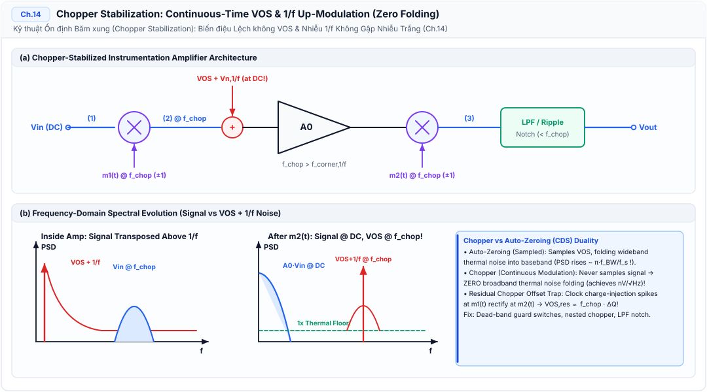

---
{
  "id": "tech-chopper-stabilization-vs-autozeroing",
  "kind": "technique",
  "domain": "nonideal-and-physical",
  "title_vi": "Điều biến Băm Liên tục Thời gian (Chopper Stabilization) Đối chiếu với Tự động Khử Lệch Rời rạc (Auto-Zeroing / CDS)",
  "title_en": "Chopper Stabilization (Continuous-Time Up/Down Modulation) vs. Auto-Zeroing: Noise Folding Immunity, Ripple Suppression, and Spike Offset",
  "summary": "Đối chiếu toàn diện hai học thuyết khử độ lệch DC và nhiễu nhấp nháy 1/f trong thiết kế CMOS độ chính xác siêu cao (microvolt/nanovolt): cơ chế điều biến – giải điều chế sóng vuông liên tục thời gian của Chopper Stabilization dịch chuyển VOS và nhiễu 1/f lên hài lẻ f_chop mà KHÔNG gây gấp nếp nhiễu nhiệt dải rộng (khác hẳn Auto-Zeroing/CDS luôn bị phạt >= +3 dB aliasing), kèm phân tích định lượng sóng gợn băm ngõ ra (chopper ripple), vòng khử gợn/lọc khía và độ lệch dư từ gai xung phun điện tích công tắc.",
  "diagram": "../../diagrams/chopper-stabilization-principle.svg",
  "razavi_refs": [
    {
      "chapter": 14,
      "section": "14.2.2-14.2.3",
      "pages": "598-604",
      "equations": ["14.88", "14.89", "14.90", "14.91", "14.92", "14.94", "14.95"]
    }
  ],
  "glossary_codes": [
    "T014",
    "T015",
    "T025",
    "T038",
    "T052",
    "T060",
    "T074",
    "T392",
    "T620",
    "T788",
    "T1009",
    "T1515",
    "T2102",
    "T2136",
    "T2138",
    "T2155",
    "T2157",
    "T2158",
    "T2159"
  ],
  "process_agnostic": true,
  "roles": {
    "input_chopper_modulator_m1": "Cầu đảo cực 4 công tắc MOS không tiêu tán công suất đặt trước cổng vào bộ khuếch đại, nhân tín hiệu băng gốc với sóng vuông +-1 tần số f_chop để đẩy tín hiệu hữu ích vượt qua vùng nhiễu 1/f.",
    "wideband_core_amplifier_a": "Lõi khuếch đại vi sai liên tục thời gian có băng thông lớn hơn f_chop: khuếch đại tín hiệu đã điều biến ở f_chop đồng thời cộng thêm sai số nội tại VOS và nhiễu 1/f ở vùng DC.",
    "output_chopper_demodulator_m2": "Cầu giải điều chế 4 công tắc đồng bộ pha với m1(t), đưa tín hiệu hữu ích quay trở lại băng gốc DC (nhờ m^2(t) = 1) đồng thời băm và tống khứ VOS cùng nhiễu 1/f lên các hài lẻ f_chop, 3*f_chop.",
    "ripple_filter_or_rrl": "Bộ lọc thông thấp liên tục, bộ lọc khía tụ chuyển mạch (SC Notch) hoặc vòng hồi tiếp triệt gợn (Ripple-Reduction Loop) dập tắt thành phần sóng vuông A0*VOS tại f_chop trước khi ra tải."
  },
  "symptoms_addressed": [
    "wideband-thermal-noise-aliasing-penalty-in-autozeroed-amplifiers",
    "sub-microvolt-dc-offset-and-zero-drift-instrumentation-requirement",
    "megahertz-1-over-f-flicker-noise-corner-in-nanometer-cmos-sensors",
    "bandgap-error-amplifier-offset-and-low-frequency-noise-multiplication"
  ],
  "limitations": [
    "large-chopper-output-ripple-at-fchop-proportional-to-upconverted-vos",
    "residual-offset-proportional-to-fchop-from-demodulated-clock-charge-spikes",
    "input-impedance-degradation-from-switched-parasitic-input-capacitance",
    "signal-bandwidth-restricted-below-half-chopper-frequency-unless-multipath"
  ],
  "checklists": [
    "common-mos",
    "switched-capacitor",
    "spectre-pss-pnoise",
    "layout-and-matching"
  ]
}
---

## 1. Bản chất Nguyên lý, Sơ đồ Mạch & Vai trò Từng Nhánh Cấu trúc

Trong các hệ thống đo lường chính xác cao như bộ khuếch đại đo lường cầu cảm biến áp suất/nhiệt độ, điện tâm đồ/điện não đồ y sinh (`ECG/EEG` biên độ microvolt ở $0.05\text{–}200\text{ Hz}$), cảm biến dòng điện Hall/shunt, và lõi tham chiếu vùng cấm siêu chính xác (`topo-bandgap-reference-core`), người thiết kế đối mặt với hai kẻ thù không đội trời chung tại vùng tần số gần không (`DC`): **điện áp lệch quy về ngõ vào (`input-referred offset voltage` — `T788`)** cỡ vài milivolt kèm độ trôi nhiệt $\mu\text{V}/^\circ\text{C}$, và **nhiễu $1/f$ tần số thấp (`low-frequency 1/f noise` — `T2102`, `flicker noise` — `T392`)** có tần số góc cắt vọt lên $0.5\text{–}5\text{ MHz}$ trên transistor CMOS nanomet.

Trong Razavi §14.2.2–14.2.3 (trang 598–603, `tech-dynamic-offset-cancellation-az-cds`), kỹ thuật **Tự động khử lệch / Lấy mẫu kép tương quan (`Auto-Zeroing / CDS` — `T2157`, `T2158`)** giải quyết bài toán bằng cách *lấy mẫu* sai số ở Pha 1 rồi *trừ bỏ* ở Pha 2. Tuy rất hiệu quả cho các hệ thống vốn đã lấy mẫu rời rạc (như bộ so sánh và mạch SC), `AZ / CDS` mang hai nhược điểm bản chất không thể chấp nhận đối với mạch tương tự liên tục nhiễu siêu thấp: (1) ngõ vào/ngõ ra bị ngắt quãng rời rạc, và (2) quá trình lấy mẫu hai pha **gấp nếp (`fold / alias`) toàn bộ nhiễu nhiệt dải rộng của bộ khuếch đại dồn vào băng gốc**, làm mật độ phổ nhiễu nhiệt tăng vọt gấp $3\times\text{–}10\times$!

Kỹ thuật đối ngẫu vĩ đại khắc phục triệt để hạn chế này chính là **Ổn định bằng Điều biến Băm (`Chopper Stabilization`)** — thay vì *lấy mẫu (sampling)* trong miền thời gian, mạch thực hiện **điều chế và giải điều chế biên độ sóng vuông (`continuous-time frequency transposition`)** trong miền tần số:



Cấu trúc cơ bản của một bộ khuếch đại băm liên tục thời gian gồm 4 thành phần nối tiếp:
1. **Bộ điều biến băm ngõ vào (`Input Chopper Modulator` $C_{\text{in}}$):** Là một cầu đảo chéo 4 công tắc MOS đơn giản điều khiển bởi hai xung vuông đối pha không chồng lấp $\phi_{\text{chop}}, \overline{\phi_{\text{chop}}}$ ở tần số băm $f_{\text{chop}}$ (chọn cao hơn tần số góc nhiễu nhấp nháy: $f_{\text{chop}} > f_{c,1/f}$ và ít nhất gấp đôi băng thông tín hiệu $f_{\text{chop}} > 2 f_{\text{sig,max}}$). Cầu công tắc này nhân tín hiệu đầu vào vi sai liên tục $v_{in}(t)$ với hàm sóng vuông $m(t) = \pm 1$, **nâng toàn bộ phổ tín hiệu từ DC lên tập trung quanh tần số $f_{\text{chop}}$ (và các hài lẻ $3 f_{\text{chop}}, 5 f_{\text{chop}}\dots$)** *trước khi* nó bước vào cổng MOSFET!
2. **Lõi Khuếch đại Vi sai Liên tục Thời gian $A(s)$:** Nhận tín hiệu đã nằm an toàn ở vùng tần số sạch $f_{\text{chop}}$, khuếch đại nó với độ lợi $A_0$, đồng thời cộng thêm điện áp lệch tĩnh $V_{OS}$ và nhiễu $1/f$ nội tại của chính lõi $A(s)$ tại vùng $0\text{ Hz}$ (**lưu ý: $V_{OS}$ và nhiễu $1/f$ chỉ đi qua một lần băm ở phía sau chứ không đi qua bộ băm đầu vào!**).
3. **Bộ giải điều chế băm ngõ ra (`Output / Intermediate Chopper Demodulator` $C_{\text{out}}$):** Đặt tại ngõ ra của tầng hỗ dẫn đầu tiên (điểm nút dòng trở kháng thấp của cascode gập là vị trí ưu việt nhất!) hoặc tại ngõ ra điện áp, nhân toàn bộ luồng tín hiệu một lần nữa với cùng hàm sóng vuông đồng bộ $m(t) = \pm 1$:
   - Đối với tín hiệu hữu ích đã băm lần 1: nhờ đồng nhất thức vàng **$m(t) \cdot m(t) = (\pm 1)^2 \equiv +1$ ở mọi thời điểm $t$**, tín hiệu hữu ích được **khôi phục nguyên vẹn 100% về băng gốc DC không hề bị lấy mẫu rời rạc**!
   - Đối với $V_{OS}$ và nhiễu $1/f$ của lõi $A(s)$: chỉ bị nhân một lần duy nhất với $m(t)$, nên bị **đá văng từ DC lên tập trung quanh $f_{\text{chop}}, 3 f_{\text{chop}}, 5 f_{\text{chop}}\dots$**, bỏ lại vùng băng gốc DC hoàn toàn sạch bóng $V_{OS}$ và sạch bóng nhiễu $1/f$!
4. **Mạng Lọc Thông thấp / Khử Sóng Gợn Băm (`Low-Pass / Notch Ripple Filter`):** Lọc bỏ thành phần sóng vuông biên độ lớn $A_0 V_{OS}$ tại $f_{\text{chop}}$ để xuất ra tín hiệu liên tục tinh khiết.

---

## 2. Hệ Phương trình Cốt lõi & Tư duy "Nhìn Mạch Đọc Nhanh" (Analysis by Inspection)

### 2.1. Khai triển Chuỗi Fourier của Điều biến Băm & Chứng minh Không Gấp nếp Nhiễu Nhiệt (`Zero Aliasing`)
Hàm đảo cực chu kỳ $T_{\text{chop}} = 1 / f_{\text{chop}}$ ($\omega_{\text{chop}} = 2\pi f_{\text{chop}}$) với chu kỳ nhiệm vụ chuẩn xác $50\%$ có khai triển chuỗi Fourier chỉ chứa các bậc hài lẻ:
$$m(t) = \frac{4}{\pi} \sum_{k=1, \, k\text{ lẻ}}^{\infty} \frac{1}{k} \sin(k \omega_{\text{chop}} t) = \frac{4}{\pi}\left[\sin(\omega_{\text{chop}} t) + \frac{1}{3}\sin(3\omega_{\text{chop}} t) + \frac{1}{5}\sin(5\omega_{\text{chop}} t) + \dots\right]$$
1. **Độ lợi hiệu dụng băng gốc khi băng thông lõi $A(s)$ hữu hạn:**
   Nếu lõi $A(s) = \frac{A_0}{1 + s/\omega_0}$ có băng thông cực rộng ($\omega_0 \gg \omega_{\text{chop}}$), mọi hài lẻ đều đi qua nguyên vẹn và tổng Parseval $\frac{8}{\pi^2}\sum_{k\text{ lẻ}} \frac{1}{k^2} = \frac{8}{\pi^2} \cdot \frac{\pi^2}{8} = 1$ trả lại độ lợi DC chính xác bằng $A_0$. Ngược lại nếu lõi chỉ đủ băng thông truyền hài cơ bản $k=1$ (hoặc đặt bộ lọc dải thông), độ lợi DC suy giảm nhẹ còn $\frac{8}{\pi^2} A_0 \approx 0.81\,A_0$.
2. **Mật độ phổ công suất nhiễu tại băng gốc sau giải điều chế ($f \ll f_{\text{chop}}$):**
   Gọi $S_{n,\text{amp}}(f) = S_{n,\text{white}} \left(1 + \frac{f_{c,1/f}}{|f|}\right)$ là mật độ phổ nhiễu quy về ngõ vào của lõi khuếch đại (khi băng thông nhiễu của lõi lớn hơn nhiều $f_{\text{chop}}$). Phép nhân với $m(t)$ ở bộ giải điều chế dịch chuyển phổ từ các tần số hài lẻ $(k f_{\text{chop}} \pm f)$ về tần số thấp $f$:
   $$S_{n,\text{out,in-ref}}(f) = \left(\frac{2}{\pi}\right)^2 \sum_{\substack{k = -\infty \\ k \text{ lẻ}}}^{+\infty} \frac{1}{k^2} \, S_{n,\text{amp}}(f - k f_{\text{chop}})$$
   Tách riêng hai thành phần nhiễu nhiệt trắng và nhiễu nhấp nháy $1/f$ tại vùng băng gốc $f \ll f_{\text{chop}}$:
   - **Với thành phần nhiễu nhiệt trắng $S_{n,\text{white}}$:** Vì $S_{n,\text{white}}$ phẳng như nhau tại mọi hài lẻ, tổng trọng số hội tụ chính xác tuyệt đối:
     $$S_{n,\text{chop,thermal}}(f) = S_{n,\text{white}} \cdot \left[\frac{8}{\pi^2} \sum_{k=1,3,5\dots}^{\infty} \frac{1}{k^2}\right] = S_{n,\text{white}} \cdot 1 = S_{n,\text{white}}!$$
     **Kết luận chấn động khi đọc nhanh:** Khác hoàn toàn với xung lược Dirac lấy mẫu của `Auto-Zeroing` có trọng số tất cả các hài đều bằng $1$ ($\sum 1 \to \text{nhân bội theo } f_{BW}/f_{clk}$!), trọng số hài của sóng vuông `Chopper` giảm nhanh theo **$1/k^2$** có tổng bằng đúng $1$ — do đó **mật độ phổ nhiễu nhiệt tại băng gốc của mạch Chopper bằng đúng sàn nhiễu nhiệt gốc $S_{n,\text{white}}$ của transistor liên tục, KHÔNG HỀ BỊ GẤP NẾP TĂNG LÊN**!
   - **Với thành phần nhiễu $1/f$ được dịch chuyển từ $k f_{\text{chop}}$ xuống DC:**
     $$S_{n,\text{chop},1/f}(0) = \frac{8}{\pi^2} S_{n,\text{white}} \frac{f_{c,1/f}}{f_{\text{chop}}} \sum_{k=1,3,5\dots}^{\infty} \frac{1}{k^3} \approx 0.8525 \, S_{n,\text{white}} \left(\frac{f_{c,1/f}}{f_{\text{chop}}}\right)$$
     **Quy tắc chọn $f_{\text{chop}}$ trong 5 giây:** Chỉ cần chọn **$f_{\text{chop}} \ge (5\text{–}10)\,f_{c,1/f}$**, toàn bộ tàn dư của nhiễu $1/f$ bị đè bẹp xuống nhỏ hơn $10\%$ sàn nhiễu nhiệt trắng, biến một bộ khuếch đại CMOS nanomet thành thiết bị có mật độ phổ nhiễu phẳng tuyệt đối từ $0.001\text{ Hz}$!

### 2.2. Hai Hạn chế Thực thi Cần Xử lý của Chopper: Sóng Gợn Ngõ ra (`Chopper Ripple`) & Độ lệch Dư từ Gai Xung Công tắc (`Clock Spike Residual Offset`)
1. **Biên độ Sóng Gợn Băm ở $f_{\text{chop}}$ (`Upconverted Offset Ripple`):**
   Trong bộ khuếch đại Miller 2 tầng ghép băm chuẩn (đặt $C_{\text{in}}$ trước cặp vi sai Tầng 1 hỗ dẫn $G_{m1}$, và đặt $C_{\text{out}}$ ngay tại ngõ ra dòng của Tầng 1 trước tụ bù Miller $C_C$ của Tầng 2!), dòng điện sóng vuông $\pm G_{m1} V_{OS}$ có tần số $f_{\text{chop}}$ bị bơm thẳng vào tụ tích phân Miller $C_C$, tạo ra **dạng sóng tam giác đối xứng ở ngõ ra bộ khuếch đại** có biên độ đỉnh–đỉnh bằng:
   $$V_{\text{ripple,pp}} = \frac{G_{m1} V_{OS}}{2 \, f_{\text{chop}} \, C_C}$$
   *Ví dụ thực tế:* Với $G_{m1} = 100\,\mu\text{S}$, $V_{OS} = 10\text{ mV}$, $C_C = 5\text{ pF}$ và $f_{\text{chop}} = 100\text{ kHz}$, sóng gợn tam giác ở ngõ ra lớn tới **$V_{\text{ripple,pp}} = \frac{1\,\mu\text{A}}{2 \times 10^5 \times 5\times 10^{-12}} = 1.0\text{ V}_{\text{pp}}$** — nuốt trọn cả dải dao động nguồn thấp nếu không có cơ cấu khử gợn (`Ripple-Reduction Loop — RRL` hoặc lọc khía `SC Notch`)!
2. **Độ lệch Dư Tỷ lệ Thuận với $f_{\text{chop}}$ do Gai Xung Phun Điện tích (`Charge-Injection Spike Residual Offset`):**
   Tại mỗi sườn chuyển mạch của $C_{\text{in}}$ ($2$ lần mỗi chu kỳ $T_{\text{chop}}$), bất đối xứng phun điện tích và xuyên xung nhịp $\Delta q_{\text{inj}}$ giữa các công tắc trong cầu tạo ra một gai xung điện áp hẹp tại ngõ vào có diện tích điện áp–thời gian $\approx R_{S,\text{eff}} \Delta q_{\text{inj}}$ (hoặc biên độ $\Delta V_{\text{spike}}$ kéo dài với hằng số thời gian $\tau_{\text{spike}} \ll T_{\text{chop}}/2$). Gai xung ngắn này xuất hiện đồng bộ đúng lúc cầu giải điều chế $C_{\text{out}}$ cũng đảo pha, bị chỉnh lưu nửa chu kỳ tạo thành **độ lệch DC dư quy về ngõ vào**:
   $$V_{OS,\text{res}} \approx 2 \, f_{\text{chop}} \, \tau_{\text{spike}} \, \Delta V_{\text{spike}} \propto f_{\text{chop}} \cdot |\Delta q_{\text{inj}}|$$
   **Định luật Đánh đổi Tần số Băm:** Chọn $f_{\text{chop}}$ quá thấp thì không triệt hết nhiễu $1/f$ và làm phình to gợn sóng $V_{\text{ripple}} \propto 1/f_{\text{chop}}$; ngược lại đẩy $f_{\text{chop}}$ quá cao (hàng chục MHz) thì $V_{OS,\text{res}} \propto f_{\text{chop}}$ tăng vọt và trở kháng vào tương đương $R_{\text{in,eq}} \approx \frac{1}{2 f_{\text{chop}} C_{\text{in,par}}}$ sụt giảm! Để vừa diệt $1/f$ ở MHz vừa đạt $V_{OS,\text{res}} < 0.5\,\mu\text{V}$, các thiết kế đỉnh cao dùng **Băm Lồng Kép (`Nested Chopper`)**: cặp băm nhanh bên trong ($f_{\text{chop,high}} \approx 1\text{ MHz}$) khử nhiễu $1/f$, bao ngoài bởi cặp băm cực chậm ($f_{\text{chop,low}} \approx 200\text{ Hz}$) khử nốt gai xung của bộ băm nhanh đi $5000$ lần!

---

## 3. Bất biến Cấu trúc & Các Bẫy Lỗi Kinh điển (Structural Invariants & Traps)

- **`[INV-CHOP-01]` Bất biến Chu kỳ Nhiệm vụ $50.0\%$ của Xung Điều biến Giải điều chế (`Exact 50% Duty Cycle via Flip-Flop Divide-by-2`):**
  Nếu sóng vuông điều khiển cầu băm bị lệch chu kỳ nhiệm vụ $\Delta D = D - 0.5 \neq 0$, giá trị trung bình một chiều của $m(t)$ khác $0$ ($\overline{m(t)} = 2\Delta D$). Khi đó một phần điện áp lệch gốc $(2\Delta D) V_{OS}$ **rò thẳng qua bộ giải điều chế về băng gốc mà không hề được băm lên tần số cao**! Do đó xung điều khiển băm bắt buộc phải lấy từ ngõ ra của một **mạch chia đôi tần số D-Flip-Flop kích cạnh** chạy từ xung gốc $2 f_{\text{chop}}$.
- **`[INV-CHOP-02]` Bất biến Khớp Trễ Pha hoặc Chèn Khoảng Chờ Chắn Gai (`Guard-Band / Delayed Demodulation`):**
  Nếu sườn đảo pha của bộ giải điều chế $C_{\text{out}}$ xảy ra sớm hơn độ trễ truyền qua tầng khuếch đại, hoặc trùng đúng lúc gai phun điện tích của $C_{\text{in}}$ đang đạt đỉnh, cả độ lợi lẫn $V_{OS,\text{res}}$ đều suy thoái. Kỹ thuật `Guard-Band / Dead-Band` tạm ngắt hoặc trì hoãn nhẹ $C_{\text{out}}$ vài nanogiây cho gai xung đầu vào tắt hẳn rồi mới nối sang tụ tích phân giúp cắt giảm $V_{OS,\text{res}}$ đi một bậc độ lớn!
- **`[TRAP-CHOP-01]` Bẫy Sụt Trở kháng Ngõ vào Tương đương $R_{\text{in,eq}} = \frac{1}{2 f_{\text{chop}} C_{\text{par}}}$ Gây Sai số Nguồn Trở lớn:**
  Cặp cổng đầu vào của lõi khuếch đại có điện dung $C_{in}$ bị cầu băm đảo chiều nạp từ $+V_{in}$ sang $-V_{in}$ hai lần mỗi chu kỳ (hành xử y hệt điện trở tụ chuyển mạch Maxwell!). Nếu $C_{in} = 1\text{ pF}$ và $f_{\text{chop}} = 500\text{ kHz}$, trở kháng vào DC sụt từ hàng tera-ôm xuống chỉ còn **$R_{\text{in,eq}} = \frac{1}{4 f_{\text{chop}} C_{in}} = 500\text{ k}\Omega$** (vì điện áp trên tụ đảo dấu $\pm V_{in}$, tiêu thụ điện tích $2 C_{in} V_{in}$ mỗi nửa chu kỳ!), làm sụt áp nặng khi đọc điện cực y sinh hay cầu điện trở lớn nếu không có vòng nâng trở kháng dương (`impedance-boosting loop`) hoặc giảm nhỏ $C_{in}$!
- **`[TRAP-CHOP-02]` Bẫy Trộn Tần Nhiễu Nguồn cấp (`PSRR Degradation at Odd Harmonics of f_chop`):**
  Bất kỳ gợn nhiễu nào trên đường nguồn $V_{DD}$ nằm đúng tại tần số băm $f_{\text{chop}}$ (ví dụ rò từ chính bộ đệm tạo xung băm sang nguồn tương tự!) đi vào lõi Tầng 1 sẽ bị bộ giải điều chế $C_{\text{out}}$ **trộn tần trực tiếp xuống thành sai số một chiều $0\text{ Hz}$ tại ngõ ra**! Phải cấp nguồn riêng đã lọc sạch cho bộ tạo xung băm và bố cục đường đi dây $\phi_{\text{chop}}, \overline{\phi_{\text{chop}}}$ đối xứng xoắn chéo hoàn toàn.
- **`[TRAP-CHOP-03]` Bẫy Nhầm Vị trí Đặt Cầu Giải điều chế Sau Cực Trội:**
  Tuyệt đối không đặt bộ giải điều chế $C_{\text{out}}$ ở **phía sau** cực trội tần số thấp $\omega_{p1} \ll \omega_{\text{chop}}$! Nếu tín hiệu đã điều biến ở $f_{\text{chop}}$ bị cực trội cắt cụt biên độ và xoay pha $-90^\circ$ trước khi tới $C_{\text{out}}$, tích đồng bộ với $m(t)$ có giá trị trung bình tụt về $0$ làm mất sạch độ lợi! $C_{\text{out}}$ luôn phải đặt ở nút băng thông rộng **trước** tụ tích phân Miller (cụ thể: đặt ngay tại hai nhánh nguồn của cặp transistor cascode trong tầng cascode gập đầu tiên!).

---

## 4. Lộ trình Nâng cấp Cấu trúc & Bát giác Đánh đổi (Upgrade Paths & Design Octagon)

Trong `concept-analog-design-octagon`, việc chọn giữa `Auto-Zeroing / CDS`, `Chopper Stabilization` hay kiến trúc lai **`Chopper + Auto-Zero / Ping-Pong`** phụ thuộc trực tiếp vào bản chất miền thời gian (liên tục hay lấy mẫu) và yêu cầu sàn nhiễu nhiệt băng gốc:

| Hạng mục Đánh giá | Tự động Khử lệch `Auto-Zeroing / CDS` (§14.2.2–14.2.3) | Điều biến Băm `Chopper Stabilization` | Kiến trúc Lai `Chopper + RRL / Ping-Pong AZ` |
| :--- | :--- | :--- | :--- |
| **Chế độ Vận hành Thời gian** | **Rời rạc hai pha** (cần pha ngắt tín hiệu để đo lỗi) | **Liên tục thời gian 100%** | **Liên tục thời gian 100%, không gợn sóng** |
| **Cơ chế Xử lý $V_{OS}$ & Nhiễu $1/f$** | Lấy mẫu ở Pha 1, trừ sai phân thông cao $2|\sin(\omega T_s/4)|$ | Biến điệu tần số lên các hài lẻ $f_{\text{chop}}, 3f_{\text{chop}}\dots$ | Vừa triệt $V_{OS}$ tại nguồn vừa dịch chuyển phần dư |
| **Ảnh hưởng lên Sàn Nhiễu Nhiệt** | **Bị phạt nặng ($+3\text{ dB}$ đến $+12\text{ dB}$)** do gấp nếp phổ dải rộng! | **Không gấp nếp ($0\text{ dB}$ phạt!)** — đạt đúng sàn nhiễu nhiệt gốc! | **Không gấp nếp ($0\text{ dB}$ phạt!)**, phẳng tới mHz |
| **Độ lệch DC Dư Điển hình** | $5\text{–}50\,\mu\text{V}$ (giới hạn bởi $\Delta Q_{\text{inj}}$ công tắc nhớ) | $0.5\text{–}5\,\mu\text{V}$ (giới hạn bởi gai xung ở $f_{\text{chop}}$) | **$< 0.1\text{–}0.5\,\mu\text{V}$**, độ trôi $< 5\text{ nV}/^\circ\text{C}$ |
| **Nhiễu Tạo tác ở Ngõ ra** | Bước nhảy giữ mẫu và nhiễu kT/C trên tụ nhớ | **Sóng gợn tại $f_{\text{chop}}$** ($V_{\text{ripple}} \propto V_{OS}/f_{\text{chop}}$) | Gợn sóng bị dập tắt $> 50\text{–}60\text{ dB}$ ngay trên chip |
| **Ứng dụng Điển hình Nhất** | Bộ so sánh ADC, tầng MDAC Pipelined, cảm biến ảnh CMOS | Op-Amp đo lường cầu cảm biến, AFE y sinh, Bandgap siêu chuẩn | Bộ khuếch đại đo lường Zero-Drift công nghiệp 24-bit |

- **Ba cấu trúc nâng cấp tiêu diệt sóng gợn băm (`Ripple Suppression`) ngay trên chip mà không cần tụ lọc khổng lồ bên ngoài:**
  1. **Tích hợp Bộ lọc Khía Tụ Chuyển mạch Đồng bộ (`Switched-Capacitor Synchronous Notch Filter`):** Chèn một cầu mẫu-và-cộng trung bình hai nửa chu kỳ đặt giữa Tầng 1 và Tầng 2 của Op-Amp, tạo điểm không truyền đạt chính xác tại $f_{\text{chop}}$ mà không cần điều chỉnh hằng số RC!
  2. **Vòng Hồi tiếp Khử Gợn Liên tục (`Continuous-Time Ripple-Reduction Loop — RRL`):** Dùng một tụ nhỏ $C_s$ dò thành phần xoay chiều tại ngõ ra ở $f_{\text{chop}}$, giải điều chế đồng bộ để đo ngược lại dấu/biên độ của $V_{OS1}$, tích phân rồi bơm dòng bù DC trả về nút cascode của Tầng 1 (tương tự cổng hỗ dẫn phụ $G_{m2}$ trong `tech-dynamic-offset-cancellation-az-cds`!) để tự động triệt $V_{OS1} \to 0$ ngay tại nguồn sinh ra sóng gợn!
  3. **Ghép Đôi Hai Nhánh `Ping-Pong Auto-Zero` + `Chopper`:** Hai tầng đầu vào thay phiên nhau một nhánh khử lệch `AZ` trong khi nhánh kia khuếch đại liên tục kèm băm.
- **Ứng dụng trực tiếp vào Lõi Bandgap Siêu Chính xác:** Thay Op-Amp tĩnh trong `topo-bandgap-reference-core` hoặc `topo-low-voltage-sub1v-bandgap` bằng Op-Amp băm `Chopper + SC Notch` xóa sạch hoàn toàn sai số nhân bội $(1 + R_2/R_3)V_{OS}$ và nhiễu $1/f$ vùng tần số thấp mà **không cần hiệu chỉnh laser hay mảng cầu chì nhiều bit**!

---

## 5. Thích ứng Đa Tiến trình (90nm / 65nm / 45nm) & Cách Kiểm chứng trong Cadence / Spectre

### 5.1. Thiết kế Cầu Công tắc Băm & Tầng Cascode Gập Băm trên `90nm` / `65nm` / `45nm`
1. **Định cỡ Cầu 4 Công tắc Băm Tối thiểu hóa Gai Xung $\Delta q_{\text{inj}}$:**
   - Công tắc cầu băm đầu vào $C_{\text{in}}$ không mang dòng DC lớn nên bắt buộc chọn **kích thước gần tối thiểu cho phép** ($W/L$ nhỏ đủ để $4 k T R_{on,\text{sw}} \ll \frac{4 k T \gamma}{g_{m1}}$, ví dụ $R_{on,\text{sw}} \approx 100\text{–}300\,\Omega$ trong khi $1/g_{m1} \approx 2\text{–}5\text{ k}\Omega$), dùng cấu trúc cổng truyền CMOS (`T2138`) hoặc NMOS kèm công tắc giả bù nửa kích thước hai đầu và bố cục **tâm chung đối xứng tứ giác (`quad-symmetric layout`)** để điện tích phun vào hai dây vi sai tự khử nhau tới $> 98\%$!
2. **Đặt Bộ Giải điều chế $C_{\text{out}}$ tại Nút Nguồn Cascode của `Folded-Cascode`:**
   - Trong `topo-folded-cascode-ota`, thay vì đặt $C_{\text{out}}$ tại nút ra trở kháng cao (nơi biên độ áp lớn làm công tắc khó dẫn và phun điện tích nặng!), hãy đặt hai cầu 4 công tắc nhỏ (1 cầu NMOS tại nguồn cascode NMOS, 1 cầu PMOS tại nguồn cascode PMOS) ở **nút gấp dòng trở kháng thấp $\approx 1/g_{m,\text{casc}}$** nơi điện thế DC đứng yên cố định! Khi đó công tắc chỉ chuyển hướng dòng tín hiệu với điện áp cổng–nguồn hoàn toàn không đổi, cho méo hài cực thấp và băng thông nội tại qua cầu băm lên tới hàng trăm MHz!

### 5.2. Phác đồ Kiểm chứng Bắt buộc bằng SpectreRF (`PSS + PAC + PNoise + PXF`)
- **Lưu ý sống còn về công cụ mô phỏng:** Bộ khuếch đại băm là hệ biến thiên tuần hoàn theo thời gian (`LPTV`). Nếu bấm chạy `.dc` hay `.ac` hay `.noise` tĩnh thông thường trong Cadence ADE, trình mô phỏng chỉ đóng cứng một đường chéo của cầu công tắc tại $t = 0$: kết quả sẽ báo độ lệch vẫn bằng $10\text{ mV}$ và nhiễu $1/f$ vẫn cao ngất ngưởng! **Bắt buộc phải kiểm chứng mọi chỉ số của mạch Chopper bằng bộ công cụ `SpectreRF` (`pss` + `pac` + `pnoise` + `pxf`)**:
```spice
// Kiem chung Bo khuech dai Chopper 2 tang tich hop loc khia gợn tai f_chop = 200 kHz
pss_chop  pss  fund=200k  harms=15  errpreset=conservative  tstab=100u  method=gear2only

// 1) Do dap ung tan so bang goc lien tuc (DC Gain, GBW, Phase) bang PAC (sideband = 0):
pac_chop  pac  start=0.1  stop=10M  dec=20  maxsideband=15

// 2) Do mat do pho nhieu quy ve ngo vao tu 0.01 Hz den 100 kHz bang PNoise (noisetype=sources):
//    Xac nhan tai 0.1 Hz va 1 Hz: mat do pho nhieu PHANG TUYET DOI bang san nhieu nhiet (vi du 8 nV/rtHz),
//    hoan toan khong con doc 1/f va KHONG bi tang gap boi so voi .noise o vung nhiet trang 10 MHz!
pnoise_chop (vout_p vout_n) pnoise start=0.01 stop=100k dec=10 \
    maxsideband=25 iprobe=Vin_src noisetype=sources

// 3) Kiem chung PSRR co xet tron tan xung băm tai cac hai le (f_chop, 3*f_chop) bang PXF:
pxf_chop (vout_p vout_n) pxf start=0.1 stop=20k dec=10 maxsideband=15

// 4) Do do lech DC du V_OS,res (bao gom gai phun dien tich) va bien do gợn V_ripple:
//    Lay trung binh 1 chu ky PSS cua V(vout_p, vout_n) khi ap dat mismatch V_OS_core = 10 mV:
//    V_OS_res_in = average(v("vout_p" ?result "pss_td") - v("vout_n" ?result "pss_td")) / Gain_CL
//    V_ripple_pp = peakToPeak(v("vout_p" ?result "pss_td") - v("vout_n" ?result "pss_td"))
```

---

## 6. Mốc Đối chiếu Sách Razavi & Thuật ngữ Chuẩn CLB

| Mục Sách Razavi (2nd Ed.) & Đối chiếu Mở rộng | Trang & Phương trình | Nội dung Đối chiếu Trọng tâm | Mã Thuật ngữ Chuẩn CLB |
| :--- | :--- | :--- | :--- |
| **§14.2.2 Dynamic Offset Cancellation Foundations** | Tr. 598–602, Eq. `(14.88)–(14.95)`, Fig. `14.30–14.36` | Trần diện tích – điện dung Pelgrom, nguyên lý khử lệch động bằng chuyển mạch và giới hạn sàn sai số do bất đối xứng phun điện tích công tắc $\Delta q_{\text{inj}}$ | `T620` (độ lệch), `T788` (điện áp lệch quy về ngõ vào), `T2157` (tự động khử lệch không AZ), `T2159` (bộ khuếch đại phụ khử lệch), `T014` (Phun điện tích) |
| **§14.2.3 Noise Reduction & Aliasing Trade-off** | Tr. 602–604, Fig. `14.37–14.39`, Ref. `[5]` (Enz & Temes IEEE Proc. 1996) | Cơ chế khử nhiễu $1/f$ bằng phép xử lý động và hiện tượng chồng lấp / gấp nếp nhiễu nhiệt băng rộng của `AZ/CDS` — động lực trực tiếp dẫn sang điều biến băm `Chopper` trong tài liệu tham khảo chuẩn `[5]` của Chương 14 | `T392` (Nhiễu nhấp nháy), `T2102` (nhiễu $1/f$ tần số thấp), `T1009` (nhiễu nhiệt), `T2158` (lấy mẫu kép tương quan CDS), `T025` (Tín hiệu liên tục theo thời gian), `T2138` (cổng truyền dẫn CMOS) |
