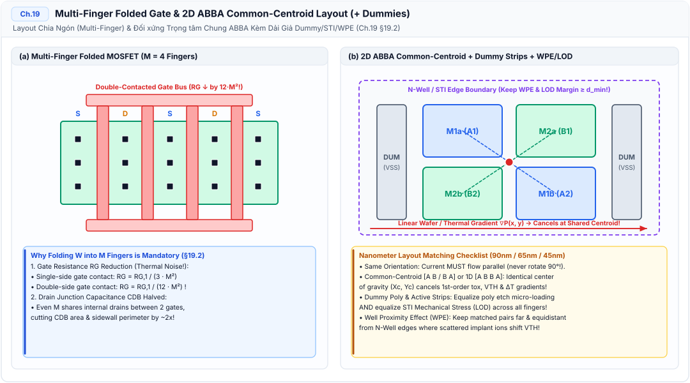

---
{
  "id": "tech-common-centroid-sti-wpe-layout",
  "kind": "technique",
  "domain": "nonideal-and-physical",
  "title_vi": "Kỹ thuật Bố trí Hình học Tương tự: Gấp Đa Ngón, Đối xứng Tâm chung ABBA, Ứng suất STI/WPE, Nhiễu Đế & Đóng gói (Analog Layout & Packaging)",
  "title_en": "Analog Layout & Packaging: Multi-Finger Folding, Common-Centroid ABBA, STI/WPE Dummies, Substrate Coupling, and Bondwire Bounce",
  "summary": "Hệ quy tắc bố trí hình học vi mạch tương tự chuẩn công nghiệp: gấp đa ngón giảm điện trở cổng phân bố theo 1/(3M^2) hoặc 1/(12M^2) và giảm nửa CDB, đối xứng tâm chung 1D ABBA / 2D triệt tiêu gradien bậc nhất, ngón giả chống ứng suất cơ học STI (LOD) và hiệu ứng lân cận giếng (WPE), đi dây tham chiếu Kelvin/miền dòng, che chắn xuyên nhiễu đế và kiểm soát nảy nguồn đóng gói L_bond*dI/dt.",
  "diagram": "../../diagrams/common-centroid-multifinger.svg",
  "razavi_refs": [
    {
      "chapter": 19,
      "section": "19.2.1-19.2.4",
      "pages": "737-744",
      "equations": ["19.1", "19.2", "19.4", "19.5", "19.6", "19.7", "19.8", "19.9"]
    },
    {
      "chapter": 19,
      "section": "19.2.5-19.2.8",
      "pages": "744-759",
      "equations": ["19.13", "19.14", "19.16", "19.18"]
    },
    {
      "chapter": 19,
      "section": "19.3-19.4",
      "pages": "760-772",
      "equations": ["19.19", "19.20", "19.21", "19.22", "19.27"]
    }
  ],
  "glossary_codes": [
    "T048",
    "T291",
    "T300",
    "T1777",
    "T052",
    "T330",
    "T130",
    "T084",
    "T2087",
    "T2088",
    "T573",
    "T062"
  ],
  "process_agnostic": true,
  "roles": {
    "multifinger_folded_gate": "Chia chiều rộng lớn W thành M ngón song song dùng chung khuếch tán S/D để cắt giảm mạnh điện trở cổng phân bố RG theo 1/M^2 và giảm gần một nửa điện dung tiếp giáp cực máng CDB.",
    "common_centroid_abba_array": "Cấu trúc ghép chéo đối xứng tâm chung 1D (ABBA) hoặc 2D đặt trọng tâm hình học hai linh kiện trùng khít nhau, triệt tiêu hoàn toàn gradien bậc nhất về oxit, pha tạp và nhiệt độ.",
    "dummy_strips_and_well_margin": "Các ngón giả ở hai biên dãy Active liên tục và khoảng lùi biên giếng >= 1.5-3 um bảo vệ các ngón hoạt động khỏi ứng suất cơ học rãnh nông STI (LOD), hiệu ứng khắc biên và tán xạ ion biên giếng WPE.",
    "kelvin_current_ref_and_shields": "Phân phối tham chiếu trong miền dòng điện kết hợp nối đất Kelvin hình sao và màn chắn kim loại/vi sai loại bỏ sụt áp IR đường đất cùng xuyên nhiễu điện dung.",
    "substrate_and_package_interface": "Chiến lược nối đế vào đất tương tự GNDA trên chip, tách chân nguồn số/tương tự, ghép cặp dây hàn ngược chiều dòng và dập cộng hưởng tụ lọc chống nảy áp L_bond*dI/dt."
  },
  "symptoms_addressed": [
    "high-poly-gate-thermal-noise-and-excessive-drain-capacitance",
    "systematic-offset-from-process-thermal-gradients-and-implant-tilt",
    "post-layout-vth-and-mobility-shift-from-sti-lod-and-wpe",
    "bias-current-error-from-ground-bus-ir-drop",
    "mixed-signal-substrate-noise-and-bondwire-supply-ground-bounce"
  ],
  "limitations": [
    "common-centroid-cross-routing-increases-wiring-parasitic-capacitance",
    "excessive-finger-splitting-raises-sidewall-perimeter-capacitance",
    "dummy-devices-and-wpe-well-enclosure-expand-block-footprint",
    "on-chip-decoupling-capacitors-can-resonate-with-bondwire-inductance-if-undamped"
  ],
  "checklists": [
    "common-mos",
    "layout-and-matching",
    "differential-pair",
    "current-mirror"
  ]
}
---

## 1. Bản chất Nguyên lý, Sơ đồ Mạch & Vai trò Từng Nhánh Cấu trúc

Trong hệ thống tín hiệu hỗn hợp tốc độ và độ chính xác cao, **bố trí hình học (`layout` — `T048`, hay bố cục mặt bằng `T291`)** và **đóng gói (`packaging` — `T062`)** không phải bước vẽ cơ khí thụ động sau cùng, mà chính là **một phần không thể tách rời của sơ đồ mạch điện** (Razavi Chương 19). Một cặp vi sai đạt $\text{CMRR} = 100\text{ dB}$ và $V_{OS} = 0\text{ V}$ trên mô phỏng nguyên lý có thể sụp đổ hoàn toàn trên silicon thực chỉ vì một sợi kim loại đi ngang lệch một bên, hai ngón biên nằm sát mép rãnh cách ly nông `STI`, một đường phân cực áp chạy dọc dây đất chung, hay vài nanohenry tự cảm dây hàn vỏ chip!



Kiến trúc vật lý bảo toàn phẩm chất mạch tương tự từ cấp độ transistor lên tới vỏ đóng gói dựa trên 5 trụ cột cấu trúc:
1. **Gấp Đa Ngón Chia sẻ Khuếch tán (`Multi-Finger Folding` — §19.2.1):** Tách transistor rộng $W$ thành $M$ ngón song song chiều rộng $W_f = W/M$ xen kẽ `S–D–S–D–S` để đánh sập đồng thời điện trở cổng poly và điện dung cực máng $C_{DB}$.
2. **Đối xứng Trục, Đồng hướng Dòng chảy & Tâm Chung `ABBA` (`Symmetry & Common-Centroid` — §19.2.2):** Căn thẳng hàng hướng dòng nguồn $\to$ máng chống bóng che cấy ion nghiêng $7^\circ$ (`gate shadowing`) và đan chéo trọng tâm hình học để khử gradien công nghệ/nhiệt độ tuyến tính theo cả trục $X$ lẫn trục $Y$.
3. **Vùng Đệm Ứng suất Rãnh Nông `STI/LOD` & Lùi Biên Giếng `WPE` (`Dummy Fingers & Well Margin` — §19.2.3–19.2.4):** Bọc hai đầu dãy bằng các ngón giả (`dummy fingers`) trên cùng một đảo khuếch tán liên tục và giữ khoảng lùi an toàn khỏi vách giếng để mọi ngón thật nhìn thấy môi trường cơ học – pha tạp đồng nhất tuyệt đối.
4. **Phân phối Tham chiếu Miền Dòng, Đất Sao Kelvin & Che chắn Dây dẫn (§19.2.5–19.2.7):** Triệt tiêu sai số sụt áp $IR$ bậc hai trên đường đất, nhiễu nhiệt lỗ tiếp xúc (`via/contact`) và **xuyên nhiễu (`crosstalk` — `T2087`)** giữa xung nhịp số với đường tương tự nhạy cảm.
5. **Kiểm soát Ghép Nhiễu Đế (`Substrate Coupling` — §19.3) & Ký sinh Đóng gói (`Packaging` — §19.4):** Cố định hiệu thế nguồn–thân của mạch tương tự trước hiện tượng nảy thế đế và khống chế xung sụt áp cảm kháng dây hàn $L_{\text{bond}}\,dI/dt$.

## 2. Hệ Phương trình Cốt lõi & Tư duy "Nhìn Mạch Đọc Nhanh" (Analysis by Inspection)

### 2.1. Định luật Gấp $M$ Ngón: Giảm $R_G$ theo $1/(3M^2)$ hoặc $1/(12M^2)$ & Chia sẻ Tiếp giáp $C_{DB}$
Khi một MOSFET tổng độ rộng $W$, chiều dài $L$ được chia thành $M$ ngón song song (mỗi ngón rộng $W/M$), điện trở DC của mỗi dải cổng giảm $M$ lần còn $R_{\square,\text{poly}}\frac{W}{M L}$, và mắc $M$ ngón song song giúp giảm tiếp $M$ lần nữa thành $\frac{1}{M^2}$! Tính thêm bản chất đường truyền $RC$ phân bố dọc theo chiều rộng ngón cổng (hệ số $1/3$ khi nối tiếp xúc một đầu, hoặc tương đương hai nhánh nửa ngón mắc song song cho hệ số $1/12$ khi nối tiếp xúc cả hai đầu ngón — Razavi Ví dụ 19.1, Eq. 19.2):

$$R_{G,\text{eff,1-side}} = \frac{1}{3 M^2} R_{\square,\text{poly}} \left(\frac{W}{L}\right), \qquad R_{G,\text{eff,2-side}} = \frac{1}{12 M^2} R_{\square,\text{poly}} \left(\frac{W}{L}\right)$$

**Quy tắc đọc nhanh cho LNA / đầu vào nhiễu thấp:** Phải chọn số ngón $M$ đủ lớn sao cho $R_{G,\text{eff}} \le \frac{1}{5 g_m} \div \frac{1}{10 g_m}$ để nhiễu nhiệt cực cổng $4kT R_{G,\text{eff}}$ không đáng kể so với nhiễu kênh dẫn $4kT\gamma / g_m$. Đồng thời, nhờ hai ngón kề nhau dùng chung một vùng khuếch tán máng ở giữa, **diện tích đáy cực máng và $C_{DB}$ giảm gần một nửa**! Tuy nhiên không được chia $M$ lớn vô tội vạ: với số ngón lẻ $M$ và chiều dài mở rộng S/D bằng $E$, điện dung chu vi thành bên (`sidewall perimeter`, Eq. 19.4–19.5) là:

$$C_P = \left[(M + 1)E + \frac{M + 1}{M} W\right] C_{jsw} \implies \text{bắt buộc giữ } M \cdot E \ll W$$

*(Mẹo vàng: Luôn chọn số ngón chẵn $M = 2k$ với thứ tự `S – D – S – ... – D – S` để toàn bộ $k$ vùng cực máng nhạy cảm nằm gọn bên trong dùng chung tiếp giáp, còn hai biên ngoài cùng là cực nguồn nối đất/điểm tĩnh! Với tầng cascode hai transistor bằng độ rộng $W_1 = W_2$, gộp chung vùng máng $M_1$ – nguồn $M_2$ không cần đục lỗ tiếp xúc kim loại như Hình 19.12b giúp cắt giảm cực mạnh tụ ký sinh tại nút trong cascode!).*

**Ví dụ Định lượng Chọn Số Ngón Tối thiểu Theo Trần Nhiễu Cổng (Razavi Ví dụ 19.1, Eq. 19.1–19.3):**
Xét một MOSFET kích thước $W/L = 5\ \mu\text{m}/40\text{ nm}$ có $g_m = \frac{1}{100\ \Omega} = 10\text{ mS}$ và điện trở mặt cổng $R_{\square,\text{poly}} = 30\ \Omega/\square$:
- Điện áp nhiễu nhiệt kênh dẫn quy về cực cổng là $\sqrt{4 k T \gamma / g_m} = \sqrt{4 k T \gamma (100\ \Omega)}$.
- Điện áp nhiễu nhiệt phân bố của $M$ ngón tiếp xúc một đầu là $\sqrt{4 k T \cdot \frac{1}{3} R_{\square,\text{poly}} \frac{W/L}{M^2}} = \sqrt{4 k T \cdot \frac{1}{3} \frac{30 \times 125}{M^2}}$.
- Để ép điện áp nhiễu cực cổng không vượt quá $\frac{1}{5}$ điện áp nhiễu kênh dẫn (tức công suất nhiễu cổng chỉ chiếm $\frac{1}{25} = 4\%$ công suất nhiễu kênh dẫn với $\gamma = 1$):

$$\frac{3750}{3 M^2} \le \frac{100}{25} = 4 \implies M \ge \sqrt{\frac{1250}{4}} = 17.7 \implies \text{bắt buộc chia tối thiểu } M = 18\text{ ngón!}$$
*(Nếu nối tiếp xúc cả hai đầu ngón cổng theo hệ số $1/12$, số ngón yêu cầu giảm ngay một nửa xuống chỉ còn $M = 9\text{ ngón}$, tiết kiệm mạnh điện dung chu vi thành bên $C_P$!).*

### 2.2. Chứng minh Khử Gradien Tuyến tính của Đối xứng Tâm Chung `ABBA` so với Đan xen `ABAB`
Giả sử thông số công nghệ hoặc nhiệt độ (ví dụ $C_{ox}$ hay $V_{TH}$) biến thiên tuyến tính dọc theo trục $x$ với bước lệch $\Delta$ giữa 4 nửa linh kiện đặt liên tiếp tại tọa độ $x = \{1, 2, 3, 4\}$: giá trị lần lượt là $p_0,\; p_0 + \Delta,\; p_0 + 2\Delta,\; p_0 + 3\Delta$ (Hình 19.20, Eq. 19.6–19.9):
- **Đan xen bậc một giản đơn (`1D Interdigitation — ABAB`, Hình 19.20b):** Ghép $M_A = U_1 \parallel U_3$ và $M_B = U_2 \parallel U_4$ cho tổng tham số $(2p_0 + 2\Delta)$ so với $(2p_0 + 4\Delta)$ — **vẫn còn sót lại sai lệch hệ thống $2\Delta$** vì trọng tâm $\bar{x}_A = 2.0 \neq \bar{x}_B = 3.0$!
- **Đối xứng Tâm chung một chiều (`1D Common-Centroid — ABBA`, Hình 19.20a):** Ghép hai nửa ngoài cùng cho $M_A = U_1 \parallel U_4$ và hai nửa giữa cho $M_B = U_2 \parallel U_3$:

$$\Sigma_A = p_0 + (p_0 + 3\Delta) = 2p_0 + 3\Delta, \qquad \Sigma_B = (p_0 + \Delta) + (p_0 + 2\Delta) = 2p_0 + 3\Delta \implies \Delta\Sigma_{AB} \equiv 0!$$

Trọng tâm hình học của hai linh kiện trùng khít tuyệt đối ($\bar{x}_A = \frac{1+4}{2} = 2.5 = \frac{2+3}{2} = \bar{x}_B$). Khi mở rộng lên ma trận **Đối xứng Tâm chung 2 chiều (`2D Quad Cross-Coupled AB / BA`, Hình 19.19)** cho cặp vi sai lớn, mảng điện trở đơn vị tỷ số nguyên (Ví dụ 19.2: tách $R_2/R_1 = 5.34 \approx 16/3$ thành các thanh song song nối tiếp, tuyệt đối tránh uốn khúc chữ chi `serpentine` bị sai số góc vuông Hình 19.30!) hoặc ma trận tụ đơn vị bọc vòng tụ giả ngoài biên (Ví dụ 19.4, Hình 19.37), **mọi gradien tuyến tính dọc cả hai trục $X$ và $Y$ ($\vec{g} \cdot \vec{r}$) đều bị triệt tiêu bằng không!**

### 2.3. Cơ chế Vật lý Ứng suất Cơ học `STI / LOD` (§19.2.3) và Tán xạ Biên Giếng `WPE` (§19.2.4)
Ngay cả trong cấu trúc `ABBA`, hai mảnh $A$ nằm ở rìa ngoài trong khi hai mảnh $B$ nằm kẹp ở giữa! Ở tiến trình dưới micromet và nanomet, sự khác biệt môi trường biên này gây sai lệch hàng milivôn qua hai hiệu ứng vật lý bắt buộc phải khử:
1. **Ứng suất Cơ học Rãnh Cách ly Nông (`STI Stress` / `Length of Diffusion — LOD`, Hình 19.21):** Rãnh cách ly nông (`trench`, `T330`) nhồi đầy $\text{SiO}_2$ có hệ số giãn nở nhiệt khác biệt lớn với tinh thể silic; sau chu trình ủ nhiệt $\sim 1000^\circ\text{C}$, thành rãnh STI ép một trường ứng suất cơ học nén/kéo giảm dần theo khoảng cách từ mép vùng Active (`OD`) vào tâm (`tham số SA, SB` trong mô hình BSIM4), làm biến đổi độ linh động áp điện trở $\mu$ và $V_{TH}$ của các ngón rìa! **Giải pháp bắt buộc:** Duy trì **một dải khuếch tán Active (`OD`) liền mạch duy nhất** và chèn thêm ít nhất **$1\text{–}2$ ngón cổng giả (`Dummy Fingers`, nối cực cổng/nguồn/máng về đất hoặc mức phân cực tĩnh)** ở cả hai đầu dãy (`D – D – A – B – B – A – D – D`) để đẩy mép gãy STI ra xa các ngón hoạt động!
2. **Hiệu ứng Lân cận Giếng (`Well Proximity Effect — WPE`, Hình 19.22):** Trong lúc cấy ion năng lượng cao tạo giếng (`N-well` / `P-well`), chùm ion va đập xiên góc vào sườn vách thẳng đứng dày của lớp chất cản quang (`photoresist`) bao quanh biên giếng và **phản xạ dội ngược xuống vùng rìa giếng** (`tham số SCA, SCB, SCC` trong BSIM4). Hệ quả là mật độ pha tạp trong dải $\sim 1\text{–}2\ \mu\text{m}$ sát mép giếng cao bất thường, làm lệch mạnh $V_{TH}$ của mọi transistor đặt gần mép (như $M_1$ so với $M_2, M_3$ trên Hình 19.22b). **Giải pháp bắt buộc:** Đặt toàn bộ các linh kiện cần khớp nằm chung trong một giếng rộng và giữ khoảng cách từ mép kênh dẫn ngoài cùng tới mọi biên giếng **tối thiểu $d_{\text{well}} \ge 1.5\text{–}3.0\ \mu\text{m}$**!

### 2.4. Phân phối Tham chiếu, Trễ Dây $RC$, Nhiễu Đế & Cảm kháng Dây Hàn $L_{\text{bond}}\,\frac{dI}{dt}$
- **Sụt áp đường đất bậc $N^2$ & Phân phối Miền Dòng (§18.7.3 Ví dụ 18.3 & §19.2.5):** Nếu phân phối một đường điện áp phân cực $V_b$ chung cho $N$ nguồn dòng dọc theo đường đất có điện trở đoạn nhỏ $r$, sụt áp tích lũy sinh sai lệch dòng tăng vọt theo **bình phương số nhánh**: $\left|\frac{I_1 - I_N}{I}\right| = g_m r \frac{N(N - 1)}{2}$ (Eq. 18.10)! Thay vào đó, phải: (1) truyền **các nhánh dòng tham chiếu $I_{\text{REF}}$** tới từng cụm mạch rồi mới lập gương dòng cục bộ kèm tụ lọc tại chỗ (Hình 19.24); (2) nhân tỷ lệ dòng bằng **cùng chiều dài $L$ và bội số nguyên ngón đơn vị $W_u$** (Hình 19.25, tránh sai số khuếch tán ngang $2L_D$ khi đổi $L$ hoặc đổi $W$ lẻ); và (3) đi dây tham chiếu / đất nhạy cảm theo cấu trúc **hình sao Kelvin (`Kelvin Star Routing`)** không chung đường dòng tải lớn.
- **Trễ phân bố đường dây & Che chắn Xuyên nhiễu (§19.2.7):** Dây dẫn dài $L_{\text{wire}}$ có điện trở và điện dung trên đơn vị chiều dài $R_u, C_u$ gây trễ và giãn sườn xung (`dispersion`) tỷ lệ với bình phương chiều dài: $T_D = \frac{1}{2} R_u C_u L_{\text{wire}}^2$ (Eq. 19.14). Chống xuyên nhiễu điện dung bằng truyền dẫn vi sai cân bằng (kèm đoạn dây giả cân bằng tụ chồng lấn như Hình 19.41) kết hợp **đường che chắn (`shield line` — `T573`)** đồng phẳng hai bên hoặc lồng chắn kim loại trên–dưới (Hình 19.42–19.43).
- **Ghép Nhiễu Đế (`Substrate Coupling` — §19.3) & Nảy Nguồn Đóng gói (`Packaging` — §19.4):** Mỗi dây hàn vàng/đồng nối chip ra chân vỏ có tự cảm không thể thu nhỏ theo định luật Moore (Eq. 19.19 & 19.22):

$$L_{\text{bond}} \approx 0.2 \ln\!\left(\frac{2h}{r}\right) \;\; [\text{nH/mm}] \approx 1\text{ nH/mm}, \qquad \Delta V_{\text{bounce}} = L_{\text{bond}} \frac{dI}{dt} \approx L_{\text{bond}} \frac{\Delta I}{\Delta t}$$

Khi hàng ngàn cổng logic chuyển mạch rút dòng biến thiên nhanh $\Delta I / \Delta t$, xung nảy nguồn/đất $\Delta V_{\text{bounce}}$ lên tới hàng trăm milivôn đồng thời bơm nhiễu qua $C_{DB}$ làm rung điện thế đế $V_{\text{sub}}$, điều chế trực tiếp $V_{TH}$ của NMOS tương tự qua hiệu ứng thân $g_{mb} v_{bs}$! **Bộ tứ giải pháp hệ thống:** (1) Tách riêng chân cấp nguồn/đất tương tự (`VDDA/GNDA`) và số (`VDDD/GNDD`), đồng thời trên đế $p^+$ thông thường, **nối tiếp xúc đế vào `GNDA` ngay trên chip** (Hình 19.58a/19.59b) để cực nguồn và cực thân NMOS tương tự nhấp nhô đồng pha ($v_{bs} \approx 0$); (2) Dùng mạch vi sai chuyển hướng dòng đuôi không đổi để tự thân không tạo $dI/dt$ và miễn nhiễm nhiễu chung; (3) Hàn nhiều dây song song (tự cảm hiệu dụng $(L_S + M)/2$, Hình 19.73), đặt **cặp chân `VDD` – `GND` sát cạnh nhau mang dòng ngược chiều** để hỗ cảm $M$ triệt bớt tự cảm vòng ($L_{\text{loop}} = 2L_S - 2M$, Razavi Hình 19.75), đặt vuông góc các dây nhạy cảm để khử hỗ cảm $L_m$ (Hình 19.74) hoặc hàn thẳng xuống đế đồng lộ đáy (`exposed ground paddle downbond`, Hình 19.68); và (4) Đặt tụ lọc nguồn trên chip (`on-chip decap`) **có điện trở nối tiếp kênh dẫn dập tắt cộng hưởng** $\omega_{\text{res}} = 1/\sqrt{(L_D + L_G) C_{\text{decap}}}$!

### 2.5. Mô hình Hỗ cảm Vỏ Đóng gói & Bẫy Nhảy Áp Nút Đuôi Khi Phân cực Ngoài (Eq. 19.20–19.27)
1. **Tự cảm Chân Dẹt & Hỗ cảm Giữa Hai Dây Hàn Song song (§19.4, Eq. 19.20–19.21):**
   Bên cạnh tự cảm dây hàn tròn $L_{\text{bond}} \approx 0.2\ln(2h/r)\text{ nH/mm}$, chân dẫn phẳng (`flat package trace`) bề rộng $W$ đặt ở độ cao $d$ trên mặt phẳng đất và hỗ cảm từ trường $L_m$ giữa hai dây hàn tròn song song cách tâm khoảng $d$ ở độ cao $h$ trên mặt đất được ước lượng chính xác bởi:

$$L_{\text{trace}} \approx \frac{1.6}{K_f} \cdot \frac{d}{W} \;\; [\text{nH/mm}] \quad \left(K_f \approx 0.72\frac{d}{W} + 1\right), \qquad L_m \approx 0.1 \ln\!\left[1 + \left(\frac{2h}{d}\right)^2\right] \;\; [\text{nH/mm}]$$

   Vì hàm $\ln[1 + (2h/d)^2]$ giảm khá chậm theo khoảng cách $d$, một dây xung nhịp `CK` hoặc dây nguồn số `VDDD` đặt cách dây ngõ vào tương tự vài milimet vẫn cảm ứng sang một điện áp nhiễu $V_{\text{ind}} = L_m \frac{dI_{\text{noisy}}}{dt}$ đáng kể nếu không kẹp một dây đất tĩnh `GND` chắn giữa hai chân (Hình 19.72 & 19.74b)!
2. **Sự Sụt Nhảy Nút Chung $P$ của Cặp Vi sai Chuyển mạch Dòng & Cấm Cấp Phân cực Thô Từ Ngoài Chip (Ví dụ 19.8, Eq. 19.25–19.27):**
   Xét mảng lớn các cặp vi sai đóng vai trò chuyển mạch dòng tốc độ cao (như trong bộ chuyển đổi DAC dòng lái `current-steering DAC`, Hình 19.69). Ở trạng thái một nhánh dẫn trọn dòng đuôi, thế nút nguồn chung là $V_{P1} = V_2 - \sqrt{2} V_{OV,\text{eq}}$; nhưng ở thời điểm quá độ cân bằng giữa chừng ($I_{D1} = I_{D2}$ với chênh áp vừa đủ chuyển mạch $V_2 - V_1 = \sqrt{2} V_{OV,\text{eq}}$), thế nút nguồn chung sụt xuống cực tiểu:

$$V_{P2} = \frac{V_1 + V_2}{2} - V_{OV,\text{eq}} = V_2 - \left(1 + \frac{\sqrt{2}}{2}\right) V_{OV,\text{eq}} \implies \Delta V_P = V_{P1} - V_{P2} = \left(1 - \frac{\sqrt{2}}{2}\right) V_{OV,\text{eq}} \approx 0.293\, V_{OV,\text{eq}}$$

   Mỗi lần cặp vi sai lật trạng thái, bước sụt áp $\Delta V_P$ tại cực máng nguồn dòng đuôi $M_3$ này lập tức **bơm điện tích xuyên qua tụ chồng lấn $C_{GD3}$ vào đường dây phân cực cổng $X$**! Nếu gắn một tụ lọc khổng lồ ở **bên ngoài vỏ chip (`off-chip bypass cap`)** để cố giữ tĩnh nút $X$, tự cảm dây hàn $L_{\text{bond}}$ mắc nối tiếp với tụ ngoài (Hình 19.71) sẽ biến nút $X$ thành mạch hở ở tần số cao và gây dao động rung nghiêm trọng! Do đó nút $X$ bắt buộc phải được tạo nội bộ trên chip: hoặc để nút $X$ trở kháng thấp nhanh nhẹn tự hồi phục cực nhanh (`agile bias node`), hoặc gắn tụ lọc trên chip cực lớn $C_X \ge (100\text{–}1000)\sum C_{GD3}$ ngay sát chân nguồn của $M_3$ (Hình 19.70).

## 3. Bất biến Cấu trúc & Các Bẫy Lỗi Kinh điển (Structural Invariants & Traps)

- **`[INV-LAY-01]` Bất biến Bốn Điều kiện Đồng nhất Để Khớp Linh kiện:** Hai linh kiện ghép cặp chỉ thực sự khớp ở mức giới hạn Pelgrom khi thỏa mãn đồng thời **4 điều kiện**: (1) Cùng cấu trúc ô đơn vị $(W_u, L_u)$ — tuyệt đối không suy rộng tỷ lệ bằng cách đổi $L$ hay vẽ $W$ liền khối khác bội số; (2) Cùng trục định hướng và **cùng chiều dòng chảy `Source -> Drain`** (khử bóng che nghiêng $7^\circ$); (3) Trùng trọng tâm hình học (`Common-Centroid`); và (4) Cùng môi trường bao quanh (ngón giả `STI/LOD`, khoảng lùi giếng `WPE` và đường kim loại đi phía trên đối xứng!).
- **`[INV-LAY-02]` Bất biến Mật độ Dòng Chống Di cư Điện tử (`Electromigration` — §18.7.3):** Mọi đường kim loại (bề rộng $W$, bề dày $t$) và ma trận lỗ `via/contact` dẫn dòng một chiều lớn phải thỏa mãn giới hạn mật độ dòng diện tích $J_{\text{DC}} = \frac{I_{\text{DC}}}{W \cdot t} \le J_{\max}$ [$\text{A/cm}^2$], tương đương giới hạn dòng tuyến tính chuẩn hóa theo bề rộng của PDK $J_{W,\text{DC}} = \frac{I_{\text{DC}}}{W} \le J_{W,\max} = J_{\max}\cdot t$ (điển hình $\sim 1\text{–}2\text{ mA}/\mu\text{m}$ bề rộng kim loại tùy lớp và nhiệt độ, xem `tech-interconnect-rc-electromigration-and-ir-drop`) để tránh đứt mạch hở sau vài năm vận hành.
- **`[TRAP-LAY-01]` Bẫy Đi Một Sợi Dây Kim loại "Vô hại" Băng Ngang Qua Một Nửa Cặp Vi sai (Hình 19.17):** Dù đã xếp `ABBA` hoàn hảo dưới lớp silic, chỉ cần kéo một đường kim loại ở lớp trên vắt ngang qua riêng các ngón của $M_2$ mà không có trên $M_1$, trường cơ học/tĩnh điện và tụ ký sinh chồng lấn sẽ phá vỡ đối xứng, làm tăng cả $V_{OS}$ lẫn $HD_2$ tần số cao! Nếu không thể tránh, bắt buộc đặt một **đoạn dây giả đối xứng (`dummy replica wire` nối đất)** bên trên $M_1$ (Hình 19.17b).
- **`[TRAP-LAY-02]` Bẫy Cắt Rời Vùng Khuếch tán Active Giữa Ngón Thật và Ngón Giả:** Nhiều người đặt `Dummy MOS` tách rời thành một đảo Active riêng biệt cách transistor chính một rãnh `STI`! Làm vậy hoàn toàn **vô hiệu hóa tác dụng chống ứng suất `STI/LOD`** vì mép rãnh `STI` vẫn nằm sát sườn ngón thật! Ngón giả bắt buộc phải nằm chung trên **cùng một dải `OD` liên tục** với các ngón thật (Hình 19.21b, c).
- **`[TRAP-LAY-03]` Bẫy Cộng hưởng Nổ Nhiễu Nguồn do Tụ Lọc Trên Chip $Q$ Cao (§19.4 tr. 768):** Gắn tụ lọc nguồn `MOM` thuần dung kháng (ESR cực thấp) nối tiếp với tự cảm dây hàn $L_D + L_G \approx 4\text{–}10\text{ nH}$ tạo mạch cộng hưởng $LC$ hệ số phẩm chất $Q$ cao ngay vùng $100\text{–}500\text{ MHz}$; nếu hài xung nhịp rơi trúng $\omega_{\text{res}}$, biên độ rung nguồn `VDD` sẽ bị **khuếch đại vọt lên gấp $Q$ lần** thay vì được lọc êm! Phải tính chọn điện trở nối tiếp kênh MOS (`RS`) để đạt đáp ứng tắt dần tới hạn ($R_S \approx \sqrt{(L_D + L_G)/C_{\text{decap}}}$).
- **`[TRAP-LAY-04]` Bẫy Nối Chung Đất Số `GNDD` và Đất Tương tự `GNDA` Ngay Trên Chip Đế $p^+$:** Nối trực tiếp hai lưới kim loại đất trên chip biến đường đất tương tự thành nhánh rẽ dòng xả chuyển mạch số khổng lồ, xóa sạch toàn bộ ý nghĩa của việc tách chân vỏ đóng gói (Hình 19.58)!

## 4. Lộ trình Nâng cấp Cấu trúc & Bát giác Đánh đổi (Upgrade Paths & Design Octagon)

Trong **Bát giác Thiết kế (`concept-analog-design-octagon`)**, kỹ thuật bố trí mặt bằng quyết định xem hiệu năng thực sau chế tạo có giữ được lời hứa lý thuyết của các nút mạch hay bị sụp đổ bởi ký sinh vật lý:
- **Hiện thực hóa Định luật Khớp Linh kiện & Triệt Hài Chẵn:** Mọi chỉ tiêu độ lệch tĩnh của `law-pelgrom-mismatch-and-sizing-duality`, độ khử chung `concept-cm-response-and-cmrr` và khả năng triệt hài bậc chẵn của `law-differential-nonlinearity-and-feedback` trên `topo-basic-differential-pair`, `topo-folded-cascode-ota` và gương dòng `topo-basic-current-mirror` / `topo-lvccml-wide-swing-mirror` đều phụ thuộc trực tiếp vào bố cục `ABBA` + ngón giả `STI/WPE` của thẻ này.
- **Độ Chính xác Tỷ số Tuyệt đối trong Bandgap & Mạch SC:** Tỷ số diện tích emitter BJT ($1:8$ hoặc $1:24$, xếp ma trận tâm chung $3\times 3$ hoặc $5\times 5$ với ô trung tâm là $Q_1$) và tỷ số thanh điện trở $R_2/R_1$ trong `topo-bandgap-reference-core`, cũng như mảng tụ đơn vị kèm vòng tụ giả ngoài biên kết hợp `tech-charge-injection-and-bottom-plate-sampling` đều bắt buộc tuân thủ quy tắc tâm chung 2D và đối xứng đường dây kết nối (Hình 19.38).
- **Tối ưu Tạp âm Cổng & Phối hợp Cách ly Vật lý:** Phép gấp đa ngón tiếp xúc hai đầu cắt đứt thành phần nhiễu nhiệt cực cổng poly trong `law-mos-thermal-and-flicker-noise`, đồng thời phối hợp chặt chẽ với luật tiếp xúc đế, cầu nhảy Anten và vòng bảo vệ kép `Guard Ring` tại `law-cmos-wells-and-latchup-guard-rings`.

## 5. Thích ứng Đa Tiến trình (90nm / 65nm / 45nm) & Cách Kiểm chứng trong Cadence / Spectre

### 5.1. Thích ứng Đa Tiến trình (`90nm` / `65nm` / `45nm`)
Khi bước xuống `90nm`, `65nm` và `45nm` (`tech-nanometer-vdsmin-gmid-sizing`), các hiệu ứng phụ thuộc mặt bằng (`Layout-Dependent Effects — LDE`) tăng mức độ chi phối lên gấp bội:
1. **Quy tắc Định hướng Cổng Poly Duy nhất (`Unidirectional Poly Pitch`):** Ở `45nm` với quang khắc nhúng bước sóng $193\text{ nm}$ và hiệu chỉnh nhiễu xạ quang học `OPC`, foundry **cấm xoay cổng poly hai hướng vuông góc**: toàn bộ cổng transistor trên chip bắt buộc xếp song song theo một phương duy nhất với bước lưới (`poly pitch`) đều đặn kèm dải poly giả lấp đầy mật độ (`poly density dummy strips`).
2. **Độ nhạy Cực đoan với `LOD (SA, SB)` và `WPE (SCA, SCB, SCC)`:** Trong mô hình BSIM4.5+ của PDK `90nm/65nm/45nm`, nếu vẽ schematic với tham số mặc định `SA, SB` giả định transistor đơn lẻ rồi ra layout vẽ gộp nhiều ngón có ngón giả, dòng $I_D$ và $V_{TH}$ sau trích xuất PEX có thể lệch $10\%\text{–}20\%$ so với tiền bố cục! Mẹo chuyên nghiệp: ngay ở bước vẽ nguyên lý (`pre-layout schematic`), hãy khai báo chính xác số ngón `nf` và số bội `m` trên thuộc tính CDF của pcell để callback BSIM4 tính sẵn `SA, SB` sát với mặt bằng thực!
3. **Điện trở Lỗ `Via/Contact` Tăng cao (Ví dụ 19.5):** Một lỗ tiếp xúc $65\text{ nm} \times 65\text{ nm}$ có điện trở tới $20\text{–}50\ \Omega$; luôn đặt **tối thiểu `2x1` hoặc `2x2` lỗ `via` dự phòng (`double/redundant vias`)** ở mọi điểm chuyển tầng kim loại để vừa giảm nửa điện trở nhiệt vừa tránh lỗi hở lỗ đơn lẻ giảm năng suất thu hồi (`yield`).

### 5.2. Quy trình Thực thi & Kiểm chứng Hậu Bố cục trong Cadence Virtuoso Layout XL / Spectre
1. **Thiết kế Điều khiển theo Ràng buộc (`Virtuoso Layout XL` + `Modgen`):**
   - Dùng công cụ **`Modgen` (`Module Generator`)** trong Virtuoso Layout XL cho mọi cặp vi sai, gương dòng và mảng tụ/điện trở: khai báo trực tiếp mẫu ma trận `ABBA` hoặc `2D Common-Centroid`, tự động chèn `Dummy Fingers` hai đầu chung `OD`, khóa hướng `S/D` đồng nhất và bật chế độ đi dây đối xứng gương (`Symmetric Routing`).
2. **Trích xuất Ký sinh Toàn phần (`Calibre PEX / Quantus QRC` chế độ `R + C + CC`) & Mô phỏng `Post-Layout`:**
   - Trích xuất `calibre_extracted` view với đầy đủ điện trở đường dây/cổng (`R`), tụ xuống đế (`C`), tụ ghép chéo giữa các dây (`CC`) **VÀ các tham số hình học thật `SA, SB, SD, SCA, SCB, SCC`** ghi ngược vào từng instance BSIM4!
   - Chạy so sánh trực tiếp `Schematic` vs `Post-Layout` trong ADE Assembler:
     - Kiểm tra độ lệch hệ thống DC `VOS_postlayout` (nếu vọt từ $10\ \mu\text{V}$ lên $> 0.5\text{ mV}$, lập tức truy vết tham số `SA/SB` hoặc `SCA` bị lệch giữa hai nhánh hoặc đường dây bất đối xứng!).
     - Kiểm tra sự tụt giảm `GBW`, `Phase Margin` (`stb`), sự trồi lên của sàn nhiễu nhiệt cổng (`noise`) và sự tái sinh $HD_2$ tần số cao (`pss/dft`).
3. **Mô phỏng Đồng thời Mạch – Khung Pad – Vỏ Đóng gói (`Package RLC Deck Co-Simulation`):**
   - Tuyệt đối không nối thẳng nguồn `vdc` lý tưởng vào lưới nguồn trên chip khi ký duyệt cuối (`sign-off`)! Bắt buộc chèn mô hình mạch tương đương vỏ đóng gói (`RLC + hỗ cảm K` với $L_{\text{bond}} \approx 2\text{–}5\text{ nH}$, $C_{\text{pad}} + C_{\text{ESD}}$, điện trở đường nguồn) vào testbench cấp cao nhất và chạy `tran` khi các khối số/đệm xung nhịp chuyển mạch tối đa để xác nhận biên độ nảy nguồn `VDD_internal - GND_internal` không gây dao động cộng hưởng và không làm hỏng SNR của lõi tương tự.
```spice
// Mo hinh day han dong goi (Bondwire + Package Lead + Mutual Coupling + Damped On-Chip Decap)
L_vdda  (VDD_ext  VDD_pad)  inductor l=3.5n r=0.15
L_gnda  (GND_ext  GND_pad)  inductor l=3.5n r=0.15
// Dat chan VDDA va GNDA sat canh nhau mang dong nguoc chieu (he so ghep k = 0.35 giam L_loop!)
K_pwr   mutual_inductor ind1=L_vdda ind2=L_gnda coupling=0.35
C_pad_v (VDD_pad  0)        capacitor c=800f
// Tu loc nguon MOS tren chip co dien tro kenh R_damp dap tat cong huong LC:
R_damp  (VDD_chip decap_mid) resistor r=2.5
C_decap (decap_mid GND_chip) capacitor c=200p
```
4. **Kiểm tra Tự động Sụt Áp Đường Nguồn & Di cư Điện tử (`VoltSpot / EM-IR Analysis`):**
   - Trên netlist trích xuất `DSPF` / `R+C+CC`, chạy phân tích `EM-IR` tĩnh và động qua dòng đỉnh ở góc `FF, 110°C–125°C`: đảm bảo độ sụt áp tĩnh `IR drop` trên đường phân phối đất của mảng nguồn dòng tạo ra độ lệch $\Delta V_{GS} \ll 0.2\text{ mV}$ và mật độ dòng trung bình / hiệu dụng trên mọi đoạn kim loại và cụm `via` thấp hơn ngưỡng `J_max` của foundry.

## 6. Mốc Đối chiếu Sách Razavi & Thuật ngữ Chuẩn CLB

| Mục Sách Razavi (2nd Ed.) | Trang & Phương trình | Nội dung Đối chiếu Trọng tâm | Mã Thuật ngữ Chuẩn CLB |
| :--- | :--- | :--- | :--- |
| **§19.2.1 Multifinger Transistors** | Tr. 737–739, Eq. `(19.1)–(19.5)`, Ex. `19.1` | Gấp $M$ ngón giảm $R_G$ theo $1/(3M^2)$, chia sẻ vùng S/D giảm $C_{DB}$ và giới hạn tụ chu vi $C_P$ | `T048` (Bố trí hình học / layout), `T291` (Bố trí hình học của linh kiện MOS), `T300` (Bố trí hình học transistor) |
| **§19.2.2 Symmetry & Common-Centroid** | Tr. 739–743, Eq. `(19.6)–(19.9)`, Fig. `19.14–19.20` | Bóng che cấy ion nghiêng $7^\circ$, dây giả đối xứng và chứng minh khử gradien của `1D ABBA` / `2D Common-Centroid` | `T1777` (tính đối xứng), `T052` (Sai lệch linh kiện) |
| **§19.2.3–19.2.4 STI & WPE** | Tr. 743–744, Fig. `19.21–19.22` | Ứng suất cơ học rãnh cách ly nông `STI` (ngón giả liên tục) và hiệu ứng phản xạ biên giếng `WPE` (lùi biên giếng) | `T330` (Rãnh cách ly), `T130` (Giếng n) |
| **§19.2.5–19.2.8 Ref, Wires, Pads/ESD** | Tr. 744–759, Eq. `(19.10)–(19.18)`, Ex. `19.2–19.6` | Phân phối tham chiếu miền dòng, mảng điện trở/tụ đơn vị, trễ $\frac{1}{2}R_u C_u L^2$, màn chắn và pad/ESD | `T2088` (các đường phân phối tham chiếu), `T2087` (xuyên nhiễu), `T573` (đường che chắn) |
| **§19.3–19.4 Substrate & Packaging** | Tr. 760–772, Eq. `(19.19)–(19.27)`, Ex. `19.7–19.8` | Xuyên nhiễu đế qua hiệu ứng thân, nối đế vào `GNDA`, cảm kháng dây hàn $L_{\text{bond}}\,dI/dt$, hỗ cảm và dập cộng hưởng tụ lọc | `T084` (Đế bán dẫn), `T062` (Đóng gói) |
