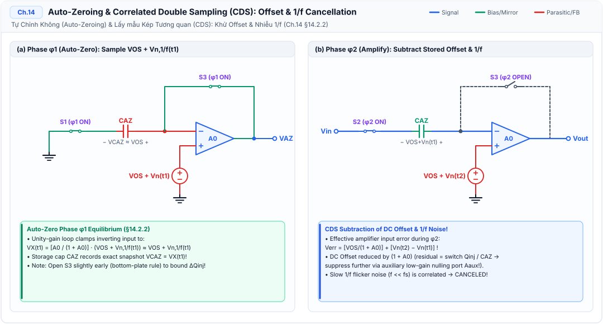

---
{
  "id": "tech-dynamic-offset-cancellation-az-cds",
  "kind": "technique",
  "domain": "nonideal-and-physical",
  "title_vi": "Kỹ thuật Khử Độ lệch Động: Tự Chỉnh Không (Auto-Zeroing), Cổng Hỗ dẫn Phụ & Lấy Mẫu Kép Tương Quan (AZ & CDS)",
  "title_en": "Dynamic Offset Cancellation: Auto-Zeroing (OOS/IOS), Auxiliary Nulling Port, and Correlated Double Sampling",
  "summary": "Cơ chế phá trần diện tích – điện dung của định luật Pelgrom bằng lưu trữ độ lệch hai pha (OOS vòng hở, IOS vòng kín, cổng hỗ dẫn phụ Gm2 << Gm1 nén phun điện tích) và nguyên lý lấy mẫu kép tương quan (CDS) lọc thông cao nhiễu nhấp nháy 1/f đổi lấy sự gấp nếp nhiễu nhiệt dải rộng.",
  "diagram": "../../diagrams/autozero-cds-offset.svg",
  "razavi_refs": [
    {
      "chapter": 14,
      "section": "14.2.2",
      "pages": "598-602",
      "equations": ["14.89", "14.90", "14.91", "14.92", "14.94", "14.95"]
    },
    {
      "chapter": 14,
      "section": "14.2.3",
      "pages": "602-603",
      "equations": []
    }
  ],
  "glossary_codes": [
    "T620",
    "T788",
    "T052",
    "T014",
    "T015",
    "T074",
    "T087",
    "T088",
    "T319",
    "T392",
    "T1009",
    "T2102"
  ],
  "process_agnostic": true,
  "roles": {
    "oos_series_output_caps": "Tụ nối tiếp ngõ ra lưu trữ điện áp lệch đã khuếch đại vòng hở Av*VOS; triệt hoàn toàn VOS tĩnh nhưng bị giới hạn độ lợi thấp Av <= 10 để tránh bão hòa ngõ ra.",
    "ios_series_input_caps": "Tụ nối tiếp ngõ vào kết hợp công tắc đóng vòng hồi tiếp độ lợi đơn vị lưu trữ xấp xỉ VOS; dùng được cho khuếch đại độ lợi lớn nhưng đòi hỏi ổn định pha vòng kín và nhạy với phun điện tích tại nút ngõ vào.",
    "auxiliary_nulling_gm2_port": "Nhánh hỗ dẫn phụ Gm2 << Gm1 bơm dòng bù lệch vào nút trở kháng thấp, tách hoàn toàn tụ nhớ khỏi đường tín hiệu chính và chia nhỏ sai số phun điện tích công tắc theo tỷ số Gm2/Gm1.",
    "cds_differencing_sampler": "Cơ cấu lấy mẫu hai thời điểm liên tiếp cách nhau khoảng trễ ngắn Delta_t tạo bộ lọc thông cao có điểm không tại DC, quét sạch cả độ lệch tĩnh lẫn nhiễu nhấp nháy 1/f tần số thấp."
  },
  "symptoms_addressed": [
    "pelgrom-area-capacitance-ceiling-in-precision-comparators",
    "residual-dc-offset-below-100uv-requirement",
    "post-packaging-mechanical-stress-offset-drift",
    "low-frequency-1-over-f-flicker-noise-corner"
  ],
  "limitations": [
    "requires-two-phase-clock-and-periodic-refresh-against-leakage",
    "wideband-thermal-noise-folding-and-variance-doubling",
    "switch-charge-injection-mismatch-sets-ultimate-offset-floor",
    "series-storage-capacitors-add-bottom-plate-parasitic-loading"
  ],
  "checklists": [
    "common-mos",
    "differential-pair",
    "switched-capacitor",
    "layout-and-matching"
  ]
}
---

## 1. Bản chất Nguyên lý, Sơ đồ Mạch & Vai trò Từng Nhánh Cấu trúc

Theo định luật Pelgrom (`law-pelgrom-mismatch-and-sizing-duality`), việc giảm **điện áp lệch quy về ngõ vào (`input-referred offset voltage` — `T788`)** bằng cách tăng tĩnh diện tích cổng vấp phải **bức tường diện tích – điện dung – tốc độ**: muốn hạ $\sigma(V_{OS,in})$ đi $10$ lần (ví dụ từ $5\text{ mV}$ xuống $0.5\text{ mV}$) phải phóng to diện tích $W L$ và điện dung cổng $C_{in} = W L C_{ox}$ lên **$100$ lần**! Trong một bộ chuyển đổi ADC nhiều bộ so sánh song song, tụ ngõ vào hàng trăm femtofarad trên mỗi bộ so sánh (Razavi chỉ rõ $\sigma(\Delta V_{TH}) = 1\text{ mV}$ ở $0.6\ \mu\text{m}$ tốn tới $\sim 300\text{ fF}$ mỗi transistor!) sẽ bóp nghẹt băng thông và đốt công suất tầng đệm đứng trước. Hơn nữa, định luật Pelgrom hoàn toàn bất lực trước **độ trôi lệch do ứng suất cơ học sau đóng gói (`packaging` — `T062`)**, độ trôi nhiệt chậm và **nhiễu $1/f$ tần số thấp (`low-frequency 1/f noise` — `T2102`)** có tần số góc cắt lên tới hàng megahertz ở linh kiện nanomet.

Nguyên lý **Khử Độ lệch Động (Dynamic Offset Cancellation)** giải phóng hoàn toàn ràng buộc diện tích này bằng cách chuyển từ "chế tạo linh kiện khớp tĩnh" sang **"đo sai số thực tế trong Pha 1 và trừ bỏ trong Pha 2"** thông qua bộ nhớ tương tự trên tụ điện chuyển mạch (`switched-capacitor circuit`, `T087`):



Hệ thống khử lệch động tiến hóa qua 4 cấu trúc nhánh đặc trưng (Razavi §14.2.2–14.2.3, Hình 14.30–14.39):
1. **Lưu trữ Độ lệch Ngõ ra (`Output Offset Storage — OOS`, Hình 14.31):** Ngắt tín hiệu vào, nối tắt hai cổng vào về $V_{CM}$ và nối tắt hai bản cực sau tụ nối tiếp ngõ ra $C_1, C_2$ về $V_{CM}$ để nạp thẳng điện áp lệch đã khuếch đại vòng hở $A_v V_{OS}$ lên $C_1, C_2$.
2. **Lưu trữ Độ lệch Ngõ vào (`Input Offset Storage — IOS`, Hình 14.32):** Đặt $C_1, C_2$ nối tiếp ở phía trước ngõ vào và dùng cặp công tắc $S_3, S_4$ khép bộ khuếch đại thành **vòng hồi tiếp âm độ lợi đơn vị** trong pha chỉnh không, tự động tái tạo và ghi nhớ $\approx V_{OS}$ lên $C_1, C_2$ mà không bao giờ làm bão hòa ngõ ra.
3. **Cổng Khuếch đại Khử lệch Phụ (`Auxiliary Offset-Nulling Port`, Hình 14.35):** Tách hoàn toàn tụ lưu trữ $C_1, C_2$ ra khỏi đường truyền tín hiệu tốc độ cao bằng cách dùng một cặp vi sai phụ hỗ dẫn nhỏ $G_{m2} \ll G_{m1}$ bơm dòng hiệu chỉnh vào nút trở kháng thấp (như nút gấp dòng của Folded-Cascode OTA).
4. **Lấy mẫu Kép Tương quan (`Correlated Double Sampling — CDS`, Hình 14.37–14.39):** Thực hiện phép chỉnh không ngay sát trước thời điểm lấy mẫu tín hiệu cách nhau khoảng $\Delta t$ cực ngắn, biến bộ nhớ tụ điện thành bộ lọc sai phân bậc nhất triệt tiêu đồng thời offset DC và nhiễu nhấp nháy (`flicker noise`, `T392`).

## 2. Hệ Phương trình Cốt lõi & Tư duy "Nhìn Mạch Đọc Nhanh" (Analysis by Inspection)

### 2.1. So sánh Định lượng `OOS` Vòng hở và `IOS` Vòng kín (Razavi Eq. 14.89–14.90)
- **Trong cấu trúc `OOS` (Hình 14.31):** Ở pha chỉnh không ($CK = 1$), ngõ ra lõi khuếch đại xác lập tại $V_{out,\text{core}} = A_v V_{OS}$ còn hai nút sau tụ $X, Y$ bị kẹp ở $0\text{ V}$ vi sai, nên hiệu điện áp lưu trên cặp tụ $C_1, C_2$ đúng bằng $A_v V_{OS}$. Sang pha khuếch đại ($CK = 0$), phép trừ nối tiếp trên tụ triệt tiêu **chính xác $100\%$ thành phần $V_{OS}$ tĩnh**! Sai số còn sót lại chỉ đến từ bất đối xứng **phun điện tích (`charge injection` — `T014`)** $\Delta Q_{\text{inj}}$ của cặp công tắc ngõ ra $S_3, S_4$, quy ngược về ngõ vào bị chia nhỏ theo độ lợi:

$$V_{OS,\text{res,OOS}} = \frac{\Delta V_{\text{inj},S3,4}}{A_v} = \frac{\Delta Q_{\text{inj},S3,4}}{A_v C_{1,2}}, \qquad \text{nhưng bắt buộc:} \quad |A_v V_{OS}| < V_{\text{swing,max}} \implies A_v \lesssim 10$$

- **Trong cấu trúc `IOS` (Hình 14.32):** Ở pha chỉnh không, vòng hồi tiếp âm độ lợi đơn vị thỏa mãn $(V_{XY} - V_{OS})(-A_v) = V_{out} = V_{XY}$, suy ra điện áp nạp trên cặp tụ ngõ vào $C_1, C_2$ là (Eq. 14.89–14.90):

$$V_{C1,2} = V_{XY} = \frac{A_v}{1 + A_v} V_{OS} \approx V_{OS}$$

Khi mở $S_3, S_4$ để khuếch đại tín hiệu (kể cả ảnh hưởng chia áp với điện dung ngõ vào $C_{in}$ của bộ khuếch đại theo Problem 14.18 và sai lệch phun điện tích $\Delta V_{\text{inj},S3,4}$ bơm thẳng vào nút cổng $X, Y$):

$$V_{OS,\text{res,IOS}} = \frac{V_{OS}}{1 + A_v}\left(1 + \frac{C_{in}}{C_1}\right) + \Delta V_{\text{inj},S3,4}$$

**Đọc nhanh ưu – nhược điểm:** `IOS` cho phép dùng op-amp độ lợi rất lớn ($A_v = 10^3\text{–}10^4$) mà không lo kịch trần nguồn khi đo lệch, nhưng bất đối xứng phun điện tích $\Delta V_{\text{inj},S3,4}$ rơi **nguyên vẹn $1:1$ ngay tại nút ngõ vào nhạy cảm nhất** (nếu hở mạch ở pha so sánh với $A_v$ cực lớn, chính xung phun điện tích này có thể làm bão hòa bộ so sánh!). Đồng thời cả `OOS` và `IOS` đều chèn tụ $C_1, C_2$ kèm **điện dung đáy tiếp giáp (`bottom-plate capacitance` — `T319`)** trực tiếp lên đường tín hiệu chính, làm tụt cực tần số và xấu đi dự trữ pha.

### 2.2. Kiến trúc Cổng Hỗ dẫn Phụ $G_{m2} \ll G_{m1}$ Không Chèn Tụ Đường Chính (Eq. 14.91–14.95)
Xét lõi khuếch đại một tầng gồm tầng hỗ dẫn chính $G_{m1}$ (có độ lệch $V_{OS1}$), tầng hỗ dẫn phụ $G_{m2}$ (có độ lệch $V_{OS2}$) cùng đổ dòng vào tải trở kháng truyền đạt $R$ (ví dụ nút gấp dòng $X, Y$ của `topo-folded-cascode-ota`, Hình 14.35b). Trong pha chỉnh không, ngõ vào chính nối tắt ($V_{in} = 0$) và ngõ ra đóng vòng hồi tiếp âm quay về cổng $G_{m2}$ nạp lên tụ $C_1, C_2$:

$$\left[G_{m1} V_{OS1} - G_{m2}(V_{out} - V_{OS2})\right] R = V_{out} \implies V_{C1,2} = V_{out}\big|_{\text{AZ}} = \frac{G_{m1} R\, V_{OS1} + G_{m2} R\, V_{OS2}}{1 + G_{m2} R}$$

Khi ngắt công tắc $S_3, S_4$, tụ $C_1, C_2$ giữ nguyên áp sửa sai này đồng thời nhận thêm sai lệch phun điện tích vi sai $\Delta V_{\text{inj}} = \Delta Q_{\text{inj}} / C_{1,2}$. Quy toàn bộ sai số ngõ ra về cổng ngõ vào chính (chia cho $A_{\text{main}} = G_{m1} R$, với $A_{\text{aux}} = G_{m2} R \gg 1$):

$$V_{OS,\text{tot,in}} = \frac{V_{OS1}}{1 + G_{m2} R} + \frac{G_{m2}}{G_{m1}}\frac{G_{m2} R}{1 + G_{m2} R} V_{OS2} + \left(\frac{G_{m2}}{G_{m1}}\right)\Delta V_{\text{inj}} \approx \frac{V_{OS1}}{G_{m2} R} + \frac{V_{OS2}}{G_{m1} R} + \left(\frac{A_{\text{aux}}}{A_{\text{main}}}\right)\Delta V_{\text{inj}}$$

**Quy tắc thiết kế vàng:** Chọn $G_{m2} \approx 0.1\, G_{m1}$ (tức $A_{\text{aux}} / A_{\text{main}} \approx 0.1$). Khi đó: (1) đường truyền tín hiệu chính $V_{in} \to G_{m1} \to V_{out}$ hoàn toàn sạch bóng tụ nối tiếp; (2) đóng góp offset $V_{OS2}$ của bản thân cổng phụ bị nén đi $G_{m1} R$ lần (nên $G_{m2}$ có thể dùng transistor nhỏ!); và (3) sai số bệ đỡ phun điện tích $\Delta V_{\text{inj}}$ bị **chia nhỏ đi $10$ lần**! Vì dòng rò tiếp giáp p–n và dòng rò dưới ngưỡng của $S_3, S_4$ làm trôi áp trên $C_1, C_2$ theo tốc độ $dV/dt = I_{\text{leak}} / C_{1,2}$, mạch bắt buộc phải được **làm tươi định kỳ (`periodic refresh`)** ở tần số tối thiểu vài kilohertz.

### 2.3. Hiệu ứng Lọc Nhiễu của `CDS` / `Auto-Zeroing`: Triệt Nhiễu $1/f$ vs. Gấp Nếp Nhiễu Nhiệt
Xem điện áp nhiễu nội tại quy về ngõ vào của bộ khuếch đại là $v_n(t)$. Tại cuối pha chỉnh không $t_1$, giá trị tức thời $v_n(t_1)$ được chụp lại cùng với $V_{OS}$ trên tụ nhớ; tại cuối pha lấy mẫu tín hiệu $t_2 = t_1 + \Delta t$, nhiễu ròng còn lại trong mẫu ngõ ra là hiệu sai phân hai thời điểm:

$$v_{n,\text{CDS}}(t) = v_n(t) - v_n(t - \Delta t) \xrightarrow{\mathcal{F}} H_{\text{CDS}}(j\omega) = 1 - e^{-j\omega \Delta t}$$

Với chu kỳ xung nhịp $T_s = 1 / f_{clk}$ và khoảng cách hai lần lấy mẫu $\Delta t = T_s / 2$, hàm truyền biên độ nhiễu của `CDS` là:

$$\left|H_{\text{CDS}}(j\omega)\right| = \left|1 - e^{-j\omega T_s / 2}\right| = 2\left|\sin\!\left(\frac{\omega T_s}{4}\right)\right| = 2\left|\sin\!\left(\frac{\pi f}{2 f_{clk}}\right)\right|$$

Phương trình gọn đẹp này giải thích trọn vẹn hai mặt đối lập của `AZ / CDS`:
1. **Triệt tiêu DC Offset và Nhiễu nhấp nháy $1/f$ ở miền $f \ll f_{clk}$:** Khi $\omega \Delta t \ll 1$, khai triển $\sin x \approx x$ cho $|H_{\text{CDS}}(j2\pi f)| \approx 2\pi f \cdot \frac{\Delta t}{2} \cdot 2 = \pi \frac{f}{f_{clk}}$ (tương đương độ biến thiên cực đại $2\pi f A \Delta t$ trong Ví dụ số Hình 14.39 của Razavi: với $\Delta t = 10\text{ ns}$, nhiễu $1\text{ MHz}$ chỉ kịp nhích tối đa $6.3\%$ biên độ!). Nhân bình phương hàm truyền $|H_{\text{CDS}}|^2 \propto f^2$ với mật độ phổ nhiễu $1/f$ ($S_{1/f}(f) = K_f / f$) cho mật độ phổ sau CDS là $S_{\text{out},1/f}(f) \propto K_f \pi^2 f / f_{clk}^2 \to 0$ khi $f \to 0$: **cực điểm phân kỳ tại DC của nhiễu $1/f$ bị xóa sổ hoàn toàn!**
2. **Trả giá bằng Nhân đôi Phương sai & Gấp nếp (`Aliasing / Folding`) Nhiễu Nhiệt Dải rộng:** Để mạch xác lập chính xác trong nửa chu kỳ $T_s / 2$ (ví dụ sai số $< 0.1\%$ đòi hỏi $\ge 7\tau$), băng thông một cực của bộ khuếch đại phải rộng hơn nhiều so với tần số lấy mẫu: $f_{-3\text{dB}} \gg f_{clk}$ (băng thông nhiễu nhiệt $f_{BW} = \frac{\pi}{2} f_{-3\text{dB}} \approx (5\text{–}10) f_{clk}$). Hệ quả là hai mẫu **nhiễu nhiệt (`thermal noise` — `T1009`)** tại $t_1$ và $t_2$ hoàn toàn **không tương quan thống kê** ($\mathbb{E}[v_{n,\text{th}}(t_1) v_{n,\text{th}}(t_2)] \approx 0$)! Phép trừ hai biến ngẫu nhiên độc lập làm **cộng phương sai** ($\sigma_{\text{CDS,th}}^2 = 2\sigma_{\text{th}}^2$, tăng sàn nhiễu trắng tích phân thêm $+3\text{ dB}$), và trong miền tần số toàn bộ năng lượng nhiễu nhiệt dải rộng bị lấy mẫu gấp nếp (`fold`) chồng chất vào dải cơ sở $[0, f_{clk}/2]$ theo hệ số $\approx 2 \times \frac{2 f_{BW}}{f_{clk}}$!

### 2.4. Định cỡ Tụ Nhớ Chống Suy hao $C_{in}$, Rò Dòng Nhiệt độ Cao & Ma trận Đối chiếu Kiến trúc
1. **Ảnh hưởng Điện dung Ngõ vào $C_{in}$ trong `IOS` (Razavi Problem 14.18):**
   Trong cấu hình `IOS` (Hình 14.32), giữa hai nút ngõ vào trong $X$ và $Y$ của lõi khuếch đại luôn tồn tại điện dung cổng $C_{in}$ (hợp thành nối tiếp với cặp tụ nhớ $C_1, C_2$ mỗi nhánh giá trị $C_{AZ}$). Khi chuyển sang pha khuếch đại với tín hiệu vào vi sai $V_{in}$, bộ chia áp điện dung làm suy giảm tín hiệu hữu ích tới lõi còn $\frac{C_{AZ}/2}{C_{AZ}/2 + C_{in}} V_{in}$, khiến cả độ lợi hiệu dụng bị hụt lẫn độ lệch dư quy về ngõ vào ngoài bị nhân xấu đi theo thừa số:

$$V_{OS,\text{in,eff}} = \left(1 + \frac{2 C_{in}}{C_{AZ}}\right)\left(\frac{V_{OS}}{1 + A_v} + \Delta V_{\text{inj},S3,4}\right) \implies \text{chọn } C_{AZ} \ge (5\text{–}10)\times 2 C_{in}$$

2. **Phương trình Chu kỳ Làm tươi Tối đa Chống Rò Tiếp giáp (`Refresh Rate Bound`):**
   Tại góc nhiệt độ cực đại $T_{\max}$ (ví dụ $85^\circ\text{C}\text{–}125^\circ\text{C}$), tổng dòng rò ngược tiếp giáp S/D–thân và dòng rò dưới ngưỡng $I_{\text{leak}}(T_{\max})$ rút điện tích khỏi tụ nhớ $C_{AZ}$. Trong cấu trúc cổng hỗ dẫn phụ ($G_{m2} / G_{m1}$), để độ trôi điện áp lệch quy về ngõ vào chính giữa hai kỳ làm tươi không vượt quá ngưỡng cho phép $\Delta V_{OS,\text{droop,max}}$, tần số làm tươi tối thiểu phải thỏa mãn:

$$\left(\frac{G_{m2}}{G_{m1}}\right) \frac{I_{\text{leak}}(T_{\max})}{C_{AZ} \cdot f_{\text{refresh}}} \le \Delta V_{OS,\text{droop,max}} \implies f_{\text{refresh}} \ge \left(\frac{G_{m2}}{G_{m1}}\right) \frac{I_{\text{leak}}(T_{\max})}{C_{AZ} \cdot \Delta V_{OS,\text{droop,max}}}$$

   *(Ví dụ: Với $I_{\text{leak}}(125^\circ\text{C}) = 10\text{ pA}$, $C_{AZ} = 200\text{ fF}$, $G_{m2}/G_{m1} = 0.1$ và yêu cầu độ trôi $\le 10\ \mu\text{V}$, tần số làm tươi tối thiểu là $f_{\text{refresh}} \ge 0.1 \times \frac{10^{-11}}{2\times 10^{-13} \times 10^{-5}} = 500\text{ Hz}$ — hoàn toàn khớp khuyến nghị vài kilohertz của Razavi tr. 602!).*

3. **Bảng Đối chiếu Nhanh 4 Kiến trúc Khử Độ lệch Động:**

| Kiến trúc Khử Lệch | Giới hạn Độ lợi Lõi $A_v$ | Độ lệch Tĩnh Dư (trước $\Delta Q_{\text{inj}}$) | Trọng số Phun Điện tích $\Delta V_{\text{inj}}$ | Tụ Nối tiếp Đường Tín hiệu Chính | Khử Nhiễu $1/f$ & Tác động Nhiễu Nhiệt |
| :--- | :--- | :--- | :--- | :--- | :--- |
| **`OOS` (Lưu trữ Ngõ ra)** | Thấp ($A_v \lesssim 10$, tránh kẹp trần $A_v V_{OS}$) | $\approx 0$ (lý tưởng tuyệt đối) | Chia nhỏ theo $\frac{1}{A_v}$ | **Có** (tụ $C_1, C_2$ + $C_P$ ở ngõ ra) | Lọc thông cao $1/f$; **gấp nếp** nhiễu nhiệt |
| **`IOS` (Lưu trữ Ngõ vào)** | Cao tùy ý ($10^2\text{–}10^4$, cần bù pha $\beta=1$) | $\frac{V_{OS}}{1 + A_v}$ | Nhân **trực tiếp $1:1$** tại ngõ vào! | **Có** (tụ $C_1, C_2$ + $C_P$ ở ngõ vào) | Lọc thông cao $1/f$; **gấp nếp** nhiễu nhiệt |
| **Cổng Phụ $G_{m2} \ll G_{m1}$** | Cao (OTA 1 tầng Folded-Cascode) | $\approx \frac{V_{OS1}}{G_{m2}R} + \frac{V_{OS2}}{G_{m1}R}$ | Chia nhỏ theo $\frac{G_{m2}}{G_{m1}} \approx 0.1$ | **Không** (đường chính thông suốt!) | Lọc thông cao $1/f$; gấp nếp nhẹ từ nhánh phụ |
| **`Chopper` (Điều chế Liên tục)** | Cao (hoạt động liên tục không ngắt) | $\approx 0$ (chỉ còn xung gai điều chế) | Sinh gợn sóng tại $f_{\text{chop}}$ cần lọc LPF | **Không** (dùng cầu 4 công tắc đảo pha) | Dịch $1/f$ lên $f_{\text{chop}}$; **không gấp nếp** nhiễu nhiệt! |

## 3. Bất biến Cấu trúc & Các Bẫy Lỗi Kinh điển (Structural Invariants & Traps)

- **`[INV-AZ-01]` Bất biến Bảo toàn Tổng Năng lượng Nhiễu Trắng Không Tương quan:** Không một phép trừ hai mẫu rời rạc nào có thể giảm được nhiễu có thời gian tự tương quan ngắn hơn khoảng cách lấy mẫu ($\tau_{\text{corr}} \ll \Delta t$): `CDS` chỉ triệt được thành phần biến thiên chậm ($f \ll 1/(2\pi \Delta t)$) và luôn nhân đôi công suất nhiễu trắng không tương quan ($+3\text{ dB}$).
- **`[INV-AZ-02]` Bất biến Tỷ số Hỗ dẫn Cổng Phụ:** Mọi nhiễu $kT/C$ lấy mẫu trên tụ nhớ $C_{1,2}$ và mọi sai số phun điện tích công tắc tại cổng phụ đều bị nhân hệ số $(G_{m2}/G_{m1})^2$ về công suất (hoặc $G_{m2}/G_{m1}$ về biên độ) khi quy về ngõ vào chính.
- **`[TRAP-AZ-01]` Bẫy Bão hòa Vòng hở trong `OOS` Đơn tầng:** Áp dụng `OOS` cho một tầng cascode độ lợi $A_v = 200$ khi $\sigma(V_{OS}) = 8\text{ mV}$ ($3\sigma = 24\text{ mV}$) sẽ đòi hỏi ngõ ra đạt $200 \times 0.024 = 4.8\text{ V} \gg V_{DD}$, đẩy các transistor tải gãy gập vào vùng triode sâu ngay trong pha chỉnh không khiến điện áp lưu trên tụ hoàn toàn sai! Muốn khử offset cho bộ so sánh độ lợi lớn bằng `OOS`, bắt buộc chia thành chuỗi $3\text{–}4$ tầng tiền khuếch đại độ lợi thấp ($A_v \approx 4\text{–}8$/tầng) khử lệch tuần tự.
- **`[TRAP-AZ-02]` Bẫy Nút Công tắc Cân bằng Xóa Mất Hiệu quả Khử Offset (Razavi Chú thích 3 tr. 602):** Trong mạch khuếch đại SC đảo/nhân hai Chương 13, nếu người thiết kế sơ ý dùng một công tắc nối tắt đơn thuần giữa ngõ vào đảo và không đảo thay vì đóng vòng hồi tiếp âm từ ngõ ra về ngõ vào đảo của op-amp, điện áp $V_{OS}$ của op-amp sẽ không được sao chép lên tụ lấy mẫu!
- **`[TRAP-AZ-03]` Bẫy Rò Điện tích Nhiệt độ Cao (`125°C` Junction Leakage Droop):** Dòng rò ngược tiếp giáp p–n của công tắc MOS tăng gấp đôi sau mỗi $\sim 10^\circ\text{C}$; một mạch `AZ` chạy mượt ở $27^\circ\text{C}$ với tần số làm tươi $1\text{ kHz}$ và tụ nhớ $0.5\text{ pF}$ có thể bị dòng rò $50\text{ pA}$ ở $125^\circ\text{C}$ làm trôi $\Delta V = I_{\text{leak}} T / C = 100\text{ mV}$ giữa hai kỳ làm tươi!
- **`[TRAP-AZ-04]` Bẫy Mất Ổn định Pha trong Pha `IOS` Độ lợi Đơn vị:** Bộ tiền khuếch đại của bộ so sánh thường được thiết kế hở vòng tốc độ cao không bù tần số; khi đóng công tắc $S_3, S_4$ của `IOS` tạo vòng hồi tiếp $\beta = 1$, nếu cực thứ hai nằm thấp hơn $GBW$, mạch sẽ tự dao động ngay trong pha chỉnh không và chốt cứng một điện áp rác ngẫu nhiên lên tụ $C_1, C_2$!

## 4. Lộ trình Nâng cấp Cấu trúc & Bát giác Đánh đổi (Upgrade Paths & Design Octagon)

Trong **Bát giác Thiết kế (`concept-analog-design-octagon`)**, `AZ / CDS` đổi **Độ phức tạp Xung nhịp & Sàn Nhiễu Nhiệt Gấp nếp** để phá vỡ xung đột giữa **Độ chính xác DC ($V_{OS}$)**, **Nhiễu $1/f$** và **Diện tích / Tốc độ**:
- **Từ Định cỡ Tĩnh sang Khử Động Hai Pha:** Khi `law-pelgrom-mismatch-and-sizing-duality` đòi hỏi diện tích cổng phi thực tế để đạt $V_{OS,in} < 0.5\text{ mV}$ (đặc biệt trong bộ khuếch đại sai số của `topo-bandgap-reference-core` hoặc chuỗi so sánh ADC), nâng cấp lên `tech-dynamic-offset-cancellation-az-cds` giúp thu nhỏ diện tích cặp vi sai `topo-basic-differential-pair` đi hàng chục lần.
- **Triệt Sàn Phun Điện tích Công tắc:** Giới hạn độ lệch cuối cùng của mọi mạch `OOS`/`IOS`/cổng phụ nằm ở bất đối xứng phun điện tích $\Delta Q_{\text{inj}}$ của công tắc lấy mẫu; do đó bắt buộc phối hợp với trình tự ngắt sớm xung nhịp và công tắc giả bù đối xứng trong `tech-charge-injection-and-bottom-plate-sampling`, kết hợp bố cục đối xứng tuyệt đối hai tụ nhớ $C_1, C_2$ theo `tech-common-centroid-sti-wpe-layout`.
- **Ghép nối Cổng Phụ vào Lõi OTA Tốc độ Cao:** Cấu trúc cổng phụ $G_{m2}$ ghép tự nhiên nhất vào nút gấp dòng trở kháng thấp $\approx 1/g_{m,\text{casc}}$ của `topo-folded-cascode-ota` mà không làm suy giảm dải dao động ngõ ra và không cần chèn tụ vào vòng hồi tiếp của `concept-feedback-four-topologies`.
- **Khi Không Chấp nhận Gấp nếp Nhiễu Nhiệt (`Chopper Stabilization` vs `AZ`):** Nếu mạch hoạt động liên tục thời gian băng gốc (như cảm biến y sinh/cầu đo) yêu cầu triệt cả $V_{OS}$ lẫn `law-mos-thermal-and-flicker-noise` mà **không được gấp nếp nhiễu nhiệt**, thay thế lấy mẫu rời rạc `AZ/CDS` bằng điều chế – giải điều chế liên tục (`Chopper Stabilization`), hoặc kết hợp đồng thời `Chopper + AZ` để đạt $V_{OS} < 1\ \mu\text{V}$.

## 5. Thích ứng Đa Tiến trình (90nm / 65nm / 45nm) & Cách Kiểm chứng trong Cadence / Spectre

### 5.1. Đặc thù Thiết kế Đa Tiến trình (`90nm` / `65nm` / `45nm`)
Ở các tiến trình `90nm`, `65nm` và `45nm` (`tech-nanometer-vdsmin-gmid-sizing`), kỹ thuật `AZ/CDS` càng trở nên bắt buộc vì tần số góc nhiễu $1/f$ vọt lên $1\text{–}5\text{ MHz}$ và hệ số Pelgrom $A_{VTH}$ trên transistor cực ngắn tạo $\sigma(V_{OS})$ tới $10\text{–}25\text{ mV}$:
1. **Dòng rò cổng & dòng rò dưới ngưỡng tăng vọt:** Với oxit cổng mỏng ($1.2\text{–}1.8\text{ nm}$), tuyệt đối **không dùng tụ cổng MOS làm tụ nhớ $C_1, C_2$** vì dòng rò xuyên hầm cổng (`gate tunneling leakage` $I_G$) sẽ xả sạch điện áp chỉnh không! Bắt buộc dùng tụ kim loại `MOM`/`MIM`, dùng công tắc kênh hơi dài hơn tối thiểu ($L_{\text{sw}} \approx 1.5 L_{\min}$) hoặc linh kiện ngưỡng cao (`HVT` / dày oxit nếu áp cho phép) cho công tắc giữ mẫu $S_3, S_4$ để dập dòng rò dưới ngưỡng ở góc `FF, 125°C`.
2. **Định cỡ Tụ Nhớ $C_{AZ}$ theo Trần Nhiễu $kT/C$:** Vì nhiễu nhiệt trên tụ nhớ cổng phụ được quy về ngõ vào chính theo hệ số $(G_{m2}/G_{m1})^2 \cdot \frac{2kT}{C_{AZ}}$, với $G_{m2}/G_{m1} = 0.1$, chỉ cần tụ $C_{AZ} = 100\text{ fF}$ đã cho nhiễu đóng góp quy về ngõ vào nhỏ tương đương một tụ $10\text{ pF}$ đặt ở ngõ vào chính ($\approx 0.1 \times 200\ \mu\text{V}_{\text{rms}} = 20\ \mu\text{V}_{\text{rms}}$), tiết kiệm $100\times$ diện tích mặt bằng!

### 5.2. Quy trình Kiểm chứng Chuyên sâu trong Cadence Spectre / SpectreRF
1. **Kiểm chứng Độ lệch Dư sau Chỉnh Không bằng `Transient + Monte Carlo`:**
   - Dựng xung nhịp hai pha không chồng lấn (`non-overlapping clocks` $\phi_1, \phi_{1e}, \phi_2$ với sườn ngắt sớm `early clock` cho công tắc nối đất ảo). Bơm một nguồn bậc thang hoặc dốc tuyến tính cực chậm (`ramp` độ dốc $10\ \mu\text{V}/\text{chu kỳ}$) vào $V_{in,\text{diff}}$ và chạy `tran` (`errpreset=conservative`) qua `variation=all` trong Monte Carlo ($N = 200$) để đo trực tiếp ngưỡng lật thực tế $V_{OS,\text{residual}}$ (bao gồm cả bất đối xứng phun điện tích $\Delta Q_{\text{inj}}$ của $S_3, S_4$!).
2. **Kiểm chứng Lọc Nhiễu $1/f$ và Gấp nếp Nhiễu Nhiệt bằng `SpectreRF PSS + PNoise`:**
   - **Cấm dùng phân tích `.noise` AC tuyến tính thông thường** vì `.noise` chỉ nhìn một pha tĩnh hở/đóng cố định, hoàn toàn mù trước cơ chế lấy mẫu hai pha và gấp nếp phổ của `AZ/CDS`!
   - Bắt buộc chạy **`pss` (Shooting Engine)** khóa theo chu kỳ xung nhịp $T_s = 1 / f_{clk}$, tiếp nối bằng **`pnoise`** ở chế độ **`timedomain` / `sampled (jitter/track-and-hold)`** đặt thời điểm lấy mẫu (`samplepoint`) ngay trước sườn xuống của pha khuếch đại $t_2$:
     - Quan sát phổ nhiễu ngõ ra từ $1\text{ Hz} \to f_{clk}/2$: xác nhận đường cong $1/f$ ở tần số thấp đã bị san phẳng hoàn toàn (không còn dốc $-10\text{ dB/decade}$), đồng thời kiểm tra mật độ sàn nhiễu trắng sau gấp nếp (`folded white noise floor`) có nằm trong ngân sách SNR mục tiêu hay không.
3. **Kiểm chứng Ổn định Pha Vòng Chỉnh Không (`STB` trong Pha $\phi_{AZ}$):**
   - Đặt mạch cố định ở trạng thái pha chỉnh không ($S_1, S_2, S_3, S_4$ dẫn), chèn `diffstbprobe` vào vòng hồi tiếp `IOS` hoặc vòng phụ $G_{m2} R$ và chạy `stb` qua mọi góc `PVT` để đảm bảo dự trữ pha $\text{PM} \ge 60^\circ$ và thời gian xác lập $t_{\text{settle}} < 0.7 \times (T_s / 2)$.
4. **Mẫu Khai báo `SpectreRF PSS + Sampled PNoise` Đo Triệt Nhiễu $1/f$ và Gấp nếp Nhiễu Nhiệt:**
```spice
// Chu ky xung nhip f_clk = 10 MHz (Ts = 100 ns): Pha AZ [0..48ns], Pha Amplify [50ns..98ns]
pss_az  pss  fund=10M  harms=0  errpreset=conservative  tstab=400n  method=gear2only
// Dat diem lay mau ngay truoc suon xuong pha khuech dai tai t_sample = 97 ns:
// maxsideband >= 25 de tich luy day du nhieu nhiet dai rong gap nep ve dai co so [1 Hz .. 5 MHz]
pnoise_cds (Vout_p Vout_n) pnoise start=1 stop=5M dec=15 \
    maxsideband=30 noisetype=timedomain numberofpoints=1 timepoints=[97n]
// Bieu thuc ADE Calculator:
// Vn_out_rms = sqrt(integ(pow(getData("out" ?result "pnoise_sample_pm0"), 2), 1, 5e6))
// Kiem tra tai f = 10 Hz..1 kHz: PSD phang (khong con doc 1/f), khop cong thuc 2*|sin(pi*f/(2*f_clk))|
```
5. **Danh mục Rà soát Trước Khi Chốt Sơ đồ (`Pre-Layout AZ/CDS Sign-off`):**
   - Xác nhận xung ngắt sớm $\phi_{1e}$ mở trước $\phi_1$ tối thiểu $150\text{–}300\text{ ps}$ qua mọi góc `PVT` + tải dây thực tế để cố định điện tích phun trên cặp tụ nhớ $C_1, C_2$.
   - Kiểm tra biên độ điện áp cực đại trên nút cổng phụ $V_{C1,2}$ khi bơm lệch $\pm 3\sigma(V_{OS1})$: đảm bảo cặp vi sai phụ $G_{m2}$ còn giữ nguyên vùng bão hòa (`region = 2`, biên `vds - vdsat > 80 mV`) và không tiến gần vùng quét gãy độ hỗ dẫn ($\Delta V_{\text{aux}} < 0.5 V_{OV,\text{aux}}$).
   - Quét nhiệt độ tới $125^\circ\text{C}$ góc `FF` với chu kỳ làm tươi chậm nhất để xác nhận độ sụt áp rò `droop` trên tụ nhớ quy về ngõ vào chính nhỏ hơn $10\%$ ngân sách sai số DC.

## 6. Mốc Đối chiếu Sách Razavi & Thuật ngữ Chuẩn CLB

| Mục Sách Razavi (2nd Ed.) | Trang & Phương trình | Nội dung Đối chiếu Trọng tâm | Mã Thuật ngữ Chuẩn CLB |
| :--- | :--- | :--- | :--- |
| **§14.2.2 Offset Cancellation (OOS/IOS)** | Tr. 598–600, Eq. `(14.89)–(14.90)`, Fig. `14.30–14.32` | Trần diện tích – tụ của Pelgrom; lưu trữ lệch ngõ ra `OOS` ($A_v \lesssim 10$) vs ngõ vào `IOS` vòng kín | `T620` (độ lệch / offset), `T788` (điện áp lệch quy về ngõ vào), `T319` (Điện dung đáy tiếp giáp) |
| **§14.2.2 Auxiliary Amplifier Port** | Tr. 600–602, Eq. `(14.91)–(14.95)`, Fig. `14.33–14.36` | Nhánh hỗ dẫn phụ $G_{m2} \approx 0.1 G_{m1}$ tách tụ khỏi đường tín hiệu và nén phun điện tích công tắc | `T014` (Phun điện tích), `T015` (Triệt tiêu hiện tượng phun điện tích), `T088` (Chuyển mạch) |
| **§14.2.3 Noise Reduction by AZ/CDS** | Tr. 602–603, Fig. `14.37–14.39`, Ref. `[5]` | Lấy mẫu kép tương quan `CDS` lọc thông cao $2|\sin(\omega T_s/4)|$ diệt nhiễu $1/f$ và gấp nếp nhiễu nhiệt | `T392` (Nhiễu nhấp nháy), `T2102` (nhiễu 1/f tần số thấp), `T1009` (nhiễu nhiệt), `T074` (Lấy mẫu) |
