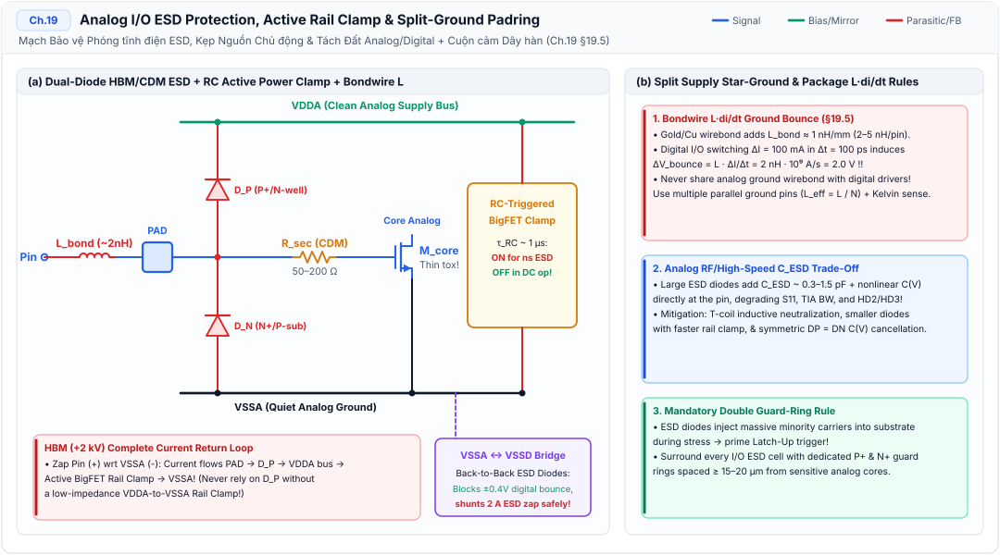

---
{
  "id": "tech-esd-protection-padring-and-package-parasitics",
  "kind": "technique",
  "domain": "nonideal-and-physical",
  "title_vi": "Bảo vệ Xả Tĩnh điện ESD, Kiến trúc Vòng Chân Pad Tách Miền và Ký sinh Đóng gói Vỏ Chip (ESD Protection, Split Padring & Package Parasitics)",
  "title_en": "ESD Protection (HBM/CDM Dual-Diode + Power Clamp), Split Analog/Digital Padring Architecture, and Bondwire/Package RLC Parasitics",
  "summary": "Thiết kế toàn diện giao diện vật lý giữa lõi silicon và thế giới bên ngoài: hình học chân hàn (bond pad) và kỹ thuật cắt góc bát giác giảm 20% điện dung ký sinh; bảo vệ phóng tĩnh điện hai bậc HBM/CDM bằng cặp diode kép, điện trở chặn R_CDM và mạch kẹp nguồn chủ động RC-BigFET; kiến trúc vòng pad tách miền nguồn/đất tương tự–số liên kết qua diode đối song song; tính toán tự cảm và hỗ cảm dây hàn (~1 nH/mm), nhiễu nảy nguồn/đất L*dI/dt, xuyên âm hỗ cảm chân vỏ và kỹ thuật giảm chấn cộng hưởng giữa điện cảm đóng gói với tụ khử nhiễu nguồn trên chip.",
  "diagram": "../../diagrams/esd-padring-cross-section.svg",
  "razavi_refs": [
    {
      "chapter": 19,
      "section": "19.1.2, 19.2.8, 19.4",
      "pages": "736, 757-760, 764-772",
      "equations": ["19.15", "19.16", "19.17", "19.18", "19.19", "19.20", "19.21", "19.22", "19.23", "19.24", "19.25", "19.26", "19.27"]
    }
  ],
  "glossary_codes": [
    "T008",
    "T045",
    "T053",
    "T062",
    "T1155",
    "T2087",
    "T2190",
    "T2191",
    "T2192",
    "T2197",
    "T2198"
  ],
  "process_agnostic": true,
  "roles": {
    "octagonal_low_c_bondpad": " Tấm kim loại chu vi chip (70x70 đến 100x100 um) được vát 8 cạnh và chỉ giữ các tầng kim loại trên cao nhằm cắt giảm điện dung ký sinh xuống đế cho tín hiệu tốc độ cao.",
    "dual_stage_hbm_cdm_esd_network": "Cặp diode lớn sơ cấp ngoài pad gánh dòng HBM hàng ampe kết hợp điện trở nối tiếp R_CDM và cặp diode thứ cấp sát cổng kẹp chặt điện áp dưới ngưỡng thủng oxit mỏng.",
    "active_rc_power_rail_clamp": "Mạch phát hiện sườn xung nhanh RC kích mở transistor NMOS khổng lồ (BigFET) dẫn tắt dòng tĩnh điện từ thanh VDD xuống thanh VSS rồi tự khóa chặt ở chế độ DC bình thường.",
    "antiparallel_domain_breaker_diodes": "Các cặp diode ESD đấu ngược chiều song song (back-to-back) đặt tại ranh giới GNDA <-> GNDD vừa chặn nhiễu nhỏ (< 0.5 V) khi chạy vừa thông đường thoát dòng khi có xung ESD.",
    "damped_package_pdn_network": "Mô hình RLC dây hàn–chân vỏ ghép với tụ lọc nguồn trên chip có điện trở nối tiếp giảm chấn có chủ đích để dập tắt hiện tượng cộng hưởng phóng đại gợn nguồn."
  },
  "symptoms_addressed": [
    "catastrophic-gate-oxide-rupture-or-junction-meltdown-during-hbm-and-cdm-esd-events",
    "open-esd-return-path-failure-across-isolated-analog-and-digital-supply-domains",
    "severe-supply-and-ground-bounce-l-di-dt-from-package-bondwire-inductance",
    "amplified-supply-ringing-due-to-high-q-resonance-between-package-inductance-and-onchip-decap",
    "input-bandwidth-collapse-and-pin-to-pin-crosstalk-from-pad-capacitance-and-mutual-inductance"
  ],
  "limitations": [
    "large-esd-diodes-and-series-cdm-resistors-degrade-rf-input-matching-and-noise-figure",
    "wirebond-packages-fundamentally-suffer-from-1-nh-per-mm-unscalable-inductance-requiring-flipchip-for-mmwave",
    "massive-onchip-mos-decoupling-capacitors-increase-gate-oxide-defect-area-and-leakage-current"
  ],
  "checklists": [
    "common-mos",
    "esd-pad-and-substrate",
    "layout-and-matching"
  ]
}
---

## 1. Bản chất Nguyên lý, Sơ đồ Mạch & Vai trò Từng Nhánh Cấu trúc

Một lõi vi mạch có thể hoạt động hoàn hảo tới từng microvolt khi treo lơ lửng trong trình mô phỏng với các nguồn áp lý tưởng, nhưng ngay khoảnh khắc bước ra khỏi phòng sạch để cắt hạt (`dicing`), hàn dây đóng gói (**`packaging` — `T062`**) và cầm trên tay người lắp ráp, nó phải đối mặt với hai "cú sốc sinh tử" (Razavi §19.2.8, tr. 757–760 & §19.4, tr. 764–772):
1. **Phóng tĩnh điện hủy diệt (`Electrostatic Discharge — ESD`):** Ngón tay người hoặc đầu kẹp máy tự động tích điện áp hàng nghìn vôn phóng thẳng vào chân chip có điện dung chỉ vài chục femtofarad — nếu không có đường thoát dòng khép kín tốc độ sub-nanosecond, điện trường vượt $E_{\text{crit}} \approx 10^7\text{ V/cm}$ (chỉ $\sim 1.5\text{–}2.0\text{ V}$ trên oxit cổng dày $15\text{–}20\,\text{\AA}$!) sẽ bắn thủng vĩnh viễn cực cổng MOSFET hoặc nấu chảy tiếp giáp $p\text{–}n$!
2. **Nút cổ chai Ký sinh Không Thu Nhỏ Theo Định luật Moore (`Unscalable Package Parasitics`):** Trong suốt nhiều thập kỷ tốc độ transistor tăng hàng trăm lần, đường kính và chiều dài dây hàn vàng/đồng (`bondwire`) cùng chân vỏ gói cơ khí gần như không thể thu nhỏ đáng kể, biến mỗi kết nối ra ngoài thành một mạng điện cảm tự cảm, hỗ cảm và điện dung phức tạp làm nảy nguồn/đất (`supply/ground bounce` — `T2198`), gây xuyên âm chân kề chân và kích thích cộng hưởng nguồn!



Kiến trúc vòng giao tiếp ngoại vi (`Padring & Package Interface`) chuẩn công nghiệp được cấu thành từ 5 khối chức năng phối hợp chặt chẽ:
1. **Chân Hàn Kim loại & Biến thể Bát giác Giảm Tụ (`Bonding Pad & Octagonal RF Pad` — Hình 19.48–19.51):** Các ô kim loại kích thước $70\,\mu\text{m} \times 70\,\mu\text{m}$ đến $100\,\mu\text{m} \times 100\,\mu\text{m}$ đặt dọc chu vi chip cách nhau $\ge 25\,\mu\text{m}$ để đầu máy hàn ép sợi dây đường kính $25\text{–}50\,\mu\text{m}$.
2. **Mạng Bảo vệ Tín hiệu Hai Bậc (`Primary Dual-Diode + R_CDM + Secondary Clamp` — Hình 19.52 mở rộng):** Cặp diode tiếp giáp diện tích lớn $D_1$ (lên `VDD_ESD`) và $D_2$ (xuống `VSS_ESD`) đặt ngay sát pad, nối qua điện trở hạn dòng $R_1$ (`R_CDM` $\sim 50\text{–}200\,\Omega$) và cặp diode nhỏ thứ cấp đặt ngay trước cực cổng mỏng của mạch nội.
3. **Mạch Kẹp Nguồn Chủ động (`Active RC-Triggered Power-Rail Clamp`):** Cầu nối bắt buộc giữa thanh nguồn dương và thanh đất để dẫn dòng ESD từ diode trên $D_1$ thoát an toàn về chân đất mà không làm áp `VDD` vọt quá giới hạn đánh thủng.
4. **Phân vùng Vòng Pad Tách Miền Tương tự–Số (`Split Analog/Digital Padring` + `Back-to-Back Diodes`):** Chia cắt thanh vòng nguồn/đất thành các cung độc lập (`VDDA/GNDA`, `VDDD/GNDD`, `VDD_IO/VSS_IO`) liên kết đất qua cặp diode đối song song để vừa cô lập nhiễu `L*di/dt` vừa đảm bảo thông mạch ESD mọi tổ hợp chân!
5. **Mô hình Đồng thiết kế Vỏ Gói & Tụ Lọc Giảm Chấn (`Package RLC + Damped On-Chip Decap` — Hình 19.61–19.71):** Ma trận tự cảm dây hàn $L_{\text{bond}}$, hỗ cảm $L_m$, hàn hạ trực tiếp xuống đế kim loại vỏ (`downbonding` — Hình 19.68) và mạng tụ khử nhiễu nguồn trên chip có giảm chấn chống cộng hưởng.

---

## 2. Hệ Phương trình Cốt lõi & Tư duy "Nhìn Mạch Đọc Nhanh" (Analysis by Inspection)

### 2.1. Tính toán Điện dung Chân Pad & Mẹo Vát Góc Bát giác (Ví dụ 19.6, Phương trình 19.15–19.18)
Xét chân pad kích thước $75\,\mu\text{m} \times 75\,\mu\text{m}$ (chu vi $4 \times 75 = 300\,\mu\text{m}$, Ví dụ 19.6 Hình 19.50):
- Nếu chỉ cấu tạo bằng tấm kim loại trên cao `Metal 4` (tụ bản phẳng $6\text{ aF}/\mu\text{m}^2$, tụ rìa $15\text{ aF}/\mu\text{m}$, PT 19.15–19.16):
  $$C_{\text{pad,M4}} = 75^2 \times 6\text{ aF} + (4 \times 75) \times 15\text{ aF} = 33.75\text{ fF} + 4.50\text{ fF} = 38.25\text{ fF}$$
- Nếu lót thêm `Metal 3` bên dưới để tăng độ bền cơ học khi dập dây hàn (tụ đáy tăng lên $9\text{ aF}/\mu\text{m}^2$, cộng hai tụ rìa $17 + 15\text{ aF}/\mu\text{m}$, PT 19.17–19.18):
  $$C_{\text{pad,M4+M3}} = 75^2 \times 9\text{ aF} + 300 \times (17 + 15)\text{ aF} = 50.625\text{ fF} + 9.60\text{ fF} = 60.22\text{ fF}$$
  *(Ở các quy trình cơ học yêu cầu xếp chồng đủ mọi tầng từ `M1` đến `M9` dưới pad thường, $C_{\text{pad}}$ vọt lên tới $250\text{–}500\text{ fF}$!)*
- **Kỹ thuật Pad Bát giác Tần số Cao (`Octagonal Pad` — Hình 19.51):** Bốn góc nhọn của hình vuông hoàn toàn thừa thãi đối với mối hàn tròn ở tâm! Vát bỏ 4 góc vuông để tạo hình bát giác đều ($a = b$) lập tức **cắt giảm $\sim 20\%$ cả diện tích lẫn chu vi** mà không hề làm khó máy hàn dây, kết hợp khoét bỏ các tầng kim loại thấp `M1–M6` dưới gầm pad (chỉ giữ `Top Metals` chịu lực `CUP — Circuit/Shield Under Pad`) để tối ưu hóa cho ngõ vào LNA và SerDes tốc độ cao!

### 2.2. Hai Tiêu chuẩn Phóng Tĩnh điện (`HBM` vs `CDM`) và Tại sao Bắt buộc Có $R_1$ + Kẹp Thứ cấp?
1. **Mô hình Cơ thể Người (`HBM — Human Body Model`, §19.2.8 tr. 758):** Tụ $C_{\text{HBM}} = 100\text{ pF}$ nạp tới $V_{\text{ESD}} = \pm 2000\text{ V}$ phóng qua điện trở da người $R_{\text{HBM}} = 1.5\text{ k}\Omega$ tạo xung dòng đỉnh $I_{\text{peak,HBM}} \approx \frac{2000\text{ V}}{1500\,\Omega} = \mathbf{1.33\text{ A}}$ với thời gian tăng $\sim 2\text{–}10\text{ ns}$ và kéo dài $\sim 150\text{ ns}$ (mang năng lượng nhiệt lớn dễ làm chảy tiếp giáp).
2. **Mô hình Linh kiện Tích điện (`CDM — Charged Device Model`):** Chính vỏ gói và đế con chip tự tích điện trên băng chuyền ma sát rồi một chân bất kỳ chạm vào mặt bàn kim loại nối đất: điện tích từ toàn bộ chip lao ồ ạt từ trong ra chân đó với **thời gian sườn siêu nhanh $< 100\text{–}200\text{ ps}$ và dòng đỉnh vọt lên $5\text{–}10\text{ A}$**!
- **Phương trình Kẹp Áp Hai Bậc cứu sống Oxit Cổng `65nm/45nm`:**
  Dưới xung `CDM` $I_{\text{CDM}} = 6\text{ A}$, dù diode sơ cấp $D_1$ ngoài pad có điện trở dẫn động rất nhỏ $R_{\text{on},D1} = 1.2\,\Omega$, điện áp ngay tại chân pad vẫn vọt lên $V_{\text{pad}} = V_{DD} + 0.7\text{ V} + I_{\text{CDM}} R_{\text{on},D1} \approx 8\text{–}9\text{ V}$ (vượt gấp đôi điện áp nổ oxit cổng core $\sim 4.5\text{ V}$ dưới xung ngắn!). Khi chèn điện trở chặn `unsilicided poly` $R_1 = 100\,\Omega$ nối tiếp với cặp diode thứ cấp nhỏ $D_{\text{sec}}$ ($R_{\text{on,sec}} \approx 5\,\Omega$) ngay sát cực cổng MOSFET lõi, bộ chia dòng ép điện áp thực đặt lên cực cổng tụt xuống mức an toàn tuyệt đối:

$$V_{\text{gate}} \approx V_{DD} + 0.7\text{ V} + \left(\frac{V_{\text{pad}} - V_{DD} - 0.7\text{ V}}{R_1 + R_{\text{on,sec}}}\right) R_{\text{on,sec}} \approx 1.0 + 0.7 + \frac{7.3}{105}\times 5 \approx \mathbf{2.05\text{ V}} < V_{\text{ox,crit}}!$$

### 2.3. Tự cảm, Hỗ cảm Dây Hàn & Nhiễu Nảy Nguồn/Đất $L\,\frac{\Delta I}{\Delta t}$ (§19.4, PT 19.19–19.27)
Từ hình học vật lý của dây hàn tròn bán kính $r$ đặt cách mặt phẳng đất khoảng $h$, vệt chân phẳng rộng $W$ và hai dây hàn song song cách nhau khoảng $d$ (Hình 19.62, PT 19.19–19.21):

$$L_{\text{wire}} \approx 0.2 \ln\!\left(\frac{2h}{r}\right)\;\;[\text{nH/mm}] \approx 1\text{ nH/mm}, \qquad L_m \approx 0.1 \ln\!\left[1 + \left(\frac{2h}{d}\right)^2\right]\;\;[\text{nH/mm}]$$

Tổng điện cảm mỗi kết nối vỏ gói (dây hàn + vệt dẫn `leadframe` + chân pin) rơi vào khoảng **$2\text{ nH}$ (vỏ `QFN` có đáy đất tiếp xúc, Hình 19.68) đến $10\text{–}20\text{ nH}$ (vỏ `DIP/QFP` chân dài)**!
- **Định lượng Sốc Nảy Nguồn/Đất (Ví dụ 19.7, PT 19.22–19.24):** Ngay cả khi ghép song song $N_{\text{pins}} = 200$ dây hàn ($5\text{ nH}$ mỗi dây $\implies L_{\text{eff}} = 25\text{ pH}$), dòng chuyển mạch $\Delta I = 25\text{ A}$ biến thiên trong $\Delta t = 5\text{ ns}$ vẫn sinh ra sụt áp cảm kháng trên mỗi phía nguồn và đất:
  $$\Delta V_{\text{bounce}} = L_{\text{eff}} \frac{\Delta I}{\Delta t} = \frac{5\text{ nH}}{200} \cdot \frac{25\text{ A}}{5\text{ ns}} = 125\text{ mV} \implies \Delta V_{\text{VDD}-\text{GND,worst}} = 250\text{ mV}!$$
- **Tại sao Cấm Cấp Điện áp Phân cực Tĩnh từ Ngoài Vỏ Chip cho Mảng Công tắc Dòng? (Ví dụ 19.8, Hình 19.69, PT 19.25–19.27):**
  Trong mảng công tắc dòng vi sai (như `Current-Steering DAC`), mỗi lần cặp vi sai chuyển từ trạng thái một nhánh dẫn hoàn toàn ($V_{P1} = V_2 - \sqrt{2}(V_{GS} - V_{TH})_{\text{eq}}$) qua điểm cân bằng giữa chừng ($V_{P2} = V_2 - \left(1 + \frac{\sqrt{2}}{2}\right)(V_{GS} - V_{TH})_{\text{eq}}$) và ngược lại, nút đuôi chung $P$ sụt nhảy bậc điện áp $\Delta V_P = V_{P1} - V_{P2} = \left(1 - \frac{\sqrt{2}}{2}\right)(V_{GS} - V_{TH})_{\text{eq}} \approx 0.293\,V_{OV,\text{eq}}$ (PT 19.25–19.27), bơm xung điện tích ngược qua $C_{GD3}$ của nguồn dòng đuôi vào đường phân cực cổng $X$. Nếu đường $X$ được cấp từ ngoài bo mạch qua cuộn cảm vỏ gói $L_{\text{pkg}}$, dòng xung này kích thích dao động chuông dữ dội lâu tắt trên $V_X$! Mọi điện áp phân cực cổng nhạy cảm **bắt buộc phải tạo nội bộ trên chip** hoặc có bộ đệm trở kháng thấp ngay trên đế silicon!
- **Xuyên âm Hỗ cảm $L_m$ & Quy tắc Ghép Cặp Chân Vi sai:** Khi một chân ngõ ra số có dòng $\frac{dI_1}{dt}$ lớn nằm sát chân ngõ vào tương tự đơn đầu, từ thông móc vòng cảm ứng thẳng điện áp nhiễu $V_{\text{xtalk}} = L_m \frac{dI_1}{dt}$ lên dây hàn tương tự (với $L_m = 1.5\text{ nH}$ và $\frac{dI_1}{dt} = 50\text{ mA/ns}$, nhiễu cảm ứng lên tới $75\text{ mV}$!). Ngược lại, nếu đưa tín hiệu tương tự vào bằng **hai chân vi sai nằm sát cạnh nhau** (`Pin k` và `Pin k+1`), chân gây nhiễu ở xa cảm ứng điện áp gần bằng nhau lên cả hai dây hàn tạo thành nhiễu chế độ chung tự triệt tiêu, đồng thời hai dòng ngược chiều trên chính cặp dây vi sai cho điện cảm vòng tổng giảm xuống còn $L_{\text{diff}} = 2(L_{\text{self}} - L_m)$!

### 2.4. Bẫy Cộng hưởng Giữa Dây Hàn $L_{\text{pkg}}$ và Tụ Lọc Nguồn Trên Chip $C_{\text{decap}}$ (Hình 19.67)
Gắn tụ lọc lớn $C_1$ giữa `VDD1` và `GND1` ngay trên chip giúp ghìm hiệu điện thế nội ổn định, **NHƯNG** tổng cảm kháng đóng gói $L_{\text{pkg}} = L_D + L_G$ tạo với $C_1$ một mạch cộng hưởng LC tại:

$$f_{\text{res}} = \frac{1}{2\pi\sqrt{(L_D + L_G)\,C_1}}, \qquad Q_{\text{PDN}} = \frac{1}{R_{\text{ESR}}}\sqrt{\frac{L_D + L_G}{C_1}}$$

Nếu $L_D + L_G = 6\text{ nH}$ và $C_1 = 400\text{ pF}$ thì $f_{\text{res}} \approx 103\text{ MHz}$! Nếu tụ vẽ quá lý tưởng ($R_{\text{ESR}} \approx 0.1\,\Omega \implies Q_{\text{PDN}} \approx 38$), bất kỳ xung nhịp hay tần số lặp gói dữ liệu nào rơi gần $103\text{ MHz}$ sẽ bị **nhân bội biên độ nhiễu nguồn lên hàng chục lần**! Do đó Razavi chỉ rõ (tr. 768): bắt buộc mắc nối tiếp một điện trở giảm chấn nhỏ $R_{\text{damp}}$ (hoặc cố ý định cỡ chiều dài kênh tụ MOS theo PT 18.4 sao cho $R_{\text{ESR}} \approx \sqrt{(L_D + L_G)/C_1}$) để ép $Q_{\text{PDN}} \le 1$!

---

## 3. Bất biến Cấu trúc & Các Bẫy Lỗi Kinh điển (Structural Invariants & Traps)

- **`[INV-ESD-01]` Bất biến Ma trận Thoát Dòng Khép kín Giữa Mọi Cặp Chân Bất kỳ (`Complete Pin-to-Pin ESD Matrix`):**
  Máy kiểm định ESD công nghiệp không chỉ bắn tĩnh điện giữa chân Tín hiệu với đất của chính nó, mà bắn chéo giữa **mọi tổ hợp chân** (ví dụ dương vào `AIN_P` trong khi nối đất duy nhất chân `VDDD` hoặc `GNDD`, toàn bộ các chân khác để hở!). Nếu hai miền nguồn/đất tương tự và số cắt rời nhau hoàn toàn mà quên đặt **ô cắt miền chứa cặp diode ESD đối song song (`antiparallel breaker cell` giữa `GNDA` $\leftrightarrow$ `GNDD`)** kèm `Power Clamp` trên mỗi miền nguồn, dòng ESD không có đường vòng sang `GNDD` sẽ bắn nổ tung phần lõi ranh giới (chẳng hạn cổng giao tiếp bộ so sánh sang thanh ghi SAR)!
- **`[INV-ESD-02]` Bất biến "Cấm Ngõ Vào/Ra Vượt Quá Dải Nguồn $> 0.4\text{ V}$" Khi Dùng Diode Kép Tiêu chuẩn:**
  Với cấu trúc diode kép (Hình 19.52), nếu chân tín hiệu nhận áp cao hơn `VDD + 0.6 V` (ví dụ khi chip đang tắt nguồn `VDD = 0 V` mà thiết bị ngoại vi trên bo mạch vẫn cấp áp `1.8 V` vào chân I/O — trạng thái **`Fail-Safe / Cold-Sparing`**!), diode trên $D_1$ sẽ bật dẫn thông cấp nguồn ngược trái phép lên thanh `VDD` của cả chip và đốt cháy diode! Các chân yêu cầu chịu áp khi mất nguồn (`fail-safe` hoặc quá áp dung sai `3.3V-tolerant`) **cấm dùng diode treo lên `VDD`**, mà phải dùng cấu trúc kẹp nối đất tự thân (`GGNMOS / SCR clamp xuống VSS`)!
- **`[TRAP-ESD-01]` Bẫy Tự Kích Hoạt Nhầm của `RC Power Clamp` Khi Bật Nguồn Sườn Quá Nhanh (`False Triggering`):**
  Mạch kẹp nguồn chủ động dùng bộ lọc thông cao $R_{\text{trig}} C_{\text{trig}}$ (thường thiết kế $\tau_{RC} \approx 0.5\text{–}1.0\,\mu\text{s}$ để nhận diện sườn ESD vài nanogiây nhưng bỏ qua sườn bật nguồn bình thường vài miligiây). Nếu trên bàn thí nghiệm kỹ sư nối chip vào nguồn xung bật công tắc cơ khí tạo sườn dốc `VDD` lên trong $100\text{ ns}$, mạch `RC Power Clamp` tưởng nhầm là xung ESD liền bật mở transistor khổng lồ rút dòng ngắn mạch hàng ampe làm sập nguồn cấp!
- **`[TRAP-ESD-02]` Bẫy Phi tuyến Điện dung Diode ESD ($C_j(V)$) Gây Méo Hài `HD2/HD3` cho Ngõ vào Tương tự Độ Tuyến tính Cao:**
  Hai diode lớn $D_1$ (`p+/N-well`) và $D_2$ (`n+/P-sub`) ngoài pad thực chất là hai tụ biến dung phi tuyến ngược chiều nhau! Nếu diện tích và độ dốc điện dung của $D_1$ và $D_2$ không cân xứng quanh mức đồng pha đầu vào $V_{CM}$, hoặc trở kháng nguồn phát $R_S$ bên ngoài lớn (ví dụ $500\,\Omega$), dòng nạp vào tụ phi tuyến $C_{\text{ESD}}(V_{in})$ rơi trên $R_S$ sẽ sinh méo hài hạn chế trần `SFDR` của `14-bit ADC` xuống dưới $75\text{ dB}$!

---

## 4. Lộ trình Nâng cấp Cấu trúc & Bát giác Đánh đổi (Upgrade Paths & Design Octagon)

Trong **Bát giác Thiết kế (`concept-analog-design-octagon`)**, thiết kế vòng padring, ESD và đóng gói là lằn ranh cuối cùng biến một mạch nghiên cứu thành sản phẩm thương mại đạt chứng nhận công nghiệp (`JEDEC HBM 2kV / CDM 500V`):
- **Tích hợp Đồng bộ Cấp độ Chip:** Phối hợp khăng khít với quy tắc cách ly đế `tech-substrate-noise-coupling-and-shielding`, quy tắc chống chốt nguồn `law-cmos-wells-and-latchup-guard-rings`, và đi dây công suất Kelvin cho `topo-cmos-ldo-regulator` / `topo-sar-adc-charge-redistribution-architecture`.

| Công nghệ Đóng gói Vỏ Chip | Tự cảm Kết nối Điển hình ($L_{\text{pkg}}$) | Cách Xử lý Đất Đế (`Substrate Ground`) | Phân khúc Ứng dụng Tối ưu |
| :--- | :--- | :--- | :--- |
| **Vỏ Chân Dài (`DIP / SOIC / LQFP`)** | Cao ($5\text{–}15\text{ nH/pin}$) | Phải đi qua chân vỏ dài; nảy đất $L\,di/dt$ rất nặng | Vi điều khiển/cảm biến tần số thấp chi phí cực rẻ |
| **Vỏ Không Chân Đáy Lộ (`QFN` + `Exposed Paddle`)** | Thấp–Trung bình ($1.5\text{–}3.5\text{ nH}$ tín hiệu; **$< 0.5\text{ nH}$ đất đáy!**) | Dán keo bạc dẫn điện mặt lưng xuống tấm đồng đáy + hàn hạ ngắn `downbond` (Hình 19.68) | **Chuẩn vàng tỷ số hiệu năng/giá thành** cho RF, PMIC, Mixed-Signal ADC/PLL tới $\sim 6\text{ GHz}$ |
| **Đảo Chip Đấu Bi Hàn (`Flip-Chip BGA / WLCSP`)** | **Cực thấp ($50\text{–}200\text{ pH/bump}$)** | Hàng trăm bi hàn đồng/thiếc (`Cu pillar / solder bump`) phân bố thẳng trên mặt chip | Bộ xử lý dòng chục ampe, SerDes $> 28\text{ Gbps}$, Radar/5G mmWave |

---

## 5. Thích ứng Đa Tiến trình (90nm / 65nm / 45nm) & Cách Kiểm chứng trong Cadence / Spectre

### 5.1. Quy tắc Vàng Sử dụng Thư viện Ô I/O & ESD Của Nhà máy Đúc (`Foundry ESD/IO Library`)
1. **Tuyệt đối không tự vẽ tay transistor/diode ESD từ Pcell analog thông thường ở `90nm/65nm/45nm`!**
   Transistor analog chuẩn có phủ `salicide` làm dòng phóng tĩnh điện tập trung cục bộ tại mép tiếp xúc gây cháy tức khắc ở vài trăm vôn! Các ô ESD chuyên dụng của nhà máy (`Foundry Verified I/O & ESD Cells`) sử dụng vùng chặn silicide kéo dài ở cực máng (`ballast drain extension`), khoảng cách tiếp xúc đặc biệt và đã được kiểm chứng thực nghiệm trên máy bắn xung đường truyền `TLP (Transmission Line Pulse)`.
2. **Sắp xếp Thứ tự Chân Vòng Pad (`Pinout Floorplanning Rules`):**
   - Nhóm riêng cung chân Tương tự (kẹp bởi `VDDA, GNDA`), cung chân RF/VCO, và cung chân Số tốc độ cao (kẹp bởi nhiều cặp `VDDD, GNDD` xen kẽ theo tỷ lệ tối đa $4\text{–}6$ chân I/O số phải có $1$ cặp nguồn–đất để hạ cảm kháng tổng!).
   - Đặt chân tham chiếu nhạy nhiễu (`VREF_EXT`, đầu vào thạch anh `XTAL`) kẹp giữa hai chân đất tĩnh đóng vai trò lá chắn hỗ cảm (`Quiet GND Shield Pins`).

### 5.2. Kịch bản Đồng Mô phỏng Lõi Chip + Pad ESD + Mô hình Đóng gói RLC trong Spectre
Trước khi ký duyệt `Tape-Out`, bắt buộc bọc quanh toàn bộ sơ đồ đỉnh (`Chip Top`) một lớp vỏ mô phỏng `Package + Pad + ESD Wrapper` và kiểm chứng cả quá độ chuyển mạch lẫn đáp ứng trở kháng mạng nguồn `Z_PDN(f)`:

```spice
// Spectre Top-Level Sign-Off Wrapper: Package Bondwire (Self + Mutual L) + ESD Pad + Damped Decap
simulator lang=spectre

// 1. Cap day han tin hieu vi sai canh nhau (L_self = 2.5 nH, he so ghep ho cam k = 0.35):
L_pin_inp (vinp_pcb pad_inp) inductor l=2.5n r=0.12
L_pin_inn (vinn_pcb pad_inn) inductor l=2.5n r=0.12
K_diff_in mutual_inductor ind1=L_pin_inp ind2=L_pin_inn coupling=0.35

// 2. Mang Pad + ESD Hai Bac bao ve cong oxit mong (Octagonal Pad 40fF + Dual Diodes + R_CDM = 100 Ohm):
C_pad_p   (pad_inp  gnda_esd) capacitor c=40f
// Diode ESD so cap D1/D2 (~ 120fF moi diode) + R_CDM + Clamp thu cap (~ 15fF):
C_esd1_p  (pad_inp  vdda_esd) capacitor c=120f
C_esd2_p  (pad_inp  gnda_esd) capacitor c=120f
R_cdm_p   (pad_inp  gate_inp) resistor  r=100
C_sec_p   (gate_inp gnda_int) capacitor c=20f

// 3. Mang Phan phoi Nguon (PDN) kem Tu Khử Nhiễu Trên Chip C_decap = 500pF co Giam chan R_damp = 3.5 Ohm:
// Q_PDN = (1 / 3.5) * sqrt((2.5n + 1.5n) / 500p) = 0.285 * 2.83 = 0.81 <= 1.0 (Khong cong huong!)
L_vdda    (vdda_pcb vdda_int) inductor  l=2.5n r=0.12
L_gnda    (gnda_pcb gnda_int) inductor  l=1.5n r=0.08
R_damp    (vdda_int n_decap)  resistor  r=3.5
C_decap   (n_decap  gnda_int) capacitor c=500p
```

---

## 6. Mốc Đối chiếu Sách Razavi & Thuật ngữ Chuẩn CLB

| Mục Sách Razavi (2nd Ed.) | Trang, Hình & Phương trình | Nội dung Đối chiếu Trọng tâm | Mã Thuật ngữ Chuẩn CLB |
| :--- | :--- | :--- | :--- |
| **§19.2.8 Pads & ESD Protection** | Tr. 757–760, Eq. `(19.15)–(19.18)`, Ex. `19.6`, Fig. `19.48–19.52` | Kích thước chân hàn $70\text{–}100\,\mu\text{m}$, tính điện dung pad $38.25\text{ fF}$ vs $60.22\text{ fF}$, pad bát giác giảm $20\%$ điện dung, mô hình tĩnh điện người và mạch kẹp diode kép + $R_1$ | `T045` (mạch tích hợp), `T2190` (hiện tượng chốt ký sinh latch-up), `T2191` (vòng bảo vệ), `T2192` / `T008` (hiệu ứng anten) |
| **§19.4 Package Inductance & Bounce** | Tr. 764–768, Eq. `(19.19)–(19.24)`, Ex. `19.7`, Fig. `19.61–19.67` | Công thức tự cảm và hỗ cảm dây hàn ($\sim 1\text{ nH/mm}$), định lượng sụt áp nảy nguồn $L\,\Delta I/\Delta t = 125\text{ mV}$, ghép nhiều dây song song và giảm chấn cộng hưởng tụ lọc trên chip | `T062` (đóng gói), `T1155` (tụ nối tắt), `T2198` (điện cảm dây hàn chân vỏ và nảy đất $L\,di/dt$) |
| **§19.4 Downbond, Ref & Mutual Coupling** | Tr. 769–772, Eq. `(19.25)–(19.27)`, Ex. `19.8`, Fig. `19.68–19.71` | Hàn hạ trực tiếp xuống mặt phẳng đất vỏ (`downbonding`), nhiễu giật nút phân cực công tắc dòng vi sai và khử xuyên âm hỗ cảm bằng cặp chân vi sai | `T053` (hệ thống tín hiệu hỗn hợp), `T2087` (xuyên nhiễu), `T2197` (đấu nối bốn dây Kelvin và đi đất hình sao) |
