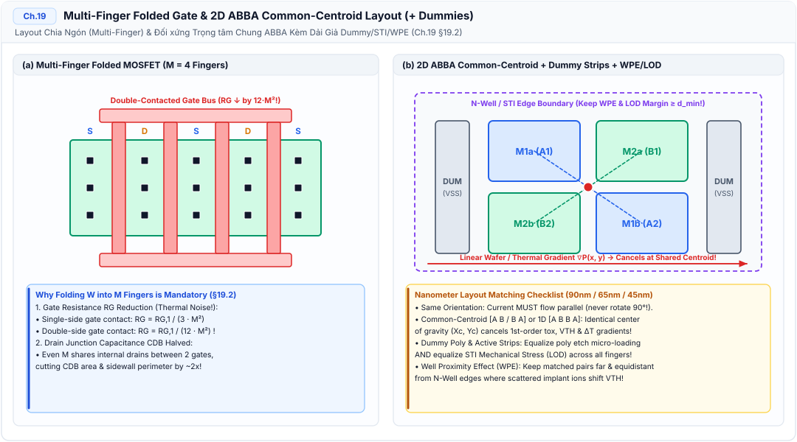

---
{
  "id": "tech-interconnect-rc-electromigration-and-ir-drop",
  "kind": "technique",
  "domain": "nonideal-and-physical",
  "title_vi": "Đường Dây Liên kết Kim loại CMOS: Trễ Phân tán RC Elmore, Nhiễu Nhiệt Lỗ Thông, Di cư Điện tử, Xẻ rãnh Ứng suất & Sụt áp IR Drop (Interconnect RC, EM & IR Drop)",
  "title_en": "CMOS BEOL Interconnect Engineering: Barke Fringing Cap, Distributed RC Elmore Delay, Via Thermal Noise, Electromigration, Slotting, and IR Drop",
  "summary": "Làm chủ vật lý và kỹ thuật đi dây nhiều tầng kim loại (BEOL) trong vi mạch tương tự–hỗn hợp: phân cấp điện trở mặt và điện trở lỗ thông gây nhiễu nhiệt quy về ngõ vào, công thức thực nghiệm điện dung trường rìa Barke, trễ và tán sắc sườn xung nhịp tỷ lệ bình phương chiều dài T_D = 0.5*Ru*Cu*L^2, sai số bậc hai N^2*gm*r trên thanh đất DAC và quy tắc phân phối dòng tham chiếu thay vì kéo áp cổng đường dài, giới hạn mật độ dòng di cư điện tử (Electromigration Jmax) cùng luật xẻ rãnh kim loại rộng (slotting) và đi dây bốn cực Kelvin.",
  "diagram": "../../diagrams/common-centroid-multifinger.svg",
  "razavi_refs": [
    {
      "chapter": 18,
      "section": "18.7.3",
      "pages": "727-730",
      "equations": ["18.5", "18.6", "18.7", "18.8", "18.9", "18.10", "18.11"]
    },
    {
      "chapter": 19,
      "section": "19.2.5, 19.2.7",
      "pages": "744-746, 753-757",
      "equations": ["19.14"]
    }
  ],
  "glossary_codes": [
    "T048",
    "T712",
    "T1009",
    "T1080",
    "T1914",
    "T1965",
    "T2087",
    "T2088",
    "T2193",
    "T2195",
    "T2197"
  ],
  "process_agnostic": true,
  "roles": {
    "beol_metal_stack_hierarchy": "Các tầng kim loại dưới mỏng khít (M1–M4, ~60–100 mOhm/sq) phục vụ nối nội bộ ngắn và các tầng đỉnh dày rộng (Top Metals, ~10–30 mOhm/sq) dẫn nguồn, xung nhịp và cuộn cảm.",
    "contact_and_via_arrays": "Chuỗi lỗ tiếp xúc xuống poly/active (30–40 Ohm/lỗ ở 40nm) và lỗ thông liên tầng via (5–10 Ohm/via) bắt buộc nhân song song để giảm nhiễu nhiệt và chống đứt mạch.",
    "distributed_rc_transmission_line": "Mạng điện trở và điện dung phân bố dọc dây dài gây trễ Elmore tỷ lệ với L^2 và làm tù sườn xung nhịp lấy mẫu (edge dispersion).",
    "current_reference_distribution_star": "Các nhánh nguồn dòng độc lập đưa dòng phân cực đi xa tới từng khối cục bộ thay vì kéo chung một dây điện áp cổng nhạy sụt áp đất.",
    "slotted_wide_power_buses": "Các thanh cái nguồn/đất bề rộng lớn ghép song song nhiều tầng kim loại có xẻ rãnh dọc giải phóng ứng suất cơ nhiệt và giữ mật độ dòng dưới trần di cư điện tử Jmax."
  },
  "symptoms_addressed": [
    "quadratic-n-squared-current-mismatch-along-shared-ground-bus-in-current-steering-dac",
    "unexpected-lna-or-ota-input-referred-noise-degradation-after-post-layout-pex",
    "channel-to-channel-sampling-skew-and-clock-edge-dispersion-in-interleaved-or-pipeline-adcs",
    "long-term-open-circuit-void-or-short-circuit-hillock-failure-from-electromigration",
    "bias-current-shift-across-chip-floorplan-due-to-ground-ir-drop-on-shared-vgs-line"
  ],
  "limitations": [
    "widening-signal-wires-lowers-series-resistance-but-linearly-increases-parasitic-capacitance",
    "stacking-three-or-more-metal-layers-for-power-buses-blocks-orthogonal-signal-routing-channels",
    "cmp-dummy-metal-fill-near-sensitive-analog-wires-adds-unmodeled-fringing-capacitance-if-not-excluded"
  ],
  "checklists": [
    "common-mos",
    "layout-and-matching",
    "esd-pad-and-substrate"
  ]
}
---

## 1. Bản chất Nguyên lý, Sơ đồ Mạch & Vai trò Từng Nhánh Cấu trúc

Trên sơ đồ nguyên lý (`schematic`), mọi đường dây nối từ điểm A đến điểm B đều là một nút đẳng thế lý tưởng có điện trở bằng không, điện dung bằng không và chịu được dòng điện vô hạn. Thế nhưng trên mặt bằng thực tế của một con chip công nghệ nanomet (`90nm` / `65nm` / `45nm`), hệ thống chồng từ $8$ đến $12$ tầng kim loại (**`BEOL — Back-End-of-Line Interconnects`**, Razavi §18.7.3, tr. 727–730 & §19.2.5, §19.2.7, tr. 744–746, 753–757) lại chính là nơi đánh sập hiệu năng sau trích xuất ký sinh (`Post-Layout PEX`) nhiều nhất! Khi chiều rộng dây thu nhỏ xuống dưới $0.1\,\mu\text{m}$ và dòng phân cực tương tự vẫn giữ ở mức miliampe để đạt nhiễu thấp, **bốn hiện tượng vật lý của đường dây** lập tức trỗi dậy chi phối mạch:



1. **Điện trở Mặt Kim loại & Điện trở Chuỗi Lỗ Thông (`Sheet & Contact/Via Resistance` — §18.7.3 & Ví dụ 19.5):** Các tầng kim loại thấp (`M1–M4`) mỏng nên có $R_\square \approx 50\text{–}120\,\text{m}\Omega/\square$, trong khi một lỗ tiếp xúc đơn `Contact` $80\text{ nm} \times 80\text{ nm}$ xuống cổng poly ở `40nm` nặng tới **$30\text{–}40\,\Omega$** và mỗi `Via` liên tầng nặng $5\text{–}10\,\Omega$ — đủ để cộng thẳng nhiễu nhiệt $4 k T R_{\text{wire}}$ vào ngõ vào bộ khuếch đại nhiễu thấp!
2. **Sụt áp Một chiều/Quá độ `IR Drop` & Lỗi Tích lũy Bậc Hai $N^2$ trên Thanh Đất (Ví dụ 18.3 & §19.2.5):** Chỉ vài milivôn sụt áp trên đường đất dùng chung đã trực tiếp cắt xén điện áp $V_{GS}$ của dãy nguồn dòng gương hoặc thang dòng `DAC`, buộc phải thay đổi kiến trúc phân phối tham chiếu toàn chip.
3. **Điện dung Trường Rìa Barke, Trễ Phân tán `Elmore` $\propto L^2$ và Tán sắc Sườn Xung (`Wire RC Delay & Dispersion` — PT 18.11 & 19.14):** Dây dẫn dài hoạt động như đường truyền RC phân bố làm trễ và làm tù sườn xung nhịp lấy mẫu, gây sai lệch thời điểm lấy mẫu giữa các kênh ADC.
4. **Hiện tượng Di cư Điện tử (`Electromigration — EM`) & Luật Xẻ rãnh Ứng suất Kim loại Rộng (`Metal Slotting`):** Giới hạn vật lý quyết định bề rộng tối thiểu của đường nguồn, số lượng `via` tối thiểu và tuổi thọ sống còn $10$ năm của con chip ở $125\,^\circ\text{C}$.

---

## 2. Hệ Phương trình Cốt lõi & Tư duy "Nhìn Mạch Đọc Nhanh" (Analysis by Inspection)

### 2.1. Sai số Bậc Hai $N^2$ trên Thanh Đất Chung của Dãy Nguồn Dòng (Ví dụ 18.3, Phương trình 18.5–18.10)
Xét một mảng gồm $N$ nguồn dòng NMOS giống hệt nhau ($M_1, M_2, \dots, M_N$, mỗi nguồn mang dòng danh định $I$ và hỗ dẫn $g_m$), cùng nhận một đường áp cổng $V_b$ nhưng cực nguồn nối dọc theo một thanh kim loại đất có điện trở mỗi chặng giữa hai ô liên tiếp là $r$ (Hình 18.23, điểm nối đất chuẩn nằm ở bên trái cạnh $M_1$). Áp dụng xếp chồng dòng điện qua từng đoạn điện trở $r$ (PT 18.5–18.6):
- Đoạn đầu tiên (sát đất chuẩn) phải gánh tổng dòng $N \cdot I \implies V_{S1} = N I r$; đoạn thứ hai gánh $(N-1)I \dots$ cho tới cực nguồn của phần tử xa nhất $M_N$ tích lũy tổng điện thế dâng lên:

$$V_{SN} = I r + 2 I r + \dots + N I r = \frac{N(N + 1)}{2} I r$$

Vì $V_{GS,k} = V_b - V_{Sk}$ bị co lại một lượng $V_{Sk}$, dòng cực máng thực tế của $M_N$ sụt xuống còn $I_N \approx I - g_m V_{SN}$ (PT 18.7–18.9), tạo ra **độ sai lệch dòng tỉ đối giữa phần tử đầu và phần tử cuối tăng vọt theo BÌNH PHƯƠNG số phần tử $N^2$** (PT 18.10):

$$\left|\frac{I_1 - I_N}{I}\right| = g_m r \frac{N(N - 1)}{2} \approx \frac{1}{2} N^2 g_m I r \cdot \frac{1}{I}$$

*Ví dụ chấn động:* Một bộ `10-bit Current-Steering DAC` dùng $N = 64$ nguồn dòng nhiệt kế (`thermometer unary cells`), mỗi ô $I = 100\,\mu\text{A}$, $g_m = 1\text{ mS}$: chỉ cần mỗi đoạn dây đất giữa hai ô có điện trở bé xíu **$r = 0.05\,\Omega$ ($50\,\text{m}\Omega$)**, sai lệch giữa $I_1$ và $I_{64}$ đã vọt lên $\frac{64 \times 63}{2} \times 10^{-3} \times 0.05 \approx \mathbf{10.1\%}$ — phá hủy hoàn toàn độ tuyến tính INL!
- **Ba giải pháp kiến trúc chuẩn (§19.2.5 & §19.2.7):**
  1. **Phân phối bằng Dòng điện thay vì Điện áp (`Current Distribution` — Hình 19.23 $\to$ 19.24):** Tuyệt đối không kéo một sợi dây điện áp $V_{GS}$ đi khắp chip! Đặt một dãy nguồn dòng PMOS/NMOS trung tâm (trở kháng ra cực cao $r_O$) xuất các nhánh dòng riêng $I_{\text{REF}1}, I_{\text{REF}2}\dots$ chạy tới từng khối con rồi mới mắc diode gương dòng cục bộ gắn trực tiếp xuống đất tại chỗ của khối con đó (kèm tụ lọc $C_{\text{bypass}}$ dập nhiễu đường dây)!
  2. **Đấu nối Hình Cây Đối xứng (`Binary Tree Routing`) hoặc Vuốt Thon Thanh Đất (`Tapered Ground Bus` — Hình 19.47):** Cấp nguồn/đất từ chính giữa rẽ nhánh nhị phân bằng nhau tới mọi ô DAC để mọi cực nguồn chịu đúng cùng một sụt áp DC!
  3. **Đấu Bốn Dây Kelvin (`Kelvin Sensing` — `T2197`):** Tách hoàn toàn đường dây mang dòng lớn (`Force`) khỏi đường dây cảm nhận điện áp không mang dòng (`Sense`) cho Bandgap và LDO (`topo-cmos-ldo-regulator`).

### 2.2. Nhiễu Nhiệt Cổng từ Dây Dẫn và Chuỗi Lỗ Thông `Via/Contact` (Ví dụ 19.5, Hình 19.44)
Nhiều kỹ sư thiết kế cặp đầu vào có $g_m = 20\text{ mS}$ để ép nhiễu nhiệt kênh xuống $\sqrt{4 k T \gamma / g_m} \approx 0.75\text{ nV}/\sqrt{\text{Hz}}$, nhưng lại đi dây tín hiệu vào trên tầng `Metal 4` dài $L = 100\,\mu\text{m}$, rộng $W = 2\,\mu\text{m}$ ($50\,\square \times 40\,\text{m}\Omega/\square = 2\,\Omega$), rồi nhảy qua các tầng `M4->M3->M2->M1->Poly` bằng **chỉ 2 lỗ via mỗi tầng** ($5\,\Omega / 2 = 2.5\,\Omega \times 3 = 7.5\,\Omega$) và **2 lỗ contact poly** ($30\,\Omega / 2 = 15\,\Omega$, Ví dụ 19.5 tr. 755):

$$R_{\text{wire,tot}} = 2 + 2.5 + 2.5 + 2.5 + 15 = 24.5\,\Omega \implies \overline{V_{n,\text{wire}}^2} = 4 k T R_{\text{wire,tot}} \implies V_{n,\text{wire}} \approx 0.64\text{ nV}/\sqrt{\text{Hz}}$$

Chỉ riêng hai lỗ contact sơ sài ở cổng đã cộng thêm lượng nhiễu nhiệt **ngang ngửa toàn bộ cặp transistor đầu vào tốn hàng miliampe**! Quy tắc bắt buộc: tại ngõ vào nhạy nhiễu, luôn chia đa ngón (`multi-finger` `T2193`), nối kim loại cả hai đầu ngón cổng và đặt **mảng từ $8\text{–}16$ lỗ `via/contact` song song** tại mỗi điểm chuyển tầng!

### 2.3. Công thức Điện dung Dây Barke (PT 18.11) & Trễ Phân tán `Elmore` $\propto L^2$ (PT 19.14)
Điện dung trên mỗi đơn vị chiều dài của dây kim loại rộng $W$, dày $t$ cách đế (hoặc mặt phẳng kim loại dưới) khoảng $h$ gồm bản phẳng $W/h$ cộng ba số hạng điện trường rìa hai sườn (`fringing field`, PT 18.11):

$$C_u = \epsilon_{ox}\left[\frac{W}{h} + 0.77 + 1.06\left(\frac{W}{h}\right)^{0.25} + 1.06\left(\frac{t}{h}\right)^{0.5}\right]$$

Khi $W \lesssim h$, điện dung rìa cố định áp đảo khiến việc bóp hẹp thêm $W$ gần như **không làm giảm $C_u$** mà chỉ làm điện trở trên đơn vị chiều dài $R_u = R_\square / W$ tăng vọt! Với một đường dây tổng chiều dài $L$, hằng số thời gian trễ truyền lan xấp xỉ Elmore (PT 19.14, Hình 19.45) tăng theo **bình phương chiều dài $L^2$**:

$$T_D \approx \frac{1}{2} R_u C_u L^2 = \frac{1}{2} R_{\text{total}} C_{\text{total}}$$

- **Bẫy Tán sắc & Lệch Thời điểm Lấy mẫu Mảng ADC (Hình 19.46):** Khi phân phối xung nhịp `CK` và tín hiệu tương tự `Vin` chạy dọc qua $n$ kênh lấy mẫu song song (`Time-Interleaved / Flash ADC`), sự khác biệt hằng số thời gian phân tán làm sườn xung nhịp ở kênh xa bị kéo dài thoai thoải (`dispersion`, tăng nhiễu jitter công tắc!) và trễ lệch so với `Vin`, gây méo hài ghép kênh nghiêm trọng nếu không đi dây theo **cây chữ H đối xứng (`H-tree`)** kèm bộ đệm làm sắc sườn tại chỗ!

### 2.4. Giới hạn Di cư Điện tử (`Electromigration — EM`) và Phương trình Tuổi thọ Black
Dưới mật độ dòng điện một chiều lớn $J = I_{DC} / (W \cdot t)$, "cơn gió điện tử" va đập truyền động lượng liên tục vào các ion kim loại tại biên hạt tinh thể, đẩy nguyên tử kim loại trôi về phía cực dương: nơi mất nguyên tử rỗng dần thành **hốc đứt mạch (`void`)**, nơi dồn ứ trồi lên thành **râu kim loại chập mạch (`hillock/whisker`)**. Thời gian trung bình tới khi hỏng hóc (`MTTF`) tuân theo định luật Black:

$$\text{MTTF} = \frac{A_{\text{EM}}}{J^n}\exp\!\left(\frac{E_a}{k T}\right) \implies W_{\min,\text{EM}} = \frac{I_{DC,\text{avg}}}{J_{\max}(T_{\max})}$$

Trong đó mật độ dòng tối đa cho phép ở $105\text{–}125\,^\circ\text{C}$ thường chỉ khoảng $J_{\max,\text{DC}} \approx 0.5\text{–}1.5\text{ mA}/\mu\text{m}$ cho các tầng kim loại mỏng dưới thấp và $2\text{–}5\text{ mA}/\mu\text{m}$ cho tầng kim loại dày trên đỉnh, còn mỗi lỗ `via` đơn chỉ chịu được $I_{\max,\text{via}} \approx 0.1\text{–}0.4\text{ mA}$! *(Lưu ý: dòng xoay chiều đối xứng thuần túy không có thành phần DC trung bình có khả năng tự hồi phục ngược chiều nên chịu được $J_{\text{RMS}}$ cao hơn nhiều lần dòng một chiều!)*

---

## 3. Bất biến Cấu trúc & Các Bẫy Lỗi Kinh điển (Structural Invariants & Traps)

- **`[INV-INT-01]` Bất biến Xẻ Rãnh Dọc Giải phóng Ứng suất cho Thanh Kim loại Quá Rộng (`Wide-Metal Stress Slotting`):**
  Khi vẽ thanh cái nguồn `VDD/GND` hoặc đường ra `LDO` rộng $30\text{–}50\,\mu\text{m}$ để gánh dòng hàng chục miliampe, luật DRC **cấm vẽ một tấm kim loại đặc nguyên khối rộng quá $W_{\max,\text{slot}}$** (thường $10\text{–}15\,\mu\text{m}$): sự co giãn nhiệt khác biệt sẽ làm nứt vỡ điện môi và bong tróc màng! Bắt buộc phải xẻ các rãnh hẹp chạy **song song dọc theo hướng dòng điện** (`cheese/slot holes`), và khi tính bề rộng chịu dòng `EM` hay `IR drop`, phải lấy **tổng bề rộng kim loại thực còn lại sau khi trừ đi bề rộng các rãnh xẻ**!
- **`[INV-INT-02]` Bất biến Bố trí Đúng Cấp Tầng Kim loại (`Metal Layer Assignment`):**
  - `M1–M2`: Chỉ dùng cho kết nối cục bộ cực ngắn trong phạm vi vài micromet của ô linh kiện.
  - `M3–M5`: Định tuyến tín hiệu vi sai nội khối và đan tụ `MOM`.
  - `Top Metals` (`M_top`, `M_top-1` siêu dày `UTM`): Dành riêng cho lưới nguồn/đất toàn cục, đường xung nhịp chính, cuộn cảm xoắn ốc `LC-VCO` và kết nối từ phần tử công suất LDO ra chân Pad!
- **`[TRAP-INT-01]` Bẫy Ghép Song song Các Tầng Kim loại Không Đương Xứng Độ Dày (§19.2.7 tr. 757):**
  Tầng kim loại trên cùng thường dày gấp $2\text{–}4$ lần các tầng bên dưới ($R_\square \approx 15\,\text{m}\Omega/\square$ so với $80\,\text{m}\Omega/\square$). Nếu lấy `M2` ghép song song với `M3` để hy vọng giảm một nửa điện trở thì hiệu quả rất tốt, nhưng nếu lót thêm một lớp `M2` mỏng bên dưới thanh `Top Metal` siêu dày thì điện trở tổng chỉ giảm chưa tới $15\%$ trong khi lại **bịt kín hoàn toàn mọi hành lang đi dây tín hiệu ngang qua bên dưới thanh nguồn**!
- **`[TRAP-INT-02]` Bẫy Điền Kim loại Giả Tự động (`Auto CMP Dummy Metal Fill`) Phá Hỏng Cuộn cảm và Cặp Vi sai:**
  Trước khi đúc chip, xưởng foundry chạy kịch bản rải hàng triệu ô kim loại nhỏ lơ lửng (`dummy fill`) vào mọi khoảng trống để cân bằng mật độ mài phẳng `CMP`. Nếu quên vẽ lớp cấm điền tự động (`DMEXCL / Dummy Fill Blockage`) phủ lên vùng cuộn cảm VCO, mảng tụ `C-DAC` và cặp dây vi sai RF, các mảnh kim loại giả này sẽ sinh dòng xoáy Foucault hạ thấp $Q$ cuộn cảm và làm lệch điện dung hai nhánh vi sai!

---

## 4. Lộ trình Nâng cấp Cấu trúc & Bát giác Đánh đổi (Upgrade Paths & Design Octagon)

Trong **Bát giác Thiết kế (`concept-analog-design-octagon`)**, thiết kế hệ thống dây dẫn đánh đổi giữa **Số Tầng Kim loại & Diện tích Hành lang Đi dây** với **Nhiễu Nhiệt, Độ Chính xác Khớp Dòng và Độ Tin cậy Dài hạn**:
- **Bảo toàn Độ Khớp Linh kiện & Phân cực Xa:** Kết hợp trực tiếp với `tech-common-centroid-sti-wpe-layout` và quy tắc phân phối nhánh dòng chuẩn của `topo-bandgap-reference-core` / `topo-constant-gm-bias-and-supply-sensitivity`.
- **Mở rộng từ Đường Dây Nội Chip ra Chân Vỏ & Chắn Nhiễu:** Liên kết sang kỹ thuật bọc lồng chắn chống xuyên âm tại `tech-substrate-noise-coupling-and-shielding` và giao tiếp pad/dây hàn đóng gói tại `tech-esd-protection-padring-and-package-parasitics`.

| Bài toán Đường Dây | Cách Đi dây Ngây thơ (Thất bại trên Silicon) | Kỹ thuật Đi dây Chuẩn Công nghiệp (Đạt Sign-Off) |
| :--- | :--- | :--- |
| **Phân cực gương dòng cách xa $300\,\mu\text{m}$** | Kéo 1 dây áp cổng $V_{GS}$ dùng chung đường đất có $IR\text{ drop}$ | Xuất nhánh **dòng tham chiếu riêng $I_{\text{bias}}$** tới gương diode + tụ lọc cục bộ tại đích |
| **Thanh đất mảng $N$ nguồn dòng DAC** | Nối chuỗi nối tiếp một đầu gây sai số bậc hai $\propto N^2 g_m r$ | Đi dây **cây nhị phân đối xứng (`Binary Tree`)** hoặc thanh kim loại đỉnh vuốt thon |
| **Dây vào cổng LNA / Cặp vi sai nhiễu thấp** | Dây hẹp dài + $1\text{–}2$ lỗ `contact/via` cộng hàng chục $\Omega$ nhiễu nhiệt | Dây tầng cao ngắn rộng + chia đa ngón nối 2 đầu + **mảng $\ge 8\text{–}16$ `via/contact`** |
| **Đo điện áp hồi tiếp ra LDO dòng $100\text{ mA}$** | Lấy điểm chia áp ngay tại cực máng trước đoạn dây ra pad | Đấu **4 dây Kelvin**: tách riêng thanh lực rộng xẻ rãnh và dây cảm nhận `Sense` tại đúng chân tải |

---

## 5. Thích ứng Đa Tiến trình (90nm / 65nm / 45nm) & Cách Kiểm chứng trong Cadence / Spectre

### 5.1. Sự Khắc nghiệt của Điện trở Dây và `EM` khi Co Nhỏ xuống `65nm / 45nm`
Ở `45nm`, bề rộng tối thiểu của `M1` chỉ còn $60\text{–}70\text{ nm}$ và bề dày lớp chắn khuếch tán `TaN` chiếm tỷ trọng lớn trong rãnh đồng, cộng thêm tán xạ điện tử tại biên hạt làm điện trở mặt `M1` vọt lên $> 120\,\text{m}\Omega/\square$ và giới hạn `EM` ở $110\,^\circ\text{C}$ rất chặt ($\sim 0.4\text{–}0.8\text{ mA}/\mu\text{m}$ trên `M1–M3`). Quy tắc thực hành an toàn trước khi có công cụ EM tự động:
- Với dòng DC ở `125 °C`: giữ mật độ $\le 0.5\text{ mA}/\mu\text{m}$ cho kim loại mỏng (`M1–M4`), $\le 2.0\text{ mA}/\mu\text{m}$ cho kim loại dày trên cao, và dùng tối thiểu **$2\text{–}4$ `via` cho mỗi $0.2\text{ mA}$ dòng một chiều** (luôn đặt tối thiểu `double-via` ở mọi nút tín hiệu để tăng năng suất chế tạo `DFM`!).

### 5.2. Quy trình Kiểm chứng `PEX (R+C+CC)` và Phân tích `EM / IR Drop` trong Cadence
1. **Trích xuất Chọn lọc trong `Hierarchy Editor (config view)`:**
   - Chuyển khối cần kiểm tra sang view `av_extracted` (trích xuất từ `Quantus QRC` hoặc `Calibre xRC` ở chế độ `RCC`: cả điện trở nối tiếp `R`, tụ xuống đất `C` và tụ ghép chéo `CC`).
   - So sánh trực tiếp 3 phép đo giữa `schematic` và `av_extracted`: (a) sụt áp DC trên đường `VDD/VSS` nội bộ (`< 5 mV`), (b) bảng đóng góp nhiễu `Noise Summary` xem các phần tử điện trở ký sinh `r_wire` chiếm bao nhiêu phần trăm tổng nhiễu ngõ vào, và (c) độ lệch thời gian sườn xung nhịp tới các công tắc lấy mẫu.
2. **Kiểm tra Tự động `Voltush-Fi / Assura EM-IR`:**
   - Chạy mô phỏng dòng động và dòng DC tại góc dòng lớn nhất (`FF, VDD_max, 125 °C`) nạp vào bộ kiểm tra luật `EM` của PDK để đánh dấu màu đỏ mọi đoạn thắt cổ chai vượt ngưỡng $J_{\max}$ hoặc thiếu `via`.

```spice
// Spectre Pre-Layout Wire Budget Model: Mo hinh hoa som duong day dai & chuoi Via truoc khi ve Layout!
// Khuyen nghi chen subckt mo hinh П-3-doan (3-segment Pi RC) cho moi duong CLK / Bias dai > 150 um:
subckt wire_rc_pi3 (in out gnd_ref)
parameters len=200u wid=0.4u r_sq=0.08 c_um=0.18f r_vias=10
    R_v1 (in  n1) resistor r=r_vias
    C_0  (n1  gnd_ref) capacitor c=(c_um * len / 6)
    R_1  (n1  n2) resistor r=(r_sq * len / (3 * wid))
    C_1  (n2  gnd_ref) capacitor c=(c_um * len / 3)
    R_2  (n2  n3) resistor r=(r_sq * len / (3 * wid))
    C_2  (n3  gnd_ref) capacitor c=(c_um * len / 3)
    R_3  (n3  n4) resistor r=(r_sq * len / (3 * wid))
    C_3  (n4  gnd_ref) capacitor c=(c_um * len / 6)
    R_v2 (n4  out) resistor r=r_vias
ends wire_rc_pi3
```

---

## 6. Mốc Đối chiếu Sách Razavi & Thuật ngữ Chuẩn CLB

| Mục Sách Razavi (2nd Ed.) | Trang, Hình & Phương trình | Nội dung Đối chiếu Trọng tâm | Mã Thuật ngữ Chuẩn CLB |
| :--- | :--- | :--- | :--- |
| **§18.7.3 Interconnects** | Tr. 727–730, Eq. `(18.5)–(18.11)`, Ex. `18.3`, Table `18.1`, Fig. `18.23–18.25` | Sụt áp thanh đất DAC gây sai số tỉ lệ $N^2$, giới hạn mật độ dòng di cư điện tử ($\sim 2\text{ mA}/\mu\text{m}$) và phương trình thực nghiệm điện dung rìa Barke | `T048` (bố trí hình học), `T1914` (hiệu ứng tải), `T2197` (đấu nối bốn dây Kelvin và đi đất hình sao) |
| **§19.2.5 Reference Distribution** | Tr. 744–746, Fig. `19.23–19.25` | Sai số do kéo dây áp cổng $V_{GS}$ đường dài và kỹ thuật phân phối bằng các nguồn dòng độc lập kèm tụ lọc cục bộ & giữ nguyên $L$ nhân $W$ đơn vị | `T712` (dòng điện tham chiếu), `T2088` (các đường phân phối tham chiếu) |
| **§19.2.7 Interconnect Layout** | Tr. 753–757, Eq. `(19.14)`, Ex. `19.5`, Fig. `19.44–19.47` | Nhiễu nhiệt từ dây dẫn & chuỗi `contact/via` ($24.5\,\Omega \to 0.64\text{ nV}/\sqrt{\text{Hz}}$), trễ phân tán $T_D = \frac{1}{2}R_u C_u L^2$, lệch pha mảng lấy mẫu và thanh đất vuốt thon | `T1009` (nhiễu nhiệt), `T1080` (nhiễu nhiệt điện trở), `T1965` (hằng số thời gian hữu hạn), `T2087` (xuyên nhiễu), `T2193` (transistor đa ngón) |
