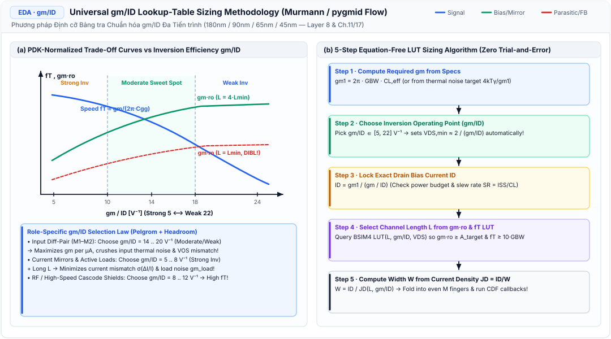

---
{
  "id": "tech-nanometer-opamp-design-case-studies",
  "kind": "technique",
  "domain": "nonideal-and-physical",
  "title_vi": "Nghiên cứu điển hình Thiết kế Op-Amp Công nghệ Nanomet (40nm / 65nm, Nguồn 1 V): Từ Đặc trưng Hóa Linh kiện đến Vòng Kín Tốc độ Cao",
  "title_en": "Nanometer CMOS Op-Amp Design Case Studies (40nm / 65nm, 1-V Supply): Characterization, Topology Feasibility, CMFB & Closed-Loop Settling",
  "summary": "Giải phẫu toàn diện ba nghiên cứu thiết kế thực tế của Razavi ở tiến trình nanomet (40nm CMOS, VDD = 1 V): lý do Op-Amp Cascode xếp chồng (Telescopic) thất bại khi đòi hỏi đồng thời độ lợi A0 >= 500 và dao động 1 Vpp, cách phân bổ lại ngân sách VDS và công suất trong Op-Amp Hai Tầng Cascode-Miller qua các góc PVT, và quy trình tổng hợp bộ khuếch đại vòng kín tốc độ cao xác lập chính xác 0.5% kèm phép co giãn tỷ lệ công suất.",
  "diagram": "../../diagrams/gmid-sizing-methodology.svg",
  "razavi_refs": [
    {
      "chapter": 11,
      "section": "11.2-11.4",
      "pages": "460-472",
      "equations": ["11.1", "11.3", "11.5", "11.7", "11.8", "11.9"]
    },
    {
      "chapter": 11,
      "section": "11.5.1-11.5.2",
      "pages": "473-495",
      "equations": ["11.10", "11.11", "11.12", "11.13"]
    },
    {
      "chapter": 11,
      "section": "11.6.1-11.6.5",
      "pages": "496-507",
      "equations": ["11.14", "11.15", "11.16", "11.17", "11.18", "11.20", "11.21", "11.23", "11.24"]
    }
  ],
  "glossary_codes": [
    "T050",
    "T059",
    "T060",
    "T063",
    "T069",
    "T1816",
    "T1818",
    "T1819",
    "T1820",
    "T1831",
    "T1848",
    "T1851",
    "T1865",
    "T1877",
    "T1874",
    "T1888",
    "T1905",
    "T1949",
    "T1951",
    "T1986"
  ],
  "process_agnostic": true,
  "roles": {
    "reference_device_characterization": "Trích xuất họ đường cong ID-VDS, gm/ID, ID/W và độ lợi nội tại gm*rO trên một transistor tham chiếu chuẩn (Wref) cho từng chiều dài kênh L = 40nm, 80nm, 120nm, 200nm thay thế hoàn toàn công thức luật bình phương đã sụp đổ.",
    "telescopic_feasibility_probe": "Phép thử cấu trúc 1 tầng xếp chồng 5 tầng MOSFET dưới nguồn 1 V nhằm phơi bày giới hạn vật lý giữa điểm gối VDS,min (~100 mV/tầng), suy giảm gm*rO do DIBL và bất ổn định vòng CMFB.",
    "cascode_first_two_stage_core": "Kiến trúc hai tầng kết hợp tầng một Telescopic Cascode (biên độ ra nhỏ +-25 mV nên được cấp VDS rộng rãi để đạt A1 ~ 50) với tầng hai Nguồn chung (gánh toàn bộ dao động vi sai 1 Vpp với A2 ~ 12) đạt tổng A0 > 500 trên nguồn 1 V.",
    "closed_loop_settling_and_scaling_engine": "Mạng hồi tiếp điện dung/điện trở kết hợp bù Miller triệt zero truyền thẳng và phép co giãn tuyến tính toàn bộ W, I, C theo hệ số alpha để đổi băng thông dư lấy mức giảm công suất 8x."
  },
  "symptoms_addressed": [
    "square-law-hand-calculations-failing-by-3x-in-nanometer-cmos",
    "single-stage-cascode-gain-collapse-under-1v-supply-and-1vpp-swing",
    "cmfb-loop-oscillation-despite-stable-differential-loop",
    "resistive-feedback-loading-crushing-two-stage-open-loop-gain",
    "excessive-static-power-after-initial-high-speed-opamp-synthesis"
  ],
  "limitations": [
    "minimum-channel-length-40nm-intrinsic-gain-capped-around-5-to-10",
    "capacitive-feedback-virtual-ground-drifts-under-nanometer-gate-leakage-without-reset",
    "linear-power-downscaling-degrades-thermal-noise-and-pelgrom-offset-by-sqrt-alpha",
    "large-signal-slewing-exposes-nonlinear-junction-capacitance-and-recovery-tails"
  ],
  "checklists": [
    "common-mos",
    "two-stage-miller",
    "cmfb",
    "feedback-and-stb"
  ]
}
---

## 1. Bản chất Nguyên lý, Sơ đồ Mạch & Vai trò Từng Nhánh Cấu trúc

Khi bước xuống các nút công nghệ nanomet sâu như **`65nm` và `40nm` CMOS** với điện áp nguồn danh định bị khóa chặt ở **$V_{DD} = 1.0\text{ V}$** (Razavi Chương 11, trang 459–507), kỹ sư thiết kế mạch tương tự đối mặt với một cú sốc kép về vật lý linh kiện (`law-short-channel-effects`):
1. **Sự sụp đổ của luật bình phương kênh dài (`T1833`)**: Bão hòa vận tốc hạt tải ($v_{\text{sat}}$, `T1838`) và suy giảm độ linh động theo trường dọc (`T1845`) khiến dòng cực máng chỉ còn tăng gần tuyến tính theo $V_{GS} - V_{TH}$, còn công thức $g_m = \sqrt{2\mu C_{ox}(W/L)I_D}$ sai lệch hàng trăm phần trăm.
2. **Sự sụp đổ của độ lợi nội tại $g_m r_O$ và trần dự trữ điện áp**: Hiệu ứng hạ rào thế cảm ứng bởi cực máng (**DIBL**, `T1885`) và điều biến chiều dài kênh đẩy $g_m r_O$ của transistor kênh tối thiểu $L = 40\text{ nm}$ tụt xuống chỉ còn **$7 \dots 10$ đối với NMOS** và **$5 \dots 7$ đối với PMOS** (§11.5.1, tr. 473)! Đồng thời với $V_{DD} = 1.0\text{ V}$, việc đòi hỏi biên độ dao động ngõ ra đơn đầu $0.5\text{ V}_{pp}$ (**vi sai $1.0\text{ V}_{pp}$**, `T1871`) chỉ chừa lại vẻn vẹn **$0.5\text{ V}$ tổng khoảng dự trữ $V_{DS}$** cho toàn bộ chuỗi transistor xếp chồng từ đất lên nguồn!



Chương 11 của Razavi là cây cầu thực chiến nối liền lý thuyết Chương 1–10 với thiết kế công nghiệp hiện đại thông qua **4 trụ cột kiến trúc nối tiếp nhau**:
1. **Đặc trưng hóa Transistor Tham chiếu & Quy luật Co giãn Hỗ dẫn (§11.2–11.4, Hình 11.2–11.18)**: Thay vì giải phương trình đại số $V_{GS} - V_{TH}$, ta mô phỏng trước một **transistor tham chiếu (`reference transistor`, `T1865`)** có bề rộng cố định $W_{\text{ref}}$ (ví dụ $W_{\text{ref}} = 5\,\mu\text{m}$) cho một tập chiều dài kênh rời rạc $L \in \{40, 60, 80, 100, 150, 200\text{ nm}\}$. Nhờ nguyên lý ghép song song $k$ linh kiện giống hệt nhau: ở cùng $V_{GS}$ và $V_{DS}$, cả $I_D$ lẫn $g_m$ đều nhân lên $k$ lần và $r_O$ chia $k$ lần, nên **tỉ số hiệu suất hỗ dẫn $g_m / I_D$ (`T1851`), điện áp điểm gối bão hòa $V_{DS,\min}$ (`T1848` / `T1889`), độ lợi nội tại $g_m r_O$ và tần số cắt $f_T$ hoàn toàn bất biến theo bề rộng $W$**!
2. **Nghiên cứu Điển hình 1 — Thử nghiệm & Giới hạn Vật lý của Telescopic Op-Amp dưới Nguồn $1\text{ V}$ (§11.5.1, Hình 11.19–11.37)**: Thử thách thiết kế Op-Amp vi sai toàn phần đạt $A_0 = 500$, dao động vi sai $1\text{ V}_{pp}$, $P \le 2\text{ mW}$ trên tiến trình `40nm`, $V_{DD} = 1\text{ V}$. Quá trình giải bài toán này phơi bày tường tận: cách chia $100\text{ mV}$ $V_{DS}$ cho mỗi tầng trong chồng 5 linh kiện, cách phân cực cascode điện áp thấp (`T1888`), cách thiết kế mạng **CMFB dùng tầng theo nguồn bổ sung NMOS–PMOS** để không gây tải điện trở (Hình 11.27), và cách phát hiện – dập tắt dao động tự kích của vòng CMFB (`T1909`). Kết quả trung thực của Razavi: Telescopic 1 tầng chỉ đạt được $A_0 \approx 180 \dots 230$ (hoặc đánh mất dao động $1\text{ V}_{pp}$), chứng minh bằng số liệu vì sao **phải chuyển sang cấu trúc hai tầng**!
3. **Nghiên cứu Điển hình 2 — Thành công của Op-Amp Hai Tầng Cascode–CS Bền vững qua PVT (§11.5.2, Hình 11.38–11.47)**: Giữ tầng 1 là Telescopic Cascode nhưng chỉ cần độ lợi $A_1 \approx 40 \dots 50$ và tầng 2 là Nguồn chung vi sai đạt $A_2 \approx 12 \dots 15$. Vì ngõ ra tầng 1 chỉ phải dao động đơn đầu $\frac{0.5\text{ V}_{pp}}{A_2} \approx 40 \dots 50\text{ mV}_{pp}$ (thay vì $500\text{ mV}_{pp}$!), toàn bộ chuỗi 5 transistor của tầng 1 lập tức được giải phóng không gian $V_{DS} \approx 160 \dots 180\text{ mV}$ mỗi linh kiện để đẩy $r_O$ vọt lên cao, trong khi tầng 2 chỉ có đúng 2 transistor ($M_{10}, M_{11}$) giữa $V_{DD}$ và $GND$ nên dễ dàng gánh trọn dao động vi sai $1\text{ V}_{pp}$ ngay cả ở góc xấu nhất `SS`, $+100\,^\circ\text{C}$ và $V_{DD} - 5\%$!
4. **Nghiên cứu Điển hình 3 — Bộ Khuếch đại Vòng Kín Tốc độ Cao & Co giãn Tỷ lệ Công suất (§11.6, Hình 11.48–11.65)**: Thiết kế mạch khuếch đại vòng kín độ lợi danh định $|A_{CL}| = 4$, sai số độ lợi tĩnh $< 1\%$, tải $C_L = 1\text{ pF}$ mỗi bên, thời gian xác lập $0.5\%$ đạt $t_s \le 2\text{ ns}$. Nghiên cứu này giải quyết bài toán chọn mạng hồi tiếp **tụ điện vs điện trở**, hiệu ứng dòng rò cổng `40nm` (`T1963`), bù Miller kèm điện trở triệt zero truyền thẳng, kiểm tra bước nhảy tín hiệu lớn (`T1656`), và áp dụng định luật **co giãn tỷ lệ Op-Amp (`op amp scaling`, `T059`)** hạ công suất từ $6\text{ mW}$ xuống $0.75\text{ mW}$ chỉ trong một bước biến đổi đồng dạng!

---

## 2. Hệ Phương trình Cốt lõi & Tư duy "Nhìn Mạch Đọc Nhanh" (Analysis by Inspection)

### 2.1. Bốn Bài toán Định cỡ Transistor Nanomet trên Mặt phẳng $(g_m/I_D, V_{DS,\min})$ (§11.3–11.4, PT 11.1–11.9)
Với transistor tham chiếu rộng $W_{\text{ref}}$ ở một chiều dài kênh $L$ đã chọn, mọi transistor thực tế rộng $W = \alpha W_{\text{ref}}$ giữ nguyên điện áp các cực sẽ tuân theo phép biến đổi tỷ lệ chính xác (PT 11.7–11.9):

$$I_D(W) = \alpha\,I_{D,\text{ref}}, \qquad g_m(W) = \alpha\,g_{m,\text{ref}}, \qquad r_O(W) = \frac{r_{O,\text{ref}}}{\alpha} \implies \left(\frac{g_m}{I_D}\right)_W = \left(\frac{g_m}{I_D}\right)_{\text{ref}}, \quad (g_m r_O)_W = (g_m r_O)_{\text{ref}}$$

Từ bộ ba biến thiết kế $\{g_m, I_D, V_{DS,\min}\}$ và biến hình học $W$ (với $L$ cố định theo yêu cầu $r_O$ hoặc $f_T$), Razavi phân loại mọi quyết định định cỡ vào **4 trường hợp chuẩn tắc (§11.4.1–11.4.4)**:
- **Trường hợp I — Cho trước $(I_D, V_{DS,\min})$** *(điển hình cho nguồn dòng đuôi $M_9$, nguồn dòng tải $M_{7,8}$)*: Tra đường cong $I_{D,\text{ref}}(V_{DS})$ tìm đường có điểm gối nằm đúng tại $V_{DS,\min}$ yêu cầu $\rightarrow$ đọc được $V_{GS}$ và dòng tham chiếu $I_{D,\text{ref}}$ $\rightarrow$ tính ngay bề rộng $W = W_{\text{ref}} \frac{I_D}{I_{D,\text{ref}}}$.
- **Trường hợp II — Cho trước $(g_m, I_D)$** *(điển hình cho cặp vi sai đầu vào khi ngân sách dòng và GBW/nhiễu đã ấn định)*: Lập tỉ số mục tiêu $g_m / I_D$ $\rightarrow$ tra đồ thị $g_{m,\text{ref}}$ theo $I_{D,\text{ref}}$ (Hình 11.14–11.15):
  - Nếu tỉ số $g_m / I_D$ yêu cầu vượt quá đỉnh cực đại vùng dưới ngưỡng ($\sim 25 \dots 28\text{ V}^{-1}$ ở nhiệt độ phòng), bài toán **bất khả thi vật lý (`unachievable region`, `T1997`)** — bắt buộc phải tăng ngân sách dòng $I_D$!
  - Nếu khả thi, đọc $I_{D,\text{ref}}$ tương ứng rồi suy ra $W = W_{\text{ref}} \frac{I_D}{I_{D,\text{ref}}}$ và kiểm tra lại xem $V_{DS,\min}$ tạo ra có nằm gọn trong khoảng dự trữ điện áp cho phép hay không.
- **Trường hợp III — Cho trước $(g_m, V_{DS,\min})$**: Từ $V_{DS,\min}$ xác định $V_{GS}$ tối đa cho phép trên họ đặc tuyến tham chiếu $\rightarrow$ đọc cả $g_{m,\text{ref}}$ lẫn $I_{D,\text{ref}}$ tại $V_{GS}$ đó $\rightarrow$ suy ra đồng thời $W = W_{\text{ref}}\frac{g_m}{g_{m,\text{ref}}}$ và dòng tiêu thụ bắt buộc $I_D = I_{D,\text{ref}}\frac{g_m}{g_{m,\text{ref}}}$.
- **Trường hợp IV — Chỉ cho trước $g_m$** *(tự do chọn điểm đánh đổi Công suất vs Tốc độ/Diện tích)*: Tăng $W$ ở cùng $I_D$ đẩy transistor lùi về vùng nghịch đảo vừa/yếu (`moderate/weak inversion`, `T2002`) giúp tiết kiệm dòng điện nhưng làm $C_{GS} \propto W L$ phình to kéo sụt $f_T$; ngược lại giảm $W$ tăng $V_{OV}$ đẩy tốc độ $f_T$ cao nhưng ngốn dòng $I_D$ và tốn khoảng dự trữ $V_{DS,\min}$.

### 2.2. Toán học Mở khóa Op-Amp dưới Nguồn $1\text{ V}$ & Khối Trích xuất CMFB Kép (§11.5.1–11.5.2, PT 11.10–11.13)
1. **Bài toán Trần Độ lợi của Telescopic Op-Amp 1 Tầng (Hình 11.19)**:
   Với $V_{DD} = 1.0\text{ V}$ và dao động đơn đầu mỗi ngõ ra $0.5\text{ V}_{pp}$ (vi sai $1.0\text{ V}_{pp}$), tổng điện áp $V_{DS}$ còn lại cho 5 transistor xếp chồng ($M_9$, $M_{1,2}$, $M_{3,4}$, $M_{5,6}$, $M_{7,8}$) là $1.0 - 0.5 = 0.5\text{ V}$, tức trung bình chỉ **$100\text{ mV}$ cho mỗi transistor**! Ngay cả khi tăng chiều dài kênh cascode và tải PMOS lên $L = 80 \dots 150\text{ nm}$ để cải thiện $r_O$, ở $V_{DS} \approx 100 \dots 120\text{ mV}$ các linh kiện nằm sát vùng chuyển tiếp triode–bão hòa khiến $r_O$ sụt thê thảm khi ngõ ra quét biên độ lớn (độ lợi vòng hở tụt xuống $< 200$).
2. **Mạng Trích xuất Mức Chế độ Chung không gây tải điện trở (Hình 11.27, PT 11.10–11.13)**:
   Nếu dùng cặp điện trở chia áp $R_{CM}$ cảm nhận ngõ ra của Telescopic Op-Amp, $R_{CM}$ mắc song song trực tiếp với trở kháng ra cao làm sập độ lợi DC; ngược lại nếu chỉ dùng một cặp theo nguồn NMOS, khi ngõ ra quét lớn $\pm 0.25\text{ V}$, sự phi tuyến bậc hai của cặp theo nguồn làm mức CM đo được bị méo theo tín hiệu vi sai! Razavi giải quyết bằng cách ghép **hai cặp theo nguồn bổ sung NMOS ($M_{10,11}$) và PMOS ($M_{14,15}$)** rồi cộng có trọng số qua $R_1, R_2$ để tái tạo trung thực $V_{out,CM}$ (PT 11.10–11.13):
   $$V_M = \frac{R_2}{R_1 + R_2}\,V_{X,\text{NMOS-SF}} + \frac{R_1}{R_1 + R_2}\,V_{Y,\text{PMOS-SF}}$$
   Nhờ hai cặp theo nguồn nén méo đối ngược chiều nhau khi một bên tiến gần triode còn bên kia mở rộng khoảng hở, sai lệch mức CM dưới dao động lớn giảm xuống chỉ còn vài milivôn!
3. **Phân bổ Ngân sách hai tầng cứu sống Độ lợi & Swing (§11.5.2, Hình 11.38–11.39)**:
   Chuyển sang **Op-Amp Hai Tầng** gồm Tầng 1 Telescopic Cascode ($I_{\text{tail}} \approx 0.4\text{ mA}$) + Tầng 2 Nguồn chung PMOS lái tải nguồn dòng NMOS ($I_{D,\text{stage2}} \approx 0.7\text{ mA}/\text{nhánh}$):
   - Vì Tầng 2 cung cấp độ lợi $|A_{v2}| = g_{m10}(r_{O10} \parallel r_{O12}) \approx 12 \dots 15$, ngõ ra đơn đầu của Tầng 1 chỉ cần dao động $\frac{500\text{ mV}_{pp}}{12} \approx 42\text{ mV}_{pp}$!
   - Nhờ không phải dao động lớn ở nút giữa, 5 transistor xếp chồng của Tầng 1 chia nhau gần trọn $1.0\text{ V}$ nguồn cấp ($V_{DS} \approx 170 \dots 220\text{ mV}$ mỗi tầng, đặt sâu trong vùng bão hòa phẳng!), dễ dàng đạt $|A_{v1}| \approx 50 \implies |A_0| = |A_{v1} A_{v2}| \approx 600 \dots 750 > 500$, trong khi ngõ ra Tầng 2 chỉ có 2 transistor nối tiếp nên đạt trọn $1.0\text{ V}_{pp}$ vi sai qua cả góc `SS`, $V_{DD} = 0.95\text{ V}$ và $T = 100\,^\circ\text{C}$!

### 2.3. Tổng hợp Bộ Khuếch đại Vòng Kín Tốc độ Cao & Định luật Co giãn Tỷ lệ (§11.6, PT 11.14–11.24)
Xét bài toán §11.6: thiết kế mạch khuếch đại vi sai vòng kín có độ lợi danh định $|A_{CL}| = 4$, sai số độ lợi tĩnh $\le 1\%$, tải $C_L = 1\text{ pF}$, dao động vi sai $1\text{ V}_{pp}$ và thời gian xác lập $0.5\%$ là $t_s \le 2\text{ ns}$:
1. **Tại sao bắt buộc chọn Hồi tiếp Điện dung thay vì Hồi tiếp Điện trở? (PT 11.14–11.16 & Ví dụ 11.12–11.13)**:
   Với hồi tiếp đảo dùng điện trở $R_2 / R_1 = 4$ (hoặc tụ điện $C_1 / C_2 = 4$), sai số độ lợi vòng kín xấp xỉ là:
   $$\frac{V_{out}}{V_{in}} = -\frac{C_1}{C_2}\,\frac{1}{1 + \dfrac{1}{\beta A_0}}, \qquad \beta = \frac{C_2}{C_1 + C_2 + C_{in}} \implies \epsilon_{\text{gain}} \approx \frac{1}{\beta A_0} \le 0.01$$
   Nếu $C_{in} \ll C_1 + C_2$ thì $1/\beta = 1 + 4 = 5 \implies A_0 \ge 500$ (hoặc $A_0 \ge 600 \dots 800$ khi kể đến $C_{in}$!). Nếu dùng mạng điện trở $R_1, R_2$, để không làm tăng nhiễu và không tạo cực RC ký sinh làm chậm $t_s = 2\text{ ns}$, $R_2$ chỉ được cỡ vài $\text{k}\Omega$ — nhưng tải điện trở vài $\text{k}\Omega$ nối trực tiếp vào ngõ ra Tầng 2 sẽ đè bẹp $r_{O,\text{stage2}}$, ép dòng phân cực Tầng 2 phải tăng vọt lên hàng chục miliampe! Do đó **mạng hồi tiếp điện dung (`capacitive feedback`, `T1958`, Hình 11.51)** là lựa chọn bắt buộc để không tiêu tốn dòng DC và không làm sụt độ lợi DC $A_0$.
2. **Ngân sách Băng thông từ Thời gian Xác lập $0.5\%$ (PT 11.17–11.23)**:
   Với đáp ứng bậc một lý tưởng $V_{out}(t) = V_F(1 - e^{-t/\tau_{CL}})$, để sai số còn lại bằng $\epsilon = 0.5\% = 0.005$ tại $t_s = 2\text{ ns}$ (PT 11.17):
   $$e^{-t_s / \tau_{CL}} \le 0.005 \implies \tau_{CL} \le \frac{t_s}{\ln(200)} = \frac{2\text{ ns}}{5.298} \approx 377.5\text{ ps} \implies \omega_{-3\text{dB},CL} = \frac{1}{\tau_{CL}} \ge 2.65\text{ Grad/s}\;\;(422\text{ MHz})$$
   Trong Op-Amp hai tầng bù Miller có tụ bù $C_C$ và hệ số hồi tiếp $\beta = \frac{C_2}{C_1 + C_2 + C_{in}} \approx \frac{1}{6}$, tần số cắt vòng $\omega_u \approx \beta \frac{g_{m1}}{C_C}$ phải đạt tối thiểu $\sim 2.65\text{ Grad/s}$ kèm dự trữ pha $\text{PM} \ge 60^\circ \dots 65^\circ$ (đặt cực không trội ngõ ra $\omega_{p2} = \frac{g_{m,\text{stage2}}}{C_{L,\text{tot}}} \ge 2.2\,\omega_u$ và chèn điện trở $R_z$ nối tiếp $C_C$ để đẩy zero truyền thẳng RHP về triệt tiêu cực phụ hoặc ra vô cùng, PT 11.20–11.24!).
3. **Định luật Co giãn Tuyến tính Toàn Mạch (`Op-Amp Scaling`, §11.6.4, Hình 11.59)**:
   Một phát hiện thực chiến cực đẹp của Razavi: nếu sau khi thiết kế xong nguyên mẫu đạt $t_s = 0.25\text{ ns}$ ở công suất $6\text{ mW}$ với tải lớn, hoặc khi yêu cầu hệ thống nới lỏng tải xuống $C_L / \alpha$ (hay cho phép hằng số thời gian chậm hơn), ta có thể nhân đồng loạt **mọi bề rộng $W$, mọi dòng phân cực $I_{\text{bias}}$, mọi tụ điện bù $C_C$ và tụ hồi tiếp $C_1, C_2$ với cùng hệ số $1/\alpha$** (giữ nguyên mọi chiều dài kênh $L$, giữ nguyên điện trở nhân với $\alpha$):
   - Mọi điện áp phân cực DC ($V_{GS}, V_{DS}, V_{DS,\min}$), toàn bộ **độ lợi vòng hở $A_0$**, và **dự trữ pha $\text{PM}$** được **bảo toàn bất biến $100\%$**!
   - Công suất tiêu thụ giảm ngay $\alpha$ lần (ví dụ $\alpha = 8 \Rightarrow P$ giảm từ $6\text{ mW}$ xuống $0.75\text{ mW}$!), đổi lại mật độ công suất nhiễu nhiệt và phương sai lệch ngưỡng $\sigma^2(V_{OS})$ tăng lên $\alpha$ lần.

---

## 3. Bất biến Cấu trúc & Các Bẫy Lỗi Kinh điển (Structural Invariants & Traps)

- **[INV-NMOP-01] Bất biến Kiểm tra Khả thi Độ lợi Nội tại trước khi Định cỡ (`Feasibility First`)**:
  Trước khi tính bất kỳ một kích thước $W/L$ nào, luôn ước lượng trần độ lợi cực đại của mỗi tầng theo công thức $(g_m r_O)_{\text{NMOS}} \parallel (g_m r_O)_{\text{PMOS}}$ tại chiều dài kênh dự kiến và khoảng hở $V_{DS}$ thực tế sau khi trừ biên độ dao động đỉnh! Ở `40nm`/`65nm` với $V_{DD} = 1.0\text{ V}$ và dao động vi sai $1\text{ V}_{pp}$, không một cấu trúc đơn tầng không có khuếch đại phụ (Gain-Boosting) nào đạt nổi $A_0 \ge 500$ ở tốc độ cao qua đủ các góc PVT.
- **[INV-NMOP-02] Bất biến Phân cực Độc lập hai vòng Vi sai (DM) và Chế độ chung (CMFB)**:
  Trong mọi Op-Amp vi sai toàn phần 1 tầng hay 2 tầng, vòng CMFB là một bộ khuếch đại hồi tiếp âm hoàn chỉnh riêng biệt (`T1900`). Trong Op-Amp 2 tầng (§11.5.2), nếu lấy tín hiệu cảm nhận CM từ ngõ ra Tầng 2 quay ngược về điều khiển nguồn dòng của Tầng 1, vòng CMFB đi qua **hai cực trở kháng cao liên tiếp** giống hệt đường vi sai nên bắt buộc phải được bù Miller tương đương; nếu muốn đơn giản và nhanh, cảm nhận và khóa CM riêng cho từng tầng hoặc bơm dòng hồi tiếp CM trực tiếp vào tầng ngõ ra!
- **[TRAP-NMOP-01] Bẫy Mất Ổn định Vòng CMFB dù Đường Vi sai Đạt $\text{PM} = 70^\circ$ (Ví dụ 11.9, Hình 11.32–11.36)**:
  Trong thiết kế Telescopic §11.5.1, đường truyền vi sai là hệ 1 cực trội nên ổn định tự nhiên, nhưng vòng CMFB đi qua thêm cực nội tại của bộ trích xuất CM ($M_{10\text{–}15}$, $R_{1,2}$) và cực cổng nguồn dòng đuôi lớn $M_9$, khiến đáp ứng bậc thang vòng kín bùng phát dao động tần số cao trên mức đồng pha (`common-mode instability`, `T1909`)! Phải luôn cắt vòng CMFB kiểm tra hàm truyền vòng `CMFB loop transmission` (`T1915`) độc lập và thêm tụ bù tiến trước (feedforward bypass cap song song điện trở chia CM) khi cần.
- **[TRAP-NMOP-02] Bẫy Dòng Rò Cực Cổng Oxit Mỏng (`Gate Leakage`, `T1963`) làm Trôi Bão hòa Nút Đất Ảo Điện dung (§11.6.1, Hình 11.52)**:
  Ở tiến trình `40nm` / `65nm` oxit cổng mỏng $\sim 1.2 \dots 1.6\text{ nm}$, dòng rò xuyên hầm cực cổng $I_G$ của cặp đầu vào rộng $W \sim 50 \dots 100\,\mu\text{m}$ lên tới hàng nanoampe! Nếu mắc hồi tiếp thuần điện dung $C_1, C_2$ mà để nút cổng ngõ vào $X$ cô lập một chiều hoàn toàn, dòng rò $I_G$ sẽ nạp tụ liên tục làm trôi điện thế DC nút đất ảo cho tới khi Op-Amp khóa cứng sát nguồn! Bắt buộc phải có công tắc đặt lại định kỳ theo chu kỳ lấy mẫu (`discrete-time reset`, Chương 13) hoặc điện trở phân cực giả cực lớn (`pseudo-resistor` hàng chục $\text{M}\Omega$) để ghim mức DC ngõ vào.
- **[TRAP-NMOP-03] Bẫy Chỉ Chạy `AC` Tín hiệu Nhỏ mà Bỏ Quên Quét `DC` Vòng Kín & Bước nhảy Tín hiệu Lớn (§11.5.1 & §11.6.5)**:
  Phép phân tích `.ac` chỉ tuyến tính hóa quanh điểm cân bằng $V_{out,DM} = 0$, hoàn toàn mù trước việc $A_0$ sụp mất $70\%$ ở mép biên độ $\pm 0.25\text{ V}$ hay việc bước nhảy lớn làm một nhánh tắt hẳn gây slewing và hồi phục chậm do tụ tiếp giáp phi tuyến (`T1993`)! Razavi bắt buộc luôn chạy **quét DC vòng hở/vòng kín trên toàn dải swing (`T1902`)** và **bước nhảy quá độ biên độ cực đại (`T1989`)**.

---

## 4. Lộ trình Nâng cấp Cấu trúc & Bát giác Đánh đổi (Upgrade Paths & Design Octagon)

Trong `concept-analog-design-octagon`, ba nghiên cứu điển hình của Chương 11 minh họa sống động cách di chuyển trên các đỉnh bát giác khi tiến trình thu nhỏ xuống nanomet:
- **Từ nền tảng định cỡ**: Áp dụng trực tiếp quy trình đặc trưng hóa từ `tech-nanometer-vdsmin-gmid-sizing` và `tech-channel-length-and-opamp-scaling`, chịu sự chi phối của hiệu ứng kênh ngắn `law-short-channel-effects` và biên góc công nghệ `concept-process-corners-and-temperature`.
- **Đối chiếu và lựa chọn kiến trúc Op-Amp**:
  - Khi cần tốc độ cực đại ở biên độ dao động vừa phải ($\le 0.4\text{ V}_{pp}$ vi sai) và độ lợi vừa ($35 \dots 45\text{ dB}$): dùng `topo-telescopic-cascode-opamp` hoặc `topo-folded-cascode-ota`.
  - Khi cần độ lợi cao ($> 55 \dots 70\text{ dB}$) kèm biên độ dao động trung bình: nâng cấp bằng khuếch đại phụ cascode `topo-gain-boosted-cascode`.
  - Khi cần **đồng thời độ lợi cao ($A_0 \ge 500 \dots 2000$) VÀ dao động ngõ ra lớn ($\ge 1.0\text{ V}_{pp}$ vi sai trên nguồn $1.0\text{ V}$)**: bắt buộc chuyển sang **Cascode-First Two-Stage Op-Amp** (`topo-two-stage-opamp` + `tech-miller-rhp-zero-nulling-and-cascode-comp`).

| Tiêu chí Thiết kế (`40nm`, $V_{DD} = 1.0\text{ V}$) | Telescopic Cascode 1 Tầng (§11.5.1) | Cascode + CS Hai Tầng (§11.5.2) | Vòng Kín Tốc độ Cao Đã Co giãn (§11.6.4) |
| :--- | :--- | :--- | :--- |
| **Số transistor xếp chồng tại ngõ ra** | $5$ linh kiện ($\sim 100\text{ mV}$ $V_{DS}$/tầng) | **$2$ linh kiện** tại Tầng 2 ($\sim 250\text{ mV}$ $V_{DS}$/tầng) | **$2$ linh kiện** tại Tầng 2 + mạng tụ $C_1, C_2$ |
| **Độ lợi vòng hở $A_0$ đạt được** | $\sim 180 \dots 230$ (thất bại chỉ tiêu $500$) | **$600 \dots 750$** (vượt chỉ tiêu qua cả góc `SS`) | **$> 600$** (sai số độ lợi vòng kín $< 1\%$) |
| **Dao động vi sai tuyến tính đỉnh–đỉnh** | $< 0.65\text{ V}_{pp}$ (sập độ lợi ở mép biên) | **$\ge 1.0\text{ V}_{pp}$** bền vững trên PVT | **$1.0\text{ V}_{pp}$** với xác lập $0.5\%$ đúng hạn |
| **Độ phức tạp bù tần số & CMFB** | 1 cực DM tự ổn định; cần bù riêng CMFB | Cần bù Miller $C_C + R_z$ + khóa CM hai tầng | Bù Miller $C_C + R_z$ tối ưu cho hệ số $\beta \approx 1/6$ |

---

## 5. Thích ứng Đa Tiến trình (90nm / 65nm / 45nm) & Cách Kiểm chứng trong Cadence / Spectre

### 5.1. Chiến lược Chiều dài Kênh Phân tầng (`Tiered Channel-Length Allocation`) cho 90nm / 65nm / 45nm
Không bao giờ dùng một giá trị $L$ duy nhất cho toàn bộ Op-Amp nanomet! Thực hành chuẩn từ Chương 11:
- **Cặp vi sai đầu vào ($M_{1,2}$) & Transistor khuếch đại Tầng 2 ($M_{10,11}$)**: Chọn $L \approx 1.5 \dots 2.5\,L_{\min}$ (ví dụ $60 \dots 100\text{ nm}$ trong công nghệ `40nm`/`45nm`, hoặc $120 \dots 180\text{ nm}$ trong `90nm`) ở vùng nghịch đảo vừa ($g_m/I_D \approx 14 \dots 18\text{ V}^{-1}$) để vừa có $f_T$ cao vừa tránh vùng DIBL nặng nhất tại $L_{\min}$.
- **Transistor Cascode ($M_{3\text{–}6}$)**: Dùng $L \approx 1.5 \dots 2\,L_{\min}$ để giữ điện dung ký sinh tại nút gấp/nút cascode nhỏ, đẩy cực phụ lên cao.
- **Nguồn dòng đuôi ($M_9$) & Nguồn dòng tải chủ động ($M_{7,8}, M_{12,13}$)**: Không mang tín hiệu xoay chiều tốc độ cao qua cực cổng nên bắt buộc chọn **$L \ge 3 \dots 5\,L_{\min}$** (ví dụ $150 \dots 250\text{ nm}$) và $g_m/I_D$ thấp ($8 \dots 10\text{ V}^{-1}$, $V_{DS,\min} \approx 150 \dots 180\text{ mV}$) để tối đa hóa $r_O$, giảm nhiễu dòng nhiệt $4kT\gamma g_m$ và nén sai lệch gương dòng Pelgrom!

### 5.2. Phác đồ 5 Phép thử Bắt buộc trong Cadence Spectre cho Op-Amp Nanomet
```spice
// Phac do 5 phep thu Spectre toan dien theo Razavi Chuong 11 (1-V Nanometer Op-Amp)
// 1. Quet DC vong ho & vong kin tren toan dai Swing (-0.5V .. +0.5V vi sai) xem do sut A0(Vout):
dc_swing dc dev=Vid param=dc start=-1.5m stop=1.5m step=10u

// 2. Kiem tra doc lap do on dinh Vong Vi sai (mode=diff) va Vong CMFB (mode=comm) bang diffstbprobe:
stb_dm stb probe=I_diffstb localgnd=0 start=1k stop=20G dec=50 probe_mode=diff
stb_cm stb probe=I_diffstb localgnd=0 start=1k stop=20G dec=50 probe_mode=comm

// 3. Dap ung buoc nhay tin hieu nho (kiem tra ringing & fine settling 0.5%) va tin hieu lon (1 Vpp slewing):
tran_settle tran stop=10n errpreset=conservative maxstep=5p

// 4. Canh bao tu dong neu bat ky transistor nao roi vao vung triode o bien swing tai goc SS, 100C, 0.95V:
chk_sat assert mod=nch expr="(v(d)-v(s)) - vdsat" min=0.03 level=warning \
    info="CANH BAO CH.11: NMOS mat du tru VDS (< 30mV tren Vdsat) khi quet bien do lon!"
```
Khi kiểm tra qua 5 góc công nghệ (`TT`, `FF`, `SS`, `FS`, `SF`), luôn kết hợp tổ hợp khắc nghiệt nhất cho độ lợi và tốc độ xác lập là **`(SS, VDD_min = 0.95 V, T = 100..125 °C)`** (làm sụt $g_m$ và làm tăng $R_z, R_{on}$) cùng tổ hợp khắc nghiệt nhất cho khoảng dự trữ ngưỡng $V_{TH}$ cao là **`(SS, VDD_min = 0.95 V, T = -40 °C)`**!

---

## 6. Mốc Đối chiếu Sách Razavi & Thuật ngữ Chuẩn CLB

- **Sách gốc Razavi (2nd Ed.)**: Chương 11 (*Nanometer Design Studies*, trang 459–508):
  - **§11.2–11.4** (trang 460–472, Hình `11.2`–`11.18`, PT `11.1`–`11.9`, Ví dụ `11.1`–`11.5`): Hiệu ứng dưới micromet sâu, bất biến $g_m/I_D$ theo bề rộng và 4 bài toán định cỡ bằng transistor tham chiếu.
  - **§11.5.1** (trang 473–487, Hình `11.19`–`11.37`, PT `11.10`–`11.13`, Ví dụ `11.6`–`11.9`): Thiết kế thử nghiệm Telescopic Op-Amp `40nm` dưới nguồn $1\text{ V}$, mạng trích xuất CM dùng tầng theo nguồn bổ sung và bài học mất ổn định vòng CMFB.
  - **§11.5.2** (trang 487–495, Hình `11.38`–`11.47`, Ví dụ `11.10`–`11.11`): Thiết kế hoàn chỉnh Op-Amp Hai tầng (Tầng 1 Telescopic + Tầng 2 CS) đạt $A_0 > 500$, swing vi sai $1\text{ V}_{pp}$ bền vững qua góc `SS`, nhiệt độ và nguồn cấp.
  - **§11.6.1–11.6.5** (trang 495–507, Hình `11.48`–`11.65`, PT `11.14`–`11.24`, Ví dụ `11.12`–`11.16`): Thiết kế bộ khuếch đại vòng kín hồi tiếp tụ điện xác lập $0.5\%$ trong $2\text{ ns}$, ảnh hưởng dòng rò cực cổng, co giãn tỷ lệ giảm $8\times$ công suất và kiểm tra quá độ tín hiệu lớn.
- **Đối chiếu Thuật ngữ Chuẩn CLB (`terms-vi-en.json`)**:
  - `T1816` / `T1818` / `T1819`: `Nanometer Design Studies` / `40-nm CMOS technology` / `1-V supply` — **nghiên cứu thiết kế vi mạch công nghệ nanomet** / **công nghệ CMOS 40 nm** / **nguồn cấp 1 V**.
  - `T1848` / `T1851` / `T1865`: `VDS,min` / `gm/ID ratio` / `reference transistor` — **điện áp máng–nguồn tối thiểu** / **tỉ số $g_m/I_D$** / **transistor tham chiếu**.
  - `T1877` / `T1874`: `Telescopic Op Amp` / `two-stage op amp` — **bộ khuếch đại thuật toán cascode xếp chồng** / **bộ khuếch đại thuật toán hai tầng**.
  - `T1894` / `T1905` / `T1909`: `complementary source followers` / `CMFB Stability` / `common-mode instability` — **các tầng theo nguồn bổ sung NMOS–PMOS** / **ổn định vòng hồi tiếp chế độ chung** / **mất ổn định chế độ chung**.
  - `T059` / `T1951` / `T1963`: `op amp scaling` / `Step response settling time` / `gate leakage` — **điều chỉnh tỉ lệ thiết kế bộ khuếch đại thuật toán** / **thời gian xác lập đáp ứng bậc thang** / **dòng rò cực cổng**.
