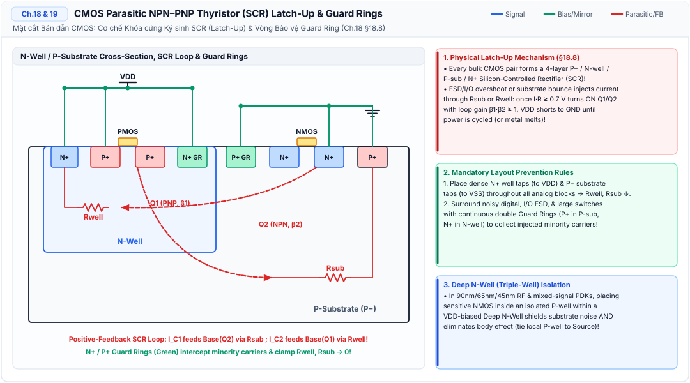

---
{
  "id": "tech-substrate-noise-coupling-and-shielding",
  "kind": "technique",
  "domain": "nonideal-and-physical",
  "title_vi": "Xuyên Nhiễu Đế Bán dẫn & Che chắn Tĩnh điện trong Vi mạch Hỗn hợp: Cơ chế Bơm C_DB, Đế p+ Đẳng thế, Đồng bộ GNDA–Đế và Lồng Deep N-Well (Substrate Coupling & Shielding)",
  "title_en": "Mixed-Signal Substrate Noise Coupling and Crosstalk Shielding: C_DB Injection, Heavily-Doped Equipotential p+ Substrate, Unison GNDA Bounce, and Deep N-Well Isolation",
  "summary": "Giải mã cơ chế truyền nhiễu chuyển mạch số sang mạch tương tự nhạy cảm qua khối đế bán dẫn chung và qua điện dung liên dây: dòng dịch C_DB*dV/dt và điện cảm dây hàn Lb*dI/dt làm rung thế đế Vsub rồi điều chế trực tiếp dòng cực máng tương tự qua hỗ dẫn cổng sau gmb*vsub; nghịch lý tăng khoảng cách vật lý trở nên vô hiệu trên phiến đế p+ pha tạp nặng (0.1 Ohm.cm); nghệ thuật nối tiếp xúc đế vào đất tương tự GNDA để nguồn và thân nảy đồng pha (VSB = 0), kết hợp bọc lồng chắn giếng n sâu (Deep N-Well), vòng bảo vệ nối chân Kelvin riêng và đi dây vi sai kèm lồng chắn đồng trục kim loại.",
  "diagram": "../../diagrams/latchup-and-guard-rings.svg",
  "razavi_refs": [
    {
      "chapter": 18,
      "section": "18.8",
      "pages": "730-731",
      "equations": []
    },
    {
      "chapter": 19,
      "section": "19.2.7, 19.3",
      "pages": "753-755, 760-764",
      "equations": []
    }
  ],
  "glossary_codes": [
    "T022",
    "T053",
    "T084",
    "T129",
    "T130",
    "T131",
    "T132",
    "T134",
    "T965",
    "T1112",
    "T2056",
    "T2087",
    "T2188",
    "T2191",
    "T2195",
    "T2197",
    "T2198"
  ],
  "process_agnostic": true,
  "roles": {
    "digital_aggressor_injection": "Hàng nghìn cổng logic số và bộ đệm xung nhịp phóng xung dòng dịch C_DB*(dV/dt) cùng xung nảy đất dây hàn xuống phiến đế chung tại mỗi sườn xung nhịp.",
    "substrate_propagation_medium": "Lớp nền đế p+ pha tạp nặng (0.05–0.1 Ohm.cm chống Latch-Up) hoạt động như một tấm kim loại đẳng thế truyền nguyên vẹn thế nhiễu đi khắp diện tích chip.",
    "analog_backgate_victim": "Cực thân (bulk) của MOSFET tương tự nhận nhiễu Vsub và biến đổi thẳng thành dòng nhiễu cực máng gmb*Vsub hoàn toàn không thể phân biệt với tín hiệu ngõ vào.",
    "unison_gnda_substrate_tie": "Kết nối tiếp xúc đế cục bộ của vùng tương tự thẳng vào đường đất tương tự nội chip GNDA để cực nguồn và cực thân cùng nhấp nhô đồng pha, triệt tiêu hiệu điện thế VBS.",
    "deep_nwell_and_coaxial_shields": "Lồng giếng n sâu nối VDDA sạch chắn dưới đáy transistor và các đường/mặt phẳng kim loại nối đất chắn hai sườn/trên-dưới thu gom đường sức điện trường xuyên âm."
  },
  "symptoms_addressed": [
    "clock-harmonic-spurs-corrupting-vco-spectrum-and-adc-snr-in-mixed-signal-soc",
    "failure-of-large-spatial-floorplan-separation-to-attenuate-substrate-bounce-on-epi-wafers",
    "severe-common-source-current-modulation-when-substrate-tap-connects-to-noisy-digital-ground",
    "capacitive-clock-crosstalk-onto-high-impedance-analog-summing-or-sampling-nodes"
  ],
  "limitations": [
    "tying-substrate-to-gnda-Still-exposes-single-ended-external-inputs-to-offchip-vs-onchip-ground-bounce",
    "coplanar-and-coaxial-grounded-metal-shields-increase-wire-to-ground-capacitance",
    "deep-nwell-pockets-have-significant-junction-capacitance-requiring-low-impedance-clean-bias"
  ],
  "checklists": [
    "common-mos",
    "layout-and-matching",
    "esd-pad-and-substrate"
  ]
}
---

## 1. Bản chất Nguyên lý, Sơ đồ Mạch & Vai trò Từng Nhánh Cấu trúc

Trong kỷ nguyên hệ thống trên một vi mạch (**`Mixed-Signal SoC` — `T053`**), một bộ thu phát RF nhạy tới mức microvolt, một bộ dao động `LC-VCO` tạp âm pha cực thấp hay một bộ chuyển đổi `14-bit SAR ADC` phải nằm chung trên cùng một mảnh đế bán dẫn chỉ vài milimét vuông với hàng chục triệu cổng logic DSP chuyển mạch ở tốc độ hàng gigahertz (Razavi §19.3, tr. 760–764). Thách thức tàn khốc nhất ở đây là một mâu thuẫn vật lý nội tại ngay từ khâu chọn phiến wafer: để dập tắt thảm họa chốt nguồn `Latch-Up` (§18.8), phần lớn các quy trình CMOS dùng phiến **đế $p^+$ pha tạp rất nặng có điện trở suất cực thấp ($\rho \approx 0.05\text{–}0.1\,\Omega\cdot\text{cm}$)** bên dưới lớp biểu mô mỏng `p-epi`. Thế nhưng, chính khối đế $p^+$ dẫn điện tốt đó lại biến thành một **"tấm bus dẫn nhiễu toàn cục"** nối thông mọi cổng số ồn ào thẳng tới gầm của các transistor tương tự nhạy cảm nhất!



Một bài toán xuyên nhiễu vật lý trên chip luôn cấu thành từ chuỗi 3 mắt xích (**Nguồn phát `Aggressor` $\to$ Môi trường truyền `Channel` $\to$ Nạn nhân thu `Victim`**) trên cả hai tầng không gian (dưới lòng đế bán dẫn và trên tầng dây kim loại):
1. **Cơ chế Bơm Nhiễu xuống Đế (`Substrate Noise Injection` — Hình 19.53a,b):** Mỗi khi cổng đảo số $M_2\text{–}M_3$ chuyển trạng thái theo sườn xung nhịp `CK`, biên độ áp lớn $\Delta V \approx V_{DD}$ tại cực máng bơm dòng dịch điện dung $i_{\text{inj}} = C_{DB2}\frac{dV_{\text{drain}}}{dt}$ xuống đế (cộng thêm dòng xả xuống tiếp xúc đế số đang rung lắc bởi điện cảm dây hàn $L_b\frac{dI}{dt}$!). Khi hàng chục nghìn cổng số đồng loạt lật trạng thái tại đúng cạnh lên xung nhịp, điện thế của đế $V_{\text{sub}}(t)$ bị giật nảy hàng chục đến hàng trăm milivôn!
2. **Cơ chế Thu Nhiễu qua Cổng Sau (`Back-Gate / Body-Effect Pickup` — Hình 19.53c):** Dưới gầm transistor khuếch đại tương tự $M_1$, dao động thế đế $\Delta V_{\text{sub}}(t)$ điều chế trực tiếp điện áp ngưỡng $V_{TH1}$ thông qua hiệu ứng thân (`concept-mos-transconductance-and-body-effect`), sinh ra dòng nhiễu cực máng $\Delta i_{D1} = g_{mb1}\,\Delta v_{BS}(t)$ (với $g_{mb} \approx (0.1\text{–}0.25)\,g_m$!) cộng thêm dòng ghép điện dung $C_{DB1}\frac{dV_{\text{sub}}}{dt}$ chảy thẳng vào nút ngõ ra!
3. **Cơ chế Xuyên âm Điện dung Liên Dây trên Tầng Kim loại (`Interconnect Capacitive Crosstalk` — §19.2.7, Hình 19.40–19.43):** Các đường xung nhịp/dữ liệu biên độ lớn chạy song song hoặc cắt ngang đường tín hiệu tương tự ghép điện tích trực tiếp qua điện dung sườn và điện dung chồng lấp.

---

## 2. Hệ Phương trình Cốt lõi & Tư duy "Nhìn Mạch Đọc Nhanh" (Analysis by Inspection)

### 2.1. Định lượng Nhiễu Cổng Sau & Tại sao "Kéo Xa Khoảng cách" Thất bại trên Đế $p^+$ (§19.3, Hình 19.53–19.54)
Xét tầng khuếch đại nguồn chung $M_1$ có cực nguồn nối đất nội sạch ($V_S = 0$), trong khi cực thân cảm nhận nhiễu đế $v_{\text{sub}}(t)$. Dòng tín hiệu nhỏ tổng cộng của $M_1$ là:

$$i_{D1}(t) = g_{m1} v_{in}(t) + g_{mb1} v_{\text{sub}}(t) \implies v_{n,\text{in,eq}}(t) = \left(\frac{g_{mb1}}{g_{m1}}\right) v_{\text{sub}}(t) = \eta \cdot v_{\text{sub}}(t)$$

Vì tỷ số $\eta = \frac{g_{mb}}{g_m} = \frac{\gamma}{2\sqrt{2\phi_F + V_{SB}}} \approx 0.15\text{–}0.25$, một xung nhiễu đế $v_{\text{sub}} = 100\text{ mV}$ tương đương như **bơm thẳng một xung nhiễu $15\text{–}25\text{ mV}$ vào ngay cực cổng đầu vào bộ khuếch đại**!
- **Sự khác biệt sống còn giữa hai loại phiến đế (`Heavily-Doped Epi` vs `Lightly-Doped Bulk`):**
  - *Trên phiến đế pha tạp nhẹ (`lightly-doped p- substrate`, $\rho \approx 10\text{–}20\,\Omega\cdot\text{cm}$ hay dùng trong quy trình RF CMOS chuyên dụng):* Đế có điện trở khối lớn; tăng khoảng cách vật lý $d$ giữa khối số và khối tương tự kết hợp chèn vành thu `p+ guard ring` ở giữa làm suy hao biên độ nhiễu mạnh theo khoảng cách!
  - *Trên phiến đế $p^+$ pha tạp nặng phủ lớp `p-epi` mỏng ($\rho_{\text{sub}} \approx 0.05\text{–}0.1\,\Omega\cdot\text{cm}$, chuẩn của đa số quy trình số/hỗn hợp):* Dòng nhiễu chui tọt qua lớp `p-epi` mỏng vài micromet xuống lõi $p^+$ bên dưới — nơi có điện trở gần như bằng $0$ đóng vai trò **một nút kim loại đẳng thế toàn chip (`global equipotential node`)**! Lúc này, đẩy khối tương tự ra cách xa khối số $500\,\mu\text{m}$ hay $2000\,\mu\text{m}$ gần như **KHÔNG làm giảm biên độ $v_{\text{sub}}$**, mà chỉ làm dây dẫn tín hiệu dài thêm (như trong lát cắt ADC Hình 19.54)!

### 2.2. Bài toán Nan giải của Razavi: Nối Tiếp xúc Đế vào `GNDA` hay `GNDD`? (Hình 19.56–19.60)
Khi chip chia riêng chân đất tương tự (`GNDA` qua dây hàn $L_A$) và chân đất số (`GNDD` qua dây hàn $L_D$, Hình 19.57):
- Tuyệt đối **không được** nối tiếp xúc đế $p^+$ mạnh vào cả `GNDA` lẫn `GNDD` trên đế điện trở thấp, vì chính tấm đế sẽ làm cầu nối tắt điện trở nhỏ nối chập hai miền đất lại với nhau!
- Nếu nối đế vào `GNDD` ồn ào (Hình 19.58b, 19.59a): cực nguồn của $M_1$ đứng ở `GNDA` êm ả nhưng cực thân $V_{\text{sub}}$ lại nhảy loạn xạ theo xung `GNDD` ($\Delta V_{BS} = V_{\text{GNDD}} - V_{\text{GNDA}}$ hàng trăm mV), đánh thẳng qua $g_{mb1}$ phá nát dòng $I_{D1}$!
- **Quy tắc "Nhấp nhô Đồng pha" (`Bounce in Unison` — Hình 19.58a, 19.59b):** Khi nối tiếp xúc đế cục bộ của vùng tương tự gắn chặt vào chính đường **`GNDA` ngay trên chip**, cả cực nguồn $V_S$ lẫn cực thân $V_B$ của transistor tương tự sẽ cùng nhấp nhô đồng thời một lượng như nhau theo dây hàn $L_A$:

$$V_B(t) \approx V_S(t) = V_{\text{GNDA}}(t) \implies v_{BS}(t) = V_B(t) - V_S(t) \approx 0 \implies g_{mb1} v_{BS}(t) \approx 0!$$

- **Giới hạn còn lại & Chìa khóa Vi sai Toàn phần (Hình 19.60a $\to$ 19.60b):** Cho dù `GNDA` và đế đã nảy đồng pha, một tín hiệu **đơn đầu (`single-ended`)** đi từ ngoài bo mạch (lấy mốc đất `PCB Ground`) vào chip sẽ thấy điện áp cổng–nguồn thực tế bị cộng thêm nhiễu nảy đất $V'_{in} = V_{in,\text{ext}} - V_{\text{GNDA}}(t)$ (Hình 19.60a)! Chỉ khi chuyển toàn bộ đường truyền tín hiệu từ ngoài vào trong sang **vi sai toàn phần (`fully differential` — Hình 19.60b)**, nhiễu nảy của `GNDA` và $V_{\text{sub}}$ mới biến hoàn toàn thành nhiễu chế độ chung (`common-mode` — `T022`) và bị triệt tiêu bởi CMRR của cặp vi sai!

### 2.3. Định lượng Xuyên âm Liên Dây, Dây Giả Cân bằng & Lồng Chắn Kim loại (§19.2.7, Hình 19.40–19.43)
Xét ví dụ định lượng của Razavi (tr. 754, Hình 19.40): một dây xung nhịp `CK` biên độ $\Delta V_{CK} = 1\text{ V}$ đi gần dây ngõ vào tương tự $V_{in}$ (có tổng điện dung nút xuống đất $C_{\text{tot}} = 10\text{ fF}$). Chỉ cần điện dung ghép chéo bé nhỏ tới mức **$C_c = 50\text{ aF}$ ($0.05\text{ fF}$!)**, bước nhảy xung nhịp đã chích vào $V_{in}$ một sai số:

$$\Delta V_{in} = \frac{C_c}{C_{\text{tot}} + C_c}\,\Delta V_{CK} \approx \frac{50\text{ aF}}{10\text{ fF}} \times 1\text{ V} = 5\text{ mV}!$$

Ba lớp phòng tuyến hình học bắt buộc trên mặt bằng:
1. **Đi dây Vi sai Đối xứng + Chèn "Dây Giả" Cân bằng Giao thoa (`Dummy Balancing Wire` — Hình 19.41):** Khi đường `CK` nằm bên cạnh $V_{in}^+$ (tạo tụ $C_2$) và xa $V_{in}^-$, ta cố ý vẽ một đoạn dây giả nối vào `CK` đối xứng phía bên kia của $V_{in}^-$ (tạo tụ $C'_2 = C_2$)! Nhờ đó cả hai nhánh vi sai nhận lượng điện tích nhiễu bằng nhau (ngay cả khi lệch khớp $10\%$, nhiễu vi sai còn lại đã giảm đi $10$ lần!), đồng thời ưu tiên dùng xung nhịp vi sai bù nhau (`CK` và $\overline{\text{CK}}$) để tự triệt điện trường ngay tại nguồn!
2. **Chắn Đồng phẳng Hai Sườn (`Coplanar Ground Shielding` — Hình 19.42a):** Đặt hai sợi dây kim loại nối đất sạch kẹp sát hai bên sườn dây tương tự nhạy cảm để "hút" toàn bộ đường sức điện trường từ dây số bên ngoài kết thúc xuống đất — hiệu quả gấp nhiều lần mà tốn ít diện tích hơn việc chỉ chừa khoảng trống rộng (Hình 19.42b)!
3. **Lồng Chắn Đồng trục Ba Chiều (`3D Coaxial Metal Shield` — Hình 19.43):** Với các đường tham chiếu hoặc đầu vào siêu nhạy trên tầng `Metal 6`, kẹp hai dây đất chắn hai bên ở `Metal 6`, lót tấm chắn đất bên dưới ở `Metal 5` và đậy nắp chắn đất bên trên ở `Metal 7` nối khâu với nhau bằng hàng rào `via` thành một ống đồng trục kín mít $360^\circ$ (đánh đổi bằng việc điện dung của dây xuống đất tăng lên).

---

## 3. Bất biến Cấu trúc & Các Bẫy Lỗi Kinh điển (Structural Invariants & Traps)

- **`[INV-SUB-01]` Bất biến Bọc Lồng Giếng N Sâu (`Deep N-Well`) + Nguồn Sạch cho Mọi NMOS Nhạy Đế:**
  Trong các khối `LC-VCO` (`topo-quadrature-vco-and-varactor-tuning`), công tắc lấy mẫu đầu vào `ADC` (`topo-bootstrapped-sampling-switch`), bộ khuếch đại đầu vào `LNA/OTA`, luôn đặt transistor NMOS vào trong giếng `Deep N-Well` (`T132`) để ngắt hoàn toàn sự tiếp xúc điện học giữa cực thân `Isolated P-well` với phiến đế chung! Khi đó, lớp `DNW` nối vào `VDDA` (hoặc ngõ ra bộ ổn áp nội `LDO`) đóng vai trò màn chắn Faraday tiếp giáp ngược dưới đáy, còn `Isolated P-well` nối thẳng vào cực nguồn tương tự nội bộ.
- **`[INV-SUB-02]` Bất biến Tách Chân Đất Riêng cho Vòng Bảo vệ Thu Nhiễu (`Dedicated Kelvin Guard-Ring Pin`):**
  Vòng tiếp xúc $p^+$ bao quanh khối số (`noisy aggressor guard ring`) dùng để hút dòng nhiễu đế **bắt buộc phải nối về đường đất số `GNDD` (hoặc một chân pad đất bảo vệ `GND_SUB/RING` riêng biệt)**; tuyệt đối **KHÔNG** đấu vòng thu nhiễu ở biên ngoài vào cùng thanh kim loại `GNDA` đang cấp cho cực nguồn cặp vi sai nội bộ!
- **`[TRAP-SUB-01]` Bẫy Cộng hưởng Ký sinh của Đảo `Deep N-Well` Khi Quên Khâu Tiếp xúc Trở kháng Thấp:**
  Đảo `Deep N-Well` diện tích lớn có điện dung tiếp giáp với cả đế ngoài lẫn giếng p trong lên tới vài picofarad và điện trở tấm ngang khá lớn ($\sim 500\text{–}1000\,\Omega/\square$). Nếu chỉ chấm lèo tèo vài lỗ tiếp xúc vào `DNW` hoặc nối `DNW` vào một nguồn áp trở kháng cao, nhiễu tần số cao từ đế $p$ sẽ xuyên thẳng qua tụ tiếp giáp làm cả đảo `DNW` rung lắc rồi ghép tiếp vào `Isolated P-well`! Phải khâu vòng tiếp xúc `N-well + n+` khép kín $360^\circ$ quanh chu vi `DNW` nối trở kháng cực thấp về nguồn sạch có tụ lọc `decap` tại chỗ!
- **`[TRAP-SUB-02]` Bẫy "Tấm Chắn Kim loại Lơ lửng (`Floating Shield`)" Làm Xuyên Âm Tệ Hơn Khi Chưa Chắn!**
  Nếu vẽ hai dây kim loại chắn hai bên hoặc tấm chắn dưới gầm đường tương tự nhưng quên nối đất (hoặc nối qua một sợi dây đất mảnh dài có cảm kháng/điện trở lớn), tấm kim loại đó biến thành một **bản cực tụ trung gian nổi** thu gom nhiễu diện tích rộng từ các đường số rồi phát xạ lại toàn bộ sang dây tương tự nằm sát nó!
- **`[TRAP-SUB-03]` Bẫy Dùng Tấm Chắn Đặc Không Xẻ Rãnh Dưới Cuộn cảm Xoắn ốc VCO:**
  Trong khi dây tín hiệu cần tấm chắn đất liền mạch (Hình 19.43), nếu đặt tấm kim loại đặc dưới đáy cuộn cảm VCO để chắn đế, từ trường biến thiên sẽ cảm ứng dòng điện xoáy khép kín (`eddy current`) triệt tiêu từ thông và giết chết hệ số phẩm chất $Q$! Dưới cuộn cảm bắt buộc phải dùng **màn chắn đất xẻ rãnh hình nan quạt cắt đứt đường khép vòng dòng xoáy (`patterned ground shield — PGS`)**!

---

## 4. Lộ trình Nâng cấp Cấu trúc & Bát giác Đánh đổi (Upgrade Paths & Design Octagon)

Trong **Bát giác Thiết kế (`concept-analog-design-octagon`)**, chống xuyên nhiễu đế và xuyên âm dây là sự đầu tư có chủ đích về **Diện tích Vành Đai Cách ly, Tầng Kim loại và Kiến trúc Vi sai** để bảo vệ **Dải Động Không Nhiễu Giả (`SFDR / Spurious-Free Dynamic Range`)** ở cấp hệ thống:
- **Nền tảng cấu trúc:** Phát triển trực tiếp trên mặt cắt giếng `concept-cmos-fabrication-wells-and-process-steps`, định luật phòng chống SCR `law-cmos-wells-and-latchup-guard-rings`, và hoàn thiện khép kín với mô hình vỏ gói tại `tech-esd-protection-padring-and-package-parasitics`.
- **Chiến lược Kiến trúc Mạch:** Ưu tiên số 1 luôn là cấu trúc vi sai đối xứng (`topo-folded-cascode-ota`, `topo-switched-capacitor-integrator-parasitic-insensitive`) có CMFB tốt và cấp nguồn riêng từ `topo-cmos-ldo-regulator` nội chip để tách khỏi nguồn I/O số.

| Cấp độ Cách ly Nhiễu Đế | Cấu trúc Thực thi trên Mặt bằng | Độ Suy hao Nhiễu Đế Điển hình ($100\text{ MHz}$) | Phạm vi Áp dụng Khuyến nghị |
| :--- | :--- | :--- | :--- |
| **Mức 1: Tiếp xúc Đế Đồng pha** | Nối tap $p^+$ tương tự vào `GNDA` nội chip + dùng cấu trúc mạch vi sai | Khử hiệu ứng $g_{mb}$ bậc nhất; còn nhạy lệch đối xứng | Khối tương tự tần số thấp/trung bình trên quy trình chuẩn không có `DNW` |
| **Mức 2: Vòng Bảo vệ Kép (`Double Guard Ring`)** | Vòng $p^+$ nối đất riêng bao khối số + tường `N-well` sâu nối $V_{DD}$ + vòng $p^+$ quanh khối analog | $15\text{–}30\text{ dB}$ (rất mạnh trên đế $p^-$, trung bình trên đế $p^+$) | Ranh giới bắt buộc giữa vùng logic/I/O và vùng Bandgap/Op-Amp |
| **Mức 3: Lồng `Deep N-Well` + Vi sai Chắn Đồng trục** | Bọc toàn bộ khối analog trong `Triple-Well` nối `VDDA_LDO` + bọc lồng đất `M_k` cho dây nhạy | **$40\text{–}65\text{ dB}$ ngay cả trên phiến đế $p^+$!** | **Tiêu chuẩn bắt buộc** cho `LC-VCO`, `PLL`, `LNA`, `12–16 bit ADC` trong SoC |

---

## 5. Thích ứng Đa Tiến trình (90nm / 65nm / 45nm) & Cách Kiểm chứng trong Cadence / Spectre

### 5.1. Đặc thù Xuyên Nhiễu ở Các Nút Công nghệ `90nm / 65nm / 45nm`
1. **Tốc độ sườn chuyển mạch cực gắt ($\Delta t_{\text{edge}} \approx 10\text{–}25\text{ ps}$) ở `65nm/45nm`:**
   Dù điện áp nguồn số giảm từ $1.8\text{ V}$ xuống $1.0\text{ V}$, thời gian lật trạng thái của cổng logic `45nm` nhanh gấp $5\text{–}10$ lần công nghệ cũ nên đạo hàm $dV/dt$ và $dI/dt$ tăng vọt, đẩy phổ nhiễu đế trải rộng từ vài trăm MHz lên tới nhiều GHz — rơi thẳng vào dải tần của VCO và dải Nyquist của ADC tốc độ cao!
2. **Tùy chọn Vùng Cấy Đế Điện trở Cao (`BFMOAT / Native Substrate Block`) trong RF PDK `65nm/45nm`:**
   Nhiều foundry `65nm/45nm` cung cấp lớp mặt nạ chặn cấy giếng $p$ nền (`sub-block / native layer`) tạo vùng đảo điện trở suất cao cục bộ dưới cuộn cảm và khối RF để giảm tổn hao đế và giảm ghép nhiễu ngang.

### 5.2. Phác đồ Mô phỏng Đồng thời Nhiễu Đế + Dây Hàn và Kiểm tra `PEX CC` trong Cadence
Sai lầm kinh điển nhất là nối tất cả chân `gnd!` toàn cục lý tưởng trong testbench Spectre — làm biến mất $100\%$ hiện tượng xuyên nhiễu đế trên mô phỏng! Để nhìn thấy sự thật trước khi đúc chip:
1. **Không bao giờ dùng net toàn cục `0 / gnd!` trực tiếp trên chân Bulk của sơ đồ con:** Đưa chân `VSUB`, `VDDA`, `GNDA`, `VDDD`, `GNDD` ra thành các chân tường minh (`explicit pins`) trên biểu tượng khối để ở testbench cấp cao nhất gắn mạng điện trở đế tương đương và cuộn cảm dây hàn $L_A, L_D$.
2. **Kiểm tra đối xứng tụ ghép chéo `CC` sau `PEX`:** Dùng công cụ lọc tụ ký sinh trong `Quantus QRC / CalibreDRV` kiểm tra mọi tụ ghép $C_c > 0.2\text{ fF}$ từ các mạng xung nhịp sang hai dây vi sai $V_{in}^+, V_{in}^-$ phải khớp nhau trong phạm vi $< 5\%$ (hoặc bằng $0$ nhờ dây đất chắn)!

```spice
// Spectre Mixed-Signal Substrate & Ground-Bounce Audit Testbench
simulator lang=spectre

// 1. Tach biet dat PCB (0) voi dat noi chip GNDA, GNDD qua dien cam day han L_A, L_D:
L_bond_gnda (gnda_int 0) inductor l=3n r=0.15
L_bond_gndd (gndd_int 0) inductor l=4n r=0.20

// 2. Mang dien tro luoi De ban dan p+ don gian hoa giua vung Digital va vung Analog:
R_sub_dig   (gndd_int vsub_dig)  resistor r=5
R_sub_tie   (vsub_dig vsub_ana)  resistor r=15
R_sub_ana   (vsub_ana gnda_int)  resistor r=5

// 3. Nguon gay nhieu Chuyen mach So (mo phong 500 cong logic lat canh tai f_clk = 200 MHz):
I_dig_aggr  (vddd_int gndd_int) isource type=pulse val0=0 val1=80m period=5n rise=40p fall=40p width=200p
C_db_aggr   (gndd_int vsub_dig) capacitor c=5p

// Quan sat do suy hao spur tai f_clk = 200 MHz tren ngo ra vi sai V(outp, outn) cua khoi Analog
// khi dung NMOS thuong (bulk = vsub_ana) so voi khi boc trong Deep N-Well (dnw = vdda_clean, ipw = gnda_int)!
```

---

## 6. Mốc Đối chiếu Sách Razavi & Thuật ngữ Chuẩn CLB

| Mục Sách Razavi (2nd Ed.) | Trang & Hình vẽ | Nội dung Đối chiếu Trọng tâm | Mã Thuật ngữ Chuẩn CLB |
| :--- | :--- | :--- | :--- |
| **§19.2.7 Capacitive Shielding** | Tr. 753–755, Fig. `19.40–19.43` | Ví dụ định lượng $50\text{ aF}$ gây nhiễu $5\text{ mV}$, khử xuyên âm bằng truyền vi sai + dây giả cân bằng (`dummy line`) và chắn đồng phẳng / đồng trục 3 tầng kim loại | `T022` (chế độ chung), `T965` (tác dụng che chắn), `T2087` (xuyên nhiễu), `T2195` (phần tử giả) |
| **§19.3 Substrate Coupling** | Tr. 760–762, Fig. `19.53–19.55` | Bơm nhiễu qua $C_{DB2}$ và $L_b$, điều chế ngưỡng $M_1$ qua hiệu ứng thân $g_{mb}$, tính đẳng thế của đế $p^+$ $0.1\,\Omega\cdot\text{cm}$ và cấu trúc vòng bảo vệ `Guard Ring` | `T053` (hệ thống tín hiệu hỗn hợp), `T084` / `T1112` (đế bán dẫn), `T2056` (đế bán dẫn loại p), `T2191` (vòng bảo vệ) |
| **§19.3 Ground Bounce & Unison Tie** | Tr. 762–764, Fig. `19.56–19.60` | Lựa chọn nối tiếp xúc đế vào `GNDA` thay vì `GNDD` để cực nguồn và thân nảy đồng pha, hạn chế với ngõ vào đơn đầu và ưu thế vượt trội của ngõ vào vi sai | `T132` (giếng n sâu), `T134` (kết nối đế), `T2188` (quy trình giếng N sâu), `T2197` (đấu Kelvin & đi đất hình sao), `T2198` (điện cảm dây hàn & nảy đất) |
