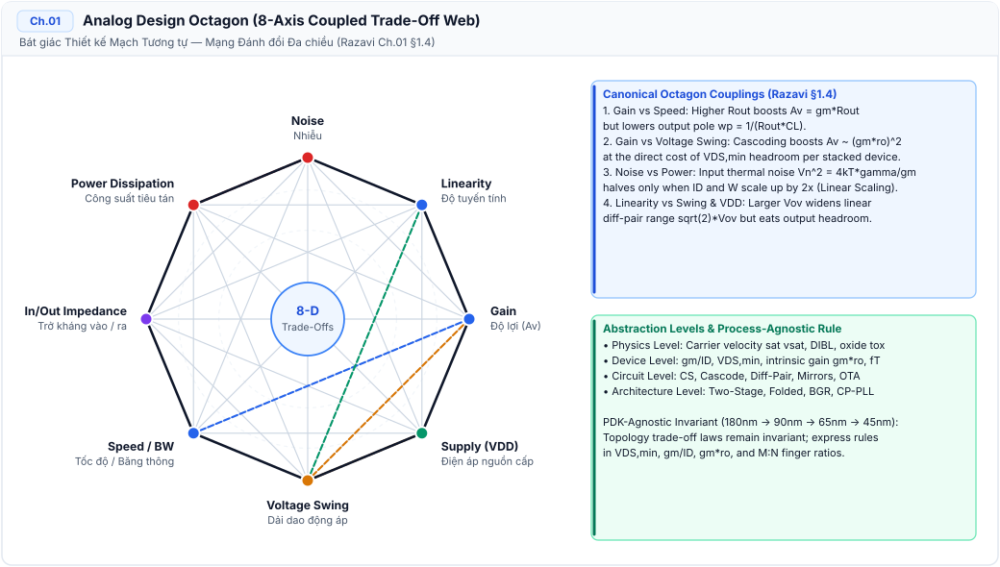

---
{
  "id": "concept-opamp-performance-contract",
  "kind": "concept",
  "domain": "opamps-and-compensation",
  "title_vi": "Hợp đồng Chỉ tiêu Hiệu năng Bộ Khuếch đại Thuật toán & Ma trận Xung đột Đặc tả (Op-Amp Performance Contract & Spec-Conflict Matrix)",
  "title_en": "Operational Amplifier Performance Contract, OTA vs. Op-Amp Distinction, and Specification-Conflict Matrix",
  "summary": "Dịch toàn bộ bảng đặc tả hệ thống (sai số tĩnh, thời gian xác lập X%, biên độ ra, ICMR, tốc độ biến thiên điện áp SR, nhiễu/độ lệch, PSRR) thành các ràng buộc toán học tường minh lên độ lợi vòng hở A0, băng thông tín hiệu nhỏ GBW và dòng tĩnh ISS trước khi chọn cấu trúc Op-Amp.",
  "diagram": "../../diagrams/analog-design-octagon.svg",
  "razavi_refs": [
    {
      "chapter": 9,
      "section": "9.1",
      "pages": "344-349",
      "equations": ["9.1", "9.2", "9.3", "9.8", "9.9", "9.10", "9.11", "9.14"]
    },
    {
      "chapter": 11,
      "section": "11.6.1",
      "pages": "495-500",
      "equations": ["11.16", "11.17", "11.20", "11.21"]
    }
  ],
  "glossary_codes": ["T060", "T066", "T067", "T079", "T090", "T094", "T095", "T756", "T1408", "T1413", "T1415", "T1416", "T1431", "T1437"],
  "process_agnostic": true,
  "roles": {
    "open_loop_dc_gain_a0": "Quyết định độ chính xác xác lập tĩnh (static gain accuracy 1/(1 + beta*A0)) và mức nén méo phi tuyến vòng kín",
    "small_signal_gbw": "Quyết định hằng số thời gian xác lập tuyến tính tau = 1/(beta*omega_u) cho phần tinh chỉnh cuối của đáp ứng bước nhảy",
    "large_signal_slew_rate": "Quyết định tốc độ nạp xả cực đại dVout/dt = Imax/CL trong giai đoạn đầu khi bước nhảy lớn làm khóa hẳn một nhánh vi sai",
    "icmr_and_output_swing_window": "Quyết định số tầng transistor tối đa được phép xếp chồng giữa VDD và đất ngay từ bước chọn họ mạch"
  },
  "symptoms_addressed": [
    "under-designed-dc-gain-failing-adc-enob-accuracy",
    "fast-ac-bandwidth-but-slow-transient-step-settling",
    "hidden-cin-attenuation-in-capacitive-feedback-factor-beta",
    "confusing-on-chip-ota-with-off-chip-resistive-load-opamp"
  ],
  "limitations": [
    "single-topology-cannot-maximize-gain-swing-speed-and-low-noise-simultaneously",
    "capacitive-feedback-cin-degrades-beta-as-input-pair-width-is-increased"
  ],
  "checklists": ["common-mos", "feedback-and-stb"]
}
---

## 1. Bản chất Nguyên lý, Sơ đồ Mạch & Vai trò Từng Nhánh Cấu trúc

Khi bắt tay thiết kế một **bộ khuếch đại thuật toán (`T060`, operational amplifier — op amp)** nằm bên trong hệ thống lớn (như bộ chuyển đổi tương tự–số ADC đường ống, bộ lọc tụ chuyển mạch, mạch tham chiếu vùng cấm BGR hay bộ ổn áp LDO), sai lầm phổ biến nhất là nhảy ngay vào chỉnh kích thước $W/L$ trước khi dịch yêu cầu hệ thống thành một **"Hợp đồng Chỉ tiêu Toán học" (Performance Contract)** không mâu thuẫn nội tại (Razavi Chương 9, §9.1 & Chương 11, §11.6.1).

Trước hết, cần nắm vững sự phân biệt cốt lõi trên vi mạch tích hợp CMOS (Chú thích chân trang 1, tr. 345, `T756`):
1. **Op-Amp cổ điển lái tải điện trở vs. OTA trên chip (Operational Transconductance Amplifier):** Op-Amp đa dụng đóng gói rời phải lái tải điện trở nhỏ (ví dụ $R_L = 500\,\Omega\text{–}2\text{ k}\Omega$), nên bắt buộc gắn tầng đệm ngõ ra trở kháng thấp. Ngược lại, **90% Op-Amp bên trong chip CMOS hỗn hợp tín hiệu chỉ lái tải thuần điện dung $C_L$** (cực cổng MOSFET hoặc mảng tụ lấy mẫu vài trăm $\text{fF}$ đến vài $\text{pF}$)! Do đó chúng có trở kháng ngõ ra vòng hở rất cao ($R_{out}$ hàng trăm $\text{k}\Omega$ đến hàng chục $\text{M}\Omega$) — thực chất về mặt vật lý là các **OTA (`T756`)**, nhưng khi đóng vòng hồi tiếp điện áp âm, trở kháng ra vòng kín vẫn giảm xuống $\frac{R_{out}}{1 + \beta A_0}$ và hành xử như Op-Amp điện áp đích thực!
2. **Tám trục chỉ tiêu khóa chéo nhau trên Bát giác Thiết kế (`concept-analog-design-octagon`):**
   - **Độ lợi một chiều vòng hở ($A_0$):** Bị ép từ độ phân giải bit (ví dụ ADC 12-bit cần sai số tĩnh $< 2^{-12} \approx 0{,}024\%$).
   - **Băng thông tín hiệu nhỏ ($\text{GBW}$ / $\omega_u$) & Thời gian xác lập (`T1413`, settling time $t_s$):** Bị ép từ tần số lấy mẫu xung nhịp $f_s$ (ví dụ phải xác lập xong trong nửa chu kỳ xung nhịp $\frac{1}{2 f_s}$!).
   - **Tốc độ biến thiên điện áp cực đại (`T079`, Slew Rate — SR):** Giới hạn phi tuyến tín hiệu lớn tách rời khỏi $\text{GBW}$!
   - **Dải điện áp chế độ chung ngõ vào (`T1437`, ICMR) & Biên độ dao động ngõ ra (`T095`, Output Swing):** Bị bóp nghẹt bởi điện áp nguồn cấp $V_{DD}$ thấp ($1{,}2\text{ V} \to 0{,}9\text{ V}$).
   - **Độ tuyến tính, Nhiễu & Độ lệch (`T1431`, Noise & Offset), Tỉ số khử nhiễu nguồn cấp (`T1577`, PSRR) và Công suất tiêu tán (`T066`, Power Dissipation).**

---

## 2. Hệ Phương trình Cốt lõi & Tư duy "Nhìn Mạch Đọc Nhanh" (Analysis by Inspection)

### 2.1. Từ Sai số Độ lợi Tĩnh ($\epsilon_{\text{static}}$) $\implies$ Độ lợi Vòng Hở Tối thiểu $A_{0,\min}$ (§9.1.1 & §11.6.1)
Xét mạch khuếch đại đóng vòng hồi tiếp âm (dùng điện trở $R_1, R_2$ hoặc tụ điện $C_1, C_2$ kèm tụ ngõ vào Op-Amp $C_{in}$!). Hệ số hồi tiếp thực tế $\beta$ là (Phương trình 9.2, 11.17):

$$
\beta_{\text{res}} = \frac{R_1}{R_1 + R_2}, \qquad \beta_{\text{cap}} = \frac{C_2}{C_1 + C_2 + C_{in}} \quad \left(\text{với độ lợi danh định } A_{\text{cl,ideal}} = \frac{C_1}{C_2} \text{ hoặc } 1 + \frac{C_1}{C_2}\right)
$$

Hàm truyền vòng kín có sai số tỉ đối tĩnh $\epsilon_{\text{static}}$ so với giá trị lý tưởng (Phương trình 9.3, 11.16):

$$
A_{\text{closed}} = A_{\text{cl,ideal}} \cdot \frac{1}{1 + \dfrac{1}{\beta A_0}} \approx A_{\text{cl,ideal}} \left(1 - \frac{1}{\beta A_0}\right) \implies A_{0,\min} \ge \frac{1}{\beta \cdot \epsilon_{\text{static}}}
$$

**Bảng quy đổi nhanh thực chiến (với $\beta = 0{,}2 \iff$ khuếch đại $\approx 4\text{–}5\times$):**
- Sai số xác lập tĩnh $\epsilon_{\text{static}} \le 1\%$ $\implies \beta A_0 \ge 100 \implies A_0 \ge 500\text{ V/V}$ ($54\text{ dB}$).
- Sai số xác lập tĩnh $\epsilon_{\text{static}} \le 0{,}1\%$ ($\sim 10\text{-bit}$) $\implies \beta A_0 \ge 1000 \implies A_0 \ge 5000\text{ V/V}$ ($74\text{ dB}$).
- Sai số $\le 0{,}01\%$ ($\sim 13\text{–}14\text{-bit}$) $\implies \beta A_0 \ge 10^4 \implies A_0 \ge 50\,000\text{ V/V}$ ($94\text{ dB}$).

### 2.2. Từ Thời gian Xác lập Tuyến tính ($t_s$ tới độ chính xác $\epsilon_{\text{dyn}}$) $\implies$ Băng thông $\text{GBW}_{\min}$ (Phương trình 9.8–9.11)
Với Op-Amp một cực trội $A(s) = \dfrac{A_0}{1 + s/\omega_0}$ có tần số độ lợi đơn vị $\omega_u = A_0 \omega_0 = 2\pi\,\text{GBW}$, cực vòng kín nằm tại $\omega_{-3\text{dB,cl}} = (1 + \beta A_0)\omega_0 \approx \beta \omega_u$, cho hằng số thời gian vòng kín:

$$
\tau_{\text{cl}} = \frac{1}{(1 + \beta A_0)\omega_0} \approx \frac{1}{\beta \, \omega_u} = \frac{1}{2\pi \beta \, \text{GBW}}
$$

Đáp ứng bước nhảy tuyến tính $V_{out}(t) = V_{\text{final}}\left(1 - e^{-t/\tau_{\text{cl}}}\right) u(t)$ lọt vào dải sai số động $\epsilon_{\text{dyn}}$ (lưu ý tổng ngân sách sai số phải chia cho cả tĩnh lẫn động: $\epsilon_{\text{static}} + \epsilon_{\text{dyn}} \le \epsilon_{\text{total}}$!) sau khoảng thời gian:

$$
e^{-t_s / \tau_{\text{cl}}} \le \epsilon_{\text{dyn}} \implies t_s \ge \tau_{\text{cl}} \ln\left(\frac{1}{\epsilon_{\text{dyn}}}\right) \implies \text{GBW}_{\min} \ge \frac{\ln(1 / \epsilon_{\text{dyn}})}{2\pi \beta \, t_s}
$$

*Các mốc hệ số nhân $\ln(1/\epsilon_{\text{dyn}})$ nằm lòng:*
- Xác lập $1\%$ (`T1415`, $\epsilon_{\text{dyn}} = 10^{-2}$): $t_{1\%} = 4{,}61\,\tau_{\text{cl}}$ (Ví dụ Razavi tr. 347: $t_{1\%} = 5\text{ ns} \implies \tau_{\text{cl}} \approx 1{,}09\text{ ns}$!).
- Xác lập $0{,}1\%$ ($\epsilon_{\text{dyn}} = 10^{-3}$): $t_{0{,}1\%} = 6{,}91\,\tau_{\text{cl}}$.
- Xác lập $0{,}01\%$ ($\epsilon_{\text{dyn}} = 10^{-4}$): $t_{0{,}01\%} = 9{,}21\,\tau_{\text{cl}}$.

### 2.3. Kết hợp Slew Rate Tín hiệu Lớn + Xác lập Tuyến tính $\implies$ Dòng Đuôi $I_{SS,\min}$
Khi bước nhảy ngõ ra có biên độ lớn $\Delta V_{\text{out,max}}$, thời gian xác lập tổng gồm hai pha nối tiếp: pha nạp dòng tối đa $t_{\text{slew}} \approx \dfrac{\Delta V_{\text{out,max}} - V_{\text{lin}}}{\text{SR}}$ và pha bám mũ tuyến tính $t_{\text{lin}}$:

$$
t_{\text{total}} = t_{\text{slew}} + t_{\text{lin}} \le t_{s,\text{spec}}, \qquad \text{SR} = \left.\frac{dV_{\text{out}}}{dt}\right|_{\max} = \frac{I_{\text{max}}}{C_{\text{tot}}} \ge 2\pi f_{\max} V_{\text{peak}} \quad (\text{để không méo tam giác sóng sin!})
$$

---

## 3. Bất biến Cấu trúc & Các Bẫy Lỗi Kinh điển (Structural Invariants & Traps)

- **[INV-SPEC-01] Bất biến Khóa Trần Tự Tải $C_{in}$ trong Hồi tiếp Điện dung (§11.6.1 & §11.6.3):** Nhìn vào $\beta_{\text{cap}} = \dfrac{C_2}{C_1 + C_2 + C_{in}}$: nếu người thiết kế cố tăng mãi chiều rộng $W_{1,2}$ của cặp vi sai đầu vào để tăng $g_{m1}$ (nhằm lấy thêm $A_0$ và $\text{GBW}$), điện dung cổng $C_{in} = C_{GS1} + C_{GD1,\text{Miller}}$ sẽ phình to ngang ngửa $C_1 + C_2$, **kéo sập hệ số hồi tiếp $\beta_{\text{cap}}$** và đồng thời nhân nhiễu đầu vào Op-Amp lên $\frac{1}{\beta_{\text{cap}}} = 1 + \frac{C_1 + C_{in}}{C_2}$ lần! Tối ưu toàn cục thường đạt cực trị khi $C_{in} \approx \frac{1}{5}\text{–}\frac{1}{3}(C_1 + C_2)$.
- **[TRAP-SPEC-01] Tính $A_0$ Tại $V_{\text{out}} = 0\text{ V}_{\text{diff}}$ Rồi Tưởng Đạt Sai Số Tĩnh Trên Toàn Dải Swing (§11.5.2, Hình 11.40c):** Độ lợi vòng hở $A_0$ chỉ đạt đỉnh tại điểm cân bằng giữa dải, nhưng khi $V_{\text{out}}$ tiến gần hai biên của dải dao động yêu cầu (ví dụ $\pm 0{,}5\text{ V}_{\text{diff}}$), $V_{DS}$ của transistor tầng ra giảm nhỏ làm hiệu ứng DIBL kéo sập $r_O$ và làm $A_v(V_{\text{out}})$ rớt mất $50\%\text{–}80\%$! **Luật bắt buộc:** Chỉ tiêu $A_0 \ge A_{0,\min}$ phải được thỏa mãn **tại cả hai rìa cực trị của dải biên độ ngõ ra $\pm V_{\text{swing,max}}$**, không phải chỉ ở tâm $0\text{ V}$!
- **[TRAP-SPEC-02] Quên Cộng Dồn Điện dung Tải Hiệu dụng $C_{L,\text{eff}}$ Khi Đóng Vòng Điện dung (Ví dụ 9.22 Hình 9.73a & §11.6.1 Hình 11.50):** Trong mạch khuếch đại tụ điện (theo quy ước ký hiệu của §11.6.1 Hình 11.50 và §2.2 ở trên: $C_1$ nối vào nút trừ, $C_2$ nối hồi tiếp từ $V_{\text{out}}$ về nút trừ cho $\beta_{\text{cap}} = \frac{C_2}{C_1 + C_2 + C_{in}}$, ngoài ra có tải $C_L$ nối đất ở $V_{\text{out}}$; lưu ý Hình 9.73a đặt tên ngược lại $C_1$ là tụ hồi tiếp và $C_2$ là tụ nối đất), tổng tải điện dung mà Op-Amp thực sự phải gánh (cho cả $\text{GBW}$ lẫn $\text{SR}$!) không phải chỉ $C_L$, mà là:

$$
C_{L,\text{eff}} = C_L + \frac{C_2 (C_1 + C_{in})}{C_1 + C_2 + C_{in}} = C_L + (1 - \beta_{\text{cap}}) C_2
$$

Quên số hạng $(1 - \beta_{\text{cap}}) C_2$ sẽ làm thiếu hụt cả dòng Slew Rate lẫn dự trữ pha!
- **[TRAP-SPEC-03] Xung đột Trực diện giữa Dải ICMR và Dải Ngõ ra khi Đóng Hồi tiếp Độ lợi Đơn vị ($V_{\text{out}}$ nối thẳng $V_{in-}$):** Trong bộ đệm độ lợi đơn vị ($\beta = 1$), điện áp ngõ vào và ngõ ra **trùng làm một** trên toàn bộ biên độ tín hiệu! Một cấu trúc có ICMR nằm cao gần $V_{DD}$ nhưng dải ngõ ra lại nằm thấp gần đất (hoặc bị khóa bởi chênh áp $|V_{DS}| < V_{TH}$ như Telescopic Cascode!) sẽ rơi vào vùng triode ngay khi tín hiệu quét lớn!

---

## 4. Lộ trình Nâng cấp Cấu trúc & Bát giác Đánh đổi (Upgrade Paths & Design Octagon)

Từ bảng hợp đồng đặc tả vừa tính, sử dụng cây quyết định chọn họ mạch (Decision Tree) chuẩn Razavi:

| Yêu cầu hợp đồng đặc tả nổi trội | Họ cấu trúc Op-Amp được chọn (Canonical Node) | Ưu thế quyết định | Điểm yếu phải kiểm soát |
|---|---|---|---|
| Tốc độ cực cao, nhiễu thấp nhất, tiêu thụ dòng thấp nhất, $A_0$ trung bình–khá, dải swing vừa phải và ICMR cố định (vd mạch SC có đặt lại mức DC vào/ra riêng!) | `topo-telescopic-cascode-opamp` | Chỉ 2 nhánh dòng chính, ít transistor sinh nhiễu nhất, cực phụ rất cao (nhất là bản toàn NMOS hoặc cascode NMOS) | Swing hẹp ($V_{DD} - 5 V_{DS,\min}$), gần như không nối tắt trực tiếp vào–ra làm unity buffer dải rộng được |
| Cần nối tắt vào–ra ($V_{\text{in}} = V_{\text{out}}$), ICMR rộng chạm tới một đường nguồn ($V_{DD}$ hoặc GND), tốc độ 1 tầng cao, tự bù bởi $C_L$ | `topo-folded-cascode-ota` | Giải phóng hoàn toàn khóa chéo giữa ICMR và dải ra, ổn định tốt hơn khi tăng $C_L$ | Tốn gấp ~2 lần dòng, $A_0$ thấp hơn Telescopic ~2–3 lần, nhiễu nhiệt cao hơn do nguồn dòng gập |
| $V_{DD}$ thấp ($\le 1{,}0\text{ V}$) nhưng bắt buộc biên độ ra cực rộng sát hai nguồn ($V_{DD} - 2 V_{DS,\min}$) KÈM độ lợi $A_0$ cao | `topo-two-stage-opamp` | Tách bạch hoàn toàn Tầng 1 lấy $A_0$ cao + nhiễu thấp và Tầng 2 CS lấy Swing cực đại | Chứa 2 cực trở kháng cao, bắt buộc bù Miller (`tech-miller-pole-splitting`) và bị sụt PM khi tăng $C_L$! |
| Cần độ lợi cực đại cỡ 2–3 tầng ($80\text{–}100\text{ dB}$ cho ADC 14-bit+) nhưng đòi hỏi tốc độ xác lập nhanh như Op-Amp 1 tầng | `topo-gain-boosted-cascode` | Nhân $R_{out}$ lên $(1 + A_{\text{aux}})$ lần giữ nguyên đặc tính 1 tầng trên đường tín hiệu chính | Tốn diện tích/công suất cho 2 Op-Amp phụ và phải khóa vị trí doublet $\omega_{b1} < \omega_{u,\text{aux}} < \omega_{p2,\text{main}}$ |

---

## 5. Thích ứng Đa Tiến trình (90nm / 65nm / 45nm) & Cách Kiểm chứng trong Cadence / Spectre

### 5.1. Thích ứng Công nghệ Nanomet (90nm $\to$ 65nm $\to$ 45nm)
- **Ngân sách Dự trữ Điện áp ($V_{DD}$ Budget Allocation) với $V_{DS,\min}$ Thực tế:** Khi $V_{DD}$ giảm từ $1{,}8\text{ V}$ (180nm) $\to 1{,}2\text{ V}$ (90nm) $\to 1{,}0\text{ V}$ (65nm/45nm), điện áp bão hòa tối thiểu $V_{DS,\min}$ để giữ $g_m r_O$ không sụp đổ do DIBL vẫn cần ít nhất **$120\text{–}180\text{ mV}$ mỗi transistor** (`tech-nanometer-vdsmin-gmid-sizing`). Do đó:
  - 5 transistor chồng nhau (Telescopic) mất $5 \times 0{,}15\text{ V} = 0{,}75\text{ V}$, chỉ còn $0{,}25\text{ V}$ biên độ đơn đầu ($0{,}5\text{ V}_{pp,\text{diff}}$) ở nguồn $1{,}0\text{ V}$!
  - Nếu đặc tả yêu cầu $1{,}0\text{ V}_{pp,\text{diff}}$ hoặc $1{,}4\text{ V}_{pp,\text{diff}}$ trên nguồn $1{,}0\text{ V}$, phép kiểm toán khoảng dự trữ điện áp lập tức loại bỏ mọi cấu trúc 1 tầng cascode ở ngõ ra và chỉ thẳng tới **`topo-two-stage-opamp`** ngay từ dòng tính đầu tiên (như chính Nghiên cứu Thiết kế §11.5 của Razavi chứng minh!).

### 5.2. Quy trình Kiểm chứng Bộ Đặc tả Tổng thể trong Cadence / Spectre
Thiết lập 4 testbench tiêu chuẩn không phụ thuộc tiến trình để nghiệm thu mọi Op-Amp trên cả 5 góc công nghệ (`TT, FF, SS, FS, SF`) và 3 mức nhiệt độ (`-40°C, 27°C, 125°C`):
1. **TB1 — Open-Loop / Closed-Loop DC Sweep:** Đóng vòng hồi tiếp (hoặc dùng vòng servo DC / balun lý tưởng cho vi sai hoàn toàn) quét ngõ ra phủ hết $\pm V_{\text{swing,spec}}$, lấy đạo hàm kiểm tra $A_v(V_{\text{out}}) \ge A_{0,\min}$ tại mọi điểm trong dải swing và mọi điểm $V_{in,CM} \in \text{ICMR}$.
2. **TB2 — Stability (`stb` DM & CM):** Chạy `stb` với `iprobe` / `diffstbprobe` mang đúng tải thực $C_{L,\text{eff}}$ và mạng $\beta$, kiểm tra $\text{PM} \ge 60^\circ$, $\text{GM} \ge 10\text{ dB}$, $f_{GX}$ đạt chỉ tiêu.
3. **TB3 — Step Settling (`tran` Small & Large Step):** Bơm bước nhảy nhỏ ($10\text{ mV}$) và bước nhảy toàn dải ($V_{\text{swing,spec}}$), đo chính xác thời điểm tín hiệu đi vào và nằm yên vĩnh viễn trong dải băng sai số $\pm \epsilon_{\text{total}}$.
4. **TB4 — Noise, Offset & PSRR (`noise`, Monte Carlo `dc`, `xf`):** Tích phân nhiễu ngõ ra chia độ lợi, chạy `200 runs` Monte Carlo mismatch đo $3\sigma(V_{OS})$, và chạy hàm truyền từ nguồn `VDD`/`VSS` tới ngõ ra vi sai trên toàn dải tần.

---

## 6. Mốc Đối chiếu Sách Razavi & Thuật ngữ Chuẩn CLB

### 6.1. Đối chiếu Sách Gốc Razavi (2nd Edition)
- **Chương 9:** *Operational Amplifiers* — §9.1 *General Considerations* & §9.1.1 *Performance Parameters* (tr. 344–349, Phương trình 9.1–9.14, Hình 9.1–9.6, Ví dụ 9.1–9.4).
- **Chương 11:** §11.5 *Op Amp Design Examples* (tr. 472–495) & §11.6.1 *High-Speed Amplifier: General Considerations* (tr. 495–500, Phương trình 11.14–11.24).
- **Chú giải Hiệu đính Học thuật CLB (`NG11`):**
  - **`NG11-09` (tr. 495):** Trong bảng chỉ tiêu thời gian xác lập ở đầu §11.6, bản in gốc in hoa chữ `S` thành `"5 nS"` (nanosiemens); đơn vị thời gian đúng là **`5 ns`** (nanosecond).
  - **`NG11-10` (tr. 497, Ví dụ 11.12):** Bản in viết tắt $\beta = [R_1/(R_1+R_2)] V_{\text{out}}$ rồi ngay sau đó lại dùng $\beta A_0 = A_0 R_1 / (R_1 + R_2)$; giữ nhất quán hệ số hồi tiếp không thứ nguyên là $\beta = R_1 / (R_1 + R_2)$, còn điện áp hồi tiếp mới là $V_F = \beta V_{\text{out}}$.

### 6.2. Bảng Thuật ngữ Chuẩn CLB Vi Mạch Sử dụng trong Thẻ
| Mã CLB | Thuật ngữ Tiếng Anh | Thuật ngữ Tiếng Việt Chuẩn | Ghi chú Ngữ cảnh |
|---|---|---|---|
| `T060` | operational amplifier (op amp) | bộ khuếch đại thuật toán | Khối khuếch đại vi sai độ lợi lớn dùng trong hồi tiếp |
| `T756` | operational transconductance amplifier (OTA) | bộ khuếch đại hỗ dẫn thuật toán | Op-Amp không có tầng đệm ra trở kháng thấp, chuyên lái tải tụ |
| `T1437` | input common-mode voltage range (ICMR) | dải điện áp chế độ chung ngõ vào | Khoảng $V_{in,CM}$ giữ mọi transistor trong vùng bão hòa |
| `T079` | slew rate (SR) | tốc độ biến thiên điện áp (cực đại) | Giới hạn phi tuyến tín hiệu lớn $dV_{\text{out}}/dt\big|_{\max}$ |
| `T1408` | small-signal bandwidth | băng thông tín hiệu nhỏ | Quyết định tốc độ xác lập tuyến tính |
| `T1413` | settling time | thời gian xác lập | Tổng thời gian slewing + xác lập tuyến tính lọt vào dải $\pm\epsilon$ |
| `T1416` | settling accuracy | độ chính xác xác lập | Bị giới hạn đồng thời bởi $\frac{1}{1+\beta A_0}$ (tĩnh) và $e^{-t/\tau}$ (động) |
| `T067` | power supply rejection | khả năng khử nhiễu nguồn cấp | Đánh giá qua tỉ số PSRR (`T1577`) |
