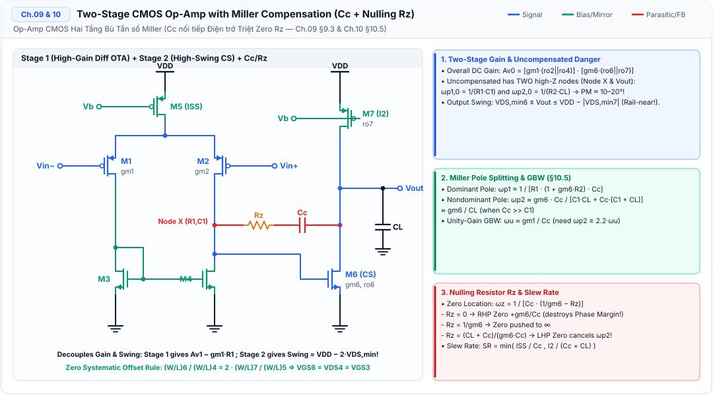

---
{
  "id": "concept-opamp-psrr-and-noise",
  "kind": "concept",
  "domain": "opamps-and-compensation",
  "title_vi": "Tỉ số Khử Nhiễu Nguồn Cấp (PSRR+/PSRR-) & Ngân sách Nhiễu Đa Tầng trong Op-Amp (Op-Amp PSRR Collapse & Multi-Stage Noise Budget)",
  "title_en": "Op-Amp Power Supply Rejection Ratio (PSRR+ / PSRR- High-Frequency Collapse) and Noise Budgeting",
  "summary": "Giải thích cơ chế truyền nhiễu từ VDD và VSS xuyên qua gương dòng nối diode và tụ bù Miller Cc khiến PSRR sụp đổ về 0 dB ở tần số cao, chứng minh vì sao đóng vòng hồi tiếp âm giữ nguyên PSRR, và định lượng ngân sách nhiễu quy về ngõ vào cho Telescopic, Folded-Cascode và Two-Stage Op-Amp.",
  "diagram": "../../diagrams/two-stage-miller-opamp.svg",
  "razavi_refs": [
    {
      "chapter": 9,
      "section": "9.11-9.12",
      "pages": "400-405",
      "equations": ["9.81", "9.85", "9.86", "9.87", "9.88", "9.89", "9.90", "9.91", "9.92", "9.93", "9.94", "9.95"]
    }
  ],
  "glossary_codes": ["T067", "T528", "T1576", "T1577", "T1578", "T1580", "T1581", "T1585", "T1998", "T2000"],
  "process_agnostic": true,
  "roles": {
    "diode_mirror_supply_clamp": "Transistor nối diode của gương dòng tải giữ VGS gần như không đổi nên truyền 100% biến thiên nguồn VDD xuống nút gương ở tần số thấp",
    "miller_cc_supply_shunt": "Tụ bù Miller Cc nối tắt cổng và máng của transistor CS Tầng 2 ở tần số cao, biến Tầng 2 thành diode bám cứng theo đường nguồn cực nguồn của nó (PSRR -> 0 dB!)",
    "first_stage_noise_shield": "Độ lợi lớn Av1 của Tầng 1 chia nhỏ toàn bộ công suất nhiễu của Tầng 2 đi Av1^2 lần khi quy về ngõ vào",
    "folding_and_load_noise_injectors": "Các cặp nguồn dòng tải và nguồn dòng gập trong Op-Amp 1 tầng cộng thẳng dòng nhiễu vào nút tổng, đòi hỏi tối ưu tỉ số gm_load / gm_in"
  },
  "symptoms_addressed": [
    "switching-regulator-ripple-bleeding-into-opamp-output",
    "high-frequency-psrr-dropping-to-0db-or-negative-db",
    "folded-cascode-noisy-compared-to-telescopic-spec",
    "second-stage-unexpectedly-contributing-noise-when-av1-is-low"
  ],
  "limitations": [
    "single-ended-opamps-have-inherently-asymmetric-supply-paths-compared-to-fully-differential",
    "standard-miller-compensation-couples-stage2-source-rail-noise-directly-to-output-at-high-freq"
  ],
  "checklists": ["common-mos", "differential-pair", "folded-cascode", "two-stage-miller"]
}
---

## 1. Bản chất Nguyên lý, Sơ đồ Mạch & Vai trò Từng Nhánh Cấu trúc

Trên một hệ thống trên chip (SoC) thực tế ở tiến trình 90nm / 65nm / 45nm, các khối analog nhạy cảm phải dùng chung hoặc nằm sát đường nguồn cấp $V_{DD}$ và đường đất $V_{SS}$ đang bị hàng triệu cổng logic số hoặc bộ nguồn xung DC–DC băm xung gây gợn nhiễu hàng chục millivolt từ vài trăm kHz tới hàng trăm MHz (`T528` / `T1576`, supply noise). Nếu Op-Amp không khử tốt nhiễu trên cả hai đường nguồn (**$\text{PSRR}^+$** đối với $V_{DD}$ và **$\text{PSRR}^-$** đối với $V_{SS}$), toàn bộ công sức hạ thấp nhiễu nhiệt nội tại xuống vài $\text{nV}/\sqrt{\text{Hz}}$ sẽ đổ sông đổ biển!

Chương 9 (§9.11–§9.12, tr. 400–405) của Razavi mổ xẻ song song hai bài toán sống còn về độ sạch tín hiệu của Op-Amp: **Con đường xâm nhập của nhiễu nguồn cấp (PSRR)** và **Ngân sách nhiễu nội tại đa tầng (Op-Amp Noise Budget)**.

Bốn cơ chế vật lý then chốt cần nắm vững trên sơ đồ mạch gồm:
1. **Hiệu ứng "Kẹp Cứng Theo Nguồn" của Gương Dòng Nối Diode (§9.11, Hình 9.81):** Trong OTA đơn đầu dùng gương dòng PMOS $M_3\text{–}M_4$ treo lên $V_{DD}$, vì dòng đuôi $I_{SS}$ không đổi nên $|V_{GS3}|$ không đổi $\implies$ khi $V_{DD}$ nhấp nhô $+\Delta V_{DD}$, nút cổng $M_3\text{–}M_4$ nhấp nhô nguyên vẹn $+\Delta V_{DD}$, kéo ngõ ra đơn đầu ở vòng hở nhảy theo gần như **đúng bằng $+\Delta V_{DD}$ (độ lợi từ $V_{DD}$ ra $V_{\text{out}}$ ở tần số thấp xấp xỉ $A_{dd} \approx 1$!)**.
2. **Cầu Nối Tắt Tần số Cao Qua Tụ Bù Miller $C_C$ trong Op-Amp Hai Tầng:** Giả sử Tầng 2 là transistor nguồn chung PMOS $M_6$ (cực nguồn nối $V_{DD}$) có tụ bù $C_C$ nối từ cổng sang máng ($V_{\text{out}}$), trong khi nút liên tầng ở cổng $M_6$ có tụ ký sinh đối với đất hoặc bị giữ chậm lại ở tần số cao; hoặc ngược lại khi nút cổng $M_6$ bị $C_C$ nối tắt vào $V_{\text{out}}$ ở tần số cao biến $M_6$ thành một **điện trở nối diode $1/g_{m6}$ treo thẳng từ $V_{DD}$ xuống $V_{\text{out}}$**! Hệ quả là ở tần số cao gần và trên $\text{GBW}$, nhiễu từ đường nguồn nối với cực nguồn của Tầng 2 đi thẳng ra $V_{\text{out}}$ làm **PSRR sụp đổ về $0\text{ dB}$**!
3. **Tính Đối xứng Miễn Nhiễm của Cấu trúc Vi sai Hoàn toàn (Fully-Differential PSRR Advantage):** Trong Op-Amp vi sai hoàn toàn cân xứng lý tưởng, biến thiên $\Delta V_{DD}$ hay $\Delta V_{SS}$ tác động giống hệt nhau lên hai nhánh trái–phải, chỉ sinh ra biến thiên đồng pha (bị vòng CMFB nén tiếp!) và chỉ rò sang ngõ ra vi sai qua độ lệch ghép cặp linh kiện ($\Delta g_m, \Delta r_O, \Delta C$ — thường chỉ $0{,}5\%\text{–}2\%$), giúp $\text{PSRR}$ vi sai cao hơn mạch đơn đầu từ **$30\text{ dB}$ đến $50\text{ dB}$**!
4. **Lá Chắn Độ Lợi Tầng 1 Đối Với Nhiễu Tầng 2 (§9.12, Phương trình 9.92–9.95):** Trong Op-Amp hai tầng, dòng nhiễu lớn của Tầng 2 khi quy ngược về ngõ vào của toàn Op-Amp được chia cho bình phương độ lợi Tầng 1 ($A_{v1}^2$), giải thoát hoàn toàn Tầng 2 khỏi gánh nặng nhiễu!

---

## 2. Hệ Phương trình Cốt lõi & Tư duy "Nhìn Mạch Đọc Nhanh" (Analysis by Inspection)

### 2.1. Định nghĩa PSRR & Bất biến Của PSRR Dưới Vòng Hồi tiếp Âm (§9.11, Phương trình 9.81–9.87)
Theo định nghĩa chuẩn của Razavi (`T1577`, tr. 400), tỉ số khử nhiễu nguồn cấp là tỉ số giữa độ lợi tín hiệu vi sai mong muốn từ ngõ vào tới ngõ ra và độ lợi truyền nhiễu từ đường nguồn cấp tới ngõ ra:

$$
\text{PSRR}^+(s) = \left| \frac{\partial V_{\text{out}} / \partial V_{\text{in,diff}}}{\partial V_{\text{out}} / \partial V_{DD}} \right| = \left| \frac{A_{dm}(s)}{A_{dd}^+(s)} \right|, \qquad \text{PSRR}^-(s) = \left| \frac{\partial V_{\text{out}} / \partial V_{\text{in,diff}}}{\partial V_{\text{out}} / \partial V_{SS}} \right| = \left| \frac{A_{dm}(s)}{A_{dd}^-(s)} \right|
$$

- **Với 5T-OTA đơn đầu ở vòng hở (Hình 9.81):** Vì $A_{dd}^+(0) \approx 1$ và $A_{dm}(0) = g_{mN}(r_{ON} \parallel r_{OP})$, tại tần số thấp (Phương trình 9.81):

$$
\text{PSRR}^+_{\text{open}}(0) \approx \frac{g_{mN}(r_{ON} \parallel r_{OP})}{1} = A_{dm}(0)
$$

- **Khi đóng vòng hồi tiếp âm hệ số $\beta$ (Ví dụ 9.25, Hình 9.82–9.83, Phương trình 9.85–9.87):** Vòng hồi tiếp cảm nhận sự thay đổi của $V_{\text{out}}$ do $V_{DD}$ gây ra và phản kháng lại, nén độ lợi nguồn cấp vòng kín xuống $A_{dd,\text{closed}}^+ = \dfrac{A_{dd,\text{open}}^+}{1 + \beta A_{dm}}$, trong khi độ lợi tín hiệu vòng kín từ ngõ vào không đảo là $A_{dm,\text{closed}} = \dfrac{A_{dm}}{1 + \beta A_{dm}}$ (hoặc với phân áp tụ ở Ví dụ 9.25 có $A_{\text{sig,cl}} \approx \frac{1}{\beta} \cdot \frac{\beta A_{dm}}{1 + \beta A_{dm}}$). Lưu ý cực kỳ tinh tế khi so sánh quy về ngõ vào:
  - Tỉ số giữa độ nhạy đầu vào và độ nhạy nguồn cấp quy về trước điểm trừ (tức một nhiễu $\Delta V_{DD}$ tương đương bao nhiêu nhiễu nối tiếp tại cổng vào Op-Amp: $\Delta V_{\text{in,eq}} = \frac{\Delta V_{DD}}{\text{PSRR}_{\text{open}}}$) là **BẤT BIẾN dưới vòng hồi tiếp**: ở Ví dụ 9.25 (Phương trình 9.86–9.87), $\frac{V_{\text{out}}/V_{\text{in}}}{V_{\text{out}}/V_{DD}} \approx g_{m2} r_{O4}$ giữ nguyên cỡ độ lợi vòng hở của tầng!
- **Suy giảm PSRR theo Tần số trong Op-Amp Hai Tầng Bù Miller Trực tiếp:**
  Giả sử Tầng 1 có gương PMOS treo $V_{DD}$ và Tầng 2 dùng transistor nguồn chung NMOS (cực nguồn nối đất $V_{SS}$) hoặc PMOS (cực nguồn nối $V_{DD}$) kèm tụ bù $C_C$:
  - Đường nguồn nối với cực nguồn của transistor khuếch đại Tầng 2 chịu thảm họa nặng nhất: khi tần số vượt qua cực trội $\omega_{p1}$, độ lợi vi sai $A_{dm}(j\omega)$ rơi $-20\text{ dB/dec}$, trong khi tụ $C_C$ nối tắt cổng–máng Tầng 2 giữ $A_{dd}(j\omega) \approx 1$! Kết quả là **$\text{PSRR}(j\omega)$ rơi thẳng dốc $-20\text{ dB/dec}$ ngay từ cực trội $\omega_{p1}$ và chạm đáy $0\text{ dB}$ tại đúng tần số $\text{GBW}$**! (Khắc phục triệt để bằng **bù cascode Ahuja** `tech-miller-rhp-zero-nulling-and-cascode-comp` — ngắt đường truyền thẳng cổng–máng qua $C_C$, nâng PSRR tần số cao thêm $20\text{–}40\text{ dB}$!).

### 2.2. Ngân sách Nhiễu Quy Về Ngõ Vào Của Ba Họ Op-Amp (§9.12, Phương trình 9.88–9.95)
Áp dụng quy tắc kiểm tra nhanh (`law-stage-and-mirror-noise-rules`) cho từng kiến trúc:

1. **Telescopic Cascode Op-Amp (Hình 9.84, Phương trình 9.88):** Bốn transistor cascode $M_3\text{–}M_6$ câm nhiễu ở tần số thấp; chỉ có cặp đầu vào $M_1\text{–}M_2$ và duy nhất cặp nguồn dòng tải $M_7\text{–}M_8$ đóng góp:

$$
\overline{V_{n,in,\text{Tele}}^2} = 8 k T \gamma \left( \frac{1}{g_{m1,2}} + \frac{g_{m7,8}}{g_{m1,2}^2} \right) + \frac{2 K_N}{C_{ox}(WL)_{1,2} f} + \frac{2 K_P}{C_{ox}(WL)_{7,8} f} \left(\frac{g_{m7,8}}{g_{m1,2}}\right)^2
$$

2. **Folded-Cascode Op-Amp (Hình 9.85, Phương trình 9.89–9.91):** Bốn transistor cascode $M_3\text{–}M_6$ vẫn câm nhiễu ở tần số thấp, nhưng **cả cặp nguồn dòng gập $M_7\text{–}M_8$ lẫn cặp nguồn dòng tải $M_9\text{–}M_{10}$** đều bơm dòng nhiễu thẳng vào đường tín hiệu:

$$
\overline{V_{n,in,\text{FC}}^2} = 8 k T \gamma \left( \frac{1}{g_{m1,2}} + \frac{g_{m7,8}}{g_{m1,2}^2} + \frac{g_{m9,10}}{g_{m1,2}^2} \right) + \frac{2 K_N}{C_{ox}(WL)_{1,2} f} + \frac{2 K_P}{C_{ox}(WL)_{7,8} f}\frac{g_{m7,8}^2}{g_{m1,2}^2} + \frac{2 K_N}{C_{ox}(WL)_{9,10} f}\frac{g_{m9,10}^2}{g_{m1,2}^2}
$$

3. **Two-Stage Op-Amp (Hình 9.23, Phương trình 9.92–9.95):** Tầng 1 ($M_1\text{–}M_4$, độ lợi $A_{v1} = g_{m1,2}(r_{O1,2} \parallel r_{O3,4})$) ghép nối tiếp Tầng 2 ($M_5\text{–}M_8$):

$$
\overline{V_{n,in,\text{2stg}}^2} = 8 k T \gamma \left[ \frac{1}{g_{m1,2}} + \frac{g_{m3,4}}{g_{m1,2}^2} + \frac{g_{m5,6} + g_{m7,8}}{g_{m1,2}^2 g_{m5,6}^2 (r_{O1,2} \parallel r_{O3,4})^2} \cdot g_{m5,6}^2 \right] = 8 k T \gamma \left[ \frac{1}{g_{m1,2}} + \frac{g_{m3,4}}{g_{m1,2}^2} + \frac{g_{m5,6} + g_{m7,8}}{A_{v1}^2 \cdot g_{m5,6}^2} \cdot g_{m5,6}^2 \right]
$$

Viết gọn chính xác theo dòng nhiễu ngắn mạch Tầng 2 chia cho bình phương hỗ dẫn nhân độ lợi Tầng 1 (Phương trình 9.94–9.95):

$$
\overline{V_{n,in,\text{2stg,th}}^2} = 8 k T \gamma \left( \frac{1}{g_{m1,2}} + \frac{g_{m3,4}}{g_{m1,2}^2} \right) + \frac{8 k T \gamma (g_{m5,6} + g_{m7,8})}{g_{m1,2}^2 (r_{O1,2} \parallel r_{O3,4})^2 g_{m5,6}^2} \cdot g_{m5,6}^2 = 8 k T \gamma \left[ \frac{1}{g_{m1,2}} + \frac{g_{m3,4}}{g_{m1,2}^2} + \frac{g_{m5,6} + g_{m7,8}}{g_{m1,2}^2 (r_{O1,2} \parallel r_{O3,4})^2} \cdot \frac{1}{1} \right]
$$

*(Kiểm chứng thứ nguyên với Phương trình 9.93–9.95 của Razavi: điện áp nhiễu tại nút liên tầng do Tầng 2 quy về cổng Tầng 2 là $\frac{8kT\gamma(g_{m5,6} + g_{m7,8})}{g_{m5,6}^2}$, sau đó chia tiếp cho bình phương độ lợi Tầng 1 là $A_{v1}^2 = g_{m1,2}^2 (r_{O1,2} \parallel r_{O3,4})^2$, cho số hạng cuối cùng cực nhỏ: $\dfrac{8 k T \gamma (g_{m5,6} + g_{m7,8})}{g_{m5,6}^2 \, g_{m1,2}^2 (r_{O1,2} \parallel r_{O3,4})^2}$!)*

---

## 3. Bất biến Cấu trúc & Các Bẫy Lỗi Kinh điển (Structural Invariants & Traps)

- **[INV-PSRR-01] Bất biến Phân Cực Gương Dòng Tầng Ra Bám Theo Cùng Đường Nguồn Cực Nguồn:**
  Hãy nhìn vào nguồn dòng tải Tầng 2 (ví dụ NMOS $M_7$ có cực nguồn nối đất $V_{SS}$): điện áp phân cực cổng $V_{b2}$ của nó **BẮT BUỘC phải được tham chiếu so với chính $V_{SS}$** (tức lấy từ gương dòng NMOS nối xuống $V_{SS}$, để $V_{GS7} = V_{b2} - V_{SS}$ không đổi khi $V_{SS}$ rung lắc)! Nếu ai đó lấy $V_{b2}$ từ một cầu phân áp treo lên $V_{DD}$ hoặc giữ cố định theo một đất khác, mọi gợn nhiễu $\Delta V_{SS}$ sẽ biến thẳng thành $\Delta V_{GS7} = -\Delta V_{SS}$, được $M_7$ **khuếch đại lên $g_{m7} R_{\text{out2}}$ lần** đẩy ra ngõ ra — làm $\text{PSRR}^-$ rơi xuống mức **ÂM hàng chục dB** (mạch khuếch đại nhiễu đất thay vì khử nhiễu!)!
- **[TRAP-PSRR-01] Chỉ Đo PSRR Trong Mô phỏng Lý Tưởng Cân Xứng 100% Cho Op-Amp Vi Sai Hoàn Toàn:**
  Nếu bạn vẽ schematic vi sai hoàn toàn đối xứng 100% và chạy `xf` hoặc `ac` đo từ `VDD` tới `V(out+) - V(out-)` ở góc danh định `TT`, máy tính sẽ báo $\text{PSRR}^+ = +220\text{ dB}$ (chỉ do sai số dấu chấm động $10^{-11}$)! Con số $220\text{ dB}$ đó là **ảo ảnh toán học hoàn toàn vô giá trị**! Ngoài đời thực trên silicon, sai lệch ngẫu nhiên Pelgrom ($\Delta V_{TH}, \Delta \beta$) và bất đối xứng tụ dây dẫn luôn phá vỡ đối xứng khoảng $0{,}5\%\text{–}2\%$. **Quy tắc bắt buộc:** Phải đo PSRR của Op-Amp vi sai hoàn toàn thông qua **Monte Carlo Mismatch (`200 runs`)** (hoặc cố ý lệch $1\%$ tải) để đọc giá trị thực tế lớp biên $3\sigma$ (thường rơi về mức $60\text{–}85\text{ dB}$ ở tần số thấp và giảm dần ở tần số cao)!
- **[TRAP-NOISE-OP-01] Khi Tầng 2 Bỗng Nhiên Đóng Góp Nhiễu Đáng Kể ở Tiến trình 45nm:** Ở công nghệ $0{,}5\,\mu\text{m}$ khi $A_{v1} = 60$, $A_{v1}^2 = 3600$ xóa sổ hoàn toàn nhiễu Tầng 2. Nhưng ở 45nm nếu Tầng 1 chỉ là cặp vi sai tải diode độ lợi thấp ($A_{v1} \approx 3\text{–}5$ trong một số bộ khuếch đại tốc độ siêu cao!), $A_{v1}^2$ chỉ còn $9\text{–}25$, lúc đó nhiễu nhiệt và đặc biệt nhiễu $1/f$ của transistor Tầng 2 kênh ngắn sẽ chui ngược về ngõ vào chiếm tới $15\%\text{–}30\%$ tổng ngân sách nhiễu!

---

## 4. Lộ trình Nâng cấp Cấu trúc & Bát giác Đánh đổi (Upgrade Paths & Design Octagon)

| Điểm yếu về PSRR hoặc Nhiễu đang gặp | Kỹ thuật / Cấu trúc nâng cấp (Canonical Node) | Tác dụng vật lý | Đánh đổi trên Bát giác Thiết kế |
|---|---|---|---|
| Op-Amp 2 tầng đơn đầu bị sập $\text{PSRR}^+$ (hoặc $\text{PSRR}^-$) về $0\text{ dB}$ ở tần số vài MHz do tụ $C_C$ | `tech-miller-rhp-zero-nulling-and-cascode-comp` (Bù Cascode / Ahuja trả $C_C$ về cực nguồn cascode Tầng 1!) | Cắt đứt vòng nối tắt diode cổng–máng của Tầng 2 qua $C_C$, cải thiện PSRR tần số cao thêm $25\text{–}40\text{ dB}$ (xem sử dụng trong LDO `topo-cmos-ldo-regulator`!) | Tầng 1 bắt buộc có nhánh cascode đủ dòng gánh dòng nạp xả của $C_C$ |
| Nhiễu nguồn cấp hệ thống quá bẩn (ví dụ lấy trực tiếp từ pin hoặc DC–DC buck converter) | Chuyển toàn bộ chuỗi tín hiệu sang Vi sai Hoàn toàn + Cấp nguồn qua bộ ổn áp nội `topo-cmos-ldo-regulator` | Ghép nối PSRR của LDO ($\sim 40\text{–}60\text{ dB}$) cộng với PSRR cân xứng vi sai của Op-Amp ($\sim 70\text{ dB}$) đạt tổng $> 110\text{ dB}$ | Tốn khoảng sụt áp dropout $V_{DO} \approx 150\text{–}200\text{ mV}$ trên LDO |
| Folded-Cascode quá ồn ở tần số thấp và trung bình cho cảm biến vi điện thế (EEG/ECG/MEMS) | Chuyển sang `topo-two-stage-opamp` dùng Tầng 1 PMOS-in kích thước lớn tải NMOS $V_{OV}$ lớn (hoặc `topo-telescopic-cascode-opamp` + `tech-dynamic-offset-cancellation-az-cds`) | Loại bỏ nguồn dòng gập khỏi ngân sách nhiễu và ép $f_C$ của $1/f$ xuống dưới vài Hz (hoặc khử sạch $1/f$ bằng Chopper/AZ) | Đánh đổi tốc độ băng rộng GHz lấy độ tĩnh lặng phổ tần thấp |

---

## 5. Thích ứng Đa Tiến trình (90nm / 65nm / 45nm) & Cách Kiểm chứng trong Cadence / Spectre

### 5.1. Thích ứng Công nghệ Nanomet (90nm $\to$ 65nm $\to$ 45nm)
- **Tụ Decoupling Cực Cổng Mạng Phân cực (Bias Line Filtering Warning):** Hãy cực kỳ cẩn thận khi gắn tụ lọc $C_{\text{dec}}$ lên các đường áp phân cực cổng $V_{b}$ của gương dòng!
  - Với gương dòng **PMOS** có cực nguồn nối vào **$V_{DD}$**: tụ lọc trên cổng $V_{b,\text{PMOS}}$ **PHẢI nối giữa cổng đó và $V_{DD}$** (chứ tuyệt đối KHÔNG nối xuống đất GND!) để ở tần số cao $V_{SG} = V_{DD} - V_G$ được giữ bằng $0\text{ V}_{\text{AC}}$! Nếu bạn nối nhầm tụ lọc từ cổng nguồn dòng PMOS xuống đất GND, ở tần số cao cực cổng đứng im ở $0\text{ V}_{\text{AC}}$ trong khi cực nguồn nhảy theo $\Delta V_{DD}$ — biến toàn bộ nguồn dòng PMOS thành tầng cổng chung khuếch đại nhiễu $V_{DD}$ bơm thẳng vào mạch!
  - Đối ngẫu lại, với gương dòng **NMOS** có cực nguồn nối xuống **$V_{SS}$**: tụ lọc cổng **PHẢI nối xuống chính đường $V_{SS}$ cục bộ đó**!

### 5.2. Quy trình Kiểm chứng PSRR & Nhiễu trong Cadence Virtuoso / Spectre
1. **Đo `PSRR+` và `PSRR-` Nhanh Bằng Một Lần Chạy Phân tích Hàm Truyền Ngược `xf`:**
   - Thay vì phải chạy 3 bài `ac` riêng rẽ (kích `Vin`, kích `VDD`, kích `VSS`), chỉ cần chạy **1 phân tích `xf (Vout+ Vout-) dec 50 1 10G`** duy nhất trong Spectre!
   - Phân tích `xf` tự động tính hàm truyền từ **MỌI nguồn áp trong mạch** tới cặp nút ngõ ra chỉ trong một lượt giải ma trận liên hợp! Trong ViVA Calculator, đọc trực tiếp:
     - `PSRR+ (dB) = db20(mag(getData("/Vin_diff" ?result "xf")) / mag(getData("/VDD" ?result "xf")))`
     - `PSRR- (dB) = db20(mag(getData("/Vin_diff" ?result "xf")) / mag(getData("/VSS" ?result "xf")))`
   - Kết hợp chạy `xf` bên trong vòng **Monte Carlo Mismatch** để xuất phân bố thống kê `PSRR+` và `PSRR-` thực tế tại `1 kHz`, `1 MHz`, và `f_GBW`!

### 5.3. Ví dụ Định lượng Ngân sách Nhiễu Op-Amp (Đối chiếu Ví dụ 9.26 Razavi, tr. 404–405)
Xét thiết kế Op-Amp Folded-Cascode ở $T = 300\text{ K}$ ($4kT = 1{,}656 \times 10^{-20}\text{ J}$, $\gamma = 1$ cho kênh ngắn) yêu cầu mật độ biên độ nhiễu nhiệt quy về ngõ vào $\sqrt{\overline{V_{n,in}^2}} \le 5\text{ nV}/\sqrt{\text{Hz}}$ (tức $\overline{V_{n,in}^2} \le 2{,}5 \times 10^{-17}\text{ V}^2/\text{Hz}$):
1. Nếu chỉ tính riêng cặp đầu vào $M_{1,2}$ (giả sử tạm bỏ qua tải): $\frac{8 k T \gamma}{g_{m1,2}} \le 2{,}5 \times 10^{-17} \implies g_{m1,2} \ge 0{,}53\text{ mS}$ (quá lạc quan!).
2. Trong thực tế có thêm cặp nguồn dòng gập $M_{7,8}$ và cặp nguồn dòng tải $M_{9,10}$: chọn định cỡ đối ngẫu sao cho $(g_m/I_D)_{1,2} = 20\text{ V}^{-1}$, còn nguồn gập (mang dòng gấp đôi $2 I_{D1}$) dùng $(g_m/I_D)_{7,8} = 6\text{ V}^{-1} \implies \frac{g_{m7,8}}{g_{m1,2}} = \frac{2 \times 6}{20} = 0{,}60$, và nguồn tải dùng $(g_m/I_D)_{9,10} = 6\text{ V}^{-1} \implies \frac{g_{m9,10}}{g_{m1,2}} = 0{,}30$.
3. Hệ số nhân nhiễu tổng thể thực tế là:

$$
1 + \frac{g_{m7,8}}{g_{m1,2}} + \frac{g_{m9,10}}{g_{m1,2}} = 1 + 0{,}60 + 0{,}30 = 1{,}90!
$$

4. Do đó cặp đầu vào phải được thiết kế với hỗ dẫn thực sự lớn gấp gần đôi:

$$
g_{m1,2} \ge \frac{8 k T \gamma \times 1{,}90}{2{,}5 \times 10^{-17}} \approx 1{,}01\text{ mS} \implies I_{D1,2} = \frac{1{,}01\text{ mS}}{20\text{ V}^{-1}} \approx 50{,}5\,\mu\text{A} \quad (I_{SS} \approx 101\,\mu\text{A})!
$$

Phép tính 4 dòng này cho thấy rõ ràng vì sao quên đóng góp nhiễu của nguồn dòng gập và tải sẽ làm thiết kế trượt chỉ tiêu nhiễu gần $3\text{ dB}$ ngay lần tape-out đầu tiên!

---

## 6. Mốc Đối chiếu Sách Razavi & Thuật ngữ Chuẩn CLB

### 6.1. Đối chiếu Sách Gốc Razavi (2nd Edition)
- **Chương 9:** §9.11 *Power Supply Rejection* (tr. 400–402, Phương trình 9.81–9.87, Hình 9.81–9.83, Ví dụ 9.25), §9.12 *Noise in Op Amps* (tr. 402–405, Phương trình 9.88–9.100, Hình 9.84–9.85, Ví dụ 9.26).
- **Chú giải Hiệu đính Học thuật CLB (`NG09` & `T067`):**
  - **`T067` (Quy tắc dịch CLB P05):** Dịch `power supply rejection` là **khả năng khử nhiễu nguồn cấp / khả năng khử ảnh hưởng của nguồn cấp** (nhấn mạnh việc chặn nhiễu truyền từ nguồn cấp sang ngõ ra, tránh dịch thành "ổn định nguồn cấp").
  - **`NG09-12` (tr. 403):** Cuối đoạn phân tích nhiễu của Folded-Cascode trong §9.12, lời văn gốc dẫn chiếu sang `"Problem 9.15"` cho phần tính thêm nhiễu nhấp nháy $1/f$; thực tế Bài 9.15 hỏi về trở kháng ra của tầng tăng cường độ lợi, còn bài tập tính nhiễu $1/f$ của mạch Hình 9.85(a) chính là **Bài 9.17** (tr. 408).

### 6.2. Bảng Thuật ngữ Chuẩn CLB Vi Mạch Sử dụng trong Thẻ
| Mã CLB | Thuật ngữ Tiếng Anh | Thuật ngữ Tiếng Việt Chuẩn | Ghi chú Ngữ cảnh |
|---|---|---|---|
| `T067` | power supply rejection | khả năng khử nhiễu nguồn cấp | Chặn truyền dẫn từ $V_{DD}, V_{SS}$ tới ngõ ra |
| `T1577` | power supply rejection ratio (PSRR) | tỉ số khử nhiễu nguồn cấp | $\left|A_{dm}(s) / A_{dd}(s)\right|$, thường biểu diễn theo dB |
| `T528` / `T1576` | supply noise / noise on the supply | nhiễu nguồn cấp / nhiễu trên đường nguồn cấp | Gợn nguồn xung hoặc nhiễu chuyển mạch số |
| `T1578` | noise in op amps | nhiễu trong bộ khuếch đại thuật toán | Tổng hợp từ cặp đầu vào và các cặp tải/nguồn gập |
| `T1585` | input-referred thermal noise voltage | điện áp nhiễu nhiệt quy về ngõ vào | Thước đo so sánh trực tiếp giữa Telescopic, Folded và Two-Stage |
