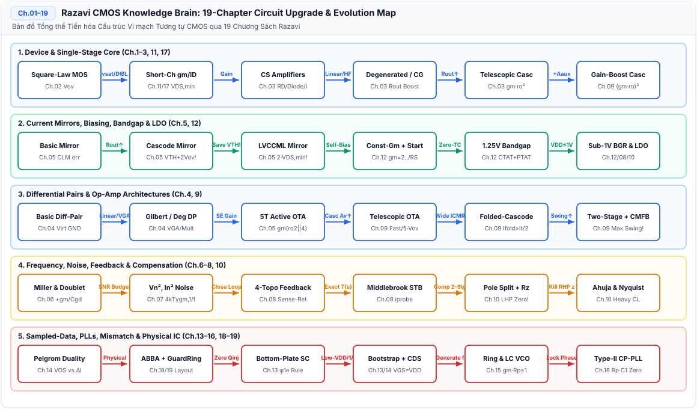

---
{
  "id": "concept-opamp-topology-comparison-and-swing",
  "kind": "concept",
  "domain": "opamps-and-compensation",
  "title_vi": "Ma trận So sánh Tổng thể Các Họ Op-Amp, Kiểm chứng Biên độ Ra & Ngõ vào Bổ sung Rail-to-Rail (Op-Amp Topology Comparison, Swing & Rail-to-Rail Input)",
  "title_en": "Master Op-Amp Topology Comparison Matrix, Output Swing Verification, and Rail-to-Rail Input Range Limitations",
  "summary": "Đặt lên bàn cân định lượng 4 kiến trúc Op-Amp chủ lực (Telescopic, Folded-Cascode, Two-Stage, Gain-Boosted) trên cả 6 trục hiệu năng, phương pháp chuẩn xác kiểm chứng biên độ dao động ngõ ra thực tế qua đường cong đạo hàm độ lợi, và bài toán biến thiên hỗ dẫn gấp 2 lần của tầng đầu vào bổ sung NMOS+PMOS Rail-to-Rail.",
  "diagram": "../../diagrams/upgrade-evolution-map.svg",
  "razavi_refs": [
    {
      "chapter": 9,
      "section": "9.5-9.6, 9.8",
      "pages": "373-374, 388-390",
      "equations": []
    }
  ],
  "glossary_codes": ["T090", "T094", "T095", "T1437", "T1444", "T1460", "T1461", "T1474", "T1506", "T1588", "T1596"],
  "process_agnostic": true,
  "roles": {
    "topology_selection_matrix": "Bảng đối chiếu đa chiều (Gain, Swing, Speed, Power, Noise, ICMR, Load Sensitivity) định hướng chọn đúng họ mạch ngay từ đầu",
    "differential_gain_curve_verifier": "Phép đo đạo hàm dVout/dVin trên toàn dải quét để xác định biên độ dao động thực tế nơi độ lợi chưa sụt dưới ngưỡng cho phép",
    "complementary_rail_to_rail_input": "Ghép song song một cặp vi sai NMOS và một cặp vi sai PMOS để mở dải ICMR từ 0 V đến VDD nhưng làm Gm tổng biến thiên theo Vin,CM"
  },
  "symptoms_addressed": [
    "wrong-opamp-architecture-chosen-for-supply-and-load",
    "overestimating-output-swing-from-hand-vdsat-formulas",
    "loop-bandwidth-and-phase-margin-shifting-across-rail-to-rail-icmr",
    "dead-zone-in-rail-to-rail-input-at-low-supply-voltage"
  ],
  "limitations": [
    "no-single-cmos-opamp-topology-wins-on-all-six-axes",
    "rail-to-rail-input-causes-2x-gm-variation-and-changing-offset-across-vcm"
  ],
  "checklists": ["common-mos", "differential-pair", "folded-cascode", "two-stage-miller"]
}
---

## 1. Bản chất Nguyên lý, Sơ đồ Mạch & Vai trò Từng Nhánh Cấu trúc

Sau khi khảo sát từng kiến trúc riêng lẻ, câu hỏi cốt lõi nhất của kỹ sư thiết kế mạch và của hệ thống suy luận tự động là: **Khi đứng trước một bài toán mới ở tiến trình 90nm, 65nm hay 45nm, chọn cấu trúc nào và nâng cấp theo lộ trình nào khi một chỉ tiêu bị vỡ?** Chương 9 (§9.5, §9.6 và §9.8) của Razavi đúc kết bức tranh toàn cảnh đối chiếu bốn họ Op-Amp trụ cột kèm hai vấn đề thực chiến ở điện áp nguồn thấp: **cách đo đúng biên độ ngõ ra thực tế** và **giới hạn của tầng đầu vào toàn dải nguồn–nguồn (Rail-to-Rail ICMR)**.



Ba mảnh ghép kiến trúc được tổng hợp trong thẻ này gồm:
1. **Ma trận Đối chiếu 4 Họ Kiến trúc (Bảng 9.1, §9.5):** Đặt `topo-telescopic-cascode-opamp`, `topo-folded-cascode-ota`, `topo-two-stage-opamp` và `topo-gain-boosted-cascode` trên cùng một mặt phẳng tham chiếu công bằng.
2. **Tiêu chuẩn Xác định Biên độ Ngõ ra Thực tế (§9.6, Hình 9.39–9.40):** Chỉ ra vì sao không thể chỉ lấy tổng $V_{GS} - V_{TH}$ trên giấy để kết luận mạch đạt Output Swing, đặc biệt ở công nghệ kênh ngắn nơi ranh giới giữa vùng bão hòa và vùng triode là một đường cong suy giảm độ lợi liên tục!
3. **Tầng Đầu vào Bổ sung NMOS $\parallel$ PMOS mở rộng ICMR Toàn dải (§9.8, Hình 9.64–9.67):** Phân tích hiện tượng ba vùng hoạt động của $V_{in,\text{CM}}$ làm hỗ dẫn tổng $G_{m,\text{tot}}$ và tốc độ biến thiên điện áp nhảy gấp đôi ở giữa dải, hoặc sập về $0$ (vùng chết — dead zone) khi $V_{DD}$ quá thấp!

---

## 2. Hệ Phương trình Cốt lõi & Tư duy "Nhìn Mạch Đọc Nhanh" (Analysis by Inspection)

### 2.1. Bảng Ma trận So sánh Toàn diện Bốn Họ Op-Amp Chủ lực (Mở rộng từ Bảng 9.1 Razavi, tr. 373)

| Tiêu chí Hiệu năng | 1. Telescopic Cascode (`topo-telescopic-cascode-opamp`) | 2. Folded-Cascode (`topo-folded-cascode-ota`) | 3. Two-Stage Miller (`topo-two-stage-opamp`) | 4. Gain-Boosted Cascode (`topo-gain-boosted-cascode`) |
|---|---|---|---|---|
| **Độ lợi DC vòng hở ($A_0$)** | Trung bình – Khá<br>$\sim (g_m r_O)^2$ | Thấp hơn Telescopic $2\text{–}3\times$<br>$\sim 0{,}4\,(g_m r_O)^2$ | Cao<br>$\sim (g_m r_O)^2 \text{ đến } (g_m r_O)^3$ | **Cực cao**<br>$\sim (g_m r_O)^3 \text{ đến } (g_m r_O)^4$ |
| **Biên độ ra đơn đầu ($\Delta V_{\text{out,se}}$)** | **Hẹp nhất**<br>$V_{DD} - 5\,V_{DS,\min}$ | Trung bình<br>$V_{DD} - 4\,V_{DS,\min}$ | **Rộng nhất (Sát nguồn!)**<br>$V_{DD} - 2\,V_{DS,\min}$ | Trung bình / Hẹp<br>$V_{DD} - 4\text{ hoặc }5\,V_{DS,\min}$ |
| **Tốc độ xác lập tín hiệu nhỏ** | **Nhanh nhất** (1 tầng, cực phụ NMOS cực cao) | **Cao** (1 tầng, cực phụ tại nút gập) | **Thấp hơn** (2 cực thấp, bị giới hạn bởi $\omega_{p2}$ và RHP zero) | **Cao** (giữ bản chất 1 tầng nếu khống chế tốt doublet!) |
| **Công suất tiêu tán ($P_{\text{diss}}$)** | **Thấp nhất** (chỉ 2 nhánh dòng chính $I_{SS}$) | Trung bình – Cao ($\sim 2\times$ dòng do thêm nhánh gập) | Trung bình – Cao (tốn dòng cho cả Tầng 1 và Tầng 2) | Trung bình – Cao (thêm $15\%\text{–}30\%$ dòng cho 2 OTA phụ) |
| **Nhiễu quy về ngõ vào ($\overline{V_{n,in}^2}$)** | **Thấp nhất** (chỉ 1 cặp tải đóng góp nhiễu) | Cao hơn đáng kể (cả nguồn gập + nguồn tải đều sinh nhiễu) | **Thấp** (nhiễu Tầng 2 bị chia nhỏ bởi $A_{v1}^2$!) | **Thấp** (nhiễu OTA phụ bị nén bởi $(g_m r_O)^2$ ở tần số thấp) |
| **Dải ICMR & Khả năng nối $V_{\text{in}}=V_{\text{out}}$** | Hẹp; **cấm nối tắt trực tiếp** $V_{\text{in}}=V_{\text{out}}$ dải rộng | Rộng (chạm GND hoặc $V_{DD}$); **nối tắt tốt** | Rộng (tùy Tầng 1); **nối tắt tốt** (sau khi bù Miller!) | Giống Telescopic hoặc Folded-Cascode nền bên dưới |
| **Phản ứng khi tăng Tụ tải $C_L$** | **Tốt lên** ($\text{PM}$ tăng, tự bù tại ngõ ra) | **Tốt lên** ($\text{PM}$ tăng, tự bù tại ngõ ra) | **Xấu đi nguy hiểm!** ($\omega_{p2}$ tụt xuống làm sập $\text{PM}$) | **Tốt lên** trên vòng chính (nhưng kiểm tra vòng phụ!) |

### 2.2. Phương pháp Định lượng Biên độ Dao động Ngõ ra Thực tế (§9.6, Hình 9.39–9.40)
Khi một transistor ở ngõ ra có $V_{DS}$ giảm dần về phía $V_{DS,\min}$, nó không chuyển trạng thái kiểu "công tắc nhảy bậc" mà điện trở ra $r_O(V_{DS})$ giảm dần liên tục làm độ lợi vi phân vòng hở $A_v(V_{\text{out}}) = \dfrac{\partial V_{\text{out}}}{\partial V_{\text{in,diff}}}$ rớt hình chuông úp (Hình 9.40b)!
Do đó, **định nghĩa nghiêm ngặt duy nhất** của biên độ dao động ngõ ra tối đa cho phép (`T1444`) là khoảng $\left[V_{\text{out,min}}, V_{\text{out,max}}\right]$ mà trên toàn bộ khoảng đó bất đẳng thức hợp đồng độ lợi vẫn được giữ vững:

$$
\forall V_{\text{out}} \in \left[V_{\text{out,min}},\, V_{\text{out,max}}\right]: \qquad \left| \frac{\partial V_{\text{out}}}{\partial V_{\text{in,diff}}} \right| \ge A_{0,\min,\text{spec}}
$$

Để đo đường đặc tuyến này cho một Op-Amp có $A_0 = 5000$ mà không bị bão hòa do lệch $\mu\text{V}$ ở vòng hở, Razavi chỉ rõ 2 cách đo chuẩn (Hình 9.39–9.40):
1. Quét tinh vi nguồn $V_{\text{in,diff}}$ với bước chia cực mịn ($\Delta V_{\text{in}} \sim 1\text{–}10\,\mu\text{V}$) ngay quanh điểm cân bằng (sau khi CMFB đã hội tụ) và vẽ đạo hàm $\frac{dV_{\text{out}}}{dV_{\text{in,diff}}}$ theo trục hoành là chính $V_{\text{out}}$!
2. Hoặc đóng vòng hồi tiếp âm tỉ số đã biết (kèm dịch mức lý tưởng) ép $V_{\text{out}}$ quét hết dải nguồn và đo trực tiếp độ lợi vòng `stb` tại từng điểm phân cực DC của $V_{\text{out}}$!

### 2.3. Tầng Đầu vào Bổ sung Rail-to-Rail & Bài toán Biến thiên $G_m$ (§9.8, Hình 9.64–9.67)
Để đạt dải điện áp chế độ chung ngõ vào phủ kín từ $0\text{ V}$ tới $V_{DD}$ (**Rail-to-Rail ICMR**), ta mắc song song một cặp vi sai PMOS ($M_{1P}\text{–}M_{2P}$, nguồn đuôi $I_{SS,P}$ từ $V_{DD}$) với một cặp vi sai NMOS ($M_{1N}\text{–}M_{2N}$, nguồn đuôi $I_{SS,N}$ xuống đất), rồi cộng hai dòng vi sai lại (ví dụ đưa chung vào hai nút gập trên và dưới của cấu trúc Folded-Cascode!). Khi $V_{in,\text{CM}}$ quét từ $0\text{ V}$ lên $V_{DD}$, mạch trải qua **3 vùng hoạt động**:
1. **Vùng thấp gần GND ($0 \le V_{in,\text{CM}} < V_{GS,N} + V_{DS,\min,\text{tailN}}$):** Cặp NMOS tắt hoàn toàn, chỉ cặp PMOS hoạt động $\implies G_{m,\text{tot}} = g_{mP}$.
2. **Vùng cao gần $V_{DD}$ ($V_{DD} - |V_{GS,P}| - |V_{DS,\min,\text{tailP}}| < V_{in,\text{CM}} \le V_{DD}$):** Cặp PMOS tắt hoàn toàn, chỉ cặp NMOS hoạt động $\implies G_{m,\text{tot}} = g_{mN}$.
3. **Vùng giữa dải (Khi $V_{DD} > V_{GS,N} + |V_{GS,P}| + 2\,V_{DS,\min}$):** **Cả hai cặp NMOS và PMOS cùng hoạt động đồng thời!** Ngay cả khi đã thiết kế khéo để $g_{mN} = g_{mP} = g_{m0}$ ở hai biên, tại vùng giữa dải tổng hỗ dẫn vẫn **nhảy vọt gấp đôi**:

$$
G_{m,\text{mid}} = g_{mN} + g_{mP} = 2\,g_{m0}!
$$

---

## 3. Bất biến Cấu trúc & Các Bẫy Lỗi Kinh điển (Structural Invariants & Traps)

- **[INV-COMP-01] Định luật Bảo toàn Tối ưu Bù Tần số Bị Phá Vỡ Khi $G_m$ Nhảy Gấp Đôi (§9.8, tr. 389):**
  Trong một bộ đệm dùng Op-Amp Rail-to-Rail (ví dụ bộ đệm khuếch đại tai nghe hoặc bộ đệm cột màn hình LCD nơi $V_{in,\text{CM}} = V_{\text{out}}$ quét liên tục từ $0\text{ V}$ lên $V_{DD}$!): khi $G_{m,\text{tot}}$ tăng gấp $2$ lần ở giữa dải, **băng thông độ lợi đơn vị $\text{GBW} = \frac{G_{m,\text{tot}}}{2\pi C_C}$ cũng vọt lên gấp $2$ lần**, đẩy tần số cắt độ lợi đâm sầm vào cực không trội $\omega_{p2}$ làm sụt mạnh dự trữ pha $\text{PM}$ (hoặc ngược lại nếu bù an toàn cho giữa dải thì ở hai rìa dải Op-Amp chậm đi một nửa!), đồng thời Slew Rate cũng nhảy bậc từ $I_{SS}/C_C$ lên $2 I_{SS}/C_C$!
- **[TRAP-COMP-01] Vùng Chết Giữa Dải ("Dead Zone") Của Mạch Rail-to-Rail Khi $V_{DD}$ Thấp (Hình 9.67, tr. 390):**
  Điều kiện để vùng dẫn của cặp PMOS và vùng dẫn của cặp NMOS chồng lấp lên nhau không bị đứt quãng ở giữa là:

$$
V_{DD,\min,\text{R2R}} \ge V_{GS,N} + |V_{GS,P}| + V_{DS,\min,\text{tailN}} + |V_{DS,\min,\text{tailP}}|
$$

Nếu ở góc tiến trình chậm lạnh (`SS, -40°C`) có $V_{THN} \approx |V_{THP}| \approx 0{,}45\text{ V}$ và overdrive/tail tốn $0{,}15\text{ V} \times 4 = 0{,}6\text{ V}$, tổng điện áp tối thiểu cần tới **$1{,}5\text{ V}$**! Nếu chạy ở $V_{DD} = 1{,}0\text{ V}$, ngay tại $V_{in,\text{CM}} = 0{,}5\text{ V}$ **CẢ HAI CẶP NMOS VÀ PMOS CÙNG TẮT ĐỒNG THỜI**, tạo thành một hố chết $G_m = 0$ ngay chính giữa dải tín hiệu! (Lúc đó bắt buộc dùng linh kiện ngưỡng thấp `LVT`, bơm điện tích nâng áp nguồn đuôi, hoặc chuyển sang cấu hình đảo dùng điện trở/SC ghim $V_{in,\text{CM}}$ cố định thay vì bắt Op-Amp chịu Rail-to-Rail ICMR!).
- **[TRAP-COMP-02] Bước Nhảy Điện áp Lệch $V_{OS}(V_{in,\text{CM}})$ Gây Méo Hài Tổng (THD) Nặng Trong Mạch Rail-to-Rail:** Cặp NMOS có một điện áp lệch ngẫu nhiên $V_{OS,N}$ (do mismatch của $M_{1N}\text{–}M_{2N}$), còn cặp PMOS có một điện áp lệch ngẫu nhiên hoàn toàn độc lập $V_{OS,P} \neq V_{OS,N}$! Khi tín hiệu sin lớn quét từ gần đất lên gần $V_{DD}$ trong cấu hình đệm không đảo, quyền điều khiển chuyển giao từ cặp PMOS sang cặp NMOS khiến điện áp lệch hiệu dụng nhảy bậc từ $V_{OS,P}$ sang $V_{OS,N}$ ngay giữa chu kỳ sóng sin — tạo ra **méo hài bậc cao (crossover-like offset distortion)** không thể nén hết bằng độ lợi vòng!

---

## 4. Lộ trình Nâng cấp Cấu trúc & Bát giác Đánh đổi (Upgrade Paths & Design Octagon)

| Bài toán thực tế khi chọn kiến trúc | Quyết định Kiến trúc Tối ưu (Canonical Node) | Giải thích bản chất | Cái giá tránh được / Phải chịu |
|---|---|---|---|
| Hệ thống đòi hỏi xử lý tín hiệu toàn dải nguồn–nguồn $0 \to V_{DD}$ ở $V_{DD} = 0{,}9\text{ V}$ với THD cực thấp (`<-80 dB`) | Dùng cấu hình **Đảo (Inverting Resistive hoặc Parasitic-Insensitive SC)** với `topo-two-stage-opamp` | Ở cấu hình đảo, hai cực $V_{in+}, V_{in-}$ của Op-Amp **luôn đứng yên tại một mức $V_{\text{CM}}$ cố định duy nhất** (ví dụ $0{,}2\text{ V}$ cho PMOS-in!), triệt tiêu 100% biến thiên $G_m$, vùng chết và nhảy bậc $V_{OS}$, trong khi ngõ ra Tầng 2 CS vẫn quét sát hai đường nguồn! | Trở kháng vào của toàn khối bằng $R_1$ (hoặc dung kháng chuyển mạch $1/(f_s C_1)$) thay vì $\infty$ |
| Bắt buộc cấu hình Không Đảo trở kháng vào vô cực và Rail-to-Rail ICMR ở $V_{DD} \ge 1{,}5\text{ V}$ | Folded-Cascode đầu vào bổ sung kèm mạch giữ không đổi $G_m$ (Constant-$G_m$ current switches $1:3$ cho vùng biên hoặc giữ $\sqrt{I_N} + \sqrt{I_P} = \text{const}$) | Khi một cặp tắt ở hai biên, mạch chuyển mạch tự động bơm dòng đuôi gấp $4\times$ (trong vùng bình phương) cho cặp còn lại để nâng $g_m$ lên gấp $2\times$, giữ $G_{m,\text{tot}}$ phẳng! | Phức tạp hóa tầng đầu, vẫn còn bước nhảy $V_{OS}$ khi chuyển vùng và lệch quy luật bình phương ở kênh ngắn |

---

## 5. Thích ứng Đa Tiến trình (90nm / 65nm / 45nm) & Cách Kiểm chứng trong Cadence / Spectre

### 5.1. Thích ứng Công nghệ Nanomet (90nm $\to$ 65nm / 45nm)
- **Khai thác Đa Ngưỡng Điện áp (`SVT` vs. `LVT` / `ULVT`) có sẵn trong PDK 90nm/65nm/45nm:** Các thư viện PDK hiện đại đều cung cấp transistor ngưỡng chuẩn (`SVT/RVT`, $V_{TH} \approx 0{,}38\text{–}0{,}45\text{ V}$) và ngưỡng thấp (`LVT`, $V_{TH} \approx 0{,}25\text{–}0{,}30\text{ V}$). Chỉ dùng `LVT` một cách phẫu thuật đúng tại **cặp vi sai đầu vào** khi bị ép ICMR ở nguồn $0{,}9\text{–}1{,}0\text{ V}$, trong khi giữ toàn bộ các nguồn dòng phân cực và cascode ở `SVT` (hoặc $L$ dài hơn) để bảo toàn $r_O$ cao và tránh dòng rò tĩnh dưới ngưỡng!

### 5.2. Quy trình Kiểm chứng trong Cadence Virtuoso / Spectre
1. **Đồ thị "Hình Chuông Độ Lợi" Xác Minh Swing Thực tế (`Gain vs. Vout`):**
   - Trong ViVA, vẽ trục Y là `deriv(V(out_diff))` và đổi trục X từ biến quét sang `V(out_diff)` (*Axis Properties $\to$ Plot vs. `V(out_diff)`*).
   - Kẻ đường ngang tại mức `A0_min_spec`: khoảng cách giữa hai giao điểm trái–phải của đường cong với vạch ngang đó trên cả 5 góc PVT chính là **Biên độ Dao động Ngõ ra Thực Chứng (Guaranteed Linear Output Swing)**!
2. **Quét Tham số `Vcm` Kiểm tra $G_m(V_{\text{CM}})$ và `stb` Dọc Toàn Dải ICMR:**
   - Đặt biến thiết kế `vcm_in`, chạy Parametric Sweep quét `vcm_in` qua 10 điểm từ `ICMR_min` đến `ICMR_max`, tại mỗi điểm xuất đồng thời `gm1 + gm2`, `phaseMargin`, `gainMargin` và `V_offset` (trong Monte Carlo) để bảo đảm không tồn tại bất kỳ vùng chết hay điểm sụt dự trữ pha nào!
3. **Mẫu Netlist Spectre Đo Đường Cong Đạo hàm Độ lợi & Hỗ dẫn Toàn dải ICMR:**
   ```spectre
   // Quet tinh vi Vin_diff quanh diem can bang tai cac muc Vcm khac nhau
   parameters vcm_in=0.5 vid=0
   E_in_p (in_p cm_ref) vcvs gain=0.5
   E_in_n (in_n cm_ref) vcvs gain=-0.5
   V_cm   (cm_ref 0)    vsource dc=vcm_in
   V_id   (vid_ctrl 0)  vsource dc=vid

   dc_swing dc param=vid start=-5m stop=5m step=5u
   dc_icmr  dc param=vcm_in start=0 stop=1.0 step=25m
   ```
   - Từ `dc_swing`, vẽ `abs(deriv(V(out_p, out_n)))` theo `V(out_p, out_n)` để đọc trực tiếp hai biên rơi độ lợi.
   - Từ `dc_icmr`, vẽ `OP("/M1N" "gm") + OP("/M1P" "gm")` để kiểm định độ phẳng hỗ dẫn tổng (phải biến thiên $< \pm 15\%$ nếu có mạch ổn định $G_m$, hoặc kiểm chứng hệ thống chịu được biến thiên $2\times$ khi không có mạch giữ $G_m$).

### 5.3. Ví dụ Định lượng Chọn Kiến trúc Cho Ba Bài Toán Thực Tế ở 65nm ($V_{DD} = 1{,}0\text{ V}$)
Giả sử trên tiến trình 65nm có $V_{DS,\min} = 150\text{ mV}$ và độ lợi nội tại mỗi transistor ở $L = 2 L_{\min}$ là $g_m r_O \approx 14$:
- **Bài toán A — MDAC Tốc độ Cao $200\text{ MS/s}$ ($10\text{-bit}$, cần $A_0 \ge 65\text{ dB}$, Swing $0{,}5\text{ V}_{pp,\text{diff}}$):**
  - Swing đơn đầu cần $0{,}25\text{ V}$ $\implies$ ngân sách còn lại $1{,}0 - 0{,}25 = 0{,}75\text{ V} = 5 \times 150\text{ mV}$ vừa khít cho **Telescopic Cascode**!
  - Tuy nhiên $(g_m r_O)^2 \approx 196 \iff 46\text{ dB} < 65\text{ dB}$ $\implies$ nâng cấp thẳng lên **`topo-gain-boosted-cascode`** (đạt $> 85\text{ dB}$ với tốc độ 1 tầng giữ nguyên)!
- **Bài toán B — Bộ Đệm Tham Chiếu Nối Tắt $V_{\text{out}} = V_{\text{in}}$ ($V_{\text{REF}} = 0{,}25\text{ V}$ gần đất):**
  - Telescopic bị loại ngay lập tức vì nối tắt vào–ra và $V_{\text{in}}$ gần đất $\implies$ chọn **`topo-folded-cascode-ota` đầu vào PMOS** (ICMR phủ tới $0\text{ V}$, tự ổn định khi gắn tụ lọc lớn ở ngõ ra)!
- **Bài toán C — Bộ Khuếch đại Âm thanh / Cảm biến Đòi hỏi Swing $1{,}4\text{ V}_{pp,\text{diff}}$ ($\Delta V_{\text{out,se}} = 0{,}7\text{ V}$):**
  - Ngân sách dự trữ trên cột ngõ ra chỉ còn $1{,}0 - 0{,}7 = 0{,}30\text{ V} = 2 \times 150\text{ mV}$ $\implies$ mọi cấu trúc 1 tầng cascode đều bất khả thi; bắt buộc chọn **`topo-two-stage-opamp`** (Tầng 1 Folded/Telescopic + Tầng 2 CS)!

---

## 6. Mốc Đối chiếu Sách Razavi & Thuật ngữ Chuẩn CLB

### 6.1. Đối chiếu Sách Gốc Razavi (2nd Edition)
- **Chương 9:** §9.5 *Comparison* (tr. 373, Bảng 9.1), §9.6 *Output Swing Calculations* (tr. 373–374, Hình 9.39–9.40), §9.8 *Input Range Limitations* (tr. 388–390, Hình 9.64–9.67).

### 6.2. Bảng Thuật ngữ Chuẩn CLB Vi Mạch Sử dụng trong Thẻ
| Mã CLB | Thuật ngữ Tiếng Anh | Thuật ngữ Tiếng Việt Chuẩn | Ghi chú Ngữ cảnh |
|---|---|---|---|
| `T1596` | op amp topologies | cấu trúc bộ khuếch đại thuật toán | Bốn họ chính: Telescopic, Folded, Two-Stage, Gain-Boosted |
| `T1444` | maximum allowable output voltage swing | biên độ dao động điện áp ngõ ra cực đại cho phép | Đo tại ngưỡng độ lợi vòng hở bắt đầu tụt dưới mức đặc tả |
| `T1588` / `T1437` | input common-mode range | dải điện áp chế độ chung ngõ vào | Bị giới hạn bởi $V_{GS} + V_{DS,\min,\text{tail}}$ và mép triode cặp đầu vào |
| `T090` | trade-off | sự đánh đổi | Không cấu trúc nào tối ưu đồng thời cả 6 chỉ tiêu trong Bảng 9.1 |
| `T094` | voltage gain | độ lợi điện áp | Phải kiểm chứng dọc toàn bộ dải dao động điện áp ngõ ra |
| `T095` | voltage swing | dải dao động điện áp | Khoảng $V_{\text{out,max}} - V_{\text{out,min}}$ trên một nhánh hoặc vi sai |

### 6.3. Tóm tắt Quy trình Chọn Kiến trúc Trong 4 Câu Hỏi Ngắn (Quick Triage)
1. **Có cần biên độ ra đơn đầu $> V_{DD} - 4\,V_{DS,\min}$ hoặc lái tải điện trở không?**
   - Có $\implies$ Chọn ngay **`topo-two-stage-opamp`**.
2. **Nếu 1 tầng đủ biên độ ra: Có cần nối tắt $V_{\text{in}} = V_{\text{out}}$ hoặc ICMR chạm một đường nguồn không?**
   - Có $\implies$ Chọn **`topo-folded-cascode-ota`**.
   - Không (ví dụ mạch tụ chuyển mạch đặt lại mức CM riêng!) $\implies$ Chọn **`topo-telescopic-cascode-opamp`** để tiết kiệm $50\%$ công suất và hạ nhiễu thấp nhất!
3. **Độ lợi DC của cấu trúc 1 tầng vừa chọn ở 65nm/45nm có bị thiếu hụt so với $A_{0,\min} = \frac{1}{\beta \epsilon_{\text{static}}}$ không?**
   - Có $\implies$ Gắn thêm cặp OTA phụ nâng lên **`topo-gain-boosted-cascode`**!
4. **Ngõ ra là vi sai hoàn toàn tải nguồn dòng?**
   - Có $\implies$ Bắt buộc gắn kèm **`tech-common-mode-feedback-cmfb`** (hoặc **`tech-switched-capacitor-cmfb`** cho mạch SC)!
