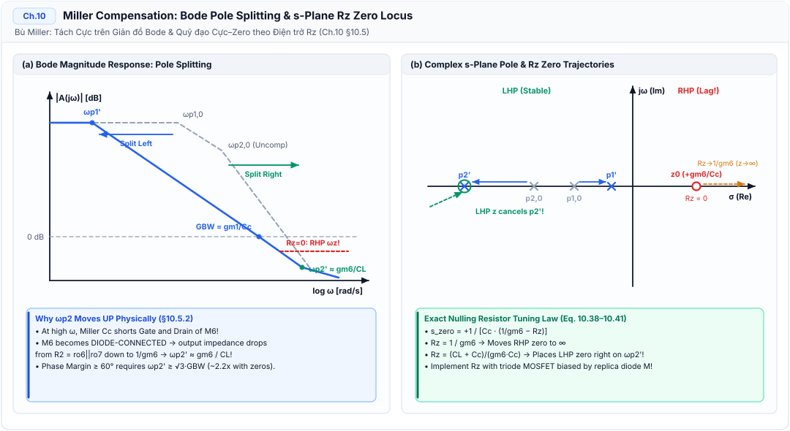

---
{
  "id": "law-multipole-phase-margin",
  "kind": "law",
  "domain": "opamps-and-compensation",
  "title_vi": "Định luật Ổn định Đa Cực, Tiêu chuẩn Barkhausen & Quan hệ Dự trữ Pha – Cực Không Trội (Multipole Stability & Phase Margin Law)",
  "title_en": "Barkhausen Instability, Multipole Feedback Dynamics, Phase Margin vs. Step Ringing, and Basic Frequency Compensation",
  "summary": "Thiết lập điều kiện dao động Barkhausen |beta*H|=1, angle=-180 deg, định lượng mối liên hệ giữa dự trữ pha (PM = 45, 60, 76 deg) với vọt lố biên độ miền tần số và rung miền thời gian, chứng minh bất đẳng thức vàng omega_p2 >= sqrt(3)*beta*GBW để đạt PM >= 60 deg (và ~2.2-3x khi có cực/zero phụ), cùng giới hạn đánh tụ nối đất đơn thuần.",
  "diagram": "../../diagrams/pole-splitting-locus.svg",
  "razavi_refs": [
    {
      "chapter": 10,
      "section": "10.1-10.4",
      "pages": "410-426",
      "equations": ["10.1", "10.2", "10.3", "10.4", "10.8", "10.9", "10.13", "10.17", "10.23"]
    }
  ],
  "glossary_codes": ["T063", "T1575", "T1592", "T1601", "T1613", "T1614", "T1616", "T1618", "T1619", "T1630", "T1632", "T1666", "T1684"],
  "process_agnostic": true,
  "roles": {
    "loop_transmission_beta_h": "Hàm truyền vòng beta*H(s) quyết định toàn bộ vị trí các cực vòng kín thông qua phương trình đặc trưng 1 + beta*H(s) = 0",
    "gain_crossover_omega_gx": "Tần số cắt độ lợi nơi |beta*H(j*omega_GX)| = 1 (0 dB) — mốc đo dự trữ pha PM = 180 deg + angle(beta*H(j*omega_GX))",
    "phase_crossover_omega_px": "Tần số cắt pha nơi angle(beta*H(j*omega_PX)) = -180 deg — phải nằm cao hơn hẳn omega_GX để hệ ổn định trên đồ thị Bode chuẩn",
    "worst_case_unity_beta": "Trạng thái hồi tiếp độ lợi đơn vị (beta = 1) đẩy đường biên độ độ lợi vòng lên cao nhất, tạo trường hợp bất lợi nhất về ổn định"
  },
  "symptoms_addressed": [
    "closed-loop-sustained-oscillation",
    "excessive-step-response-overshoot-and-ringing",
    "closed-loop-ac-frequency-peaking",
    "instability-when-configuring-opamp-as-unity-gain-buffer"
  ],
  "limitations": [
    "dominant-pole-shunt-capacitor-compensation-sacrifices-huge-bandwidth-when-two-poles-are-initially-low",
    "bode-gx-px-rule-can-mislead-for-non-monotonic-multiple-180-crossing-loops"
  ],
  "checklists": ["common-mos", "feedback-and-stb", "two-stage-miller"]
}
---

## 1. Bản chất Nguyên lý, Sơ đồ Mạch & Vai trò Từng Nhánh Cấu trúc

Mọi hệ thống hồi tiếp âm được thiết kế để lấy tín hiệu hồi trả **trừ bớt** tín hiệu đầu vào ở tần số thấp: $Y(s) = \dfrac{H(s)}{1 + \beta H(s)} X(s)$. Tuy nhiên, mỗi tầng transistor và mỗi nút ký sinh bên trong vòng lặp đều tích lũy độ trễ thời gian — tức **độ dịch pha âm $\angle \beta H(j\omega) < 0$** khi tần số tăng lên (Razavi Chương 10, §10.1–§10.4, tr. 410–426). Nếu tại một tần số $\omega_1$ nào đó, tổng độ dịch pha quanh vòng đạt tới **$-180^\circ$**, phép trừ ở bộ cộng đầu vào lập tức đảo ngược 100% thành **phép cộng cùng pha (hồi tiếp dương!)**! Nếu đúng tại tần số $\omega_1$ đó độ lớn độ lợi vòng vẫn còn bằng hoặc lớn hơn đơn vị ($\left|\beta H(j\omega_1)\right| \ge 1$), một mầm nhiễu nhiệt nhỏ xíu ở $\omega_1$ đi một vòng quay lại sẽ tự khuếch đại lớn hơn chính nó, biến bộ khuếch đại thành một **bộ tạo dao động tự kích**!

Bốn cột mốc tần số và cấu trúc chi phối hoàn toàn tính ổn định gồm:
1. **Tiêu chuẩn Dao động Barkhausen (`T1601`, Barkhausen's Criteria, Phương trình 10.2–10.3):** Hệ hồi tiếp âm mất ổn định khi tồn tại tần số $\omega_1$ sao cho $\left|\beta H(j\omega_1)\right| = 1$ đồng thời $\angle \beta H(j\omega_1) = -180^\circ$ (khiến mẫu số $1 + \beta H(j\omega_1) = 1 - 1 = 0 \implies$ độ lợi vòng kín vọt lên $\infty$).
2. **Điểm cắt độ lợi $\omega_{GX}$ (`T1614`, Gain Crossover — GX) so với Điểm cắt pha $\omega_{PX}$ (`T1616`, Phase Crossover — PX):** Đối với các hàm truyền vòng giảm đơn điệu thông thường, mạch chỉ ổn định khi biên độ $|\beta H|$ kịp rơi xuống dưới $1$ ($0\text{ dB}$) **TRƯỚC KHI** góc pha kịp chạm tới $-180^\circ$, nghĩa là bắt buộc **$\omega_{GX} < \omega_{PX}$**!
3. **Trường hợp bất lợi nhất về ổn định (`T1618`, Worst-Case Stability tại $\beta = 1$):** Vì đường cong biên độ trên thang dB là $20\log_{10}\beta + 20\log_{10}|H(j\omega)|$, khi tăng $\beta$ lên mức tối đa $\beta = 1$ (**hồi tiếp độ lợi đơn vị — `T1619`, unity-gain feedback**), toàn bộ đường biên độ được nâng cao nhất, đẩy $\omega_{GX}$ sang phải gần $\omega_{PX}$ nhất! Một Op-Amp được bù ổn định tại $\beta = 1$ sẽ ổn định cho mọi $\beta \le 1$ (với mạng $\beta$ thuần điện trở/tụ không thêm cực trễ).
4. **Số lượng cực của hệ vòng hở (§10.2):**
   - **Hệ 1 cực:** Pha tối đa chỉ tiến tới $-90^\circ$ $\implies$ **ổn định vô điều kiện (`T1630`, unconditionally stable)** với mọi $\beta A_0 > 0$.
   - **Hệ 2 cực LHP:** Pha tiệm cận $-180^\circ$ từ phía trên khi $\omega \to \infty$ (`NG10-01`!) nên về lý thuyết toán học không bao giờ tự dao động duy trì mãi mãi, nhưng khi $\beta A_0$ lớn làm $\angle \beta H(\omega_{GX}) \to -180^\circ$, cặp cực vòng kín áp sát trục ảo $j\omega$ gây **rung tắt cực chậm và vọt lố dữ dội** không thể dùng được!
   - **Hệ $\ge 3$ cực (hoặc 2 cực + 1 RHP zero):** Pha cắt vượt qua $-180^\circ$ xuống $-270^\circ$, hoàn toàn có thể **dao động tự duy trì đập biên nguồn** nếu $\beta A_0$ vượt ngưỡng tới hạn!

---

## 2. Hệ Phương trình Cốt lõi & Tư duy "Nhìn Mạch Đọc Nhanh" (Analysis by Inspection)

### 2.1. Quỹ đạo Cực của Hệ Hai Cực & Định nghĩa Dự trữ Pha (`T063`, Phase Margin — §10.2–§10.3)
Xét bộ khuếch đại hai cực LHP $H(s) = \dfrac{A_0}{(1 + s/\omega_{p1})(1 + s/\omega_{p2})}$ đặt trong vòng hồi tiếp hệ số $\beta$. Đa thức mẫu số vòng kín bậc hai $1 + \beta H(s) = 0$ có tần số tự nhiên $\omega_n$ và hệ số tắt dần $\zeta$ (Phương trình 10.6–10.9):

$$
s^2 + (\omega_{p1} + \omega_{p2}) s + \omega_{p1}\omega_{p2}(1 + \beta A_0) = 0
$$

$$
\omega_n = \sqrt{\omega_{p1}\omega_{p2}(1 + \beta A_0)}, \qquad \zeta = \frac{\omega_{p1} + \omega_{p2}}{2 \sqrt{\omega_{p1}\omega_{p2}(1 + \beta A_0)}}
$$

Ngay khi $(1 + \beta A_0) > \dfrac{(\omega_{p1} + \omega_{p2})^2}{4 \omega_{p1}\omega_{p2}}$, nghiệm cực tách khỏi trục thực thành cặp cực phức liên hợp $s_{1,2} = -\frac{\omega_{p1}+\omega_{p2}}{2} \pm j\omega_d$ và tiến dần về phía trục $j\omega$ khi $\beta A_0$ tăng!

**Dự trữ pha (`T063`, Phase Margin — PM)** được định nghĩa tại tần số cắt độ lợi $\omega_{GX}$ (nơi $|\beta H(j\omega_{GX})| = 1$):

$$
\text{PM} = 180^\circ + \angle \beta H(j\omega_{GX})
$$

*(Chú ý cảnh báo CLB ở `T063`: $\text{PM}$ là góc tính bằng **độ** đo ngay tại $\omega_{GX}$, tuyệt đối không phải hiệu hai tần số $\omega_{PX} - \omega_{GX}$!)*

Tại đúng $\omega = \omega_{GX}$, vì $\beta H(j\omega_{GX}) = 1 \cdot e^{-j(180^\circ - \text{PM})}$, độ lớn hàm truyền vòng kín bằng (Phương trình 10.10–10.18):

$$
\left| \frac{Y}{X}(j\omega_{GX}) \right| = \frac{1}{\beta} \cdot \frac{1}{\left| 1 + e^{-j(180^\circ - \text{PM})} \right|} = \frac{1}{\beta} \cdot \frac{1}{2 \sin(\text{PM} / 2)}
$$

Từ biểu thức tuyệt đẹp này, đọc ngay ý nghĩa vật lý của 3 mốc $\text{PM}$ kinh điển:
- **$\text{PM} = 5^\circ$ (Phương trình 10.11–10.13):** $\left|Y/X\right| \approx \dfrac{11{,}5}{\beta}$ ($+21\text{ dB}$ vọt đỉnh cộng hưởng, rung hàng chục chu kỳ!).
- **$\text{PM} = 45^\circ$ (`T1652`, Phương trình 10.15–10.17):** $\left|Y/X\right| \approx \dfrac{1{,}31}{\beta}$ ($+2{,}3\text{ dB}$ peaking trên miền tần số, vọt lố bước nhảy $\approx 23\%$ kèm rung rõ rệt).
- **$\text{PM} = 60^\circ$ (`T1684`, Phương trình 10.18, xem `NG10-02`):** $2\sin(30^\circ) = 1 \implies \left|\dfrac{Y}{X}(j\omega_{GX})\right| = \dfrac{1}{\beta}$ (**không bị vọt đỉnh tại $\omega_{GX}$**, hệ số tắt dần tương đương $\zeta \approx 0{,}61$, vọt lố bước nhảy chỉ $\approx 8{,}7\%$ và xác lập cực nhanh!).
- **$\text{PM} \approx 76^\circ$:** Tương ứng tắt dần tới hạn $\zeta = 1{,}0$ ($\omega_{p2} \approx 4\,\beta\,\text{GBW}$), $0\%$ vọt lố hoàn toàn không rung nhưng tốc độ sườn lên bắt đầu chậm hơn $\text{PM} = 60^\circ\text{–}65^\circ$. Do đó **$\text{PM} = 60^\circ \text{ đến } 65^\circ$ là điểm ngọt tối ưu vàng trong thiết kế vi mạch CMOS**!

### 2.2. Bất đẳng thức Vị trí Cực Không Trội $\omega_{p2}$ Để Đạt $\text{PM} \ge 60^\circ$
Xét hệ hai cực có cực trội $\omega_{p1} \ll \omega_{GX}$ (nên tại $\omega_{GX}$, cực trội đã đóng góp đủ $-90^\circ$ góc pha). Để tổng góc pha tại $\omega_{GX}$ lớn hơn hoặc bằng $-120^\circ$ (tức $\text{PM} \ge 60^\circ$), cực không trội thứ nhất $\omega_{p2}$ chỉ được phép đóng góp tối đa **$-30^\circ$**:

$$
-\arctan\left(\frac{\omega_{GX}}{\omega_{p2}}\right) \ge -30^\circ \implies \frac{\omega_{GX}}{\omega_{p2}} \le \tan(30^\circ) = \frac{1}{\sqrt{3}} \implies \omega_{p2} \ge \sqrt{3}\,\omega_{GX} \approx 1{,}732\,\omega_{GX}
$$

Nếu tính chính xác cả sự sụt biên độ nhẹ $-\frac{1}{2}\log_{10}(1 + 1/3) = -0{,}62\text{ dB}$ của chính cực $\omega_{p2}$ tại $\omega_{GX}$ so với tích xấp xỉ một cực $\beta\,\text{GBW} = \beta A_0 \omega_{p1}$:
- Với hệ **thuần 2 cực**: $\omega_{p2} \ge \frac{\sqrt{3}}{\sqrt[4]{4/3}}\,\beta\,\text{GBW} \approx 1{,}61\,\beta\,\text{GBW}$ (hoặc lấy chẵn an toàn $\omega_{p2} \ge 2\,\beta\,\text{GBW}$).
- Khi thực tế có thêm các cực ký sinh cao hơn ($\omega_{p3}, \omega_{p4}$ đóng góp thêm $-5^\circ \text{ đến } -10^\circ$) hoặc doublet/zero phụ: để giữ chắc chắn $\text{PM} \ge 60^\circ$ qua mọi góc PVT, quy tắc vàng thiết kế thực chiến là:

$$
\omega_{p2} \ge (2{,}2 \text{ đến } 3{,}0) \times \beta \cdot \text{GBW}!
$$

### 2.3. Bù Tần số Cơ bản Bằng Hạ Cực Trội (Dominant-Pole Droop Compensation — §10.4)
Với **Op-Amp một tầng** (Telescopic / Folded-Cascode, Hình 10.17–10.22): cực trội $\omega_{p1} = \frac{1}{R_{\text{out}} C_L}$ vốn đã nằm ngay tại ngõ ra, còn cực không trội $\omega_{p2}$ nằm ở nút nội cascode rất cao ($\omega_{p,X} \approx g_{m,\text{cas}}/C_X$). Nếu $\text{PM}$ chưa đủ $60^\circ$, chỉ việc **mắc thêm tụ bù song song với tụ tải $C_L$ ở ngõ ra** để kéo $\omega_{p1}$ thấp xuống sao cho $\beta\,\text{GBW} = \frac{\beta g_{m1}}{C_L + C_{\text{comp}}} \le \frac{\omega_{p,X}}{2{,}5}$!
**Nhưng tại sao cách gắn tụ nối đất này THẤT BẠI THẢM HẠI cho Op-Amp hai tầng (§10.4–§10.5, tr. 427)?**
Vì Op-Amp hai tầng ban đầu có **cả hai cực $\omega_{p,E}$ (liên tầng) và $\omega_{p,A}$ (ngõ ra) đều nằm ở tần số thấp**! Nếu chỉ gắn một tụ nối đất khổng lồ tại nút liên tầng để ép $\omega_{GX} < \frac{1}{2}\omega_{p,A}$:
1. Băng thông độ lợi đơn vị bị khóa trần ở mức cực thấp $\omega_{u} < \frac{1}{2R_{\text{out2}} C_L}$ (lãng phí hoàn toàn tốc độ của Tầng 2!).
2. Tụ bù nối đất không có hệ số nhân Miller nên đòi hỏi điện dung vật lý cực lớn (hàng chục đến hàng trăm $\text{pF}$), không thể tích hợp lên silicon!
$\implies$ Bắt buộc phải chuyển sang **Bù Miller tạo Tách Cực (`tech-miller-pole-splitting`)**!

---

## 3. Bất biến Cấu trúc & Các Bẫy Lỗi Kinh điển (Structural Invariants & Traps)

- **[INV-PM-01] Bất biến Giảm Hệ số Hồi tiếp $\beta$ Cải thiện Độ Ổn định (Đối với Hệ Đơn điệu Chuẩn):** Nếu một bộ khuếch đại được thiết kế chỉ chạy ở độ lợi vòng kín cố định bằng $4$ ($\beta = 0{,}25$, ví dụ tầng MDAC nhân 2 hoặc nhân 4 trong Pipeline ADC, §11.6.2!), tuyệt đối **đừng lãng phí công suất/băng thông đi bù cho $\beta = 1$**! Chỉ cần bù sao cho tại đúng $\beta = 0{,}25$ đạt $\text{PM} \ge 60^\circ$, bạn thu lợi ngay lập tức **băng thông vòng hở $\text{GBW}$ lớn gấp $4$ lần** trên cùng một tụ bù nhỏ bằng $1/4$ (Phương trình 11.24)! *(Tuy nhiên trên datasheet/schematic phải đóng dấu cảnh báo đỏ: "Decompensated Op-Amp — Unstable for Closed-Loop Gain < 4"!)*
- **[TRAP-PM-01] Chỉ Nhìn Dự trữ Pha (`PM`) Mà Bỏ Quên Dự trữ Độ lợi (`Gain Margin — GM`):** Có những mạch nhiều tầng có một LHP zero giữ pha lơ lửng ở $-130^\circ$ tại $\omega_{GX}$ (cho $\text{PM} = 50^\circ$ tưởng là ổn!), nhưng ngay sau $\omega_{GX}$ gặp liền hai cực cascode/gương dòng kéo pha sập thẳng qua $-180^\circ$ khi biên độ $|\beta H|$ mới chỉ kịp giảm xuống $-2\text{ dB}$! Chỉ cần góc công nghệ dịch nhẹ là $|\beta H(\omega_{PX})|$ vượt $0\text{ dB}$ gây dao động tần số cao! **Luôn kiểm tra song hành CẢ HAI điều kiện:** $\text{PM} \ge 60^\circ$ **VÀ** $\text{GM} \ge 10\text{ dB}$!
- **[TRAP-PM-02] Lầm Tưởng Rằng Cố Ý Đẩy Một LHP Zero Đè Lên Cực Phụ Là Xóa Sạch Mọi Hậu Quả (`T1692`, §10.4 tr. 426):** Dù trên đồ thị Bode một LHP zero hủy gần khít một cực không trội giúp khôi phục hoàn hảo dự trữ pha $\text{PM}$, nếu sự khử cực–zero lệch nhau $10\%\text{–}20\%$ theo PVT, nó để lại một **doublet** làm chậm đuôi xác lập miền thời gian (`concept-diffpair-mirror-pole-doublet`).

---

## 4. Lộ trình Nâng cấp Cấu trúc & Bát giác Đánh đổi (Upgrade Paths & Design Octagon)

| Vấn đề ổn định đang đối mặt | Bước chuyển kỹ thuật tiếp theo (Canonical Node) | Giải pháp trọng tâm | Cái giá đánh đổi |
|---|---|---|---|
| Op-Amp 2 tầng có cả 2 cực đều thấp, đánh tụ nối đất tốn diện tích và mất sạch băng thông | `tech-miller-pole-splitting` | Mắc tụ bù $C_C$ vắt ngang Tầng 2: vừa nhân Miller hạ $\omega_{p1}$ với tụ nhỏ, vừa đẩy $\omega_{p2}$ vọt lên $\approx g_{m2}/C_L$! | Xuất hiện RHP zero tại $+g_{m2}/C_C$ |
| RHP zero của bù Miller kéo sập pha trước khi kịp chạm $\omega_{p2}$ | `tech-miller-rhp-zero-nulling-and-cascode-comp` | Thêm điện trở $R_z$ nối tiếp $C_C$ hoặc hồi tiếp dòng $C_C$ qua cực nguồn cascode (Ahuja) | Cần bám $R_z \propto 1/g_{m2}$ theo PVT hoặc tăng dòng nhánh cascode |
| Đồ thị Bode của hệ đa vòng cắt $-180^\circ$ tới 2–3 lần, không biết âm hay dương dự trữ pha | `tech-nyquist-stability-criterion` | Áp dụng tiêu chuẩn Nyquist đếm số vòng bao quanh điểm $(-1, 0)$ trên mặt phẳng phức | Cần quét đủ dải tần từ DC đến $\infty$ và đếm số cực RHP vòng hở $P$ |

---

## 5. Thích ứng Đa Tiến trình (90nm / 65nm / 45nm) & Cách Kiểm chứng trong Cadence / Spectre

### 5.1. Thích ứng Công nghệ Nanomet (90nm $\to$ 65nm $\to$ 45nm)
- **Biến thiên $\text{PM}$ Theo Góc Công nghệ & Nhiệt độ:** Trong 90nm/65nm/45nm, hãy luôn thiết kế ở nominal `TT, 27°C` với **$\text{PM}_{\text{nom}} \approx 65^\circ\text{–}70^\circ$**, bởi vì ở góc xấu nhất (thường là `FF, -40°C` nơi dòng và $g_{m1}$ tăng làm $\omega_{GX}$ vọt cao, hoặc `FS`/`SF` + `125°C` nơi $g_{m2}$ của Tầng 2 sụt giảm kéo thấp $\omega_{p2}$ kèm tụ điện MIM/MOM lệch $-15\%$), dự trữ pha thực tế rất dễ rớt mất $8^\circ\text{–}12^\circ$! Mục tiêu ký duyệt thiết kế (sign-off) là **$\text{PM}_{\min,\text{PVT}} \ge 52^\circ\text{–}55^\circ$ trên mọi tổ hợp góc PVT và sau trích xuất ký sinh layout (PEX)**!

### 5.2. Quy trình Kiểm chứng trong Cadence Virtuoso / Spectre
1. **Đối chiếu Tam Giác Vàng: `stb` (PM/GM) $\leftrightarrow$ `ac` Vòng Kín (Peaking dB) $\leftrightarrow$ `tran` Bước Nhảy (Overshoot %):**
   - Không bao giờ ký duyệt ổn định chỉ bằng một con số `phaseMargin` đơn lẻ của `stb`! Luôn chạy đủ bộ ba kiểm tra chéo:
     1. `stb`: `phaseMargin >= 60 deg` (nominal) / `>= 52 deg` (PVT + PEX), `gainMargin >= 10 dB`.
     2. `ac` vòng kín: độ vọt đỉnh biên độ $\max_f |A_{\text{cl}}(f)| / |A_{\text{cl}}(0)| \le +1{,}0\text{ dB}$!
     3. `tran` xung nhỏ ($10\text{ mV}$): độ vọt lố (overshoot) $< 10\%$ và dập tắt hoàn toàn chỉ sau 1 nửa chu kỳ lượn!

### 5.3. Bảng Tra Nhanh Tương Quan Giữa Dự trữ Pha (`PM`), Tỉ số Cực $\omega_{p2}/(\beta\,\text{GBW})$, Hệ số Tắt dần $\zeta$ & Vọt lố Bước nhảy
Đối với hệ chuẩn 2 cực LHP không có điểm không gần dải cắt ($H(s) = \frac{A_0}{(1 + s/\omega_{p1})(1 + s/\omega_{p2})}$, $\beta A_0 \gg 1$), mối quan hệ giải tích chính xác dùng để tra nhanh khi thiết kế tay và kiểm định mô phỏng là:

| Dự trữ Pha ($\text{PM}$) | Tỉ số $\dfrac{\omega_{p2}}{\beta\,\text{GBW}}$ | Hệ số Tắt dần Vòng kín ($\zeta$) | Độ Vọt đỉnh Miền Tần số (AC Peaking) | Độ Vọt lố Bước nhảy Miền Thời gian (Step Overshoot) | Đánh giá Thiết kế Thực tế |
|---|---|---|---|---|---|
| $30^\circ$ | $\approx 0{,}54$ | $0{,}27$ | $+6{,}0\text{ dB}$ | $\approx 41\%$ | **Không đạt** — rung mạnh nhiều chu kỳ, dễ dao động theo PVT |
| $45^\circ$ | $\approx 0{,}90$ ($\sim 1{,}0$) | $0{,}42$ | $+2{,}4\text{ dB}$ | $\approx 23\%$ | **Biên dưới tối thiểu** — chỉ chấp nhận cho vòng phụ không khắt khe |
| **$60^\circ$** | **$\approx 1{,}61$ ($\sim \sqrt{3}$)** | **$0{,}61$** | **$0{,}0\text{ dB}$ tại $\omega_{GX}$** ($\le 0{,}2\text{ dB}$ đỉnh) | **$\approx 8{,}7\%$** | **Điểm ngọt Chuẩn Vàng** — cân bằng tối ưu tốc độ xác lập & độ êm |
| **$65^\circ$** | **$\approx 2{,}05$** | **$0{,}69 \approx \frac{1}{\sqrt{2}}$** | **$0{,}0\text{ dB}$ phẳng tuyệt đối** (Butterworth!) | **$\approx 4{,}7\%$** | **Mục tiêu Thiết kế Nominal Lý tưởng** (để giữ $\ge 55^\circ$ qua PVT!) |
| $76^\circ$ | $\approx 3{,}90$ ($\sim 4{,}0$) | $1{,}00$ | $0{,}0\text{ dB}$ (Cực thực kép) | $0{,}0\%$ | Tắt dần tới hạn — không vọt lố nhưng tốn công suất $g_{m2}$ hoặc giảm băng thông |

---

## 6. Mốc Đối chiếu Sách Razavi & Thuật ngữ Chuẩn CLB

### 6.1. Đối chiếu Sách Gốc Razavi (2nd Edition)
- **Chương 10:** *Stability and Frequency Compensation* — §10.1 *General Considerations* (tr. 410–414, Phương trình 10.1–10.4, Hình 10.1–10.6), §10.2 *Multipole Systems* (tr. 414–416, Phương trình 10.5–10.9, Hình 10.7–10.9), §10.3 *Phase Margin* (tr. 416–420, Phương trình 10.10–10.18, Hình 10.10–10.16), §10.4 *Basic Frequency Compensation* (tr. 420–426, Phương trình 10.19–10.23, Hình 10.17–10.24).
- **Chú giải Hiệu đính Học thuật CLB (`NG10`):**
  - **`NG10-01` (tr. 414):** Ở câu cuối trang 414 khi phát biểu điều kiện ổn định cho hệ hai cực LHP, bản in gốc in ngược dấu bất đẳng thức thành $\angle \beta H < -180^\circ$; theo đúng Hình 10.7 (đường pha đi từ $0^\circ$ xuống và tiệm cận $-180^\circ$ từ phía trên), điều kiện đúng tại điểm cắt độ lợi là **$\angle \beta H > -180^\circ$**!
  - **`NG10-02` (tr. 419, Phương trình 10.18):** Khi tính đáp ứng vòng kín tại $\omega_1 = \omega_{GX}$ cho $\text{PM} = 60^\circ$, bản in gốc viết $Y(j\omega_1)/X(j\omega_1) = 1/\beta$ thiếu dấu trị tuyệt đối độ lớn; chính xác về mặt số phức tại $\beta H = e^{-j120^\circ}$ ta có $\frac{Y}{X}(j\omega_1) = \frac{1}{\beta} e^{-j60^\circ}$, nên đại lượng bằng $\frac{1}{\beta}$ là **biên độ $\left|\dfrac{Y(j\omega_1)}{X(j\omega_1)}\right| = \dfrac{1}{\beta}$**.
  - **`NG11-11` (tr. 500, §11.6.2):** Khi điều chỉnh bù tần số theo hệ số hồi tiếp $\beta = 1/5$ với $A_0 = 500$ ($\beta A_0 = 100$), công thức (11.24) cho cực trội mới $f'_{p1} \approx 170\text{ MHz} / 100 = 1{,}7\text{ MHz}$ (khớp §11.6.2), dù trang 500 có chỗ chia nhầm cho $125$ ra $1{,}36\text{ MHz}$.

### 6.2. Bảng Thuật ngữ Chuẩn CLB Vi Mạch Sử dụng trong Thẻ
| Mã CLB | Thuật ngữ Tiếng Anh | Thuật ngữ Tiếng Việt Chuẩn | Ghi chú Ngữ cảnh |
|---|---|---|---|
| `T1592` | stability and frequency compensation | tính ổn định và bù tần số | Trọng tâm toàn bộ Chương 10 |
| `T1601` | Barkhausen's Criteria | tiêu chuẩn Barkhausen | $\left|\beta H(j\omega_1)\right| = 1$ và $\angle \beta H(j\omega_1) = -180^\circ$ |
| `T1614` / `T1615` | gain crossover (GX) | tần số cắt độ lợi / điểm cắt độ lợi | Nơi $\left|\beta H(j\omega_{GX})\right| = 1$ ($0\text{ dB}$) |
| `T1616` / `T1617` | phase crossover (PX) | tần số cắt pha / điểm cắt pha | Nơi $\angle \beta H(j\omega_{PX}) = -180^\circ$ |
| `T063` | phase margin (PM) | dự trữ pha | $\text{PM} = 180^\circ + \angle \beta H(j\omega_{GX})$ (đơn vị độ) |
| `T1619` | unity-gain feedback | hồi tiếp độ lợi đơn vị | $\beta = 1$ — trường hợp bất lợi nhất về ổn định (`T1618`) |
| `T1630` | unconditionally stable | ổn định vô điều kiện | Ổn định cho mọi hệ số hồi tiếp $0 < \beta \le 1$ |
