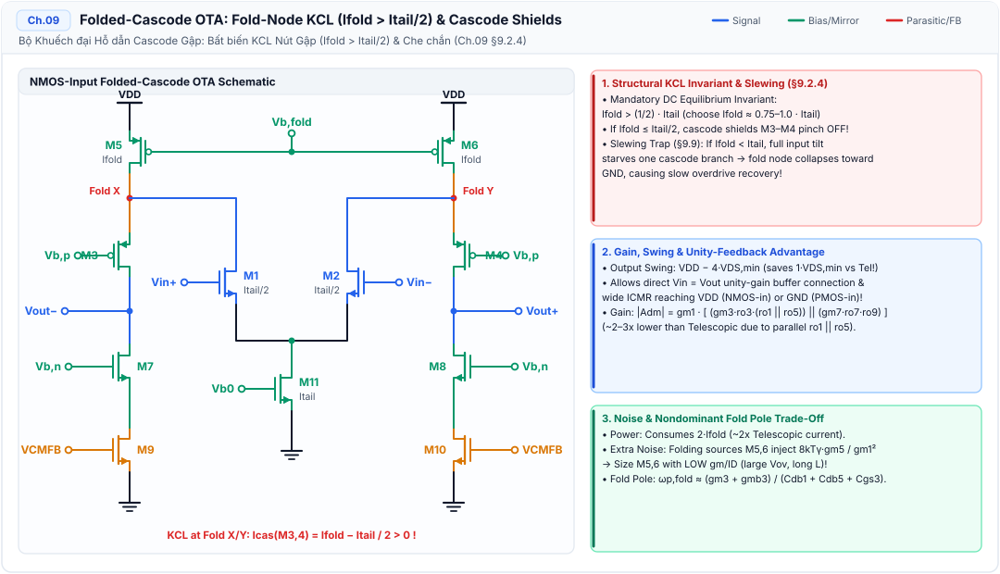

---
{
  "id": "law-slewing-vs-linear-settling-time-budget",
  "kind": "law",
  "domain": "opamps-and-compensation",
  "title_vi": "Định luật Phân bổ Ngân sách Thời gian Xác lập: Slewing, Xác lập Tuyến tính, Phục hồi Quá kích & Đuôi Chậm Doublet",
  "title_en": "Total Step-Settling Time Budget Law: Slewing vs. Linear Exponential Settling, Two-Stage Bottlenecks, Overdrive Recovery, and Pole-Zero Doublets",
  "summary": "Định luật phân rã chính xác tổng thời gian xác lập bước nhảy lớn t_settle = t_slew + t_linear tới độ chính xác tương đối epsilon (hoặc N-bit ADC), điện áp bước ranh giới Vstep,crit = Vov/beta = 2/(beta*(gm/ID)), nút thắt slewing nội bộ so với ngoại vi trong Op-Amp hai tầng, hiện tượng chết lặng phục hồi quá kích khi Ifold < Iss và đuôi hàm mũ siêu chậm do cặp cực-zero gần trùng (doublet).",
  "diagram": "../../diagrams/folded-cascode-ota.svg",
  "razavi_refs": [
    {
      "chapter": 9,
      "section": "9.9-9.10.2",
      "pages": "390-400",
      "equations": ["9.59", "9.63", "9.66", "9.69", "9.71", "9.74", "9.80"]
    },
    {
      "chapter": 10,
      "section": "10.6",
      "pages": "433-436, 457",
      "equations": ["10.36", "10.37", "10.38", "10.59", "10.60"]
    }
  ],
  "glossary_codes": ["T079", "T1413", "T1541", "T1546", "T1556", "T1558", "T1707", "T1708", "T1717", "T1951"],
  "process_agnostic": true,
  "roles": {
    "slewing_current_limited_phase": "Giai đoạn đầu của bước nhảy lớn khi sai số đầu vào vượt ngưỡng quét cạn dòng đuôi ISS, làm ngõ ra tăng tuyến tính theo dốc cố định SR = ISS/CL,eff",
    "linear_exponential_tail_phase": "Giai đoạn cuối khi sai số vi sai lọt vào cửa sổ tuyến tính +-sqrt(2)*Vov1, ngõ ra hội tụ hàm mũ với hằng số thời gian vòng kín tau_CL = 1/(beta*omega_u)",
    "overdrive_recovery_deadtime": "Khoảng trễ tê liệt khi một nhánh dòng bị rút cạn đẩy transistor vào vùng triode sâu, cần thời gian nạp lại điện dung nút nội bộ trước khi khuếch đại trở lại",
    "pole_zero_doublet_slow_mode": "Thành phần hàm mũ phụ k_d*exp(-omega_z*t) ẩn mình trên đồ thị Bode nhưng kéo dài lê thê thời gian xác lập chính xác cao 0.01% - 0.001%"
  },
  "symptoms_addressed": [
    "switched-capacitor-adc-failing-enob-at-high-sampling-clock-rate",
    "large-step-settling-much-slower-than-small-signal-gbw-prediction",
    "asymmetric-positive-and-negative-slew-rates-in-two-stage-miller-opamp",
    "mysterious-slow-settling-tail-despite-65-degree-phase-margin"
  ],
  "limitations": [
    "boosting-gm-over-id-accelerates-linear-settling-but-shrinks-slewing-threshold-vstep-crit",
    "single-time-constant-formula-underestimates-underdamped-ringing-envelope",
    "pole-zero-cancellation-compensation-schemes-inherently-risk-pvt-doublets"
  ],
  "checklists": ["common-mos", "folded-cascode", "two-stage-miller"]
}
---

## 1. Bản chất Nguyên lý, Sơ đồ Mạch & Vai trò Từng Nhánh Cấu trúc

Trong các hệ thống lấy mẫu rời rạc thời gian tốc độ cao — tiêu biểu là tầng khuếch đại thặng dư (MDAC) của ADC Pipeline, bộ tích phân $\Sigma\Delta$, mạch giữ mẫu (Sample-and-Hold) hay bộ điều chế chuyển mạch tụ (`topo-switched-capacitor-amplifiers-integrators`) — phổ tần số xoay chiều không phải là thước đo cuối cùng! Thứ duy nhất quyết định độ chính xác của hệ thống tại thời điểm sườn xuống xung nhịp lấy mẫu $T_{\text{clk}}/2$ là **thời gian xác lập (`T1413`, settling time)** hay đầy đủ là **thời gian xác lập đáp ứng bậc thang (`T1951`, step response settling time)**: khoảng thời gian tính từ lúc áp bước nhảy biên độ lớn $\Delta V_{\text{step}}$ cho tới khi ngõ ra lọt hẳn vào và nằm yên bên trong dải dung sai tương đối $\pm\epsilon$ (ví dụ với ADC $N$-bit đòi hỏi sai số dưới $\frac{1}{2}\text{ LSB}$, tức $\epsilon < \frac{1}{2^{N+1}}$: $12\text{-bit} \Rightarrow \epsilon < 0{,}012\%$, $14\text{-bit} \Rightarrow \epsilon < 0{,}003\%$).



Như Razavi giải phẫu xuyên suốt Chương 9 (§9.9–§9.10.2, tr. 390–400) và Chương 10 (§10.6, tr. 433–436 & Bài tập 10.26, tr. 457), đáp ứng quá độ của một Op-Amp thực tế trước bước nhảy lớn **không bao giờ là một hàm mũ đơn thuần**, mà bị chi phối bởi **bốn cơ chế vật lý nối đuôi nhau**:
1. **Chế độ giới hạn tốc độ biến thiên (`T1558`, slewing regime / `T1541`, slewing):** Cặp vi sai đầu vào bị bão hòa cứng, lái $100\%$ dòng đuôi $I_{SS}$ sang một nhánh nạp tụ với dốc hằng số bằng **tốc độ biến thiên điện áp cực đại (`T079`, slew rate — $\text{SR}$)**.
2. **Phục hồi sau quá kích (`T1556`, overdrive recovery):** Nếu dòng dồn sang làm cạn nhánh cascode hoặc đẩy transistor tải/nguồn đuôi lún sâu vào vùng triode, mạch bị "đóng băng" một khoảng thời gian chết $t_{\text{rec}}$ để kéo nút nội bộ thoát khỏi vùng triode!
3. **Quá trình xác lập tuyến tính (`T1546`, linear settling):** Khi điện áp sai số vi sai tại cổng đầu vào thu hẹp vào lại cửa sổ tuyến tính, Op-Amp quay về chế độ khuếch đại tín hiệu nhỏ và hội tụ hàm mũ theo hằng số thời gian vòng kín $\tau_{\text{CL}} = \frac{1}{\beta \omega_u}$.
4. **Đuôi xác lập chậm do cặp cực–zero gần trùng (`T1707` / `T1708`, doublet problem):** Bất kỳ sự triệt tiêu không hoàn hảo nào giữa một cực và một zero ở tần số thấp/trung bình đều tiêm thêm một hàm mũ siêu chậm $k_d e^{-\omega_z t}$ vô hình trên đồ thị Bode nhưng phá hỏng toàn bộ thời gian xác lập chính xác cao!

---

## 2. Hệ Phương trình Cốt lõi & Tư duy "Nhìn Mạch Đọc Nhanh" (Analysis by Inspection)

### 2.1. Phân rã Chính xác Ngân sách $t_{\text{settle}} = t_{\text{slew}} + t_{\text{linear}}$ & Ranh giới Bước Nhảy $V_{\text{step,crit}}$ (§9.9, Phương trình 9.59–9.71)
Xét Op-Amp một cực trội đóng trong vòng hồi tiếp điện trở (Phương trình 9.59: $\left(V_{in} - V_{\text{out}}\frac{R_2}{R_1+R_2}\right)A - V_{\text{out}}\frac{1}{R_{\text{out}}} = \frac{V_{\text{out}}}{R_1+R_2} + V_{\text{out}} C_L s$) hoặc vòng hồi tiếp điện dung (Phương trình 9.63: $\left(V_{in} - \frac{C_1}{C_1+C_2}V_{\text{out}}\right)A_v - \frac{V_{\text{out}}}{R_{\text{out}}} = V_{\text{out}}\frac{C_1 C_2}{C_1+C_2}s$, hệ số hồi tiếp $\beta = \frac{C_1}{C_1+C_2}$ theo ký hiệu Hình 9.69 của Razavi):
- **Khi bước nhảy nhỏ (Thuần túy Xác lập Tuyến tính, Phương trình 9.66):**
  Đáp ứng bước đơn vị biên độ $V_0$ là hàm mũ chuẩn:

$$
V_{\text{out}}(t) = V_{\text{final}}\left[1 - \exp\!\left(-\frac{t}{\tau_{\text{CL}}}\right)\right]u(t) \quad \text{(9.66)}, \qquad \tau_{\text{CL}} = \frac{1}{\beta\,\omega_u} = \frac{C_{L,\text{eff}}}{\beta\,g_{m1}}
$$

  Để sai số tương đối giảm xuống dưới $\epsilon$ ($\left|\frac{V_{\text{out}}(t) - V_{\text{final}}}{V_{\text{final}}}\right| \le \epsilon$), thời gian xác lập tuyến tính thuần túy là:

$$
t_{\text{linear,only}}(\epsilon) = \tau_{\text{CL}}\,\ln\!\left(\frac{1}{\epsilon}\right) \quad \xrightarrow{\epsilon = 2^{-(N+1)}}\; (N + 1)\ln 2 \cdot \tau_{\text{CL}} \approx 0{,}693\,(N + 1)\,\tau_{\text{CL}}
$$

- **Điện áp Bước Ranh giới Khởi phát Slewing ($V_{\text{step,crit}}$, Phương trình 9.69):**
  Ngay tại $t = 0^+$ khi ngõ ra chưa kịp nhúc nhích ($\Delta V_{\text{out}}(0^+) = 0$), một bước nhảy mong muốn tại ngõ ra có độ lớn $\Delta V_{\text{out,step}}$ đặt một điện áp lỗi vi sai $\Delta V_{in,\text{diff}}(0^+) = \beta\,\Delta V_{\text{out,step}}$ trực tiếp lên cặp đầu vào $M_1\text{–}M_2$! Theo đặc tuyến cặp vi sai luật bình phương (Phương trình 9.69), một transistor tắt hẳn và $100\%$ dòng đuôi $I_{SS}$ dồn sang một bên khi $\Delta V_{in,\text{diff}} \ge \sqrt{2}\,V_{OV1}$ (hoặc theo xấp xỉ tiếp tuyến dốc đầu là $\Delta V_{\text{lin}} = \frac{I_{SS}}{g_{m1}} = V_{OV1} = \frac{2}{g_{m1}/I_{D1}}$!). Suy ra **ngưỡng bước nhảy ngõ ra ranh giới**:

$$
V_{\text{step,crit,exact}} = \frac{\sqrt{2}\,V_{OV1}}{\beta}, \qquad V_{\text{step,crit,tan}} = \frac{I_{SS}}{\beta\,g_{m1}} = \frac{V_{OV1}}{\beta} = \frac{2}{\beta\,(g_{m1}/I_{D1})}
$$

  *Hệ quả thiết kế sâu sắc cho CMOS nanomet:* Khi bạn đẩy cặp đầu vào lên vùng nghịch đảo yếu/vừa ($g_{m1}/I_{D1} = 20\text{ V}^{-1} \Rightarrow \frac{2}{g_{m1}/I_{D1}} = 100\text{ mV}$) để tăng $\text{GBW}$ và giảm nhiễu, cửa sổ tuyến tính bị co hẹp chỉ còn $100\text{ mV}/\beta$ — khiến **hầu như mọi bước nhảy thực tế ($\Delta V_{\text{out,step}} \ge 0{,}4\text{–}0{,}8\text{ V}$) đều lập tức rơi sâu vào chế độ Slewing**!

- **Tổng Thời gian Xác lập Kết hợp ($t_{\text{settle}} = t_{\text{slew}} + t_{\text{linear}}$, Phương trình 9.71):**
  Khi $\Delta V_{\text{out,step}} > V_{\text{step,crit,tan}}$, ngõ ra leo dốc thẳng đứng với tốc độ $\text{SR} = \frac{I_{SS}}{C_{L,\text{eff}}}$ trong khoảng thời gian $t_{\text{slew}}$ cho đến khi khoảng cách còn lại tới đích thu hẹp đúng bằng $V_{\text{step,crit,tan}} = \frac{V_{OV1}}{\beta}$ (tương tự dạng Phương trình 9.71 với hệ số ngưỡng $\alpha$), sau đó chuyển mượt sang hàm mũ với hằng số thời gian $\tau_{\text{CL}}$ (liên tục cả biên độ lẫn đạo hàm $\frac{dV_{\text{out}}}{dt}$ tại điểm nối!):

$$
t_{\text{slew}} = \frac{\Delta V_{\text{out,step}} - \dfrac{V_{OV1}}{\beta}}{\text{SR}}, \qquad t_{\text{linear}} = \tau_{\text{CL}}\,\ln\!\left(\frac{V_{OV1} / \beta}{\epsilon\,\Delta V_{\text{out,step}}}\right)
$$

$$
\Longrightarrow \quad t_{\text{settle}}(\epsilon) = \frac{\Delta V_{\text{out,step}}}{\text{SR}} + \tau_{\text{CL}}\left[\ln\!\left(\frac{V_{OV1}}{\beta\,\epsilon\,\Delta V_{\text{out,step}}}\right) - 1\right] \quad \left(\text{với } \tau_{\text{CL}} = \frac{V_{OV1}}{\beta\,\text{SR}}!\right)
$$

  *(Chú ý đẳng thức vàng kết nối hai thế giới: đối với OTA 1 tầng lớp A, $\frac{\text{SR}}{\beta\,\omega_u} = \frac{I_{SS}/C_L}{\beta\,g_{m1}/C_L} = \frac{V_{OV1}}{\beta} = V_{\text{step,crit,tan}}$!)*

### 2.2. Nút Thắt Slewing Trong Op-Amp Hai Tầng Bù Miller (`T1717`, §10.6 Phương trình 10.36–10.38) & OTA Đẩy–Kéo (§9.10 Phương trình 9.74, 9.80)
Trong Op-Amp hai tầng bù Miller (Tầng 1 dòng đuôi $I_{SS}$ lái Tầng 2 NMOS nguồn chung $M_{\text{out}}$ có nguồn dòng tải tĩnh $I_1 = I_{D2}$ qua tụ phản hồi $C_F = C_C$, Hình 10.37):
1. **Phương trình vi phân chính xác của Tầng 2 trong giai đoạn Slewing (Phương trình 10.36–10.38):**
   Khi Tầng 1 bị bão hòa bơm dòng bước hằng định $I_{in}(t) = I_{SS}\,u(t)$ vào nút cổng $X$ của $M_{\text{out}}$, xấp xỉ đất ảo lý tưởng cho dốc tuyến tính $V_{\text{out}}(t) \approx \frac{I_{SS}}{C_C}t$ (Phương trình 10.36). Giải chính xác KCL tại cả hai đầu tụ $C_C$ kể cả $g_{m2}$ và $r_{O2}$ hữu hạn dẫn tới phương trình vi phân (Phương trình 10.37) và nghiệm quá độ đầy đủ (Phương trình 10.38):

$$
C_C\left(1 + \frac{1}{g_{m2} r_{O2}}\right)\frac{dV_{\text{out}}}{dt} = I_{in} - \frac{C_C}{g_{m2}}\frac{dI_{in}}{dt} \quad \text{(10.37)} \;\Longrightarrow\; V_{\text{out}}(t) = \frac{I_{SS}}{C_C\left(1 + \dfrac{1}{g_{m2}r_{O2}}\right)}t\,u(t) - \frac{I_{SS}}{g_{m2} + r_{O2}^{-1}}u(t) \quad \text{(10.38)}
$$

   *Hiện tượng bước nhảy ngược ban đầu (Pre-slew Negative Step):* Số hạng thứ hai $-\frac{I_{SS}}{g_{m2}}u(t)$ cho thấy ngay tại $t = 0^+$, dòng bước $+I_{SS}$ phóng xuyên thẳng qua tụ $C_C$ làm ngõ ra **giật ngược chiều xuống dưới** một nấc trước khi bắt đầu leo dốc dương!
2. **Định luật Nút Thắt Kép Giữa Slewing Nội bộ ($C_C$) và Slewing Ngoại vi ($C_L$):**
   Khi ngõ ra đồng thời mang tải lớn $C_L$:
   - Theo chiều mà transistor khuếch đại $M_{\text{out}}$ bật mạnh hơn (hút dòng lớn tùy ý xuống đất với NMOS CS): $M_{\text{out}}$ dễ dàng nuốt trọn cả dòng $I_{SS}$ từ $C_C$ lẫn dòng xả $C_L\left|\frac{dV_{\text{out}}}{dt}\right|$, nên tốc độ chỉ bị giới hạn nội bộ bởi Tầng 1: $\text{SR}^- = \frac{I_{SS}}{C_C}$.
   - Theo chiều ngược lại (ngõ ra phải tăng lên nhờ nguồn dòng tĩnh cố định $I_{D2}$ ở trên đầu): nguồn dòng $I_{D2}$ phải **cùng lúc gánh cả dòng $I_{SS}$ chảy vào $C_C$ lẫn dòng nạp cho $C_L$**! Nếu $I_{D2}$ không đủ lớn, $M_{\text{out}}$ tắt hẳn và nút cổng $X$ bị kéo vọt lên kẹp chặt Tầng 1 vào vùng triode, khóa tốc độ biến thiên tổng thể tại giá trị nhỏ hơn trong hai nhánh:

$$
\text{SR}_{\text{2-stage}} = \min\!\left(\frac{I_{SS}}{C_C},\;\; \frac{I_{D2} - I_{SS}}{C_L} \;\text{ (hoặc } \frac{I_{D2}}{C_C + C_L} \text{ khi Tầng 1 sập dòng)}\right) \implies \text{Bắt buộc chọn } I_{D2} \ge I_{SS}\left(1 + \frac{C_L}{C_C}\right)!
$$

   *(Để vượt qua giới hạn dòng tĩnh lớp A này mà không tốn công suất, §9.10.1–§9.10.2 giới thiệu OTA gương dòng tỷ lệ $M = W_4/W_8$ có hàm truyền nhánh gương Phương trình 9.74 và OTA hai tầng đẩy–kéo lớp AB Phương trình 9.80 kèm chú giải cực tính `NG09-11`!).*

### 2.3. Đuôi Hàm Mũ Siêu Chậm Do Cặp Cực–Zero Gần Trùng (`T1707` / `T1708`, Bài tập 10.26 Phương trình 10.59–10.60)
Giả sử mạch xuất hiện một cặp cực–zero nằm gần nhau ($\omega_z \approx \omega_{p2}$) ở tần số thấp hơn nhiều so với $\omega_u = A_0 \omega_{p1}$ (ví dụ do gương dòng chủ động `concept-diffpair-mirror-pole-doublet`, do OTA phụ trong `topo-gain-boosted-cascode` §9.4.3, hoặc do lệch điện trở khử zero $R_z$ trong bù Miller!). Hàm truyền vòng hở (Phương trình 10.59) và hàm truyền hồi tiếp đơn vị $\beta = 1$ (Phương trình 10.60, tr. 457) là:

$$
H_{\text{open}}(s) = A_0\,\frac{1 + \dfrac{s}{\omega_z}}{\left(1 + \dfrac{s}{\omega_{p1}}\right)\left(1 + \dfrac{s}{\omega_{p2}}\right)} \quad \text{(10.59)} \;\Longrightarrow\; H_{\text{closed}}(s) = \frac{A_0\left(1 + \dfrac{s}{\omega_z}\right)}{\dfrac{s^2}{\omega_{p1}\omega_{p2}} + \left(\dfrac{1}{\omega_{p1}} + \dfrac{1}{\omega_{p2}} + \dfrac{A_0}{\omega_z}\right)s + A_0 + 1} \quad \text{(10.60)}
$$

Khi $\omega_z, \omega_{p2} \ll \omega_u = A_0 \omega_{p1}$ và có độ lệch nhỏ $\Delta\omega = \omega_{p2} - \omega_z \neq 0$, hai cực vòng kín tách thành một cực nhanh $\omega_{\text{fast}} \approx \omega_u$ và một cực chậm bị "kẹt" sát zero tại $\omega_{\text{slow}} \approx \omega_z\left(1 + \frac{\omega_{p2} - \omega_z}{\omega_u}\right)$. Phép biến đổi Laplace ngược cho đáp ứng bước đơn vị:

$$
V_{\text{out}}(t) \approx V_{\text{step}}\left[1 - (1 - k_d)e^{-\omega_u t} - k_d e^{-\omega_z t}\right]u(t), \qquad k_d \approx \frac{\omega_{p2} - \omega_z}{\omega_u}
$$

- **Ví dụ định lượng gây sốc:** Giả sử $\omega_u = 2\pi(100\text{ MHz})$ ($\tau_{\text{CL}} = 1{,}59\text{ ns}$), có một doublet lệch $10\%$ nằm ở $\omega_z = 2\pi(5\text{ MHz}), \omega_{p2} = 2\pi(5{,}5\text{ MHz})$ ($\tau_z = 31{,}8\text{ ns}$):
  - Trên đồ thị Bode AC: độ lệch pha cực đại của doublet chưa tới $3^\circ$ ở $5\text{ MHz}$ và bằng **$0{,}15^\circ$ tại $100\text{ MHz}$** — người thiết kế nhìn Bode tưởng mạch hoàn hảo tuyệt đối!
  - Trong miền thời gian cho ADC $14\text{-bit}$ ($\epsilon = 0{,}003\% = 3\times 10^{-5}$): biên độ đuôi chậm là $k_d \approx \frac{0{,}5\text{ MHz}}{100\text{ MHz}} = 0{,}005 = 0{,}5\%$! Thay vì xác lập xong trong $10{,}5\,\tau_{\text{CL}} \approx 16{,}7\text{ ns}$, ngõ ra bị thành phần $0{,}005\,e^{-t/31{,}8\text{ ns}}$ cầm chân suốt **$t_{\text{doublet}} = 31{,}8\text{ ns} \times \ln\!\left(\frac{0{,}005}{3\times 10^{-5}}\right) \approx 163\text{ ns}$ — chậm gấp $10$ lần**!

---

## 3. Bất biến Cấu trúc & Các Bẫy Lỗi Kinh điển (Structural Invariants & Traps)

- **[INV-SET-01] Bất biến Cân bằng Dòng Nhánh Gập Chống Trễ Phục hồi Quá kích (`I_fold >= 1.0 * I_SS`, §9.9 Hình 9.75–9.77):**
  Trong Folded-Cascode OTA, khi xảy ra bước nhảy lớn làm một bên cặp đầu vào dồn trọn dòng $I_{SS}$ vào nút gập $X$, nếu người thiết kế tiết kiệm công suất chọn $I_{\text{fold}} < I_{SS}$ (chẳng hạn $I_{\text{fold}} = 0{,}7\,I_{SS}$), transistor cascode bên đó tắt ngúm hoàn toàn và dòng dư $I_{SS} - I_{\text{fold}}$ kéo điện áp nút gập $V_X$ đập thẳng lên $V_{DD}$ (với PMOS-in thì đập xuống GND), đẩy cặp đầu vào và nguồn dòng đuôi lún sâu vào vùng triode! Khi ngõ ra gần chạm đích, mạch mất hàng chục nano-giây **phục hồi sau quá kích (`T1556`)** chỉ để xả lại tụ lớn $C_X$ về điểm phân cực cũ! Luôn đặt **$I_{\text{fold}} \ge (1{,}0\text{–}1{,}2)\,I_{SS}$** hoặc gắn diode/transistor kẹp biên độ tại nút gập!
- **[INV-SET-02] Bất biến Cấm Đặt Doublet Trong Vùng $\omega_z < \beta\,\omega_u$ Của Mạch Xác Lập Chính Xác Cao:**
  Mọi cặp cực–zero không thể khớp tuyệt đối trên silicon (như vòng OTA phụ trong `topo-gain-boosted-cascode` hoặc cặp khử $R_z C_C$) **bắt buộc phải được đẩy lên vùng tần số $\omega_{\text{doublet}} > \beta\,\omega_u$** (đồng thời thấp hơn $\omega_{p2}$ của mạch chính: quy tắc kẹp bánh mì Razavi–Bult & Geelen $\beta\,\omega_{\text{GBW,main}} < \omega_{\text{GBW,aux}} < \omega_{p2,\text{main}}$!) để hằng số thời gian $1/\omega_z$ của đuôi doublet ngắn hơn cả hằng số thời gian chính $\tau_{\text{CL}}$, triệt tiêu hoàn toàn đuôi lê thê!

- **[TRAP-SET-01] Bẫy Tối Ưu Hóa Mù Quáng $g_m/I_D$ Cực Cao Làm Chậm Tổng Thời Gian Xác Lập Bước Lớn:** Nhiều sinh viên giữ nguyên dòng đuôi $I_{SS}$ rồi tăng vọt $W_{1,2}$ để đẩy $g_{m1}/I_{D1}$ từ $12\text{ V}^{-1}$ lên $24\text{ V}^{-1}$ với hy vọng giảm một nửa $\tau_{\text{CL}}$! Thực tế khi $\Delta V_{\text{out,step}}$ lớn, $t_{\text{slew}} = \frac{\Delta V_{\text{out,step}} - V_{OV1}/\beta}{\text{SR}}$ chiếm $70\%$ tổng thời gian lại **dài thêm ra** (do $V_{OV1}$ bị giảm một nửa!), trong khi $C_{in}$ của $M_{1,2}$ tăng gấp $4\text{–}6$ lần làm suy giảm hệ số hồi tiếp $\beta = \frac{C_2}{C_1 + C_2 + C_{in}}$, khiến tổng $t_{\text{settle}}$ thực tế **TỆ HƠN**!
- **[TRAP-SET-02] Bẫy Đo Thời Gian Xác Lập Bằng Ngưỡng Tĩnh Sai Giá Trị Cuối $V_{\text{final}}$:** Do độ lợi DC hữu hạn $A_0$, giá trị tiệm cận thực tế tại $t \to \infty$ là $V_{\text{final}} = V_{\text{ideal}}\frac{\beta A_0}{1 + \beta A_0}$ chứ không phải $V_{\text{ideal}}$. Khi đo động lực học xác lập trong mô phỏng `tran` (như Razavi làm rõ ở §11.6.3 Ví dụ 11.15 với $V_{\text{final}} = 99{,}1\text{ mV}$ cho bước $100\text{ mV}$), phải tách bạch lỗi tĩnh DC (sửa bằng tăng $A_0$) với lỗi động chưa xác lập so với $V(\infty)$ (sửa bằng tăng $\text{SR}$ và $\text{GBW}$)!

---

## 4. Lộ trình Nâng cấp Cấu trúc & Bát giác Đánh đổi (Upgrade Paths & Design Octagon)

| Triệu chứng nút thắt xác lập đo được | Lộ trình nâng cấp sang cấu trúc đích (Canonical Node) | Hiệu quả rút ngắn $t_{\text{settle}}$ | Đánh đổi trên `concept-analog-design-octagon` |
|---|---|---|---|
| $t_{\text{slew}}$ chiếm $> 60\%$ chu kỳ bán nhịp $T_s/2$ trong khi $\tau_{\text{CL}}$ đã dư nhanh | `tech-slew-rate-and-class-ab-opamps` (Tầng đầu vào Class-AB / Slew-Enhanced hoặc Tầng ra đẩy–kéo Monticelli) | Phá bỏ trần $I_{SS}$, bơm dòng quá độ gấp $5\text{–}20\times$ dòng tĩnh lúc có bước nhảy lớn, đưa $t_{\text{slew}} \to 0$! | Thêm nhiễu và biến thiên $g_m$ theo biên độ nếu mạch kiểm soát dòng tĩnh lớp AB thiếu chính xác |
| $t_{\text{linear}}$ quá chậm do cực phụ $\omega_{p2}$ thấp khóa trần $\beta\omega_u$ | `tech-phase-margin-bode-to-step-overshoot-mapping` & `tech-miller-rhp-zero-nulling-and-cascode-comp` | Chỉnh chính xác $\text{PM} \approx 62^\circ\text{–}65^\circ$ (tối ưu thời gian vào dải $\pm\epsilon$ nhanh nhất) và đẩy $\omega_{p2}$ bằng bù cascode Ahuja | Giảm PM dưới $55^\circ$ gây vọt lố xuyên ngược ra khỏi dải dung sai $\pm\epsilon$ làm nhảy vọt $t_{\text{settle}}$! |
| Đuôi chậm hàng trăm $\text{ns}$ ở mức $0{,}05\%$ trong Gain-Boosted OTA hoặc gương dòng đơn đầu | Chuyển sang cấu trúc vi sai hoàn toàn không gương dòng + canh băng thông OTA phụ theo `topo-gain-boosted-cascode` | Loại bỏ hoàn toàn doublet gương dòng (`concept-diffpair-mirror-pole-doublet`) và nhốt doublet phụ vào vùng $> \beta\omega_u$ | Bắt buộc đi kèm mạch `tech-switched-capacitor-cmfb` hoặc CMFB liên tục |

---

## 5. Thích ứng Đa Tiến trình (90nm / 65nm / 45nm) & Cách Kiểm chứng trong Cadence / Spectre

### 5.1. Bảng Chia Ngân sách Xác lập N-Bit ADC Trên Tiến trình 90nm / 65nm / 45nm
Giả sử thiết kế bộ khuếch đại chuyển mạch tụ (MDAC $\beta = 0{,}5$, bước nhảy ngõ ra cực đại $\Delta V_{\text{out,step}} = 0{,}8\text{ V}_{pp}$ vi sai = $0{,}4\text{ V}$ đơn đầu, thời gian cho phép xác lập trong pha giữ $T_{\text{settle,max}} = 0{,}40\,T_{\text{clk}}$):

| Cấp Độ Chính Xác Đích | Dung sai $\epsilon = 2^{-(N+1)}$ | Số hằng số thời gian cần thiết $\ln(1/\epsilon)$ | Điểm đặt $g_{m1}/I_{D1}$ tối ưu cho cặp đầu vào | Quy tắc chia ngân sách vàng $t_{\text{slew}} : t_{\text{linear}}$ |
|---|---|---|---|---|
| **ADC 10-bit ($f_s = 200\text{ MS/s}$, $T_{\text{budget}} = 2{,}0\text{ ns}$)** | $0{,}049\%$ ($4{,}9\times 10^{-4}$) | $7{,}6\,\tau_{\text{CL}}$ | $12 \text{ – } 15\text{ V}^{-1}$ ($V_{\text{lin}} \approx 140\text{–}170\text{ mV}$) | $30\%\;t_{\text{slew}}$ ($0{,}6\text{ ns}$) + $70\%\;t_{\text{linear}}$ ($1{,}4\text{ ns} \Rightarrow \tau_{\text{CL}} \le 190\text{ ps}$) |
| **ADC 12-bit ($f_s = 100\text{ MS/s}$, $T_{\text{budget}} = 4{,}0\text{ ns}$)** | $0{,}012\%$ ($1{,}2\times 10^{-4}$) | $9{,}0\,\tau_{\text{CL}}$ | $14 \text{ – } 17\text{ V}^{-1}$ ($V_{\text{lin}} \approx 120\text{–}140\text{ mV}$) | $25\%\;t_{\text{slew}}$ ($1{,}0\text{ ns}$) + $75\%\;t_{\text{linear}}$ ($3{,}0\text{ ns} \Rightarrow \tau_{\text{CL}} \le 340\text{ ps}$) |
| **ADC 14-bit ($f_s = 40\text{ MS/s}$, $T_{\text{budget}} = 10{,}0\text{ ns}$)** | $0{,}003\%$ ($3{,}0\times 10^{-5}$) | $10{,}4\,\tau_{\text{CL}}$ | $16 \text{ – } 19\text{ V}^{-1}$ ($V_{\text{lin}} \approx 105\text{–}125\text{ mV}$) | $20\%\;t_{\text{slew}}$ ($2{,}0\text{ ns}$) + $80\%\;t_{\text{linear}}$ ($8{,}0\text{ ns} \Rightarrow \tau_{\text{CL}} \le 780\text{ ps}$, cấm mọi doublet $< 1{,}5\,\beta f_u$!) |

### 5.2. Kịch bản OCEAN / Spectre Tự động Đo $t_{\text{slew}}$, $t_{\text{settle}}(\epsilon)$ & Bắt Sống Đuôi Chậm Doublet!
Lưu ý kỹ thuật cực kỳ quan trọng trong Spectre: khi đo xác lập $12\text{–}16\text{ bit}$ ($\epsilon \sim 10^{-4}\text{–}10^{-5}$), thiết lập mặc định `errpreset="moderate"` (`reltol=1e-3`) có nhiễu số học của bộ giải tích phân lớn hơn cả dải lỗi $\epsilon$! **Bắt buộc bật `errpreset="conservative"` (`reltol=1e-5` hoặc `1e-6`, `maxstep=20p`)** khi chạy `tran`!

```ocean
; Phân tách tự động Slew Rate dương/âm, t_settle(0.1%), t_settle(0.01%) và chẩn đoán Doublet!
simulator('spectre)
openResults("./psf")
selectResult('tran)

vd = v("/voutp") - v("/voutn")
t_step = 5e-9
v_init = value(vd (t_step - 100e-12))
v_inf  = value(vd 195e-9)
v_span = abs(v_inf - v_init)

; 1. Đo Slew Rate thực tế (từ 10% đến 60% bước nhảy)
sr_meas_Vus = slewRate(vd v_init nil v_inf nil 10 60 nil "time") / 1e6

; 2. Đo thời gian xác lập tới 0.1% (~10-bit) và 0.01% (~13-bit) so với v_inf
t_set_0p1_ns  = (settlingTime(vd v_init nil v_inf nil 0.1  nil "time") - t_step) * 1e9
t_set_0p01_ns = (settlingTime(vd v_init nil v_inf nil 0.01 nil "time") - t_step) * 1e9

printf("SR = %.1f V/us | t_settle(0.1%%) = %.2f ns | t_settle(0.01%%) = %.2f ns\n"
       sr_meas_Vus t_set_0p1_ns t_set_0p01_ns)

; 3. Chẩn đoán tự động Doublet: với hàm mũ 1 cực chuẩn, (t_0.01% - t_0.1%) = ln(10)*tau_CL
;    nên tỉ số t_set_0p01 / t_set_0p1 không vượt quá ~1.45! Nếu > 2.2 => CÓ DOUBLET CHẬM!
when(t_set_0p01_ns > 2.2 * t_set_0p1_ns
  printf("[ALERT] Phat hien DUOI CHAM DOUBLET hoac OVERDRIVE RECOVERY (t_0.01%%/t_0.1%% = %.2f > 2.2)!\n"
         (t_set_0p01_ns / max(t_set_0p1_ns 1e-6)))
)
```

---

## 6. Mốc Đối chiếu Sách Razavi & Thuật ngữ Chuẩn CLB

### 6.1. Đối chiếu Sách Gốc Razavi (2nd Edition) & Chú giải Hiệu đính Học thuật CLB
- **Chương 9:**
  - §9.9 *Slew Rate* (tr. 390–397, Phương trình 9.59, 9.63, 9.66, 9.69, 9.71, Hình 9.68–9.77 — đối chiếu xác lập tuyến tính và giới hạn tốc độ biến thiên trên mạch hồi tiếp điện trở/điện dung, kèm phân tích sập nút gập khi $I_{\text{fold}} < I_{SS}$ và phục hồi quá kích).
  - §9.10.1–§9.10.2 *Push-Pull & Two-Stage Slew Enhancement* (tr. 397–400, Phương trình 9.74, 9.80, Hình 9.78–9.80 — tăng cường tốc độ biến thiên vượt trần $I_{SS}$).
- **Chương 10:**
  - §10.6 *Slewing in Two-Stage Op Amps* (tr. 433–436, Phương trình 10.36, 10.37, 10.38, Ví dụ 10.8, Hình 10.37–10.40 — slewing trên tụ bù Miller $C_C$, bước giật ngược ban đầu và bất đối xứng nạp tải).
  - *Bài tập Chương 10 — Bài 10.26* (tr. 457, Phương trình 10.59, 10.60 — chứng minh hàm truyền vòng kín chứa cặp cực–zero gần trùng tạo ra số hạng hàm mũ chậm kéo dài đáp ứng bậc thang).
- **Chú giải Hiệu đính Nguồn CLB (`source_issues.json`):**
  - **`NG09-11` (tr. 398, Hình 9.79c):** Bản in gốc ghi lỗi chữ `'ccrrect polarity'` thay cho `'correct polarity'` (*cực tính đúng*) trong sơ đồ đẩy–kéo tăng cường slew rate.
  - **`NG10-08` & `NG10-09` (tr. 458, Bài tập 10.19d & 10.22):** Trong Bài 10.19(d) về đáp ứng quá độ có zero, bản in ghi hàm mũ $\exp(-\omega_{p2} t)$ nhưng lại gọi hằng số thời gian là $1/\omega_z$ (hằng số thời gian của số hạng đã in phải là $1/\omega_{p2}$); và ở Phương trình (10.62) Bài 10.22, dấu trước số hạng hàm mũ cuối bị in dấu trừ thay vì dấu cộng để thỏa mãn $V_{\text{out}}(0^+) = 0$.

### 6.2. Bảng Thuật ngữ Chuẩn CLB Vi Mạch Sử dụng trong Thẻ
| Mã CLB | Thuật ngữ Tiếng Anh | Thuật ngữ Tiếng Việt Chuẩn | Ghi chú Ngữ cảnh |
|---|---|---|---|
| `T1413` / `T1951` | settling time / Step response settling time | thời gian xác lập / thời gian xác lập đáp ứng bậc thang | Tổng thời gian $t_{\text{slew}} + t_{\text{linear}}$ để vào dải lỗi $\pm\epsilon$ |
| `T079` | slew rate | Tốc độ biến thiên điện áp cực đại | Độ dốc cực đại $\left|dV_{\text{out}}/dt\right|_{\max}$ khi dòng phân cực bị bão hòa |
| `T1541` / `T1558` | slewing / slewing regime | hiện tượng giới hạn tốc độ biến thiên / chế độ giới hạn tốc độ biến thiên | Chế độ phi tuyến khi $|\Delta V_{in,\text{diff}}| > \sqrt{2}V_{OV1}$ |
| `T1546` | linear settling | quá trình xác lập tuyến tính | Đoạn hội tụ hàm mũ $e^{-t/\tau_{\text{CL}}}$ cuối chu kỳ xác lập |
| `T1556` | overdrive recovery | phục hồi sau quá kích | Độ trễ thoát vùng triode khi nhánh dòng bị rút cạn lúc slewing |
| `T1717` | Slewing in Two-Stage Op Amps | giới hạn tốc độ biến thiên ở bộ khuếch đại thuật toán hai tầng | Nút thắt kép giữa dòng nạp $C_C$ và dòng nạp $C_L$ |
| `T1707` / `T1708` | doublet problem / doublet | vấn đề cặp cực–zero gần trùng / cặp cực–zero gần trùng | Thủ phạm tạo đuôi hàm mũ chậm $k_d e^{-\omega_z t}$ phá hỏng xác lập $N$-bit |
