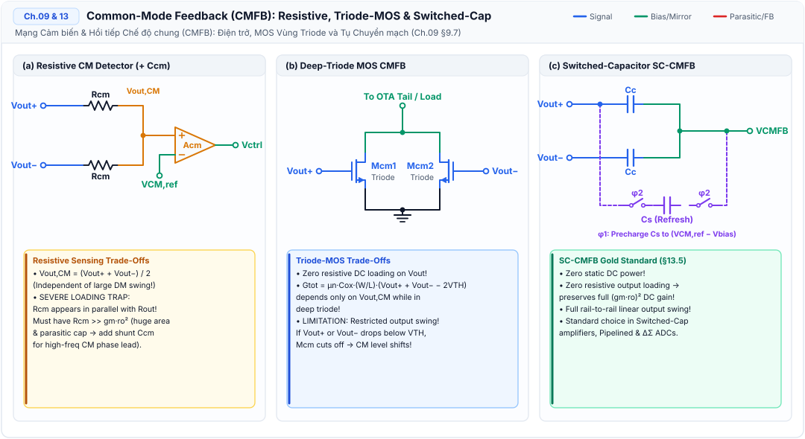

---
{
  "id": "tech-common-mode-feedback-cmfb",
  "kind": "technique",
  "domain": "opamps-and-compensation",
  "title_vi": "Mạch Hồi tiếp Chế độ Chung (CMFB): Cảm nhận, Điều khiển, Đa Tầng & Kiểm định Ổn định Chế độ Chung",
  "title_en": "Common-Mode Feedback (CMFB): Sensing Topologies, Return Loops, Two-Stage CMFB, and Stability Verification",
  "summary": "Giải thích nguyên nhân vật lý khiến mọi bộ khuếch đại vi sai hoàn toàn tải nguồn dòng trôi dạt chạm nguồn nếu thiếu CMFB, phân tích định lượng 3 kỹ thuật cảm nhận chế độ chung (cầu điện trở lớn, bộ đệm theo nguồn, MOSFET vùng triode sâu), cách điều khiển dòng cho Op-Amp 1 tầng và 2 tầng, cùng quy trình kiểm định ổn định vòng CM độc lập bằng diffstbprobe.",
  "diagram": "../../diagrams/cmfb-sensing-networks.svg",
  "razavi_refs": [
    {
      "chapter": 9,
      "section": "9.7",
      "pages": "374-388",
      "equations": ["9.47", "9.48", "9.49", "9.50", "9.51", "9.53", "9.55", "9.56", "9.57"]
    },
    {
      "chapter": 11,
      "section": "11.5.1-11.5.2",
      "pages": "480-486, 490-492",
      "equations": ["11.10", "11.11", "11.12", "11.13"]
    }
  ],
  "glossary_codes": ["T022", "T799", "T800", "T1516", "T1522", "T1526", "T1527", "T1532", "T1534", "T1905", "T1909", "T1915"],
  "process_agnostic": true,
  "roles": {
    "cm_sensing_network": "Mạng đối xứng tuyến tính tính trung bình cộng Vout,CM = (Vout1 + Vout2)/2 mà không làm sụt trở kháng ra vi sai và không bị phi tuyến khi tín hiệu vi sai lớn",
    "cm_error_amplifier": "Bộ so sánh mức Vout,CM với điện áp tham chiếu chuẩn VREF (thường là VDD/2) để tạo tín hiệu điều khiển sai lệch",
    "cm_current_return_port": "Cực điều khiển dòng phân cực (nguồn dòng đuôi ISS hoặc cặp nguồn dòng tải PMOS/NMOS) khép kín vòng âm giữ cân bằng KCL",
    "cm_compensation_elements": "Tụ bù nối song song điện trở cảm nhận hoặc tại nút ngõ ra khử cực phụ trong hàm truyền vòng hồi tiếp chế độ chung"
  },
  "symptoms_addressed": [
    "fully-differential-outputs-stuck-at-vdd-or-gnd",
    "differential-loop-ignored-common-mode-drift",
    "common-mode-oscillation-despite-stable-differential-loop",
    "output-swing-clipped-by-shifted-common-mode-dc-level"
  ],
  "limitations": [
    "resistive-sensing-loads-high-z-cascode-outputs-unless-buffered",
    "source-follower-sensing-clips-under-large-differential-swings",
    "triode-mos-sensing-depends-on-device-parameters-and-adds-output-capacitance",
    "two-stage-single-loop-cmfb-crosses-three-poles-risking-instability"
  ],
  "checklists": ["common-mos", "differential-pair", "feedback-and-stb", "cmfb"]
}
---

## 1. Bản chất Nguyên lý, Sơ đồ Mạch & Vai trò Từng Nhánh Cấu trúc

Tại sao mọi **bộ khuếch đại vi sai hoàn toàn (`T799`, fully-differential amplifier)** dùng tải nguồn dòng đều **bắt buộc tuyệt đối phải có mạch hồi tiếp chế độ chung (`T800`, common-mode feedback — CMFB)**, ngay cả khi mạch đã được bao bọc bên ngoài bởi một vòng hồi tiếp âm vi sai hoàn hảo? Razavi chứng minh bằng định luật KCL không thể chối cãi ở §9.7.1 (tr. 374–376):
- Gọi tổng dòng từ cặp nguồn dòng tải PMOS phía trên bơm xuống là $I_{P,\text{tot}}$ và nguồn dòng đuôi NMOS phía dưới hút đi là $I_{N,\text{tot}}$. Hai nguồn dòng này tạo ra bởi hai mạng phân cực độc lập (hoặc sai lệch kênh ngắn $\lambda_N \neq \lambda_P$, lệch góc công nghệ `FS`/`SF`), nên luôn tồn tại một sai lệch dòng tĩnh nhỏ $\Delta I_{\text{CM}} = I_{P,\text{tot}} - I_{N,\text{tot}} \neq 0$ (dù chỉ vài chục nano-ampe!).
- Dòng sai lệch $\Delta I_{\text{CM}}$ này buộc phải chảy qua trở kháng ra rất cao $R_{\text{out}}$ của tầng khuếch đại (hàng trăm $\text{k}\Omega$ đến hàng chục $\text{M}\Omega$), tạo điện áp lệch $\Delta V_{\text{CM}} = \frac{1}{2} \Delta I_{\text{CM}} R_{\text{out}}$ lên tới hàng chục Volt — tức **đẩy cả hai ngõ ra $V_{\text{out1}}$ và $V_{\text{out2}}$ đập thẳng lên $V_{DD}$ hoặc sập sát đất**, đẩy các nguồn dòng vào vùng triode cho đến khi dòng của chúng tự ép bằng nhau!
- **Hồi tiếp vi sai bên ngoài hoàn toàn "mù" trước lỗi này:** Vì vòng ngoài chỉ đo hiệu $V_{\text{out1}} - V_{\text{out2}}$, khi cả hai ngõ ra cùng trôi lên sát $V_{DD}$ thì hiệu bằng $0$ vẫn giữ nguyên!



Một hệ thống CMFB hoàn chỉnh luôn gồm **3 khâu nối tiếp nhau** (Hình 9.44):
1. **Mạng cảm nhận mức chế độ chung (`T1516`, CM Level Sense Circuit):** Đo trung bình cộng $V_{\text{out,CM}} = \frac{V_{\text{out1}} + V_{\text{out2}}}{2}$ mà không làm suy giảm độ lợi vi sai hoặc biên độ ra.
2. **Khâu so sánh với $V_{\text{REF}}$:** Tạo sai số $V_e = V_{\text{out,CM}} - V_{\text{REF}}$.
3. **Khâu hồi trả điều khiển nguồn dòng:** Điều chỉnh dòng đuôi $I_{SS}$ hoặc cặp nguồn dòng tải để khóa chặt $I_{P,\text{tot}} \equiv I_{N,\text{tot}}$ tại đúng $V_{\text{out,CM}} = V_{\text{REF}}$.

---

## 2. Hệ Phương trình Cốt lõi & Tư duy "Nhìn Mạch Đọc Nhanh" (Analysis by Inspection)

### 2.1. Ba Kỹ thuật Cảm nhận Chế độ Chung Liên tục Thời gian (§9.7.2, tr. 377–380)

#### Phương pháp 1: Cầu Chia Hai Điện trở Bằng Nhau $R_1 = R_2 = R_{\text{CM}}$ (Hình 9.45)
Nối hai điện trở bằng nhau từ $V_{\text{out1}}$ và $V_{\text{out2}}$ chụm vào nút giữa $V_{\text{sense}}$:

$$
V_{\text{sense}} = \frac{R_2 V_{\text{out1}} + R_1 V_{\text{out2}}}{R_1 + R_2} \xrightarrow{R_1 = R_2} \frac{V_{\text{out1}} + V_{\text{out2}}}{2} = V_{\text{out,CM}}
$$

- **Ưu điểm:** Tuyến tính tuyệt đối trên toàn dải biên độ ra từ $0\text{ V}$ đến $V_{DD}$, không tiêu tốn headroom!
- **Nhược điểm chí mạng cho Cascode:** Đối với tín hiệu vi sai, nút giữa $V_{\text{sense}}$ là **đất ảo xoay chiều**, nên mỗi ngõ ra bị $R_{\text{CM}}$ tải song song trực tiếp! Muốn không làm sập $R_{\text{out}}$ của Telescopic/Folded-Cascode ($R_{\text{out}} \sim 500\text{ k}\Omega\text{–}5\text{ M}\Omega$), phải chọn $R_{\text{CM}} \gg R_{\text{out}}$ (hàng chục $\text{M}\Omega$) — chiếm diện tích khổng lồ và cùng tụ cổng bộ so sánh $C_{\text{in,err}}$ sinh ra một **cực trễ pha tần số rất thấp $\omega_{p,\text{sense}} = \frac{2}{R_{\text{CM}} C_{\text{in,err}}}$ làm vòng CMFB dao động**! (Khắc phục bằng cách mắc song song tụ bù truyền thẳng $C_{\text{CM}}$ lên trên mỗi điện trở $R_{\text{CM}}$!).

#### Phương pháp 2: Đệm Tầng Theo Nguồn Trước Cầu Điện trở (Source-Follower Buffered Sensing — Hình 9.46 & §11.5.1 Hình 11.29)
Chèn hai bộ đệm bám nguồn $M_{S1}, M_{S2}$ (hoặc cặp theo nguồn bổ sung NMOS + PMOS ở §11.5.1, Phương trình 11.10–11.13!) đứng trước hai điện trở nhỏ hơn nhiều ($R_{\text{CM}} \sim 10\text{–}30\text{ k}\Omega$) để cách ly trở kháng cao của ngõ ra chính.
- **Bẫy Phi tuyến Tín hiệu Vi sai Lớn (Hình 9.47):** Khi biên độ vi sai $\left|V_{\text{out1}} - V_{\text{out2}}\right|$ quá lớn, một trong hai transistor theo nguồn bị **tắt ngúm hoàn toàn**, làm $V_{\text{sense}}$ không còn bằng trung bình cộng nữa mà bám lệch hẳn theo đỉnh dương — gây hiện tượng **chuyển đổi vi sai sang chế độ chung (DM-to-CM nonlinear shift)** làm méo dạng sóng!

#### Phương pháp 3: Cặp MOSFET Hoạt động Vùng Triode Sâu ($M_7\text{–}M_8$, Hình 9.48 & 9.53–9.57)
Nối cực cổng của hai MOSFET giống hệt nhau $M_7, M_8$ vào $V_{\text{out1}}, V_{\text{out2}}$, nối chung nguồn xuống đất và nối chung máng với nhau (giữ $V_{DS7,8} \ll 2(V_{\text{out,CM}} - V_{TH})$ để cả hai nằm sâu trong vùng triode tuyến tính!). Tổng điện dẫn song song của hai kênh dẫn là (Phương trình 9.47–9.49):

$$
\frac{1}{R_{\text{tot}}} = \frac{1}{R_{on7}} + \frac{1}{R_{on8}} = \mu_n C_{ox} \left(\frac{W}{L}\right)_{7,8} \big[ (V_{\text{out1}} - V_{TH}) + (V_{\text{out2}} - V_{TH}) \big] = 2 \mu_n C_{ox} \left(\frac{W}{L}\right)_{7,8} \left( V_{\text{out,CM}} - V_{TH} \right)
$$

- **Ưu điểm:** Không hề gây tải điện trở lên ngõ ra chính (chỉ nối vào cực cổng cách điện!), không tốn điện trở diện tích lớn.
- **Giới hạn:** Khi tín hiệu vi sai xuống quá thấp làm $\min(V_{\text{out1}}, V_{\text{out2}}) < V_{TH} + V_{DS7,8}$, một transistor rời vùng triode sâu (hoặc tắt hẳn!), phá vỡ Phương trình (9.49); ngoài ra điện dung cổng $C_{GS7,8} + C_{GD7,8}$ cộng thêm vào tải $C_L$. (Độ nhạy theo áp chuẩn $V_b$ được nén bằng cấu trúc gương đối xứng Hình 9.56–9.57, Phương trình 9.50–9.56!).
*(Ghi chú: Trong các mạch tụ chuyển mạch xung nhịp, kỹ thuật thứ 4 là **SC-CMFB** tại `tech-switched-capacitor-cmfb` vượt trội hoàn toàn vì tuyến tính toàn dải, không tải DC và gần như không tốn công suất!)*

### 2.2. Tốc độ, Độ ổn định Vòng CMFB & Bố trí CMFB trong Op-Amp Hai Tầng (§9.7.3–§9.7.4)
- **Yêu cầu Băng thông & Dự trữ Pha của Vòng CMFB:** Nhiễu nguồn cấp và nhiễu ghép đế nhảy vào mạch dưới dạng chế độ chung tốc độ cao. Nếu vòng CMFB chậm hoặc kém ổn định (rung kéo dài), hai ngõ ra lắc lư đồng pha đẩy transistor chạm triode làm hỏng luôn cả đường vi sai! Quy tắc thiết kế: **$\text{GBW}_{\text{CMFB}}$ nên đạt cùng bậc độ lớn ($0{,}3\times \text{ đến } 1{,}0\times$) với $\text{GBW}_{\text{DM}}$** và bắt buộc có **$\text{PM}_{\text{CMFB}} \ge 60^\circ$**!
- **Tách Nhánh Nguồn Dòng Điều khiển (Split Current Source Trick — tr. 381):** Thay vì để bộ khuếch đại lỗi CMFB lái toàn bộ $100\%$ chiều rộng cực cổng của nguồn dòng tải khổng lồ (gây tụ tải lớn làm sập băng thông vòng CMFB và kéo sập toàn bộ dòng khi khởi động), hãy **tách mỗi nguồn dòng tải thành 2 transistor mắc song song**: $70\%\text{–}80\%$ dòng được cấp cố định bởi gương phân cực chuẩn $V_b$, chỉ **$20\%\text{–}30\%$ dòng còn lại** được điều khiển bởi ngõ ra CMFB!
- **CMFB trong Op-Amp Hai Tầng (§9.7.4, Hình 9.59–9.63 & §11.5.2 Hình 11.42):**
  - *Bẫy chết người của 1 vòng CMFB duy nhất bọc qua 2 tầng (Hình 9.61):* Cảm nhận ở ngõ ra Tầng 2 rồi trả về nguồn dòng Tầng 1 khiến vòng CMFB chứa tới **3 cực tần số thấp** (cực Tầng 1, cực Tầng 2, cực bộ khuếch đại lỗi CMFB) và có thể đảo dấu cực tính nếu không đếm đúng số lần đảo pha — cực kỳ khó bù ổn định!
  - *Giải pháp chuẩn mực (Hình 9.62 & Hình 11.42):* Dùng **hai vòng CMFB cục bộ riêng biệt cho từng tầng**! Đặc biệt ở Tầng 2 CS có trở kháng ra thấp hơn nhiều ($r_{O9} \parallel r_{O11} \sim 2\text{–}5\text{ k}\Omega$ trong §11.5.2), ta có thể dùng thẳng hai điện trở $R_1 = R_2 \approx 30\text{ k}\Omega$ nối từ hai ngõ ra chụm về cực cổng của cặp nguồn dòng NMOS Tầng 2 (kèm nguồn dòng dịch mức nhỏ $I_B$ tạo độ dời $I_B R_1 / 2$, Hình 11.42b) — cực kỳ gọn, chỉ có 1 cực nên tự ổn định vô điều kiện!

---

## 3. Bất biến Cấu trúc & Các Bẫy Lỗi Kinh điển (Structural Invariants & Traps)

- **[INV-CMFB-01] Bất biến Kiểm tra Cực tính Vòng CMFB (CM Polarity Invariant):**
  Đếm số lần đảo pha dọc theo **nửa mạch chế độ chung** (nơi hai nhánh trái–phải chập song song!):
  - Giả sử cả $V_{\text{out1}}$ và $V_{\text{out2}}$ cùng **tăng lên ($+$)** $\implies V_{\text{sense}}$ tăng ($+$):
    - Nếu hồi trả về **cực cổng nguồn dòng NMOS kéo xuống đất** ở cùng nút ngõ ra đó (hoặc kéo tăng dòng đuôi NMOS của Folded-Cascode PMOS-in? Khoan — phải xét kỹ từng cấu trúc!):
      - Trong Telescopic NMOS-in: nếu tăng áp cổng nguồn đuôi NMOS $M_9$ ($+$) $\implies I_{SS}$ tăng $\implies$ rút thêm dòng từ hai nút ngõ ra $\implies V_{\text{out1,2}}$ **giảm xuống ($-$)** $\implies$ **Hồi tiếp âm đúng!**
      - Trong Folded-Cascode NMOS-in (Hình 9.52): nếu tăng dòng đuôi NMOS $M_{11}$ ($+$) $\implies$ hút bớt dòng tại nút gập PMOS phía trên $\implies$ dòng đổ xuống nhánh cascode PMOS ra ngõ ra **giảm đi** $\implies V_{\text{out1,2}}$ **giảm xuống ($-$)** $\implies$ **Hồi tiếp âm đúng!**
  Luôn lần dấu từng nút bằng tay VÀ xác minh pha ở `1 Hz` trong `stb` bằng `0 deg`!
- **[TRAP-CMFB-01] Bẫy "Ổn định Vi sai Hoàn Hảo Nhưng Dao Động Chế độ Chung Dữ Dội" (`T1909`):**
  Trong Op-Amp hai tầng bù Miller, hai tụ bù $C_C$ nối giữa Tầng 1 và Tầng 2 thực hiện tách cực cho cả đường vi sai lẫn đường chế độ chung **NẾU VÀ CHỈ NẾU** vòng CMFB cũng đi qua đúng đường được $C_C$ bọc! Nếu bạn đặt bộ khuếch đại lỗi CMFB là một cặp vi sai riêng có độ lợi lớn cộng thêm 1 cực mới vào vòng CM mà không có tụ bù tương ứng (hoặc cảm nhận qua $R_{\text{CM}}$ lớn tạo cực trễ $\frac{1}{R_{\text{CM}} C_{\text{gs,err}}}$), mô phỏng AC vi sai (`Vout+ - Vout-`) trông phẳng phiu tuyệt đẹp với $\text{PM}_{\text{DM}} = 68^\circ$, nhưng vừa bật `tran` lên là cả hai ngõ ra $V_{\text{out}+}$ và $V_{\text{out}-}$ cùng vỗ cánh dao động sin biên độ $600\text{ mV}_{pp}$ hoàn toàn đồng pha nhau!
- **[TRAP-CMFB-02] Nhiễu của Bộ Khuếch đại Lỗi CMFB Không Hề Chui Vào Ngõ Ra Vi Sai (Khi Mạch Cân Xứng!):**
  Đừng phí công thiết kế bộ so sánh lỗi CMFB có dòng lớn hay diện tích khổng lồ vì sợ nhiễu! Mọi nhiễu của $V_{\text{REF}}$ và của bộ khuếch đại lỗi CMFB đều bơm đồng thời bằng nhau vào cả hai nhánh trái–phải, tức là **nhiễu chế độ chung thuần túy** và bị triệt tiêu ở ngõ ra vi sai (chỉ rò một phần nhỏ qua sai lệch linh kiện $\Delta g_m / g_m \sim 1\%$).

---

## 4. Lộ trình Nâng cấp Cấu trúc & Bát giác Đánh đổi (Upgrade Paths & Design Octagon)

| Bối cảnh hoạt động của Op-Amp Vi sai Hoàn toàn | Cấu trúc CMFB tối ưu (Canonical Node) | Ưu điểm quyết định | Đánh đổi cần lưu ý |
|---|---|---|---|
| Mạch làm việc trong hệ thống rời rạc thời gian có xung nhịp (ADC, bộ lọc SC, cảm biến chuyển mạch) | `tech-switched-capacitor-cmfb` (SC-CMFB, Chương 13 §13.5) | **Tiêu chuẩn vàng công nghiệp:** Không tải điện trở DC, tuyến tính $100\%$ từ $0\text{ V}$ tới $V_{DD}$, gần như $0\text{ mW}$ công suất phụ! | Có gợn nhỏ do phun điện tích xung nhịp, không dùng được cho mạch thuần liên tục thời gian không có clock |
| Mạch liên tục thời gian tần số cao (Bộ lọc Gm-C, Baseband thu phát RF) có biên độ ra vừa phải | Cảm nhận bằng cầu $R_{\text{CM}}$ kèm tụ truyền thẳng $C_{\text{CM}}$ song song (hoặc đệm theo nguồn bổ sung §11.5.1) | Tốc độ vòng CM cao, tạo LHP zero $\frac{1}{R_{\text{CM}} C_{\text{CM}}}$ bù pha tuyệt vời cho vòng CMFB | Tốn diện tích điện trở/tụ $R_{\text{CM}} C_{\text{CM}}$ hoặc tốn thêm dòng nhánh đệm theo nguồn |
| Tầng thứ hai của Op-Amp hai tầng vi sai hoàn toàn ($R_{\text{out2}}$ thấp cỡ vài $\text{k}\Omega$) | Cầu điện trở trực tiếp tự phân cực cổng NMOS tải + nguồn dòng dịch mức $I_B$ (Hình 11.42) | Đơn giản tối đa, tự ổn định 1 cực, chịu được biên độ ra sát nguồn | Mức $V_{\text{out,CM}}$ trôi nhẹ $\sim \pm 40\text{–}50\text{ mV}$ theo $V_{GS}$ qua PVT |

---

## 5. Thích ứng Đa Tiến trình (90nm / 65nm / 45nm) & Cách Kiểm chứng trong Cadence / Spectre

### 5.1. Thích ứng Công nghệ Nanomet (90nm $\to$ 65nm $\to$ 45nm)
- **Đệm Theo Nguồn Bổ sung (Complementary Source Followers — §11.5.1, Phương trình 11.10–11.13):** Ở $V_{DD} = 1{,}0\text{ V}$ trên 65nm/45nm, một bộ đệm cảm nhận CM chỉ dùng NMOS source follower sẽ đẩy nút sau đệm tụt xuống $V_{\text{CM}} - V_{GS,N} \approx 0{,}5 - 0{,}45 = 0{,}05\text{ V}$ làm tắt nguồn dòng phân cực bên dưới! Giải pháp tuyệt hay của Razavi ở Hình 11.29 (tr. 480): dùng **đồng thời một cặp NMOS source follower (dịch xuống $V_1 = V_{\text{CM}} - V_{GS,N}$) và một cặp PMOS source follower (dịch lên $V_2 = V_{\text{CM}} + |V_{GS,P}|$)**, rồi trộn qua tỉ số điện trở để tái tạo lại mức điện áp trung bình nằm ngay giữa nguồn cấp ($\sim 0{,}5\text{ V}$) nuôi thoải mái bộ khuếch đại lỗi CMFB!

### 5.2. Quy trình Kiểm chứng Bắt Buộc cho Vòng CMFB trong Cadence / Spectre
1. **Chạy `stb` Chế độ Chung Độc lập với Chế độ Vi sai:**
   - Cách 1: Đặt `iprobe` ngay trên dây đơn đầu xuất ra từ bộ khuếch đại lỗi CMFB (`V_cmfb_ctrl`) trước khi rẽ vào cực cổng hai nguồn dòng trái–phải, chạy `stb start=1 stop=100G`! Đây là điểm nút thắt cổ chai đơn đầu nơi **toàn bộ vòng CMFB phải chui qua 100%** (trong khi tín hiệu vi sai tự triệt tiêu bằng 0 tại đó!), cho kết quả `loopGain`, `phaseMargin`, `gainMargin` của riêng vòng CM chính xác tuyệt đối!
   - Cách 2: Với mạch CMFB đối xứng không có dây đơn đầu (như cầu $R_1, R_2$ tự nối cổng Hình 11.42), dùng `diffstbprobe` đặt chế độ `mode=comm`!
2. **Kiểm tra Bước nhảy Chế độ Chung & Khởi động Nguồn (`tran` CM Step & Supply Ramp):**
   - Trong `tran`, nhồi một xung nhiễu đồng pha $\Delta V_{\text{CM}} = \pm 100\text{ mV}$ vào nguồn `VREF_CM` (hoặc bơm dòng đồng pha vào hai ngõ ra), quan sát dạng sóng $V_{\text{out,CM}}(t) = \frac{V(\text{out}+) + V(\text{out}-)}{2}$ phải bám êm ái không rung, và quét `VDD` từ `0 V -> VDD` trong `1 us` để chắc chắn CMFB không bị kẹt ở điểm khóa chết (latch-up state) gần đất hoặc $V_{DD}$!
3. **Mẫu Netlist Spectre Chạy Đồng Thời Kiểm định `stb` Vi sai & Chế độ Chung:**
   ```spectre
   // Dat diffstbprobe tren duong hoi tiep vi sai ngoai va iprobe tren day dieu khien CMFB noi
   DPRB_MAIN (fb_p fb_n in_p in_n) diffstbprobe
   IPRB_CMFB (cm_err_out bias_cm_gate) iprobe

   // 1. Kiem tra on dinh vong tin hieu vi sai (Differential Mode)
   stb_dm stb probe=DPRB_MAIN diffprobe_mode=diff start=1 stop=100G dec=50

   // 2. Kiem tra on dinh vong che do chung noi tai (Common-Mode Feedback Loop)
   stb_cm stb probe=IPRB_CMFB start=1 stop=100G dec=50
   ```
4. **Tính Bù Pha Bằng Tụ Truyền Thẳng $C_{\text{CM}}$ Khi Cảm nhận Bằng Điện trở Lớn $R_{\text{CM}}$:**
   - Giả sử mỗi bên cảm nhận dùng $R_{\text{CM}} = 200\text{ k}\Omega$ lái cặp vi sai lỗi CMFB có tổng điện dung cổng $C_{\text{in,err}} = 100\text{ fF}$: cực ký sinh tại nút cảm nhận rơi xuống $f_{p,\text{sense}} = \frac{1}{2\pi (R_{\text{CM}}/2) C_{\text{in,err}}} \approx 15{,}9\text{ MHz}$ — cắt ngang vòng CMFB làm sập dự trữ pha!
   - Mắc song song mỗi điện trở $R_{\text{CM}}$ một tụ nhỏ $C_{\text{CM}} = 100\text{ fF}$: hàm truyền mạng cảm nhận biến thành $\frac{1 + s R_{\text{CM}} C_{\text{CM}}}{1 + s R_{\text{CM}} (C_{\text{CM}} + C_{\text{in,err}}/2)}$, đẩy cực và zero chập gần nhau (tỉ số $100\text{ fF} / 150\text{ fF}$) khôi phục ngay lập tức $> 60^\circ$ dự trữ pha cho vòng CMFB!

---

## 6. Mốc Đối chiếu Sách Razavi & Thuật ngữ Chuẩn CLB

### 6.1. Đối chiếu Sách Gốc Razavi (2nd Edition)
- **Chương 9:** §9.7 *Common-Mode Feedback* — §9.7.1 *Basic Concepts* (tr. 374–377, Hình 9.41–9.44), §9.7.2 *CM Sensing Techniques* (tr. 377–380, Phương trình 9.47–9.49, Hình 9.45–9.49), §9.7.3 *CM Feedback Techniques* (tr. 380–386, Phương trình 9.50–9.57, Hình 9.50–9.58), §9.7.4 *CMFB in Two-Stage Op Amps* (tr. 386–388, Hình 9.59–9.63).
- **Chương 11:** §11.5.1 *CMFB Design & Stability* (tr. 480–486, Phương trình 11.10–11.13, Hình 11.29–11.35) & §11.5.2 (tr. 490–492, Hình 11.42).
- **Chú giải Hiệu đính Học thuật CLB (`NG09`):**
  - **`NG09-10` (tr. 380, Hình 9.50):** Khi đối chiếu mạch hoàn chỉnh CMFB ở Hình 9.50 với lời văn giải thích bên dưới, lưu ý sách dùng hai tên gọi cho cùng một phần tử: điện áp chuẩn được viết là $V_{\text{REF}}$ trong lời văn nhưng ghi nhãn $V_b$ trên hình; dòng điều khiển được gọi là $I_{\text{CM}}$ ở đoạn đầu và $I_{\text{out}}$ ở đoạn sau.

### 6.2. Bảng Thuật ngữ Chuẩn CLB Vi Mạch Sử dụng trong Thẻ
| Mã CLB | Thuật ngữ Tiếng Anh | Thuật ngữ Tiếng Việt Chuẩn | Ghi chú Ngữ cảnh |
|---|---|---|---|
| `T800` / `T1522` | common-mode feedback (CMFB) | hồi tiếp chế độ chung | Bắt buộc cho mọi ngõ ra vi sai trở kháng cao |
| `T1516` | CM level sense circuit | mạch cảm nhận mức chế độ chung | Tách trung bình cộng $(V_{\text{out1}} + V_{\text{out2}})/2$ |
| `T1526` | CMFB using triode devices | hồi tiếp chế độ chung dùng linh kiện vùng triode | Cảm nhận qua tổng điện dẫn $1/R_{on7} + 1/R_{on8}$ |
| `T1532` | CMFB in two-stage op amps | hồi tiếp chế độ chung trong bộ khuếch đại thuật toán hai tầng | Ưu tiên 2 vòng CMFB cục bộ thay vì 1 vòng xuyên 2 tầng |
| `T1905` | CMFB stability | ổn định vòng hồi tiếp chế độ chung | Phải kiểm định độc lập với ổn định vòng vi sai |
| `T1909` | common-mode instability | mất ổn định chế độ chung | Hiện tượng hai ngõ ra cùng dao động đồng pha |
