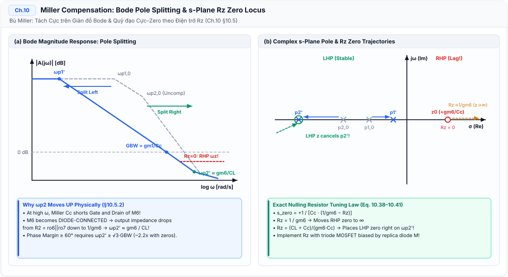

---
{
  "id": "tech-miller-pole-splitting",
  "kind": "technique",
  "domain": "opamps-and-compensation",
  "title_vi": "Kỹ thuật Bù Miller & Cơ chế Vật lý Tách Cực trong Op-Amp Hai Tầng (Miller Compensation & Pole Splitting)",
  "title_en": "Miller Compensation and Exact Pole-Splitting Mechanism in Two-Stage Operational Amplifiers",
  "summary": "Dẫn xuất chính xác hiện tượng tách cực (pole splitting) khi mắc tụ bù Cc vắt qua tầng thứ hai: không chỉ dùng hiệu ứng Miller đẩy cực liên tầng wp1 về sát gốc tọa độ với giá trị tụ nhỏ gọn, mà còn dùng hồi tiếp nội bộ quanh tầng hai hạ trở kháng ngõ ra ở tần số cao xuống 1/gm2 để kéo cực ngõ ra wp2 vọt lên gm2/(CL + CE)!",
  "diagram": "../../diagrams/pole-splitting-locus.svg",
  "razavi_refs": [
    {
      "chapter": 10,
      "section": "10.5",
      "pages": "426-430",
      "equations": ["10.24", "10.25", "10.26", "10.27", "10.28", "10.29"]
    },
    {
      "chapter": 6,
      "section": "6.2",
      "pages": "182-185",
      "equations": ["6.30", "6.35", "6.40"]
    }
  ],
  "glossary_codes": ["T1687", "T1694", "T1695", "T1697", "T1698", "T1699", "T1700", "T1701", "T1702", "T1972"],
  "process_agnostic": true,
  "roles": {
    "miller_capacitor_cc": "Tụ bù nối chéo từ nút ngõ ra trở kháng cao của Tầng 1 sang nút ngõ ra của Tầng 2, tạo vòng hồi tiếp điện áp–dòng điện cục bộ quanh Tầng 2",
    "interstage_node_e": "Nút liên tầng có trở kháng lớn RS = Rout1 nhìn thấy điện dung nhân Miller (1 + gm2*RL)*Cc nên biến thành cực trội wp1' tần số rất thấp",
    "diode_connected_stage2_hf": "Ở tần số cao, Cc ngắn mạch cổng–máng của transistor Tầng 2 biến nó thành phần tử nối diode có trở kháng 1/gm2, kéo cực ngõ ra wp2' vọt lên cao",
    "unwanted_rhp_zero": "Hệ quả phụ nguy hiểm do đường truyền thẳng qua Cc tạo zero nửa mặt phẳng phải tại +gm2/(Cc + Cgd2)"
  },
  "symptoms_addressed": [
    "two-stage-opamp-oscillation-from-two-low-frequency-poles",
    "huge-area-and-bandwidth-loss-of-shunt-capacitor-compensation",
    "low-output-pole-1-over-rl-cl-blocking-unity-gain-bandwidth"
  ],
  "limitations": [
    "introduces-feedforward-rhp-zero-degrading-phase-margin",
    "output-pole-wp2-falls-when-load-capacitance-cl-increases",
    "requires-high-stage2-gm2-consuming-significant-second-stage-power"
  ],
  "checklists": ["common-mos", "feedback-and-stb", "two-stage-miller"]
}
---

## 1. Bản chất Nguyên lý, Sơ đồ Mạch & Vai trò Từng Nhánh Cấu trúc

Trước khi được bù tần số, một **bộ khuếch đại thuật toán hai tầng (`topo-two-stage-opamp`)** chứa hai nút trở kháng cao nối tiếp nhau: nút liên tầng $E$ (trở kháng $R_1 = R_S = R_{\text{out1}}$, tổng tụ ký sinh $C_1 = C_E$) và nút ngõ ra $A$ (trở kháng $R_2 = R_L = R_{\text{out2}}$, tổng tụ tải $C_2 = C_L$). Hai cực ban đầu $\omega_{p,E} = \frac{1}{R_1 C_1}$ và $\omega_{p,A} = \frac{1}{R_2 C_2}$ đều nằm ở tần số thấp (gần như tạo thành "hai cực trội" `T1695`), kéo góc pha vòng xuống sát $-180^\circ$ từ rất sớm và làm mạch mất ổn định ngay khi đóng vòng hồi tiếp.

Như đã chứng minh ở `law-multipole-phase-margin`, gắn tụ nối đất đơn thuần sẽ hy sinh gần hết băng thông và tốn diện tích khổng lồ. Giải pháp thiên tài giải cứu toàn bộ họ Op-Amp đa tầng là **bù Miller (`T1698`, Miller compensation)**: mắc một **tụ bù (`T1687`)** $C_C$ vắt ngang giữa ngõ vào và ngõ ra của Tầng thứ hai (Razavi Chương 10, §10.5, tr. 426–430).

Sức mạnh kỳ diệu của tụ $C_C$ nằm ở chỗ nó tạo ra **HAI TÁC ĐỘNG ĐỒNG THỜI THEO HAI HƯỚNG NGƯỢC NHAU** gọi là **sự tách cực (`T1699`, pole splitting, Hình 10.28)**:
1. **Đẩy cực liên tầng $\omega_{p1} \to \omega'_{p1}$ LÙI SÂU VỀ GỐC TỌA ĐỘ (Tiết kiệm diện tích tụ!):** Nhìn từ đầu ra Tầng 1 vào nút liên tầng $E$, tụ $C_C$ được nhân điện dung Miller bởi độ lợi đảo pha của Tầng 2 thành $(1 + g_{m2} R_2) C_C$. Chỉ cần một tụ $C_C$ nhỏ vài trăm $\text{fF}$ đến vài $\text{pF}$ trên chip đã tương đương gắn một tụ nối đất lớn gấp hàng chục lần!
2. **Đẩy cực ngõ ra $\omega_{p2} \to \omega'_{p2}$ VỌT LÊN TẦN SỐ CAO GẤP $\sim g_{m2} R_2$ LẦN (Mở toang băng thông!):** Đây là điều mà phép xấp xỉ Miller ngây thơ ở Chương 6 không thể nhìn thấy! Tại sao thêm tụ điện $C_C$ vào mạch mà cực thứ hai không giảm đi mà lại **tăng vọt lên tần số cao hơn**?
   - **Giải thích vật lý trực quan 1 (Mô hình Nối tắt Tần số Cao — Hình 10.29b):** Ở tần số cao gần cực thứ hai (vượt xa cực thứ nhất), dung kháng $\frac{1}{\omega C_C}$ trở nên rất nhỏ, gần như **nối tắt xoay chiều cực cổng vào cực máng của transistor khuếch đại Tầng 2 ($M_9$)**! Một MOSFET có cổng nối vào máng lập tức biến thành **linh kiện nối diode có trở kháng ra hạ từ $R_2 = r_{O9} \parallel r_{O11}$ (hàng chục $\text{k}\Omega$) tụt thẳng xuống còn $\approx \frac{1}{g_{m2}}$ (chỉ vài trăm $\Omega$!)**! Do đó tụ tải $C_L$ nhìn vào ngõ ra thấy điện trở thấp $\frac{1}{g_{m2}}$, đẩy cực ngõ ra từ $\frac{1}{R_2 C_L}$ nhảy vọt lên $\approx \frac{g_{m2}}{C_L}$!
   - **Giải thích vật lý trực quan 2 (Lý thuyết Hồi tiếp Cục bộ — `T1700`):** Tụ $C_C$ đóng vai trò mạng hồi tiếp âm **điện áp–dòng điện (Shunt–Shunt)** bao quanh riêng Tầng 2 ở tần số cao: cảm nhận điện áp ngõ ra và trả dòng về nút cổng Tầng 2, làm hạ thấp cả trở kháng vào lẫn trở kháng ra của Tầng 2!

---

## 2. Hệ Phương trình Cốt lõi & Tư duy "Nhìn Mạch Đọc Nhanh" (Analysis by Inspection)

### 2.1. Dẫn xuất Chính xác Cặp Cực Đã Tách ($\omega'_{p1}, \omega'_{p2}$) & Tốc độ Độ lợi Đơn vị $\omega_u$
Mô hình hóa đầu ra Tầng 1 bằng tương đương Thevenin/Norton ($G_{m1} = g_{m1}$, điện trở ra $R_1 = R_S$, tụ ký sinh liên tầng $C_1 = C_E$) lái Tầng 2 nguồn chung (hỗ dẫn $g_{m2}$ — ký hiệu $g_{m9}$ trong Hình 10.29 của Razavi, điện trở ra $R_2 = R_L$, tụ tải $C_2 = C_L$, gộp $C_{GD2}$ vào $C_C \leftarrow C_C + C_{GD2}$). Áp dụng thẳng nghiệm bậc hai chính xác của tầng CS đã chứng minh ở Chương 6 (`law-miller-theorem-and-rhp-zero`, Phương trình 6.30, 6.35, 6.40) với giả thiết hai cực sau bù cách xa nhau ($|\omega'_{p1}| \ll |\omega'_{p2}|$, Phương trình 10.24–10.25):

1. **Cực trội mới ($\omega'_{p1}$):**

$$
\omega'_{p1} \approx \frac{1}{R_1 \big[(1 + g_{m2} R_2) C_C + C_1\big] + R_2 (C_C + C_2)} \;\approx\; \frac{1}{g_{m2} R_2 R_1 C_C}
$$

*(Khi $g_{m2} R_2 \gg 1$ và $R_1 g_{m2} C_C \gg C_2$.)*

2. **Băng thông độ lợi đơn vị vòng hở ($\omega_u = 2\pi\,\text{GBW}$):** Nhân độ lợi DC toàn mạch $A_0 = (g_{m1} R_1)(g_{m2} R_2)$ với $\omega'_{p1}$, cả $R_1, R_2$ và $g_{m2}$ đều tự động giản ước sạch sẽ!

$$
\omega_u \approx A_0 \cdot \omega'_{p1} = (g_{m1} R_1 g_{m2} R_2) \cdot \frac{1}{g_{m2} R_2 R_1 C_C} = \frac{g_{m1}}{C_C}!
$$

3. **Cực không trội mới tại ngõ ra ($\omega'_{p2}$, Phương trình 10.25 — đã sửa ngoặc dư `NG10-03`):**

$$
\omega'_{p2} \approx \frac{R_1 \big[(1 + g_{m2} R_2) C_C + C_1\big] + R_2 (C_C + C_2)}{R_1 R_2 \big(C_C C_1 + C_C C_2 + C_1 C_2\big)} \;\approx\; \frac{g_{m2} C_C}{C_1 C_2 + C_C (C_1 + C_2)} = \frac{g_{m2}}{C_1 + C_2 + \dfrac{C_1 C_2}{C_C}}
$$

Xét hai giới hạn vật lý thực chiến cực kỳ quan trọng của biểu thức $\omega'_{p2}$ này:
- **Khi $C_C \gg C_1$ và $C_2 = C_L \gg C_1$ (Trường hợp điển hình nhất):** Mẫu số rút gọn về $C_1 + C_L \approx C_L$, cho công thức nhớ nhanh kinh điển:

$$
\omega'_{p2} \approx \frac{g_{m2}}{C_1 + C_L} \approx \frac{g_{m2}}{C_L}
$$

So với cực ngõ ra trước khi bù $\omega_{p2,\text{uncomp}} = \frac{1}{R_2 C_L}$, cực thứ hai đã được **kéo vọt lên cao gấp $g_{m2} R_2$ lần**!
- **Khi tải $C_L$ rất nhỏ nhưng tụ liên tầng $C_1$ lớn (do Tầng 2 quá rộng làm $C_{GS2}$ khổng lồ!):** Lúc đó $\frac{C_1 C_L}{C_C}$ hoặc $C_1$ chặn ở mẫu số khiến $\omega'_{p2}$ bị khóa trần bởi $\frac{g_{m2}}{C_1} \approx \omega_{T2}$ dù bạn có tăng $C_C$ đến vô cùng!

### 2.2. Quy tắc Định cỡ Sơ bộ Tụ Bù $C_C$ Theo Hệ số Hồi tiếp $\beta$ (Ví dụ 10.6, Phương trình 10.26–10.28)
Để đạt dự trữ pha $\text{PM} \ge 60^\circ$ (khi đã triệt RHP zero bằng `tech-miller-rhp-zero-nulling-and-cascode-comp`), áp dụng điều kiện cực không trội $\omega'_{p2} \ge K_{\text{PM}} \cdot \beta\,\omega_u$ (với $K_{\text{PM}} = 1$ cho $\text{PM} \approx 45^\circ$ như Phương trình 10.28 khi chưa kể RHP zero, và **$K_{\text{PM}} \approx 2{,}2 \text{ đến } 3{,}0$** cho $\text{PM} \ge 60^\circ\text{–}65^\circ$ chuẩn thiết kế thực tế!):

$$
\frac{g_{m2}}{C_L + C_1} \ge K_{\text{PM}} \cdot \beta \frac{g_{m1}}{C_C} \implies C_C \ge K_{\text{PM}} \cdot \beta \cdot \frac{g_{m1}}{g_{m2}} (C_L + C_1)
$$

*Ví dụ thực chiến:* Với $\beta = 1$ (unity-gain buffer), muốn giữ $C_C$ nhỏ chỉ bằng $0{,}3\,C_L\text{–}0{,}5\,C_L$ để đạt $\text{GBW}$ và Slew Rate cao với $\text{PM} \ge 60^\circ$ ($K_{\text{PM}} = 2{,}5$), ta bắt buộc phải thiết kế hỗ dẫn của Tầng 2 lớn gấp $5\text{–}8$ lần hỗ dẫn của Tầng 1 ($g_{m2} \approx (5\text{–}8)\,g_{m1}$)!

### 2.3. Cái Bẫy Đi Kèm: Zero Nửa Mặt phẳng Phải $\omega_z = +g_{m2}/C_C$ (Phương trình 10.29)
Như đã chứng minh ở Chương 6, chính tụ $C_C$ tạo đường truyền thẳng tần số cao đi tắt từ nút liên tầng sang ngõ ra ngược pha với dòng $g_{m2}$, sinh ra một **RHP zero** nằm ngay gần $\omega_u$:

$$
\omega_z = +\frac{g_{m2}}{C_C + C_{GD2}} \approx +\frac{g_{m2}}{C_C}
$$

Hàm truyền vòng đầy đủ sau khi gắn riêng $C_C$ mang dấu trừ chết người trên tử số (Phương trình 10.29):

$$
\beta H(s) \approx \frac{\beta A_0 \left(1 - \dfrac{s}{\omega_z}\right)}{\left(1 + \dfrac{s}{\omega'_{p1}}\right)\left(1 + \dfrac{s}{\omega'_{p2}}\right)}
$$

---

## 3. Bất biến Cấu trúc & Các Bẫy Lỗi Kinh điển (Structural Invariants & Traps)

- **[INV-SPLIT-01] Bất biến Bảo toàn Tích Hai Cực Khi Thay Đổi $C_C$ Lớn:**
  Nhìn vào tích $\omega'_{p1} \cdot \omega'_{p2}$ từ đa thức bậc hai mẫu số: $\omega'_{p1} \cdot \omega'_{p2} = \dfrac{1}{R_1 R_2 (C_1 C_2 + C_C C_1 + C_C C_2)}$. Khi $C_C$ tăng lên lớn hơn $C_1, C_2$, mẫu số tăng tuyến tính theo $C_C$: cực $\omega'_{p1}$ giảm tỉ lệ với $\frac{1}{C_C}$, trong khi cực $\omega'_{p2}$ **tiệm cận một hằng số trần** $\dfrac{g_{m2}}{C_1 + C_2}$ chứ không tăng mãi theo $C_C$! Nói cách khác: tăng $C_C$ vượt quá ngưỡng $C_C \gg \frac{C_1 C_2}{C_1 + C_2}$ chỉ còn tác dụng hạ thấp $\omega_{u} = \frac{g_{m1}}{C_C}$ chứ không đẩy $\omega'_{p2}$ đi xa hơn được nữa!
- **[TRAP-SPLIT-01] Sai Lầm Kinh Điển Của Sinh Viên: Chọn $C_C = C_L$ Để Lấy $\omega_z$ "Triệt tiêu" $\omega'_{p2}$! (Ví dụ 10.7, tr. 430):**
  Thấy $\left|\omega'_{p2}\right| \approx \frac{g_{m2}}{C_L}$ và $\left|\omega_z\right| \approx \frac{g_{m2}}{C_C}$, rất nhiều người nảy ra ý tưởng đặt $C_C = C_L$ để hai tần số bằng nhau tự khử nhau! **Thảm họa 100%!**
  Vì $\omega'_{p2}$ nằm ở **Nửa Mặt phẳng Trái** ($1 + s/\omega_0$ ở mẫu số), còn $\omega_z$ nằm ở **Nửa Mặt phẳng Phải** ($1 - s/\omega_0$ ở tử số)! Tỉ số $\dfrac{1 - s/\omega_0}{1 + s/\omega_0}$ là một **bộ dịch pha toàn thông (all-pass phase lag network)**: biên độ bằng $1$ phẳng lì không hề giảm, nhưng **góc pha bị quật sập gấp đôi bằng $-2\arctan(\omega/\omega_0)$ (lên tới $-180^\circ$ trễ pha!)**, giết chết hoàn toàn dự trữ pha của Op-Amp!
- **[TRAP-SPLIT-02] Nghịch lý Độ Ổn định Theo Tụ Tải $C_L$ (Hình 10.36, tr. 433):**
  Hãy khắc cốt ghi tâm sự đối lập 180 độ giữa Op-Amp 1 tầng và Op-Amp 2 tầng bù Miller:
  - Ở **Op-Amp 1 tầng** (Telescopic / Folded): gắn thêm tụ tải $C_L$ lớn hơn làm giảm $\text{GBW}$, mạch **ổn định hơn** ($\text{PM}$ tăng).
  - Ở **Op-Amp 2 tầng bù Miller**: $\text{GBW} = \frac{g_{m1}}{2\pi C_C}$ cố định theo $C_C$, còn gắn thêm tụ tải $C_L$ lớn hơn lại kéo sập cực phụ $\omega'_{p2} \approx \frac{g_{m2}}{C_L}$ tụt thẳng xuống đè lên $\text{GBW}$, làm **sập dự trữ pha và gây rung dao động**! Do đó Op-Amp 2 tầng luôn phải thiết kế và kiểm định ổn định ở **giá trị tụ tải lớn nhất có thể xảy ra ($C_{L,\max}$)**!

---

## 4. Lộ trình Nâng cấp Cấu trúc & Bát giác Đánh đổi (Upgrade Paths & Design Octagon)

| Điểm nghẽn còn lại sau khi gắn riêng tụ Miller $C_C$ | Bước nâng cấp bắt buộc tiếp theo (Canonical Node) | Giải quyết vấn đề gì | Đánh đổi trên Bát giác Thiết kế |
|---|---|---|---|
| RHP zero $+g_{m2}/C_C$ (đặc biệt nặng trong CMOS vì $g_{m2}$ vừa phải!) cướp mất $20^\circ\text{–}45^\circ$ dự trữ pha | `tech-miller-rhp-zero-nulling-and-cascode-comp` ($R_z$ nối tiếp $C_C$) | Đẩy zero ra $\infty$ ($R_z = 1/g_{m2}$) hoặc lật sang LHP khử cực $\omega'_{p2}$ ($R_z = \frac{C_L + C_C}{g_{m2} C_C}$) | Cần mạch bám $R_z$ theo PVT và cẩn thận biến thiên $R_{on}$ của triode MOS khi bước nhảy lớn |
| Tụ tải $C_L$ quá lớn (hàng chục pF, ví dụ trong LDO hoặc đệm ngoài chip) làm $\frac{g_{m2}}{C_L}$ quá thấp | `tech-miller-rhp-zero-nulling-and-cascode-comp` (Bù Cascode / Ahuja — trả $C_C$ qua cực nguồn cascode Tầng 1!) | Chặn hẳn RHP zero VÀ nhân vọt cực thứ hai $\omega'_{p2}$ lên thêm hệ số $g_{m,\text{cas}} R_1$ lần! | Yêu cầu Tầng 1 có nhánh cascode đủ dòng gánh slewing qua $C_C$ |

---

## 5. Thích ứng Đa Tiến trình (90nm / 65nm / 45nm) & Cách Kiểm chứng trong Cadence / Spectre

### 5.1. Thích ứng Công nghệ Nanomet (90nm $\to$ 65nm $\to$ 45nm)
- **Tối ưu Tụ Bù $C_C$ Trên Layout (MIM / MOM Capacitor & Bottom-Plate Orientation):**
  Trên các tiến trình 90nm/65nm/45nm có nhiều lớp kim loại đồng dày đặc, tụ bù $C_C$ thường dùng tụ kim loại đan ngón (**MOM — Metal-Oxide-Metal**) hoặc **MIM** (không phụ thuộc điện áp phân cực để tránh méo phi tuyến!). Tụ vật lý trên chip luôn có điện dung ký sinh từ tấm đáy (bottom plate / outer shield) xuống đế silic cỡ $3\%\text{–}10\%\,C_C$.
  **Quy tắc đấu hướng hai cực tụ $C_C$ bất di bất dịch:**
  - Nối **tấm đáy (bottom plate — có ký sinh xuống đất lớn hơn)** về phía **NGÕ RA Tầng 2 ($V_{\text{out}}$)**: tại đó tụ ký sinh nối đất chỉ cộng thêm một lượng không đáng kể vào tụ tải $C_L$ lớn vốn có!
  - Nối **tấm đỉnh (top plate — ít ký sinh nhất)** về phía **NÚT LIÊN TẦNG $E$ (đầu ra Tầng 1)**: giữ cho $C_1 = C_E$ nhỏ nhất có thể nhằm bảo toàn hiệu quả tách cực đẩy $\omega'_{p2}$ lên tối đa và tránh rò nhiễu đế (substrate noise) vào cổng khuếch đại Tầng 2!

### 5.2. Quy trình Kiểm chứng Sự Tách Cực Trực Quan trong Cadence / Spectre
1. **Quét Tham số `Cc` Quan sát Quỹ đạo Tách Cực (`pz` & `stb` Parametric Sweep):**
   - Khai báo biến thiết kế `cc_val`, quét từ `0 fF` (chưa bù), `100 fF`, `500 fF`, `1 pF`, `2 pF`.
   - Vẽ đồng thời hai đường tần số cực $|p_1|$ và $|p_2|$ từ phân tích `pz` (hoặc vẽ họ đường cong `loopGain` của `stb`): bạn sẽ thấy tận mắt khi `cc_val` tăng từ `0` lên `500 fF`, $|p_1|$ lao dốc xuống tần số thấp trong khi **$|p_2|$ bứt phá chạy ngược lên tần số cao gấp hàng chục lần**, và ngay bên cạnh đó xuất hiện nghiệm dương `+z1` của RHP zero — minh họa sống động 100% Hình 10.28 và 10.31 của sách Razavi!

---

## 6. Mốc Đối chiếu Sách Razavi & Thuật ngữ Chuẩn CLB

### 6.1. Đối chiếu Sách Gốc Razavi (2nd Edition)
- **Chương 10:** §10.5 *Compensation of Two-Stage Op Amps* (tr. 426–430, Phương trình 10.24–10.29, Hình 10.25–10.31, Ví dụ 10.6–10.7).
- **Chú giải Hiệu đính Học thuật CLB (`NG10`):**
  - **`NG10-03` (tr. 428, Phương trình 10.25):** Mẫu số của Phương trình (10.25) trong bản in gốc bị thừa một dấu ngoặc tròn đóng `)` ngay sau $C_E C_L$ trước dấu ngoặc vuông đóng `]`: công thức sạch đúng cú pháp là $R_S R_L \left[(C_C + C_{GD9}) C_E + (C_C + C_{GD9}) C_L + C_E C_L\right]$.
  - **`NG10-04` (tr. 429, Hình 10.30):** Trên trục tung đồ thị Hình 10.30 thuộc Ví dụ 10.6, bản in gốc ghi nhãn độ lợi tần số thấp là $\beta g_{m1} R_S g_{m2} R_L$, trong khi xuyên suốt sơ đồ Hình 10.29 và các phương trình (10.26)–(10.28) transistor khuếch đại Tầng 2 mang chỉ số $M_9$ ($g_{m9}$) — cần hiểu $g_{m2}$ trên nhãn hình chính là $g_{m9}$ (hỗ dẫn của Tầng 2).

### 6.2. Bảng Thuật ngữ Chuẩn CLB Vi Mạch Sử dụng trong Thẻ
| Mã CLB | Thuật ngữ Tiếng Anh | Thuật ngữ Tiếng Việt Chuẩn | Ghi chú Ngữ cảnh |
|---|---|---|---|
| `T1698` | Miller compensation | bù Miller | Gắn tụ bù vắt ngang tầng khuếch đại đảo pha thứ hai |
| `T1687` | compensation capacitor | tụ bù | Tụ $C_C$ định vị $\omega_u = g_{m1}/C_C$ |
| `T1699` | pole splitting | sự tách cực | Đẩy $\omega_{p1}$ xuống thấp đồng thời kéo $\omega_{p2}$ lên cao |
| `T1701` | interstage pole | cực liên tầng | Cực tại nút giữa Tầng 1 và Tầng 2, trở thành cực trội sau bù |
| `T1700` | feedback around the second stage | hồi tiếp quanh tầng thứ hai | Cách hiểu bản chất vì sao $Z_{\text{out2}}$ giảm xuống $1/g_{m2}$ ở tần số cao |
| `T1702` | right-half-plane zero | zero ở nửa mặt phẳng phải | Tác dụng phụ tại $+g_{m2}/(C_C + C_{GD2})$ bắt buộc phải triệt |
