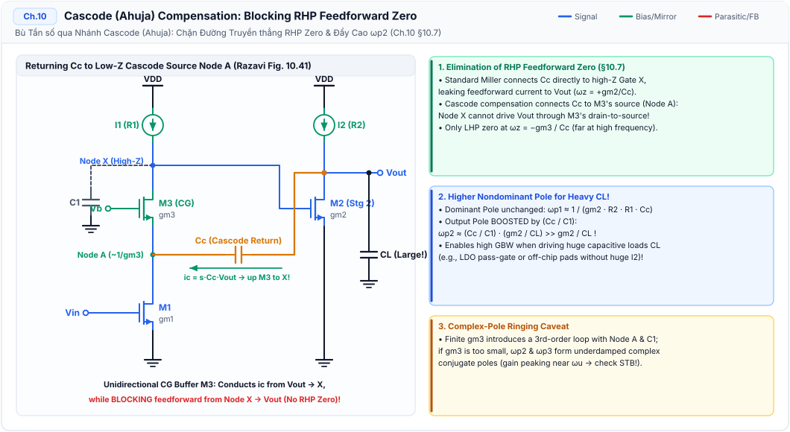

---
{
  "id": "tech-miller-rhp-zero-nulling-and-cascode-comp",
  "kind": "technique",
  "domain": "opamps-and-compensation",
  "title_vi": "Triệt Tiêu RHP Zero Bằng Điện trở Nối tiếp Rz, Bám Theo PVT & Bù Cascode / Ahuja cho Tải Nặng (Nulling Resistor & Cascode/Ahuja Compensation)",
  "title_en": "Miller RHP-Zero Nulling Resistor (Rz Tracking) and Cascode (Ahuja) Compensation Techniques",
  "summary": "Chuỗi giải pháp triệt tiêu thảm họa RHP zero +gm2/Cc trong Op-Amp hai tầng: mắc nối tiếp điện trở Rz = 1/gm2 (đẩy zero ra vô cực) hoặc Rz = (CL+Cc)/(gm2*Cc) (kéo sang LHP khử cực phụ wp2), mạch phân cực MOSFET vùng triode tự bám 1/gm2 qua PVT, và kỹ thuật bù Cascode (Ahuja) hồi trả dòng Cc qua cực nguồn cascode giúp triệt RHP zero đồng thời nhân vọt wp2 lên gm_cas*R1 lần khi tải CL nặng!",
  "diagram": "../../diagrams/cascode-ahuja-compensation.svg",
  "razavi_refs": [
    {
      "chapter": 10,
      "section": "10.5, 10.7",
      "pages": "430-433, 436-439",
      "equations": ["10.30", "10.31", "10.32", "10.33", "10.34", "10.35", "10.41", "10.43", "10.45", "10.49", "10.50", "10.51"]
    }
  ],
  "glossary_codes": ["T021", "T1357", "T1678", "T1692", "T1702", "T1706", "T1707", "T1712", "T1734", "T1739", "T1973", "T1994"],
  "process_agnostic": true,
  "roles": {
    "nulling_resistor_rz": "Điện trở mắc nối tiếp tụ bù Cc tạo sụt áp chặn dòng truyền thẳng tần số cao, điều khiển vị trí điểm không theo wz = 1/[Cc*(1/gm2 - Rz)]",
    "triode_mos_replica_tracker": "MOSFET vùng triode sâu M_Rz được phân cực bằng nhánh sao chép diode hoặc Constant-Gm để điện trở Ron tự động bám tỉ lệ nghịch với gm2 qua mọi góc PVT",
    "source_follower_feedback_buffer": "Bộ đệm theo nguồn chặn chiều truyền thẳng của Cc nhưng làm mất khoảng dự trữ điện áp VGS ở ngõ ra",
    "cascode_ahuja_current_buffer": "Tầng cổng chung / cực nguồn cascode của Tầng 1 nhận dòng hồi tiếp từ Cc mà chặn đứng truyền thẳng từ Tầng 1 ra ngõ ra, đồng thời đẩy vọt cực ngõ ra wp2"
  },
  "symptoms_addressed": [
    "severe-phase-margin-collapse-from-miller-rhp-zero",
    "fixed-poly-resistor-rz-drifting-away-from-1-over-gm2-across-pvt",
    "heavy-capacitive-load-cl-pulling-wp2-below-gbw",
    "high-frequency-psrr-collapse-through-direct-miller-cc"
  ],
  "limitations": [
    "lhp-zero-pole-cancellation-creates-settling-doublet-if-cl-varies-between-phases",
    "triode-mos-rz-modulates-nonlinearly-during-large-output-voltage-slewing",
    "ahuja-cascode-compensation-requires-cascode-branch-current-exceeding-tail-slew-current-plus-parasitic-pole-check"
  ],
  "checklists": ["common-mos", "feedback-and-stb", "two-stage-miller"]
}
---

## 1. Bản chất Nguyên lý, Sơ đồ Mạch & Vai trò Từng Nhánh Cấu trúc

Trong Op-Amp hai tầng CMOS dùng `tech-miller-pole-splitting` thuần túy, vì hỗ dẫn $g_{m2}$ của MOSFET nhỏ hơn BJT hàng chục lần trong khi tụ bù $C_C$ phải đủ lớn để đặt $\omega_u = g_{m1}/C_C$, **zero ở nửa mặt phẳng phải (`T1702`, RHP zero)** tại $\omega_z = +\frac{g_{m2}}{C_C}$ thường rơi ngay gần hoặc thậm chí thấp hơn cả cực phụ $\omega'_{p2} \approx \frac{g_{m2}}{C_L}$! Điểm không RHP này vừa kéo phẳng biên độ (ngăn độ lợi vòng giảm về $0\text{ dB}$) vừa bồi thêm góc trễ pha âm $-\arctan(\omega/\omega_z)$ về phía $-270^\circ$, phá tan dự trữ pha!

Chương 10 (§10.5 tr. 430–433 & §10.7 tr. 436–439) của Razavi trang bị **hai họ vũ khí chiến lược** để tiêu diệt đường truyền thẳng gây hại này:
1. **Nhánh Chặn Thụ động / Bán Chủ động: Điện trở Triệt $R_z$ Nối tiếp $C_C$ (Nulling Resistor, Hình 10.32–10.35):** Chèn $R_z$ nối tiếp với $C_C$ để giới hạn dòng truyền thẳng ở tần số cao không cho phép nó vượt qua dòng hỗ dẫn $g_{m2} V_X$. Hơn nữa, nếu chọn $R_z > \frac{1}{g_{m2}}$, dòng truyền thẳng qua nhánh $(R_z + \frac{1}{sC_C})$ còn giúp tạo điện áp điều khiển ngược làm **đổi dấu điểm không sang Nửa Mặt phẳng Trái (`T1678`, LHP zero)** để bù pha hoặc khử luôn cực không trội $\omega'_{p2}$!
2. **Nhánh Chặn Đơn hướng Chủ động: Bù qua Tầng Đệm hoặc Bù Cascode / Ahuja (`T1994`, Cascode Compensation, Hình 10.41–10.45):** Không nối $C_C$ trực tiếp vào cực cổng Tầng 2 nữa, mà cho $C_C$ bơm dòng hồi tiếp từ ngõ ra quay về **cực nguồn trở kháng thấp của transistor cascode nằm trong Tầng 1** (Hình 10.43)! Tầng cổng chung cascode cho phép dòng hồi tiếp từ $V_{\text{out}}$ chạy về nút liên tầng để thực hiện nhân Miller hoàn hảo, nhưng **chặn đứng 100% chiều truyền thẳng ngược lại từ Tầng 1 qua $C_C$ ra $V_{\text{out}}$**, đồng thời tạo vòng hồi tiếp tần số cao nâng cực thứ hai $\omega'_{p2}$ lên gấp $g_{m,\text{cas}} R_1$ lần!

---

## 2. Hệ Phương trình Cốt lõi & Tư duy "Nhìn Mạch Đọc Nhanh" (Analysis by Inspection)

### 2.1. Dẫn xuất Nhanh Công thức Điểm Không $\omega_z$ Khi Thêm Điện trở $R_z$ (§10.5, Phương trình 10.30–10.33)
Áp dụng mẹo nhìn nhanh điểm không (`law-miller-theorem-and-rhp-zero` §2.3): ngắn mạch xoay chiều nút ngõ ra xuống đất ($V_{\text{out}} = 0$) và tìm tần số phức $s_z$ sao cho tổng dòng từ nút liên tầng $X$ đổ ra ngõ ra bằng 0!
Khi $V_{\text{out}} = 0$, nhánh nối tiếp $(R_z + \frac{1}{s_z C_C})$ dẫn dòng $\dfrac{V_X}{R_z + \frac{1}{s_z C_C}}$ ngược chiều với dòng kênh dẫn $g_{m2} V_X$ của Tầng 2 (ký hiệu $g_{m9}$ trong Hình 10.32 của Razavi):

$$
\frac{V_X}{R_z + \dfrac{1}{s_z C_C}} = g_{m2} V_X \implies \frac{s_z C_C}{1 + s_z R_z C_C} = g_{m2} \implies s_z = \frac{1}{C_C \left(\dfrac{1}{g_{m2}} - R_z\right)}
$$

Từ Phương trình (10.30) tuyệt đẹp này (lưu ý hiệu đính dấu biên tại `NG10-05`!), có **3 chế độ chọn $R_z$**:
1. **Chế độ I — Đẩy Zero Ra Vô cực (Zero Nulling to Infinity):**

$$
R_z = \frac{1}{g_{m2}} \implies s_z \to \infty \quad (\text{tiêu diệt hoàn toàn điểm không!})
$$

2. **Chế độ II — Đẩy Zero Sang Nửa Mặt phẳng Trái Để Khử Cực Không Trội $\omega'_{p2}$ (`T1712`, Pole-Zero Cancellation, Phương trình 10.31–10.33):**
   Chọn $R_z > \frac{1}{g_{m2}}$ sao cho nghiệm âm $s_z = -\dfrac{1}{C_C (R_z - g_{m2}^{-1})}$ trùng khít lên cực không trội $-\omega'_{p2} \approx -\dfrac{g_{m2}}{C_L + C_E}$:

$$
\frac{1}{C_C \left(R_z - \dfrac{1}{g_{m2}}\right)} = \frac{g_{m2}}{C_L + C_E} \implies R_z = \frac{C_L + C_E + C_C}{g_{m2} C_C} \approx \frac{C_L + C_C}{g_{m2} C_C} = \frac{1}{g_{m2}}\left(1 + \frac{C_L}{C_C}\right)
$$

3. **Cực thứ ba phát sinh do $R_z$ ($\omega_{p3}$):** Thêm $R_z$ nâng bậc mẫu số từ 2 lên 3, sinh thêm cực thứ ba ở tần số cao:

$$
\omega_{p3} \approx \frac{1}{R_z (C_1 \parallel C_C \parallel C_L)} \approx \frac{1}{R_z C_1}
$$

Vì tụ ký sinh nút liên tầng $C_1 = C_E \ll C_C, C_L$, với $R_z$ vừa phải thì $\omega_{p3}$ nằm rất xa phía trên $\omega_u$, để lại một hệ gần như một cực lý tưởng với dự trữ pha vọt lên $75^\circ\text{–}85^\circ$!

### 2.2. Hai Mạch Tự Động Bám Tỉ lệ $R_z \propto 1/g_{m2}$ Qua Mọi Góc PVT (Hình 10.34–10.35, Phương trình 10.34–10.35)
Nếu dùng một điện trở polysilicon cố định cho $R_z$ (trôi $\pm 20\%$ ngược chiều với $g_{m2}$ qua góc công nghệ và nhiệt độ!), điều kiện $R_z = \frac{1}{g_{m2}}\left(1 + \frac{C_L}{C_C}\right)$ sẽ vỡ vụn trên silicon! Razavi nêu hai phương pháp bám chuẩn xác:
- **Cách 1 — Thực thi $R_z$ bằng MOSFET Vùng Triode Sâu $M_{15}$ Phân cực bởi Bản sao Diode (Hình 10.34):** Dùng transistor $M_{15}$ mắc nối tiếp $C_C$ ($V_{DS15} = 0$ ở DC!). Mạch phân cực phụ xếp chồng diode $M_{13}$ (cùng mật độ dòng với transistor Tầng 2 $M_9$ để $V_{GS13} = V_{GS9} = V_{X,\text{DC}}$) và diode $M_{14}$ để áp đặt $V_{GS15} - V_{TH} = V_{GS14} - V_{TH}$, cho điện trở kênh $R_{on15} = \frac{1}{g_{m14}}\frac{(W/L)_{14}}{(W/L)_{15}}$. Định cỡ chỉ phụ thuộc vào **tỉ số hình học và tỉ số dòng/tụ bất biến PVT** (Phương trình 10.35):

$$
\left(\frac{W}{L}\right)_{15} = \sqrt{\left(\frac{W}{L}\right)_{14}\left(\frac{W}{L}\right)_{9}} \sqrt{\frac{I_{D9}}{I_{D14}}} \cdot \frac{C_C}{C_C + C_L}
$$

- **Cách 2 — Giữ $R_z$ là Điện trở Poly/Khuếch tán Và Khóa $g_{m2} \propto 1/R_S$ bằng Phân cực Constant-$G_m$ (Hình 10.35 & `tech-ptat-current-and-constant-gm`):** Nuôi toàn bộ Op-Amp bằng nguồn dòng phân cực độc lập nguồn cấp có $g_m$ ghim theo điện trở chuẩn $R_S$ cùng loại vật liệu với $R_z$ ($g_{m2} \propto \frac{1}{R_S}$), nhờ đó tích $g_{m2} R_z \propto \frac{R_z}{R_S}$ trở thành hằng số hình học bất biến theo cả góc công nghệ lẫn nhiệt độ!

### 2.3. Kỹ thuật Bù Cascode / Ahuja (Compensation via Common-Gate / Cascode Stage — §10.7, Phương trình 10.46–10.51)
Xét Tầng 1 có transistor cổng chung / cascode $M_{c}$ (ký hiệu $M_2$ trong Hình 10.43 của Razavi, hỗ dẫn $g_{mc}$), nút liên tầng có trở kháng cao $R_1 = R_S$ nối vào cổng transistor Tầng 2 ($M_{\text{out}}$, hỗ dẫn $g_{m2}$, tải $R_2 = R_L, C_L$). Nối tụ bù $C_C$ từ $V_{\text{out}}$ quay về **cực nguồn của transistor cascode $M_c$** (bỏ qua $C_1$ tạm thời để thấy lõi vật lý, Phương trình 10.49–10.51):

$$
\frac{V_{\text{out}}}{I_{in}}(s) = \frac{-g_{m2} R_1 R_2 \left(g_{mc} + s C_C\right)}{R_2 C_L C_C s^2 + \big[(1 + g_{m2} R_1) g_{mc} R_2 C_C + C_C + g_{mc} R_2 C_L\big] s + g_{mc}}
$$

Ba kết quả đột phá làm nên danh tiếng của **Bù Ahuja / Cascode Compensation**:
1. **KHÔNG CÒN RHP ZERO!** Tử số mang dấu cộng $(g_{mc} + s C_C)$, sinh ra một **LHP zero có lợi** tại:

$$
s_z = -\frac{g_{mc}}{C_C} \quad (\text{nằm ở Nửa Mặt phẳng Trái, cộng thêm pha dương thay vì trừ pha!})
$$

2. **Cực trội giữ nguyên như Miller chuẩn (Phương trình 10.50):** $\omega_{p1} \approx \dfrac{1}{g_{m2} R_2 R_1 C_C} \implies \omega_u = \dfrac{g_{m1}}{C_C}$.
3. **Cực không trội ngõ ra được NHÂN BỘI LÊN GẤP $(g_{mc} R_1)$ LẦN (Phương trình 10.51):**

$$
\omega_{p2,\text{Ahuja}} \approx \frac{g_{mc} R_1 \cdot g_{m2}}{C_L} \quad \left(\text{khi tụ ký sinh cổng Tầng 2 } C_1 \text{ nhỏ; tổng quát có } C_1: \; \omega_{p2,\text{Ahuja}} \approx \sqrt{\frac{g_{mc} g_{m2}}{C_1 C_L}} \text{ hoặc } \frac{C_C}{C_1} \frac{g_{m2}}{C_L}\right)!
$$

Ngay cả khi kể đầy đủ tụ ký sinh nút liên tầng $C_1 = C_{GS,\text{out}}$, miễn là $C_C \gg C_1$, cực ngõ ra vẫn được đẩy cao gấp $\sim \dfrac{C_C}{C_1}$ lần so với $\dfrac{g_{m2}}{C_L}$ của bù Miller thông thường — cho phép Op-Amp hai tầng lái êm ru những **tụ tải khổng lồ $C_L = 20\text{–}500\text{ pF}$** (như trong CMOS LDO không tụ ngoài `topo-cmos-ldo-regulator` hoặc bộ đệm chân chip!) với dòng Tầng 2 rất tiết kiệm!

---

## 3. Bất biến Cấu trúc & Các Bẫy Lỗi Kinh điển (Structural Invariants & Traps)

- **[INV-NULL-01] Bất biến Ranh giới Chuyển Nửa Mặt phẳng của $R_z$ (`NG10-05`):**
  - $0 \le R_z < \dfrac{1}{g_{m2}}$: Điểm không vẫn nằm ở **RHP** ($s_z > 0$, tuy bị đẩy ra tần số cao hơn).
  - $R_z = \dfrac{1}{g_{m2}}$: Điểm không nhảy tới $\pm\infty$ (**biến mất hoàn toàn**).
  - $R_z > \dfrac{1}{g_{m2}}$: Điểm không lật sang **LHP** ($s_z < 0$), đóng góp góc pha sớm dương $+\arctan(\omega/|s_z|)$!
- **[TRAP-NULL-01] Bẫy Khử Cực–Zero Bằng $R_z$ Khi Tải $C_L$ Thay Đổi Giữa Hai Pha Xung Nhịp (tr. 431):**
  Nếu dùng Chế độ II ($R_z = \frac{C_L + C_C}{g_{m2} C_C}$) để đặt LHP zero đè khít lên $\omega'_{p2}$, mạch yêu cầu biết chính xác hằng số $C_L$! Trong các mạch tụ chuyển mạch (`topo-switched-capacitor-amplifiers-integrators`), tải $C_L$ ở pha lấy mẫu $\phi_1$ khác hẳn tải ở pha truyền điện tích $\phi_2$; hoặc với bộ đệm đa năng người dùng gắn $C_L$ bất kỳ, sự lệch nhau giữa $\omega_z$ và $\omega'_{p2}$ lập tức để lại **doublet gây đuôi xác lập chậm**! Trong những ứng dụng $C_L$ biến thiên đó, chọn $R_z \approx \frac{1}{g_{m2}} \text{ đến } \frac{1{,}2}{g_{m2}}$ (chỉ triệt RHP zero mà không phụ thuộc $C_L$!) an toàn hơn nhiều!
- **[TRAP-NULL-02] Biến thiên Phi tuyến của MOSFET Triode $M_{Rz}$ Khi Ngõ Ra Nhảy Bước Lớn (Hình 10.33, tr. 431):**
  Khi ngõ ra $V_{\text{out}}$ có một bước nhảy lớn $\Delta V_{\text{out}}$, tụ $C_C$ ban đầu chưa kịp đổi áp nên giật mạnh thế nút cực nguồn/máng của transistor triode $M_{Rz}$ theo! Điện áp cổng–nguồn hiệu dụng của $M_{Rz}$ bị điều chế mạnh làm $R_{on}$ nhảy vọt (thậm chí tạm thời khóa tắt $M_{Rz}$!), làm biến dạng đáp ứng xác lập tín hiệu lớn! Mẹo giảm thiểu: đặt $M_{Rz}$ ở phía nút liên tầng $X$ (nơi biên độ dao động nhỏ hơn hẳn phía ngõ ra $V_{\text{out}}$!) thay vì đặt ở phía $V_{\text{out}}$!
- **[TRAP-AHUJA-01] Hai Bẫy Của Bù Cascode / Ahuja: Cực Nút Cascode Phức & Đói Dòng Slewing (§10.7, tr. 438–439, Hình 10.45):**
  1. **Nguy cơ cặp cực phức tần số cao (Ringing):** Vòng hồi tiếp nhanh tạo bởi $M_{\text{out}} \to C_C \to M_c \to \text{nút liên tầng } E$ thực chất là một vòng nhiều cực (có thêm cực tại nút nguồn cascode $P$ do tụ $C_P$ và cực tại nút liên tầng $E$ do tụ cổng $C_1$!). Nếu $g_{mc}$ quá nhỏ hoặc $C_1$ quá lớn, cặp cực không trội của bù Ahuja tách thành **cặp cực phức có hệ số tắt dần $\zeta$ thấp**, tạo gai cộng hưởng (peaking bump) ngay trên tần số $\text{GBW}$ làm sập **Gain Margin**!
  2. **Điều kiện dòng tĩnh nhánh Cascode khi Slewing (Hình 10.45):** Trong suốt quá trình slewing dương/âm, toàn bộ dòng nạp xả tụ bù $C_C$ ($\pm I_{SS}$) đổ thẳng vào cực nguồn cascode $P$! Do đó dòng phân cực tĩnh của nhánh nhận $C_C$ bắt buộc phải lớn hơn $I_{SS}$ ($I_{\text{cas}} > I_{SS}$ trong cấu trúc Folded-Cascode Tầng 1, hoặc dùng cấu trúc vi sai đối xứng đẩy–kéo dòng qua hai tụ $C_C$ trái–phải) để transistor cascode không bị khóa tắt lúc slewing!

---

## 4. Lộ trình Nâng cấp Cấu trúc & Bát giác Đánh đổi (Upgrade Paths & Design Octagon)

| Bối cảnh bài toán bù hai tầng | Kỹ thuật lựa chọn tối ưu | Ưu thế cốt lõi | Đánh đổi cần kiểm soát |
|---|---|---|---|
| Op-Amp 2 tầng có Tầng 1 là 5T-OTA đơn giản (không có nút cascode), tải $C_L$ vừa phải ($0{,}5\text{–}5\text{ pF}$) | Bù Miller $C_C$ + Điện trở triệt $R_z$ bám theo $1/g_{m2}$ (`Constant-Gm R_z` hoặc `Triode MOS M_Rz` đặt phía nút liên tầng) | Đơn giản, không cần cascode ở Tầng 1, khôi phục trọn vẹn $65^\circ\text{–}75^\circ$ dự trữ pha | Cực thứ hai vẫn bị trần ở $g_{m2}/C_L$ và PSRR tần số cao qua $C_C$ kém hơn Ahuja |
| Op-Amp 2 tầng có Tầng 1 là Telescopic hoặc Folded-Cascode (như Hình 11.40 hoặc LDO error amp!), tải $C_L$ lớn ($10\text{–}200\text{ pF}$) hoặc yêu cầu PSRR cao | **Bù Cascode / Ahuja** nối $C_C$ vào nút nguồn cascode Tầng 1 (có thể kết hợp thêm một $R_z$ nhỏ để dập cực phức!) | Tận dụng sẵn nút cascode có sẵn của Tầng 1: miễn phí triệt RHP zero, nhân rộng $\omega_{p2}$, và **chặn đường rò nhiễu nguồn cấp qua $C_C$**! | Phải kiểm tra `gainMargin` của gai cực phức tần số cao và đảm bảo dòng nhánh cascode đủ gánh slewing |

---

## 5. Thích ứng Đa Tiến trình (90nm / 65nm / 45nm) & Cách Kiểm chứng trong Cadence / Spectre

### 5.1. Thích ứng Công nghệ Nanomet (90nm $\to$ 65nm $\to$ 45nm — Cảnh báo Kênh Ngắn của Razavi tr. 432!)
- **Lệch Luật Bình phương trong Công thức Bám $R_z$ (Razavi tr. 432):** Razavi chỉ rõ nhược điểm tinh tế của cả Hình 10.34 lẫn Hình 10.35 ở tiến trình nanomet: transistor khuếch đại Tầng 2 ($M_9$) thường có $L$ ngắn ($80\text{ nm}\text{–}120\text{ nm}$) nên chịu hiệu ứng bão hòa vận tốc và suy giảm độ linh động theo trường dọc làm $g_{m9}$ lệch khỏi luật bình phương, trong khi transistor triode $M_{15}$ (hoặc mạch Constant-$G_m$ kênh dài hơn) lại tuân theo luật khác!
  **Cách xử lý thực chiến trên 90nm/65nm/45nm:**
  1. Dùng **cùng chiều dài kênh $L$** cho transistor bản sao tạo phân cực và transistor Tầng 2 nếu dùng phương pháp triode MOS.
  2. Hoặc dùng điện trở poly chính xác kèm 2–3 bit công tắc hiệu chỉnh nhẹ nếu cực kỳ khắt khe, song trong thực tế chỉ cần đặt $R_z$ hơi lớn hơn $1/g_{m2}$ ở góc `FF` (sao cho ở mọi góc `TT, FF, SS` biểu thức $R_z > 1/g_{m2}$ luôn giữ zero nằm bên nửa trái LHP an toàn mà không rơi ngược về RHP!).

### 5.2. Quy trình Kiểm chứng trong Cadence Virtuoso / Spectre
1. **Kiểm tra Không Rơi Ngược Về RHP Zero Ở Góc `SS, 125°C` (`pz` Across Corners):**
   - Ở góc `SS, 125°C`, $g_{m2}$ đạt cực tiểu làm $\frac{1}{g_{m2}}$ đạt cực đại! Nếu $R_z$ giảm ở nhiệt độ cao (như điện trở poly hệ số nhiệt âm), $R_z$ có thể tụt xuống $< \frac{1}{g_{m2}}$ làm zero nhảy vọt từ LHP xuyên qua $\infty$ quay lại RHP! Luôn chạy `pz` ở cả `FF, -40°C` và `SS, 125°C` để xác nhận phần thực của điểm không `real(z1) < 0` (hoặc nằm cao gấp $> 5\times \text{GBW}$)!
2. **Với Bù Cascode / Ahuja — Kiểm tra Gai Cộng Hưởng Phía Trên `0 dB` Trên Đồ thị `stb`:**
   - Khi dùng bù Ahuja, đừng chỉ nhìn tại điểm cắt `0 dB` đầu tiên! Hãy nhìn tiếp đoạn tần số từ `f_GX` lên tới `10 * f_GX` trên đồ thị biên độ `db20(mag(loopGain))`: nếu cặp cực phức nút cascode thiếu giảm chấn, đường biên độ sau khi tụt xuống $-8\text{ dB}$ có thể **nhô ngược lên lại sát hoặc vượt trên $0\text{ dB}$** đúng lúc pha đi qua $-180^\circ$! Nếu thấy gai nhọn đó, chèn thêm một điện trở giảm chấn nhỏ $R_z \sim 200\text{–}800\,\Omega$ nối tiếp $C_C$ hoặc tăng nhẹ $g_{mc}$ của cascode là dập phẳng ngay lập tức!

---

## 6. Mốc Đối chiếu Sách Razavi & Thuật ngữ Chuẩn CLB

### 6.1. Đối chiếu Sách Gốc Razavi (2nd Edition)
- **Chương 10:** §10.5 *Compensation of Two-Stage Op Amps — Elimination of RHP Zero* (tr. 430–433, Phương trình 10.30–10.35, Hình 10.32–10.36), §10.7 *Other Compensation Techniques* (tr. 436–439, Phương trình 10.39–10.51, Hình 10.41–10.45).
- **Chương 11:** §11.5.2 & §11.6.2 (tr. 493, 500–502, Hình 11.45, 11.56 — ứng dụng tinh chỉnh $R_z$ trên Op-Amp 40nm).
- **Chú giải Hiệu đính Học thuật CLB (`NG10` & `NG11`):**
  - **`NG10-05` (tr. 431):** Ngay dưới Phương trình (10.30) $\omega_z \approx \frac{1}{C_C (g_{m9}^{-1} - R_z)}$, sách gốc viết gộp *"if $R_z \ge g_{m9}^{-1}$, then $\omega_z \le 0$"*. Xét chặt chẽ toán học: tại đúng dấu bằng $R_z = g_{m9}^{-1}$, mẫu số bằng $0$ nên **$\omega_z \to \pm\infty$** (chứ không phải bằng $0$!); chỉ khi bất đẳng thức ngặt **$R_z > g_{m9}^{-1}$** thì $\omega_z < 0$ mới mang giá trị âm hữu hạn nằm trong nửa mặt phẳng trái LHP!
  - **`NG11-12` (tr. 500, §11.6.2):** Trong câu văn điều chỉnh điện trở bù nối tiếp tụ Miller lên $950\,\Omega$, bản in gốc in nhầm ký hiệu thành $R_2$ (vốn là điện trở hồi tiếp); đối chiếu với nhãn sơ đồ Hình 11.56 thì điện trở đang nói tới chính là **$R_z = 950\,\Omega$**.

### 6.2. Bảng Thuật ngữ Chuẩn CLB Vi Mạch Sử dụng trong Thẻ
| Mã CLB | Thuật ngữ Tiếng Anh | Thuật ngữ Tiếng Việt Chuẩn | Ghi chú Ngữ cảnh |
|---|---|---|---|
| `T1973` | feedforward zero | zero do đường truyền thẳng tạo ra | Gốc rễ vật lý của RHP zero qua $C_C$ |
| `T1706` | resistor in series | điện trở mắc nối tiếp | Điện trở triệt $R_z$ mắc nối tiếp với $C_C$ |
| `T1678` | left-half-plane zero | zero ở nửa mặt phẳng trái | Thu được khi $R_z > 1/g_{m2}$ hoặc khi dùng bù Ahuja |
| `T1712` / `T1974` | pole-zero cancellation | triệt tiêu cực–zero | Đặt LHP zero trùng với cực không trội $\omega'_{p2}$ |
| `T1707` | doublet problem | vấn đề cặp cực–zero gần trùng | Xuất hiện khi khử cực–zero không khít do biến thiên $C_L$ hoặc PVT |
| `T1994` | cascode compensation | bù cascode | Trả dòng tụ bù $C_C$ về cực nguồn của transistor cascode (`T1739`) |
