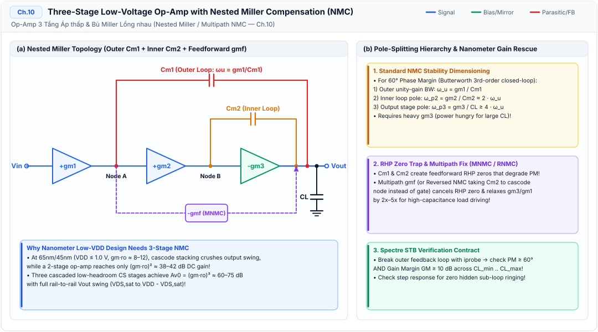

---
{
  "id": "tech-nested-miller-and-multipath-compensation",
  "kind": "technique",
  "domain": "opamps-and-compensation",
  "title_vi": "Bù Miller Lồng Nhau (NMC) & Bù Đa Đường Truyền Thẳng (MNMC) cho Bộ Khuếch đại Đa Tầng Nanomet",
  "title_en": "Nested Miller Compensation (NMC) and Multipath Feedforward Compensation (MNMC) for Low-Voltage Three-Stage Op-Amps",
  "summary": "Giải thích tại sao CMOS nanomet (45-65nm, gm*ro ~ 6-10, VDD <= 1.0V) cấm chồng tầng cascode dọc và bắt buộc ghép chuỗi ngang 3 tầng khuếch đại; dẫn xuất phân cấp tách cực Miller lồng nhau (tụ ngoài Cm1 + tụ trong Cm2), quy tắc tỉ lệ cực chuẩn Butterworth 1:2:4, điều kiện gm3 >> gm1, gm2 khử cặp zero RHP và nhánh truyền thẳng gmf mở rộng băng thông.",
  "diagram": "../../diagrams/nested-miller-3stage.svg",
  "razavi_refs": [
    {
      "chapter": 10,
      "section": "10.5, 10.7",
      "pages": "426-433, 436-439",
      "equations": ["10.25", "10.29", "10.30", "10.33", "10.39", "10.41", "10.44", "10.46", "10.50"]
    },
    {
      "chapter": 11,
      "section": "11.5.2",
      "pages": "487-495",
      "equations": []
    }
  ],
  "glossary_codes": ["T852", "T874", "T879", "T1575", "T1592", "T1679", "T1687", "T1698", "T1699"],
  "process_agnostic": true,
  "roles": {
    "cascaded_three_gain_stages": "Ba tầng khuếch đại ghép nối tiếp ngang nhân lũy thừa độ lợi A0 ~ (gm*ro)^3 dưới nguồn cấp <= 1.0V chỉ tốn 2*Vds,min ở ngõ ra",
    "inner_miller_loop_cm2": "Tụ bù lồng trong vắt qua Tầng 3 biến khối Tầng 2-3 thành bộ tích phân một cực cục bộ ở dải tần trung",
    "outer_miller_loop_cm1": "Tụ bù bao ngoài vắt từ ngõ ra Tầng 1 tới ngõ ra cuối cùng xác lập cực trội toàn cục và tần số GBW = gm1/Cm1",
    "multipath_feedforward_gmf": "Nhánh hỗ dẫn truyền thẳng song song bơm dòng tần số cao vượt mặt tầng trung gian chậm để tạo zero LHP và nhân đôi băng thông"
  },
  "symptoms_addressed": [
    "sub-100nm-intrinsic-gain-too-low-for-two-stage-opamp-target",
    "sub-1v-supply-forbids-vertical-cascode-transistor-stacking",
    "uncompensated-three-stage-amplifier-violating-barkhausen-criterion",
    "bandwidth-compression-and-rhp-zeros-in-pure-nested-miller-loops"
  ],
  "limitations": [
    "pure-nmc-cuts-achievable-gbw-roughly-in-half-compared-to-two-stage",
    "requires-large-output-stage-transconductance-gm3-much-greater-than-gm1-gm2",
    "sensitive-to-light-capacitive-loads-when-wp3-slides-down-into-wp2",
    "wrong-interstage-sign-inversion-turns-cm1-or-cm2-into-positive-feedback-oscillator"
  ],
  "checklists": ["common-mos", "two-stage-miller", "feedback-and-stb"]
}
---

## 1. Bản chất Nguyên lý, Sơ đồ Mạch & Vai trò Từng Nhánh Cấu trúc

Khi công nghệ CMOS thu nhỏ xuống vùng nanomet sâu (**65nm, 45nm, 40nm** với nguồn cấp $V_{DD} \le 0{,}9\text{–}1{,}0\text{ V}$, Razavi Chương 11, §11.5.2, tr. 487–495), hai bức tường vật lý đồng thời sập xuống chặn đứng các cấu trúc Op-Amp truyền thống:
1. **Sự sụp đổ của độ lợi nội tại $g_m r_O$:** Do điều biến chiều dài kênh mạnh và DIBL, một MOSFET kênh ngắn chỉ đạt $g_m r_O \approx 6\text{–}10$ (ngay cả khi tăng $L = 2\text{–}3\,L_{\min}$ cũng chỉ đạt $12\text{–}18$). Một Op-Amp hai tầng nguồn chung đơn giản chỉ gom được $A_0 \sim (g_m r_O)^2 \approx 35\text{–}45\text{ dB}$ — hoàn toàn không đủ cho ADC/DAC độ phân giải $\ge 12\text{–}16\text{ bit}$ hoặc mạch đo lường chính xác đòi hỏi $A_0 \ge 75\text{–}90\text{ dB}$!
2. **Sự phá sản của phép xếp chồng dọc (Vertical Cascode Forbidden):** Dưới nguồn cấp $0{,}9\text{–}1{,}0\text{ V}$ với yêu cầu biên độ ngõ ra $0{,}5\text{–}0{,}6\text{ V}_{pp}$ mỗi nhánh, không còn chỗ để chồng 4–5 transistor dọc theo cột dòng (`NG11-07`: không thể dùng *cascode* chồng dọc, bắt buộc phải chuyển sang **ghép nối tiếp ngang nhiều tầng — *horizontal cascade***!).

Lời giải kiến trúc tất yếu là **Op-Amp 3 tầng ghép nối tiếp (Three-Stage Cascaded Op-Amp)**: nhân ba độ lợi $A_0 = A_1 \cdot A_2 \cdot A_3 \sim (g_m r_O)^3 \approx 60\text{–}80\text{ dB}$, trong khi tầng cuối vẫn chỉ xếp chồng đúng 2 transistor ($V_{DD} - 2\,V_{DS,\min}$)! Thế nhưng 3 nút trở kháng cao nối tiếp sinh ra **3 cực tần số thấp**, tạo độ dịch pha tiệm cận $-270^\circ$ chắc chắn tự kích dao động dữ dội khi đóng vòng hồi tiếp nếu không có **tính ổn định và bù tần số (`T1592`)** chuyên biệt.



Mở rộng trực tiếp từ **định lý Miller (`T852`)**, **hiệu ứng Miller (`T874`)**, **sự nhân điện dung Miller (`T879`)** và **sự tách cực (`T1699`, pole splitting)** của Chương 10 (§10.5 & §10.7, tr. 426–439), kỹ thuật **Bù Miller Lồng Nhau (Nested Miller Compensation — NMC)** đệ quy hóa **bù Miller (`T1698`)** thành hai vòng lồng đồng tâm dùng hai **tụ bù (`T1687`)**:
- **Vòng Miller trong ($C_{m2}$):** Vắt ngang qua Tầng 3 đảo pha ($A_3 = -g_{m3} R_3 < 0$), tách cực giữa nút ra Tầng 2 ($V_2$) và nút tải ($V_{\text{out}}$), biến tổ hợp [Tầng 2 + Tầng 3] thành một khối tương đương bậc nhất ở tần số trung bình.
- **Vòng Miller ngoài ($C_{m1}$):** Vắt ngang từ nút ra Tầng 1 ($V_1$) qua cả hai tầng sau tới thẳng $V_{\text{out}}$ (nhìn thấy độ lợi đảo tổng cộng $A_2 A_3 < 0$), đẩy cực tại $V_1$ lùi sâu về sát gốc tọa độ làm cực trội duy nhất của toàn hệ thống!
- **Nhánh Truyền thẳng Đa đường ($g_{mf}$ — Multipath Nested Miller Compensation, MNMC):** Mắc thêm một tầng hỗ dẫn truyền thẳng nối từ đầu vào (hoặc nút $V_1$) bơm dòng trực tiếp ra ngõ ra cuối cùng ở tần số cao để triệt tiêu các zero nửa mặt phẳng phải và khôi phục băng thông bị mất!

---

## 2. Hệ Phương trình Cốt lõi & Tư duy "Nhìn Mạch Đọc Nhanh" (Analysis by Inspection)

### 2.1. Nền tảng Tách cực Một Vòng & Các Biến thể Chặn Đường Truyền Thẳng trong Sách Razavi (§10.5 & §10.7)
Trước khi lồng vòng thứ hai, cần nắm chắc bốn kết quả giải tích nền tảng của Razavi tại §10.5 và §10.7 (cơ sở để lắp ghép mọi cấu trúc đa tầng):
1. **Bù Miller cơ bản & Zero nửa mặt phẳng phải (Phương trình 10.25 & 10.29):** Trong hệ 2 tầng ($R_S, C_E$ lái tầng $g_{m9}, R_L, C_L$ qua $C_C$), cực thứ hai được kéo vọt lên $\omega'_{p2} \approx \frac{g_{m9}}{C_E + C_L}$ (Phương trình 10.25, `NG10-03`), nhưng dòng truyền thẳng thụ động qua $C_C$ tạo ra RHP zero tại $+\frac{g_{m9}}{C_C + C_{GD9}}$ làm suy giảm cả độ lớn lẫn pha vòng theo $\beta H(s) = \beta A_0 \frac{1 - s/\omega_z}{(1 + s/\omega_{p1})(1 + s/\omega_{p2})}$ (Phương trình 10.29).
2. **Dịch Zero bằng Điện trở Nối tiếp $R_z$ (Phương trình 10.30 & 10.33, `NG10-05`):** Chèn $R_z$ nối tiếp $C_C$ dời zero tới $\omega_z \approx \frac{1}{C_C(g_{m9}^{-1} - R_z)}$ (Phương trình 10.30; khi $R_z > g_{m9}^{-1}$ zero sang hẳn LHP!), cho phép đặt trùng khử cực phụ thứ nhất nếu chọn $R_z \approx \frac{C_L + C_C}{g_{m9} C_C}$ (Phương trình 10.33).
3. **Chặn Đường Truyền Thẳng bằng Đệm Bám Nguồn hoặc Cổng Chung (Phương trình 10.39–10.50):**
   - *Đệm bám nguồn một chiều (Hình 10.41b–10.42, Phương trình 10.39, 10.41, 10.44):* Từ quan hệ $V_1 = -\frac{V_{\text{out}}}{g_{m1} R_L}(1 + R_L C_L s)$ (Phương trình 10.39), hàm truyền vòng hở (Phương trình 10.41) triệt bỏ hoàn toàn RHP zero (thay bằng LHP zero tại $-g_{m2}/C_C$) và đặt cực phụ tại $\omega_{p2} \approx \frac{g_{m1}}{C_L}$ (Phương trình 10.44, lưu ý ký hiệu Hình 10.42 gọi tầng CS cuối là $g_{m1}$ và tầng bám nguồn là $g_{m2}$).
   - *Hồi trả qua Tầng Cổng Chung / Cascode Ahuja (Hình 10.43–10.46, Phương trình 10.46, 10.50):* Bơm dòng $C_C$ vào cực nguồn trở kháng thấp $1/g_{m2}$ thỏa mãn $V_{\text{out}} + \frac{g_{m2} V_2}{C_C s} = -V_2$ (Phương trình 10.46), giữ cực trội tại $\omega_{p1} \approx \frac{1}{g_{m1} R_L R_S C_C}$ (Phương trình 10.50) đồng thời **nhân bội cực thứ hai thêm $g_{m2} R_S$ lần**! Đặc biệt ở Hình 10.46(a) (tr. 439), Razavi chỉ ra việc **phối hợp đồng thời hai tụ bù $C_C$ và $C'_C$** mở ra bậc tự do điều khiển đa vòng — chính là cầu nối trực tiếp sang NMC!

### 2.2. Dẫn xuất Hàm Truyền Bậc Ba & Quy trình Định cỡ Chuẩn 1 : 2 : 4 của Nested Miller (NMC)
Xét Op-Amp 3 tầng gồm: Tầng 1 ($+g_{m1}, R_1$), Tầng 2 **không đảo** ($+g_{m2}, R_2$), và Tầng 3 **đảo** ($-g_{m3}, R_3$) lái tải lớn $C_L$ (bỏ qua tụ ký sinh nội bộ nhỏ $C_1, C_2 \ll C_{m1}, C_{m2}, C_L$ và giả sử độ lợi mỗi tầng $g_{mk} R_k \gg 1$):
- Độ lợi DC toàn mạch là $A_0 = (g_{m1} R_1)(g_{m2} R_2)(g_{m3} R_3)$ (mang dấu đảo âm từ $V_{in-}$ sang $V_{\text{out}}$), và cực trội sau khi nhân Miller hai tầng qua $C_{m1}$ nằm tại $\omega_{p1} \approx \frac{1}{(g_{m2} R_2 g_{m3} R_3) R_1 C_{m1}}$, cho băng thông độ lợi đơn vị vòng hở chỉ phụ thuộc $g_{m1}$ và $C_{m1}$:

$$
\omega_{\text{GBW}} = A_0 \cdot \omega_{p1} \approx \frac{g_{m1}}{C_{m1}}
$$

- Viết phương trình nút KCL chính xác ở dải tần trung–cao ($\omega \gg \omega_{p1}$, nên $R_1, R_2, R_3$ coi như hở mạch so với dung kháng $C_{m1}, C_{m2}, C_L$), ta thu được hàm truyền tiệm cận tần số cao của NMC:

$$
H_{\text{NMC,HF}}(s) \approx \frac{g_{m1}}{s C_{m1}} \cdot \frac{1 - s\dfrac{C_{m2}}{g_{m3}} - s^2\dfrac{C_{m1} C_{m2}}{g_{m2} g_{m3}}}{1 + s\dfrac{C_{m2}(C_L + C_{m1}) - \dots}{g_{m2} C_{m1}} \;\xrightarrow{g_{m3} \gg g_{m1}, g_{m2}}\; 1 + s\left(\dfrac{C_{m2}}{g_{m2}}\right) + s^2\left(\dfrac{C_{m2} C_L}{g_{m2} g_{m3}}\right)}
$$

*(Điều kiện bắt buộc để khử số hạng giảm chấn âm và đẩy cặp zero tử số ra tần số rất cao là **$g_{m3} \gg g_{m1}, g_{m2}$**!)*

Khi đóng vòng hồi tiếp âm hệ số $\beta$ ($\omega_{\text{CL,0}} = \beta \omega_{\text{GBW}} = \beta\frac{g_{m1}}{C_{m1}}$), đa thức đặc trưng vòng kín bậc ba có dạng chuẩn hóa Butterworth tối ưu phẳng cực đại ($(s + \omega_0)(s^2 + \omega_0 s + \omega_0^2) = s^3 + 2\omega_0 s^2 + 2\omega_0^2 s + \omega_0^3$, ứng với **$\text{PM} \approx 60^\circ$** và vọt lố bậc thang chỉ $\sim 4\%$) khi và chỉ khi chọn **quy luật phân cấp tần số vàng $1 : 2 : 4$**:

$$
\beta\,\omega_{\text{GBW}} \;:\; \omega_{p2,\text{eff}} \;:\; \omega_{p3,\text{eff}} \;=\; 1 \;:\; 2 \;:\; 4 \quad \Longleftrightarrow \quad \omega_{p2,\text{eff}} = \frac{g_{m2}}{C_{m2}} = 2\,\beta\,\omega_{\text{GBW}}, \qquad \omega_{p3,\text{eff}} = \frac{g_{m3}}{C_L} = 4\,\beta\,\omega_{\text{GBW}}
$$

Giải ngược hệ tỉ lệ $1:2:4$ này ra trực tiếp **quy trình bù tần số (`T1679`)** đóng gói cho hai tụ bù NMC:

$$
C_{m1} = 4\,\beta\,\frac{g_{m1}}{g_{m3}}\,C_L, \qquad C_{m2} = 2\,\frac{g_{m2}}{g_{m3}}\,C_L \quad \Longrightarrow \quad \beta\,\omega_{\text{GBW,NMC}} = \frac{1}{4}\frac{g_{m3}}{C_L}
$$

*Phát hiện đánh đổi cốt tử:* Trong Op-Amp 2 tầng bù Miller chuẩn ($\text{PM} \approx 60^\circ$), $\beta\,\omega_{\text{GBW,2-stage}} \approx \frac{1}{2}\frac{g_{m,\text{out}}}{C_L}$. Khi lên 3 tầng NMC, với cùng tầng công suất cuối $g_{m3}$ và cùng tải $C_L$, **băng thông tối đa đạt được bị cắt giảm một nửa ($\frac{1}{4}\frac{g_{m3}}{C_L}$ thay vì $\frac{1}{2}\frac{g_{m3}}{C_L}$)**!

### 2.3. Nâng cấp Bù Đa Đường Truyền Thẳng (MNMC — Feedforward $g_{mf}$) Khôi phục Gấp Đôi Băng thông!
Để phá vỡ rào cản $\frac{1}{4}\frac{g_{m3}}{C_L}$ mà không tăng dòng tĩnh Tầng 3, cấu trúc **Multipath Nested Miller Compensation (MNMC)** đặt thêm một nhánh hỗ dẫn truyền thẳng $g_{mf}$ nối song song từ nút ra Tầng 1 ($V_1$, hoặc trực tiếp từ cổng vi sai đầu vào) bơm dòng thẳng vào nút ra Tầng 2 (hoặc nút ngõ ra cuối $V_{\text{out}}$):
- Ở DC: độ lợi vẫn giữ nguyên $A_0 = A_1 A_2 A_3$ cực cao của 3 tầng nối tiếp.
- Ở tần số cao gần $\omega_{\text{GBW}}$: nhánh nhanh $g_{mf}$ đi tắt vòng qua Tầng 2 chậm, tạo ra một **zero nửa mặt phẳng trái (LHP zero) có vị trí điều khiển được**:

$$
\omega_{z,\text{MNMC}} = -\frac{g_{m2}}{C_{m2}} \cdot \frac{g_{m3}}{g_{mf}} \quad \text{(khi đặt trùng } |\omega_{z,\text{MNMC}}| = \omega_{p2} \implies \text{khử gọn } 1 \text{ bậc trễ pha!)}
$$

  Nhờ khử được một cực phụ trên mặt phẳng $s$, hệ 3 tầng quay trở về đặc tính pha của hệ 2 tầng, cho phép giảm một nửa $C_{m1}$ và **khôi phục băng thông lên lại $\beta\,\omega_{\text{GBW,MNMC}} \approx \frac{1}{2}\frac{g_{m3}}{C_L}$**!

---

## 3. Bất biến Cấu trúc & Các Bẫy Lỗi Kinh điển (Structural Invariants & Traps)

- **[INV-NMC-01] Bất biến Dấu Đảo Pha Giữa Ba Tầng Trong NMC (Stage Polarity Sign Invariant):**
  Để **cả hai** tụ $C_{m2}$ và $C_{m1}$ đều thực hiện hồi tiếp **ÂM** tách cực chứ không biến thành mạch dao động tích cực:
  - Vòng trong $C_{m2}$ ôm riêng Tầng 3 $\implies$ Tầng 3 bắt buộc **ĐẢO PHA** ($A_3 < 0$).
  - Vòng ngoài $C_{m1}$ ôm chuỗi [Tầng 2 $\times$ Tầng 3] $\implies$ tích $A_2 \cdot A_3$ cũng bắt buộc **ĐẢO PHA** ($A_2 A_3 < 0$).
  - Chia hai điều kiện trên suy ra bất biến cấu trúc bất khả xâm phạm: **Tầng 2 bắt buộc phải KHÔNG ĐẢO PHA ($A_2 > 0$)**! (Trong thiết kế vi sai đầu–đầu sang đơn đầu, thực hiện cực dễ bằng cách đảo chéo dây $+/-$ giữa ngõ ra Tầng 1 và ngõ vào Tầng 2; trong thiết kế đơn đầu, Tầng 2 phải dùng tầng cổng chung, gương dòng đảo lại, hoặc cặp vi sai lấy ngõ ra không đảo!).
- **[INV-NMC-02] Bất biến Phân cấp Hỗ dẫn $g_{m3} \gg g_{m1}, g_{m2}$ (Transconductance Dominance Law):**
  Nếu người thiết kế chia dòng tĩnh đều nhau cho 3 tầng làm $g_{m3} \approx g_{m2}$, số hạng truyền thẳng bậc nhất $-s\frac{C_{m2}}{g_{m3}}$ trên tử số kéo RHP zero tụt xuống ngay sát $\omega_{\text{GBW}}$, đồng thời hệ số giảm chấn $\zeta$ của cặp cực phức phụ $\omega_{p2,3}$ rơi xuống gần $0$ gây đỉnh cộng hưởng nhọn hoắt (*gain peaking* $> 10\text{ dB}$) ở trên $\omega_{\text{GBW}}$ (chỉ phát hiện được đầy đủ bằng tiêu chuẩn Nyquist `tech-nyquist-stability-criterion` hoặc kiểm tra Gain Margin)! Bắt buộc phân bổ dòng sao cho **$g_{m3} \ge (4\text{–}8)\,g_{m1,2}$** (hoặc dùng tầng cuối đẩy–kéo Class-AB có $g_{m3}$ lớn, hoặc chèn điện trở/đệm chặn đường truyền thẳng qua $C_{m2}$!).

- **[TRAP-NMC-01] Bẫy Mất Ổn Định Khi Tải Điện Dung $C_L$ Quá Nhỏ Hoặc Quá Lớn (Load-Range Window Trap):**
  Khác với Folded-Cascode 1 tầng (tăng $C_L$ luôn ổn định hơn), và khác cả Op-Amp 2 tầng (giảm $C_L$ luôn ổn định hơn), Op-Amp 3 tầng NMC có **cửa sổ tải $C_L$ bị chặn cả hai đầu**:
  - Nếu $C_L$ **quá lớn** so với thiết kế: $\omega_{p3} = g_{m3}/C_L$ tụt xuống đâm vào $\omega_{p2}$, làm sập dự trữ pha!
  - Nếu $C_L$ **quá nhỏ** (hở tải): hệ số giảm chấn $\zeta \propto \sqrt{\frac{C_L}{C_{m2}}\frac{g_{m2}}{g_{m3}}}$ của cặp cực phức tần số cao tụt mạnh gây dao động rung tần số cao (trừ khi dùng biến thể *Damping-Factor-Control Frequency Compensation — DFCFC* hoặc nối thêm điện trở $R_z$ vào $C_{m2}$)!
- **[TRAP-NMC-02] Bẫy Cặp Cực–Zero Gần Trùng Khi Dò Sai Nhánh Truyền Thẳng $g_{mf}$ Trong MNMC:** Nếu lạm dụng nhánh $g_{mf}$ tạo cặp cực–zero triệt nhau ở tần số quá thấp ($\omega_{z,\text{MNMC}} \ll \omega_{\text{GBW}}$), sai lệch góc công nghệ PVT giữa $g_{mf}$ và $C_{m2}$ sẽ để lộ một *doublet* làm xuất hiện đuôi xác lập chậm hàng trăm nano-giây (`law-slewing-vs-linear-settling-time-budget`)! Luôn đặt cặp triệt cực–zero ở vùng $\ge (1{,}2\text{–}2{,}0)\,\beta\omega_{\text{GBW}}$.

---

## 4. Lộ trình Nâng cấp Cấu trúc & Bát giác Đánh đổi (Upgrade Paths & Design Octagon)

| Bài toán thực tế & Giới hạn của NMC cơ bản | Biến thể nâng cấp / Cấu trúc đích (Canonical Node) | Đột phá đạt được | Đánh đổi trên `concept-analog-design-octagon` |
|---|---|---|---|
| Nguồn cấp $\ge 1{,}2\text{ V}$ và $g_m r_O \ge 15$ đã đủ đạt $A_0 \ge 70\text{ dB}$ chỉ với 2 tầng | Hạ bậc về `topo-two-stage-opamp` + `tech-miller-pole-splitting` + `tech-miller-rhp-zero-nulling-and-cascode-comp` | Băng thông tăng gấp đôi ($g_{m,\text{out}}/(2 C_L)$), ít cực hơn, thiết kế đơn giản và ít nhiễu/công suất hơn | Mất $\sim 20\text{ dB}$ độ lợi DC so với cấu trúc 3 tầng ở kênh cực ngắn |
| Phải lái siêu tụ tải lớn ($C_L = 100\text{ pF}\text{–}10\text{ nF}$, như LDO không tụ ngoài `topo-cmos-ldo-regulator` hoặc đệm tai nghe) mà không thể đốt dòng lớn ở $g_{m3}$ | *Reversed Nested Miller Compensation (RNMC)* + Đệm cascode / Class-AB (`tech-slew-rate-and-class-ab-opamps`) | Đảo đầu nối tụ trong $C_{m2}$ về nút ra Tầng 1 thay vì nút tải $V_{\text{out}}$ để không bắt $C_{m2}$ tải trực tiếp ngõ ra, nâng băng thông gấp $2\text{–}4\times$ ở $C_L$ khổng lồ! | Đòi hỏi kiểm soát chặt cực ký sinh nội bộ Tầng 2 bằng phương pháp đồ thị cực Nyquist (`tech-nyquist-stability-criterion`) |
| Mạch NMC 3 tầng có nhiều điểm cắt pha $-180^\circ$ hoặc nghi ngờ cực phức tần số cao nhô qua $0\text{ dB}$ | Kiểm định bắt buộc bằng `tech-nyquist-stability-criterion` & `tech-bode-blackman-middlebrook-stb` | Phân biệt chính xác hệ ổn định có điều kiện (conditionally stable) với hệ dao động mà chỉ số PM đơn lẻ nhìn nhầm | Tốn thêm bước quét đồ thị bao quanh điểm $(-1, j0)$ trên toàn dải tần |

---

## 5. Thích ứng Đa Tiến trình (90nm / 65nm / 45nm) & Cách Kiểm chứng trong Cadence / Spectre

### 5.1. Bảng Định cỡ Phân cấp 3 Tầng Cho CMOS 90nm / 65nm / 45nm ($V_{DD} = 0{,}9\text{–}1{,}0\text{ V}$)
Áp dụng cho một Op-Amp 3 tầng tiêu biểu trên tiến trình **65nm / 45nm ($V_{DD} = 1{,}0\text{ V}$)** lái $C_L = 10\text{ pF}$ với mục tiêu $A_0 > 80\text{ dB}$, $\text{GBW} = 25\text{ MHz}$ ($\beta = 1$), $\text{PM} \ge 60^\circ$:

| Tầng Khuếch đại & Phần tử Bù | Phân bổ Dòng tĩnh (% $I_{\text{tot}}$) | Vùng $g_m/I_D$ ($\text{V}^{-1}$) & $V_{DS,\min}$ ($\text{mV}$) | Chọn $L$ & Công thức Định cỡ | Vai trò Vật lý Trọng tâm |
|---|---|---|---|---|
| **Tầng 1 (Cặp vi sai đầu vào $M_{1,2}$)** | $15\%\text{ – }20\%$ | $18\text{ – }22\text{ V}^{-1}$ ($V_{DS,\min} \approx 90\text{ mV}$) | $L_1 = 2\text{–}3\,L_{\min}$; $g_{m1} = 2\pi\,\text{GBW}\,C_{m1}$ | Quyết định nhiễu đầu vào, offset và tích số $\text{GBW}$ thông qua $C_{m1}$ |
| **Tầng 2 (Tầng trung gian không đảo $A_2 > 0$)** | $15\%\text{ – }20\%$ | $14\text{ – }17\text{ V}^{-1}$ ($V_{DS,\min} \approx 120\text{ mV}$) | $L_2 = 2\,L_{\min}$; giữ diện tích gọn để $C_{\text{par},2} \ll C_{m2}$ | Cộng thêm $20\text{–}25\text{ dB}$ độ lợi DC và đẩy $\omega_{p2} = g_{m2}/C_{m2} = 2\,\text{GBW}$ |
| **Tầng 3 (Tầng xuất CS / Class-AB đảo $A_3 < 0$)** | **$60\%\text{ – }65\%$** | $13\text{ – }16\text{ V}^{-1}$ ($V_{DS,\min} \approx 130\text{ mV}$) | $L_3 = 1{,}5\,L_{\min}$; **$g_{m3} \ge 4(2\pi\,\text{GBW})C_L$** | Nắm giữ cực thứ ba $\omega_{p3} = g_{m3}/C_L \ge 4\,\text{GBW}$ và dập tắt RHP zero! |
| **Hai tụ bù MIM/MOM ($C_{m1}, C_{m2}$) + $R_{z2}$** | $0\%$ (Thụ động) | Tấm dưới (bottom plate) của $C_{m1}, C_{m2}$ quay về phía $V_{\text{out}}$! | $C_{m1} = 4\frac{g_{m1}}{g_{m3}}C_L$, $C_{m2} = 2\frac{g_{m2}}{g_{m3}}C_L$, $R_{z2} \approx \frac{1}{g_{m3}}$ | Quay tấm dưới tụ về $V_{\text{out}}$ để tụ ký sinh xuống đế rơi vào $C_L$ thay vì làm nặng nút trong $V_1, V_2$! |

### 5.2. Kiểm chứng Toàn diện Cả Dự trữ Pha (PM) Lẫn Dự trữ Độ lợi (GM) Trong Cadence Spectre (`stb`)
Trong hệ thống 3 tầng NMC/MNMC, **tuyệt đối cấm chỉ nhìn mỗi `phaseMargin` mà bỏ qua `gainMargin`**! Một cặp cực phức có giảm chấn thấp ở $3\times \text{GBW}$ có thể để lại `PM = 62°` rất đẹp tại $\text{GBW}$, nhưng nhô vọt đỉnh biên độ vượt lên trên $0\text{ dB}$ ngay tại tần số cắt pha $-180^\circ$ (`GM < 0 dB` $\Rightarrow$ mạch dao động thực sự)!

```ocean
; Kiểm định kép PM + GM + Độ nhô đỉnh vòng kín cho Op-Amp 3 tầng NMC / MNMC
simulator('spectre)
openResults("./psf")

; 1. Kiểm tra STB vòng hở (bắt buộc cả PM >= 60 deg VÀ GM >= 10 dB!)
selectResult('stb_margin)
pm_val  = getData("phaseMargin")
ugf_val = getData("phaseMarginFreq")
gm_val  = getData("gainMargin")
gmf_val = getData("gainMarginFreq")
printf("3-Stage NMC STB : UGF = %.2f MHz | PM = %.2f deg | GM = %.2f dB (@ %.2f MHz)\n"
       ugf_val/1e6 pm_val gm_val gmf_val/1e6)

when(pm_val < 58.0 || gm_val < 10.0
  printf("[CRITICAL] Rủi ro cộng hưởng cực phức bậc 3! Kiểm tra gm3 >= 4*2*pi*UGF*CL hoặc thêm Rz2 = 1/gm3!\n")
)

; 2. Kiểm tra độ nhô đỉnh đáp ứng tần số vòng kín (Closed-Loop Peaking <= 1.0 dB)
selectResult('ac)
Acl_dB = db20(abs(v("/vout") / v("/vin")))
peak_dB = ymax(Acl_dB) - value(Acl_dB 1e3)
printf("Closed-Loop AC Peaking = %.2f dB\n" peak_dB)
```

---

## 6. Mốc Đối chiếu Sách Razavi & Thuật ngữ Chuẩn CLB

### 6.1. Đối chiếu Sách Gốc Razavi (2nd Edition) & Chú giải Hiệu đính Học thuật CLB
- **Chương 10:**
  - §10.5 *Compensation of Two-Stage Op Amps* (tr. 426–433, Phương trình 10.25, 10.29, 10.30, 10.33, Hình 10.27–10.35 — tách cực Miller, zero truyền thẳng RHP và khử zero bằng điện trở nối tiếp $R_z$).
  - §10.7 *Other Compensation Techniques* (tr. 436–439, Phương trình 10.39, 10.41, 10.44, 10.46, 10.50, Hình 10.41–10.46 — dùng tầng đệm bám nguồn và tầng cổng chung cắt đường truyền thẳng RHP zero, cùng sơ đồ kết hợp hai tụ bù đồng thời $C_C, C'_C$ ở Hình 10.46).
- **Chương 11:**
  - §11.5.2 *Two-Stage Op Amp [in 40-nm CMOS, 1-V Supply]* (tr. 487–495 — phân tích tường tận giới hạn độ lợi nội tại và áp dự trữ dưới nguồn $1\text{ V}$ buộc phải thay xếp chồng dọc bằng ghép tầng ngang).
- **Chú giải Hiệu đính Nguồn CLB (`source_issues.json`):**
  - **`NG10-03` (tr. 428, Phương trình 10.25):** Mẫu số của Phương trình (10.25) trong bản in dư một dấu ngoặc tròn đóng ngay sau $C_E C_L$.
  - **`NG10-04` (tr. 429, Hình 10.30):** Nhãn độ lợi tần số thấp trên Hình 10.30 in nhầm chỉ số $\beta g_{m1} R_S g_{m2} R_L$, trong khi lời văn và Phương trình (10.26)–(10.27) ký hiệu transistor tầng hai là $M_9$ ($g_{m9}$).
  - **`NG10-05` (tr. 431, Phương trình 10.30):** Sách viết $R_z \ge g_{m9}^{-1} \Rightarrow \omega_z \le 0$; chính xác về mặt toán học thì tại đúng $R_z = g_{m9}^{-1}$, mẫu số bằng $0$ đẩy zero ra **vô cực ($\infty$)**, còn khi $R_z > g_{m9}^{-1}$ zero mới có giá trị hữu hạn âm thuộc nửa mặt phẳng trái (LHP)!
  - **`NG11-07` (tr. 487, §11.5.2) & `NG11-08` (tr. 491, Hình 11.42a):** Phân biệt rõ lỗi đánh máy `"folded cascade"` với `"folded-cascode"` ở đầu §11.5.2, và lưu ý Hình 11.42(a) in nhầm mẫu số chiều dài PMOS là $41\,\mu\text{m}/80\,\mu\text{m}$ thay vì kích thước thực tế **$41\,\mu\text{m}/80\,\text{nm}$**!

### 6.2. Bảng Thuật ngữ Chuẩn CLB Vi Mạch Sử dụng trong Thẻ
| Mã CLB | Thuật ngữ Tiếng Anh | Thuật ngữ Tiếng Việt Chuẩn | Ghi chú Ngữ cảnh |
|---|---|---|---|
| `T1592` | Stability and Frequency Compensation | tính ổn định và bù tần số | Trọng tâm thiết kế hệ hồi tiếp đa cực |
| `T1575` / `T1679` | frequency compensation / Compensation Procedure | bù tần số / quy trình bù tần số | Định hình lại vị trí cực–zero vòng hở để đạt PM & GM mục tiêu |
| `T852` | Miller's theorem | định lý Miller | Ánh xạ trở kháng nối vắt qua tầng đảo pha về ngõ vào/ngõ ra |
| `T874` / `T879` | Miller effect / Miller multiplication | hiệu ứng Miller / sự nhân điện dung Miller | Nhân tụ $C_{m1}$ lên $(1 + A_2 A_3)$ lần tạo cực trội diện tích nhỏ |
| `T1698` / `T1699` | Miller compensation / pole splitting | bù Miller / sự tách cực | Đẩy cực trong về gốc đồng thời đẩy cực ngoài lên tần số cao |
| `T1687` | compensation capacitor | tụ bù | Phân cấp hai tụ lồng nhau $C_{m1}$ (ngoài) và $C_{m2}$ (trong) |
