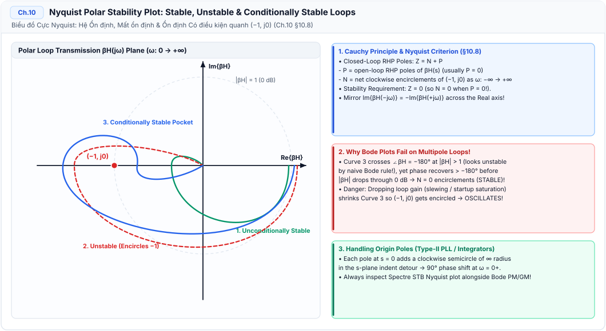

---
{
  "id": "tech-nyquist-stability-criterion",
  "kind": "technique",
  "domain": "opamps-and-compensation",
  "title_vi": "Tiêu chuẩn Ổn định Nyquist, Nguyên lý Cauchy & Hệ thống Ổn định Có Điều kiện (Nyquist Stability Criterion & Conditionally Stable Loops)",
  "title_en": "Nyquist's Stability Criterion, Cauchy's Principle of Argument, Origin Poles, and Conditionally Stable Systems",
  "summary": "Giải thích vì sao quy tắc đồ thị Bode thông thường chẩn đoán sai các hệ thống có nhiều điểm cắt pha -180 deg, hệ ổn định có điều kiện (conditionally stable) hoặc vòng có cực RHP mở vòng; dẫn xuất chặt chẽ tiêu chuẩn Nyquist Z = N + P từ nguyên lý biến thiên đối số Cauchy, cách xử lý cực tại gốc tọa độ và cách đọc đồ thị cực Nyquist trực tiếp trong Cadence Spectre.",
  "diagram": "../../diagrams/nyquist-polar-stability.svg",
  "razavi_refs": [
    {
      "chapter": 10,
      "section": "10.8",
      "pages": "439-455",
      "equations": ["10.52", "10.53", "10.54", "10.55", "10.56", "10.57", "10.58"]
    }
  ],
  "glossary_codes": ["T1597", "T1613", "T1740", "T1745", "T1747", "T1790", "T1791", "T1793", "T1798", "T1801", "T1805", "T1806"],
  "process_agnostic": true,
  "roles": {
    "critical_righ_half_plane_contour": "Đường cong khép kín theo chiều kim đồng hồ bao trọn trục ảo j*omega và toàn bộ nửa mặt phẳng phải (vùng tới hạn gây mất ổn định)",
    "cauchy_argument_mapping": "Ánh xạ hàm phức 1 + beta*H(s) biến số cực P và số zero Z nằm trong đường bao thành Z - P vòng quay quanh gốc tọa độ",
    "critical_point_minus_one": "Điểm tới hạn (-1 + j0) trên mặt phẳng phức của beta*H(s) — tương đương gốc (0, 0) của đa thức đặc trưng vòng kín 1 + beta*H(s)",
    "origin_pole_indent_detour": "Cung bán nguyệt bán kính vô cùng bé né qua bên phải các cực nằm tại s = 0 (như mạch tích phân hay Charge-Pump PLL Type-II) tạo vòng quét lớn ở vô cực"
  },
  "symptoms_addressed": [
    "bode-plot-shows-two-or-more-180-degree-phase-crossings",
    "system-oscillates-when-loop-gain-decreases-during-slewing-or-startup",
    "local-positive-feedback-latch-embedded-inside-global-negative-feedback",
    "type-ii-pll-or-multi-integrator-sigma-delta-loop-stability-analysis"
  ],
  "limitations": [
    "linear-nyquist-stability-still-requires-checking-large-signal-saturation-for-conditionally-stable-loops",
    "counting-encirclements-on-logarithmic-magnitude-ranges-requires-zooming-near-minus-one"
  ],
  "checklists": ["feedback-and-stb"]
}
---

## 1. Bản chất Nguyên lý, Sơ đồ Mạch & Vai trò Từng Nhánh Cấu trúc

Trong 95% các bộ khuếch đại một tầng và hai tầng đơn giản, góc pha của hàm truyền vòng $\angle \beta H(j\omega)$ giảm đơn điệu theo tần số, nên quy tắc đồ thị Bode ($\omega_{GX} < \omega_{PX} \iff \text{PM} > 0^\circ$) là đủ để kết luận tính ổn định. Tuy nhiên, Razavi mở đầu §10.8.1 (tr. 439–440) và tổng kết ở §10.8.7 bằng những nghịch lý thực tế phơi bày giới hạn của việc chỉ xét $s = j\omega$ trên đồ thị Bode:
1. **Nghịch lý $Y/X(j\omega) < \infty$ trên hệ mất ổn định & Hệ có cực RHP vòng hở (§10.8.1 Hình 10.47, Phương trình 10.52–10.53):** Trên Hình 10.47 ($\beta = 1$ và $|H(j\omega_0)| = 3$ tại tần số cắt pha $-180^\circ$, tức dự trữ pha âm), nếu chỉ thay $s = j\omega_0$ vào hàm truyền vòng kín thì $\frac{Y}{X}(j\omega_0) = \frac{-3}{1 - 3} = \frac{3}{2} < \infty$ (không hề phân kỳ tại bất kỳ tần số hình sin thuần ảo $s = j\omega$ nào, vì nghiệm dao động thực sự là sóng sin tăng trưởng mũ $s = \sigma_1 + j\omega_1$ với $\sigma_1 > 0$ nơi $\beta H(\sigma_1 + j\omega_1) = -1$!). Ngược lại, một tầng có hồi tiếp dương cục bộ / tải kháng âm chéo mang cực vòng hở ở nửa mặt phẳng phải $H(s) = \frac{1}{s/a - 1}$ ($P = 1 > 0$) khi đóng hồi tiếp âm đủ mạnh ($\beta > 1$) lại đẩy cực vòng kín sang nửa mặt phẳng trái $s_{\text{cl}} = -a(\beta - 1) < 0$ **hoàn toàn ổn định**, mặc dù quy tắc Bode truyền thống không sao giải thích nổi!
2. **Hệ có nhiều điểm cắt pha $-180^\circ$ (`Multiple 180° Crossings` / Hệ ổn định có điều kiện — §10.8.7, Hình 10.72):** Trong các bộ khuếch đại đa tầng bù nhiều nhánh (nested Miller), bộ điều chế $\Sigma\Delta$ bậc cao, vòng khóa pha PLL bậc 2/3 (`topo-charge-pump-type2-pll`), hoặc mạch LDO có nhiều cặp cực–zero phức, pha của $\beta H(j\omega)$ có thể **lặn xuống dưới $-180^\circ$ ở tần số trung bình (khi độ lợi vòng vẫn đang lớn tới $+20\text{ dB}$!), rồi nhờ hai LHP zero kéo vọt ngược lên lại trên $-180^\circ$ (ví dụ $-120^\circ$) trước khi biên độ cắt qua $0\text{ dB}$**! Nếu nhìn tại tần số cắt pha đầu tiên $\omega_{PX1}$, $|\beta H| > 1$ khiến quy tắc Bode tưởng rằng mạch tự dao động — trong khi thực tế mạch **ổn định hoàn toàn** (gọi là **hệ ổn định có điều kiện — conditionally stable**)!

Để có một tiêu chuẩn toán học **đúng tuyệt đối 100% không ngoại lệ** cho mọi mạng tuyến tính bất biến thời gian, **Tiêu chuẩn Ổn định Nyquist (`T1597`, Nyquist's Stability Criterion)** ánh xạ toàn bộ biên giới của nửa mặt phẳng phải phức sang **đồ thị Nyquist (`T1806`)** trên mặt phẳng phức $\big(\text{Re}\{\beta H(j\omega)\},\, \text{Im}\{\beta H(j\omega)\}\big)$.

---

## 2. Hệ Phương trình Cốt lõi & Tư duy "Nhìn Mạch Đọc Nhanh" (Analysis by Inspection)

### 2.1. Nguyên lý Biến thiên Đối số của Cauchy (`T1791`, Cauchy's Principle of Argument — §10.8.4)
Xét một đường cong khép kín $\Gamma_s$ trên mặt phẳng phức $s = \sigma + j\omega$ đi **theo chiều kim đồng hồ (clockwise — CW)** bao trọn toàn bộ "vùng tới hạn gây mất ổn định" (trục ảo $j\omega$ và toàn bộ nửa mặt phẳng phải $\sigma \ge 0$, Hình 10.60, không đi đè lên bất kỳ cực hay zero nào).
Giả sử hàm phức $F(s) = 1 + \beta H(s)$ có **$Z$ nghiệm không (zeros)** và **$P$ cực (poles)** nằm bên trong đường bao $\Gamma_s$. Mỗi zero nằm trong $\Gamma_s$ làm vectơ $s - s_{z,i}$ quay trọn 1 vòng chiều kim đồng hồ ($-2\pi\text{ rad}$), còn mỗi cực nằm trong $\Gamma_s$ (ở dưới mẫu số!) làm vectơ thương số quay 1 vòng ngược chiều kim đồng hồ ($+2\pi\text{ rad}$).
Do đó, ảnh $F(\Gamma_s)$ của đường cong trên mặt phẳng $F$ sẽ bao quanh gốc tọa độ $(0, 0)$ một số vòng theo chiều kim đồng hồ bằng:

$$
N_{\text{CW around }(0,0)}\big\{1 + \beta H(s)\big\} = Z - P
$$

### 2.2. Định lý Ổn định Nyquist (`T1793`, §10.8.5, Phương trình 10.57)
Hàm truyền vòng kín $A_{\text{cl}}(s) = \dfrac{H(s)}{1 + \beta H(s)}$ ổn định **khi và chỉ khi** mẫu số $1 + \beta H(s)$ **không có bất kỳ nghiệm không nào nằm trong nửa mặt phẳng phải hoặc trên trục ảo**, tức bắt buộc **$Z = 0$**!
Lưu ý hai phép biến đổi đơn giản hóa cực mạnh:
1. Cực của $1 + \beta H(s)$ chính là cực của hàm truyền vòng hở $\beta H(s)$ (với $\beta$ ổn định). Vậy $P$ chính là **số cực nằm ở nửa mặt phẳng phải (RHP poles) của bản thân mạch vòng hở $\beta H(s)$**!
2. Dịch mặt phẳng của $1 + \beta H(s)$ sang trái đúng $1$ đơn vị: việc $1 + \beta H(s)$ bao quanh điểm $(0, 0)$ **tương đương 1-đối-1** với việc đồ thị cực của riêng **$\beta H(s)$ bao quanh điểm tới hạn $(-1, 0)$**!

Ta thu được phương trình bất tử của Nyquist:

$$
Z = N + P \qquad \xrightarrow{\text{Điều kiện ổn định vòng kín } (Z = 0)} \qquad N = -P!
$$

trong đó:
- **$Z$:** Số cực RHP (không ổn định) của hệ thống **vòng kín** (phải bằng $0$!).
- **$P$:** Số cực RHP (không ổn định) đã biết của hệ thống **vòng hở** $\beta H(s)$.
- **$N$:** Số vòng ròng mà đồ thị cực Nyquist của $\beta H(s)$ (khi $\omega$ quét từ $-\infty \to 0 \to +\infty$) bao quanh điểm **$(-1, 0)$ theo chiều kim đồng hồ (CW)** ($N < 0$ nghĩa là bao quanh $|N|$ vòng **ngược chiều kim đồng hồ — CCW**!).

**Hai trường hợp áp dụng trực tiếp:**
- **Trường hợp 1 — Mạch vòng hở tự thân ổn định ($P = 0$, chiếm $> 99\%$ các Op-Amp/LDO/PLL):** Điều kiện cần và đủ để vòng kín ổn định là **$N = 0$** — đồ thị cực của $\beta H(j\omega)$ **KHÔNG ĐƯỢC đi qua và KHÔNG ĐƯỢC bao quanh điểm $(-1, 0)$** một vòng ròng nào!
- **Trường hợp 2 — Mạch vòng hở có $P > 0$ cực RHP (như tầng có tải kháng âm cục bộ mang $P = 1$ cực RHP):** Để vòng kín được cứu sống thành ổn định ($Z = 0$), đồ thị cực của $\beta H(j\omega)$ **BẮT BUỘC phải bao quanh điểm $(-1, 0)$ đúng $P$ vòng theo chiều NGƯỢC kim đồng hồ ($N = -P$)**!

### 2.3. Quy tắc Đếm Số Vòng Bao Quanh Bằng Tia Bán Vô hạn (Ray-Crossing Rule — tr. 450)
Khi đường cong Nyquist xoắn phức tạp qua lại trục thực nhiều lần (như Hình 10.72d), làm sao đếm $N$ không bao giờ nhầm? Razavi chỉ dẫn thuật toán hình học 3 bước bất bại:
1. Từ điểm tới hạn $(-1, 0)$, kẻ một tia thẳng bất kỳ ra xa vô cực (dễ nhất là kẻ tia dọc theo trục thực âm từ $-1$ về $-\infty$, hoặc tia thẳng đứng lên $+j\infty$).
2. Đếm số lần đường cong kín $\beta H(\Gamma_s)$ cắt ngang qua tia đó theo chiều **thuận kim đồng hồ ($n_{\text{CW}}$)** và theo chiều **ngược kim đồng hồ ($n_{\text{CCW}}$)**.
3. Hiệu số **$N = n_{\text{CW}} - n_{\text{CCW}}$** chính là số vòng bao quanh ròng! *(Chẳng hạn trong hệ ổn định có điều kiện Hình 10.72d khi cả hai giao điểm trục thực $B$ và $C$ đều nằm bên trái $(-1, 0)$ — xem `NG10-07` — tia kẻ từ $(-1,0)$ đi ra cắt 1 nhánh đi lên CW và 1 nhánh đi xuống CCW nên $N = 1 - 1 = 0 \implies$ **Hệ ổn định** dù cắt $-180^\circ$ ở độ lợi $> 1$!)*

### 2.4. Xử lý Các Cực Tại Gốc Tọa Độ ($s = 0$: Bộ Tích phân & Charge-Pump PLL — §10.8.6)
Nếu $\beta H(s)$ có $k$ cực nằm đúng tại gốc tọa độ $s = 0$ (ví dụ $k = 1$ cho mạch tích phân lý tưởng `Eq. 10.58`, hoặc **$k = 2$ cực tại gốc tọa độ** `T1805` cho vòng khóa pha bơm điện tích `topo-charge-pump-type2-pll` nơi cả bộ PFD+CP+tụ lẫn VCO đều là bộ tích phân $\frac{1}{s^2}$!):
- Đường bao $\Gamma_s$ không được đi đè lên cực $s = 0$, nên ta vẽ một **cung tròn bán nguyệt siêu nhỏ bán kính $\epsilon \to 0^+$ né sang bên phải gốc tọa độ** ($s = \epsilon e^{j\theta}$ với $\theta$ quét ngược chiều kim đồng hồ từ $-\frac{\pi}{2} \to 0 \to +\frac{\pi}{2}$, Hình 10.67 & 10.70)!
- Qua phép nghịch đảo $\frac{1}{s^k} = \frac{1}{\epsilon^k} e^{-j k \theta}$, cung né nhỏ xíu đó phóng ra thành một **vòng tròn bán kính khổng lồ $\infty$ quay THUẬN CHIỀU KIM ĐỒNG HỒ (CW) một góc bằng $k \times 180^\circ$** nối nhánh $\omega = 0^-$ sang nhánh $\omega = 0^+$:
  - $k = 1$ cực tại gốc: nửa vòng tròn lớn $180^\circ$ CW ở vô cực.
  - $k = 2$ cực tại gốc (`T1805`, Hình 10.70–10.71): nguyên **1 vòng tròn $360^\circ$ CW ở vô cực**! Nếu không có LHP zero cứu pha (như chưa gắn điện trở $R_P$ nối tiếp tụ lọc $C_1$ trong PLL Type-II!), đồ thị lập tức ôm trọn $(-1, 0)$ một vòng CW ($N = 1 \implies Z = 1$ hoặc đi qua $(-1,0)$) — chứng minh hình học vì sao **2 cực tại gốc không có zero bù chắc chắn mất ổn định 100%**!

---

## 3. Bất biến Cấu trúc & Các Bẫy Lỗi Kinh điển (Structural Invariants & Traps)

- **[INV-NYQ-01] Bất biến Co Giãn Đồng Dạng Theo Hệ số Hồi tiếp $\beta$ (Hình 10.65c):** Thay đổi hệ số hồi tiếp thực $\beta$ chỉ đơn giản là phóng to hoặc thu nhỏ bán kính mọi điểm trên đồ thị Nyquist của $H(j\omega)$ (hoặc tương đương coi đồ thị $H(j\omega)$ giữ cố định còn điểm tới hạn trượt dọc trục thực âm tại vị trí $\left(-\frac{1}{\beta}, 0\right)$!).
- **[TRAP-NYQ-01] Cái Bẫy Tử Thần Của "Hệ Ổn định Có Điều kiện" Khi Khởi Động Hoặc Quá Tải Slewing! (§10.8.7):**
  Xét hệ có 3 cực và 2 LHP zero ở Hình 10.72d: ở điểm làm việc tuyến tính nhỏ bình thường, cả hai giao điểm trục thực âm $B$ và $C$ đều nằm bên trái $(-1, 0)$ nên $N = 0$ (ổn định). **NHƯNG điều gì xảy ra khi bật nguồn hoặc khi có một xung nhiễu lớn đẩy Op-Amp vào vùng slewing / bão hòa biên độ?**
  Khi transistor chạm vùng bão hòa biên độ hoặc slewing, **độ lợi hiệu dụng tín hiệu lớn giảm mạnh** — làm toàn bộ đường cong Nyquist **co nhỏ lại**! Ngay khi nó co nhỏ đến mức điểm $(-1, 0)$ rơi lọt vào khoảng giữa hai giao điểm $B$ và $C$, số vòng bao quanh nhảy lên $N = 2$ ($Z = 2$ cực RHP!), và **mạch tự khóa chặt vào một dao động biên độ lớn vĩnh viễn không bao giờ tự thoát ra được** (large-signal limit-cycle oscillation)! Do đó trong thiết kế vi mạch thực tế, nếu dùng cấu trúc ổn định có điều kiện, bắt buộc phải có mạch kẹp chống bão hòa (anti-windup / clamping) hoặc kiểm tra xung quá tải cực đại trên miền thời gian `tran`!
- **[TRAP-NYQ-02] Nhầm Dấu Giữa $\beta H(j\omega)$ Của Sách Giáo Khoa Và `loopGain` Trong Cadence Spectre:**
  - Trong sách Razavi (Phương trình 10.57), mẫu số viết là $1 + \beta H(s)$ (dấu trừ của hồi tiếp âm đã được tách ra ngoài bộ cộng!), nên điểm tới hạn nằm tại **`(-1, 0)`** (tương ứng pha của $\beta H$ bằng $-180^\circ$).
  - Trong Cadence Spectre `stb`, bạn cần kiểm tra xem công cụ đang vẽ `loopGain` theo quy ước $T(s)$ (mẫu số $1 + T(s)$, ở DC hồi tiếp âm có $T(0) > 0$ nằm ở trục thực dương $+A_0\beta$, điểm tới hạn là **`(-1, 0)`** — đây là mặc định chuẩn của Spectre `stb`!) hay vẽ hàm truyền vòng mang cả dấu đảo pha $-T(s)$ (nếu ai đó tự đo bằng AC cắt vòng không đảo dấu, điểm tới hạn lại là **`(+1, 0)`**!). Chỉ cần nhìn điểm bắt đầu tại `f = 1 Hz`: nếu nó xuất phát trên **trục thực dương** ($+1000 + j0$), điểm tới hạn chắc chắn 100% là **`(-1, 0)`**!

---

## 4. Lộ trình Nâng cấp Cấu trúc & Bát giác Đánh đổi (Upgrade Paths & Design Octagon)

| Loại mạch bắt buộc dùng Tiêu chuẩn Nyquist | Thẻ Tri thức liên kết (Canonical Node) | Vai trò của kiểm định Nyquist | Hành động thiết kế đi kèm |
|---|---|---|---|
| Op-Amp 3 tầng bù Nested Miller hoặc Gain-Boosted Cascode có nhiều cặp cực–zero | `topo-gain-boosted-cascode`, `tech-bode-blackman-middlebrook-stb` | Xác nhận các vòng lượn pha do doublet không ôm qua $(-1, 0)$ và đo khoảng cách biên an toàn thực sự (Vector Margin) | Giữ khoảng cách ngắn nhất từ đường cong Nyquist tới điểm $(-1, 0)$ lớn hơn $\ge 0{,}5$! |
| Vòng khóa pha Bơm điện tích bậc 2/3 (2 cực tại gốc $s=0$ + zero $R_P C_1$ + cực phụ $C_2$) | `topo-charge-pump-type2-pll` | Xử lý chính xác vòng quét $360^\circ$ ở vô cực của $1/s^2$ và tối ưu tỉ số $C_1/C_2$ cho dự trữ pha cực đại | Đặt tần số cắt độ lợi $\omega_{GX}$ ngay tại trung bình nhân giữa zero $\omega_z = \frac{1}{R_P C_1}$ và cực $\omega_{p3} \approx \frac{C_1+C_2}{R_P C_1 C_2}$ |
| Mạch tự phân cực Bandgap / Constant-$G_m$ có cả vòng hồi tiếp âm lẫn vòng hồi tiếp dương | `tech-supply-independent-bias-and-startup`, `topo-bandgap-reference-core` | Kiểm tra tổng độ lợi vòng ròng không có nghiệm cực RHP ($P \to Z = 0$) | Giữ độ lợi vòng dương nhỏ hơn độ lợi vòng âm ở mọi tần số và mọi điểm dòng khởi động |

---

## 5. Thích ứng Đa Tiến trình (90nm / 65nm / 45nm) & Cách Kiểm chứng trong Cadence / Spectre

### 5.1. Thích ứng Công nghệ Nanomet: Thước đo "Dự trữ Vectơ" (Vector / Stability Margin $s_m$)
Ở tiến trình 90nm/65nm/45nm khi dùng nhiều tầng khuếch đại kênh ngắn có cực ký sinh dày đặc ở vùng vài GHz, riêng hai con số $\text{PM}$ (chỉ đo trên vòng tròn đơn vị $|T|=1$) và $\text{GM}$ (chỉ đo trên trục thực $\text{Im}\{T\}=0$) đều có thể bỏ lọt trường hợp đường cong Nyquist **lượn sát rạt điểm $(-1, 0)$ ở góc chéo** (ví dụ đi qua $-0{,}9 - j0{,}15$: cả $\text{PM}$ lẫn $\text{GM}$ nhìn riêng đều có vẻ đạt nhưng khoảng cách tới điểm nổ dao động $(-1,0)$ chỉ còn $0{,}18$, gây vọt đỉnh vòng kín $\frac{1}{0{,}18} = 5{,}5\times \approx +15\text{ dB}$!).
**Thước đo tối thượng bất biến tiến trình trên đồ thị Nyquist:** Đo **bán kính khoảng cách ngắn nhất (Vector Margin / Sensitivity Peak Inverse)** từ đường cong $T(j\omega)$ tới điểm $(-1, 0)$:

$$
d_{\min} = \min_{\omega \ge 0} \left| 1 + T(j\omega) \right| \ge 0{,}5 \quad \big(\text{đảm bảo hệ số nhạy cực đại } \|S\|_\infty = \frac{1}{d_{\min}} \le 2{,}0 \iff +6\text{ dB}\big)!
$$

### 5.2. Quy trình Vẽ & Đọc Đồ thị Nyquist Trực Tiếp trong Cadence Virtuoso / Spectre
1. **Xuất Đồ thị Cực Nyquist từ Phân tích `stb`:**
   - Sau khi chạy `stb probe=IPRB0 start=1 stop=100G dec=100` (luôn dùng mật độ điểm cao `dec=100` để đường cong quanh điểm `(-1, 0)` mịn không bị nối tắt dây cung!), trong cửa sổ *Direct Plot $\to$ Main Form $\to$ stb*, chọn nút **`Nyquist`** (hoặc vẽ `imag(loopGain)` theo trục X là `real(loopGain)`).
2. **Phóng to Vùng Lân cận `[-2, +1] x [-1.5, +1.5]` và Vẽ Vòng Tròn Cấm:**
   - Vì ở DC $|T(0)|$ có thể lớn tới $10^4$ ($80\text{ dB}$), nếu để tự động căn khung toàn đồ thị (`Fit All`), vùng quanh `(-1, 0)` sẽ co thành một chấm nhỏ không đọc được! Hãy phóng to khung nhìn vào hình vuông `Re in [-2, +1]`, `Im in [-1.5, +1.5]`.
   - Trong ViVA Calculator, tính trực tiếp chỉ số an toàn toàn cục cho bảng góc PVT / Monte Carlo chỉ bằng 1 dòng biểu thức duy nhất:
     `min_dist_to_minus1 = ymin(mag(1 + getData("loopGain" ?result "stb-stb")))`
     Bắt buộc **`min_dist_to_minus1 > 0.5`** trên tất cả các góc PVT!

### 5.3. Ví dụ Định lượng Kinh điển: Hệ Ba Cực Trùng Nhau vs. Hệ Ba Cực + Hai LHP Zero (Ví dụ 10.11 & §10.8.7)
1. **Hệ ba cực trùng nhau** $\beta H(s) = \dfrac{\beta A_0}{(1 + s/\omega_0)^3}$ (Ví dụ 10.11, tr. 449–450):
   - Góc pha cắt $-180^\circ$ khi mỗi cực đóng góp đúng $-60^\circ$: $\arctan(\omega_{PX}/\omega_0) = 60^\circ \implies \omega_{PX} = \sqrt{3}\,\omega_0$.
   - Tại tần số cắt pha đó, độ lớn mỗi thừa số mẫu số là $\sqrt{1 + (\sqrt{3})^2} = 2$, nên giao điểm với trục thực âm nằm tại:

$$
\beta H(j\sqrt{3}\omega_0) = -\frac{\beta A_0}{2^3} = -\frac{\beta A_0}{8}
$$

   - Đồ thị Nyquist không bao quanh $(-1, 0)$ khi và chỉ khi $-\frac{\beta A_0}{8} > -1 \iff \beta A_0 < 8$ ($18{,}06\text{ dB}$)! Ngay khi $\beta A_0 = 8$, mạch chạm ngưỡng dao động điều hòa (đây chính là điều kiện khởi phát của bộ dao động vòng 3 tầng `topo-ring-oscillator` ở Chương 15!).
2. **Hệ ổn định có điều kiện (3 cực thấp $\omega_{p1}, \omega_{p2}, \omega_{p3}$ + 2 LHP zero cứu pha $\omega_{z1}, \omega_{z2}$, Hình 10.72):**
   - Nhờ hai LHP zero kéo pha từ dưới $-180^\circ$ lộn ngược lên trên $-180^\circ$, đường cong Nyquist cắt trục thực âm tại hai điểm $B$ (ở $\omega_{PX1}$, ví dụ tại $-15 + j0$) và $C$ (ở $\omega_{PX2}$, ví dụ tại $-3 + j0$) rồi mới thu nhỏ vào trong vòng tròn đơn vị ở góc phần tư thứ ba!
   - Cả $B = -15$ và $C = -3$ đều nằm bên trái điểm $(-1, 0)$, nên $N = 1 - 1 = 0 \implies$ **vòng kín hoàn toàn ổn định**! Nhưng nếu giảm độ lợi đi $5\times$ (khi slewing!), $B' = -3$ nằm bên trái còn $C' = -0{,}6$ trôi sang bên phải $(-1, 0)$, làm $(-1, 0)$ bị nhốt kín với $N = +2$ vòng CW $\implies$ **mạch bùng nổ dao động**!

---

## 6. Mốc Đối chiếu Sách Razavi & Thuật ngữ Chuẩn CLB

### 6.1. Đối chiếu Sách Gốc Razavi (2nd Edition)
- **Chương 10:** §10.8 *Nyquist's Stability Criterion* — §10.8.1 *Motivation* (tr. 439–440, Phương trình 10.52–10.53, Hình 10.47–10.48), §10.8.2 *Basic Concepts* (tr. 440–442, Phương trình 10.54–10.56, Hình 10.49–10.52), §10.8.3 *Construction of Polar Plots* (tr. 442–447, Hình 10.53–10.59), §10.8.4 *Cauchy's Principle* (tr. 447, Hình 10.60), §10.8.5 *Nyquist's Method* (tr. 447–450, Phương trình 10.57, Hình 10.61–10.65, Ví dụ 10.9–10.11), §10.8.6 *Systems with Poles at Origin* (tr. 450–453, Phương trình 10.58, Hình 10.66–10.71, Ví dụ 10.12–10.14), §10.8.7 *Systems with Multiple $180^\circ$ Crossings* (tr. 454–455, Hình 10.72–10.73).
- **Chú giải Hiệu đính Học thuật CLB (`NG10`):**
  - **`NG10-06` (tr. 450, Hình 10.65a):** Trên trục thực của mặt phẳng $s$ ở Hình 10.65(a) minh họa hệ ba cực (Ví dụ 10.11), bản in gốc in lặp nhãn $-\omega_{p2}$ tại hai vị trí; theo đúng thứ tự ba cực của ví dụ, nhãn nằm ngoài cùng bên trái phải là **$-\omega_{p3}$**.
  - **`NG10-07` (tr. 455, §10.8.7):** Khi kết luận Trường hợp 1 của hệ có nhiều lần cắt $-180^\circ$ (nơi đầu mục trang 454 và chính Hình 10.72d đều xác định hai giao điểm $B$ và $C$ nằm ở **bên trái** điểm $(-1, 0)$, tức thực hơn về phía âm $< -1$), câu văn ở đầu trang 455 bản in gốc lại viết nhầm chữ *"to the right of $(-1, 0)$"*; từ phù hợp với sơ đồ Hình 10.72(d) của Trường hợp 1 là **bên trái (*to the left of $(-1, 0)$*)**!
  - **`NG10-09` (tr. 458, Bài tập 10.22, Phương trình 10.62):** Trong biểu thức đáp ứng quá độ cho sẵn ở Bài 10.22, bản in gốc in dấu trừ `−` trước số hạng hàm mũ cuối cùng khiến $V_{\text{out}}(0^+) \neq 0$; để khớp điều kiện đầu bằng không của bài toán, dấu phù hợp trước số hạng đó là dấu cộng `+`.

### 6.2. Bảng Thuật ngữ Chuẩn CLB Vi Mạch Sử dụng trong Thẻ
| Mã CLB | Thuật ngữ Tiếng Anh | Thuật ngữ Tiếng Việt Chuẩn | Ghi chú Ngữ cảnh |
|---|---|---|---|
| `T1597` / `T1793` | Nyquist's stability criterion / theorem | tiêu chuẩn / định lý ổn định Nyquist | Tiêu chuẩn tổng quát $Z = N + P$ cho mọi vòng hồi tiếp tuyến tính |
| `T1791` | Cauchy's Principle of Argument | nguyên lý biến thiên đối số Cauchy | Nền tảng toán học phức đếm hiệu số $Z - P$ |
| `T1806` | Nyquist plot | đồ thị Nyquist | Đường cong cực của $\beta H(j\omega)$ trên mặt phẳng phức |
| `T1801` / `T1805` | poles at origin / two poles at origin | các cực tại gốc tọa độ / hai cực tại gốc tọa độ | Đòi hỏi cung né bán nguyệt sinh vòng quay $k \times 180^\circ$ ở $\infty$ |
| `T1740` | Bode's view | cách tiếp cận Bode | Đơn giản trực quan nhưng bất lực khi pha lượn qua $-180^\circ$ nhiều lần |
