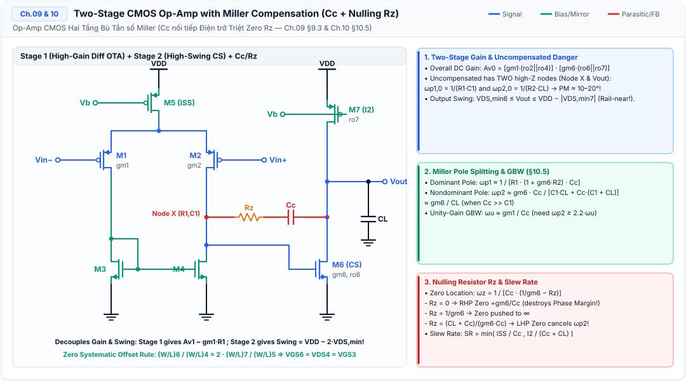

---
{
  "id": "tech-opamp-psrr-plus-and-minus-analysis",
  "kind": "technique",
  "domain": "opamps-and-compensation",
  "title_vi": "Phân tích Chuyên sâu Tỉ số Khử Nhiễu Nguồn Cấp Dương & Âm (PSRR+ / PSRR-) và Bẫy Xuyên Tụ Bù Miller ở Tần số Cao",
  "title_en": "Exact Small-Signal PSRR+ and PSRR- Analysis Across Op-Amp Topologies and the High-Frequency Miller Capacitor Feedthrough Trap",
  "summary": "Dẫn xuất chính xác hàm truyền nhiễu từ VDD và VSS ra ngõ ra AVDD(s), AVSS(s) cùng tỉ số PSRR+, PSRR- trên 5T-OTA, Folded-Cascode và Op-Amp hai tầng bù Miller; chứng minh tính bất biến của PSRR dưới hồi tiếp âm đối xứng, giải phẫu bẫy nối tắt diode qua tụ Cc làm PSRR sụt về 0 dB tại GBW và cách dùng bù cascode Ahuja khôi phục PSRR tần số cao.",
  "diagram": "../../diagrams/two-stage-miller-opamp.svg",
  "razavi_refs": [
    {
      "chapter": 9,
      "section": "9.11-9.12",
      "pages": "400-402",
      "equations": ["9.81", "9.82", "9.83", "9.84", "9.85", "9.86", "9.87", "9.88"]
    },
    {
      "chapter": 10,
      "section": "10.5, 10.7",
      "pages": "426-433, 436-439",
      "equations": ["10.30", "10.46"]
    }
  ],
  "glossary_codes": ["T067", "T528", "T1460", "T1474", "T1577", "T1687", "T1694", "T1874"],
  "process_agnostic": true,
  "roles": {
    "supply_perturbation_port": "Nguồn nhiễu xoay chiều nhỏ DeltaVDD(s) hoặc DeltaVSS(s) tiêm trực tiếp vào cực nguồn tải chủ động, gương dòng và đường quy chiếu phân cực",
    "diode_mirror_rail_tracker": "Transistor gương dòng mắc diode giữ VGS gần không đổi ở tần số thấp khiến cực cổng cặp gương nhấp nhô bám sát 1:1 theo nhiễu đường nguồn của nó",
    "miller_cc_hf_diode_short": "Tụ bù Miller Cc nối tắt xoay chiều cực cổng vào cực máng tầng hai ở tần số cao, biến transistor tầng hai thành công tắc 1/gm2 nối thẳng ngõ ra vào đường nguồn",
    "cascode_ahuja_psrr_shield": "Tầng cổng chung / cascode chặn dòng phản hồi từ Cc không cho khóa cực cổng tầng hai vào ngõ ra, giữ VGS tầng hai bằng không trước nhiễu nguồn"
  },
  "symptoms_addressed": [
    "switching-regulator-ripple-bleeding-directly-into-analog-output",
    "two-stage-opamp-psrr-collapsing-to-0db-near-unity-gain-bandwidth",
    "catastrophic-psrr-loss-from-referencing-current-source-bias-to-wrong-rail",
    "confusion-between-open-loop-supply-gain-and-closed-loop-psrr"
  ],
  "limitations": [
    "single-ended-active-mirror-topologies-inherently-suffer-asymmetric-psrr-plus-vs-minus",
    "standard-rc-nulling-miller-compensation-cannot-fix-stage2-rail-feedthrough",
    "cascode-miller-ahuja-compensation-requires-cascode-first-stage-and-extra-bias-headroom",
    "tail-current-parasitic-capacitance-degrades-high-frequency-psrr-minus"
  ],
  "checklists": ["common-mos", "folded-cascode", "two-stage-miller"]
}
---

## 1. Bản chất Nguyên lý, Sơ đồ Mạch & Vai trò Từng Nhánh Cấu trúc

Trên một vi mạch hệ thống hỗn hợp (SoC) hiện đại, các khối tương tự độ nhạy cao không được nuôi bởi pin hóa học lý tưởng mà nhận điện áp trực tiếp từ bộ ổn áp xung (DC–DC buck converter) hoặc LDO dùng chung đường cấp nguồn với hàng triệu cổng logic chuyển mạch đồng thời, sinh ra **nhiễu nguồn cấp (`T528`, supply noise)** trải dài từ vài chục $\text{kHz}$ tới hàng trăm $\text{MHz}$. Do đó, **khả năng khử ảnh hưởng của nguồn cấp (`T067`, power supply rejection)** — định lượng hóa qua **tỉ số khử nhiễu nguồn cấp (`T1577`, power supply rejection ratio — PSRR)** riêng cho đường dương ($\text{PSRR}^+$) và đường âm/đất ($\text{PSRR}^-$) — trở thành rào chắn sống còn bảo vệ dải động của mạch (Razavi Chương 9, §9.11, tr. 400–402).



Theo định nghĩa chuẩn của Razavi (§9.11, Phương trình 9.81), nếu một nhiễu nhỏ $\Delta V_{DD}(s)$ (khi giữ $\Delta V_{in} = 0, \Delta V_{SS} = 0$) tạo ra điện áp ngõ ra $\Delta V_{\text{out}}(s) = A_{VDD}(s)\,\Delta V_{DD}(s)$, và tương tự nhiễu trên đường nguồn âm/đất $\Delta V_{SS}(s)$ tạo ra $\Delta V_{\text{out}}(s) = A_{VSS}(s)\,\Delta V_{SS}(s)$, trong khi độ lợi tín hiệu mong muốn từ ngõ vào tới ngõ ra là $A_{\text{sig}}(s)$, thì:

$$
\text{PSRR}^+(s) \triangleq \left|\frac{A_{\text{sig}}(s)}{A_{VDD}(s)}\right|, \qquad \text{PSRR}^-(s) \triangleq \left|\frac{A_{\text{sig}}(s)}{A_{VSS}(s)}\right|
$$

*(Lưu ý quy ước thực hành: nhiễu nguồn quy tương đương về ngõ vào vi sai của Op-Amp chính là $\Delta V_{n,\text{in,sup}} = \frac{\Delta V_{DD}}{\text{PSRR}^+} + \frac{\Delta V_{SS}}{\text{PSRR}^-}$. Một Op-Amp có $\text{PSRR}^+ = 0\text{ dB}$ ở $10\text{ MHz}$ nghĩa là $10\text{ mV}_{pp}$ gợn sóng nguồn ở $10\text{ MHz}$ chui nguyên vẹn vào mạch như thể có một tín hiệu lỗi $10\text{ mV}_{pp}$ đặt ngay tại cổng vi sai đầu vào!)*

---

## 2. Hệ Phương trình Cốt lõi & Tư duy "Nhìn Mạch Đọc Nhanh" (Analysis by Inspection)

### 2.1. Phân tích PSRR của OTA 5 Transistor & Chứng minh Bất biến PSRR Dưới Hồi tiếp Âm (§9.11, Phương trình 9.81–9.87)
Xét cấu trúc đơn đầu cơ bản nhất: cặp vi sai NMOS $M_1\text{–}M_2$ (nguồn đuôi $M_5$ nối xuống $V_{SS}$) có tải gương dòng tích cực PMOS $M_3\text{–}M_4$ nối lên $V_{DD}$ (`topo-five-transistor-ota`, Hình 9.81):
1. **Đường từ $V_{DD}$ sang $V_{\text{out}}$ ở tần số thấp ($\text{PSRR}^+$ vòng hở, Phương trình 9.81):**
   Đặt hai cổng đầu vào $V_{in1} = V_{in2} = 0$ và cho $V_{DD}$ nhích lên $\Delta V_{DD}$ chậm. Vì dòng tĩnh của nhánh trái do $M_1$ giữ hầu như không đổi ($\Delta I_{D1} \approx 0$ khi bỏ qua $\lambda_1$), điện áp nguồn–cổng $|V_{GS3}|$ của transistor PMOS mắc diode $M_3$ giữ nguyên không đổi! Hệ quả là nút cổng chung $V_X = V_{G3,4} = V_{DD} - |V_{GS3}|$ **nhấp nhô lên xuống bám sát $1:1$ theo $\Delta V_{DD}$** ($\Delta V_X \approx \Delta V_{DD}$)! Sang nhánh phải, cả cực cổng lẫn cực nguồn của $M_4$ cùng tăng thêm $\Delta V_{DD}$ ($\Delta V_{SG4} \approx 0$), nên dòng tín hiệu nhỏ đi qua $r_{O4}$ xuống $r_{O2}$ cho $A_{VDD,\text{OL}}(0) = \frac{r_{O2}}{r_{O2} + r_{O4}}$ (hoặc xấp xỉ $1$ khi đối xứng như Razavi phân tích ở tr. 400 cuando xét cả ghép dòng gương):

$$
A_{VDD,\text{OL}}(0) \approx 1 \quad (0\text{ dB}!) \quad \Longrightarrow \quad \text{PSRR}^+(0) = \frac{\left|A_{\text{DM}}(0)\right|}{\left|A_{VDD,\text{OL}}(0)\right|} \approx g_{mN}\left(r_{OP} \parallel r_{ON}\right) \quad \text{(Phương trình 9.81)}
$$

2. **Đường từ $V_{SS}$ sang $V_{\text{out}}$ ở tần số thấp ($\text{PSRR}^-$ vòng hở):**
   Khi đường âm $V_{SS}$ biến thiên $\Delta V_{SS}$ (với cổng nguồn đuôi $M_5$ được neo tham chiếu theo chính $V_{SS}$ sao cho $\Delta V_{GS5} = 0$!), nhiễu chỉ có thể bơm dòng chế độ chung $\Delta I_{\text{tail}} = -\frac{\Delta V_{SS}}{r_{O5}}$ vào điểm nút đuôi $P$. Nhờ tính đối xứng của cặp $M_1\text{–}M_2$ và phép trừ dòng $1:1$ của gương dòng $M_3\text{–}M_4$, hai nửa dòng nhiễu $\frac{1}{2}\Delta I_{\text{tail}}$ triệt tiêu lẫn nhau tại ngõ ra giống hệt cơ chế CMRR, giúp $A_{VSS,\text{OL}}(0) \sim \frac{1}{g_{m3} r_{O5}} \ll 1$ và **$\text{PSRR}^-(0) \gg \text{PSRR}^+(0)$ tới $20\text{–}40\text{ dB}$** ở tần số thấp! Tuy nhiên ở tần số cao, tụ ký sinh tại nút đuôi $C_P$ và nút gương $C_X$ làm lệch pha hai nhánh trừ dòng, kéo $\text{PSRR}^-(j\omega)$ suy giảm nhanh.

3. **Ví dụ 9.25 — Định lý Bảo toàn PSRR Khi Đóng Vòng Hồi tiếp Điện dung (Hình 9.82–9.83, Phương trình 9.82–9.87):**
   Đặt OTA 5 transistor vào mạch khuếch đại đảo dùng tụ $C_1$ (nối tiếp ngõ vào) và $C_2$ (hồi tiếp từ $V_{\text{out}}$ về cổng đảo $V_2$ của $M_2$, cổng $V_1$ của $M_1$ nối đất, hệ số hồi tiếp $\beta = \frac{C_1}{C_1 + C_2}$, bỏ qua $\lambda_{1\text{–}3}$ để thấy bản chất cốt lõi):
   - Đặt $V_{in} = 0$, bộ chia tụ hồi tiếp đưa áp về cổng $M_2$: $V_{\text{out}}\frac{C_1}{C_1 + C_2} - V_2 = 0$ (tổng quát với $-V_1$ là Phương trình 9.82), cùng điều kiện cân bằng dòng đuôi $g_{m1} V_1 + g_{m2} V_2 = 0 \implies V_1 = -V_2$, suy ra (Phương trình 9.83):

$$
V_2 = \frac{V_{\text{out}}}{2}\frac{C_1}{C_1 + C_2}, \qquad V_1 = -\frac{V_{\text{out}}}{2}\frac{C_1}{C_1 + C_2} \quad \text{(9.82, 9.83)}
$$

   - Viết phương trình KCL tại nút ngõ ra $V_{\text{out}}$ khi $V_{DD}$ nhích lên (lưu ý nút gương $M_3\text{–}M_4$ sao chép dòng $-g_{m1} V_1 \frac{g_{m4}}{g_{m3}}$ và dòng rò qua $r_{O4}$ từ $V_{DD}$ xuống $V_{\text{out}}$, Phương trình 9.84):

$$
-g_{m1} V_1 \frac{g_{m4}}{g_{m3}} - \frac{V_{DD} - V_{\text{out}}}{r_{O4}} + g_{m2} V_2 = 0 \quad \text{(9.84)}
$$

   - Với mạch đối xứng ($g_{m1}=g_{m2}, g_{m3}=g_{m4}$), thay (9.83) vào (9.84) khử số $2$, thu được độ lợi truyền nhiễu nguồn vòng kín (Phương trình 9.85):

$$
\frac{V_{\text{out}}}{V_{DD}} = \frac{1}{g_{m2} r_{O4}\dfrac{C_1}{C_1 + C_2} + 1} = \frac{1}{1 + \beta A_{\text{DM,OL}}} \quad \text{(9.85)}
$$

   - Chia độ lợi vòng kín không đảo $\left(1 + \frac{C_2}{C_1}\right) = \frac{1}{\beta}$ cho (9.85), ta thu được PSRR vòng kín (Phương trình 9.86–9.87):

$$
\text{PSRR}_{\text{CL}}^+ = \left(1 + \frac{C_2}{C_1}\right)\left(g_{m2} r_{O4}\frac{C_1}{C_1 + C_2} + 1\right) \approx g_{m2} r_{O4} \quad \text{(khi } g_{m2} r_{O4}\beta \gg 1\text{)} \quad \text{(9.86, 9.87)}
$$

   *Kết luận vàng của Razavi (Hình 9.83):* Vòng hồi tiếp âm làm giảm nhiễu nguồn xuất ra ngõ ra $(1 + \beta A_{\text{DM,OL}})$ lần, nhưng cũng làm giảm độ lợi tín hiệu từ vòng hở xuống vòng kín đúng $(1 + \beta A_{\text{DM,OL}})$ lần — khiến **$\text{PSRR}$ hầu như bất biến giữa vòng hở và vòng kín**! (Và tương tự nhiễu nhiệt/nhấp nháy ở Phương trình 9.88, bất kỳ cặp nguồn dòng tải nào có $g_{m,\text{load}}$ lớn cũng vừa bơm nhiễu nội tại vừa khuếch đại nhiễu trên đường cổng phân cực của nó!).

### 2.2. Giải phẫu Bẫy Xuyên Tụ Bù Miller $C_C$ Làm Sập PSRR Về $0\text{ dB}$ ở Op-Amp Hai Tầng!
Xét **bộ khuếch đại thuật toán hai tầng (`T1474` / `T1874`, two-stage op amp)** tiêu chuẩn có **bù tần số cho bộ khuếch đại thuật toán hai tầng (`T1694`)** dùng **tụ bù (`T1687`, $C_C$)** mắc từ nút ra Tầng 1 ($V_E$) sang nút ra Tầng 2 ($V_{\text{out}}$):
- Giả sử cấu hình phổ biến nhất trong công nghiệp: Tầng 1 dùng cặp đầu vào NMOS (hoặc Folded-Cascode `T1460`), lái **Tầng 2 là PMOS nguồn chung $M_9$ có cực nguồn nối thẳng lên $V_{DD}$** (tải dưới đáy là nguồn dòng NMOS $M_{10}$ nối xuống $V_{SS}$).
- **Ở tần số thấp ($\omega < \omega'_{p1}$):** Tụ $C_C$ hở mạch, $A_{\text{DM}}(0) = A_1 A_2$ rất lớn ($70\text{–}90\text{ dB}$) trong khi $A_{VDD}(0) \approx 1$, nên $\text{PSRR}^+(0)$ rất tốt ($\sim 70\text{–}90\text{ dB}$).
- **Thảm họa xảy ra ở dải tần trung và cao ($\omega'_{p1} \ll \omega \ll \omega'_{p2}$):**
  Tại mọi tần số vượt qua cực trội $\omega'_{p1} = \frac{1}{g_{m9} R_2 R_1 C_C}$, dung kháng $\frac{1}{\omega C_C}$ trở nên rất nhỏ so với trở kháng cao $R_1$ của Tầng 1, nên **tụ $C_C$ nối tắt xoay chiều cực cổng của $M_9$ vào chính cực máng $V_{\text{out}}$ của nó** ($\Delta V_{G9} \approx \Delta V_{\text{out}}$)!
  Hãy viết phương trình dòng tín hiệu nhỏ của transistor PMOS $M_9$ khi đường nguồn dương nhảy một lượng $\Delta V_{DD}$ trong lúc cổng của nó bị $C_C$ khóa vào $\Delta V_{\text{out}}$:

$$
v_{sg9} = v_{S9} - v_{G9} \approx \Delta V_{DD} - \Delta V_{\text{out}} \implies i_{d9} = g_{m9}\left(\Delta V_{DD} - \Delta V_{\text{out}}\right)
$$

  Dòng này đổ vào tổng trở tải $Z_L(s) = R_2 \parallel \frac{1}{s C_L}$, cho hàm truyền nhiễu nguồn $A_{VDD}(s)$ trong toàn bộ băng tần trung–cao:

$$
A_{VDD}(s) = \frac{\Delta V_{\text{out}}(s)}{\Delta V_{DD}(s)} \approx \frac{Z_L(s)}{\dfrac{1}{g_{m9}} + Z_L(s)} = \frac{g_{m9} R_2}{1 + g_{m9} R_2 + s R_2 C_L} \;\approx\; \frac{1}{1 + \dfrac{s}{\omega'_{p2}}} \;\approx\; 1 \quad (0\text{ dB})!!
$$

  *Ý nghĩa vật lý chấn động:* Tụ bù Miller $C_C$ đã biến transistor PMOS Tầng 2 thành một **công tắc nối diode trở kháng cực thấp $1/g_{m9}$ treo trực tiếp từ đường nguồn nhiễu $V_{DD}$ xuống thẳng nút ngõ ra $V_{\text{out}}$**! Vì $A_{VDD}(j\omega) \approx 1$ ($0\text{ dB}$) giữ phẳng lì suốt từ $\omega'_{p1}$ tới tận $\omega'_{p2} = g_{m9}/C_L$, trong khi $|A_{\text{DM}}(j\omega)| = \frac{g_{m1}}{\omega C_C}$ lao dốc $-20\text{ dB/dec}$, tỉ số $\text{PSRR}^+(j\omega)$ bị cắt sụt $-20\text{ dB/dec}$ từ rất sớm (ngay tại cực trội $\omega'_{p1}$ chỉ vài $\text{kHz}$!) và **chạm đáy thảm khốc $0\text{ dB}$ ngay tại tần số $\text{GBW}$**:

$$
\text{PSRR}^+(j\omega) = \left|\frac{A_{\text{DM}}(j\omega)}{A_{VDD}(j\omega)}\right| \approx \frac{g_{m1}}{\omega C_C} \quad \xrightarrow{\omega = \omega_u = g_{m1}/C_C}\; 1 \; (0\text{ dB})!
$$

  *(Hoàn toàn đối xứng: nếu Tầng 2 là **NMOS nguồn chung có cực nguồn nối xuống $V_{SS}$** như Hình 10.29 của Razavi, tụ $C_C$ sẽ nối tắt diode $M_9$ xuống $V_{SS}$, làm $A_{VSS}(j\omega) \approx 1$ và giết chết **$\text{PSRR}^-(j\omega) \to 0\text{ dB}$** tại $\text{GBW}$, ngay cả khi đã gắn điện trở khử zero $R_z$ theo Phương trình 10.30 vì $R_z \approx 1/g_{m9}$ vẫn quá nhỏ so với $R_1$!)*

---

## 3. Bất biến Cấu trúc & Các Bẫy Lỗi Kinh điển (Structural Invariants & Traps)

- **[INV-PSRR-01] Bất biến Quy Chiếu Cực Cổng Nguồn Dòng Theo Đúng Đường Nguồn Cực Nguồn Của Nó (Gate-to-Source Supply Referencing Invariant):**
  - Mọi nguồn dòng **PMOS** (cực nguồn gắn lên $V_{DD}$) **bắt buộc tuyệt đối** phải nhận điện áp phân cực cổng $V_{bP}$ tạo ra từ một nhánh diode PMOS cũng treo trên **$V_{DD}$** sao cho $\Delta V_{bP} \equiv \Delta V_{DD} \implies \Delta V_{SG,P} = 0$!
  - Mọi nguồn dòng **NMOS** (cực nguồn gắn xuống $V_{SS}$) **bắt buộc tuyệt đối** phải nhận điện áp phân cực cổng $V_{bN}$ quy chiếu xuống **$V_{SS}$** sao cho $\Delta V_{bN} \equiv \Delta V_{SS} \implies \Delta V_{GS,N} = 0$!
  - *Hệ quả vi phạm:* Nếu ngây thơ dùng cầu chia điện trở hoặc Bandgap quy chiếu theo **GND ($V_{SS}$)** để cấp thẳng vào cực cổng nguồn dòng PMOS ($\Delta V_{bP} = 0$), thì khi $V_{DD}$ rung $\Delta V_{DD}$, toàn bộ $\Delta V_{DD}$ biến thành $\Delta V_{SG,P} = \Delta V_{DD}$, được nguồn dòng PMOS **khuếch đại lên $g_{m,P} R_{\text{out}} \gg 1$ lần** ra ngõ ra — làm $\text{PSRR}^+$ trở thành **SỐ ÂM tính theo dB** (mạch khuếch đại nhiễu nguồn còn to hơn cả nguồn!)!
- **[INV-PSRR-02] Bất biến Giải cứu PSRR Tần số Cao Bằng Bù Cổng Chung / Cascode Ahuja (§10.7, Hình 10.43–10.46, Phương trình 10.46):**
  Để cắt đứt con đường nối tắt $\Delta V_{G9} \approx \Delta V_{\text{out}}$ qua $C_C$ trong Op-Amp hai tầng có Tầng 2 là PMOS $M_9$ trên $V_{DD}$: không nối đầu trái của $C_C$ vào cực cổng $M_9$, mà nối vào **cực nguồn của một transistor cascode PMOS (tầng cổng chung)** thuộc Tầng 1 (ví dụ nút cascode PMOS trong Tầng 1 Folded-Cascode hoặc Telescopic, Phương trình 10.46: $\left(V_{\text{out}} + \frac{g_{m2} V_2}{C_C s}\right) = -V_2$). Vì cực cổng của cascode PMOS và gương tải PMOS của Tầng 1 đều bám theo $\Delta V_{DD}$, nút cổng $M_9$ giờ đây dao động **đồng pha $\Delta V_{G9} \approx \Delta V_{DD}$** ở tần số cao (giữ $v_{sg9} \approx 0$!) thay vì bị neo vào $V_{\text{out}}$, nâng $\text{PSRR}^+$ tại vùng $\text{MHz}$ lên thêm **$25\text{–}45\text{ dB}$**!

- **[TRAP-PSRR-01] Bẫy Mắc Tụ Lọc Nhiễu ($C_{\text{dec}}$) Sai Đường Quy Chiếu Trên Cực Cổng Phân Cực:** Rất nhiều kỹ sư thấy nút $V_{bP}$ (cổng nguồn dòng PMOS) nhạy nhiễu nên gắn một tụ lọc lớn $C_{\text{dec}}$ từ $V_{bP}$ **xuống đất GND**! Ở tần số cao, tụ $C_{\text{dec}}$ giữ chặt $\Delta V_{bP} = 0$ so với GND trong khi cực nguồn của PMOS trên đầu lại nhảy theo $\Delta V_{DD}(j\omega)$ — tự tay tạo ra $\Delta V_{SG,P}(j\omega) = \Delta V_{DD}(j\omega)$ ở tần số cao và phá nát $\text{PSRR}^+$! **Quy tắc sắt đá:** Tụ lọc của $V_{bP}$ phải nối giữa **$V_{bP}$ và $V_{DD}$**; tụ lọc của $V_{bN}$ phải nối giữa **$V_{bN}$ và $V_{SS}$**!
- **[TRAP-PSRR-02] Bẫy Mất Cân Xứng Tụ Ký Sinh Mạng Phản Hồi Trong Mạch Vi Sai Hoàn Toàn:** Trong Op-Amp vi sai hoàn toàn lý tưởng, nhiễu nguồn $\Delta V_{DD}$ đi vào hai nhánh đối xứng như tín hiệu chế độ chung nên $\text{PSRR}_{\text{DM}}^+ \to \infty$. Trên silicon thực tế, chính sai lệch ghép cặp Pelgrom $\Delta(g_m r_O)$ giữa hai nửa mạch và sai lệch $\Delta C / C$ của cặp tụ hồi tiếp biến nhiễu nguồn chung thành nhiễu vi sai theo giới hạn $\text{PSRR}_{\text{DM}}^+ \approx \text{PSRR}_{\text{CM}}^+ / \epsilon_{\text{mismatch}}$!

---

## 4. Lộ trình Nâng cấp Cấu trúc & Bát giác Đánh đổi (Upgrade Paths & Design Octagon)

| Điểm nghẽn PSRR của mạch hiện hành | Lộ trình nâng cấp sang cấu trúc đích (Canonical Node) | Cơ chế vật lý cải thiện PSRR | Đánh đổi trên `concept-analog-design-octagon` |
|---|---|---|---|
| OTA 5 transistor đơn đầu chỉ đạt $\text{PSRR}^+(0) \approx 30\text{–}40\text{ dB}$ ở tiến trình nanomet | `topo-folded-cascode-ota` (hoặc `topo-telescopic-cascode-opamp`) | Tầng cascode che chắn cả hai nhánh nâng trở kháng rò từ $V_{DD}$ lên $g_m r_O^2$, đẩy $\text{PSRR}^+(0)$ lên $60\text{–}75\text{ dB}$ | Giảm cửa sổ biên độ ra từ $2\,V_{DS,\min}$ lên $4\text{–}5\,V_{DS,\min}$ |
| Op-Amp 2 tầng bù Miller cổ điển bị sập $\text{PSRR}^+ \to 0\text{ dB}$ (với PMOS CS) ở lân cận $\text{GBW}$ | `tech-miller-rhp-zero-nulling-and-cascode-comp` (Bù cascode Ahuja / Ribner) | Tách $C_C$ khỏi cực cổng $M_9$, bơm dòng qua nút nguồn cascode cùng cực tính đường nguồn Tầng 2 | Yêu cầu dòng nhánh cascode đủ lớn ($I_{\text{cas}} \ge I_{SS}$) để không bị nghẽn Slew Rate (§10.7 Hình 10.45) |
| Hệ thống chịu nhiễu chuyển mạch số cực mạnh cần $\text{PSRR} > 80\text{ dB}$ băng rộng | Chuyển sang đường dẫn vi sai hoàn toàn kèm `tech-common-mode-feedback-cmfb` + cấp nguồn qua `topo-cmos-ldo-regulator` cục bộ | Khử bậc nhất toàn bộ nhiễu nguồn đối xứng bằng cấu trúc vi sai + lọc sơ cấp bằng LDO $(40\text{ dB} + 60\text{ dB})$ | Tăng gấp đôi diện tích mạng thụ động vi sai và tốn thêm áp rơi dropout của LDO ($\sim 150\text{–}200\text{ mV}$) |

---

## 5. Thích ứng Đa Tiến trình (90nm / 65nm / 45nm) & Cách Kiểm chứng trong Cadence / Spectre

### 5.1. Thiết kế Bền Vững PSRR Trên Tiến trình 90nm / 65nm / 45nm (Deep N-Well & Hiệu ứng Thân!)
Ở các tiến trình sub-100nm, ngoài sự sụt giảm $g_m r_O$ làm giảm trực tiếp $\text{PSRR}(0)$ theo Phương trình (9.81), đường truyền nhiễu qua **hiệu ứng thân ($g_{mb}$)** và **tụ giếng $n$-well ($C_{\text{well-sub}}$)** trở thành thủ phạm ẩn cực kỳ nguy hiểm:

| Thành phần Nhạy Nhiễu Nguồn (90nm/65nm/45nm) | Lựa chọn Nối Cực Thân (Bulk/Well) & Định cỡ $g_m/I_D$, $L$ | Tác dụng Bảo vệ PSRR |
|---|---|---|
| **Cặp vi sai đầu vào PMOS ($M_{1,2}$)** | Tách giếng $n$-well riêng **nối thẳng vào cực nguồn chung (đuôi $V_P$)** thay vì nối cứng lên $V_{DD}$! | Chặn đứng nhánh truyền nhiễu $g_{mb1,2}\,\Delta V_{DD}$ bơm trực tiếp vào cặp đầu vào khi $V_{DD}$ dao động! |
| **Cặp vi sai đầu vào NMOS ($M_{1,2}$) trên nền nhiễu đế $V_{SS}$** | Đặt trong **Deep N-Well (Triple-Well)**, nối $p$-well cục bộ vào cực nguồn chung $V_P$ và neo vòng bảo vệ DNW sạch (`law-cmos-wells-and-latchup-guard-rings`) | Cách ly cặp đầu vào khỏi nhiễu số lan truyền qua đế $p$-substrate chung ($\text{PSRR}^-$ tăng $15\text{–}25\text{ dB}$ ở tần số cao) |
| **Nguồn dòng đuôi & Tải gương dòng** | Đặt $L = 3\text{–}6\,L_{\min}$, $g_m/I_D \approx 8\text{–}10\text{ V}^{-1}$ ($V_{DS,\min} \approx 180\text{–}220\text{ mV}$), dùng cascode khi đủ headroom | Giữ $r_{O,\text{tail}}$ lớn ở tần số thấp và giảm $g_{m,\text{mirror}}$ để nén chuyển đổi nhiễu áp phân cực thành dòng |

### 5.2. Quy trình Đo Chính xác $\text{PSRR}^+(f)$ & $\text{PSRR}^-(f)$ Trong Cadence Spectre (`xf` Analysis!)
Thay vì chạy 3 bài mô phỏng `ac` rời rạc dễ quên đổi nguồn kích thích, công cụ chuẩn xác và nhanh nhất trong Cadence Spectre là phân tích **Transfer Function (`xf`)** đặt ngõ ra tại cổng vi sai/đơn đầu của mạch vòng kín — một lần quét duy nhất trả về hàm truyền từ **MỌI nguồn áp độc lập** ($V_{\text{in}}, V_{DD}, V_{SS}$) tới ngõ ra, kèm kiểm tra Monte Carlo sai lệch ghép cặp!

```ocean
; Quét XF một lần duy nhất đo đồng thời A_sig(f), PSRR+(f) và PSRR-(f) từ 10 Hz đến 1 GHz
simulator('spectre)
openResults("./psf")
selectResult('xf)

; Lấy hàm truyền từ nguồn tín hiệu Vin, nguồn dương VDD và nguồn âm VSS tới ngõ ra
H_sig = abs(getData("/V_IN"))
H_vdd = abs(getData("/V_VDD"))
H_vss = abs(getData("/V_VSS"))

PSRR_plus_dB  = db20(H_sig / max(H_vdd 1e-12))
PSRR_minus_dB = db20(H_sig / max(H_vss 1e-12))

printf("DC (100 Hz)  : PSRR+ = %6.2f dB | PSRR- = %6.2f dB\n"
       value(PSRR_plus_dB 100.0) value(PSRR_minus_dB 100.0))
printf("1 MHz (SMPS) : PSRR+ = %6.2f dB | PSRR- = %6.2f dB\n"
       value(PSRR_plus_dB 1e6) value(PSRR_minus_dB 1e6))
printf("At 10 MHz    : PSRR+ = %6.2f dB | PSRR- = %6.2f dB\n"
       value(PSRR_plus_dB 1e7) value(PSRR_minus_dB 1e7))

; Cảnh báo bẫy tụ Miller Cc hoặc tụ lọc Vbias nối sai đường nguồn
when(value(PSRR_plus_dB 1e6) < 20.0 || value(PSRR_minus_dB 1e6) < 20.0
  printf("[WARN] PSRR tai 1 MHz < 20 dB! Kiem tra bay Cc diode-short hoac tu Cdec cua Vbias!\n")
)
```

---

## 6. Mốc Đối chiếu Sách Razavi & Thuật ngữ Chuẩn CLB

### 6.1. Đối chiếu Sách Gốc Razavi (2nd Edition) & Chú giải Học thuật
- **Chương 9:**
  - §9.11 *Power Supply Rejection* (tr. 400–402, Phương trình 9.81–9.87, Ví dụ 9.25, Hình 9.81–9.83 — định nghĩa PSRR, cơ chế cổng gương dòng mắc diode bám theo $V_{DD}$, và chứng minh hồi tiếp âm điện dung giảm $\partial V_{\text{out}}/\partial V_{DD}$ và $\partial V_{\text{out}}/\partial V_{in}$ cùng một hệ số $(1 + \beta A_0)$).
  - §9.12 *Noise in Op Amps* (tr. 402, Phương trình 9.88 — vai trò tỉ số hỗ dẫn $(g_{m,\text{load}}/g_{m,\text{in}})^2$ trong việc nhân nhiễu từ nhánh phân cực/nguồn tải về ngõ vào).
- **Chương 10:**
  - §10.5 *Compensation of Two-Stage Op Amps* (tr. 426–433, Phương trình 10.30 — mô hình nối tắt tần số cao qua tụ bù $C_C$ và điện trở khử zero $R_z$).
  - §10.7 *Other Compensation Techniques* (tr. 436–439, Phương trình 10.46, Hình 10.43–10.46 — kỹ thuật bù qua tầng cổng chung / cực nguồn cascode giúp ngắt đường nối tắt trực tiếp cổng–máng của tầng ra).
- **Liên kết Đọc chéo Hệ thống:** Đối chiếu cùng thẻ tổng quan nhiễu & nguồn cấp `concept-opamp-psrr-and-noise` và kỹ thuật triệt zero RHP / bù cascode `tech-miller-rhp-zero-nulling-and-cascode-comp`.

### 6.2. Bảng Thuật ngữ Chuẩn CLB Vi Mạch Sử dụng trong Thẻ
| Mã CLB | Thuật ngữ Tiếng Anh | Thuật ngữ Tiếng Việt Chuẩn | Ghi chú Ngữ cảnh |
|---|---|---|---|
| `T067` | power supply rejection | khả năng khử ảnh hưởng của nguồn cấp | Đặc tính ngăn nhiễu từ đường $V_{DD}, V_{SS}$ xâm nhập tín hiệu |
| `T1577` | power supply rejection ratio | tỉ số khử nhiễu nguồn cấp | $\text{PSRR} = \left|A_{\text{sig}} / A_{\text{supply}}\right|$ (đo bằng $\text{dB}$) |
| `T528` | supply noise | Nhiễu nguồn cấp | Gợn sóng bộ nguồn xung hoặc nhiễu chuyển mạch số trên đường cấp nguồn |
| `T1460` | folded-cascode op amps | bộ khuếch đại thuật toán cascode gấp | Cấu trúc 1 tầng có cascode che chắn giúp PSRR cao nếu quy chiếu $V_b$ đúng nguồn |
| `T1474` / `T1874` | Two-Stage Op Amps / two-stage op amp | bộ khuếch đại thuật toán hai tầng | Dễ sập PSRR tần số cao do tụ bù $C_C$ nối diode transistor tầng hai |
| `T1694` | Compensation of Two-Stage Op Amps | bù tần số cho bộ khuếch đại thuật toán hai tầng | Bù Miller cổ điển so với bù cascode Ahuja bảo toàn PSRR |
| `T1687` | compensation capacitor | tụ bù | Tụ $C_C$ tạo tách cực nhưng mở đường dẫn xoay chiều tần số cao ở tầng cuối |
