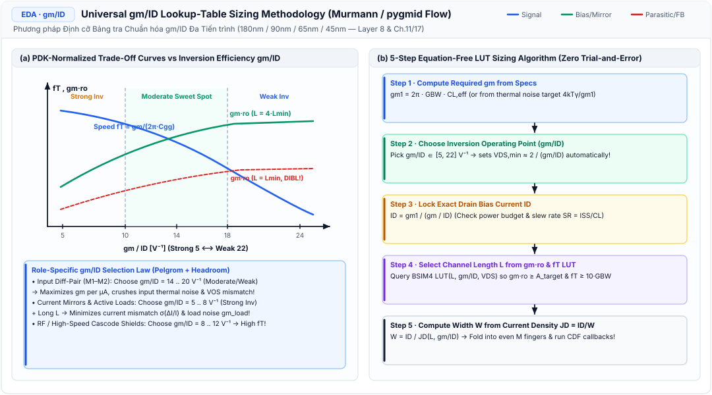

---
{
  "id": "tech-opamp-step-by-step-sizing-procedure",
  "kind": "technique",
  "domain": "opamps-and-compensation",
  "title_vi": "Quy trình Định cỡ Từng bước Bộ Khuếch đại Thuật toán: Từ Luật Bình phương Chương 9 đến gm/ID Nanomet Chương 11",
  "title_en": "Step-by-Step Op-Amp Sizing Procedure: From Square-Law Specifications to Nanometer gm/ID Synthesis",
  "summary": "Thuật toán định cỡ định lượng hoàn chỉnh ánh xạ vector chỉ tiêu {A0, GBW, SR, CL, DeltaVout, Pmax, Vn} thành bộ tham số phần cứng {ID, Vov hoặc gm/ID, W, L} cho ba cấu trúc kinh điển (Telescopic, Folded-Cascode, Two-Stage), định lý co giãn tỷ lệ tuyến tính theo công suất và cầu nối sang phương pháp Vds,min - gm/ID cho CMOS 90nm/65nm/45nm.",
  "diagram": "../../diagrams/gmid-sizing-methodology.svg",
  "razavi_refs": [
    {
      "chapter": 9,
      "section": "9.2.2-9.6",
      "pages": "353-374",
      "equations": ["9.15", "9.16", "9.17", "9.18", "9.19", "9.44", "9.46"]
    },
    {
      "chapter": 11,
      "section": "11.5-11.6",
      "pages": "473-505",
      "equations": ["11.10", "11.16", "11.21"]
    }
  ],
  "glossary_codes": ["T050", "T079", "T183", "T501", "T1450", "T1455", "T1460", "T1461", "T1474"],
  "process_agnostic": true,
  "roles": {
    "power_and_current_allocator": "Khâu phân bổ ngân sách công suất Pmax và tốc độ biến thiên SR = ISS/CL thành dòng phân cực nhánh ID cho lõi khuếch đại và mạng tạo áp phụ",
    "headroom_and_swing_partitioner": "Khâu cắt lát cửa sổ dự trữ điện áp VDD - DeltaVout,se thành điện áp vượt ngưỡng Vov (hoặc Vds,min) tối ưu trên từng tầng xếp chồng",
    "channel_length_gain_tuner": "Khâu chọn chiều dài kênh hiệu dụng L theo gmrO cần thiết để đạt sai số tĩnh vòng kín mà không làm sập cực không trội",
    "linear_width_current_scaler": "Phép nhân tỷ lệ đồng thời W và ID theo hệ số alpha giữ bất biến độ lợi DC và biên độ ra khi đổi ngân sách công suất hoặc nhiễu"
  },
  "symptoms_addressed": [
    "arbitrary-trial-and-error-transistor-sizing-in-spice",
    "dc-gain-shortfall-dominated-by-weaker-pmos-or-folded-branch",
    "output-swing-clipping-from-unbalanced-overdrive-stack-allocation",
    "square-law-sizing-collapse-in-sub-100nm-velocity-saturated-cmos"
  ],
  "limitations": [
    "hand-square-law-aspect-ratios-deviate-severely-below-130nm",
    "increasing-channel-length-for-gain-degrades-nondominant-poles",
    "linear-power-downscaling-directly-penalizes-thermal-noise-and-gbw",
    "closed-loop-input-capacitance-cin-attenuates-feedback-factor-beta"
  ],
  "checklists": ["common-mos", "differential-pair", "folded-cascode", "two-stage-miller"]
}
---

## 1. Bản chất Nguyên lý, Sơ đồ Mạch & Vai trò Từng Nhánh Cấu trúc

Khi đứng trước một tờ đặc tả kỹ thuật yêu cầu thiết kế Op-Amp từ con số không với hàng chục bậc tự do chồng chéo, sai lầm phổ biến nhất của người mới là nhập đại kích thước $W/L$ vào trình mô phỏng SPICE rồi chỉnh mò từng transistor. Trong Chương 9 (§9.2.2–§9.2.3, §9.2.6, §9.3.1, §9.5–§9.6) và Chương 11 (§11.4–§11.6), Razavi xây dựng một **quy trình thiết kế (`T1450`, Design Procedure)** tất định, tách bài toán đa biến thành chuỗi quyết định tuần tự không vòng lặp mù bằng cách khóa chặt **5 thông số cốt lõi của mỗi MOSFET**: $\{I_D,\; V_{OV} \text{ (hoặc } V_{DS,\min}, g_m/I_D\text{)},\; L,\; W,\; r_O\}$.



Trước khi đặt bút tính $W/L$, bước "Số 0" quyết định $80\%$ sự thành bại là **phân loại cấu trúc đích theo ma trận so sánh §9.5–§9.6 (tr. 373–374)**:
1. **Bộ khuếch đại thuật toán cascode xếp chồng (`T1461`, telescopic cascode op amp — `topo-telescopic-cascode-opamp`):** Tốc độ cao nhất, công suất thấp nhất (chỉ nuôi 1 cặp nhánh dòng $I_{SS}/2$), nhiễu thấp nhất; nhưng biên độ ra đơn đầu bị khóa bởi $V_{DD} - 5\,V_{DS,\min}$, ICMR hẹp và không nối tắt trực tiếp vào–ra được.
2. **Bộ khuếch đại thuật toán cascode gấp (`T1460`, folded-cascode op amp — `topo-folded-cascode-ota`):** Mở rộng ICMR chạm một đường nguồn (GND với PMOS-in, $V_{DD}$ với NMOS-in), cho phép hồi tiếp đơn vị, biên độ ra mở thành $V_{DD} - 4\,V_{DS,\min}$; đổi lại tốn $\sim 2\times$ công suất, nhiễu cao hơn và độ lợi DC thấp hơn $2\text{–}3\times$ do điện trở suy biến bị chia đôi bởi $(r_{O1} \parallel r_{O5})$.
3. **Bộ khuếch đại thuật toán hai tầng (`T1474`, two-stage op amp — `topo-two-stage-opamp`):** Tách tầng tạo độ lợi cao (Tầng 1 cascode hoặc 5T-OTA) khỏi tầng xuất biên độ lớn (Tầng 2 CS chỉ tốn $V_{DD} - 2\,V_{DS,\min}$); bắt buộc dùng khi $V_{DD} \le 1{,}0\text{–}1{,}2\text{ V}$ cần cả $A_0 \ge 60\text{–}80\text{ dB}$ lẫn biên độ ra gần chạm nguồn, với cái giá phải bù Miller (`tech-miller-pole-splitting`) và chịu cực không trội thấp hơn cấu trúc một tầng.

---

## 2. Hệ Phương trình Cốt lõi & Tư duy "Nhìn Mạch Đọc Nhanh" (Analysis by Inspection)

### 2.1. Thuật toán Tổng quát 5 Bước Ánh xạ Chỉ tiêu $\to$ Tham số Linh kiện
Cho bộ chỉ tiêu vòng kín / vòng hở: điện áp nguồn $V_{DD}$, biên độ dao động ngõ ra vi sai đỉnh–đỉnh $\Delta V_{\text{out,diff}}$ (tương đương biên độ đơn đầu mỗi nhánh $\Delta V_{\text{out,se}} = \frac{1}{2}\Delta V_{\text{out,diff}}$, mục §9.6 tr. 373–374), tụ tải $C_L$, công suất tối đa $P_{\max}$, **tốc độ biến thiên điện áp cực đại (`T079`, slew rate — $\text{SR}$)**, băng thông $\text{GBW}$ (hoặc hằng số thời gian xác lập vòng kín $\tau_{\text{CL}}$) và sai số tĩnh vòng kín $\epsilon_{\text{stat}}$:

1. **Bước 1 — Chốt Độ lợi Vòng hở $A_{0,\min}$ từ Sai số Tĩnh Vòng kín (§11.6.1, Phương trình 11.16):**
   Với mạng hồi tiếp điện trở tỉ số $R_2/R_1$ (hệ số hồi tiếp $\beta = \frac{R_1}{R_1 + R_2}$) hoặc mạng tụ chuyển mạch ($C_1, C_2$ kèm tụ cổng đầu vào $C_{in}$), điều kiện sai số độ lợi tĩnh không vượt quá ngưỡng $\epsilon_{\text{stat}}$ (ví dụ $1\%$ hay $0{,}1\%$) quy định:

$$
\frac{1}{\beta A_0} = \left(1 + \frac{R_2}{R_1}\right)\frac{1}{A_0} \le \epsilon_{\text{stat}} \quad \text{(Phương trình 11.16)}, \qquad A_{0,\text{SC}} \ge \frac{1}{\epsilon_{\text{stat}}}\left(1 + \frac{C_1 + C_{in}}{C_2}\right)
$$

2. **Bước 2 — Chốt Ngân sách Dòng tĩnh $I_{SS}$ và Hỗ dẫn yêu cầu $G_{m,\min}$ (§9.2.2 & §11.6.1, Phương trình 11.21):**
   Tổng dòng cấp tối đa từ nguồn là $I_{\text{tot,max}} = P_{\max}/V_{DD}$ (giữ lại $5\%\text{–}10\%$ cho nhánh tạo điện áp phân cực $V_{b1}, V_{b2}$). Đồng thời kiểm tra cận dưới dòng đuôi từ chỉ tiêu Slew Rate và cận dưới hỗ dẫn hiệu dụng $G_m$ từ hằng số thời gian vòng kín $\tau_{\text{CL}}$:

$$
I_{SS} \ge \text{SR} \cdot C_{L,\text{eff}}, \qquad \tau_{\text{CL}} = \frac{C_L(C_1 + C_{in}) + C_L C_2 + C_2(C_1 + C_{in})}{G_m C_2} \quad \text{(Phương trình 11.21)}
$$

   Với mạch hồi tiếp đơn vị hoặc điện trở thuần không bị suy hao tụ đầu vào: $g_{m1} \ge 2\pi \cdot \text{GBW} \cdot C_C$ (hai tầng) hoặc $2\pi \cdot \text{GBW} \cdot C_L$ (một tầng).

3. **Bước 3 — Cắt lát Khoảng dự trữ Điện áp (Overdrive / $V_{DS,\min}$ Budgeting, §9.6):**
   Tổng áp rơi tối thiểu trên tất cả $N_{\text{stack}}$ transistor xếp chồng dọc một cột ngõ ra phải thỏa mãn:

$$
\sum_{k=1}^{N_{\text{stack}}} V_{DS,\min,k} \le V_{DD} - \Delta V_{\text{out,se}}
$$

   *Quy tắc phân bổ bất đối xứng của Razavi:* Cấp $V_{OV}$ (hoặc $V_{DS,\min}$) **nhỏ** ($100\text{–}200\text{ mV}$) cho cặp đầu vào $M_{1,2}$ để cực đại hóa $g_{m1} = \frac{2 I_{D1}}{V_{OV1}}$, cấp $V_{OV}$ **lớn hơn** ($250\text{–}350\text{ mV}$) cho tải nguồn dòng PMOS (vốn có $\mu_p \ll \mu_n$, tránh $W_P$ phình khổng lồ và giảm nhiễu tải $g_{m,\text{load}}/g_{m1}^2$) cũng như nguồn dòng đuôi $M_{\text{tail}}$ (mang dòng gấp đôi $2 I_{D1}$!).

4. **Bước 4 — Chốt Chiều dài kênh $L$ từ Độ lợi $A_0$ rồi Tính Chiều rộng $W$:**
   Tính thử $r_O = \frac{1}{\lambda I_D}$ ở $L_{\min}$. Nếu $A_v$ thiếu hụt (do nhánh PMOS có $\lambda_p > \lambda_n$ hoặc nhánh gập bị suy giảm), **tăng chiều dài kênh $L$ của riêng nhánh có trở kháng thấp hơn** ($\lambda \propto 1/L$) hoặc thêm khuếch đại phụ tăng cường độ lợi (`topo-gain-boosted-cascode`, §9.4 Phương trình 9.19, 9.44, 9.46). Sau khi cố định $L$, suy ra $W$ từ luật bình phương (kênh dài) hoặc mật độ dòng $J_D = I_D/W$ (nanomet).

5. **Bước 5 — Thiết kế Mạng Phân cực Cascode Bám sát Ranh giới Bão hòa (§9.2.3, Phương trình 9.15–9.16):**
   Trong cascode xếp chồng (`T501`), áp cổng cascode $V_{b1}$ của $M_{3,4}$ phải bám theo mức chế độ chung ngõ vào $V_{in,\text{CM}}$ thông qua nút nguồn chung $V_P = V_{in,\text{CM}} - V_{GS1,2}$ bằng transistor nối diode "yếu" $M_{b1}$ (`NG09-02` kênh hẹp và dài):

$$
V_{b1} = V_{in,\text{CM}} - V_{GS1,2} + V_{GS,b1} \quad \text{(9.15)} \quad \Longrightarrow \quad V_{GS,b1} = V_{GS1,2} - V_{TH1,2} + V_{GS3,4} = V_{OV1,2} + V_{GS3,4} \quad \text{(9.16)}
$$

### 2.2. Giải phẫu Chi tiết 4 Ví dụ Định cỡ Chuẩn mực trong Sách Razavi (Ví dụ 9.7 – 9.10)

1. **Ví dụ 9.7 — Định cỡ Telescopic Cascode Op-Amp (§9.2.2, tr. 353–354 + Chú giải `NG09-01`):**
   - *Chỉ tiêu:* $V_{DD} = 3\text{ V}$, $\Delta V_{\text{out,diff}} = 3\text{ V}_{pp}$ ($\Rightarrow \Delta V_{\text{out,se}} = 1{,}5\text{ V}_{pp}$ mỗi ngõ ra $X, Y$), $P = 10\text{ mW}$, $A_0 \ge 2000$; công nghệ $L_{\text{eff}} = 0{,}5\,\mu\text{m}$ có $\mu_n C_{ox} = 60\,\mu\text{A/V}^2$, $\mu_p C_{ox} = 30\,\mu\text{A/V}^2$, $\lambda_n = 0{,}1\text{ V}^{-1}$, $\lambda_p = 0{,}2\text{ V}^{-1}$.
   - *Ngân sách dòng:* $I_{\text{tot}} = \frac{10\text{ mW}}{3\text{ V}} = 3{,}33\text{ mA} \rightarrow$ cấp $I_{SS} = 3{,}0\text{ mA}$ cho nguồn đuôi $M_9$ ($I_{D1\text{–}8} = 1{,}5\text{ mA}$/nhánh) và giữ $330\,\mu\text{A}$ cho nhánh phân cực $M_{b1}, M_{b2}$.
   - *Ngân sách Overdrive ($3\text{ V} - 1{,}5\text{ V} = 1{,}5\text{ V}$ chia cho 5 tầng):* Đặt $V_{OV9} = 0{,}5\text{ V}$ (vì $M_9$ mang dòng gấp đôi $3\text{ mA}$), $|V_{OV5}| = |V_{OV7}| = 0{,}3\text{ V}$ (PMOS có $\mu_p$ thấp gấp đôi), còn lại $0{,}4\text{ V}$ chia đều $V_{OV1} = V_{OV3} = 0{,}2\text{ V}$.
   - *Tính $(W/L)$ vòng đầu ở $L = 0{,}5\,\mu\text{m}$:* $(W/L)_{1\text{–}4} = \frac{2(1{,}5\text{ mA})}{60\,\mu \cdot 0{,}2^2} = 1250$, $(W/L)_{5\text{–}8} = \frac{2(1{,}5\text{ mA})}{30\,\mu \cdot 0{,}3^2} = 1111$, $(W/L)_9 = \frac{2(3\text{ mA})}{60\,\mu \cdot 0{,}5^2} = 400$.
   - *Kiểm tra & Sửa Độ lợi DC:* Với $g_{m1,3} = 15\text{ mA/V}$, $r_{O1,3} = 6{,}67\text{ k}\Omega$ ($\Rightarrow R_{ON} \approx 667\text{ k}\Omega$) nhưng nhánh PMOS có $g_{m5} = 10\text{ mA/V}$, $r_{O5,7} = 3{,}33\text{ k}\Omega$ ($\Rightarrow R_{OP} \approx 111\text{ k}\Omega$), độ lợi chỉ đạt $15\text{ mA/V} \times (667\text{ k}\Omega \parallel 111\text{ k}\Omega) \approx 1427 < 2000$! Giải pháp: **tăng gấp đôi $L_{5\text{–}8}$ lên $1{,}0\,\mu\text{m}$** để hạ $\lambda_p$ còn $0{,}1\text{ V}^{-1}$, nâng $R_{OP}$ gấp $4$ lần lên $444\text{ k}\Omega \implies A_v \approx 15\text{ mA/V} \times (667\text{ k}\Omega \parallel 444\text{ k}\Omega) \approx 4000 > 2000$! *(Lưu ý `NG09-01`: giữ nguyên tỉ số $W/L = 1111$ khi tăng $L \to 1{,}0\,\mu\text{m}$ cho kích thước đúng là $1111\,\mu\text{m}/1{,}0\,\mu\text{m}$ thay vì con số in nhầm $2222\,\mu\text{m}/1{,}0\,\mu\text{m}$ trong sách).*

2. **Ví dụ 9.8 — Định lý Co giãn Tỷ lệ Tuyến tính (`T050` / `T1455`, Linear Scaling, §9.2.3, tr. 354–355):**
   Khi nhân đồng thời mọi chiều rộng $W_k \to \alpha W_k$ (giữ nguyên mọi $L_k$) và mọi dòng nhánh $I_{Dk} \to \alpha I_{Dk}$ (ví dụ $\alpha = 0{,}1$ để hạ công suất từ $10\text{ mW}$ xuống $1\text{ mW}$):
   - **Các đại lượng BẤT BIẾN tuyệt đối:** Mật độ dòng $I_D/W = \text{const} \implies V_{OV}$, $V_{DS,\min}$, biên độ ra $\Delta V_{\text{out}}$, dải ICMR, tỉ số $g_m/I_D$ và **độ lợi DC $A_0 \propto g_m r_O = (\alpha g_m)(r_O/\alpha)$ giữ nguyên không đổi**!
   - **Các đại lượng CO GIÃN theo $\alpha$:** Công suất $P \propto \alpha$; tốc độ với tải cố định $C_L$ bị co giãn $\text{GBW} \propto \alpha$, $\text{SR} \propto \alpha$; điện trở ra $R_{\text{out}} \propto 1/\alpha$; và **điện áp nhiễu nhiệt hiệu dụng quy về ngõ vào tăng lên theo $1/\sqrt{\alpha}$** ($\overline{V_{n,\text{in}}^2} \propto 1/g_m \propto 1/\alpha$, tức giảm $10\times$ công suất làm nhiễu RMS tăng $\sqrt{10} \approx 3{,}16\times$)!

3. **Ví dụ 9.9 — Định cỡ Folded-Cascode NMOS-In (§9.2.6, tr. 359–361, Phương trình 9.17 + `NG09-04`, `NG09-05`):**
   Cùng chỉ tiêu $V_{DD} = 3\text{ V}, P = 10\text{ mW}, \Delta V_{\text{out,diff}} = 3\text{ V}_{pp}, A_0 = 2000$: phải chia tổng dòng $3\text{ mA}$ cho cả cặp đầu vào ($I_{SS} = 1{,}5\text{ mA} \Rightarrow I_{D1,2} = 0{,}75\text{ mA}$) lẫn nhánh cascode ($I_{D3,4} = 0{,}75\text{ mA}$, nên nguồn dòng gập PMOS $M_{5,6}$ mang $I_{D5,6} = 1{,}5\text{ mA}$!). Do cột ra chỉ có 4 tầng ($|V_{OV5}| + |V_{OV3}| + V_{OV7} + V_{OV9} = 1{,}5\text{ V}$), áp dự trữ rộng rãi hơn, nhưng theo Phương trình (9.17) độ lợi bị kìm hãm bởi $(r_{O1} \parallel r_{O5})$ và cascode PMOS $M_{3,4}$, buộc phải tăng chiều dài kênh hoặc ghép bộ khuếch đại phụ tăng cường độ lợi (Phương trình 9.19, 9.44, 9.46 — nâng $R_{\text{out}}$ thêm $(A_{\text{aux}} + 1)$ lần trong khi cực phụ dịch theo $\omega_{p2,\text{GB}} \approx (A_{\text{aux}}+1)\omega_0 + \frac{1}{g_{m2}r_{O2}r_{O1}C_L}$).

4. **Ví dụ 9.10 — Định cỡ Op-Amp Hai Tầng Nguồn Thấp $1\text{ V}$ (§9.3.1, tr. 363, Phương trình 9.18 + `NG09-06`):**
   Với $V_{DD} = 1\text{ V}$, $\Delta V_{\text{out,diff}} = 1\text{ V}_{pp}$ ($\Delta V_{\text{out,se}} = 0{,}5\text{ V}_{pp}$), $P = 1\text{ mW}$ (ngân sách $960\,\mu\text{A}$ cho lõi gồm $4$ nhánh dọc $M_1/M_3, M_2/M_4, M_5/M_7, M_6/M_8$ lẽ ra tương ứng $240\,\mu\text{A}$/nhánh hay $480\,\mu\text{A}$/tầng; *lưu ý lỗi chia trong sách gốc tr. 363*: Razavi chia nhầm $960\,\mu\text{A}$ cho $8$ transistor thay vì $4$ nhánh để lấy $I_{D1\text{–}8} = 120\,\mu\text{A}$/nhánh — thực tế chỉ tiêu thụ $240\,\mu\text{A}$/tầng = $480\,\mu\text{A}$ cho cả lõi): chỉ còn $1\text{ V} - 0{,}5\text{ V} = 0{,}5\text{ V}$ dự trữ ở ngõ ra chia bất đối xứng cho 2 transistor Tầng 2 ($|V_{OV5,6}| = 200\text{ mV}$ cho PMOS khuếch đại để giữ $g_{m5,6} = 1{,}2\text{ mA/V}$ lớn và $V_{OV7,8} = 300\text{ mV}$ cho nguồn dòng tải NMOS để giảm nhiễu!). Với $I_D = 120\,\mu\text{A}$/nhánh của sách, Tầng 1 ($V_{OV1,2} = 100\text{ mV}, |V_{OV3,4}| = 400\text{ mV}$) đạt $|A_{v1}| = g_{m1}(r_{O1} \parallel r_{O3}) \approx 2{,}4\text{ mA/V} \times (83{,}3\text{ k}\Omega \parallel 41{,}7\text{ k}\Omega) \approx 66{,}7$ (`NG09-06`), nhân với Tầng 2 $|A_{v2}| = g_{m5,6}(r_{O5,6} \parallel r_{O7,8}) \approx 1{,}2\text{ mA/V} \times (41{,}7\text{ k}\Omega \parallel 83{,}3\text{ k}\Omega) \approx 33{,}3$ cho tổng độ lợi $|A_v| \approx 2200$, vượt xa mục tiêu $A_0 = 100$ (và ở tiến trình kênh ngắn nếu $g_m r_O$ nhỏ cần nâng Tầng 1 lên cascode theo Phương trình 9.18: $A_v \approx g_{m1}[(g_{m3}r_{O3}r_{O1})\parallel(g_{m5}r_{O5}r_{O7})]\cdot g_{m9}(r_{O9}\parallel r_{O11})$!).

---

## 3. Bất biến Cấu trúc & Các Bẫy Lỗi Kinh điển (Structural Invariants & Traps)

- **[INV-SIZE-01] Bất biến Phân tách Ba Biến Điều khiển Độc lập ($I_D \leftrightarrow \text{Speed/Noise}$, $V_{OV} \leftrightarrow \text{Swing}$, $L \leftrightarrow \text{Gain}$):**
  Trong không gian thiết kế chuẩn mực:
  - Thiếu **Slew Rate / GBW** hoặc **nhiễu nhiệt quá cao** $\implies$ phải tăng **dòng nhánh $I_D$** (kèm co giãn $W$ tương ứng).
  - Thiếu **biên độ ngõ ra $\Delta V_{\text{out}}$** $\implies$ phải giảm **$V_{OV}$ ($V_{DS,\min}$)** bằng cách mở rộng $W$ tại cùng $I_D$, hoặc bớt tầng xếp chồng dọc (Telescopic $\to$ Folded-Cascode $\to$ Two-Stage).
  - Thiếu **độ lợi một chiều $A_0$** $\implies$ tuyệt đối không tăng dòng $I_D$ (tăng $I_D$ ở $W$ cố định làm giảm cả $g_m/I_D$ lẫn $r_O$, khiến $A_0$ SỤT GIẢM!), mà phải **tăng chiều dài kênh $L$** của nhánh có $r_O$ yếu nhất hoặc thêm tầng / cascode!
- **[INV-SIZE-02] Bất biến Suy hao Hệ số Hồi tiếp Do Tụ Cổng Đầu vào $C_{in}$ (§11.6.1, Phương trình 11.17 & 11.21):**
  Nếu ham tăng $W_{1,2}$ quá khổng lồ để ép $V_{OV1,2}$ cực thấp hoặc đẩy $g_{m1}$ lên trần vùng dưới ngưỡng, tụ cổng $C_{in} \approx C_{GS1} + (1 + A_{v1,\text{local}})C_{GD1}$ sẽ phình to ngang ngửa tụ hồi tiếp $C_1, C_2$. Khi đó hệ số hồi tiếp thực tế tụt xuống $\beta_{\text{eff}} = \frac{C_2}{C_1 + C_2 + C_{in}}$, vừa đòi hỏi $A_0$ cao hơn vừa kéo dài hằng số thời gian vòng kín $\tau_{\text{CL}}$ (điểm cực tiểu $\tau_{\text{CL}}$ luôn đạt được khi $C_{in}$ cỡ $\frac{1}{3}\text{–}\frac{1}{2}(C_1 + C_2)$, gọi là điều kiện phối hợp điện dung *capacitive matching*)!

- **[TRAP-SIZE-01] Bẫy Đắp Dư $L$ Vô Tội Vạ Cho Cặp Đầu Vào và Cascode Che Chắn:** Tăng $L$ trên toàn bộ transistor để lấy $A_0$ sẽ làm điện dung nút gập $C_X \propto W \cdot L$ tăng theo bình phương (vì giữ $W/L$ không đổi khi nhân đôi $L$ khiến diện tích cổng $W L$ tăng **gấp $4$ lần**!), kéo sập cực không trội $\omega_{p2} \approx g_{m,\text{cas}}/C_X$ và phá hủy dự trữ pha! Chỉ tăng $L$ ở các nguồn dòng tải/gương ($M_{5\text{–}8}$) hoặc đáy nguồn dòng; giữ $L$ của transistor cascode $M_{3,4}$ ngắn vừa đủ ($1{,}2\text{–}2\,L_{\min}$) để cực phụ đạt tần số cao nhất.
- **[TRAP-SIZE-02] Bẫy Quên Tải Của Mạng Hồi Tiếp Điện Trở Lên Ngõ Ra Op-Amp (§11.6.1, `NG11-10`):** Khi Op-Amp lái trực tiếp mạng điện trở hồi tiếp $R_1 + R_2$ (ví dụ $R_1 = 2\text{ k}\Omega, R_2 = 8\text{ k}\Omega \Rightarrow R_1 + R_2 = 10\text{ k}\Omega$), tổng trở này mắc **song song trực tiếp với $R_{\text{out}}$** của tầng cuối và hút thêm dòng tĩnh đỉnh $\Delta V_{\text{out,peak}}/(R_1 + R_2)$ lúc dao động lớn! Nếu định cỡ dòng tĩnh Tầng 2 chỉ nhìn vào $C_L$ mà quên dòng chảy vào $R_1 + R_2$, tầng ra sẽ sập dòng và méo cắt ngọn ngay nửa chu kỳ âm/dương!

---

## 4. Lộ trình Nâng cấp Cấu trúc & Bát giác Đánh đổi (Upgrade Paths & Design Octagon)

Bảng dưới tổng hợp lộ trình điều hướng cấu trúc và đánh đổi trên `concept-analog-design-octagon` khi bước kiểm tra chỉ tiêu trong thuật toán định cỡ gặp tường chắn vật lý:

| Tường chắn phát hiện trong lúc định cỡ | Chuyển dịch cấu trúc / Kỹ thuật đích | Tác động định lượng lên Hệ phương trình | Cái giá trên Bát giác Thiết kế |
|---|---|---|---|
| Công thức luật bình phương $\frac{1}{2}\mu C_{ox}\frac{W}{L}V_{OV}^2$ sai lệch $> 50\%$ ở $90\text{nm}/65\text{nm}/45\text{nm}$ | `tech-nanometer-vdsmin-gmid-sizing` & `tech-channel-length-and-opamp-scaling` | Thay $V_{OV}$ bằng cặp biến thực nghiệm $(g_m/I_D, V_{DS,\min})$ và mật độ dòng chuẩn hóa $J_D = I_D/W$ quét từ BSIM4 | Cần dựng bộ đường cong đặc trưng một lần cho mỗi góc công nghệ trước khi tính tay |
| Đã tăng $L$ tới $4\,L_{\min}$ mà $A_0$ của 1 tầng vẫn thiếu $20\text{–}30\text{ dB}$ cho ADC 12–14 bit | `topo-gain-boosted-cascode` | Nhân trở kháng ra thêm $(1 + A_{\text{aux}})$ lần (Phương trình 9.19, 9.44) mà không tốn thêm áp dự trữ dọc | Xuất hiện cặp cực–zero gần trùng (`law-slewing-vs-linear-settling-time-budget`) nếu đặt sai băng thông OTA phụ |
| Cửa sổ $V_{DD} - \Delta V_{\text{out,se}} < 4\,V_{DS,\min}$ trên nguồn $1{,}0\text{ V}$ | `topo-two-stage-opamp` hoặc `tech-nested-miller-and-multipath-compensation` | Cột ngõ ra rút xuống còn đúng $2\,V_{DS,\min}$ ($\sim 250\text{–}300\text{ mV}$), mở biên độ ra đạt $70\%$ nguồn cấp | Phải trích dòng nuôi Tầng 2 ($g_{m2} \ge 3\text{–}5\,g_{m1}$) và gắn mạng bù tần số tách cực |
| Dòng tĩnh $I_{SS}$ bị đẩy quá cao chỉ để thỏa mãn Slew Rate chứ không phải do nhiễu hay GBW | `tech-slew-rate-and-class-ab-opamps` | Tách dòng nạp tụ cực đại lúc quá độ $I_{\text{peak}} \gg I_Q$ khỏi dòng phân cực tĩnh $I_Q$ | Phức tạp hóa mạch phân cực tĩnh lớp AB và kiểm soát biến thiên $g_m$ theo biên độ |

---

## 5. Thích ứng Đa Tiến trình (90nm / 65nm / 45nm) & Cách Kiểm chứng trong Cadence / Spectre

### 5.1. Bảng Ánh xạ Định cỡ $g_m/I_D$ & $V_{DS,\min}$ Đa Tiến trình (Thay thế Luật Bình phương Chương 9 bằng Chương 11)
Ở các nút công nghệ **90nm ($V_{DD}=1{,}2\text{ V}$)**, **65nm ($V_{DD}=1{,}0\text{–}1{,}2\text{ V}$)** và **45nm ($V_{DD}=0{,}9\text{–}1{,}0\text{ V}$, tương ứng nghiên cứu 40nm $1\text{ V}$ của Razavi Chương 11)**, bão hòa vận tốc và suy giảm độ linh động làm $g_m/I_D$ bị chặn trần ở $\sim 22\text{–}26\text{ V}^{-1}$ và độ lợi nội tại $g_m r_O$ của kênh tối thiểu tụt xuống chỉ còn $6\text{–}12$. Khi áp dụng quy trình 5 bước, thay công thức tính $(W/L)$ bằng bảng phân vùng điểm làm việc chuẩn sau:

| Vai trò Nhánh Transistor trong Op-Amp | Vùng $g_m/I_D$ mục tiêu ($\text{V}^{-1}$) | Ngân sách $V_{DS,\min}$ thực tế ($\text{mV}$) | Chọn chiều dài kênh $L$ (theo $L_{\min}$ của PDK) | Lý do Tối ưu Vật lý |
|---|---|---|---|---|
| **Cặp vi sai đầu vào ($M_{1,2}$)** | $16 \text{ – } 22\text{ V}^{-1}$ (Nghịch đảo vừa / yếu) | $80 \text{ – } 120\text{ mV}$ | $1{,}5 \text{ – } 2{,}5\,L_{\min}$ | Cực đại hóa $g_{m1}$ trên mỗi $\mu\text{A}$, nén nhiễu nhiệt/offset từ các tầng sau và mở rộng ICMR |
| **Transistor Cascode che chắn ($M_{3,4}, M_{7,8}$)** | $12 \text{ – } 16\text{ V}^{-1}$ (Nghịch đảo vừa) | $100 \text{ – } 140\text{ mV}$ | $1{,}2 \text{ – } 2{,}0\,L_{\min}$ | Giữ $C_{GS} + C_{SB}$ nhỏ để đẩy cực phụ nút cascode / nút gập $\omega_{p2}$ vượt xa $3\times \text{GBW}$ |
| **Nguồn dòng tải & Nguồn dòng gập ($M_{\text{load}}, M_{\text{fold}}$)** | $7 \text{ – } 11\text{ V}^{-1}$ (Nghịch đảo mạnh) | $160 \text{ – } 250\text{ mV}$ | $3{,}0 \text{ – } 6{,}0\,L_{\min}$ | Ép $g_{m,\text{load}} \ll g_{m1}$ để triệt nhiễu nhiệt tải & giảm sai lệch gương dòng Pelgrom ($\sigma_{I}/I \propto g_m/I_D$) |
| **Nguồn dòng đuôi ($M_{\text{tail}}$) & Tầng ra CS ($M_{\text{out}}$)** | $8 \text{ – } 13\text{ V}^{-1}$ ($M_{\text{tail}}$) / $12 \text{ – } 16\text{ V}^{-1}$ ($M_{\text{out}}$) | $130 \text{ – } 200\text{ mV}$ | $2{,}5 \text{ – } 4{,}0\,L_{\min}$ ($M_{\text{tail}}$) / $1{,}5 \text{ – } 2{,}5\,L_{\min}$ ($M_{\text{out}}$) | $M_{\text{tail}}$ cần $r_{O,\text{tail}}$ cao giữ CMRR; $M_{\text{out}}$ cần cân bằng $g_{m2}$ lớn (kéo cực $\omega'_{p2}$) và $C_{GS2}$ vừa phải |

*(Lưu ý thực hành từ `NG11-02`, `NG11-08` & §11.5.1–§11.5.2: luôn kiểm tra đơn vị $\text{nm}$ so với $\mu\text{m}$ trên schematic và nhớ cộng biên an toàn $+30\text{–}50\text{ mV}$ lên trên `vdsat` của BSIM4 cho mọi transistor dọc cột ra để tránh vùng uốn gối làm sập $g_m/g_{ds}$ một nửa!)*

### 5.2. Kịch bản OCEAN / Spectre Tự động Trích xuất Bảng Tra $(g_m/I_D, J_D, g_m/g_{ds})$ & Kiểm toán Định cỡ
```ocean
; 1) Kiểm toán kết quả định cỡ Op-Amp sau khi chốt {ID, L, W} trên góc TT & SS/FF
simulator('spectre)
openResults("./psf")
selectResult('dcOpInfo)

procedure( auditOpAmpBranch(instList targetGmIdMin targetVdsMarginMv)
  foreach(inst instList
    id    = abs(pv(inst "id"))
    gm    = pv(inst "gm")
    gds   = pv(inst "gds")
    vds   = abs(pv(inst "vds"))
    vdsat = abs(pv(inst "vdsat"))
    reg   = pv(inst "region")
    gmid  = gm / max(id 1e-12)
    gmro  = gm / max(gds 1e-15)
    vhead = (vds - vdsat) * 1e3
    printf("%-8s | reg=%d | ID=%7.2f uA | gm/ID=%5.2f V^-1 | gm/gds=%5.1f | Vds-Vdsat=%6.1f mV\n"
           inst int(reg) id*1e6 gmid gmro vhead)
    when(reg != 2 || vhead < targetVdsMarginMv || gmid < targetGmIdMin
      printf("  [WARN] %s vi pham bien dinh co (yeu cau reg=2, Vhead>=%.0fmV, gm/ID>=%.1f)!\n"
             inst targetVdsMarginMv targetGmIdMin)
    )
  )
)

; Gọi kiểm toán riêng cho cặp đầu vào (gm/ID cao) và nguồn dòng tải (Vds margin rộng)
auditOpAmpBranch(list("/M1" "/M2") 15.0 50.0)
auditOpAmpBranch(list("/M5" "/M6" "/M7" "/M8" "/M9") 7.0 60.0)
```

---

## 6. Mốc Đối chiếu Sách Razavi & Thuật ngữ Chuẩn CLB

### 6.1. Đối chiếu Sách Gốc Razavi (2nd Edition) & Chú giải Hiệu đính Học thuật CLB
- **Chương 9:**
  - §9.2.2 *Design Procedure* (tr. 353–354, Ví dụ 9.7 — định cỡ Telescopic Cascode $3\text{ V}, 10\text{ mW}$).
  - §9.2.3 *Linear Scaling* (tr. 354–355, Ví dụ 9.8, Phương trình 9.15–9.16 — co giãn tuyến tính theo $W$ và tạo phân cực cascode bám $V_{in,\text{CM}}$).
  - §9.2.6 *Design Procedure [Folded-Cascode]* (tr. 359–361, Ví dụ 9.9, Phương trình 9.17).
  - §9.3.1 *Design Procedure [Two-Stage]* (tr. 363–364, Ví dụ 9.10, Phương trình 9.18) & §9.4 (Phương trình 9.19, 9.44, 9.46 — bổ sung gain-boosting khi thiếu $A_0$).
  - §9.5 *Comparison* & §9.6 *Output Swing Calculations* (tr. 373–374 — ma trận chọn cấu trúc và quy ước biên độ vi sai so với đơn đầu).
- **Chương 11:**
  - §11.5 *Op Amp Design Examples* (tr. 473–495, Phương trình 11.10 — thiết kế thực chiến Telescopic & Two-Stage ở CMOS $40\text{ nm} / 1\text{ V}$).
  - §11.6 *High-Speed Amplifier* (tr. 495–505, Phương trình 11.16, 11.21 — tổng hợp chỉ tiêu vòng kín tốc độ cao và co giãn thiết kế §11.6.4).
- **Chú giải Hiệu đính Nguồn CLB (`source_issues.json`):**
  - **`NG09-01` (tr. 354, Ví dụ 9.7):** Bản in ghi $(W/L)_{5\text{–}8} = 2222\,\mu\text{m}/1{,}0\,\mu\text{m}$ khi nhân đôi cả $W$ và $L$ từ $(W/L) = 1111$ ở $L = 0{,}5\,\mu\text{m}$; phép nhân đôi đúng để giữ $W/L = 1111$ không đổi và giảm $\lambda_p$ còn $0{,}1\text{ V}^{-1}$ (cho $A_v \approx 4000$) phải là **$1111\,\mu\text{m}/1{,}0\,\mu\text{m}$**!
  - **`NG09-04` & `NG09-05` (tr. 359–360, Ví dụ 9.9):** Đề bài Ví dụ 9.9 dẫn nhầm sang thông số của Ví dụ 9.5 thay vì **Ví dụ 9.7**; đồng thời lời giải in nhầm dấu thập phân $g_{m7,8} = 0{,}05\text{ A/V}$ và trở kháng $8{,}8\text{ M}\Omega$ — trị số đúng ứng với $I_D = 0{,}75\text{ mA}, V_{OD} = 0{,}3\text{ V}, r_O = 13{,}3\text{ k}\Omega$ là **$g_{m7,8} = 0{,}005\text{ A/V}$ ($5\text{ mA/V}$)** và **$g_m r_O^2 \approx 0{,}88\text{ M}\Omega$**!
  - **`NG09-06` (tr. 363, Ví dụ 9.10):** Sách in $r_{O3,4} = 83\text{ k}\Omega$ cho PMOS có $I_D = 120\,\mu\text{A}, \lambda_p = 0{,}2\text{ V}^{-1}$; công thức $1/(\lambda_p I_D)$ cho **$41{,}7\text{ k}\Omega$**, khớp hoàn toàn với kết quả độ lợi tầng một $g_{m1}(r_{O1}\parallel r_{O3}) \approx 2{,}4\text{ mA/V} \times (83{,}3\text{ k}\Omega \parallel 41{,}7\text{ k}\Omega) \approx 66$!
  - **`NG11-09` & `NG11-11` (tr. 495 & 500, §11.6):** Đơn vị thời gian xác lập $5\text{ ns}$ bị in hoa nhầm thành `"5 nS"` (nanosiemens), và phép chia cực trội vòng hở $170\text{ MHz}/(\beta A_0)$ với $\beta A_0 = 100$ cho $1{,}7\text{ MHz}$ (khớp §11.6.2) thay vì hệ số $125$ ($1{,}36\text{ MHz}$) ở tr. 500.

### 6.2. Bảng Thuật ngữ Chuẩn CLB Vi Mạch Sử dụng trong Thẻ
| Mã CLB | Thuật ngữ Tiếng Anh | Thuật ngữ Tiếng Việt Chuẩn | Ghi chú Ngữ cảnh |
|---|---|---|---|
| `T1450` | Design Procedure | quy trình thiết kế | Chuỗi bước định lượng từ chỉ tiêu mạch ra kích thước transistor |
| `T050` / `T1455` | linear scaling / linear scaling by adjusting the transistor widths | co giãn tỷ lệ tuyến tính / phép nhân tỉ lệ tuyến tính bằng cách điều chỉnh chiều rộng transistor | Nhân đồng thời $W$ và $I_D$ theo hệ số $\alpha$ giữ bất biến $V_{OV}$ và $A_0$ |
| `T183` | Overdrive voltage ($V_{GS} - V_{TH}$) | Điện áp vượt ngưỡng | Biến điều khiển trung tâm phân bổ biên độ ở kênh dài |
| `T079` | slew rate | Tốc độ biến thiên điện áp cực đại | Quyết định cận dưới dòng đuôi $I_{SS} \ge \text{SR}\cdot C_L$ |
| `T501` / `T1461` | telescopic cascode / telescopic cascode op amps | Cascode telescopic / bộ khuếch đại thuật toán cascode xếp chồng | Cấu trúc 1 nhánh tiết kiệm công suất nhất nhưng tốn $5\,V_{DS,\min}$ |
| `T1460` | folded-cascode op amps | bộ khuếch đại thuật toán cascode gấp | Cấu trúc 1 tầng đa năng tốn $4\,V_{DS,\min}$, mở rộng ICMR |
| `T1474` | Two-Stage Op Amps | bộ khuếch đại thuật toán hai tầng | Tách riêng tầng độ lợi và tầng xuất biên độ $2\,V_{DS,\min}$ |
