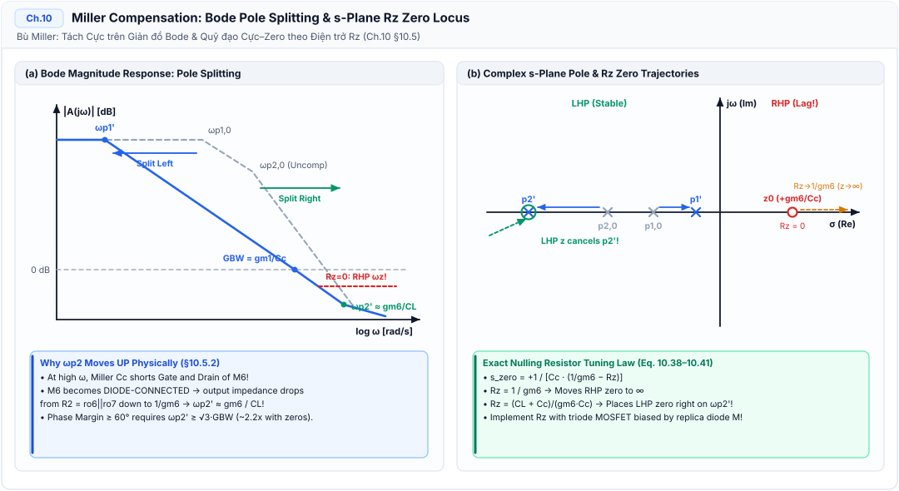

---
{
  "id": "tech-phase-margin-bode-to-step-overshoot-mapping",
  "kind": "technique",
  "domain": "opamps-and-compensation",
  "title_vi": "Ánh xạ Toán học Chính xác từ Dự trữ Pha Đồ thị Bode sang Độ Nhô Đỉnh Tần số & Độ Vọt lố Bậc thang Miền Thời gian",
  "title_en": "Exact Bode Phase Margin to Closed-Loop Damping Ratio, Frequency Peaking, and Transient Step Overshoot Mapping",
  "summary": "Thiết lập công thức đóng chính xác nối liền tỉ số tách cực vòng hở wp2/(beta*A0*wp1), dự trữ pha PM tại tần số cắt độ lợi GX, hệ số tắt dần vòng kín zeta, độ nhô đỉnh biên độ tần số Mp và phần trăm vọt lố bậc thang OS% của hệ hồi tiếp hai cực; giải thích tại sao PM = 60° - 65.5° tối ưu hóa thời gian xác lập và cảnh báo giới hạn tín hiệu nhỏ của PM.",
  "diagram": "../../diagrams/pole-splitting-locus.svg",
  "razavi_refs": [
    {
      "chapter": 10,
      "section": "10.1-10.3",
      "pages": "410-420",
      "equations": ["10.2", "10.4", "10.5", "10.8", "10.10", "10.12", "10.14", "10.16", "10.17", "10.18"]
    }
  ],
  "glossary_codes": ["T063", "T868", "T1170", "T1613", "T1614", "T1615", "T1632", "T1652", "T1653"],
  "process_agnostic": true,
  "roles": {
    "gain_crossover_probe_gx": "Tần số cắt độ lợi omega_1 nơi độ lớn độ lợi vòng |beta*H(j*omega_1)| = 1 (0 dB), mốc đo khoảng cách góc pha còn lại tới -180°",
    "pole_separation_factor": "Tỉ số khoảng cách giữa cực không trội thứ hai wp2 và tích băng thông độ lợi vòng beta*A0*wp1 quyết định trực tiếp hệ số tắt dần 4*zeta^2",
    "closed_loop_complex_pole_pair": "Cặp cực phức liên hợp vòng kín s1,2 = -zeta*omega_n +- j*omega_n*sqrt(1-zeta^2) sinh ra cộng hưởng miền tần số và dao động tắt dần miền thời gian",
    "optimal_60_65_deg_compromise": "Điểm vàng dự trữ pha 60° - 65.5° (Butterworth zeta = 0.707) triệt tiêu nhô đỉnh AC và cực tiểu hóa thời gian chui vào dải dung sai xác lập"
  },
  "symptoms_addressed": [
    "severe-step-response-ringing-from-designing-only-for-45-degree-phase-margin",
    "sluggish-overdamped-settling-from-excessive-80-to-90-degree-phase-margin",
    "inaccurate-bode-straight-line-phase-reading-when-poles-are-within-3x-to-5x",
    "large-signal-transient-ringing-despite-healthy-small-signal-ac-phase-margin"
  ],
  "limitations": [
    "exact-two-pole-formulas-shift-significantly-when-rhp-or-lhp-zeros-are-present",
    "third-and-higher-order-parasitic-poles-steal-extra-phase-at-gain-crossover",
    "small-signal-ac-phase-margin-cannot-capture-large-signal-bias-modulation-ringing"
  ],
  "checklists": ["common-mos", "feedback-and-stb", "two-stage-miller"]
}
---

## 1. Bản chất Nguyên lý, Sơ đồ Mạch & Vai trò Từng Nhánh Cấu trúc

Trong quy trình kiểm định mạch tương tự, kỹ sư quan sát tính ổn định của vòng hồi tiếp trong **miền tần số vòng hở** qua **đồ thị Bode (`T1613`, Bode plots)** và đọc con số **dự trữ pha (`T063`, phase margin — $\text{PM}$)** tại **điểm cắt độ lợi (`T1615`, gain crossover — GX)** ứng với **tần số cắt độ lợi (`T1614`, gain crossover frequency — $\omega_1 = \omega_{\text{GX}}$)**. Tuy nhiên, khách hàng sử dụng mạch (bộ lọc chống chồng phổ, bộ đệm tham chiếu, vòng khóa pha hay tầng khuếch đại ADC) lại đánh giá chất lượng trong **miền tần số vòng kín** qua **độ nhô đỉnh đáp ứng tần số (`T1653`, frequency peaking — $M_p$)** và trong **miền thời gian quá độ** qua **phần trăm độ vọt lố ($\text{OS}\%$)** cùng thời gian tắt rung!



Tại Chương 10 (§10.1–§10.3, tr. 410–420), Razavi xây dựng chiếc cầu toán học chính xác nối liền hai thế giới này cho **hệ thống nhiều cực (`T1632`, Multipole Systems)** mở đầu từ **mạch nhiều cực (`T1170`)** bậc hai kinh điển:
1. **Tiêu chuẩn tự kích Barkhausen (§10.1, Phương trình 10.2 + Chú giải `NG10-01`):** Mạch vòng kín $Y(s)/X(s) = \frac{H(s)}{1 + \beta H(s)}$ bùng phát dao động khi tồn tại tần số $\omega_1$ tại đó $\beta H(j\omega_1) = -1 \iff \left|\beta H(j\omega_1)\right| = 1$ và $\angle\beta H(j\omega_1) = -180^\circ$. Với hệ một cực duy nhất $H(s) = \frac{A_0}{1 + s/\omega_0}$, cực vòng kín luôn thực âm $s_p = -\omega_0(1 + \beta A_0)$ (Phương trình 10.4) và góc pha không bao giờ vượt quá $-90^\circ$ ($\text{PM} \ge 90^\circ$, ổn định vô điều kiện).
2. **Sự xuất hiện cặp cực phức từ cực thứ hai (§10.2, Phương trình 10.5 & 10.8):** Ngay khi có thêm cực không trội thứ hai $\omega_{p2}$, góc pha vòng tiệm cận $-180^\circ$ (`NG10-01`: để hệ hai cực LHP ổn định, tại tần số cắt độ lợi GX bắt buộc $\angle\beta H(j\omega_1) > -180^\circ$, tức dự trữ pha $\text{PM} \triangleq 180^\circ + \angle\beta H(j\omega_1) > 0^\circ$!). Toàn bộ động lực học vọt lố và nhô đỉnh của hệ hai cực được quyết định duy nhất bởi **tỉ số tách cực chuẩn hóa $\dfrac{\omega_{p2}}{\beta A_0 \omega_{p1}}$**!

---

## 2. Hệ Phương trình Cốt lõi & Tư duy "Nhìn Mạch Đọc Nhanh" (Analysis by Inspection)

### 2.1. Dẫn xuất Chính xác Ánh xạ Hai Chiều Giữa Tỉ số Tách Cực, $\zeta$ và $\text{PM}$ (§10.2, Phương trình 10.5 & 10.8)
Xét hàm truyền vòng hở hai cực thực âm phân biệt $0 < \omega_{p1} \ll \omega_{p2}$ (không có zero hữu hạn, hệ số hồi tiếp $\beta$ thực dương không phụ thuộc tần số, Phương trình 10.5):

$$
H(s) = \frac{A_0}{\left(1 + \dfrac{s}{\omega_{p1}}\right)\left(1 + \dfrac{s}{\omega_{p2}}\right)} \quad \text{(10.5)} \;\Longrightarrow\; \frac{Y}{X}(s) = \frac{A_0\,\omega_{p1}\omega_{p2}}{s^2 + (\omega_{p1} + \omega_{p2})s + (1 + \beta A_0)\omega_{p1}\omega_{p2}}
$$

Nghiệm chính xác của phương trình đặc trưng bậc hai cho quỹ đạo hai cực vòng kín (Phương trình 10.8, Hình 10.6):

$$
s_{1,2} = -\frac{\omega_{p1} + \omega_{p2}}{2} \pm \frac{1}{2}\sqrt{(\omega_{p1} + \omega_{p2})^2 - 4(1 + \beta A_0)\omega_{p1}\omega_{p2}} \quad \text{(10.8)}
$$

*(Khi tăng dần $\beta A_0$ từ $0$: hai cực thực khởi xuất từ $-\omega_{p1}$ và $-\omega_{p2}$ chạy lại gần nhau, va chạm thành nghiệm kép thực tại $-\frac{\omega_{p1} + \omega_{p2}}{2}$ ứng với tắt dần tới hạn $\zeta = 1$, rồi tách thành cặp nghiệm phức liên hợp có phần thực hằng định $-\frac{\omega_{p1} + \omega_{p2}}{2}$ chạy thẳng đứng lên/xuống vô tận!)*

Đồng nhất mẫu số vòng kín với đa thức bậc hai chuẩn điều khiển học $s^2 + 2\zeta\omega_n s + \omega_n^2$ trong điều kiện thực tế của mọi Op-Amp ($\omega_{p1} \ll \omega_{p2}$ và $\beta A_0 \gg 1$, gọi tích độ lợi–băng thông vòng tiệm cận là $\omega_{\text{GBW,loop}} \triangleq \beta A_0 \omega_{p1}$):

$$
\omega_n = \sqrt{(1 + \beta A_0)\omega_{p1}\omega_{p2}} \approx \sqrt{\omega_{\text{GBW,loop}}\cdot\omega_{p2}}, \qquad \zeta = \frac{\omega_{p1} + \omega_{p2}}{2\sqrt{(1 + \beta A_0)\omega_{p1}\omega_{p2}}} \approx \frac{1}{2}\sqrt{\frac{\omega_{p2}}{\beta A_0 \omega_{p1}}} = \frac{1}{2}\sqrt{\frac{\omega_{p2}}{\omega_{\text{GBW,loop}}}}
$$

$$
\Longleftrightarrow \quad \frac{\omega_{p2}}{\beta A_0 \omega_{p1}} = 4\zeta^2 \quad \text{(Phương trình Vàng Thiết kế Tách Cực!)}
$$

Bây giờ, tìm **tần số cắt độ lợi thực tế $\omega_1 = \omega_{\text{GX}}$** (chính xác hơn **phép xấp xỉ Bode `T868`** đường gãy khúc vốn giả sử $\omega_1 \approx \beta A_0 \omega_{p1}$!). Tại $\omega = \omega_1$ (với $\omega_1 \gg \omega_{p1}$), điều kiện $\left|\beta H(j\omega_1)\right| = 1$ viết thành:

$$
\frac{\beta A_0}{(\omega_1 / \omega_{p1})\sqrt{1 + (\omega_1 / \omega_{p2})^2}} = 1 \implies \left(\frac{\omega_1}{\omega_{p2}}\right)^2\left[1 + \left(\frac{\omega_1}{\omega_{p2}}\right)^2\right] = \left(\frac{\beta A_0 \omega_{p1}}{\omega_{p2}}\right)^2 = \frac{1}{16\zeta^4}
$$

Giải phương trình trùng phương cho tỉ số dương $\frac{\omega_1}{\omega_{p2}}$ và thay vào $\text{PM} = 180^\circ - \arctan\!\left(\frac{\omega_1}{\omega_{p1}}\right) - \arctan\!\left(\frac{\omega_1}{\omega_{p2}}\right) \approx 90^\circ - \arctan\!\left(\frac{\omega_1}{\omega_{p2}}\right) = \arctan\!\left(\frac{\omega_{p2}}{\omega_1}\right)$, ta thu được **công thức đóng vạn năng ánh xạ chính xác $\zeta \leftrightarrow \text{PM}$**:

$$
\frac{\omega_1}{\omega_{p2}} = \frac{\sqrt{\sqrt{1 + 4\zeta^4} - 2\zeta^2}}{2\zeta}, \qquad \text{PM}(\zeta) = \arctan\!\left(\frac{2\zeta}{\sqrt{\sqrt{1 + 4\zeta^4} - 2\zeta^2}}\right)
$$

*(Công thức nhẩm nhanh cực nhạy trên bàn giấy: trong suốt dải $0 < \text{PM} \le 65^\circ$, quy luật tuyến tính **$\zeta \approx \dfrac{\text{PM (độ)}}{100}$** đúng với sai số dưới $5\%$! Ngược lại khi giải ngược từ $\text{PM}$ đã biết, thay $\frac{\omega_1}{\omega_{p2}} = \cot(\text{PM})$ vào phương trình trùng phương $\left(\frac{\omega_1}{\omega_{p2}}\right)^2\left[1 + \left(\frac{\omega_1}{\omega_{p2}}\right)^2\right] = \cot^2(\text{PM})\csc^2(\text{PM}) = \left(\frac{\beta A_0 \omega_{p1}}{\omega_{p2}}\right)^2$, ta thu được đẳng thức lượng giác đóng tuyệt đẹp dễ nhớ suốt đời: **$4\zeta^2 = \dfrac{\omega_{p2}}{\beta A_0 \omega_{p1}} = \sin(\text{PM})\tan(\text{PM}) \iff \zeta = \dfrac{1}{2}\sqrt{\sin(\text{PM})\tan(\text{PM})}$**!)*

### 2.2. Độ Nhô Đỉnh Đáp ứng Tần số ($M_p$, §10.3 Phương trình 10.10–10.18) & Độ Vọt lố Bước Nhảy ($\text{OS}\%$)
1. **Phép dựng vector trực tiếp của Razavi tại $\omega = \omega_1$ (§10.3, Phương trình 10.10–10.18 + `NG10-02`):**
   Tại đúng tần số cắt độ lợi $\omega_1$, $\beta H(j\omega_1) = 1\cdot e^{-j(180^\circ - \text{PM})} = -e^{j\text{PM}}$. Suy ra biên độ vòng kín tại $\omega_1$ so với giá trị tần số thấp $1/\beta$ luôn bằng:

$$
\left|\frac{Y}{X}(j\omega_1)\right| = \frac{1}{\beta}\left|\frac{-e^{j\text{PM}}}{1 - e^{j\text{PM}}}\right| = \frac{1}{\beta}\,\frac{1}{2\sin\!\left(\dfrac{\text{PM}}{2}\right)}
$$

   Đối chiếu ba mốc kinh điển Razavi tính tường tận trong §10.3:
   - **Khi $\text{PM} = 5^\circ$ (Sát bờ vực dao động, Phương trình 10.10, 10.12, 10.14):** $\beta H(j\omega_1) = e^{-j175^\circ} \approx -0{,}996 - j0{,}087 \implies \left|\frac{Y}{X}(j\omega_1)\right| = \frac{1}{\beta \cdot 2\sin(2{,}5^\circ)} \approx \frac{11{,}46}{\beta}$ — đỉnh nhọn cộng hưởng vọt cao gấp **$11{,}5$ lần ($+21{,}2\text{ dB}$)**!
   - **Khi $\text{PM} = 45^\circ$ (`T1652`, §10.3 tr. 418–419 ngay sau Ví dụ 10.4, Hình 10.12, Phương trình 10.15–10.17):** $\beta H(j\omega_1) = e^{-j135^\circ} = -\frac{\sqrt{2}}{2} - j\frac{\sqrt{2}}{2} \implies \left|\frac{Y}{X}(j\omega_1)\right| = \frac{1}{\beta\sqrt{2 - \sqrt{2}}} \approx \frac{1{,}307}{\beta}$ — đáp ứng tần số nhô cao hơn **$+30{,}7\%$ ($+2{,}32\text{ dB}$)** ngay tại $\omega_1$ (và cực đại toàn dải $M_p = \frac{1}{2\zeta\sqrt{1 - \zeta^2}}$ tại $\omega_{\text{peak}} = \omega_n\sqrt{1 - 2\zeta^2}$ với $\zeta = 0{,}4204$ đạt **$1{,}311 = +2{,}35\text{ dB}$**)!
   - **Khi $\text{PM} = 60^\circ$ (`NG10-02`, tr. 419, Phương trình 10.18):** $\beta H(j\omega_1) = e^{-j120^\circ} \implies \frac{Y}{X}(j\omega_1) = \frac{e^{-j60^\circ}}{\beta}$, nên độ lớn $\left|\frac{Y}{X}(j\omega_1)\right| = \frac{1}{\beta}$ ($0\text{ dB}$ tại $\omega_1$; với $\zeta = 0{,}6124$, đỉnh nhô cực đại toàn dải chỉ còn **$+0{,}28\text{ dB}$** và độ vọt lố bước nhảy là **$8{,}77\%$**; độ nhô đỉnh biến mất hoàn toàn $M_p = 0\text{ dB}$ từ $\zeta \ge \frac{1}{\sqrt{2}} = 0{,}7071 \iff \text{PM} \ge 65{,}53^\circ$!).

2. **Độ Vọt lố Đáp ứng Bước Đơn vị Trong Miền Thời gian ($\text{OS}\%$ cho $0 < \zeta < 1$):**
   Đáp ứng bước đơn vị của hệ bậc hai tắt dần dưới hạn ($0 < \zeta < 1$) có dạng $y(t) = 1 - \frac{e^{-\zeta\omega_n t}}{\sqrt{1 - \zeta^2}}\sin\!\left(\omega_n\sqrt{1 - \zeta^2}\,t + \arccos\zeta\right)$, đạt đỉnh vọt lố đầu tiên tại $t_p = \frac{\pi}{\omega_n\sqrt{1 - \zeta^2}}$ với biên độ phần trăm vọt lố:

$$
\text{OS}\% = 100\% \cdot \exp\!\left(-\frac{\pi\zeta}{\sqrt{1 - \zeta^2}}\right)
$$

### 2.3. Bảng Tra Cứu Định lượng Chuẩn Công nghiệp: $\text{PM} \leftrightarrow \zeta \leftrightarrow \text{Tỉ số cực} \leftrightarrow M_p \leftrightarrow \text{OS}\%$

| Dự trữ pha $\text{PM}$ | Hệ số tắt dần $\zeta$ | Tách cực $\dfrac{\omega_{p2}}{\beta A_0 \omega_{p1}} = \sin\text{PM}\tan\text{PM}$ | Tỉ số thực tại GX $\dfrac{\omega_{p2}}{\omega_{\text{GX}}} = \tan\text{PM}$ | Độ nhô đỉnh AC $M_p$ ($\text{dB}$) | Vọt lố bước nhảy $\text{OS}\%$ | Đánh giá Thiết kế & Tốc độ Xác lập $0{,}1\%$ |
|---|---|---|---|---|---|---|
| **$30{,}0^\circ$** | $0{,}269$ | $0{,}289$ | $0{,}577$ | $+5{,}72\text{ dB}$ | **$41{,}6\%$** | Rung lắc dữ dội nhiều chu kỳ; cấm dùng trong Op-Amp! |
| **$45{,}0^\circ$** | $0{,}420$ | $0{,}707$ | $1{,}000$ ($\omega_{\text{GX}} = \omega_{p2}$) | $+2{,}35\text{ dB}$ | **$23{,}3\%$** | Quá rung cho mạch tương tự chính xác; chỉ dùng làm mốc biên giới dưới |
| **$60{,}0^\circ$** | $0{,}6124$ | **$1{,}500$** | $1{,}732$ | $+0{,}28\text{ dB}$ | **$8{,}77\%$** | Mốc chuẩn kinh điển Razavi; hầu như phẳng AC, nhanh, vọt lố $8{,}77\%$ |
| **$65{,}5^\circ$ (Butterworth)** | **$0{,}7071$** | **$2{,}000$** | $2{,}197$ | **$0{,}00\text{ dB}$** | **$4{,}32\%$** | **ĐIỂM TỐI ƯU VÀNG:** Phẳng cực đại AC, thời gian xác lập $0{,}1\%$ ngắn nhất! |
| **$70{,}0^\circ$** | $0{,}803$ | $2{,}582$ | $2{,}747$ | $0{,}00\text{ dB}$ | **$1{,}44\%$** | An toàn cao chống trôi góc PVT cho bộ đệm chính xác |
| **$76{,}3^\circ$ (Tới hạn)** | **$1{,}000$** | **$4{,}000$** | $4{,}116$ | $0{,}00\text{ dB}$ | **$0{,}00\%$** | Tắt dần tới hạn không vọt lố, nhưng tốn gấp đôi $C_C$ và chậm hơn $\text{PM}=65^\circ$! |

---

## 3. Bất biến Cấu trúc & Các Bẫy Lỗi Kinh điển (Structural Invariants & Traps)

- **[INV-PM-01] Bất biến Sai Số Đường Gãy Khúc Bode Khi Hai Cực Đứng Gần Nhau ($\omega_{p2} / \omega_{\text{GX}} \sim 1\text{–}3$):**
  Nếu dùng **phép xấp xỉ Bode (`T868`)** ngây thơ: đường thẳng $-20\text{ dB/dec}$ cắt $0\text{ dB}$ tại $\omega_{\text{GX,Bode}} = \beta A_0 \omega_{p1}$! Nhìn cột 3 và cột 4 của bảng trên tại $\text{PM} = 45^\circ$: theo đường gãy khúc Bode bạn tưởng $\omega_{p2} = \omega_{\text{GX,Bode}}$ sẽ cho $\text{PM} = 45^\circ$, nhưng thực tế do đường cong độ lớn bị cực thứ hai uốn cong xuống $-3\text{ dB}$ sớm hơn, tại $\omega_{p2} = 1{,}0\,\beta A_0 \omega_{p1}$ dự trữ pha thực tế đạt tới **$51{,}8^\circ$** (còn $\text{PM} = 45^\circ$ xảy ra khi $\omega_{p2} = 0{,}707\,\beta A_0 \omega_{p1}$)! Và tại điểm vàng Butterworth $\zeta = 0{,}707$ ($\text{PM} = 65{,}5^\circ$), bạn cần chính xác **$\omega_{p2} = 2{,}0 \cdot (\beta A_0 \omega_{p1}) \approx 2{,}2\,\omega_{\text{GX}}$** (tăng lên $\omega_{p2} \ge 3\,\omega_{\text{GX}}$ khi cộng trừ thêm hao hụt pha $10^\circ\text{–}15^\circ$ từ các cực ký sinh bậc ba, tư!).
- **[INV-PM-02] Bất biến Trường hợp Xấu Nhất Của Hệ Số Hồi Tiếp $\beta \to 1$ (Unity-Gain Feedback Worst Case):**
  Vì $\zeta = \frac{1}{2}\sqrt{\frac{\omega_{p2}}{\beta A_0 \omega_{p1}}} \propto \frac{1}{\sqrt{\beta}}$, tăng hệ số hồi tiếp $\beta$ kéo điểm cắt độ lợi $\omega_{\text{GX}}$ trèo lên tần số cao hơn lại gần $\omega_{p2}$, làm giảm cả $\zeta$ lẫn $\text{PM}$! Do đó một Op-Amp vạn năng được bù ổn định tại cấu hình khắc nghiệt nhất **$\beta = 1$ (bộ đệm độ lợi đơn vị)** với $\text{PM} \ge 60^\circ$ sẽ tự động ổn định dư dả ở mọi cấu hình khuếch đại có độ lợi lớn hơn ($\beta < 1$); ngược lại, Op-Amp chuyên dụng chỉ chạy ở $\beta = 1/5$ (như §11.6 Ví dụ 11.14) chỉ cần bù tại đúng $\beta = 1/5$ để tiết kiệm $5\times$ tụ bù và mở rộng $5\times$ băng thông!

- **[TRAP-PM-01] Bẫy "PM Xoay Chiều $65^\circ$ Đẹp Như Mơ Nhưng Bước Nhảy Lớn Rung Lắc Dữ Dội" (§10.3 Hình 10.14, tr. 420):**
  Cuối §10.3 (Hình 10.14), Razavi trình diễn một ví dụ cảnh tỉnh mọi kỹ sư dùng SPICE: một bộ đệm độ lợi đơn vị (mọi $W/L = 50\,\mu\text{m}/0{,}6\,\mu\text{m}$) cho kết quả mô phỏng `.ac` cực đẹp với $f_u = 150\text{ MHz}$ và **$\text{PM} = 65^\circ$** (lý thuyết vọt lố chỉ $4{,}3\%$!), nhưng khi cấp bước nhảy tín hiệu lớn trong `.tran`, ngõ ra lại **dao động rung dữ dội hàng chục phần trăm**! Nguyên nhân vật lý: trong quá trình biến thiên biên độ lớn, dòng phân cực các nhánh và điện áp $V_{DS}$ thay đổi mạnh đẩy transistor tiệm cận vùng triode hoặc làm tụ tiếp giáp phi tuyến $C_{DB}(V), C_{GD}(V)$ tăng vọt và $g_m(I_D)$ suy giảm tức thời — kéo cực không trội $\omega_{p2}(t)$ trượt tụt xuống ngay lúc sóng chạm đỉnh! **Bài học xương máu:** Kiểm tra `stb`/`ac` là điều kiện cần, nhưng **mô phỏng bước nhảy tín hiệu lớn `.tran` ở mọi biên mức DC ngõ ra mới là phán quyết cuối cùng**!
- **[TRAP-PM-02] Bẫy Cộng Nhầm Độ Vọt Lố Khi Mạch Có Zero Nửa Mặt Phẳng Trái (LHP Zero Overshoot Multiplication):**
  Công thức $\text{OS}\% = 100\%\,e^{-\pi\zeta/\sqrt{1-\zeta^2}}$ chỉ đúng khi **không có zero hữu hạn trong dải băng thông**! Nếu bạn dùng điện trở $R_z > 1/g_{m2}$ kéo zero sang nửa mặt phẳng trái đặt gần $\omega_{\text{GX}}$ để "ăn gian" cộng thêm $+20^\circ\text{–}30^\circ$ vào $\text{PM}$ (làm `stb` báo $\text{PM} = 75^\circ$!), chính LHP zero đó tạo số hạng đạo hàm sớm $(1 + s/\omega_z)$ trên tử số hàm truyền vòng kín, gây ra **vọt lố bậc thang $15\%\text{–}25\%$ dù $\zeta \ge 0{,}8$**!

---

## 4. Lộ trình Nâng cấp Cấu trúc & Bát giác Đánh đổi (Upgrade Paths & Design Octagon)

| Bối cảnh thiết kế vượt ngoài mô hình 2 cực cơ sở | Mở rộng / Nâng cấp sang thẻ đích (Canonical Node) | Thay đổi trong phương pháp phân tích | Đánh đổi trên `concept-analog-design-octagon` |
|---|---|---|---|
| Mạch có từ 3–5 cực ký sinh rải rác gần $\omega_{\text{GX}}$ (gương dòng, cascode, pad ra) | `law-multipole-phase-margin` & `tech-zvtc-and-eet-bandwidth` | Thay một cực $\omega_{p2}$ đơn lẻ bằng tổng dịch pha tích lũy $\sum_{k=2}^N \arctan(\omega_{\text{GX}}/\omega_{pk}) \le 90^\circ - \text{PM}_{\text{target}}$ | Phải đẩy tổng hằng số thời gian các cực phụ $\sum \tau_{pk} \le \frac{1}{3\,\omega_{\text{GX}}}$ tốn thêm dòng nhánh phụ |
| Mạch hồi tiếp không thể cắt hở vòng mà không làm lệch điểm phân cực DC hoặc tải trở kháng hai chiều | `tech-bode-blackman-middlebrook-stb` | Dùng đầu dò tiêm kép dòng–áp (`stb` probe của Spectre / phương pháp Middlebrook–Tian) đo chính xác tỷ số hoàn trả $T(j\omega)$ | Đảm bảo kết quả PM/GM khớp 100% thực tế thay vì cắt vòng đặt tụ $\text{GF}/\text{GH}$ giả tạo |
| Hàm truyền vòng hở có RHP zero hoặc bù lồng nhiều vòng làm pha cắt $-180^\circ$ nhiều lần | `tech-nyquist-stability-criterion` | Vẽ quỹ đạo cực $\beta H(j\omega)$ kiểm tra số vòng bao điểm $(-1, j0)$ thay vì tin mù quáng một con số PM tại GX | Phức tạp hơn đồ thị Bode nhưng là tiêu chuẩn duy nhất đúng tuyệt đối cho hệ bậc cao |

---

## 5. Thích ứng Đa Tiến trình (90nm / 65nm / 45nm) & Cách Kiểm chứng trong Cadence / Spectre

### 5.1. Chiến lược Dự phòng Pha Qua Các Góc PVT (90nm / 65nm / 45nm)
Trên các tiến trình **90nm, 65nm và 45nm**, tỉ số $\omega_{p2}/(\beta\,\text{GBW})$ biến thiên rất mạnh theo góc công nghệ và nhiệt độ: ví dụ ở góc **`FF, -40°C`** kèm tụ MIM đạt cực tiểu (`Cmin`), $g_{m1}$ tăng mạnh trong khi $C_C$ giảm $10\%\text{–}15\%$ đẩy $\omega_{\text{GX}} = \beta\frac{g_{m1}}{C_C}$ vọt cao lại sát $\omega_{p2}$; ngược lại ở góc chéo **`FS` hoặc `SF`**, $g_{m1}$ (NMOS) tăng trong khi $g_{m2}$ (PMOS) giảm làm hai cực xích lại gần nhau!

| Góc Thiết kế & Môi trường | Mục tiêu $\text{PM}$ thiết kế | Giới hạn Vọt lố Bước Nhảy Nhỏ ($\text{OS}\%$) | Quy tắc Định cỡ $g_m/I_D$ & Biến số Bù |
|---|---|---|---|
| **Danh định (`TT, 27°C, Ctyp`)** | **$64^\circ \text{ – } 68^\circ$** ($\zeta \approx 0{,}68\text{–}0{,}76$) | $2{,}6\% \text{ – } 5{,}5\%$ | Đặt $\omega_{p2} \approx (2{,}5\text{–}3{,}0)\,\beta\,\omega_u$; nếu có LHP zero chỉ dùng để triệt đúng cực phụ chứ không bơm PM ảo! |
| **Góc xấu nhất về ổn định (`FF/-40°C/Cmin`, `FS`, `SF`)** | **$\ge 55^\circ$** (Tuyệt đối không dưới $50^\circ$!) | $\le 13{,}3\%$ | Dẫn dòng phân cực từ nguồn dòng hằng định $g_m$ (`tech-ptat-current-and-constant-gm`) để giữ tỉ số $g_{m1}/g_{m2}$ bám nhau qua nhiệt độ |
| **Góc xấu nhất về tốc độ (`SS/125°C/Cmax`)** | $\le 76^\circ$ (Tránh quá tắt dần ì ạch) | $0\% \text{ – } 3{,}0\%$ | Bảo đảm băng thông $\omega_{\text{GX}}$ ở góc `SS, 125°C` vẫn đáp ứng cận dưới $\tau_{\text{CL,max}}$ của ngân sách thời gian xác lập |

### 5.2. Kịch bản OCEAN / Spectre Đối Chiếu Chéo 3 Miền: `stb` (PM) $\leftrightarrow$ `ac` ($M_p$) $\leftrightarrow$ `tran` ($\text{OS}\%$ Nhỏ & Lớn)
```ocean
; Kiểm chứng chéo sự khớp nhau giữa PM (miền vòng hở), Peaking Mp (vòng kín AC)
; và Overshoot (cả bước nhỏ 10 mV lẫn bước lớn 500 mV để bắt bẫy Hình 10.14 của Razavi!)
simulator('spectre)
openResults("./psf")

; 1. Đọc Phase Margin từ STB
selectResult('stb_margin)
pm_deg = getData("phaseMargin")
ugf_Hz = getData("phaseMarginFreq")

; 2. Ước lượng lý thuyết bậc 2 chuẩn từ PM đọc được
pm_rad = pm_deg * 3.14159265 / 180.0
zeta_2pole = 0.5 * sqrt(sin(pm_rad) * tan(pm_rad))
os_theory_pct = (if (zeta_2pole < 1.0)
                  100.0 * exp(-3.14159265 * zeta_2pole / sqrt(1.0 - zeta_2pole*zeta_2pole))
                  0.0)

; 3. Đo Overshoot thực tế trên bước nhảy nhỏ (tran_small) và bước nhảy lớn (tran_large)
selectResult('tran_small)
os_small_pct = overshoot(v("/vout") 0.495 nil 0.505 nil)
selectResult('tran_large)
os_large_pct = overshoot(v("/vout") 0.250 nil 0.750 nil)

printf("STB PM = %.2f deg (UGF = %.1f MHz) => 2-Pole Theory: zeta=%.3f, OS_th=%.2f%%\n"
       pm_deg ugf_Hz/1e6 zeta_2pole os_theory_pct)
printf("Measured Step Overshoot : Small-Step = %.2f%% | Large-Step = %.2f%%\n"
       os_small_pct os_large_pct)

when(os_small_pct > os_theory_pct + 6.0
  printf("[WARN] OS buoc nho cao hon ly thuyet 2 cuc > 6%% => Co LHP zero gan UGF!\n")
)
when(os_large_pct > os_small_pct + 8.0
  printf("[WARN] Bay Razavi Fig. 10.14: Rung tin hieu lon du PM AC tot => Kiem tra Vds margin tai dinh song!\n")
)
```

---

## 6. Mốc Đối chiếu Sách Razavi & Thuật ngữ Chuẩn CLB

### 6.1. Đối chiếu Sách Gốc Razavi (2nd Edition) & Chú giải Hiệu đính Học thuật CLB
- **Chương 10:**
  - §10.1 *General Considerations* (tr. 410–413, Phương trình 10.1–10.4, Ví dụ 10.1–10.2, Hình 10.1–10.5 — điều kiện dao động Barkhausen $\beta H(j\omega_1) = -1$ và quỹ đạo cực của hệ một cực).
  - §10.2 *Multipole Systems* (tr. 413–416, Phương trình 10.5–10.8, Ví dụ 10.3, Hình 10.6–10.9 — nghiệm bậc hai vòng kín, đồ thị Bode của hệ nhiều cực, điểm cắt độ lợi GX và điểm cắt pha PX).
  - §10.3 *Phase Margin* (tr. 416–420, Phương trình 10.9–10.18, Ví dụ 10.4, Hình 10.10–10.14 — định nghĩa dự trữ pha, phép tính độ nhô đỉnh vòng kín tại $\text{PM} = 5^\circ, 45^\circ, 60^\circ$, tối ưu thời gian xác lập và ví dụ cảnh báo Hình 10.14 về rung tín hiệu lớn).
- **Chú giải Hiệu đính Nguồn CLB (`source_issues.json`):**
  - **`NG10-01` (tr. 414, §10.2):** Trong câu phát biểu điều kiện ổn định của hệ hai cực LHP, bản in gốc viết nhầm chiều dấu bất đẳng thức $\angle\beta H < -180^\circ$; vì đường pha của hai cực nửa mặt phẳng trái giảm dần từ $0^\circ$ tiến tới $-180^\circ$ từ phía trên (Hình 10.7), điều kiện ổn định đúng tại tần số cắt độ lợi GX phải là **$\angle\beta H(j\omega_{\text{GX}}) > -180^\circ$**!
  - **`NG10-02` (tr. 419, §10.3):** Khi xét trường hợp $\text{PM} = 60^\circ$, bản in gốc viết $Y(j\omega_1)/X(j\omega_1) = 1/\beta$ thiếu dấu giá trị tuyệt đối; thực chất tại GX ta có $\beta H(j\omega_1) = e^{-j120^\circ}$ nên tỷ số phức bằng $\frac{Y(j\omega_1)}{X(j\omega_1)} = \frac{e^{-j60^\circ}}{\beta}$, và đại lượng bằng $1/\beta$ chính là **biên độ $\left|\dfrac{Y(j\omega_1)}{X(j\omega_1)}\right| = \dfrac{1}{\beta}$**!
  - **`NG10-06` (tr. 450, Hình 10.65a):** Lưu ý đối chiếu sang §10.8 khi hệ lên 3 cực, Hình 10.65(a) in lặp nhãn $-\omega_{p2}$ hai lần trên trục thực (nhãn ngoài cùng bên trái thực chất là $-\omega_{p3}$).

### 6.2. Bảng Thuật ngữ Chuẩn CLB Vi Mạch Sử dụng trong Thẻ
| Mã CLB | Thuật ngữ Tiếng Anh | Thuật ngữ Tiếng Việt Chuẩn | Ghi chú Ngữ cảnh |
|---|---|---|---|
| `T063` | phase margin | Dự trữ pha | $\text{PM} = 180^\circ + \angle\beta H(j\omega_{\text{GX}})$ |
| `T1652` | 45° phase margin | dự trữ pha 45° | Xảy ra khi $\omega_{\text{GX}} = \omega_{p2}$, gây nhô đỉnh $+2{,}35\text{ dB}$ và vọt lố $23{,}3\%$ |
| `T1653` | frequency peaking | độ nhô đỉnh đáp ứng tần số | Đỉnh lồi biên độ vòng kín $M_p$ gần $\omega_{\text{GX}}$ khi $\text{PM} < 65{,}5^\circ$ |
| `T1613` | Bode plots | đồ thị Bode | Đồ thị biên độ ($\text{dB}$) và pha (độ) của $\beta H(j\omega)$ theo $\log\omega$ |
| `T868` | Bode's approximations | phép xấp xỉ Bode | Xấp xỉ tiệm cận đường gãy khúc $-20\text{ dB/dec}$ và $-45^\circ/\text{dec}$ |
| `T1614` / `T1615` | gain crossover frequency / gain crossover | tần số cắt độ lợi / điểm cắt độ lợi | Điểm GX nơi $\left|\beta H(j\omega_1)\right| = 1$ ($0\text{ dB}$) |
| `T1170` / `T1632` | multipole circuit / Multipole Systems | mạch nhiều cực / hệ thống nhiều cực | Hệ hồi tiếp có từ 2 cực trở lên có khả năng dao động hoặc vọt lố |
