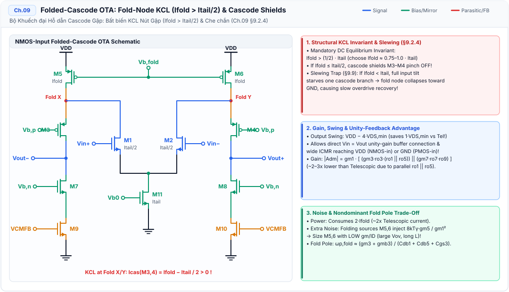

---
{
  "id": "tech-slew-rate-and-class-ab-opamps",
  "kind": "technique",
  "domain": "opamps-and-compensation",
  "title_vi": "Tốc độ Biến thiên Điện áp Cực đại (Slew Rate), Bẫy Phục hồi Quá kích & Bộ Khuếch đại Đẩy–Kéo Lớp AB (Slew Rate, Overdrive Recovery & Class-AB Op-Amps)",
  "title_en": "Large-Signal Slew Rate, Folded-Cascode Overdrive Recovery Clamping, Two-Stage Slewing, and Class-AB Push-Pull Op-Amps",
  "summary": "Giải phẫu giới hạn động học phi tuyến tín hiệu lớn của Op-Amp: sự tách rời giữa xác lập tuyến tính và Slew Rate, cơ chế sập áp nút gập gây trễ phục hồi quá kích (overdrive recovery) trong Folded-Cascode kèm mạch kẹp diode, công thức slewing hai nhánh min(ISS/Cc, (I2 - ISS)/(Cc + CL)) của Op-Amp hai tầng, và các kiến trúc đẩy–kéo lớp AB phá vỡ trần dòng tĩnh.",
  "diagram": "../../diagrams/folded-cascode-ota.svg",
  "razavi_refs": [
    {
      "chapter": 9,
      "section": "9.9-9.10",
      "pages": "390-400",
      "equations": ["9.61", "9.66", "9.70", "9.71", "9.73", "9.78", "9.80"]
    },
    {
      "chapter": 10,
      "section": "10.6",
      "pages": "433-436",
      "equations": ["10.36", "10.37", "10.38"]
    }
  ],
  "glossary_codes": ["T079", "T772", "T1546", "T1556", "T1562", "T1563", "T1564", "T1566", "T1717", "T1726", "T1728", "T1732"],
  "process_agnostic": true,
  "roles": {
    "tail_current_limiter": "Nguồn dòng đuôi cố định ISS trong Op-Amp lớp A giới hạn dòng nạp/xả cực đại khiến dVout/dt không thể tăng theo biên độ đầu vào",
    "fold_node_clamp_transistors": "Cặp transistor kẹp điện áp tại nút gập X, Y của Folded-Cascode ngăn M1 và nguồn đuôi chìm vào vùng triode khi ISS > Ifold",
    "miller_cap_slewing_bottleneck": "Tụ bù Cc và tụ tải CL trong Op-Amp hai tầng đòi hỏi cả tầng 1 (ISS) lẫn tầng 2 (I2) phải đủ dòng để tránh slewing bất đối xứng",
    "class_ab_push_pull_stage": "Cấu trúc đẩy–kéo lớp AB tiêu thụ dòng tĩnh nhỏ ở cân bằng nhưng bùng nổ dòng động lớn gấp nhiều lần khi có bước nhảy lớn"
  },
  "symptoms_addressed": [
    "triangle-wave-distortion-of-large-high-frequency-sinusoids",
    "excessive-settling-time-for-large-steps-despite-high-gbw",
    "folded-cascode-dead-time-and-droop-after-slewing",
    "asymmetric-rising-vs-falling-slew-rate-in-two-stage-opamp"
  ],
  "limitations": [
    "class-a-slew-rate-scales-strictly-with-static-bias-power",
    "current-mirror-class-ab-opamps-reintroduce-mirror-poles-limiting-phase-margin",
    "two-stage-class-ab-floating-bias-requires-careful-pvt-quiescent-current-control"
  ],
  "checklists": ["common-mos", "differential-pair", "folded-cascode", "two-stage-miller"]
}
---

## 1. Bản chất Nguyên lý, Sơ đồ Mạch & Vai trò Từng Nhánh Cấu trúc

Trong miền tín hiệu nhỏ ($\left|\Delta V_{in}\right| \ll \sqrt{2}\,V_{OV}$), đáp ứng bước nhảy của Op-Amp đóng vòng có dạng hàm mũ $V_{\text{out}}(t) = \Delta V_{\text{final}}\left(1 - e^{-t/\tau}\right)$: độ dốc ban đầu tại $t = 0^+$ bằng $\frac{\Delta V_{\text{final}}}{\tau}$ **tăng tỉ lệ thuận với biên độ bước nhảy** nên thời gian đạt $99\%$ giá trị cuối cùng là hằng số độc lập với biên độ! Thế nhưng trên thực tế (Razavi Chương 9, §9.9–§9.10 & Chương 10, §10.6), ngay khi bước nhảy đầu vào vượt quá $\sqrt{2}\,V_{OV}$ (chỉ khoảng $150\text{–}300\text{ mV}$!), một nhánh của cặp vi sai **tắt hẳn về $0\text{ A}$**, toàn bộ dòng nguồn đuôi $I_{SS}$ dồn 100% sang nhánh còn lại. Vòng hồi tiếp tạm thời bị **đứt hở về mặt động học**, và tụ điện chỉ được nạp bằng một dòng không đổi cực đại — biến sườn lên/xuống thành một **đường dốc thẳng (linear ramp)** có độ dốc tối đa gọi là **tốc độ biến thiên điện áp (`T079`, slew rate — SR)**!

Bốn cơ chế vật lý cốt lõi quyết định hành vi tín hiệu lớn của Op-Amp gồm:
1. **Giới hạn Lớp A (Class-A Tail Current Ceiling):** Trong 5T-OTA, Telescopic và Folded-Cascode chuẩn, dòng nạp xả cực đại bị khóa cứng bởi nguồn dòng tĩnh $I_{SS}$ ($\text{SR} = \frac{I_{SS}}{C_L}$).
2. **Bẫy Phục hồi Quá kích (`T1556`, Overdrive Recovery) tại Nút gập Folded-Cascode (§9.9, Hình 9.75–9.77):** Nếu nguồn dòng gập $I_P < I_{SS}$, trong suốt lúc slewing một nút gập bị kéo sập áp đẩy transistor vào vùng triode sâu, gây "thời gian chết" cực dài khi đảo chiều hoặc quay về xác lập tuyến tính!
3. **Slewing Hai Nút Cạnh Tranh trong Op-Amp Hai Tầng Bù Miller (§10.6, Hình 10.37–10.40):** Khi có cả tụ bù $C_C$ lẫn tụ tải $C_L$, tốc độ biến thiên dương và âm bị chi phối bởi **hai giới hạn dòng độc lập** của Tầng 1 ($I_{SS}$) và Tầng 2 ($I_{D,\text{stage2}}$), kèm bước nhảy ngược dấu tức thời lúc $t = 0^+$ qua $C_C$!
4. **Kiến trúc Tốc độ Biến thiên Cao Đẩy–Kéo Lớp AB (`T1562` / `T1566`, High-Slew-Rate Class-AB Op-Amps, §9.10 & §10.6):** Phá vỡ định luật lớp A bằng cách chỉ tiêu thụ dòng tĩnh nhỏ $I_Q$ lúc nghỉ, nhưng tự động bơm dòng động $I_{\text{peak}} \gg I_Q$ theo nhu cầu biên độ bước nhảy!

---

## 2. Hệ Phương trình Cốt lõi & Tư duy "Nhìn Mạch Đọc Nhanh" (Analysis by Inspection)

### 2.1. Phân Tách Thời gian Slewing & Xác lập Tuyến tính (§9.9, Phương trình 9.68–9.71)
Để khuếch đại không méo một sóng sin biên độ đỉnh $V_0$ tại tần số góc $\omega_0$, đạo hàm cực đại của sóng sin tại điểm qua không không được vượt quá $\text{SR}$:

$$
\left.\frac{d}{dt}\big(V_0 \sin \omega_0 t\big)\right|_{\max} = V_0 \omega_0 \le \text{SR} \implies f_{\max,\text{full-power}} = \frac{\text{SR}}{2\pi V_0}
$$

Với bước nhảy đầu vào biên độ lớn $V_0$ trong mạch khuếch đại tụ điện ($C_1, C_2$, hệ số hồi tiếp $\beta = \frac{C_2}{C_1 + C_2}$, bỏ qua $C_L$ ngoài để minh họa như Ví dụ 9.23), Op-Amp rời chế độ slewing để bước vào chế độ xác lập tuyến tính khi hiệu điện áp hai cổng vi sai thu nhỏ về ngưỡng tuyến tính $\Delta V_G \approx \alpha V_{OV,\text{eq}}$ (Phương trình 9.70–9.71):

$$
t_{\text{slew}} \approx \frac{C_2}{I_{SS}} \left( V_0 - \alpha V_{OV,\text{eq}} \right), \qquad t_{\text{total}} = t_{\text{slew}} + \tau_{\text{cl}} \ln\left(\frac{\text{sai số tại ranh giới}}{\epsilon_{\text{spec}}}\right)
$$

### 2.2. Slewing & Sập Nút Gập trong Folded-Cascode + Mạch Kẹp (Clamp Diodes — Hình 9.75–9.77)
Xét Folded-Cascode NMOS-in (nguồn đuôi $I_{SS}$ dưới đáy, hai nguồn dòng gập PMOS cấp dòng $I_P$ ở hai nút gập $X, Y$ trên đỉnh, Hình 9.75):
- **Trường hợp đúng chuẩn ($I_P \ge I_{SS}$):** Khi bước nhảy lớn làm $M_1$ hút trọn $I_{SS}$ tại nút $X$ và $M_2$ tắt hẳn ($0\text{ A}$ tại nút $Y$), nguồn dòng gập bên trái vẫn dư dòng $I_P - I_{SS} \ge 0$ chảy qua cascode $M_3$ giữ nút $X$ ở vùng điện áp bình thường, và dòng sạc/xả $C_L$ đạt $\text{SR} = \dfrac{I_{SS}}{C_L}$.
- **Thảm họa khi chọn $I_P < I_{SS}$ (Hình 9.76):** Khi $M_1$ đòi hút $I_{SS}$ lớn hơn dòng tối đa $I_P$ mà nguồn gập PMOS có thể cấp, transistor cascode $M_3$ **tắt hẳn về 0**, và KCL buộc điện áp nút gập $V_X$ **sập sâu xuống sát đất** cho tới khi cả $M_1$ lẫn nguồn dòng đuôi bị ép lún vào vùng triode để giảm dòng hút từ $I_{SS}$ xuống bằng $I_P$! Ngay cả khi ngõ ra đã gần chạm đích và $M_2$ bật lại, mạch vẫn bị "đóng băng" mất một khoảng thời gian dài để nạp lại tụ ký sinh $C_X$ từ sát đất quay ngược lên mức cân bằng $\sim V_{DD} - |V_{GS3}|$ (**overdrive recovery delay**)!
- **Giải pháp Mạch Kẹp Nút Gập (Clamp Transistors $M_{11}, M_{12}$, Hình 9.77):** Mắc hai transistor nối diode từ $V_{DD}$ xuống $X$ và $Y$ (hoặc nối chéo): ở trạng thái tĩnh cân bằng, $V_X, V_Y > V_{DD} - V_{THN}$ nên cặp diode kẹp **tắt hoàn toàn** (không ảnh hưởng độ lợi hay nhiễu!); khi slewing làm $V_X$ chớm tụt quá $V_{DD} - V_{THN}$, diode kẹp lập tức mở dẫn phần dòng thiếu $I_{SS} - I_P$, ghim cứng $V_X$ không bao giờ cho phép $M_1$ rơi vào vùng triode!

### 2.3. Slewing trong Op-Amp Hai Tầng Bù Miller: Hai Nút Thắt & Bước Nhảy Ngược (§10.6, Phương trình 10.36–10.38)
Xét Op-Amp hai tầng đơn đầu (Hình 10.38: Tầng 1 dòng đuôi $I_{SS}$, Tầng 2 transistor nguồn chung PMOS $M_5$ nối từ $V_{DD}$ đấu với nguồn dòng tải NMOS $I_1$ xuống đất, tụ bù $C_C$ và tụ tải ngõ ra $C_L$):
1. **Bước nhảy âm tức thời tại $t = 0^+$ (Feedforward Step, Phương trình 10.37–10.38):** Ngay khoảnh khắc dòng bậc thang $I_{SS} u(t)$ phóng vào tụ $C_C$, tụ $C_C$ đóng vai trò ngắn mạch tức thời dẫn dòng ngược chiều với độ lợi đảo pha của $M_5$, tạo một vết sụt bước nhỏ $-\frac{I_{SS}}{g_{m5} \parallel r_{O5}^{-1}}$ tại $t = 0^+$ trước khi dốc đi lên theo hệ số tụ nhân Miller ở đầu ra $C_C \left(1 + \frac{1}{g_{m5} r_{O5}}\right) \approx C_C$!
2. **Sườn lên dương (`T1726`, Positive Slew Rate — $\text{SR}^+$, Hình 10.38b):** $M_1$ hút dòng $I_{SS}$ rút khỏi nút liên tầng $X$ (vốn được Tầng 2 giữ làm đất ảo xoay chiều), buộc $C_C$ nạp với tốc độ $I_{SS}/C_C$. Lúc này transistor khuếch đại PMOS $M_5$ của Tầng 2 tự mở rộng $V_{SG5}$ để cấp tổng dòng $I_{D5} = I_1 + I_{SS} + C_L \frac{dV_{\text{out}}}{dt}$ dễ dàng (miễn là $M_5$ đủ rộng không sập $V_X$ đẩy $M_1$ vào triode!):

$$
\text{SR}^+ \approx \frac{I_{SS}}{C_C}
$$

3. **Sườn xuống âm (`T1728`, Negative Slew Rate — $\text{SR}^-$, Hình 10.38c):** Đây là nơi **Op-Amp hai tầng hay chết bất đối xứng nhất!** Khi đảo dấu bước nhảy, nhánh gương Tầng 1 bơm dòng $I_{SS}$ đẩy điện áp nút $X$ tăng lên làm **khóa tắt dần PMOS $M_5$**. Lúc đó chỉ còn duy nhất nguồn dòng tĩnh NMOS $I_1$ dưới đáy Tầng 2 phải gánh đồng thời **CẢ dòng $I_{SS}$ đổ qua $C_C$ LẪN dòng xả tụ tải $C_L$**!
   - Nếu $I_1$ dư dả ($I_1 > I_{SS} \frac{C_C + C_L}{C_C}$): $M_5$ vẫn còn dẫn nhẹ giữ đất ảo tại $X$, tốc độ xả do Tầng 1 quyết định bằng $\frac{I_{SS}}{C_C}$.
   - Nếu $I_1$ không đủ lớn: $M_5$ tắt hẳn về $0\text{ A}$, và tổng dòng $I_1$ phải chia sẻ cho $C_C$ và $C_L$ (hoặc nếu $I_1 < I_{SS}$ thì gương Tầng 1 tràn vào triode!):

$$
\text{SR}_{\text{2-stage}} = \min\left( \frac{I_{SS}}{C_C}, \; \frac{I_1}{C_C + C_L} \right) \quad \big(\text{khi Tầng 2 dùng nguồn dòng cố định } I_1\big)!
$$

*(Tương tự với Tầng 2 dùng NMOS khuếch đại và nguồn dòng tải PMOS $I_1$ ở đỉnh: vai trò bị tráo lại khiến $\text{SR}^+$ mới là nhánh bị khóa ở $\frac{I_1}{C_C + C_L}$!)*

### 2.4. Các Cấu trúc Đẩy–Kéo Lớp AB Tăng Tốc độ Biến thiên (§9.10 & §10.6, Hình 9.78–9.80 & 10.39–10.40)
- **Op-Amp Một Tầng Lớp AB Đầu vào Chéo (Cross-Coupled Input Pair + Current Mirrors, Hình 9.79d, Phương trình 9.72–9.79):** Dùng cặp đầu vào lai NMOS–PMOS chéo nhau sao cho điện áp vi sai lớn $\Delta V_{in}$ đặt trực tiếp lên tổng cổng–nguồn mà không bị nguồn dòng đuôi chặn trần! Dòng cực máng tăng theo luật bậc hai $\propto (\Delta V_{in})^2$ nạp xả $C_L$ cực nhanh, đồng thời hỗ dẫn tín hiệu nhỏ cũng được tăng cường $G_m = g_{m1} + (W_4/W_8) g_{m5}$ (đổi lại xuất hiện cực gương dòng tại đường sao chép dòng!).
- **Op-Amp Hai Tầng với Tầng 2 Đẩy–Kéo Lớp AB (Hình 9.80 & Hình 10.40):** Thay nguồn dòng tải "chết" $I_1$ của Tầng 2 bằng một transistor khuếch đại chủ động thứ hai (cả PMOS ở trên lẫn NMOS ở dưới của Tầng 2 đều được lái bởi tín hiệu từ Tầng 1 thông qua Pin nổi dịch mức lớp AB hoặc nhánh gương phụ!). Khi sườn lên: PMOS mở toang còn NMOS tắt hẳn; khi sườn xuống: NMOS mở toang còn PMOS tắt hẳn — xóa sổ hoàn toàn nút thắt $\frac{I_1}{C_C + C_L}$!

---

## 3. Bất biến Cấu trúc & Các Bẫy Lỗi Kinh điển (Structural Invariants & Traps)

- **[INV-SR-01] Định luật Bất biến Tỉ số $\text{SR} / \text{GBW}$ trong Bộ Khuếch đại Cặp Vi sai Lớp A:**
  Với mọi Op-Amp một tầng lớp A (hoặc nhánh Tầng 1 của Op-Amp hai tầng bù Miller có $\omega_u = \frac{g_{m1}}{C_C}$ và $\text{SR} = \frac{I_{SS}}{C_C}$), chia hai phương trình cho nhau thì tụ $C_C$ (hoặc $C_L$) triệt tiêu sạch sẽ:

$$
\frac{\text{SR}}{\omega_u} = \frac{I_{SS} / C}{g_{m1} / C} = \frac{I_{SS}}{g_{m1}} = \frac{2 I_{D1}}{g_{m1}} = \frac{2}{(g_m / I_D)_{1}} \approx V_{OV,1} \quad (\text{trong vùng bình phương!})
$$

**Bất biến sâu sắc:** Nếu bạn đẩy cặp vi sai đầu vào vào vùng nghịch đảo yếu/dưới ngưỡng ($g_m/I_D \approx 25\text{ V}^{-1}$) để lấy $\text{GBW}$ lớn và nhiễu thấp trên dòng $I_{SS}$ nhỏ, tỉ số $\frac{\text{SR}}{\omega_u} = \frac{2}{25} = 0{,}08\text{ V}$ trở nên cực kỳ thấp — khiến mạch rất dễ rơi vào slewing! Ngược lại muốn tăng $\text{SR}$ trên cùng $\omega_u$, bắt buộc phải giảm $(g_m/I_D)_1$ (tăng $V_{OV,1}$ hoặc suy biến nguồn `topo-degenerated-diffpair-and-gilbert`) hoặc chuyển sang **Lớp AB**!
- **[TRAP-SR-01] Chỉ Đo Sườn Lên Mà Quên Đo Sườn Xuống Trong Op-Amp Hai Tầng:** Rất nhiều người thiết kế đặt $I_{SS} = 200\,\mu\text{A}, C_C = 1\text{ pF}$ ($\text{SR}^+ = 200\text{ V}/\mu\text{s}$), rồi chọn dòng Tầng 2 $I_1 = 300\,\mu\text{A}$ để lái tụ tải lớn $C_L = 10\text{ pF}$. Khi mô phỏng xung lên thấy nhanh đúng $200\text{ V}/\mu\text{s}$, nhưng ở sườn xuống tốc độ sụp thảm hại còn $\text{SR}^- = \frac{300\,\mu\text{A}}{1\text{ pF} + 10\text{ pF}} = 27{,}3\text{ V}/\mu\text{s}$ — **chậm hơn $7{,}3$ lần**! Để đối xứng $\text{SR}^+ \approx \text{SR}^-$ với Tầng 2 lớp A, bắt buộc phải cấp dòng Tầng 2 cực lớn:

$$
I_{1,\text{stage2}} \ge I_{SS} \left(1 + \frac{C_L}{C_C}\right)!
$$

Khi $C_L \gg C_C$, công thức này đốt quá nhiều công suất tĩnh — đó chính là lúc bắt buộc chuyển Tầng 2 sang **Đẩy–Kéo Lớp AB**!
- **[TRAP-SR-02] Trôi Dòng Tĩnh $I_Q$ Theo PVT Trong Mạch Phân Cực Nổi Lớp AB (Floating Class-AB Quiescent Current Runaway):** Nếu điện áp phân cực cổng của cặp đẩy–kéo NMOS/PMOS ở Tầng 2 không được khóa bằng vòng gương xuyên dẫn (translinear loop / Monticelli bias mesh) bám theo $V_{THN} + |V_{THP}|$, ở góc tiến trình nhanh nóng (`FF, 125°C`) tổng ngưỡng giảm sâu làm dòng tĩnh xuyên qua nhánh ra tăng vọt gấp $5\text{–}10$ lần thiết kế!

---

## 4. Lộ trình Nâng cấp Cấu trúc & Bát giác Đánh đổi (Upgrade Paths & Design Octagon)

| Triệu chứng giới hạn Slew Rate | Nâng cấp cấu trúc đích (Canonical Node / Variant) | Hiệu quả mang lại | Đánh đổi trên Bát giác Thiết kế |
|---|---|---|---|
| Folded-Cascode bị trễ dài sau bước nhảy lớn dù $I_{SS}/C_L$ tính tay đủ nhanh | Đặt $I_{\text{fold}} \ge 1{,}1\,I_{SS}$ + thêm cặp diode kẹp nút gập $M_{11}\text{–}M_{12}$ (Hình 9.77) | Triệt sạch hiện tượng sập nút gập vào triode và thời gian chết phục hồi quá kích | Cộng thêm vài fF điện dung tiếp giáp của diode tắt vào nút gập $X, Y$ |
| Op-Amp 2 tầng lái tải $C_L = 10\text{–}100\text{ pF}$ bị nghẹt sườn đơn phương $\frac{I_1}{C_C + C_L}$ | Nâng Tầng 2 lên Đẩy–Kéo Lớp AB (Class-AB Output Stage, Hình 9.80 / Monticelli) | Cả sườn lên lẫn sườn xuống đều xả/nạp không bị chặn bởi $I_1$ tĩnh mà chỉ tốn dòng nghỉ nhỏ | Thêm nhánh dịch mức nổi và phải kiểm soát biến thiên $g_{m2,\text{eff}} = g_{mN} + g_{mP}$ trong bù Miller |
| Cần tăng đồng thời cả $\text{SR}$ lẫn $\text{GBW}$ tỷ lệ thuận theo tải $C_L$ mới mà không thiết kế lại | Phép nhân tỉ lệ tuyến tính (`topo-telescopic-cascode-opamp` §2.3) nhân toàn bộ $W$ và $I$ lên $\alpha$ lần | Giữ nguyên $A_0$, Swing và tăng dòng nạp gấp $\alpha$ lần | Tăng công suất tiêu thụ và diện tích đúng $\alpha$ lần |

---

## 5. Thích ứng Đa Tiến trình (90nm / 65nm / 45nm) & Cách Kiểm chứng trong Cadence / Spectre

### 5.1. Thích ứng Công nghệ Nanomet (90nm $\to$ 65nm $\to$ 45nm)
- **Tác động có lợi của Bão hòa Vận tốc lên Tỉ số $\text{SR}/\omega_u$ ở Nghịch đảo Mạnh:** Ở kênh ngắn 65nm/45nm trong vùng bão hòa vận tốc, $I_D \approx W C_{ox} v_{\text{sat}} (V_{GS} - V_{TH})$ và $g_m \approx W C_{ox} v_{\text{sat}}$, nên tỉ số $I_D / g_m \approx (V_{GS} - V_{TH})$ lớn gấp $2$ lần so với mô hình bình phương $\frac{1}{2}(V_{GS} - V_{TH})$ ở cùng overdrive — giúp nới nhẹ điện áp đầu vào bắt đầu slewing, tuy nhiên ở vùng nghịch đảo vừa/yếu thường dùng cho cặp đầu vào thì $I_D / g_m \approx \zeta V_T \approx 35\text{ mV}$ hoàn toàn bất biến theo tiến trình!
- **Giới hạn Nguồn $0{,}9\text{ V}\text{–}1{,}0\text{ V}$ lên Mạch Dịch Mức Lớp AB Monticelli:** Mạch lớp AB truyền thống xếp chồng 2 cổng–nguồn $V_{GS,N} + |V_{GS,P}|$ không vừa nguồn $0{,}9\text{ V}$ ở góc `SS, -40°C`; lúc đó dùng cặp truyền dẫn gập (folded floating mesh) hoặc ghép gương dòng đẩy–kéo trực tiếp như Hình 9.80 của Razavi!

### 5.2. Quy trình Kiểm chứng Slew Rate & Phục hồi Quá kích trong Cadence / Spectre
1. **Phép thử Xung Vuông Lớn Hai Sườn Đối Xứng (`tran` Large-Signal Step):**
   - Cấp sóng vuông biên độ lớn (ví dụ nhảy từ $V_{\text{min}} + 0{,}1\text{ V}$ lên $V_{\text{max}} - 0{,}1\text{ V}$ rồi nhảy ngược xuống, thời gian lên/xuống nguồn xung `10 ps`).
   - Dùng hàm `slewRate` trong ViVA Calculator đo riêng **Rising Slew Rate (`SR+`)** (từ $10\%$ đến $90\%$ hoặc $20\%$ đến $80\%$ đoạn dốc thẳng) và **Falling Slew Rate (`SR-`)**!
2. **Soi Điện áp Các Nút Nội ($V_X, V_Y$, Nút Đuôi $V_P$) Trong Suốt Pha Slewing:**
   - Đừng chỉ nhìn mỗi dây `V(out)`! Hãy vẽ chồng thêm điện áp nút đuôi cặp vi sai và nút gập `V(X), V(Y)` trên cùng trục thời gian `tran`: nếu thấy `V(X)` lao cắm đầu xuống sát $0\text{ V}$ (hoặc vọt chạm $V_{DD}$) rồi nằm lỳ vài nanosecond trước khi ngõ ra bắt đầu nhúc nhích ở sườn đảo chiều, mạch của bạn đang dính **bẫy phục hồi quá kích (overdrive recovery droop)**!

### 5.3. Ví dụ Định lượng Ngân sách Thời gian Xác lập Tổng ($t_{\text{slew}} + t_{\text{lin}}$)
Giả sử bộ đệm Op-Amp hai tầng ($\beta = 1$) phải xác lập một bước nhảy lớn $\Delta V_{\text{step}} = 0{,}6\text{ V}$ tới sai số $0{,}1\%$ ($\pm 0{,}6\text{ mV}$) trong tổng thời gian $t_{s,\text{spec}} \le 10\text{ ns}$, với tụ bù $C_C = 1\text{ pF}$ và tụ tải $C_L = 4\text{ pF}$:
1. Chia ngân sách thời gian hợp lý: dành $t_{\text{slew}} \approx 4\text{ ns}$ cho giai đoạn nạp dòng tối đa và $t_{\text{lin}} \approx 6\text{ ns}$ cho giai đoạn bám hàm mũ tuyến tính!
2. Giả sử ngưỡng vào vùng tuyến tính của cặp đầu vào là $V_{\text{lin}} = \sqrt{2}\,V_{OV1} \approx 0{,}15\text{ V}$: quãng đường slewing là $0{,}6\text{ V} - 0{,}15\text{ V} = 0{,}45\text{ V}$ trong $4\text{ ns}$ $\implies$ cần $\text{SR}_{\min} = \frac{0{,}45\text{ V}}{4\text{ ns}} = 112{,}5\text{ V}/\mu\text{s}$.
3. Từ đó đọc ngay dòng tĩnh tối thiểu cho **cả hai tầng** (nếu Tầng 2 chạy lớp A):
   - Dòng đuôi Tầng 1: $I_{SS} \ge \text{SR}_{\min} \cdot C_C = 112{,}5\,\mu\text{A}$ (chọn $130\,\mu\text{A}$).
   - Dòng tĩnh Tầng 2: $I_{D,\text{stage2}} \ge \text{SR}_{\min} \cdot (C_C + C_L) = 112{,}5 \times 5\text{ pF} = \mathbf{562{,}5\,\mu\text{A}}$ (chọn $650\,\mu\text{A}$, hoặc dùng Tầng 2 lớp AB chỉ cần $I_{Q2} = 150\,\mu\text{A}$ tiết kiệm $500\,\mu\text{A}$ dòng tĩnh!).
4. Kiểm tra giai đoạn tuyến tính còn lại (từ sai số $0{,}15\text{ V}$ xuống $0{,}6\text{ mV}$, tỉ số $250\times$): cần $\tau_{\text{cl}} \le \frac{6\text{ ns}}{\ln(250)} = \frac{6\text{ ns}}{5{,}52} = 1{,}09\text{ ns} \implies \text{GBW} \ge \frac{1}{2\pi \cdot 1{,}09\text{ ns}} = 146\text{ MHz} \implies g_{m1} = 2\pi\,\text{GBW}\,C_C \ge 0{,}92\text{ mS}$!

---

## 6. Mốc Đối chiếu Sách Razavi & Thuật ngữ Chuẩn CLB

### 6.1. Đối chiếu Sách Gốc Razavi (2nd Edition)
- **Chương 9:** §9.9 *Slew Rate* (tr. 390–396, Phương trình 9.58–9.71, Hình 9.68–9.77, Ví dụ 9.22–9.23), §9.10 *High-Slew-Rate Op Amps* — §9.10.1 *One-Stage Op Amps* & §9.10.2 *Two-Stage Op Amps* (tr. 397–400, Phương trình 9.72–9.80, Hình 9.78–9.80).
- **Chương 10:** §10.6 *Slewing in Two-Stage Op Amps* (tr. 433–436, Phương trình 10.36–10.38, Hình 10.37–10.40).
- **Chú giải Hiệu đính Học thuật CLB (`NG09`):**
  - **`NG09-11` (tr. 398, Hình 9.79c):** Nhãn trên sơ đồ Hình 9.79(c) của bản in gốc tiếng Anh in lỗi chính tả `"ccrrect polarity"`; đọc đúng là **cực tính đúng (*correct polarity*)** để hai dòng đẩy–kéo cộng hưởng cùng chiều tại ngõ ra.

### 6.2. Bảng Thuật ngữ Chuẩn CLB Vi Mạch Sử dụng trong Thẻ
| Mã CLB | Thuật ngữ Tiếng Anh | Thuật ngữ Tiếng Việt Chuẩn | Ghi chú Ngữ cảnh |
|---|---|---|---|
| `T079` | slew rate (SR) | tốc độ biến thiên điện áp (cực đại) | Giới hạn phi tuyến tín hiệu lớn, đơn vị thường dùng $\text{V}/\mu\text{s}$ |
| `T1546` | linear settling | quá trình xác lập tuyến tính | Pha bám hàm mũ khi cả hai transistor đầu vào đều dẫn |
| `T1563` | slew-limited settling | xác lập bị giới hạn bởi tốc độ biến thiên | Pha nạp dòng hằng số khi một nhánh vi sai bị khóa tắt |
| `T1556` | overdrive recovery | phục hồi sau quá kích | Độ trễ thoát khỏi vùng triode của các nút nội sau khi slewing |
| `T1564` / `T772` | push-pull / push-pull action | đẩy–kéo / tác động đẩy–kéo | Một nhánh bơm dòng lên trong khi nhánh kia ngừng hút dòng và ngược lại |
| `T1566` / `T1732` | class-AB amplifiers | bộ khuếch đại lớp AB | Dòng động đỉnh lớn gấp nhiều lần dòng phân cực tĩnh |
| `T1726` / `T1728` | positive / negative slew rate | tốc độ biến thiên dương / âm cực đại | Phải kiểm tra độc lập cả hai chiều trong Op-Amp hai tầng |
