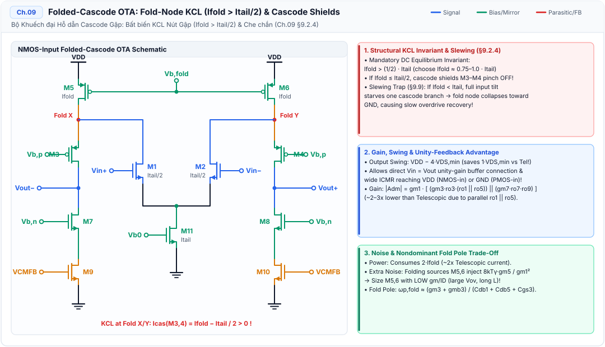

---
{
  "id": "topo-folded-cascode-ota",
  "kind": "topology",
  "domain": "opamps-and-compensation",
  "title_vi": "Bộ Khuếch đại Thuật toán Cascode Gập (Folded-Cascode Op-Amp / OTA)",
  "title_en": "Folded-Cascode Operational Transconductance Amplifier (NMOS-Input & PMOS-Input)",
  "summary": "Cấu trúc Op-Amp một tầng đa năng nhất công nghiệp: bẻ gập dòng tín hiệu từ cặp vi sai sang nhánh cascode đối cực để mở rộng ICMR chạm một đường nguồn và cho phép nối tắt hồi tiếp đơn vị Vin = Vout, kèm bất biến KCL nút gập Ifold > Itail/2, lý do độ lợi thấp hơn Telescopic ~2-3 lần và quy trình định cỡ chuẩn xác.",
  "diagram": "../../diagrams/folded-cascode-ota.svg",
  "razavi_refs": [
    {
      "chapter": 3,
      "section": "3.6.1",
      "pages": "90-92",
      "equations": []
    },
    {
      "chapter": 9,
      "section": "9.2.4-9.2.6",
      "pages": "355-361",
      "equations": ["9.17"]
    }
  ],
  "glossary_codes": ["T325", "T500", "T756", "T1437", "T1460", "T1467", "T1470", "T1667"],
  "process_agnostic": true,
  "roles": {
    "input_diff_pair": "Cặp vi sai đầu vào (PMOS M1-M2 cho ICMR chạm đất, hoặc NMOS M1-M2 cho ICMR chạm VDD và gm lớn) biến đổi Vin thành dòng +-gm1*Vin/2",
    "folding_current_sources": "Cặp nguồn dòng gập (Ifold) cấp tổng dòng tĩnh nuôi đồng thời cả nhánh cặp vi sai (Itail/2) lẫn nhánh cascode (Ifold - Itail/2)",
    "cascode_folding_shields": "Cặp transistor cổng chung đối cực nhận dòng tín hiệu đã bẻ gập tại nút trở kháng thấp ~1/(gm_cas + gmb_cas) và xuất ra nút trở kháng cao",
    "cascode_active_load": "Tải nguồn dòng cascode phía đối diện tạo trở kháng cao cân xứng để bảo toàn độ lợi cỡ (gm*ro)^2"
  },
  "symptoms_addressed": [
    "telescopic-cannot-connect-in-unity-gain-feedback",
    "narrow-icmr-blocked-by-cascode-stack",
    "input-common-mode-must-reach-gnd-or-vdd-rail",
    "slightly-wider-output-swing-consuming-4-vds-min-instead-of-5"
  ],
  "limitations": [
    "consumes-roughly-2x-bias-power-compared-to-telescopic",
    "dc-gain-2x-to-3x-lower-due-to-parallel-ro1-ro_fold-degenerating-cascode",
    "higher-input-referred-noise-from-extra-folding-current-sources",
    "lower-nondominant-pole-at-folding-node-especially-for-nmos-in-pmos-cascode",
    "slewing-overdrive-recovery-droop-if-ifold-less-than-itail"
  ],
  "checklists": ["common-mos", "differential-pair", "current-mirror", "folded-cascode", "cmfb"]
}
---

## 1. Bản chất Nguyên lý, Sơ đồ Mạch & Vai trò Từng Nhánh Cấu trúc

Để giải phóng hai xiềng xích nặng nề nhất của `topo-telescopic-cascode-opamp` — **không thể nối tắt trực tiếp ngõ vào với ngõ ra trong dải rộng** và **ICMR bị khóa chặt vào điện áp cổng cascode** — cấu trúc **bộ khuếch đại thuật toán cascode gập (`T1460`, folded-cascode op amp; viết gọn cascode gập `T500`)** tách nhánh dòng DC của cặp vi sai đầu vào ra khỏi nhánh dòng DC của tầng cascode bằng cách dùng transistor **đối cực** (PMOS đầu vào gập xuống NMOS cascode, hoặc NMOS đầu vào gập lên PMOS cascode, Razavi Chương 9, §9.2.4–§9.2.6).



Xét hai phiên bản đối ngẫu kinh điển (Hình 9.15a dùng cặp đầu vào PMOS và Hình 9.15b dùng cặp đầu vào NMOS):
1. **Bản Đầu vào PMOS $\to$ Cascode NMOS (Hình 9.15a — Phổ biến nhất cho tốc độ & nhiễu $1/f$):**
   - Nguồn dòng đuôi PMOS $M_{11}$ ($I_{SS}$) từ $V_{DD}$ cấp dòng xuống cặp vi sai PMOS $M_1\text{–}M_2$, đổ thẳng xuống hai nút gập $X, Y$ ở dưới đáy.
   - Cặp nguồn dòng gập NMOS $M_5\text{–}M_6$ nối đất rút dòng tĩnh $I_{\text{fold}} = I_{D5,6}$ lớn hơn $I_{SS}/2$, buộc phần dòng chênh lệch $I_{\text{cas}} = I_{\text{fold}} - I_{SS}/2$ phải chảy từ trên xuống qua cặp cascode **NMOS** $M_3\text{–}M_4$ và tải cascode PMOS $M_7\text{–}M_{10}$.
   - **Ưu điểm kép vàng:** Cực phụ tại nút gập $\omega_{p,\text{fold}}$ được quyết định bởi $g_{m3,4}$ của **NMOS** (cao gấp $2\text{–}3$ lần PMOS!), nhiễu nhấp nháy $1/f$ của cặp đầu vào PMOS thấp, và dải ICMR vươn xuống tận sát **mức đất GND** (thậm chí âm nhẹ dưới $0\text{ V}$ một lượng $|V_{THP}| - V_{DS,\min}$)!
2. **Bản Đầu vào NMOS $\to$ Cascode PMOS (Hình 9.15b — Phổ biến khi cần $g_{m1}$ cực đại & ICMR chạm $V_{DD}$):**
   - Cặp vi sai NMOS $M_1\text{–}M_2$ hút dòng từ hai nút gập $X, Y$ trên đỉnh, nơi cặp nguồn dòng gập PMOS $M_5\text{–}M_6$ bơm dòng $I_{\text{fold}} > I_{SS}/2$ từ $V_{DD}$ xuống, đẩy dòng dư $I_{\text{fold}} - I_{SS}/2$ chảy xuống qua cặp cascode **PMOS** $M_3\text{–}M_4$ và tải cascode NMOS $M_7\text{–}M_{10}$.
   - **Ưu điểm & Cái giá:** $g_{m1,2}$ của cặp đầu vào NMOS lớn hơn PMOS giúp cải thiện độ lợi và nén nhiễu nhiệt tải, đồng thời ICMR chạm sát **$V_{DD}$**; đổi lại transistor cascode tại nút gập là PMOS có $f_T$ thấp hơn và tụ ký sinh nút gập lớn hơn nên cực không trội $\omega_{p,\text{fold}}$ thấp hơn!

---

## 2. Hệ Phương trình Cốt lõi & Tư duy "Nhìn Mạch Đọc Nhanh" (Analysis by Inspection)

### 2.1. Định luật KCL Nút Gập & Đường Dòng Tín hiệu Nhỏ
Tại trạng thái cân bằng tĩnh ($\Delta V_{in} = 0$), áp dụng định luật Kirchhoff dòng điện tại mỗi nút gập $X$ (hoặc $Y$):

$$
I_{\text{fold}} = \frac{I_{SS}}{2} + I_{\text{cas}} \implies I_{\text{cas}} = I_{\text{fold}} - \frac{I_{SS}}{2} > 0 \quad \Longleftrightarrow \quad I_{\text{fold}} > \frac{I_{SS}}{2}
$$

Khi có điện áp vi sai nhỏ $\Delta V_{in}$, cặp đầu vào tạo dòng $\pm \frac{1}{2} g_{m1} \Delta V_{in}$. Vì nguồn dòng gập $M_{5,6}$ có trở kháng $r_{O5}$ rất lớn so với trở kháng cực thấp $\approx \frac{1}{g_{m3} + g_{mb3}}$ nhìn vào cực nguồn của transistor cascode $M_3$, gần như toàn bộ dòng tín hiệu bị bẻ gập đi qua $M_3\text{–}M_4$ ra nút ngõ ra!

### 2.2. Độ lợi Điện áp Vi sai & Tại sao Thấp hơn Telescopic $2\text{–}3$ Lần (§9.2.4, Phương trình 9.17)
Nhìn từ ngõ ra về phía nhánh gập ($M_3$ chồng trên nút gập có **cả $M_1$ lẫn nguồn dòng gập $M_5$ cùng nối song song xuống AC ground**!): điện trở suy biến cực nguồn của transistor cascode $M_3$ không còn là $r_{O1}$ đơn độc như trong Telescopic nữa, mà bị giảm còn **$(r_{O1} \parallel r_{O5})$**! Do đó (Phương trình 9.17):

$$
\left|A_{v,\text{FC}}\right| \approx g_{m1} \Big\{ \big[(g_{m3} + g_{mb3}) r_{O3} (r_{O1} \parallel r_{O5})\big] \;\parallel\; \big[(g_{m7} + g_{mb7}) r_{O7} r_{O9}\big] \Big\}
$$

Ba nguyên nhân cộng hưởng làm $\left|A_{v,\text{FC}}\right|$ thấp hơn Telescopic khoảng $2\text{–}3\times$ ($6\text{–}10\text{ dB}$) ở cùng công suất:
1. $r_{O1} \parallel r_{O5}$ nhỏ hơn $r_{O1}$ từ $2\text{–}3$ lần (vì nguồn dòng gập $M_5$ mang dòng lớn $I_{\text{fold}} \approx I_{SS} > I_{D1} = I_{SS}/2$, nên $r_{O5} \propto 1/I_{\text{fold}}$ nhỏ hơn cả $r_{O1}$!).
2. Để không nhân đôi tổng công suất tiêu thụ, dòng dành cho cặp đầu vào $I_{SS}/2$ phải giảm đi một nửa so với Telescopic, làm giảm $g_{m1}$.
3. Trong bản NMOS-in, cascode $M_3$ là PMOS có $g_{m3} r_{O3}$ thấp hơn NMOS.

### 2.3. Biên độ Dao động Ngõ ra, Dải ICMR & Cực Phụ Nút Gập (§9.2.5)
- **Biên độ ngõ ra cực đại:** Vì nguồn dòng đuôi $M_{11}$ đã được dời sang nhánh riêng bên cạnh, cột ngõ ra chỉ còn chồng **4 transistor** ($M_5, M_3, M_7, M_9$) thay vì 5 transistor như Telescopic!

$$
\Delta V_{\text{out,se}} = V_{DD} - \left( V_{DS,\min,5} + V_{DS,\min,3} + |V_{DS,\min,7}| + |V_{DS,\min,9}| \right) \approx V_{DD} - 4\,V_{DS,\min}
$$

(Mở rộng thêm được $1\,V_{DS,\min}$ đơn đầu, tức $+2\,V_{DS,\min}$ vi sai đỉnh–đỉnh so với Telescopic!).
- **Dải chế độ chung ngõ vào (ICMR):**
  - *Bản PMOS-in (Hình 9.15a):* $V_{DS,\min,5} - |V_{THP1}| \le V_{in,\text{CM}} \le V_{DD} - |V_{DS,\min,11}| - |V_{GS1}|$ $\implies$ **bao phủ mức $0\text{ V}$ (GND)**!
  - *Bản NMOS-in (Hình 9.15b):* $V_{DS,\min,11} + V_{GS1} \le V_{in,\text{CM}} \le V_{DD} - |V_{DS,\min,5}| + V_{THN1}$ $\implies$ **vươn tới sát (thậm chí vượt nhẹ) $V_{DD}$**!
- **Cực không trội tại nút gập $X, Y$ (`NG09-03`):** Tổng điện dung tại nút gập phải gánh khuếch tán của **ba transistor to** ($M_1, M_5, M_3$):

$$
C_X = C_{DB1} + C_{DB5} + C_{GD5} + C_{GS3} + C_{SB3} + 2 C_{GD1}, \qquad \omega_{p,\text{fold}} \approx \frac{g_{m3} + g_{mb3}}{C_X}
$$

Vì nguồn dòng gập $M_5$ mang dòng lớn nhất mạch ($I_{D5} = I_{\text{fold}}$) lại thường được chọn $L_5$ dài để giảm nhiễu và giữ $r_{O5}$, diện tích $M_5$ rất lớn làm $C_{DB5} + C_{GD5}$ chiếm tỷ trọng khổng lồ trong $C_X$!

---

## 3. Bất biến Cấu trúc & Các Bẫy Lỗi Kinh điển (Structural Invariants & Traps)

- **[INV-FC-01] Bất biến Sinh Tử Tại Nút Gập (KCL Equilibrium & Slew Sizing Rule):**
  - **Điều kiện sống tối thiểu ở DC:** $I_{\text{fold}} > \dfrac{1}{2} I_{SS}$. Nếu $I_{\text{fold}} \le \dfrac{1}{2} I_{SS}$ (do sai tỉ số gương hoặc lệch góc tiến trình FS/SF giữa nguồn dòng PMOS và NMOS!), dòng qua nhánh cascode $I_{\text{cas}} = 0$, cả $M_3\text{–}M_{10}$ tắt ngúm và nút gập bị kéo chạm nguồn ngay ở DC!
  - **Điều kiện chống sập nút gập khi Slewing (§9.9, Hình 9.75–9.77):** Khi có bước nhảy lớn làm cặp đầu vào lái trọn $100\%$ dòng đuôi $I_{SS}$ dồn sang một bên, nếu chọn $I_{\text{fold}} < I_{SS}$ (ví dụ $I_{\text{fold}} = 0{,}75\,I_{SS}$), nhánh cascode bên đó bị cạn sạch dòng ($M_3$ tắt hẳn) và dòng dư $I_{SS} - I_{\text{fold}}$ kéo tụt điện áp nút gập $V_X$ đẩy $M_1$ cùng nguồn đuôi lún sâu vào vùng triode — gây trễ **phục hồi sau quá kích (`T1556`, overdrive recovery)** kéo dài! Do đó quy tắc chuẩn công nghiệp là chọn **$I_{\text{fold}} \approx (1{,}0 \text{–} 1{,}2)\,I_{SS}$** (tức ở cân bằng $I_{\text{cas}} \approx 0{,}5\text{–}0{,}7\,I_{SS}$), hoặc gắn cặp transistor kẹp điện áp $M_{11}\text{–}M_{12}$ tại $X, Y$ (`tech-slew-rate-and-class-ab-opamps`)!
- **[TRAP-FC-01] Bẫy Đấu Lẫn Dòng Phản Hồi CMFB Giữa Nguồn Đuôi và Nguồn Gập làm Chết Nhánh Cascode:** Trong Folded-Cascode vi sai hoàn toàn, có 3 dòng nguồn độc lập ($I_{SS}$, $I_{\text{fold}}$, và dòng tải $I_{\text{load}}$) phải thỏa mãn cân bằng KCL toàn khối: $2 I_{\text{fold}} = I_{SS} + 2 I_{\text{load}}$. Nếu sai số gương dòng giữa NMOS và PMOS làm $I_{\text{fold}} - I_{SS}/2 \neq I_{\text{load}}$ mà vòng CMFB không điều chỉnh đúng nhánh (ví dụ CMFB điều chỉnh $I_{\text{fold}}$ hoặc $I_{SS}$ đủ bù sai lệch đó), ngõ ra lập tức chạm biên nguồn!
- **[TRAP-FC-02] Nhiễu Tăng Gấp Bội Nếu Định Cỡ Nguồn Dòng Gập $M_{5,6}$ Có $g_{m5,6}$ Lớn (§9.12, Phương trình 9.91):** Khác với Telescopic chỉ có 1 cặp nguồn dòng tải, Folded-Cascode có **2 cặp nguồn dòng song song** bơm nhiễu vào đường tín hiệu: cặp nguồn dòng gập $M_{5,6}$ (hoặc $M_{7,8}$ theo ký hiệu Hình 9.85) và cặp tải đối diện $M_{9,10}$:

$$
\overline{V_{n,\text{in,th}}^2} = 8 k T \gamma \left( \frac{1}{g_{m1,2}} + \frac{g_{m,\text{fold}}}{g_{m1,2}^2} + \frac{g_{m,\text{load}}}{g_{m1,2}^2} \right)
$$

Vì $M_{\text{fold}}$ lại mang dòng DC lớn gấp $\sim 2$ lần $M_{1,2}$, nếu bạn vô tình chọn cùng $V_{OV}$ (cùng $g_m/I_D$) cho $M_{\text{fold}}$ và $M_{1,2}$ thì $g_{m,\text{fold}} = 2 g_{m1,2}$ — khiến riêng cặp nguồn dòng gập **sinh nhiễu lớn gấp đôi chính cặp vi sai đầu vào**! Bắt buộc ép $M_{\text{fold}}$ chạy ở $V_{OV}$ lớn nhất mà cửa sổ headroom cho phép ($250\text{–}350\text{ mV}$, $g_m/I_D$ thấp) trong khi đẩy $M_{1,2}$ lên vùng nghịch đảo vừa/yếu ($g_m/I_D$ cao)!

---

## 4. Lộ trình Nâng cấp Cấu trúc & Bát giác Đánh đổi (Upgrade Paths & Design Octagon)

| Điểm nghẽn của Folded-Cascode OTA | Nâng cấp sang cấu trúc đích (Canonical Node) | Cơ chế đột phá | Đánh đổi trên Bát giác Thiết kế |
|---|---|---|---|
| Thiếu độ lợi DC $A_0$ ở tiến trình 65nm/45nm (chỉ đạt $40\text{–}50\text{ dB}$) nhưng vẫn muốn giữ tốc độ 1 tầng và khả năng nối tắt vào–ra | `topo-gain-boosted-cascode` (Gain-Boosted Folded-Cascode, Hình 9.36b) | Đặt hai khuếch đại phụ lên cổng cascode $M_{3,4}$ và $M_{5,6}$ đẩy $A_0$ vọt lên $80\text{–}95\text{ dB}$ | Thêm công suất/diện tích cho 2 OTA phụ (một NMOS-in, một PMOS-in để khớp áp nút gập!) và kiểm soát doublet |
| Thiếu biên độ ra ở nguồn $0{,}9\text{ V}\text{–}1{,}0\text{ V}$ (cửa sổ $V_{DD} - 4 V_{DS,\min}$ vẫn quá chật) hoặc phải lái tải điện trở | `topo-two-stage-opamp` (Folded-Cascode làm Tầng 1 + Tầng 2 CS / Class-AB) | Giữ trọn ICMR chạm nguồn của Folded-Cascode ở đầu vào đồng thời mở biên độ ngõ ra tới $V_{DD} - 2 V_{DS,\min}$! | Chuyển sang hệ 2 cực trội phải bù Miller (`tech-miller-pole-splitting`) hoặc bù cascode Ahuja (`tech-miller-rhp-zero-nulling-and-cascode-comp`)! |
| Muốn tận dụng phần dòng $I_{\text{fold}}$ đang bị "lãng phí" không mang tín hiệu của $M_{5,6}$ để tăng $G_m$ và Slew Rate gấp 2–3 lần | *Recycling Folded-Cascode* (Assaad & Silva-Martinez — mở rộng hiện đại từ Folded-Cascode) | Tách đôi cặp đầu vào và biến cặp nguồn dòng gập $M_{5,6}$ thành gương dòng chủ động tỉ lệ $K:1$ cùng khuếch đại tín hiệu | Xuất hiện thêm cực gương phụ trong đường recycling cần cân đối tỉ số $K \approx 2\text{–}3$ |

---

## 5. Thích ứng Đa Tiến trình (90nm / 65nm / 45nm) & Cách Kiểm chứng trong Cadence / Spectre

### 5.1. Quy trình Định cỡ 5 Bước Bất biến Tiến trình (90nm / 65nm / 45nm)
1. **Chọn cực tính đầu vào:** Chọn **PMOS-in** nếu mức tham chiếu/cảm biến nằm gần đất (ví dụ Op-Amp kẹp nhánh BJT trong Bandgap `topo-bandgap-reference-core` có $V_{BE} \approx 0{,}7\text{ V}$ trên nguồn $1{,}2\text{ V}$, hoặc cần cực nút gập NMOS nhanh nhất & nhiễu $1/f$ thấp); chọn **NMOS-in** nếu tín hiệu nằm cao gần $V_{DD}$ hoặc cần $g_{m1}$ lớn nhất trên mỗi $\mu\text{A}$.
2. **Phân bổ dòng tĩnh:** Từ chỉ tiêu $\text{SR} = I_{SS}/C_L$ và $\text{GBW} = g_{m1}/(2\pi C_L)$, chốt $I_{SS}$; đặt $I_{\text{fold}} = 1{,}0\,I_{SS}$ (nên nhánh cascode mang $I_{\text{cas}} = 0{,}5\,I_{SS}$, tổng dòng tiêu thụ lõi bằng $2\,I_{SS}$).
3. **Phân bổ $V_{DS,\min}$ trên cột 4 tầng ngõ ra:** Chia phần ngân sách $(V_{DD} - \Delta V_{\text{out,se}})$ cho 4 tầng: ưu tiên cấp $V_{DS,\min}$ hào phóng hơn ($\sim 180\text{–}250\text{ mV}$) cho nguồn dòng gập $M_{5,6}$ và nguồn dòng tải $M_{9,10}$ để hạ thấp $g_{m,\text{fold}}, g_{m,\text{load}}$ giảm nhiễu, và cấp $V_{DS,\min}$ gọn ($\sim 120\text{–}150\text{ mV}$) cho cặp cascode $M_{3,4}, M_{7,8}$ dùng phân cực cascode điện áp thấp `topo-lvccml-wide-swing-mirror`!
4. **Chọn chiều dài kênh $L$ và số ngón `nf` tại nút gập:** Giữ $L_{3,4}$ ngắn vừa ($1{,}2\text{–}1{,}8\,L_{\min}$) để cực nút gập $\omega_{p,\text{fold}}$ cao; trên layout dùng số ngón chẵn `nf` cho $M_5$ và $M_1$ để cắt một nửa $C_{DB5} + C_{DB1}$ đổ vào nút gập $X, Y$!
5. **Tự bù tần số bằng Tụ tải $C_L$ (`law-multipole-phase-margin`, §10.4):** Một ưu điểm tuyệt vời của Folded-Cascode 1 tầng là **tăng tụ tải $C_L$ làm mạch CÀNG ỔN ĐỊNH HƠN** (vì $\omega_{p1} = \frac{1}{R_{\text{out}} C_L}$ lùi về gần gốc tọa độ, kéo $\text{GBW} = \frac{g_{m1}}{C_L}$ tránh xa cực nút gập $\omega_{p,\text{fold}}$)!

### 5.2. Quy trình Kiểm chứng trong Cadence Virtuoso / Spectre
1. **Kiểm tra Bất biến Dòng Nhánh Cascode qua 5 Góc Tiến trình (Đặc biệt `FS` và `SF`!):**
   - Ở góc chéo `FS` (NMOS nhanh, PMOS chậm) và `SF` (NMOS chậm, PMOS nhanh), nếu dòng $I_{SS}$ lấy từ một gương và $I_{\text{fold}}$ lấy từ gương khác thiếu đối xứng, tỉ số $I_{\text{fold}} / I_{SS}$ có thể bị trôi! Bắt buộc đặt assertion kiểm tra `OP("/M3" "id") > 0.25 * I_tail` trên mọi góc PVT!
2. **Kiểm tra Hồi tiếp Độ lợi Đơn vị Toàn dải (`dc` & `tran` Unity-Gain Buffer):**
   - Nối tắt $V_{\text{out}}$ về $V_{in-}$ (với bản đơn đầu hoặc cấu trúc tương đương SC), quét $V_{in+}$ trên toàn bộ ICMR, kiểm tra độ lệch $V_{\text{out}} - V_{in+}$ và thời gian phục hồi bước nhảy lớn sườn lên/sườn xuống để chắc chắn nút gập $X, Y$ không sập áp dưới $V_{DS,\min}$!
3. **Bảng Kiểm Soát Nhanh 5 Thông Số DC OP Của Folded-Cascode Trong ADE:**
   ```text
   [1] Bất biến dòng gập KCL:     I(M_fold) >= 1.0 * I_tail  =>  I(M_cas) >= 0.5 * I_tail
   [2] Bất biến chống nhiễu gập:  gm(M_fold) <= 0.35 * gm(M_in)  &  gm(M_load) <= 0.30 * gm(M_in)
   [3] Bão hòa cột ra 4 tầng:     min_{k in stack}( |vds_k| - |vdsat_k| ) >= 60 mV (tại TT), >= 35 mV (tại PVT)
   [4] Cực phụ nút gập đủ cao:    (gm_cas + gmb_cas) / (2*pi * C_tot_fold) >= 3.0 * GBW
   [5] Dải ICMR chạm biên nguồn:  region(M_in) == 2 & region(M_tail) == 2 tại Vin_CM = 0 V (cho PMOS-in)
   ```

---

## 6. Mốc Đối chiếu Sách Razavi & Thuật ngữ Chuẩn CLB

### 6.1. Đối chiếu Sách Gốc Razavi (2nd Edition)
- **Chương 3:** §3.6.1 *Folded Cascode* (tr. 90–92, Hình 3.63–3.66 — giới thiệu khái niệm bẻ gập dòng tín hiệu đơn tầng).
- **Chương 9:** §9.2.4 *Folded-Cascode Op Amps* (tr. 355–357, Phương trình 9.17, Hình 9.14–9.17), §9.2.5 *Folded-Cascode Properties* (tr. 358–359, Hình 9.18–9.20), §9.2.6 *Design Procedure* (tr. 359–361, Ví dụ 9.9), §9.9 *Slew Rate* (tr. 394–396, Hình 9.75–9.77), §9.12 *Noise in Op Amps* (tr. 402–404, Phương trình 9.89–9.91, Hình 9.85).
- **Chú giải Hiệu đính Học thuật CLB (`NG09` & `NG11`):**
  - **`NG09-03` (tr. 358):** Khi xét cực không trội tại nút gập $X$ trong §9.2.5, lời văn gốc tiếng Anh gọi tích $\left[\frac{1}{g_{m3}+g_{mb3}}\right] C_X$ là *"pole"* (cực); thực chất tích $RC$ đó có thứ nguyên giây là **hằng số thời gian**, còn độ lớn tần số góc của cực phải là nghịch đảo **$\omega_{p,X} \approx \dfrac{g_{m3} + g_{mb3}}{C_X}$**!
  - **`NG09-04` & `NG09-05` (tr. 359–360, Ví dụ 9.9):** Đề bài Ví dụ 9.9 thiết kế Folded-Cascode dẫn nhầm sang thông số công nghệ của Ví dụ 9.5 (thực tế lấy bộ thông số ở Ví dụ 9.7); đồng thời ở tr. 360 sách in nhầm một dấu thập phân $g_{m7,8} = 0{,}05\text{ A/V}$ và trở kháng $8{,}8\text{ M}\Omega$ — với $I_D = 0{,}75\text{ mA}$ và $V_{OD} = 0{,}3\text{ V}$, giá trị đúng là **$g_{m7,8} = \frac{2 I_D}{V_{OD}} = 0{,}005\text{ A/V}$ ($5\text{ mA/V}$)** và $g_m r_O^2 \approx 0{,}88\text{ M}\Omega$!
  - **`NG11-07` (tr. 487):** Ở đầu §11.5.2, sách in lỗi đánh máy `"folded cascade"` ở câu đầu trước khi viết lại đúng `"folded-cascode topology"`; không nhầm `cascode` (chồng chung dòng/che chắn nút máng) với `cascade` (ghép nối tiếp nhiều tầng)!

### 6.2. Bảng Thuật ngữ Chuẩn CLB Vi Mạch Sử dụng trong Thẻ
| Mã CLB | Thuật ngữ Tiếng Anh | Thuật ngữ Tiếng Việt Chuẩn | Ghi chú Ngữ cảnh |
|---|---|---|---|
| `T500` / `T1667` | folded cascode / folded-cascode topology | cascode gập / cấu trúc cascode gấp | Gập đường dòng tín hiệu sang transistor đối cực |
| `T1460` | folded-cascode op amps | bộ khuếch đại thuật toán cascode gấp | Cho phép nối tắt hồi tiếp đơn vị và mở rộng ICMR |
| `T1467` | PMOS input differential pair | cặp vi sai ngõ vào PMOS | Cho ICMR chạm đất, nhiễu $1/f$ thấp và nút gập cascode NMOS nhanh |
| `T1470` | nondominant pole | cực không trội | Cực phụ thứ nhất $\omega_{p,\text{fold}}$ tại nút gập $X, Y$ |
| `T1437` | input common-mode voltage range | dải điện áp chế độ chung ngõ vào | Mở rộng chạm 1 đường nguồn nhờ không bị cascode khóa trên đầu |
