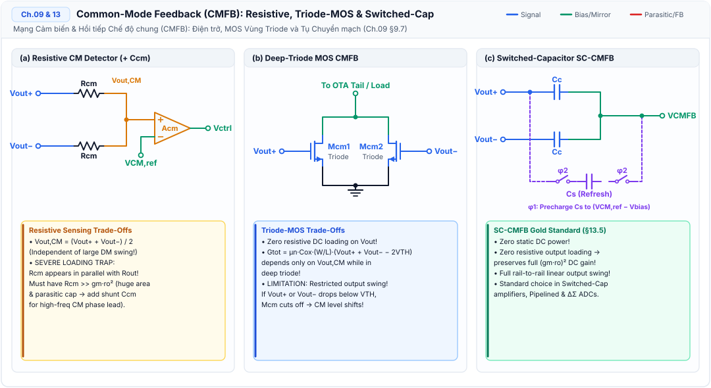

---
{
  "id": "topo-fully-differential-cmfb-topologies-comparison",
  "kind": "topology",
  "domain": "opamps-and-compensation",
  "title_vi": "So sánh Chuyên sâu Các Cấu trúc Mạch Hồi tiếp Chế độ Chung Liên tục Thời gian (Continuous-Time CMFB Topologies Comparison)",
  "title_en": "Continuous-Time Common-Mode Feedback (CMFB) Sub-Topologies: Sensing Networks, Return Injection, and Nonlinearity Traps",
  "summary": "Đối chiếu định lượng bốn họ cấu trúc cảm nhận chế độ chung liên tục thời gian (cầu điện trở cao kèm tụ bù Ccomp, bộ đệm bám nguồn trước cầu điện trở, MOSFET vùng triode sâu tại đuôi/nhánh phụ, và bộ khuếch đại vi sai kép DDA) cùng chiến lược tách nguồn dòng hồi trả và chọn điểm tiêm CMFB trong Op-Amp một tầng & hai tầng.",
  "diagram": "../../diagrams/cmfb-sensing-networks.svg",
  "razavi_refs": [
    {
      "chapter": 9,
      "section": "9.7.1-9.7.4",
      "pages": "374-388",
      "equations": ["9.47", "9.48", "9.49", "9.51", "9.53", "9.55", "9.57"]
    }
  ],
  "glossary_codes": ["T082", "T185", "T188", "T513", "T631", "T676", "T706", "T800", "T1532"],
  "process_agnostic": true,
  "roles": {
    "resistive_divider_rc_sensor": "Cầu chia hai điện trở đối xứng Rcm kèm tụ vượt song song Ccm đo trung bình tuyến tính toàn dải mà không tốn khoảng dự trữ áp",
    "source_follower_buffer_isolator": "Cặp mạch bám nguồn cách ly nút ngõ ra trở kháng cao khỏi cầu điện trở nhỏ, đánh đổi bằng sụt áp VGS và bẫy chỉnh lưu biên độ lớn",
    "deep_triode_mos_conductance_sensor": "Cặp MOSFET vùng triode sâu biến tổng điện áp cổng Vout1 + Vout2 thành điện dẫn tổng độc lập với tín hiệu vi sai nhỏ",
    "dda_dual_diffpair_comparator": "Cặp vi sai kép so sánh từng ngõ ra với VREF tại trở kháng vào vô cùng nhưng bị giới hạn dải tuyến tính +-sqrt(2)*Vov",
    "split_current_source_actuator": "Nguồn dòng phân tách tĩnh 75% + điều khiển 25% giảm tải điện dung vòng CMFB và ngăn sập điểm làm việc lúc khởi động"
  },
  "symptoms_addressed": [
    "cascode-dc-gain-collapsed-by-low-value-cmfb-sensing-resistors",
    "common-mode-level-shift-during-large-differential-output-transients",
    "dda-cmfb-clipping-limiting-differential-output-voltage-swing",
    "two-stage-cmfb-oscillation-from-three-pole-global-return-loop"
  ],
  "limitations": [
    "unbuffered-resistive-sensing-requires-megaohm-resistors-for-cascode-stages",
    "source-follower-sensing-sacrifices-vgs-plus-vdsmin-swing-range",
    "deep-triode-mos-sensing-exits-linear-regime-near-vth-bottom-swing",
    "continuous-time-cmfb-consumes-extra-static-power-unlike-sc-cmfb"
  ],
  "checklists": ["common-mos", "cmfb"]
}
---

## 1. Bản chất Nguyên lý, Sơ đồ Mạch & Vai trò Từng Nhánh Cấu trúc

Trong mọi **bộ khuếch đại vi sai hoàn toàn độ lợi cao (`T676`, high-gain fully differential amplifiers)** có **đầu vào vi sai hoàn toàn (`T631`)** và ngõ ra đối xứng dùng tải nguồn dòng chủ động, định luật Kirchhoff dòng điện (KCL) đặt mạch vào thế cân bằng lưỡi dao: chỉ cần sai lệch $1\%$ giữa dòng nguồn đuôi NMOS và tổng dòng tải PMOS (như Razavi chứng minh tại Ví dụ 9.16, tr. 376, `NG09-09`: $I_{SS} = 2{,}97\text{ mA}$ so với $3{,}00\text{ mA}$ làm dư $\Delta I = 15\,\mu\text{A}$ mỗi nhánh chảy vào $R_{\text{out,se}} = 266\text{ k}\Omega$), điện áp lệch chế độ chung đã vọt tới $\Delta V_{\text{out,CM}} = 15\,\mu\text{A} \times 266\text{ k}\Omega \approx 4{,}0\text{ V}$, đập cứng cả hai ngõ ra lên sát $V_{DD}$! Hơn nữa, ngay cả khi mắc điện trở hồi tiếp từ ngõ ra về ngõ vào, độ lợi truyền thẳng chế độ chung của cặp vi sai có nguồn đuôi hữu hạn $R_{\text{tail}}$ vẫn xấp xỉ đơn vị (Phương trình 9.57, tr. 385):

$$
\frac{V_{\text{out,CM}}}{V_{in,\text{CM}}} = -\frac{1}{\dfrac{2 R_{\text{tail}}}{r_{O3,4}} + g_{m,\text{tail}} R_{\text{tail}} + \dfrac{1}{g_{m1,2} r_{O3,4}}} \;\sim\; \mathcal{O}(1) \quad \text{(Phương trình 9.57)}
$$

khiến mạng hồi tiếp vi sai ngoài không thể tự neo cứng $V_{\text{out,CM}}$. Trong các hệ thống thời gian liên tục (bộ lọc Gm–C, bộ đệm ADC liên tục, LNA/VGA băng rộng không có xung nhịp chuyển mạch cho `tech-switched-capacitor-cmfb`), việc chọn đúng **cấu trúc con (sub-topology)** cho **hồi tiếp chế độ chung (`T800`, common-mode feedback — CMFB)** quyết định trực tiếp độ lợi vi sai còn lại, độ méo hài bậc chẵn/lẻ và biên độ dao động tối đa của toàn bộ Op-Amp!



Thẻ cấu trúc này đặt lên bàn cân giải phẫu **4 kiến trúc mạng cảm nhận chế độ chung liên tục thời gian (§9.7.2–§9.7.3)** cùng **kiến trúc điểm tiêm hồi trả cho Op-Amp một tầng và hai tầng (`T1532`, §9.7.4)**:
1. **Cầu chia áp điện trở giá trị lớn kèm tụ vượt song song ($R_{\text{CM}} \parallel C_{\text{CM}}$, Hình 9.45 & 9.52):** Chuẩn mực về độ tuyến tính biên độ lớn.
2. **Cầu chia điện trở có đệm mạch bám nguồn (`T082`, source follower + `T706`, resistive divider — Hình 9.46–9.47):** Giải cứu độ lợi DC cho Cascode nhưng mang bẫy chỉnh lưu biên độ lớn.
3. **Cảm nhận bằng MOSFET vùng triode sâu (`T188` / `T513`, deep-triode MOS sensing — Hình 9.48–9.49 & 9.53–9.57):** Cách ly trở kháng cổng tuyệt đối nhưng phụ thuộc ngưỡng $V_{TH}$ và rời vùng tuyến tính ở đáy biên độ.
4. **Cảm nhận bằng Cặp vi sai kép / Khuếch đại Hiệu Vi sai (DDA — Hình 9.50–9.51):** Trở kháng vào vô hạn không tải DC, nhưng bị kẹp dòng đuôi bởi cửa sổ tuyến tính hẹp $\pm\sqrt{2}\,V_{OV}$.

---

## 2. Hệ Phương trình Cốt lõi & Tư duy "Nhìn Mạch Đọc Nhanh" (Analysis by Inspection)

### 2.1. Phân tích Định lượng Bốn Cấu trúc Con Cảm nhận Chế độ Chung (§9.7.2–§9.7.3)

#### Cấu trúc A: Bộ Chia Áp Điện Trở Cao Kèm Tụ Bù Vượt ($R_{\text{CM}} \parallel C_{\text{CM}}$)
Hai điện trở đối xứng $R_1 = R_2 = R_{\text{CM}}$ nối từ $V_{\text{out1}}, V_{\text{out2}}$ chụm vào nút $V_{\text{sense}}$ (đầu vào bộ khuếch đại lỗi $A_{\text{err}}$ có tổng tụ cổng $C_{\text{in,err}}$):
- **Tải suy giảm độ lợi vi sai:** Dưới kích thích vi sai thuần túy ($\Delta V_{\text{out1}} = -\Delta V_{\text{out2}}$), nút đối xứng $V_{\text{sense}}$ đứng yên như đất ảo xoay chiều! Do đó điện trở ra đơn đầu của Op-Amp bị tải song song:

$$
R_{\text{out,DM,eff}} = R_{\text{out,se}} \parallel R_{\text{CM}} \quad \Longrightarrow \quad \text{Muốn mất } < 1\text{ dB độ lợi, bắt buộc } R_{\text{CM}} \ge 10\,R_{\text{out,se}}
$$

- **Cực ký sinh cảm nhận & Triệt cực bằng $C_{\text{CM}}$ (Hình 9.52):** Với Telescopic/Folded-Cascode có $R_{\text{out,se}} \approx 500\text{ k}\Omega$, chọn $R_{\text{CM}} = 5\text{ M}\Omega$ kết hợp $C_{\text{in,err}} = 100\text{ fF}$ tạo ra cực trễ pha thấp khủng khiếp $f_{p,\text{sense}} = \frac{1}{2\pi (R_{\text{CM}}/2) C_{\text{in,err}}} \approx 637\text{ kHz}$ giết chết dự trữ pha vòng CMFB! Mắc thêm hai tụ đối xứng $C_{\text{CM}}$ song song với hai điện trở $R_{\text{CM}}$ tạo hàm truyền cảm nhận:

$$
\frac{V_{\text{sense}}(s)}{V_{\text{out,CM}}(s)} = \frac{1 + s R_{\text{CM}} C_{\text{CM}}}{1 + s R_{\text{CM}} \left(C_{\text{CM}} + \dfrac{C_{\text{in,err}}}{2}\right)} \;\xrightarrow{C_{\text{CM}} \gg C_{\text{in,err}}/2}\; 1 \quad \forall\,\omega!
$$

  Đổi lại, đối với đường vi sai, mỗi tụ $C_{\text{CM}}$ cộng thẳng vào tụ tải ngõ ra ($C_{L,\text{eff}} = C_L + C_{\text{CM}}$)!

#### Cấu trúc B: Bộ Đệm Bám Nguồn Đứng Trước Cầu Chia Điện Trở (Hình 9.46–9.47)
Chèn hai transistor bám nguồn $M_{S1}, M_{S2}$ (nuôi bởi nguồn dòng tĩnh $I_B$) trước hai điện trở nhỏ $R_{\text{CM}} \sim 10\text{–}30\text{ k}\Omega$:
- Ngõ ra chính chỉ nhìn thấy tụ cổng rất nhỏ $C_{GD,S} + (1 - A_{\text{SF}})C_{GS,S}$, giải phóng hoàn toàn $R_{\text{out,se}}$ khỏi tải điện trở và đẩy cực nút chia áp lên hàng trăm $\text{MHz}$ mà không cần tụ $C_{\text{CM}}$ lớn.
- **Giới hạn bất đối xứng khi tín hiệu vi sai lớn (Hình 9.47):** Nút giữa $V_{\text{sense}}$ có thế $V_{\text{out,CM}} - V_{GS,S0}$. Khi một ngõ ra (giả sử $V_{\text{out2}}$) lao xuống thấp hơn $V_{\text{sense}} + V_{TH}$, transistor $M_{S2}$ **ngắt dẫn hoàn toàn ($I_{D,S2} = 0$)**! Điều kiện biên độ vi sai đỉnh trước khi một nhánh bám nguồn bị ngắt (với $R_{\text{CM}} \gg 1/g_{m,S}$) là:

$$
\left|V_{\text{out1}} - V_{\text{out2}}\right|_{\max,\text{SF}} \approx 2 R_{\text{CM}} I_B \quad (\text{hoặc bị chặn bởi khoảng dự trữ nguồn dòng } I_B \text{ ở đáy})
$$

  Ngay khi $M_{S2}$ tắt, $V_{\text{sense}}$ bị nhánh dương $M_{S1}$ kéo vọt lên theo nửa chu kỳ dương — biến dao động vi sai thuần túy thành xung nhiễu chế độ chung tần số gấp đôi $2 f_{\text{sig}}$!

#### Cấu trúc C: Mạng MOSFET Vùng Triode Sâu ($M_7\text{–}M_8$, Hình 9.48–9.49 & 9.53–9.57, Phương trình 9.47–9.55)
Mắc song song kênh của hai NMOS giống hệt nhau $M_7, M_8$ có cổng nối vào $V_{\text{out1}}, V_{\text{out2}}$ và giữ $V_{DS7,8} \ll 2(V_{\text{out,CM}} - V_{TH})$ để cả hai nằm chắc trong **vùng triode sâu (`T188`)** (đóng vai trò **tải làm việc ở vùng triode `T513`** cho nguồn đuôi như Hình 9.48a hoặc đặt trong nhánh gương dòng phụ độc lập Hình 9.54):
- **Tổng trở tương đương độc lập vi sai (Phương trình 9.47–9.49, tr. 379):**

$$
R_{\text{tot}} = R_{on7} \parallel R_{on8} = \frac{1}{\mu_n C_{ox}\dfrac{W}{L}(V_{\text{out1}} - V_{TH})} \;\parallel\; \frac{1}{\mu_n C_{ox}\dfrac{W}{L}(V_{\text{out2}} - V_{TH})} = \frac{1}{\mu_n C_{ox}\dfrac{W}{L}\left(V_{\text{out1}} + V_{\text{out2}} - 2 V_{TH}\right)}
$$

- **Điểm cân bằng DC & Độ lợi cảm nhận trong nhánh phụ Hình 9.54 (Ví dụ 9.18, Phương trình 9.51, 9.53, 9.55, tr. 383–384):**
  Khi cặp $M_7\text{–}M_8$ đặt dưới cực nguồn của transistor $M_5$ (cổng neo ở $V_b$, dẫn dòng $2 I_D$), áp rơi trên $R_{\text{tot}}$ bằng $V_b - V_{GS5} = 2 I_D R_{\text{tot}}$, khóa tổng điện áp ngõ ra tại (Phương trình 9.51):

$$
V_{\text{out1}} + V_{\text{out2}} = \frac{2 I_D}{\mu_n C_{ox}\left(\dfrac{W}{L}\right)_{7,8}\left(V_b - V_{GS5}\right)} + 2 V_{TH} \quad \text{(9.51)}
$$

  Trong vùng triode, hỗ dẫn chuyển đổi cổng của mỗi linh kiện là $g_{m7,8} = \frac{\partial I_D}{\partial V_{GS}} = \mu_n C_{ox}\left(\frac{W}{L}\right)_{7,8} V_{DS7,8}$, suy ra độ lợi chuyển đổi của mắt cảm nhận từ $\Delta V_{\text{out,CM}}$ sang nút điều khiển (Phương trình 9.53 & 9.55):

$$
A_{\text{sense,tri}} = -\left(g_{m7} + g_{m8}\right)\left(R_{on7} \parallel R_{on8}\right) = -\frac{2 \mu_n C_{ox}(W/L)_{7,8} V_{DS7,8}}{2 \mu_n C_{ox}(W/L)_{7,8}(V_{\text{out,CM}} - V_{TH7,8})} = -\frac{V_{DS7,8}}{V_{GS7,8} - V_{TH7,8}} \quad \text{(9.53, 9.55)}
$$

  *Nhận xét sắc bén:* Để $M_{7,8}$ nằm sâu trong vùng triode thì $V_{DS7,8} \ll V_{GS7,8} - V_{TH7,8}$, kéo theo $|A_{\text{sense,tri}}| \ll 1$ (suy giảm độ lợi vòng CMFB từ $5\text{–}10$ lần!), buộc phải bù lại bằng tầng gương dòng đối xứng Hình 9.56–9.57 để giảm độ nhạy theo $V_b$ và $V_{TH}$!

#### Cấu trúc D: Bộ Khuếch đại Hiệu Vi sai / Cặp Vi sai Kép (DDA Sensing — Hình 9.50–9.51 + `NG09-10`)
Ghép chung cực máng của hai cặp vi sai độc lập $M_{a1}\text{–}M_{a2}$ (so sánh $V_{\text{out1}}$ với $V_{\text{REF}}$) và $M_{b1}\text{–}M_{b2}$ (so sánh $V_{\text{out2}}$ với $V_{\text{REF}}$), mỗi cặp có dòng đuôi $I_0$:

$$
I_{\text{CM,out}} = I_{Da1} + I_{Db1} \approx I_0 + g_{m,\text{DDA}}(V_{\text{out1}} - V_{\text{REF}}) + g_{m,\text{DDA}}(V_{\text{out2}} - V_{\text{REF}}) = I_0 + 2 g_{m,\text{DDA}}\left(V_{\text{out,CM}} - V_{\text{REF}}\right)
$$

- **Ưu điểm:** Trở kháng vào thuần dung cực nhỏ, không tiêu tốn áp rơi trên ngõ ra, định nghĩa $V_{\text{out,CM}} \equiv V_{\text{REF}}$ cực kỳ chính xác không phụ thuộc $V_{TH}$!
- **Tử huyệt dải tuyến tính hẹp:** Mỗi cặp vi sai con tự bão hòa dòng đuôi ngay khi $\left|V_{\text{out}k} - V_{\text{REF}}\right| \ge \sqrt{2}\,V_{OV,\text{DDA}}$! Nếu Op-Amp cần dao động mỗi bên $\pm 0{,}4\text{ V}$ quanh $V_{\text{REF}}$ trên nguồn $1{,}0\text{ V}$, không thể nào tạo được $\sqrt{2}\,V_{OV,\text{DDA}} > 0{,}4\text{ V}$ mà không đẩy nguồn dòng đuôi của chính DDA vào vùng triode!

### 2.2. Ma trận Đối chiếu Toàn diện 4 Cấu trúc Con & Chiến lược Tiêm Hồi trả Hai Tầng (§9.7.4)

| Tiêu chí Kỹ thuật | A. Cầu $R_{\text{CM}} \parallel C_{\text{CM}}$ | B. Đệm Bám nguồn + $R_{\text{CM}}$ | C. MOSFET Triode sâu $M_{7,8}$ | D. Cặp Vi sai Kép (DDA) |
|---|---|---|---|---|
| **Tải DC lên độ lợi vi sai $A_{\text{DM}}$** | Nặng nếu $R_{\text{CM}}$ nhỏ; cần $R_{\text{CM}} \gg R_{\text{out}}$ | Bằng $0$ (cách ly cực cổng) | Bằng $0$ (nối vào cực cổng) | Bằng $0$ (nối vào cực cổng) |
| **Biên độ vi sai tuyến tính tối đa** | **Toàn dải Rail-to-Rail** (Tốt nhất!) | Bị cắt khi 1 nhánh SF tắt dẫn | Rời triode khi $V_{\text{out,min}} < V_{TH} + V_{DS}$ | Rất hẹp: $|V_{\text{out}k} - V_{\text{REF}}| < \sqrt{2}V_{OV}$ |
| **Độ chính xác neo mức $V_{\text{out,CM}} = V_{\text{REF}}$** | Rất cao ($\pm \text{offset}$ của $A_{\text{err}}$) | Tốt nếu bù dịch mức $V_{GS}$ đối xứng | Kém nếu không có nhánh tham chiếu đối xứng | Rất cao (khớp vi sai trực tiếp với $V_{\text{REF}}$) |
| **Tụ ký sinh cộng thêm vào $C_L$** | Bằng $C_{\text{CM}}$ ($50\text{–}300\text{ fF}$) | Rất nhỏ ($\sim C_{GD,\text{SF}}$) | Khá lớn ($C_{GS7,8} + C_{GD7,8} = W L C_{ox}$) | Nhỏ ($\sim \frac{1}{2} C_{GS,\text{DDA}}$) |
| **Cấu trúc Op-Amp ghép đôi lý tưởng** | **Tầng 2 CS của Op-Amp 2 tầng** (trở kháng ra vừa phải $\sim 5\text{–}20\text{ k}\Omega$) | Cascode tốc độ cao biên độ vừa (hoặc cặp SF bổ sung §11.5.1) | Telescopic / Folded-Cascode nguồn $\ge 1{,}2\text{ V}$ khi có nhánh bù chuẩn | Mạch vi sai băng rộng biên độ nhỏ ($\Delta V_{\text{se}} \le 250\text{ mV}_p$) |

---

## 3. Bất biến Cấu trúc & Các Bẫy Lỗi Kinh điển (Structural Invariants & Traps)

- **[INV-CMFB-01] Bất biến Phân tách Nguồn Dòng Điều khiển (Split-Current-Source Return Rule, §9.7.3 tr. 381):**
  Không bao giờ cho ngõ ra vòng CMFB lái trực tiếp $100\%$ chiều rộng cổng của nguồn dòng tải hoặc nguồn dòng đuôi chính! Hãy tách mỗi nguồn dòng thành nhánh cố định $(1 - \kappa)I_0$ ($\kappa \approx 0{,}2\text{–}0{,}3$) phân cực bằng gương chuẩn ít nhiễu và nhánh điều khiển $\kappa I_0$ nối vào CMFB. Cách tách này: (1) giảm $3\text{–}5$ lần tụ cổng tại nút hồi trả để đẩy cao cực phụ vòng CMFB; (2) giới hạn độ lợi vòng CMFB vừa vặn dễ ổn định; và (3) ngăn mạch sập về $I = 0$ trong quá độ khởi động nguồn!
- **[INV-CMFB-02] Bất biến Cấm Bọc 1 Vòng CMFB Duy Nhất Vắt Qua Cả 2 Tầng Mà Không Bù Riêng (`T1532`, §9.7.4 Hình 9.61–9.63):**
  Trong Op-Amp hai tầng, nếu cảm nhận $V_{\text{out,CM}}$ ở ngõ ra Tầng 2 rồi tiêm ngược về nguồn dòng Tầng 1, tín hiệu vòng CMFB phải đi qua **3 nút trở kháng cao liên tiếp** (nút ra bộ khuếch đại lỗi CMFB $\to$ nút ra Tầng 1 $\to$ nút ra Tầng 2), cộng thêm nguy cơ tụ bù Miller $C_C$ đảo pha đường truyền chế độ chung ở tần số cao! Giải pháp chuẩn công nghiệp (Ví dụ 9.19–9.20 & Hình 9.62): dùng **hai vòng CMFB độc lập** (một vòng cục bộ nhanh neo Tầng 1, một vòng cầu điện trở $R_{\text{CM}} \parallel C_{\text{CM}}$ điều khiển nguồn dòng Tầng 2 hoặc tiêm thẳng vào nút liên tầng sao cho vòng chính chỉ chứa tối đa 2 cực có bù Miller chế độ chung!).

- **[TRAP-CMFB-01] Bẫy Bất Đối Xứng Dạng Sóng Quá Độ Do Cảm Biến Triode Chạm Bão Hòa (Ví dụ 9.17, Hình 9.49, tr. 380):** Khi mô phỏng bước nhảy lớn vòng kín dùng CMFB vùng triode (Hình 9.48a), sinh viên thường thấy $V_{\text{out1}}(t)$ vọt lên nhiều hơn độ sụt xuống của $V_{\text{out2}}(t)$ khiến trung bình cộng bị nảy lên giữa quá độ! Nguyên nhân chính xác do Razavi vạch trần ở Ví dụ 9.17: khi nhánh âm sụt sâu làm $V_{\text{out2}} - V_{TH} < V_{DS8}$ (hoặc nhánh dương kéo dòng mạnh làm tăng $V_P = V_{DS7,8}$), $M_8$ rơi khỏi vùng triode sâu sang bão hòa/ngắt, phá vỡ Phương trình (9.49) và ép vòng CMFB tự nâng $V_{\text{out,CM}}$ lên để giữ tổng dòng không đổi!
- **[TRAP-CMFB-02] Bẫy Ngược Dấu Cực Tính Vòng Hồi Tiếp Chế Độ Chung (Positive-Feedback Latch-Up Trap):** Sai lầm kinh điển nhất làm Op-Amp kẹt cứng ở $V_{DD}$ hoặc GND ngay tại $t = 0^+$ là đấu nhầm cực $+$ và $-$ của bộ khuếch đại lỗi $A_{\text{err}}$! Quy tắc đếm dấu tức thì: giả sử $V_{\text{out,CM}}$ tăng nhẹ ($\uparrow$) $\to$ lần theo đường cảm nhận và từng transistor khuếch đại tới cực cổng nguồn dòng hồi trả $\to$ nếu điều khiển **nguồn dòng NMOS hút xuống đất** thì cổng nó phải **tăng ($\uparrow$)** để kéo $V_{\text{out,CM}}$ xuống; nếu điều khiển **nguồn dòng PMOS bơm từ $V_{DD}$** thì cổng nó cũng phải **tăng ($\uparrow$, giảm $V_{SG}$)** để bớt dòng bơm xuống!

---

## 4. Lộ trình Nâng cấp Cấu trúc & Bát giác Đánh đổi (Upgrade Paths & Design Octagon)

| Điểm nghẽn của cấu trúc CMFB hiện tại | Nâng cấp sang cấu trúc đích (Canonical Node) | Đột phá cấu trúc đạt được | Đánh đổi trên `concept-analog-design-octagon` |
|---|---|---|---|
| Hệ thống có sẵn xung nhịp lấy mẫu (ADC Pipeline, $\Sigma\Delta$, bộ lọc SC) và muốn biên độ ra chạm nguồn với công suất tĩnh CMFB bằng $0$ | `tech-switched-capacitor-cmfb` | Thay hoàn toàn điện trở/MOS triode bằng 4 tụ nhỏ chuyển mạch trung bình hóa điện tích không tốn DC headroom | Tiêm nhiễu xung nhịp (clock feedthrough / charge injection) ở tần số lấy mẫu $f_s$ |
| Đệm bám nguồn NMOS đơn thuần bị cắt dẫn ở đáy biên độ khi dùng trên nguồn thấp $1{,}0\text{ V}$ | Cặp bám nguồn bổ sung NMOS + PMOS kết hợp tuyến tính (§11.5.1 Hình 11.29, xem `tech-common-mode-feedback-cmfb`) | Nhánh NMOS đo nửa trên, nhánh PMOS đo nửa dưới, triệt tiêu thành phần $V_{GS}$ khi chọn tỉ lệ điện trở hợp lý | Tăng thêm 2 nhánh dòng phân cực phụ và cần khớp tỉ lệ giữa NMOS/PMOS qua góc `FS`/`SF` |
| Op-Amp 2 tầng cần cả tốc độ CMFB cao lẫn khả năng lái tải dung biến thiên | `topo-two-stage-opamp` kết hợp CMFB kép cục bộ Tầng 1 (Triode/DDA) + Tầng 2 (Cầu $R_{\text{CM}} \parallel C_{\text{CM}}$) | Cô lập cực liên tầng khỏi vòng CMFB ngõ ra, đạt $\text{PM}_{\text{CMFB}} > 65^\circ$ không ảnh hưởng đường vi sai | Tốn diện tích cho 2 mạch tham chiếu mức chung $V_{\text{CM1}}, V_{\text{CM2}}$ độc lập |

---

## 5. Thích ứng Đa Tiến trình (90nm / 65nm / 45nm) & Cách Kiểm chứng trong Cadence / Spectre

### 5.1. Định cỡ Thực chiến Các Nhánh CMFB trên Tiến trình 90nm / 65nm / 45nm
Khi điện áp nguồn giảm xuống $1{,}2\text{ V}$ (90nm) và $0{,}9\text{–}1{,}0\text{ V}$ (65nm/45nm), mức chế độ chung ngõ ra danh định thường đặt ở $V_{\text{REF}} = V_{DD}/2 \approx 0{,}45\text{–}0{,}60\text{ V}$. Khi đó với NMOS chuẩn (`SVT`) có $V_{THN} \approx 0{,}38\text{–}0{,}45\text{ V}$, hiệu áp $V_{\text{out,CM}} - V_{THN}$ chỉ còn vẻn vẹn $50\text{–}150\text{ mV}$ — khiến cảm biến vùng triode sâu (`SVT`) gần như tắt dẫn ở góc `SS, -40°C`!

| Cấu trúc Con CMFB ở 90nm/65nm/45nm | Lựa chọn Chủng loại Linh kiện & Định cỡ $g_m/I_D$, $V_{DS,\min}$ | Ngưỡng An toàn Bắt buộc trên PDK |
|---|---|---|
| **Cầu $R_{\text{CM}} \parallel C_{\text{CM}}$ + Khuếch đại lỗi $A_{\text{err}}$** | Dùng điện trở poly không silicide (`rppolywo` / `rhigh`) $R_{\text{CM}} \ge 8\,R_{\text{out,se}}$; cặp vi sai $A_{\text{err}}$ đặt ở $g_m/I_D \approx 15\text{–}18\text{ V}^{-1}$, $C_{\text{CM}} \approx (2\text{–}4)\,C_{\text{in,err}}$ | Kiểm tra tụ ký sinh tấm dưới của dải điện trở poly dài xuống đế để không tạo cực phân bố RC gây lệch pha thêm $> 10^\circ$ |
| **MOSFET Triode sâu ($M_{7,8}$) dưới nguồn $\le 1{,}0\text{ V}$** | Bắt buộc dùng linh kiện ngưỡng thấp **`LVT`** ($V_{TH,\text{LVT}} \approx 0{,}25\text{ V}$) và ép $V_{DS7,8} \le 40\text{–}60\text{ mV}$ ở cân bằng tĩnh | Bảo đảm tại biên độ âm cực tiểu $V_{\text{out,min}}$, vẫn giữ $V_{\text{out,min}} - V_{TH,\text{LVT}} \ge 2{,}5\,V_{DS7,8}$ ở góc `SS` |
| **Nguồn dòng Hồi trả Phân tách ($M_{\text{fix}} \parallel M_{\text{cmfb}}$)** | Đặt $I_{\text{fix}} = 0{,}75\,I_{\text{branch}}$, $I_{\text{cmfb}} = 0{,}25\,I_{\text{branch}}$; cùng $L = 3\text{–}5\,L_{\min}$, cùng $g_m/I_D \approx 8\text{–}10\text{ V}^{-1}$ ($V_{DS,\min} \approx 180\text{ mV}$) | Dải điều chỉnh $\pm 25\%$ phải lớn hơn tổng sai lệch dòng cực đại giữa gương PMOS và NMOS tại góc chéo `FS` và `SF`! |

### 5.2. Kiểm chứng Chuyên sâu Độ Ổn định Vòng CM & Tạp Nhiễu Chuyển đổi DM-to-CM trong Spectre
```ocean
; Kiểm chứng đồng thời: (1) STB vòng chế độ chung bằng diffstbprobe (mode="comm")
; và (2) Độ trôi mức chế độ chung Delta_Vcm khi phát sóng sin vi sai biên độ lớn!
simulator('spectre)
openResults("./psf")

; --- 1. Đọc kết quả phân tích STB cho chế độ chung (Common-Mode Loop) ---
selectResult('stb_margin)
pm_cm  = getData("phaseMargin")
gm_cm  = getData("gainMargin")
ugf_cm = getData("phaseMarginFreq")
printf("CMFB Loop Stability: UGF_CM = %.2f MHz | PM_CM = %.2f deg | GM_CM = %.2f dB\n"
       ugf_cm/1e6 pm_cm gm_cm)

; --- 2. Đo độ méo chuyển đổi DM -> CM trong miền thời gian (Transient) ---
selectResult('tran)
vout_p  = v("/voutp")
vout_n  = v("/voutn")
vout_cm = 0.5 * (vout_p + vout_n)
cm_pk2pk_mV = (ymax(vout_cm) - ymin(vout_cm)) * 1e3
cm_dc_err_mV = (average(vout_cm) - 0.5) * 1e3
printf("Large-Signal DM->CM Shift: Vcm_pp ripple = %.2f mV | DC Error vs Vref = %.2f mV\n"
       cm_pk2pk_mV cm_dc_err_mV)
when(pm_cm < 60.0 || cm_pk2pk_mV > 15.0
  printf("[FAIL] Kiem tra lai vung triode/SF clipping hoac tang tu bu vuot C_cm!\n")
)
```

---

## 6. Mốc Đối chiếu Sách Razavi & Thuật ngữ Chuẩn CLB

### 6.1. Đối chiếu Sách Gốc Razavi (2nd Edition) & Chú giải Hiệu đính Học thuật CLB
- **Chương 9:**
  - §9.7.1 *Basic Concepts* (tr. 374–376, Ví dụ 9.16, Hình 9.42–9.44 — bài toán sai lệch dòng KCL $1\%$ đẩy ngõ ra chạm nguồn).
  - §9.7.2 *CM Sensing Techniques* (tr. 377–380, Phương trình 9.47–9.49, Ví dụ 9.17, Hình 9.45–9.49 — cầu điện trở, đệm bám nguồn và cảm biến MOSFET vùng triode sâu).
  - §9.7.3 *CM Feedback Techniques* (tr. 380–385, Phương trình 9.50–9.56, Ví dụ 9.18, Hình 9.50–9.58 — cảm biến DDA, tụ vượt $C_{\text{CM}}$, tách nguồn dòng và khử độ nhạy $V_b$).
  - §9.7.4 *CMFB in Two-Stage Op Amps* (tr. 385–388, Phương trình 9.57, Ví dụ 9.19–9.20, Hình 9.59–9.63 — thất bại của hồi tiếp thụ động ngoài trước lỗi chế độ chung và cách đặt vòng CMFB cho hai tầng).
- **Chú giải Hiệu đính Nguồn CLB (`source_issues.json`):**
  - **`NG09-09` (tr. 376, Ví dụ 9.16):** Đề bài và lời giải Ví dụ 9.16 dẫn nhầm sang Ví dụ 9.5, nhưng giá trị trở kháng ngõ ra đơn đầu $R_{\text{out,se}} = 266\text{ k}\Omega$ và dòng $I_{SS} = 3\text{ mA}$ thực chất lấy từ thiết kế Telescopic trong **Ví dụ 9.7** ($667\text{ k}\Omega \parallel 444\text{ k}\Omega \approx 266{,}5\text{ k}\Omega$)!
  - **`NG09-10` (tr. 380, Hình 9.50 — Cảm biến DDA):** Phần lời văn dùng ký hiệu điện áp tham chiếu $V_{\text{REF}}$ và gọi dòng tổng lúc đầu là $I_{\text{CM}}$, đoạn sau gọi là $I_{\text{out}}$, trong khi nhãn trên Hình 9.50 ghi áp chuẩn là $V_b$; cả hai đều chỉ cùng một điện áp chuẩn chế độ chung mong muốn tại ngõ ra.

### 6.2. Bảng Thuật ngữ Chuẩn CLB Vi Mạch Sử dụng trong Thẻ
| Mã CLB | Thuật ngữ Tiếng Anh | Thuật ngữ Tiếng Việt Chuẩn | Ghi chú Ngữ cảnh |
|---|---|---|---|
| `T800` | common-mode feedback | hồi tiếp chế độ chung | Vòng điều khiển âm neo chặt trung bình cộng $(V_{\text{out1}} + V_{\text{out2}})/2$ |
| `T676` | high-gain fully differential amplifiers | bộ khuếch đại vi sai hoàn toàn độ lợi cao | Đối tượng bắt buộc phải có CMFB do tải nguồn dòng trở kháng cao |
| `T631` | fully differential inputs | đầu vào vi sai hoàn toàn | Cấu hình đối xứng khử nhiễu nguồn và hài bậc chẵn |
| `T706` | resistive divider | bộ chia áp điện trở | Mạng cảm nhận $R_1 = R_2$ tuyến tính toàn dải biên độ |
| `T082` | source follower | Mạch bám nguồn | Bộ đệm cách ly trở kháng trước cầu điện trở |
| `T185` / `T188` | Triode region / Deep triode region | Vùng triode (vùng tuyến tính) / Vùng triode sâu | Vùng làm việc $V_{DS} \ll 2 V_{OV}$ để tổng điện dẫn tỉ lệ tuyến tính với $V_{\text{out,CM}}$ |
| `T513` | triode load | Tải làm việc ở vùng triode | Cặp $M_{7,8}$ mắc dưới nguồn đuôi điều chỉnh dòng theo $V_{\text{out,CM}}$ |
| `T1532` | CMFB in Two-Stage Op Amps | hồi tiếp chế độ chung trong bộ khuếch đại thuật toán hai tầng | Kỹ thuật phân tách hai vòng CMFB tránh hệ 3 cực mất ổn định |
