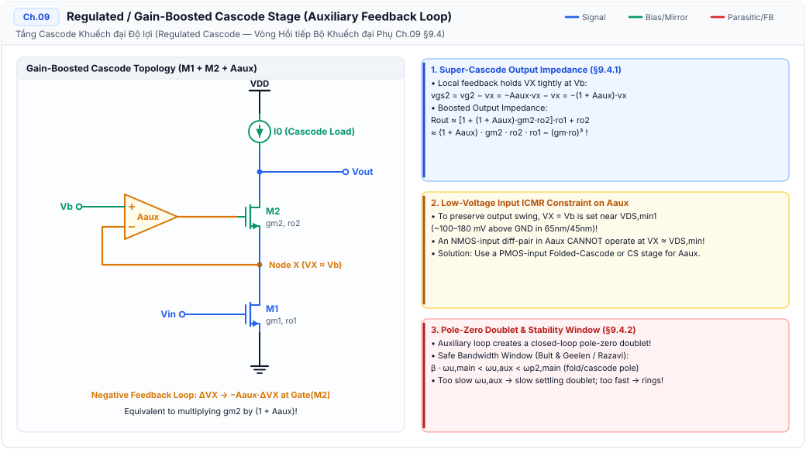

---
{
  "id": "topo-gain-boosted-cascode",
  "kind": "topology",
  "domain": "opamps-and-compensation",
  "title_vi": "Tầng Cascode Tăng cường Độ lợi / Điều chỉnh Bằng Hồi tiếp & Giới hạn Tần số Doublet (Gain-Boosted / Regulated Cascode Op-Amp)",
  "title_en": "Gain-Boosted (Regulated) Cascode Op-Amp and Auxiliary-Loop Doublet Frequency Bounds",
  "summary": "Nhân trở kháng ngõ ra của tầng cascode lên thêm (1 + A_aux) lần thông qua vòng hồi tiếp âm cục bộ điều chỉnh cực cổng cascode, đạt độ lợi cấp độ 2–3 tầng (80–100 dB) mà vẫn giữ bản chất tốc độ cao của Op-Amp một tầng, kèm ràng buộc dự trữ điện áp tại cực nguồn cascode và bất đẳng thức vàng chống doublet Bult & Geelen: omega_b1 < omega_u_aux < omega_p2_main.",
  "diagram": "../../diagrams/gain-boosted-cascode.svg",
  "razavi_refs": [
    {
      "chapter": 8,
      "section": "8.6.4 (Example 8.26)",
      "pages": "327",
      "equations": ["8.184", "8.185"]
    },
    {
      "chapter": 9,
      "section": "9.4",
      "pages": "364-373",
      "equations": ["9.21", "9.24", "9.25", "9.34", "9.38", "9.39", "9.40", "9.41", "9.42", "9.44"]
    }
  ],
  "glossary_codes": ["T499", "T1393", "T1492", "T1499", "T1505", "T1506", "T1508", "T1707", "T1708"],
  "process_agnostic": true,
  "roles": {
    "main_cascode_branch": "Đường truyền tín hiệu chính (M1-M2) dẫn gần như toàn bộ dòng tín hiệu tần số cao thẳng ra tải CL mà không bị làm chậm bởi cực của bộ khuếch đại phụ",
    "auxiliary_amplifier_a_aux": "Bộ khuếch đại phụ trợ (-A_aux) cảm nhận biến thiên điện thế tại cực nguồn cascode (nút P) và lái ngược pha cực cổng cascode để khóa cứng VDS1",
    "folded_or_ complementary_aux_input": "Tầng đầu vào của bộ khuếch đại phụ (thường dùng cặp vi sai PMOS hoặc Folded-Cascode cho phía NMOS dưới đáy) để hoạt động được ở mức điện áp cực thấp VDS,min1 ~ 150 mV",
    "auxiliary_loop_pole_zero_doublet": "Cặp cực–zero gần trùng xuất hiện quanh băng thông độ lợi đơn vị của bộ khuếch đại phụ omega_u,aux phải được nhốt chặt trong cửa sổ an toàn"
  },
  "symptoms_addressed": [
    "nanometer-cascode-gain-insufficient-for-12bit-to-16bit-settling",
    "two-stage-opamp-too-slow-or-unstable-with-variable-capacitive-load",
    "triple-cascode-impossible-due-to-low-supply-voltage"
  ],
  "limitations": [
    "output-voltage-swing-still-limited-by-single-stage-cascode-stack",
    "slow-settling-doublet-if-aux-unity-gain-bandwidth-is-too-low",
    "inner-auxiliary-loop-oscillation-if-aux-bandwidth-approaches-main-cascode-pole",
    "extra-silicon-area-and-bias-current-for-two-auxiliary-amplifiers"
  ],
  "checklists": ["common-mos", "differential-pair", "folded-cascode", "feedback-and-stb", "cmfb"]
}
---

## 1. Bản chất Nguyên lý, Sơ đồ Mạch & Vai trò Từng Nhánh Cấu trúc

Khi công nghệ co xuống 90nm / 65nm / 45nm làm $g_m r_O$ tụt xuống quanh $10$, một tầng cascode thông thường chỉ cho độ lợi $(g_m r_O)^2 \sim 40\text{ dB}$ — quá thấp cho các bộ chuyển đổi ADC đường ống $12\text{–}16\text{ bit}$. Ta không thể chồng tầng cascode thứ ba (`T506`, triple cascode) vì nguồn $1{,}0\text{ V}$ không đủ khoảng dự trữ điện áp; còn chuyển sang `topo-two-stage-opamp` thì hy sinh tốc độ một tầng và mất khả năng tự ổn định với tải tụ lớn. **Tăng cường độ lợi (`T1393`, gain-boosting)** — còn gọi là **tầng cascode điều chỉnh bằng hồi tiếp (`T1492`, regulated cascode)** — giải quyết nghịch lý này một cách ngoạn mục (Razavi Chương 9, §9.4, tr. 364–373).



Bản chất vật lý của Regulated Cascode xuất phát từ câu hỏi: *Tại sao trở kháng ra của cascode thường bị giới hạn ở $g_{m2} r_{O2} r_{O1}$?* Vì khi điện áp ngõ ra $V_{\text{out}}$ nhấp nhô một lượng $\Delta V_{\text{out}}$, nó vẫn rò rỉ một phần nhỏ $\Delta V_P \approx \dfrac{\Delta V_{\text{out}}}{g_{m2} r_{O2}}$ xuống cực nguồn $P$ của $M_2$ (tức cực máng $M_1$), sinh ra dòng rò qua $r_{O1}$!
1. **Vòng hồi tiếp âm cục bộ quanh $M_2$ (Current–Voltage / Series–Series Feedback):** Ta gắn một **bộ khuếch đại phụ trợ (`T1499`, auxiliary amplifier)** có độ lợi $-A_{\text{aux}}$ cảm nhận điện thế nút $P$ (so với tham chiếu hoặc vi sai giữa $P_+, P_-$) và điều khiển trực tiếp cực cổng của $M_2$. Chỉ cần nút $P$ nhích lên $+\Delta V_P$, cổng $M_2$ lập tức bị kéo sụt xuống $-A_{\text{aux}} \Delta V_P$, làm điện áp điều khiển cổng–nguồn hiệu dụng của $M_2$ tăng vọt thành $-(1 + A_{\text{aux}})\Delta V_P$ — tương đương như nhân hỗ dẫn của $M_2$ lên **$(1 + A_{\text{aux}})$ lần**!
2. **Tại sao mạch vẫn giữ tốc độ của Op-Amp MỘT TẦNG (§9.4.3, tr. 371)?** Khác hoàn toàn với Op-Amp hai tầng nơi *toàn bộ 100% tín hiệu* phải chui nối tiếp qua cực chậm của từng tầng, trong Gain-Boosted Cascode **phần lớn dòng tín hiệu tần số cao từ $M_1$ đi thẳng một mạch qua kênh dẫn $M_2$ ra tải $C_L$**! Bộ khuếch đại phụ $A_{\text{aux}}$ nằm ở nhánh rẽ bên cạnh, chỉ xử lý thành phần "sai số nhỏ" để nâng trở kháng ở tần số thấp và trung bình!
3. **Phải Tăng cường cho CẢ Nhánh Dưới (NMOS) Lẫn Nhánh Tải Trên (PMOS) (Hình 9.36):** Vì $R_{\text{out,total}} = R_{\text{down}} \parallel R_{\text{up}}$, nếu chỉ gắn $A_{\text{aux}}$ cho phía NMOS nâng $R_{\text{down}}$ lên $100\text{ M}\Omega$ mà để nguyên tải cascode PMOS có $R_{\text{up}} = 500\text{ k}\Omega$, tổng trở song song vẫn bị khóa chết ở $500\text{ k}\Omega$! Bắt buộc dùng hai khối phụ trợ $A_{1}$ (cho nhánh NMOS) và $A_{2}$ (cho nhánh tải PMOS).

---

## 2. Hệ Phương trình Cốt lõi & Tư duy "Nhìn Mạch Đọc Nhanh" (Analysis by Inspection)

### 2.1. Trở kháng Ngõ ra & Độ lợi DC (Từ Định lý Blackman đến Giải tích Trực tiếp — Phương trình 9.21–9.25)
Áp dụng trực tiếp Định lý Blackman (`tech-bode-blackman-middlebrook-stb`, Ví dụ 8.26, Phương trình 8.184–8.185) hoặc KCL (Phương trình 9.21) cho $M_2$ có điện trở suy biến nguồn $R_S = r_{O1}$ và khuếch đại phụ độ lợi DC $A_0$ (khi chưa kể tải tại nút $P$ của mạch phụ):

$$
R_{\text{out}} = r_{O2} + r_{O1} + \big[(1 + A_0) g_{m2} + g_{mb2}\big] r_{O2} r_{O1} \approx (1 + A_0) g_{m2} r_{O2} r_{O1}
$$

Hỗ dẫn ngắn mạch $G_m$ của toàn tầng vẫn giữ nguyên bằng $g_{m1}$ (vì nhìn lên cực nguồn $M_2$ thấy trở kháng siêu thấp $\approx \frac{1}{(1 + A_0) g_{m2}} \ll r_{O1}$, hút trọn $100\%$ dòng $g_{m1} V_{in}$, Phương trình 9.34–9.35!), cho độ lợi điện áp DC (Phương trình 9.24–9.25):

$$
\left|A_{v,\text{GB}}\right| \approx g_{m1} \Big\{ \big[(1 + A_{\text{aux,N}}) g_{m3} r_{O3} r_{O1}\big] \;\parallel\; \big[(1 + A_{\text{aux,P}}) g_{m5} r_{O5} r_{O7}\big] \Big\} \sim (g_m r_O)^3 \text{ đến } (g_m r_O)^4!
$$

*(Nếu tự thân mỗi bộ khuếch đại phụ lại là một Folded-Cascode có $A_{\text{aux}} \sim (g_m r_O)^2$, độ lợi tổng đạt cấp $(g_m r_O)^4 > 90\text{–}110\text{ dB}$ ngay trên tiến trình 65nm!)*

### 2.2. Đáp ứng Tần số Chính xác & Sự Hình thành Doublet (§9.4.3, Phương trình 9.38–9.44)
Thay bộ khuếch đại phụ bằng mô hình một cực $A_{\text{aux}}(s) = \dfrac{A_0}{1 + s/\omega_0}$ (với băng thông độ lợi đơn vị của mạch phụ là $\omega_{u,\text{aux}} = A_0 \omega_0$) vào $G_m(s)$ và $Z_{\text{out}}(s)$ khi mang tụ tải $C_L$ (Phương trình 9.39):
1. **Cực trội ngõ ra mới ($\omega_{p1}$, Phương trình 9.41–9.42):** Bị đẩy lùi về tần số rất thấp đúng bằng hệ số tăng độ lợi $(1 + A_0)$ sao cho **băng thông độ lợi đơn vị chính $\omega_{u,\text{main}} = \dfrac{g_{m1}}{C_L}$ giữ nguyên không đổi**:

$$
\omega_{p1} = \frac{1}{\big[r_{O1} + r_{O2} + (1 + A_0) g_{m2} r_{O2} r_{O1}\big] C_L + \dfrac{1}{\omega_0}} \approx \frac{1}{(1 + A_0) g_{m2} r_{O2} r_{O1} C_L}
$$

2. **Điểm không LHP ($\omega_z$, Phương trình 9.40) & Cực thứ hai do Mạch phụ ($\omega_{p,\text{doublet}}$, Phương trình 9.44):**

$$
\left|\omega_z\right| \approx (1 + A_0)\,\omega_0 \approx \omega_{u,\text{aux}}, \qquad \left|\omega_{p,\text{doublet}}\right| \approx (1 + A_0)\,\omega_0 + \frac{1}{g_{m2} r_{O2} r_{O1} C_L} \approx \omega_{u,\text{aux}} + \omega_{p1,\text{orig}}
$$

Hãy nhìn kỹ hai biểu thức trên: vì $\omega_{p1,\text{orig}} = \frac{1}{g_{m2} r_{O2} r_{O1} C_L}$ thường rất nhỏ so với $\omega_{u,\text{aux}}$, **$\left|\omega_z\right|$ và $\left|\omega_{p,\text{doublet}}\right|$ nằm sát rạt cạnh nhau ngay tại $\omega_{u,\text{aux}}$** — tạo thành một **cặp cực–zero gần trùng (`T1708`, doublet)** trên đường truyền!

### 2.3. Định luật Kẹp Tần số Bult & Geelen ($\omega_{b1} < \omega_{u,\text{aux}} < \omega_{p2,\text{main}}$)
Để vừa **không bị đuôi xác lập chậm (slow-settling tail)** do doublet vừa **không làm vòng hồi tiếp cục bộ của bộ khuếch đại phụ tự dao động**, băng thông độ lợi đơn vị của bộ khuếch đại phụ $\omega_{u,\text{aux}}$ phải nằm nghiêm ngặt bên trong "cửa sổ an toàn" kẹp bởi hai biên:

$$
\omega_{b1} = \beta \, \omega_{u,\text{main}} \;<\; \omega_{u,\text{aux}} \;<\; \omega_{p2,\text{main}} \approx \frac{g_{m2}}{C_P}
$$

- **Biên dưới ($\omega_{u,\text{aux}} > \beta \, \omega_{u,\text{main}}$ — Băng thông $-3\text{ dB}$ vòng kín của mạch chính):** Nếu đặt $\omega_{u,\text{aux}}$ quá thấp nằm lọt vào trong dải tần thấp hơn băng thông vòng kín $\omega_{b1} = \beta \cdot \text{GBW}_{\text{main}}$, cặp doublet nằm ngay giữa băng thông xử lý tín hiệu và sinh ra thành phần hàm mũ xác lập cực chậm $\exp(-\omega_{u,\text{aux}} t)$ hủy hoại thời gian xác lập chính xác $0{,}01\%$!
- **Biên trên ($\omega_{u,\text{aux}} < \omega_{p2,\text{main}}$ — Cực không trội tại nút nội cascode $P$ của mạch chính):** Nhìn vào vòng hồi tiếp cục bộ tạo bởi $A_{\text{aux}}$ và transistor cascode $M_2$: khi tải ngõ ra $C_L$ rất lớn ngắn mạch xoay chiều cực máng $M_2$ ở tần số cao, vòng cục bộ này có **cực thứ hai nằm ngay tại nút nguồn cascode $P$** ($\omega_{p,P} \approx \frac{g_{m2}}{C_P + C_{\text{in,aux}}}$)! Nếu thiết kế $\omega_{u,\text{aux}}$ quá tham lam vượt lên ngang hoặc cao hơn $\omega_{p2,\text{main}}$, **chính vòng hồi tiếp cục bộ Gain-Boosting sẽ mất dự trữ pha và tự dao động ở tần số GHz**!

---

## 3. Bất biến Cấu trúc & Các Bẫy Lỗi Kinh điển (Structural Invariants & Traps)

- **[INV-GB-01] Ràng buộc Cực tính Đầu vào Bộ Khuếch đại Phụ để Sống Sót Ở Điện áp Cực Thấp $V_P \approx V_{DS,\min}$ (§9.4.2, Hình 9.31–9.35):**
  Hãy nhìn vào điện áp DC tại nút nguồn cascode $P$ của nhánh NMOS dưới đáy: để tối đa hóa biên độ ra của mạch chính, ta đã ép $V_P = V_{DS1} \approx V_{DS,\min,1} \approx 120\text{–}180\text{ mV}$ sát mặt đất!
  - Nếu bạn dùng một OTA phụ có **cặp vi sai đầu vào NMOS** nối vào nút $P = 150\text{ mV}$, cặp NMOS đầu vào của OTA phụ tắt ngúm hoàn toàn vì $150\text{ mV} < V_{THN} + V_{DS,\min,\text{tail}}$!
  - **Quy tắc cấu trúc bắt buộc (§9.4.2):**
    1. Bộ khuếch đại phụ điều khiển cascode **NMOS gần đất** (nút $P \approx 150\text{ mV}$) **BẮT BUỘC dùng cặp đầu vào PMOS** (ví dụ Folded-Cascode PMOS-in có ICMR bao phủ mức $0\text{ V}$, Hình 9.33–9.35)!
    2. Đối ngẫu lại, bộ khuếch đại phụ điều khiển cascode **PMOS gần $V_{DD}$** (nút $Q \approx V_{DD} - 150\text{ mV}$) **BẮT BUỘC dùng cặp đầu vào NMOS** (ví dụ Folded-Cascode NMOS-in có ICMR chạm $V_{DD}$)!
- **[INV-GB-02] Dùng Bộ Khuếch đại Phụ Vi sai Hoàn toàn Tiết Kiệm Số Lượng Khối (§9.4.2, Hình 9.34–9.36):** Thay vì dùng 4 bộ khuếch đại phụ đơn đầu rời cho 4 transistor cascode ở hai nhánh trái–phải, dùng **1 OTA phụ vi sai hoàn toàn cho cặp cascode NMOS** ($P_+, P_- \to G_{3,4}$) và **1 OTA phụ vi sai hoàn toàn cho cặp cascode PMOS** ($Q_+, Q_- \to G_{5,6}$), trong đó mức đồng pha ngõ ra của mỗi OTA phụ đồng thời đóng vai trò tạo áp phân cực cổng cascode $V_{b1}, V_{b2}$ khóa chính xác $V_{DS1,2}$ và $|V_{DS7,8}|$!
- **[TRAP-GB-01] Trở kháng Ra Sẵn Có của Nhánh Nút $P$ Bị Hạ Thấp Nếu OTA Phụ Có $R_{in}$ Hữu hạn hoặc Tụ $C_{in,\text{aux}}$ Quá Lớn:** Đừng làm transistor đầu vào của OTA phụ quá to! Nhiễu của OTA phụ khi quy về ngõ vào mạch chính đã bị chia nhỏ đi $(g_{m1} r_{O1})^2$ lần ở tần số thấp (nên OTA phụ **không cần dòng lớn hay diện tích lớn vì nhiễu**!). Làm OTA phụ nhỏ gọn ($I_{\text{aux}} \approx 10\%\text{–}20\%\,I_{\text{main}}$) giúp giảm điện dung $C_{\text{in,aux}}$ gắn thêm vào nút nhạy cảm $P$, giữ cực phụ $\omega_{p2,\text{main}}$ của mạch chính ở mức cao!

---

## 4. Lộ trình Nâng cấp Cấu trúc & Bát giác Đánh đổi (Upgrade Paths & Design Octagon)

| Bối cảnh so sánh / Nâng cấp | Cấu trúc liên kết (Canonical Node) | Mối quan hệ kỹ thuật | Đánh đổi trên Bát giác Thiết kế |
|---|---|---|---|
| Nâng cấp từ `topo-telescopic-cascode-opamp` hoặc `topo-folded-cascode-ota` | `topo-gain-boosted-cascode` | Giải quyết triệt để sự suy giảm $g_m r_O$ ở 90nm/65nm/45nm mà không mất tốc độ một tầng và không giảm thêm biên độ ra | Tăng ~20%–35% công suất và diện tích cho 2 OTA phụ + thêm 2 vòng ổn định nội bộ cần kiểm tra `stb` |
| Khi Gain-Boosted Cascode vẫn không đủ biên độ ra (swing $< V_{DD} - 4 V_{DS,\min}$) | `topo-two-stage-opamp` (có thể dùng Gain-Boosted hoặc Telescopic ở Tầng 1 + CS ở Tầng 2!) | Mở biên độ ngõ ra ra sát nguồn $V_{DD} - 2 V_{DS,\min}$ | Phải bù Miller và chịu nhạy cảm độ ổn định với $C_L$ |

---

## 5. Thích ứng Đa Tiến trình (90nm / 65nm / 45nm) & Cách Kiểm chứng trong Cadence / Spectre

### 5.1. Thích ứng Công nghệ Nanomet (90nm $\to$ 65nm $\to$ 45nm)
- **Tụ tải cho vòng ổn định nội bộ của OTA phụ chính là $C_{GS,\text{cas}} + C_{GD,\text{cas}}$:** Vì OTA phụ thường là một Folded-Cascode thu nhỏ được tự bù bởi tụ tải ở ngõ ra của nó (chính là cực cổng của transistor cascode chính $M_{3,4}$!), nếu $\omega_{u,\text{aux}}$ vượt quá gần $\omega_{p2,\text{main}}$, ta dễ dàng hạ và bù ổn định vòng phụ bằng cách gắn thêm một **tụ bù nhỏ vài chục đến vài trăm $\text{fF}$ nối từ cực cổng cascode $M_{3,4}$ xuống đất xoay chiều**!

### 5.2. Quy trình Kiểm chứng Bắt Buộc cho Đa Vòng Lồng Nhau trong Cadence / Spectre
Một Gain-Boosted Fully-Differential Op-Amp chứa tới **5 đến 6 vòng hồi tiếp hoạt động đồng thời**: (1) Vòng tín hiệu chính DM, (2) Vòng CMFB chính, (3) Vòng Gain-Boost DM phía NMOS, (4) Vòng Gain-Boost DM phía PMOS, và (5–6) hai vòng CMFB cục bộ của hai OTA phụ!
1. **Kiểm tra `stb` Từng Vòng Nội Bộ (Inner Auxiliary Loops):**
   - Đặt `diffstbprobe` ngay ở ngõ ra của OTA phụ $A_{\text{aux,N}}$ (trước khi nối vào cổng $M_3, M_4$) **trong khi mạch chính đang đóng vòng và mang đầy đủ tụ tải $C_L$ thực tế** (vì $C_L$ ở cực máng $M_{3,4}$ quyết định trở kháng phản chiếu tại nút nguồn $P$!).
   - Kiểm tra cả `mode=diff` và `mode=comm` của từng OTA phụ: xác nhận $\text{PM}_{\text{aux}} \ge 60^\circ$ và đọc chính xác $f_{u,\text{aux}}$ thỏa mãn $\beta f_{u,\text{main}} < f_{u,\text{aux}} < \frac{1}{2} f_{p2,\text{main}}$!
2. **Kiểm tra Xác lập Tinh $0{,}01\%$ trên Miền Thời gian (`tran`):** Luôn vẽ `log10(abs(V(out_diff) - V_target))` theo thời gian để xác nhận không có khúc gãy chậm do doublet của $A_{\text{aux}}$!

### 5.3. Ví dụ Định lượng Cửa sổ Bult & Geelen Cho MDAC 14-Bit trên 65nm
Giả sử thiết kế Op-Amp chính cho tầng khuếch đại nhân 2 ($\beta = 0{,}5$) trong Pipeline ADC $14\text{-bit}$, tải hiệu dụng $C_{L,\text{eff}} = 2\text{ pF}$, yêu cầu $\text{GBW}_{\text{main}} = 400\text{ MHz}$ và độ lợi DC $A_0 \ge 90\text{ dB}$ ($31\,600\text{ V/V}$):
- **Băng thông vòng kín của mạch chính:** $f_{b1} = \beta \cdot \text{GBW}_{\text{main}} = 0{,}5 \times 400\text{ MHz} = 200\text{ MHz}$.
- **Cực không trội tại nút cascode chính:** Với $g_{m3} = 10\text{ mS}$ và tổng điện dung nút nội $C_P = 1{,}2\text{ pF}$ (đã tính cả $C_{\text{in,aux}}$), ta có $f_{p2,\text{main}} = \frac{g_{m3}}{2\pi C_P} \approx 1{,}33\text{ GHz}$.
- **Định vị băng thông độ lợi đơn vị của hai OTA phụ ($A_{\text{aux,N}}, A_{\text{aux,P}}$):**
  Áp dụng cửa sổ vàng $f_{b1} < f_{u,\text{aux}} < 0{,}5\,f_{p2,\text{main}} \implies 200\text{ MHz} < f_{u,\text{aux}} < 665\text{ MHz}$!
  Chọn tâm thiết kế **$f_{u,\text{aux}} \approx 400\text{–}450\text{ MHz}$**:
  - Vì tụ tải nhìn thấy ở ngõ ra OTA phụ chính là điện dung cổng cascode $C_{GS3} + C_{GD3} \approx 150\text{ fF}$, OTA phụ chỉ cần hỗ dẫn cực nhỏ $g_{m,\text{aux}} = 2\pi \cdot 450\text{ MHz} \cdot 150\text{ fF} \approx 0{,}42\text{ mS}$ (tiêu thụ dòng chỉ bằng $\sim 5\%\text{–}8\%$ dòng của nhánh chính!) mà vẫn nâng độ lợi tổng từ $46\text{ dB}$ vọt lên $46\text{ dB} + 46\text{ dB} = 92\text{ dB}$!

```spectre
// Mau kiem dinh stb cho vong Gain-Boost phu A_aux_N trong Spectre
DPRB_AUX_N (auxN_out_p auxN_out_n M3_gate M4_gate) diffstbprobe
stb_auxN_dm stb probe=DPRB_AUX_N diffprobe_mode=diff start=1 stop=100G dec=50
stb_auxN_cm stb probe=DPRB_AUX_N diffprobe_mode=comm start=1 stop=100G dec=50
// Dieu kien dat chuan:
//   phaseMargin(stb_auxN_dm) >= 60 deg
//   beta_main * f_u_main < phaseMarginFreq(stb_auxN_dm) < 0.5 * f_p2_main
```

---

## 6. Mốc Đối chiếu Sách Razavi & Thuật ngữ Chuẩn CLB

### 6.1. Đối chiếu Sách Gốc Razavi (2nd Edition)
- **Chương 8:** §8.6.4 Ví dụ 8.26 (tr. 327, Phương trình 8.182–8.186 — tính $Z_{\text{out}}$ của Regulated Cascode bằng định lý Blackman).
- **Chương 9:** §9.4 *Gain Boosting* — §9.4.1 *Basic Idea* (tr. 364–368, Phương trình 9.19–9.33, Hình 9.26–9.30), §9.4.2 *Circuit Implementation* (tr. 368–371, Hình 9.31–9.36), §9.4.3 *Frequency Response* (tr. 371–373, Phương trình 9.34–9.46, Hình 9.37–9.38, Ví dụ 9.15).
- **Chú giải Hiệu đính Học thuật CLB (`NG09`):**
  - **`NG09-07` (tr. 366):** Khi giải thích sự phân áp từ máng xuống nguồn cascode trước khi gắn $A_1$, bản in viết thiếu biến kích thích điện áp ở vế phải: $\Delta V_S = \frac{R_S}{r_O + (1 + g_m r_O) R_S} \cdot \Delta V$ (bản in thiếu thừa số $\Delta V$ làm vế phải không có thứ nguyên V).
  - **`NG09-08` (tr. 372):** Ngay dưới Phương trình (9.44), lời văn gốc gọi biểu thức $(g_{m2} r_{O2} r_{O1} C_L)^{-1}$ là *"unity-gain bandwidth of the original cascode"*, rồi ngay câu kế tiếp lại nói đúng rằng đó là *"output pole in the absence of $A_1$"*. Chính xác trong mô hình đang xét: $\frac{1}{g_{m2} r_{O2} r_{O1} C_L}$ là **tần số cực ngõ ra $-3\text{ dB}$ của tầng cascode ban đầu** ($\omega_{p1,\text{orig}}$), còn băng thông độ lợi đơn vị phải nhân thêm $g_{m1} (g_{m2} r_{O2} r_{O1})$ thành $\frac{g_{m1}}{C_L}$!
  - **`NG09-09` (tr. 376, Ví dụ 9.16):** Lời giải dẫn chiếu trở kháng ngõ ra đơn đầu $266\text{ k}\Omega$ sang Ví dụ 9.5; con số này thực tế thuộc thiết kế đã chỉnh của Ví dụ 9.7.

### 6.2. Bảng Thuật ngữ Chuẩn CLB Vi Mạch Sử dụng trong Thẻ
| Mã CLB | Thuật ngữ Tiếng Anh | Thuật ngữ Tiếng Việt Chuẩn | Ghi chú Ngữ cảnh |
|---|---|---|---|
| `T1393` | gain-boosting | tăng cường độ lợi | Kỹ thuật dùng hồi tiếp cục bộ nâng $R_{\text{out}}$ cascode |
| `T1492` | regulated cascode | tầng cascode điều chỉnh bằng hồi tiếp | Tên gọi vật lý tương đương nhấn mạnh sự ghim áp cực nguồn |
| `T1506` | gain-boosted op amp | bộ khuếch đại thuật toán tăng cường độ lợi | Đạt độ lợi đa tầng với động học một tầng |
| `T1499` | differential auxiliary amplifier | bộ khuếch đại phụ trợ vi sai | Điều khiển đồng thời hai cổng cascode trái–phải |
| `T1708` | doublet | cặp cực–zero gần trùng | Hình thành quanh $\omega_{u,\text{aux}}$ ở Phương trình (9.40) & (9.44) |
