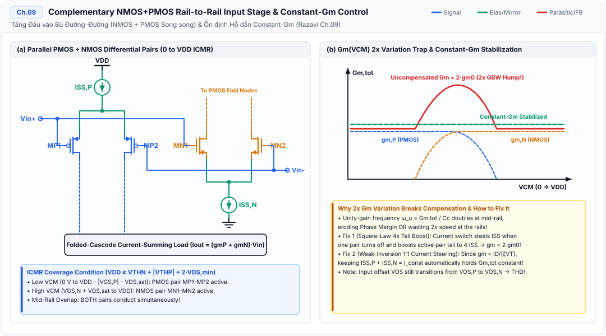

---
{
  "id": "topo-rail-to-rail-complementary-input-stage",
  "kind": "topology",
  "domain": "opamps-and-compensation",
  "title_vi": "Tầng Đầu Vào Bổ Sung Cặp Vi Sai Kép Toàn Dải Nguồn Rail-to-Rail & Kỹ thuật Ổn định Hỗ dẫn Gm (Rail-to-Rail Complementary Input Stage)",
  "title_en": "Rail-to-Rail Complementary NMOS/PMOS Input Differential Stage, Dead-Zone Supply Bound, Constant-Gm Stabilization, and Offset Transition Step",
  "summary": "Giải quyết triệt để rào cản dải chế độ chung đầu vào (ICMR) trong mạch điện áp thấp và bộ đệm độ lợi đơn vị bằng cách ghép song song cặp vi sai NMOS và PMOS gập dòng vào chung tầng cascode: phân tích điều kiện nguồn tối thiểu chống vùng chết giữa nguồn (dead zone), sự biến thiên gấp 2x của hỗ dẫn tổng Gm,tot gây mất ổn định bù tần số, các kỹ thuật giữ Gm hằng định (nhân 3x dòng đuôi ở nghịch đảo mạnh vs tổng dòng đuôi không đổi ở nghịch đảo yếu), và bước nhảy điện áp lệch Delta V_OS làm suy giảm CMRR.",
  "diagram": "../../diagrams/rail-to-rail-input-stage.svg",
  "razavi_refs": [
    {
      "chapter": 9,
      "section": "9.1.1, 9.8",
      "pages": "347-348, 388-390",
      "equations": ["9.58"]
    }
  ],
  "glossary_codes": ["T024", "T091", "T507", "T581", "T586", "T605", "T1437", "T1467"],
  "process_agnostic": true,
  "roles": {
    "pmos_input_diff_pair": "Cặp vi sai ngõ vào PMOS (M1P-M2P) đảm nhiệm khuếch đại khi mức chế độ chung đầu vào Vin,CM xuống thấp chạm sát đất GND (0 V), gập dòng tín hiệu xuống cặp nguồn dòng NMOS ở đáy",
    "nmos_input_diff_pair": "Cặp vi sai ngõ vào NMOS (M1N-M2N) đảm nhiệm khuếch đại khi Vin,CM dâng cao chạm sát nguồn dương VDD, gập dòng tín hiệu lên cặp nguồn dòng PMOS ở đỉnh",
    "folded_cascode_summing_network": "Mạng cascode gập cộng gộp đồng pha hai luồng dòng tín hiệu từ cặp NMOS và cặp PMOS tại các nút trở kháng thấp trước khi đẩy ra ngõ ra trở kháng cao",
    "constant_gm_tail_controller": "Mạch điều khiển dòng đuôi thông minh (chuyển mạch nhân 4x dòng đuôi ở vùng luật bình phương hoặc chuyển hướng giữ tổng I_tail,N + I_tail,P = const ở vùng nghịch đảo yếu) giúp san phẳng hỗ dẫn tổng thể Gm,tot"
  },
  "symptoms_addressed": [
    "unity-gain-buffer-clipping-input-swing-one-vt-plus-2vov-away-from-supply-rail",
    "tail-current-source-crushed-into-triode-causing-gm-collapse-near-gnd-or-vdd",
    "two-times-gbw-variation-across-vin-cm-destroying-opamp-phase-margin-at-mid-rail",
    "mid-rail-dead-zone-where-both-nmos-and-pmos-input-pairs-cut-off-at-low-vdd",
    "nonlinear-thd-and-cmrr-degradation-from-offset-voltage-transition-step-between-pairs"
  ],
  "limitations": [
    "requires-minimum-supply-vdd-greater-than-vgsn-plus-vgsp-plus-2vdsmin-unless-lvt-or-level-shift-is-used",
    "abrupt-transition-between-uncorrelated-pmos-offset-vos-p-and-nmos-offset-vos-n-limits-large-signal-cmrr-and-linearity",
    "input-capacitance-and-input-referred-noise-vary-across-the-three-common-mode-operating-zones"
  ],
  "checklists": ["common-mos", "differential-pair"]
}
---

## 1. Bản chất Nguyên lý, Sơ đồ Mạch & Vai trò Từng Nhánh Cấu trúc

Trong các cấu hình khuếch đại đảo hoặc mạch tụ chuyển mạch đặt nút cộng ở điện thế tham chiếu cố định, **mức chế độ chung đầu vào (`T581`, input common-mode level)** $V_{in,\text{CM}}$ đứng yên nên một cặp vi sai đơn lẻ là quá đủ. Thế nhưng trong rất nhiều mạch tương tự trọng yếu — điển hình nhất là **bộ đệm độ lợi đơn vị (unity-gain buffer, $V_{\text{out}} \approx V_{in}$, Hình 9.65)** lái ADC/màn hình, bộ khuếch đại đo dòng phía cao/thấp (high-side/low-side current-sense), hay mạch thu tín hiệu cảm biến cầu nối trực tiếp — điện áp ngõ vào quét dọc gần hết khoảng cách từ $0\text{ V}$ tới $V_{DD}$! Khi điện áp nguồn cấp co hẹp xuống $1{,}8\text{ V} \to 1{,}2\text{ V} \to 0{,}9\text{ V}$, **dải điện áp chế độ chung ngõ vào (`T1437`, input common-mode voltage range — ICMR)** của một **cặp vi sai (`T586`, differential pair)** đơn trở thành cổ chai bóp nghẹt toàn bộ hệ thống (Razavi Chương 9, §9.1.1 & §9.8, tr. 347–348, 388–390):
- Với Op-Amp chỉ dùng cặp đầu vào NMOS (như Hình 9.65): ngay cả khi nhánh cascode ngõ ra cho phép $V_{\text{out}}$ xuống thấp tới $2 V_{DS,\min}$, cặp đầu vào NMOS đã đòi hỏi $V_{in,\min} = V_{GS1,2} + V_{DS,\min,\text{tail}} = V_{THN} + 2 V_{DS,\min}$ — mất đứt một ngưỡng $V_{THN}$ ($\sim 0{,}45\text{–}0{,}7\text{ V}$)! Dưới ngưỡng này, transistor nguồn dòng đuôi NMOS bị ép lún vào vùng triode làm dòng đuôi $I_{SS}$ và **độ hỗ dẫn (`T091`, transconductance)** sụt về $0$.
- Ngược lại, Op-Amp chỉ dùng **cặp vi sai ngõ vào PMOS (`T1467`, PMOS input differential pair)** chạm được mức đất $0\text{ V}$ nhưng lại "chết cứng" khi $V_{in,\text{CM}}$ tiến lên sát $V_{DD}$ trong khoảng $|V_{GS,P}| + |V_{DS,\min,\text{tail}P}|$!



Giải pháp kiến trúc kinh điển mang tinh thần **MOS bổ sung (`T024`, complementary MOS — CMOS)** tương tự tư duy ghép song song của **tầng nguồn chung bổ sung (`T507`)** là **đặt song song cả cặp vi sai NMOS ($M_{1N}\text{–}M_{2N}$) lẫn cặp vi sai PMOS ($M_{1P}\text{–}M_{2P}$) cùng nhìn chung hai ngõ vào $V_{in+}, V_{in-}$** sao cho *"khi một cặp tắt thì cặp kia vẫn sống khỏe"* (Hình 9.66, tr. 390):
1. **Nhánh Vi sai PMOS ($M_{1P}\text{–}M_{2P}$, nuôi bởi nguồn đuôi PMOS $I_{SS,P}$ từ $V_{DD}$):** Hoạt động trọn vẹn từ $V_{in,\text{CM}} = 0\text{ V}$ (thậm chí âm nhẹ dưới $0\text{ V}$) lên tới $V_{DD} - |V_{GS,P}| - |V_{DS,\min,P}|$; dòng tín hiệu cực máng đổ xuống hai nút gập đáy $X_N, Y_N$ của cặp nguồn dòng gập NMOS.
2. **Nhánh Vi sai NMOS ($M_{1N}\text{–}M_{2N}$, nuôi bởi nguồn đuôi NMOS $I_{SS,N}$ xuống GND):** Hoạt động trọn vẹn từ $V_{GS,N} + V_{DS,\min,N}$ lên tới tận $V_{DD}$ (thậm chí vượt nhẹ trên $V_{DD}$); dòng tín hiệu cực máng hút từ hai nút gập đỉnh $X_P, Y_P$ của cặp nguồn dòng gập PMOS.
3. **Mạng Cộng Dòng Cascode Gập (Folded-Cascode Current Summing Stage, Hình 9.66):** Hợp nhất đồng pha hai luồng dòng tín hiệu vi sai $\Delta I_N + \Delta I_P$ thành một ngõ ra duy nhất có độ lợi lớn, hiện thực hóa dải đầu vào chạm cả hai đường nguồn (**Rail-to-Rail ICMR: $0 \le V_{in,\text{CM}} \le V_{DD}$**)!

Tuy nhiên, Razavi nhấn mạnh ngay ở Hình 9.67 (tr. 390) rằng việc ghép song song thô hai cặp vi sai sinh ra một "cơn ác mộng mới": **hỗ dẫn tổng thể (`T605`, overall transconductance)** $G_{m,\text{tot}}(V_{in,\text{CM}}) = g_{mN} + g_{mP}$ **tăng gấp đôi ở vùng giữa nguồn** so với ở hai biên nguồn — làm xô lệch độ lợi, nhiễu, tốc độ biến thiên và phá hỏng dự trữ pha bù tần số nếu không có mạch ổn định $G_m$!

---

## 2. Hệ Phương trình Cốt lõi & Tư duy "Nhìn Mạch Đọc Nhanh" (Analysis by Inspection)

### 2.1. Ba Vùng Hoạt Động ICMR, Điều Kiện Nguồn Tối Thiểu $V_{DD,\min}$ & Cái Bẫy "Vùng Chết Giữa Nguồn" (Mid-Rail Dead Zone)
Gọi ngưỡng bật của nhánh NMOS là $V_{\text{CM,low}}^{(N)} = V_{GS,N} + V_{DS,\min,\text{tail}N}$ và ngưỡng tắt của nhánh PMOS là $V_{\text{CM,high}}^{(P)} = V_{DD} - |V_{GS,P}| - |V_{DS,\min,\text{tail}P}|$. Khi quét $V_{in,\text{CM}}$ từ $0$ lên $V_{DD}$, mạch trải qua **3 vùng hoạt động phân biệt** (Hình 9.67):
- **Vùng I — Sát đất GND ($0 \le V_{in,\text{CM}} < V_{\text{CM,low}}^{(N)}$):** Nguồn đuôi NMOS sập áp tắt hẳn ($I_{SS,N} = 0 \implies g_{mN} = 0$), chỉ có cặp PMOS dẫn: **$G_{m,\text{tot}} = g_{mP}$**.
- **Vùng II — Chồng lấn giữa nguồn ($V_{\text{CM,low}}^{(N)} \le V_{in,\text{CM}} \le V_{\text{CM,high}}^{(P)}$):** Cả hai nguồn đuôi đều bão hòa, hai cặp vi sai chạy song song cộng dòng đồng pha: **$G_{m,\text{tot}} = g_{mN} + g_{mP}$**!
- **Vùng III — Sát nguồn dương $V_{DD}$ ($V_{\text{CM,high}}^{(P)} < V_{in,\text{CM}} \le V_{DD}$):** Nguồn đuôi PMOS sập áp tắt hẳn ($I_{SS,P} = 0 \implies g_{mP} = 0$), chỉ có cặp NMOS dẫn: **$G_{m,\text{tot}} = g_{mN}$**.

**Điều kiện Bất biến Sống Còn Để Không Xuất Hiện Vùng Chết ($G_{m,\text{tot}} = 0$) Ở Giữa Nguồn:**
Để Vùng II tồn tại liên tục (tức cặp NMOS kịp bật lên *trước khi* cặp PMOS tắt đi!), bất đẳng thức $V_{\text{CM,low}}^{(N)} \le V_{\text{CM,high}}^{(P)}$ bắt buộc điện áp nguồn cấp $V_{DD}$ phải thỏa mãn:

$$
V_{DD} \ge V_{DD,\min,\text{R2R}} = V_{GS,N} + |V_{GS,P}| + V_{DS,\min,\text{tail}N} + |V_{DS,\min,\text{tail}P}| = V_{THN,\text{eff}} + |V_{THP,\text{eff}}| + V_{OV,N} + |V_{OV,P}| + 2 V_{DS,\min,\text{tail}}
$$

*(Chú ý cực kỳ quan trọng về Hiệu ứng Thân — Body Effect!)* Tại vùng chuyển tiếp giữa nguồn $V_{in,\text{CM}} \approx V_{DD}/2$, nếu cặp NMOS đặt trên đế P chung nối đất (không có giếng Triple-Well) thì $V_{SB,N} \approx \frac{V_{DD}}{2} - V_{GS,N} > 0$, và nếu giếng N của cặp PMOS nối cố định lên $V_{DD}$ thì $V_{BS,P} \approx \frac{V_{DD}}{2} - |V_{GS,P}| > 0$: **cả $V_{THN,\text{eff}}$ lẫn $|V_{THP,\text{eff}}|$ đều bị hiệu ứng thân đẩy tăng thêm $80\text{–}150\text{ mV}$ đúng ngay tại giữa nguồn**!
- *Ví dụ số cảnh báo:* Với transistor ngưỡng chuẩn (SVT/RVT) ở góc lạnh `SS, -40°C` có $V_{THN,\text{eff}} \approx 0{,}58\text{ V}$, $|V_{THP,\text{eff}}| \approx 0{,}60\text{ V}$, $V_{OV} \approx 0{,}10\text{ V}$ và $V_{DS,\min,\text{tail}} \approx 0{,}12\text{ V}$, ta cần **$V_{DD,\min,\text{R2R}} = 0{,}58 + 0{,}60 + 0{,}20 + 0{,}24 = 1{,}62\text{ V}$**! Nếu đem mạch này chạy ở $V_{DD} = 1{,}2\text{ V}$, trong toàn bộ dải giữa $0{,}38\text{ V} < V_{in,\text{CM}} < 0{,}80\text{ V}$ **CẢ HAI CẶP VI SAI CÙNG TẮT NGÚM ($G_{m,\text{tot}} = 0$)**, tạo ra "hố tử thần" (dead zone) cắt đứt hoàn toàn đường tín hiệu!

### 2.2. Tại Sao Biến Thiên $2\times$ Của $G_{m,\text{tot}}$ Phá Hỏng Bù Tần Số Miller & Tính Tuyến Tính Đáp Ứng Bước (Phương trình 9.58)
Giả sử ta cân chỉnh kích thước sao cho ở vùng đơn cặp $g_{mN} = g_{mP} = g_{m0}$. Khi $V_{in,\text{CM}}$ đi từ biên nguồn vào vùng chồng lấn giữa nguồn, **hỗ dẫn tổng thể (`T605`)** nhảy gấp đôi từ $G_{m,\text{tot,rail}} = g_{m0}$ lên $G_{m,\text{tot,mid}} = 2 g_{m0}$! Trong một Op-Amp hai tầng bù Miller bằng tụ $C_C$ (hoặc OTA một tầng lái tụ $C_L$), tần số giao cắt độ lợi đơn vị tỉ lệ thuận trực tiếp với $G_{m,\text{tot}}$:

$$
\omega_{\text{GBW}}\!\left(V_{in,\text{CM}}\right) = \frac{G_{m,\text{tot}}\!\left(V_{in,\text{CM}}\right)}{C_C} \implies \omega_{\text{GBW,mid}} = 2 \, \omega_{\text{GBW,rail}}
$$

Trong khi đó, cực không trội thứ hai tại tầng ra $\omega_{p2} \approx \frac{g_{m,\text{out}}}{C_L}$ hoàn toàn đứng yên! Hậu quả tiến thoái lưỡng nan:
1. **Nếu chọn $C_C$ nhỏ vừa khít để đạt $\text{PM} = 60^\circ$ ở hai biên nguồn ($\omega_{p2} = \sqrt{3}\,\omega_{\text{GBW,rail}} \approx 1{,}73\,\omega_{\text{GBW,rail}}$):** Khi tín hiệu tiến vào vùng giữa nguồn làm $\omega_{\text{GBW,mid}} = 2\,\omega_{\text{GBW,rail}} > \omega_{p2}$, dự trữ pha sụt thê thảm xuống $\text{PM}_{\text{mid}} = 90^\circ - \arctan\!\left(\frac{2}{1{,}73}\right) \approx \mathbf{40^\circ}$ (thậm chí $< 25^\circ$ khi tính thêm cực gương/nút gập!), gây vọt lố dữ dội và mất ổn định!
2. **Nếu tăng gấp đôi $C_C$ để giữ an toàn $\text{PM} = 60^\circ$ ở giữa nguồn:** Khi tín hiệu ra gần hai biên nguồn, băng thông vòng kín bị **mất một nửa ($-50\%$)**, đồng thời hằng số thời gian xác lập tuyến tính $\tau(V_{in,\text{CM}}) = \frac{C_C}{\beta G_{m,\text{tot}}(V_{in,\text{CM}})}$ biến thiên gấp đôi theo mức điện áp! Đối chiếu với tính chất nền tảng của hệ tuyến tính ở đầu §9.9 (Phương trình 9.58, tr. 390: $\frac{d V_{\text{out}}}{dt} = \frac{V_0}{\tau}\exp(-t/\tau)$ đòi hỏi hằng số thời gian $\tau$ phải độc lập với biên độ để độ dốc tỉ lệ tuyến tính với bước nhảy $V_0$!), sự phụ thuộc của $\tau$ (và cả dòng đuôi hiệu dụng $I_{\text{tail,tot}}$ chuyển từ $I_0$ sang $2 I_0$!) vào mức điện áp đầu vào sinh ra **méo hài tổng $\text{THD}$ nặng nề** ngay cả ở tần số thấp hơn nhiều so với $\text{GBW}$!

### 2.3. Hai Kiến Trúc Hằng Định Hỗ Dẫn (Constant-$G_m$) Kinh Điển: Nghịch Đảo Mạnh ($1:3$ Switch) vs. Nghịch Đảo Yếu ($I_N + I_P = I_0$)
Tài liệu tham khảo kinh điển [8] được Razavi trích dẫn cuối §9.8 (Hogervorst, Huijsing *et al.*, JSSC) giải bài toán $G_{m,\text{tot}} = \text{const}$ theo hai định luật vật lý hoàn toàn khác nhau tùy vùng hoạt động của MOSFET:
1. **Phương pháp 1 — Khuếch đại Bù Dòng Đuôi $1 : 3$ (Tổng $4\times$ Dòng Đuôi) Trong Vùng Nghịch Đảo Mạnh Luật Bình Phương:**
   Trong vùng luật bình phương, $g_m = \sqrt{2 \mu C_{ox} (W/L) I_D} = \sqrt{\mu C_{ox} (W/L) I_{\text{tail}}}$. Đầu tiên chọn tỉ số kích thước bù chéo độ linh động $\frac{(W/L)_P}{(W/L)_N} = \frac{\mu_n}{\mu_p} \approx 2{,}5\text{–}3{,}5$ để ở giữa nguồn (khi $I_{\text{tail},N} = I_{\text{tail},P} = I_0$) ta có $g_{mN,0} = g_{mP,0} = g_{m0} \implies G_{m,\text{tot,mid}} = 2 g_{m0}$.
   Khi $V_{in,\text{CM}}$ tiến sát một biên nguồn làm một cặp tắt (ví dụ cặp NMOS tắt, dòng $I_{\text{tail},N}$ giảm về $0$), một transistor chuyển mạch dòng phụ đo phần dòng bị hụt $I_0 - I_{\text{tail},N}$, nhân gương tỉ lệ **$1 : 3$** rồi bơm cộng thêm $3(I_0 - I_{\text{tail},N})$ vào nguồn đuôi của cặp PMOS còn đang sống! Khi cặp NMOS tắt hẳn ($I_{\text{tail},N} = 0$), cặp PMOS nhận tổng dòng đuôi $I_{\text{tail},P,\text{rail}} = I_0 + 3 I_0 = 4 I_0$:

$$
G_{m,\text{tot,rail}} = \sqrt{\mu_p C_{ox} \left(\frac{W}{L}\right)_P (4 I_0)} = \sqrt{4} \, g_{m0} = 2 g_{m0} \equiv G_{m,\text{tot,mid}}
$$

   *Nhược điểm ở nanomet:* Phụ thuộc căn bậc hai luật bình phương (sai lệch tới $15\%\text{–}25\%$ do vận tốc bão hòa và tại vùng chuyển tiếp giữa $\sqrt{I_N} + \sqrt{I_P} \neq \text{const}$), đòi hỏi khớp $\mu_n/\mu_p$ (bị trôi mạnh ở góc chéo `FS` / `SF`!), và đẩy $V_{OV,\text{rail}}$ tăng gấp đôi ($\sqrt{4}\times$) làm thu hẹp ICMR ở biên!
2. **Phương pháp 2 — Chuyển Hướng Bảo Toàn Tổng Dòng Đuôi ($I_{\text{tail},N} + I_{\text{tail},P} = I_0$) Trong Vùng Nghịch Đảo Yếu / Dưới Ngưỡng (Chuẩn Vàng Cho 90nm / 65nm / 45nm!):**
   Khi định cỡ cả hai cặp vi sai đầu vào hoạt động ở **vùng nghịch đảo yếu (weak inversion / subthreshold, $g_m/I_D \approx 22\text{–}27\text{ V}^{-1}$)**, hỗ dẫn không còn tỉ lệ với $\sqrt{I_{\text{tail}}}$ hay $\mu C_{ox}(W/L)$ nữa, mà **tỉ lệ bậc nhất tuyệt đối với dòng phân cực**: $g_m = \dfrac{I_D}{n V_T} = \dfrac{I_{\text{tail}}}{2 n V_T}$! Vì hệ số độ dốc dưới ngưỡng của NMOS và PMOS xấp xỉ bằng nhau ($n_N \approx n_P = n \approx 1{,}3$), tổng hỗ dẫn là:

$$
G_{m,\text{tot}}\!\left(V_{in,\text{CM}}\right) = g_{mN} + g_{mP} = \frac{I_{\text{tail},N} + I_{\text{tail},P}}{2 n V_T}
$$

   **Hệ quả kỳ diệu:** Chỉ cần dùng một nguồn dòng đuôi chuẩn duy nhất $I_0$ kết hợp một công tắc chuyển dòng vi sai cực kỳ đơn giản (dùng một transistor PMOS cực cổng ghim áp cố định $V_{\text{ref}} \approx V_{DD}/2$: khi $V_{in,\text{CM}} < V_{\text{ref}}$ dòng $I_0$ chảy sang cặp PMOS; khi $V_{in,\text{CM}} > V_{\text{ref}}$ dòng $I_0$ lật sang cặp NMOS, luôn giữ $I_{\text{tail},N} + I_{\text{tail},P} \equiv I_0$ tại mọi điểm!), ta đạt được **$G_{m,\text{tot}}$ phẳng trong phạm vi $\pm 3\%\text{–}5\%$ trên toàn dải $0 \to V_{DD}$, hoàn toàn miễn nhiễm với sai lệch góc chéo `FS`/`SF` giữa $\mu_n$ và $\mu_p$, và tiết kiệm một nửa dòng tĩnh ở giữa nguồn**!

---

## 3. Bất biến Cấu trúc & Các Bẫy Lỗi Kinh điển (Structural Invariants & Traps)

- **[INV-R2R-01] Bất biến KCL Tại Nút Gập Của Folded-Cascode Khi Dòng Đuôi Nhảy $4\times$ (Chống Tắt Nhánh Cascode!):**
  Trong mạch Hình 9.66 dùng phương pháp nhân $4\times$ dòng đuôi ($I_{\text{tail,rail}} = 4 I_0$, tức mỗi bên cặp vi sai bơm tối đa tới $2 I_0$ ở trạng thái cân bằng sát nguồn và $4 I_0$ khi slewing!), các nguồn dòng gập NMOS/PMOS ở tầng cascode **BẮT BUỘC phải định cỡ dòng tĩnh $I_{\text{fold}} > 2 I_0$** (an toàn là $I_{\text{fold}} \approx 2{,}5\text{–}4\,I_0$)! Nếu bạn lỡ định cỡ $I_{\text{fold}} = 1{,}2\,I_0$ theo thói quen của Folded-Cascode một cặp đơn (`topo-folded-cascode-ota`), ngay khi mạch quét ra sát biên nguồn kích hoạt bơm dòng $3\times$ làm dòng mỗi nhánh vi sai vọt lên $2 I_0 > I_{\text{fold}}$, nhánh cascode bị hút cạn sạch dòng ($I_{\text{cas}} = 0$) và Op-Amp sập chết tức khắc!
- **[TRAP-R2R-01] "Sát Thủ Thầm Lặng" Của Độ Tuyến Tính Buffer: Bước Nhảy Điện Áp Lệch $\Delta V_{OS}$ Giữa Hai Cặp Vi Sai!**
  Ngay cả khi bạn đã làm phẳng $G_{m,\text{tot}}$ hoàn hảo 100%, cặp PMOS có một điện áp lệch ngẫu nhiên $V_{OS,P}$ (ví dụ $+2\text{ mV}$) và cặp NMOS có một điện áp lệch ngẫu nhiên **hoàn toàn độc lập** $V_{OS,N}$ (ví dụ $-3\text{ mV}$) tuân theo Định luật Pelgrom (`law-pelgrom-mismatch-and-sizing-duality`)! Điện áp lệch hiệu dụng toàn mạch phụ thuộc trọng số hỗ dẫn tại từng mức $V_{in,\text{CM}}$:

$$
V_{OS,\text{eff}}\!\left(V_{in,\text{CM}}\right) = \frac{g_{mP}\!\left(V_{in,\text{CM}}\right) V_{OS,P} + g_{mN}\!\left(V_{in,\text{CM}}\right) V_{OS,N}}{g_{mP}\!\left(V_{in,\text{CM}}\right) + g_{mN}\!\left(V_{in,\text{CM}}\right)}
$$

  Khi một bộ đệm độ lợi đơn vị ($V_{\text{out}} = V_{in} + V_{OS,\text{eff}}(V_{in})$) truyền một sóng sin biên độ lớn đi ngang qua vùng chuyển tiếp rộng chỉ $\Delta V_{\text{trans}} \approx 150\text{–}250\text{ mV}$, ngõ ra bị dính một **bậc thang phi tuyến sắc lẹm cao $\Delta V_{OS} = |V_{OS,N} - V_{OS,P}| \approx 5\text{ mV}$** ngay giữa sườn sóng! Bước nhảy $5\text{ mV}$ trên sóng $1\text{ V}_{pp}$ sinh ra méo hài bậc cao khổng lồ ($\text{THD} \sim -46\text{ dB}$, phá hỏng mọi bộ đệm ADC $> 8\text{ bit}$!) và kéo tụt tỷ số nén chế độ chung tín hiệu lớn xuống chỉ còn $\text{CMRR}_{\text{eff}} \approx 20\log_{10}\!\left(\frac{\Delta V_{\text{CM}}}{|\Delta V_{OS}|}\right) \approx 46\text{–}60\text{ dB}$!
- **[TRAP-R2R-02] Nhiễu Quy Về Ngõ Vào Tăng Gấp Bội Khi Một Cặp Tắt Mà Cặp Nguồn Gập Vẫn Đứng Nguyên:**
  Ở giữa nguồn khi cả hai cặp dẫn ($G_m = 2 g_{m0}$), $G_m^2 = 4 g_{m0}^2$ chia nhỏ nhiễu của các nguồn dòng gập trong tầng cascode đi $4$ lần; nhưng nếu không có ổn định $G_m$, khi ra sát biên nguồn $G_m$ tụt còn $g_{m0}$ làm công suất nhiễu từ toàn bộ tầng gập cascode bị phóng đại lên **$4\times$ ($+6\text{ dB}$)** đúng lúc tín hiệu chạm gần biên!

---

## 4. Lộ trình Nâng cấp Cấu trúc & Bát giác Đánh đổi (Upgrade Paths & Design Octagon)

| Điểm nghẽn của Tầng Đầu Vào Bổ Sung Rail-to-Rail | Nâng cấp sang Kiến trúc Đích (Canonical Node) | Cơ chế Giải quyết Triệt để | Đánh đổi trên Bát giác Thiết kế |
|---|---|---|---|
| Xuất hiện vùng chết giữa nguồn (dead zone) khi $V_{DD} = 0{,}8\text{–}1{,}0\text{ V} < V_{GS,N} + |V_{GS,P}| + 2 V_{DS,\min}$ | Dùng transistor ngưỡng thấp **LVT** (Low-$V_{TH}$), nối thân về nguồn trong giếng sâu Triple-Well, hoặc **Bơm điện tích nâng nguồn đuôi / Dịch mức cổng bằng tụ chuyển mạch** (`topo-bootstrapped-sampling-switch`) | Hạ $V_{THN} + |V_{THP}|$ xuống $\sim 0{,}55\text{ V}$ hoặc nâng áp cấp riêng cho tầng đầu lên $V_{DD} + 0{,}5\text{ V}$, xóa sạch vùng chết xuống tới $V_{DD} = 0{,}7\text{ V}$ | Tăng dòng rò tắt của LVT ở góc `FF, 125°C` hoặc cần xung nhịp bơm điện tích |
| Bước nhảy lệch $\Delta V_{OS} = V_{OS,N} - V_{OS,P}$ gây méo hài $\text{THD}$ không thể chấp nhận được trong bộ đệm ADC 14–16 bit! | **Dùng MỘT cặp vi sai PMOS duy nhất** nuôi bởi bộ tạo nguồn âm nội bộ trên chip ($V_{SS,\text{neg}} \approx -0{,}3\text{ V}$) hoặc nâng áp cổng bằng bơm điện tích đầu vào; hoặc áp dụng Chopper/Auto-Zero (`tech-dynamic-offset-cancellation-az-cds`) | Không bao giờ chuyển cặp giữa chừng $\implies$ triệt tiêu hoàn toàn bước nhảy $\Delta V_{OS}(V_{in,\text{CM}})$, giữ $G_m, C_{in}$, nhiễu và offset phẳng tuyệt đối từ $0 \to V_{DD}$! *(Bí quyết của các Rail-to-Rail Precision Op-Amp hiện đại gọi là "Zero-Crossover Topology"!)* | Cần một mạch bơm điện tích dòng nhỏ ($\sim 20\,\mu\text{A}$) có lọc gợn sóng trên chip |
| Ngõ vào đã đạt Rail-to-Rail ($0 \to V_{DD}$) nhưng ngõ ra Folded-Cascode vẫn mất $4 V_{DS,\min}$ biên độ! | Ghép tầng đầu Rail-to-Rail Constant-$G_m$ với tầng ra **CS Đẩy–Kéo Class-AB Monticelli** (`topo-two-stage-opamp` + `tech-slew-rate-and-class-ab-opamps`) | Tạo thành **Full Rail-to-Rail Input/Output (RRIO) Op-Amp** hoàn chỉnh cho phép cả $V_{in}$ lẫn $V_{\text{out}}$ quét sát hai đường nguồn trong vòng $\sim 50\text{–}100\text{ mV}$! | Cần bù tần số cascode Miller / Ahuja (`tech-miller-rhp-zero-nulling-and-cascode-comp`) và kiểm soát dòng tĩnh vòng truyền nổi Class-AB |

---

## 5. Thích ứng Đa Tiến trình (90nm / 65nm / 45nm) & Cách Kiểm chứng trong Cadence / Spectre

### 5.1. Bảng Định Cỡ Tầng Đầu Vào Rail-to-Rail Constant-$G_m$ Nghịch Đảo Yếu Trên 90nm / 65nm / 45nm ($V_{DD} = 1{,}2\text{ V}$)
Trên công nghệ **90nm / 65nm / 45nm** với nguồn $V_{DD} = 1{,}2\text{ V}$ (hoặc $1{,}0\text{ V}$ dùng linh kiện LVT), thiết kế theo chế độ **nghịch đảo yếu bảo toàn tổng dòng đuôi ($I_{\text{tail},N} + I_{\text{tail},P} = I_0$)** kết hợp diện tích lớn giảm Pelgrom $\Delta V_{OS}$ mang lại hiệu quả vượt trội nhất:

| Phần Tử Cấu Trúc trong Tầng Đầu Rail-to-Rail | Loại Linh Kiện & $g_m/I_D$ ($\text{V}^{-1}$) | $V_{DS,\min}$ ($\text{mV}$) | Quy tắc Định Cỡ $W, L$ & Giếng (Well) | Chỉ Tiêu Kỹ Thuật Bảo Đảm |
|---|---|---|---|---|
| **Cặp đầu vào PMOS $M_{1P}\text{–}M_{2P}$** | LVT PMOS, nghịch đảo yếu: $22 \text{ – } 25$ | $75 \text{ – } 95$ | $L_P = 3\text{–}5\,L_{\min}$, diện tích $(WL)_P$ lớn (ví dụ $80\,\mu\text{m} \times 0{,}25\,\mu\text{m}$) để ép $\sigma(V_{OS,P}) < 0{,}8\text{ mV}$; nối N-well về cực nguồn chung (nếu tốc độ cho phép) để xóa hiệu ứng thân! | Dẫn tốt từ $-0{,}1\text{ V}$ tới $0{,}75\text{ V}$ trên nguồn $1{,}2\text{ V}$ |
| **Cặp đầu vào NMOS $M_{1N}\text{–}M_{2N}$** | LVT NMOS, nghịch đảo yếu: $22 \text{ – } 25$ | $75 \text{ – } 95$ | $L_N = 3\text{–}5\,L_{\min}$, đặt trong Deep N-Well (nếu có) nối P-well cục bộ về nguồn chung để hạ $V_{THN}$ giữa nguồn; $(WL)_N$ lớn để ép $\sigma(V_{OS,N}) < 0{,}8\text{ mV}$ | Dẫn tốt từ $0{,}45\text{ V}$ tới $1{,}3\text{ V}$ (vùng chồng lấn an toàn $300\text{ mV}$ ngay cả ở `SS, -40°C`!) |
| **Công tắc chuyển hướng dòng đuôi & Gương $1:1$** | RVT/LVT, nghịch đảo vừa: $12 \text{ – } 15$ | $110 \text{ – } 140$ | Lái bằng điện áp ngưỡng chuyển $V_{\text{sw}} \approx 0{,}55\,V_{DD}$ sao cho $I_{\text{tail},P} + I_{\text{tail},N} = I_0$ trơn tru | Giữ $\frac{\Delta G_{m,\text{tot}}}{G_{m,\text{tot}}} < \pm 5\%$ trên toàn dải $0 \le V_{in,\text{CM}} \le V_{DD}$ |
| **Cặp nguồn dòng gập Cascode ($M_{\text{fold},N}, M_{\text{fold},P}$)** | RVT/SVT, nghịch đảo mạnh: $5 \text{ – } 7$ | $180 \text{ – } 230$ | $I_{\text{fold}} = 1{,}2 \, I_0$ (luôn $> I_{0,\max}$ ngay cả khi toàn bộ $I_0$ dồn sang 1 cặp và slewing!), $L = 4\text{–}8\,L_{\min}$ | Đảm bảo không bao giờ tắt nhánh cascode và nén nhiễu tải gập xuống $< 25\%$ |

### 5.2. Quy trình Kiểm chứng trong Cadence Virtuoso / Spectre (Quét Toàn Dải $V_{in,\text{CM}}$ Kiểm Tra $G_m$, PM & Monte Carlo $\Delta V_{OS}$)
Một sai lầm chí mạng khi kiểm chứng Op-Amp Rail-to-Rail là chỉ chạy `stb`, `ac`, `noise` và `montecarlo` tại một mức chế độ chung duy nhất $V_{in,\text{CM}} = V_{DD}/2$! Bạn **BẮT BUỘC phải quét tham số `V_cm` từ `0` đến `VDD` với bước nhỏ `25 mV`** qua cả góc cực lạnh `SS, -40°C, VDD_min` (nơi dễ thủng vùng chết nhất!) và Monte Carlo mismatch (để bắt bước nhảy $\Delta V_{OS}$):

```lisp
; === OCEAN Script: Quet Vin_CM tu 0 -> VDD kiem tra Dead-Zone, do phang Gm_tot, PM & buoc nhay Vos ===
simulator('spectre)
design("libName" "tb_r2r_opamp_char" "schematic")
resultsDir("./sim_r2r_icmr")

; Cau hinh mach: Unity-Gain Buffer hoac DC servo voi iprobe tren duong hoi tiep
desVar("VDD_val" 1.2)
desVar("V_cm" 0.6)

; 1. Quet V_cm tren 25 diem tu 0V den 1.2V, tai moi diem chay STB va DC
paramAnalysis("V_cm" ?start 0.0 ?stop 1.2 ?step 0.05
    analysis('dc ?saveOppoint t)
    analysis('stb ?probe "/IPRB_LOOP" ?start 1 ?stop 5G ?dec 30)
)
paramRun()

; 2. Lay cuc dai / cuc tieu cua UGBW (ti le voi Gm_tot!) va Phase Margin doc theo toan bo ICMR
selectResult('stb_margin-sweep)
ugbw_curve = getData("gainMarginFreq" ?result "stb_margin") ; hoac cross(db20(mag(loopGain)) 0 1 "falling")
pm_curve   = getData("phaseMargin" ?result "stb_margin")

selectResult('dc-sweep)
vos_curve  = VF("/vout") - VAR("V_cm") ; Sai lech Vout - Vin doc theo V_cm (bat buoc chay them trong Monte Carlo!)

printf("Min Phase Margin across [0, VDD] = %.2f deg\n" ymin(pm_curve))
printf("Max Vos Kink Peak-to-Peak        = %.3f mV\n"  (ymax(vos_curve) - ymin(vos_curve))*1e3)
; Chi tieu dat chuan: ymin(pm_curve) >= 55 deg, Gm_max/Gm_min <= 1.12 (<= +-6%), khong co diem Gm = 0 o SS/-40C!
```

---

## 6. Mốc Đối chiếu Sách Razavi & Thuật ngữ Chuẩn CLB

### 6.1. Đối chiếu Sách Gốc Razavi (2nd Edition) & Chú giải Học thuật CLB
- **Chương 9:** §9.1.1 *Performance Parameters* (tr. 347–348: các chỉ tiêu độ lợi, băng thông tín hiệu nhỏ, hành vi tín hiệu lớn, biên độ dao động, độ tuyến tính, nhiễu và điện áp lệch đầu vào), §9.8 *Input Range Limitations* (tr. 388–390: Hình 9.65 phân tích giới hạn dải đầu vào của bộ đệm độ lợi đơn vị $V_{in,\min} \approx V_{GS1,2} + V_{ISS}$, Hình 9.66 kiến trúc ghép hai bộ khuếch đại cascode gập có cặp đầu vào NMOS và PMOS, Hình 9.67 đặc tính biến thiên gấp đôi của hỗ dẫn tương đương theo $V_{in,\text{CM}}$, và tham chiếu [8] R. Hogervorst *et al.*, *"A Compact Power-Efficient 3 V CMOS Rail-to-Rail Input/Output Operational Amplifier for VLSI Cell Libraries,"* IEEE JSSC, Dec. 1994), đầu §9.9 *Slew Rate* (tr. 390: Phương trình 9.58 chứng minh tính chất tỉ lệ tuyến tính của đạo hàm đáp ứng bước $\frac{d V_{\text{out}}}{dt} = \frac{V_0}{\tau}\exp(-t/\tau)$ khi hằng số thời gian $\tau$ là hằng số bất biến).
- **Chú giải Hiệu đính Học thuật CLB (`source_issues.json` — Chương 09):**
  - **Đối chiếu đánh số hình giữa bản in 2nd Edition và kết cấu mục §9.7.4–§9.8 (tr. 388–390):** Trên trang sách 388–390 của ấn bản thứ 2, Hình 9.65 là bộ đệm độ lợi đơn vị (*Unity-gain buffer*), Hình 9.66 là mạch mở rộng dải chế độ chung đầu vào kết hợp cặp vi sai NMOS và PMOS (*Extension of input CM range*), và Hình 9.67 là đồ thị biến thiên hỗ dẫn tương đương (*Variation of equivalent transconductance as a function of input CM level*), ngay trước khi bước sang Hình 9.68 và Phương trình (9.58) ở cuối trang 390.
  - **`NG09-13` (tr. 407, Bài tập 9.12):** Đề bài gốc in nhầm lỗi đánh máy *"different pair"* thay cho *"differential pair"* (`T586`, cặp vi sai).

### 6.2. Bảng Thuật ngữ Chuẩn CLB Vi Mạch Sử dụng trong Thẻ
| Mã CLB | Thuật ngữ Tiếng Anh | Thuật ngữ Tiếng Việt Chuẩn | Ghi chú Ngữ cảnh |
|---|---|---|---|
| `T1437` | input common-mode voltage range | dải điện áp chế độ chung ngõ vào | Mở rộng trọn vẹn từ $0\text{ V}$ đến $V_{DD}$ khi thỏa mãn $V_{DD} \ge V_{DD,\min,\text{R2R}}$ |
| `T581` | input common-mode level | mức chế độ chung đầu vào | Điện thế trung bình $V_{in,\text{CM}} = \frac{1}{2}(V_{in+} + V_{in-})$ quét qua 3 vùng hoạt động |
| `T024` | complementary MOS, CMOS | MOS bổ sung | Kết hợp đối ngẫu NMOS và PMOS để bù trừ vùng tắt của nhau ở hai biên nguồn |
| `T586` | differential pair | cặp vi sai | Ghép song song hai cặp NMOS + PMOS cùng lái vào mạng cộng dòng cascode gập |
| `T1467` | PMOS input differential pair | cặp vi sai ngõ vào PMOS | Giữ cho Op-Amp tiếp tục sống khi $V_{in,\text{CM}}$ chạm sát đất GND ($0\text{ V}$) |
| `T507` | complementary CS stage | tầng nguồn chung bổ sung | Thường ghép ở tầng thứ hai để hoàn thiện Op-Amp Rail-to-Rail cả vào lẫn ra (RRIO) |
| `T091` | transconductance | độ hỗ dẫn | Hỗ dẫn riêng lẻ $g_{mN}, g_{mP}$ của từng cặp theo vùng hoạt động |
| `T605` | overall transconductance | hỗ dẫn tổng thể | $G_{m,\text{tot}} = g_{mN} + g_{mP}$: tăng gấp đôi ở giữa nguồn nếu không ổn định dòng đuôi |
