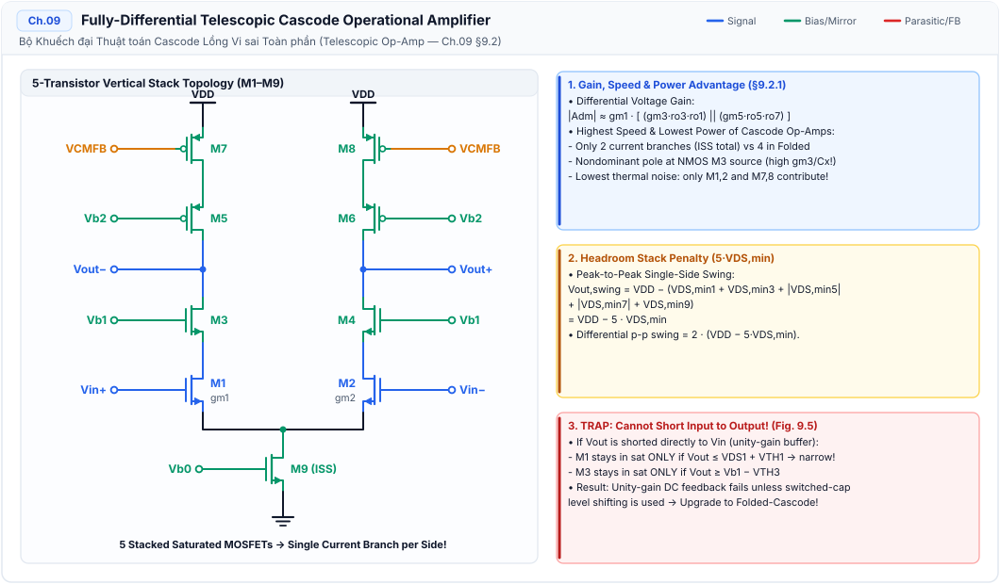

---
{
  "id": "topo-telescopic-cascode-opamp",
  "kind": "topology",
  "domain": "opamps-and-compensation",
  "title_vi": "Bộ Khuếch đại Thuật toán Cascode Xếp chồng (Telescopic-Cascode Op-Amp)",
  "title_en": "Telescopic-Cascode Operational Amplifier (Single-Ended & Fully-Differential)",
  "summary": "Cấu trúc Op-Amp một tầng nhanh nhất, ít nhiễu nhất và tiết kiệm công suất nhất: xếp chồng trực tiếp cặp vi sai, tầng cascode che chắn và tải cascode trên cùng hai nhánh dòng tĩnh, kèm phân tích giới hạn biên độ ra VDD - 5*VDS,min, lý do cấm kỵ khi nối tắt hồi tiếp đơn vị Vin = Vout, và quy trình định cỡ & nhân tỉ lệ tuyến tính.",
  "diagram": "../../diagrams/telescopic-cascode-opamp.svg",
  "razavi_refs": [
    {
      "chapter": 9,
      "section": "9.2.1-9.2.3",
      "pages": "349-355",
      "equations": ["9.15", "9.16"]
    },
    {
      "chapter": 11,
      "section": "11.5.1",
      "pages": "473-487",
      "equations": ["11.10", "11.11", "11.12", "11.13"]
    }
  ],
  "glossary_codes": ["T050", "T501", "T748", "T1425", "T1429", "T1452", "T1455", "T1461", "T1689", "T1877"],
  "process_agnostic": true,
  "roles": {
    "input_diff_pair_m1_m2": "Cặp vi sai đầu vào NMOS M1-M2 biến đổi điện áp vi sai thành dòng tín hiệu +-gm1*Vin/2 trên cùng nhánh dòng đuôi ISS/2",
    "signal_cascode_m3_m4": "Cặp cổng chung NMOS M3-M4 che chắn nút máng M1-M2 khỏi hiệu ứng Miller và nhân trở kháng nhánh dưới lên gm3*ro3*ro1",
    "pmos_cascode_load_m5_m8": "Tải nguồn dòng cascode PMOS (M5-M6 cascode chồng dưới M7-M8 nguồn dòng) tạo trở kháng nhánh trên gm5*ro5*ro7 tương xứng nhánh dưới",
    "tail_current_source_m9": "Nguồn dòng đuôi ISS định nghĩa điểm làm việc DC và khử nhiễu chế độ chung đầu vào"
  },
  "symptoms_addressed": [
    "insufficient-gain-of-5t-ota",
    "miller-capacitance-limiting-input-bandwidth",
    "excess-power-and-noise-of-folded-or-multistage-opamps",
    "mirror-pole-doublet-in-single-ended-ota"
  ],
  "limitations": [
    "severely-limited-output-swing-consumes-five-vds-min-drops",
    "cannot-directly-short-output-to-input-for-wide-swing-unity-gain-buffer",
    "strict-coupling-between-input-cm-level-and-cascode-bias-vb1",
    "single-ended-version-wastes-extra-vth-unless-lvccml-load-used"
  ],
  "checklists": ["common-mos", "differential-pair", "current-mirror", "cmfb"]
}
---

## 1. Bản chất Nguyên lý, Sơ đồ Mạch & Vai trò Từng Nhánh Cấu trúc

Khi OTA năm transistor cơ bản (`topo-five-transistor-ota`) chỉ đạt độ lợi một tầng khiêm tốn $g_m (r_{ON} \parallel r_{OP}) \sim 10\text{–}30\text{ V/V}$ ở công nghệ nanomet, cách trực tiếp và thanh thoát nhất để nhân bình phương độ lợi lên cỡ $(g_m r_O)^2$ **mà không tốn thêm bất kỳ nhánh dòng phân cực phụ nào** là xếp chồng trực tiếp các transistor cascode lên trên cặp vi sai và tải của nó — hình thành **bộ khuếch đại thuật toán cascode xếp chồng (`T1461` / `T1877`, telescopic-cascode op amp)** (Razavi Chương 9, §9.2.1–§9.2.3 & Chương 11, §11.5.1).

Cấu trúc vi sai hoàn toàn chuẩn mực (Hình 9.8b & Hình 11.21) gồm 9 transistor chính xếp thành 5 tầng dọc từ đất lên $V_{DD}$:
1. **Nguồn dòng đuôi $M_9$ ($I_{SS}$):** Cấp tổng dòng phân cực tĩnh, chia đều $I_{D} = I_{SS}/2$ cho cả hai nhánh trái và phải từ đáy lên tới đỉnh $V_{DD}$.
2. **Cặp vi sai đầu vào NMOS $M_1\text{–}M_2$:** Hoạt động như tầng nguồn chung vi sai tạo dòng tín hiệu $\pm g_{m1} V_{\text{in,diff}}/2$, đồng thời chịu trách nhiệm chính cho toàn bộ hiệu năng nhiễu và điện áp lệch (offset).
3. **Cặp cascode đường tín hiệu NMOS $M_3\text{–}M_4$ (phân cực cổng bởi $V_{b1}$):** Đóng hai vai trò sống còn: ghim điện thế máng $M_1\text{–}M_2$ cố định để triệt tiêu nhân điện dung Miller của $C_{GD1,2}$, và nâng trở kháng nhìn xuống từ ngõ ra lên $\approx (g_{m3} + g_{mb3}) r_{O3} r_{O1}$.
4. **Cặp cascode tải PMOS $M_5\text{–}M_6$ (phân cực cổng bởi $V_{b2}$) & Cặp nguồn dòng tải PMOS $M_7\text{–}M_8$ (phân cực cổng bởi $V_{b3}$ / CMFB):** Tạo trở kháng nhìn lên $\approx (g_{m5} + g_{mb5}) r_{O5} r_{O7}$ cân xứng với nhánh NMOS bên dưới; nếu không cascode cả phía tải PMOS thì điện trở $r_{O7}$ thấp sẽ mắc song song làm sập toàn bộ công sức cascode phía NMOS!
5. **Biến thể Ngõ ra Đơn đầu (Single-Ended Telescopic, Hình 9.21):** Thay tải PMOS cố định bằng gương dòng cascode nối diode; tuy nhiên nếu nối diode chồng trực tiếp (Hình 9.21a) sẽ **lãng phí thêm 1 điện áp ngưỡng $|V_{THP}|$** ở một nhánh và dính thêm cực gương $\omega_m$, nên bắt buộc phải dùng gương dòng cascode điện áp thấp `topo-lvccml-wide-swing-mirror` (Hình 9.21b) hoặc ưu tiên bản vi sai hoàn toàn kèm `tech-common-mode-feedback-cmfb`!

---

## 2. Hệ Phương trình Cốt lõi & Tư duy "Nhìn Mạch Đọc Nhanh" (Analysis by Inspection)

### 2.1. Độ lợi Điện áp Vi sai, Băng thông & Tốc độ Biến thiên Điện áp (Slew Rate)
Bằng phương pháp nhìn mạch đọc nhanh qua nửa mạch vi sai ($G_m = g_{m1,2}$, trở kháng ngõ ra mỗi bên $R_{\text{out,se}} = R_{\text{down}} \parallel R_{\text{up}}$):

$$
R_{\text{down}} \approx (g_{m3} + g_{mb3}) r_{O3} r_{O1}, \qquad R_{\text{up}} \approx (g_{m5} + g_{mb5}) r_{O5} r_{O7}
$$

$$
\left|A_{v,\text{diff}}\right| = g_{m1} \left( R_{\text{down}} \parallel R_{\text{up}} \right) \approx g_{m1} \Big\{ \big[(g_{m3} + g_{mb3}) r_{O3} r_{O1}\big] \;\parallel\; \big[(g_{m5} + g_{mb5}) r_{O5} r_{O7}\big] \Big\}
$$

- **Cực trội ngõ ra & Băng thông độ lợi đơn vị:** Với tụ tải $C_L$ ở mỗi ngõ ra đơn đầu:

$$
\omega_{p1} = \frac{1}{R_{\text{out,se}} (C_L + C_{\text{out,par}})}, \qquad \omega_u \approx G_m R_{\text{out,se}} \omega_{p1} = \frac{g_{m1}}{C_L + C_{\text{out,par}}}
$$

- **Cực không trội thứ nhất ($\omega_{p2}$ — tại nút nội cascode $X$ giữa $M_1$ và $M_3$):** Vì $M_3$ là **transistor NMOS** có độ linh động hạt tải cao và không chịu dòng phụ từ nguồn gập nào khác, điện dung ký sinh tại nút $X$ rất nhỏ và hỗ dẫn $g_{m3}$ lớn, đẩy $\omega_{p2} \approx \dfrac{g_{m3} + g_{mb3}}{C_{DB1} + C_{SB3} + C_{GS3} + 2 C_{GD1}}$ lên **cao nhất trong tất cả các họ Op-Amp CMOS**!
- **Tốc độ biến thiên điện áp vi sai (`T079`, Slew Rate, Hình 9.74):** Khi $\Delta V_{in}$ lớn làm tắt hẳn một bên, nhánh kia hút trọn $I_{SS}$ làm một ngõ ra sụt với tốc độ $-I_{SS}/(2 C_L)$ (hoặc bị kẹp bởi dòng tải $I_{SS}/2$ làm một bên tăng $+I_{SS}/(2 C_L)$ và bên kia giảm $-I_{SS}/(2 C_L)$), tổng tốc độ vi sai đạt $\text{SR}_{\text{diff}} = \dfrac{I_{SS}}{C_L}$ mà **chỉ tiêu thụ tổng dòng tĩnh đúng bằng $I_{SS}$**!

### 2.2. Ngân sách Dự trữ Điện áp (Headroom) & Dải Dao động Ngõ ra (§9.2.1 & §9.6)
Ký hiệu điện áp cực máng–nguồn tối thiểu giữ mỗi transistor bão hòa sâu là $V_{DS,\min,k}$ (tương đương $V_{OD,k}$ trong mô hình kênh dài):
- **Biên độ ngõ ra đơn đầu cực đại (Peak Single-Ended Swing):** Bị kẹp giữa 3 tầng NMOS bên dưới ($M_9, M_1, M_3$) và 2 tầng PMOS bên trên ($M_7, M_5$):

$$
V_{\text{out},\min} = V_{in,\text{CM}} - V_{TH1} + V_{DS,\min,3} \quad \big(\text{khi chọn tối ưu } V_{in,\text{CM}} = V_{GS1} + V_{DS,\min,9} \implies V_{\text{out},\min} = V_{DS,\min,9} + V_{DS,\min,1} + V_{DS,\min,3}\big)
$$

$$
V_{\text{out},\max} = V_{DD} - |V_{DS,\min,7}| - |V_{DS,\min,5}|
$$

Do đó tổng dải dao động đơn đầu và dải dao động vi sai đỉnh–đỉnh (`T1452`) là:

$$
\Delta V_{\text{out,se}} = V_{DD} - \left( V_{DS,\min,9} + V_{DS,\min,1} + V_{DS,\min,3} + |V_{DS,\min,5}| + |V_{DS,\min,7}| \right) \approx V_{DD} - 5\,V_{DS,\min}
$$

$$
\Delta V_{\text{out,diff,pp}} = 2\,\Delta V_{\text{out,se}} \approx 2 \left( V_{DD} - 5\,V_{DS,\min} \right)
$$

### 2.3. Phép Nhân Tỉ lệ Tuyến tính (`T050` / `T1455`, Linear Scaling — §9.2.3 & §11.6.4)
Giả sử bạn đã thiết kế xong một Op-Amp Telescopic đạt đúng $A_0$, ICMR và Output Swing cho tụ tải $C_{L0}$ với dòng đuôi $I_{SS0}$ và bộ chiều rộng $\{W_{k0}\}$, nay cần đổi sang lái tụ tải mới $C_L = \alpha C_{L0}$ (hoặc cần giảm phương sai nhiễu nhiệt đi $\alpha$ lần!) mà giữ nguyên tốc độ và dự trữ pha:
- **Quy tắc bất biến:** Giữ nguyên toàn bộ chiều dài kênh $\{L_k\}$ và điện áp phân cực $\{V_{b1}, V_{b2}, V_{b3}\}$, **nhân đồng thời mọi chiều rộng $W_k \to \alpha W_{k0}$ và mọi dòng phân cực $I_k \to \alpha I_{k0}$**!
- Khi đó mật độ dòng $I_D / W$ bất biến $\implies V_{GS}, V_{DS,\min}$ bất biến (Swing không đổi!), $g_m \to \alpha g_m$ và $r_O \to r_O / \alpha \implies$ **độ lợi $A_0 \propto g_m r_O$ giữ nguyên bất biến**, $\text{GBW} = \frac{\alpha g_{m1}}{\alpha C_{L0}}$ giữ nguyên, $\text{SR} = \frac{\alpha I_{SS0}}{\alpha C_{L0}}$ giữ nguyên, còn nhiễu điện áp bình phương giảm đúng $\alpha$ lần!

---

## 3. Bất biến Cấu trúc & Các Bẫy Lỗi Kinh điển (Structural Invariants & Traps)

- **[INV-TELE-01] Ràng buộc Khóa Cứng $V_{b1}$ Theo $V_{in,\text{CM}}$ (§9.2.3, Phương trình 9.15–9.16):** Để dành trọn biên độ ngõ ra cực đại mà không làm $M_1\text{–}M_2$ rơi vào vùng triode ngay tại cân bằng, điện áp phân cực cổng cascode $V_{b1}$ không được chọn tùy tiện cố định theo đất nếu $V_{in,\text{CM}}$ thay đổi, mà phải thỏa mãn chính xác:

$$
V_{b1} = V_{in,\text{CM}} - V_{GS1,2} + V_{DS,\min,1,2} + V_{GS3,4}
$$

Razavi đưa ra mạch tự bám cực khéo ở Hình 9.13 (Phương trình 9.15–9.16) dùng nhánh phụ cảm nhận $V_{in,\text{CM}}$ qua nguồn dòng và diode định cỡ để khóa $V_{DS1,2} = V_{DS,\min,1,2}$ tự động bất chấp biến thiên $V_{TH}$ và $V_{in,\text{CM}}$!
- **[TRAP-TELE-01] Tại Sao Nối Tắt Ngõ Vào – Ngõ Ra Làm Bộ Đệm Độ Lợi Đơn vị ($V_{\text{out}} = V_{\text{in}}$) Bị Hẹp Dải Tới Thảm Hại (§9.2.1, Hình 9.9–9.11):**
  Giả sử nối tắt trực tiếp ngõ ra vào cực cổng $M_2$ ($V_{G2} = V_{\text{out}}$, và khi hồi tiếp khóa chặt thì $V_{G1} \approx V_{G2} = V_{\text{out}}$):
  1. Để $M_2$ bão hòa: cực máng của $M_2$ nằm dưới cực nguồn $M_4$, tức $V_{D2} = V_{b1} - V_{GS4} < V_{\text{out}}$ không được nhỏ hơn $V_{G2} - V_{TH2} = V_{\text{out}} - V_{TH2}$.
  2. Để $M_4$ bão hòa: cực máng của $M_4$ là chính $V_{\text{out}}$ phải thỏa mãn $V_{\text{out}} \ge V_{b1} - V_{TH4}$.
  Kết hợp hai bất đẳng thức kẹp từ trên và dưới (Hình 9.11):

$$
V_{b1} - V_{TH4} \le V_{\text{out}} \le V_{b1} - V_{GS4} + V_{TH2} \implies \Delta V_{\text{out,max,unity}} = V_{TH2} - (V_{GS4} - V_{TH4}) = V_{TH2} - V_{DS,\min,4}!
$$

Toàn bộ biên độ tín hiệu bị nhốt trong một khe hẹp chỉ bằng **$1\,V_{TH} - 1\,V_{DS,\min}$** (ví dụ ở 65nm với $V_{TH} = 0{,}35\text{ V}, V_{DS,\min} = 0{,}15\text{ V}$, bộ đệm chỉ nhúc nhích được vỏn vẹn **$200\text{ mV}$** trước khi sập độ lợi!). Đây là lý do sống còn khiến Telescopic Cascode chủ yếu dùng trong mạch tụ chuyển mạch (SC) có pha đặt lại mức DC đầu vào và đầu ra độc lập nhau (hoặc phải chèn tụ ghép / dịch mức)!
- **[TRAP-TELE-02] Quên Sụt Áp Khi Ngõ Vào Vi Sai Lệch Nhau hoặc Nhiễu CM Lọt Vào:** Nếu chọn $V_{b1}$ ép $M_1\text{–}M_2$ đứng sát mép triode với $0\text{ mV}$ dự phòng, chỉ cần mức đồng pha ngõ vào $V_{in,\text{CM}}$ nhích lên $+30\text{ mV}$ là $V_{GS1}$ giữ nguyên kéo cực nguồn và cực cổng nâng lên trong khi cực máng $M_1$ bị $V_{b1} - V_{GS3}$ ghim cố định — lập tức đẩy $M_1\text{–}M_2$ chìm vào vùng triode và làm sập cả độ lợi lẫn CMRR! Luôn chừa biên an toàn $\Delta V_{\text{CM,margin}} \ge 50\text{–}80\text{ mV}$ cho $V_{DS1,2}$!

---

## 4. Lộ trình Nâng cấp Cấu trúc & Bát giác Đánh đổi (Upgrade Paths & Design Octagon)

| Khi Telescopic Cascode chạm trần vật lý | Nâng cấp sang cấu trúc đích (Canonical Node) | Giải quyết triệt để điều gì | Cái giá phải trả trên Bát giác Đánh đổi |
|---|---|---|---|
| Bắt buộc nối tắt trực tiếp $V_{\text{in}} = V_{\text{out}}$ dải rộng hoặc cần ICMR chạm tới một đường nguồn ($V_{DD}$ / GND) | `topo-folded-cascode-ota` | Bẻ gập đường dòng tín hiệu sang nhánh bên cạnh giúp tách rời ràng buộc thế DC giữa cổng đầu vào và nút ngõ ra | Tốn gấp ~2 lần công suất, nhiễu nhiệt tăng do thêm cặp nguồn dòng gập, cực phụ nút gập thấp hơn và độ lợi DC giảm ~2–3 lần |
| Ở $V_{DD} \le 1{,}0\text{ V}$, cửa sổ $V_{DD} - 5 V_{DS,\min}$ quá hẹp không đủ biên độ ra yêu cầu (như §11.5.1 $\to$ §11.5.2!) | `topo-two-stage-opamp` (dùng Telescopic làm Tầng 1 + Tầng 2 CS biên độ cao!) | Tầng 1 Telescopic chỉ cần dao động $50\text{ mV}_{pp}$ nên dư dả headroom lấy độ lợi cao, còn Tầng 2 CS mở biên độ ra tới $V_{DD} - 2 V_{DS,\min}$! | Xuất hiện cực thứ hai ở ngõ ra đòi hỏi tụ bù Miller $C_C$ + triệt RHP zero (`tech-miller-rhp-zero-nulling-and-cascode-comp`) |
| Đủ biên độ ra nhưng độ lợi $(g_m r_O)^2$ ở 65nm/45nm chưa đủ đạt $80\text{–}90\text{ dB}$ | `topo-gain-boosted-cascode` | Gắn bộ khuếch đại phụ điều chỉnh $V_{b1}, V_{b2}$ nhân $A_0$ lên $(g_m r_O)^3$ mà không chồng thêm tầng transistor dọc và giữ tốc độ 1 tầng | Tăng diện tích/dòng cho mạch phụ và xuất hiện doublet cần khống chế tần số |

---

## 5. Thích ứng Đa Tiến trình (90nm / 65nm / 45nm) & Cách Kiểm chứng trong Cadence / Spectre

### 5.1. Thích ứng Công nghệ Nanomet (90nm $\to$ 65nm $\to$ 45nm — Bài học từ Thiết kế §11.5.1)
- **Phân bổ chiều dài kênh $L$ không đồng nhất giữa các tầng chồng:** Trong nghiên cứu thiết kế 40nm/65nm ở §11.5.1 (tr. 473–480), Razavi chỉ ra: nếu để tất cả transistor ở $L_{\min}$, DIBL làm $(g_m r_O)^2$ tụt xuống chỉ còn $\sim 80\text{–}100\text{ V/V}$! Giải pháp chuẩn trên 90nm/65nm/45nm:
  - Giữ cặp đầu vào $M_{1,2}$ có $L \approx 1\text{–}1{,}5\,L_{\min}$ ở vùng nghịch đảo vừa ($g_m/I_D \approx 18\text{–}22\text{ V}^{-1}$) để tối đa hóa $g_{m1}$ và hạ $V_{DS,\min,1}$ xuống $\sim 120\text{ mV}$.
  - Tăng chiều dài của transistor cascode $M_{3,4}, M_{5,6}$ lên $1{,}5\text{–}2\,L_{\min}$ và nguồn dòng tải $M_{7,8}, M_9$ lên $2\text{–}4\,L_{\min}$ để đẩy vọt $r_O$ lên gấp 3–4 lần!
  - Nối thân–nguồn (bulk-to-source) cho cặp cascode PMOS $M_{5,6}$ trong giếng N-well riêng (Chú thích chân trang 8, tr. 475): loại bỏ hiệu ứng thân giúp giảm $|V_{GS5,6}|$, nới rộng cửa sổ thiết kế điện áp phân cực $V_{b2}$ ở nguồn $1{,}0\text{ V}$!

### 5.2. Quy trình Kiểm chứng trong Cadence Virtuoso / Spectre
1. **Kiểm tra Biên Bão hòa Từng Tầng bằng Bảng `vds - vdsat` (`dc` OP & Sweep):**
   - Với 5 transistor chồng dọc trên nguồn $1{,}0\text{ V}\text{–}1{,}2\text{ V}$, sai lệch phân cực $30\text{ mV}$ ở góc tiến trình `SS, -40°C` (nơi $|V_{TH}|$ đạt cực đại!) sẽ dồn ép 1 trong 5 tầng vào vùng triode!
   - Luôn tạo biểu thức ADE Output cho cả 5 cặp transistor ($M_9, M_{1,2}, M_{3,4}, M_{5,6}, M_{7,8}$): `abs(OP("/M3" "vds")) - abs(OP("/M3" "vdsat")) > 50m` và kiểm tra `OP("/M3" "region") == 2` trên tất cả 5 góc `TT, FF, SS, FS, SF`!
2. **Đo Chính xác $R_{\text{out}}$ Nửa Mạch Không Bị Sai Số Suy biến Đuôi (Ví dụ 11.10, tr. 488):**
   - Như Razavi cảnh báo ở Ví dụ 11.10: nếu bạn bơm dòng thử AC từ một ngõ ra đơn đầu $X$ xuống đất trong khi để nút nguồn chung $P$ của $M_{1,2}$ nối qua $M_9$ như bình thường, nhánh $M_1$ bị nhánh $M_2$ suy biến làm kết quả đo $R_{\text{out}}$ bị **phóng đại giả tạo**! Cách đo đúng 100% trong Spectre: mắc nguồn dòng AC vi sai `isource` (`mag=1`, `dc=0`) **nối trực tiếp giữa hai ngõ ra $V_{\text{out}+}$ và $V_{\text{out}-}$**, đọc $|V(\text{out}+, \text{out}-)|$ để thu chính xác $2 R_{\text{out,se}}$!

---

## 6. Mốc Đối chiếu Sách Razavi & Thuật ngữ Chuẩn CLB

### 6.1. Đối chiếu Sách Gốc Razavi (2nd Edition)
- **Chương 9:** §9.2.1 *Basic Topologies* (tr. 349–352, Hình 9.7–9.11, Ví dụ 9.5–9.6), §9.2.2 *Design Procedure* (tr. 353–354, Hình 9.12, Ví dụ 9.7), §9.2.3 *Linear Scaling* (tr. 354–355, Phương trình 9.15–9.16, Hình 9.13), §9.2.6 cuối mục (tr. 360–361, Hình 9.21 chuyển đổi đơn đầu dùng LVCCML).
- **Chương 11:** §11.5.1 *Telescopic Op Amp* (tr. 473–487, Phương trình 11.10–11.13, Hình 11.19–11.37 — thiết kế đầy đủ từ định cỡ, phân cực LVCCML đến CMFB).
- **Chú giải Hiệu đính Học thuật CLB (`NG09` & `NG11`):**
  - **`NG09-01` (tr. 354, Ví dụ 9.7):** Khi hướng dẫn tăng gấp đôi cả $W$ và $L$ cho các PMOS $M_5\text{–}M_8$ từ tỉ số cũ $(W/L) = 1111$ với $L = 0{,}5\,\mu\text{m}$ ($W = 555{,}5\,\mu\text{m}$), sách in nhầm tử số thành $2222\,\mu\text{m}/1{,}0\,\mu\text{m}$; phép nhân đôi đúng cả tử lẫn mẫu giữ nguyên tỉ số $W/L = 1111$ phải là **$1111\,\mu\text{m}/1{,}0\,\mu\text{m}$** (khớp với kết quả độ lợi $A_v \approx 4000$ trong sách!).
  - **`NG09-02` (tr. 355):** Sách in lỗi chữ `"narrrow, long device"` cho transistor nhánh tạo $V_{b1}$; hiểu đúng là linh kiện kênh hẹp và dài (*narrow, long device*) để tạo $V_{OV}$ lớn bằng tổng hai $V_{OV}$ với dòng nhánh phụ rất nhỏ.
  - **`NG11-05` (tr. 473):** Đoạn ước lượng ban đầu $r_O$ trong §11.5.1 có câu văn bị đứt ngữ pháp và lẫn chỉ số $r_{O7,8}$ với $r_{O1,2}$, nhưng kết luận quan trọng là một thiết kế Telescopic đơn thuần ở 40nm/1V rất khó đạt đồng thời cả $A_v = 500$ lẫn swing $1\text{ V}_{pp,\text{diff}}$.

### 6.2. Bảng Thuật ngữ Chuẩn CLB Vi Mạch Sử dụng trong Thẻ
| Mã CLB | Thuật ngữ Tiếng Anh | Thuật ngữ Tiếng Việt Chuẩn | Ghi chú Ngữ cảnh |
|---|---|---|---|
| `T1461` / `T1877` | telescopic cascode op amps | bộ khuếch đại thuật toán cascode xếp chồng | Cặp vi sai và tải cascode xếp trên cùng một trục nhánh dòng |
| `T1429` | one-stage op amps | bộ khuếch đại thuật toán một tầng | Biến đổi $V \to I$ một lần duy nhất thẳng ra tải |
| `T1425` | fully differential op amps | bộ khuếch đại thuật toán vi sai hoàn toàn | Ngõ ra cân xứng gấp đôi biên độ và không có cực gương |
| `T1452` | peak-to-peak differential output swing | biên độ đỉnh–đỉnh ngõ ra vi sai | Bằng $2 \times \Delta V_{\text{out,se}}$ |
| `T050` / `T1455` | linear scaling | phép nhân tỉ lệ tuyến tính | Nhân đồng thời $W$ và $I_D$ theo hệ số tải, giữ nguyên $L$ và $A_0$ |
| `T748` | low-voltage cascode | cascode điện áp thấp | Dùng để phân cực cặp PMOS $M_{5\text{–}8}$ chỉ tốn $2\,V_{DS,\min}$ |
