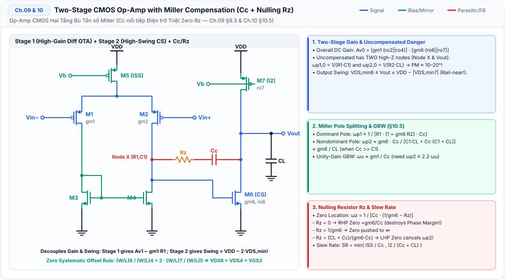

---
{
  "id": "topo-two-stage-opamp",
  "kind": "topology",
  "domain": "opamps-and-compensation",
  "title_vi": "Bộ Khuếch đại Thuật toán Hai Tầng CMOS & Quy tắc Triệt Độ lệch Hệ thống (Two-Stage CMOS Op-Amp & Systematic Offset Matching Rule)",
  "title_en": "Two-Stage CMOS Operational Amplifier (Gain-Swing Decoupling & Systematic DC Biasing Rule)",
  "summary": "Kiến trúc tách rời hoàn toàn bài toán Độ lợi cao ở Tầng 1 (OTA 5T hoặc Cascode dao động nhỏ) khỏi Biên độ dao động ngõ ra cực đại ở Tầng 2 nguồn chung (VDD - 2*VDS,min), kèm quy tắc vàng phối hợp mật độ dòng VGS6 = VDS4 để triệt tiêu độ lệch điện áp hệ thống (systematic offset) ngay từ thiết kế DC.",
  "diagram": "../../diagrams/two-stage-miller-opamp.svg",
  "razavi_refs": [
    {
      "chapter": 9,
      "section": "9.3",
      "pages": "361-364",
      "equations": ["9.18"]
    },
    {
      "chapter": 11,
      "section": "11.5.2",
      "pages": "487-495",
      "equations": []
    }
  ],
  "glossary_codes": ["T023", "T094", "T095", "T620", "T788", "T1286", "T1392", "T1474", "T1694", "T1874"],
  "process_agnostic": true,
  "roles": {
    "high_gain_stage_1": "Tầng đầu tiên (5T-OTA, Telescopic hoặc Folded-Cascode) cung cấp độ lợi lớn, nén nhiễu tầng sau và chỉ phải chịu biên độ dao động rất nhỏ tại nút liên tầng",
    "high_swing_cs_stage_2": "Tầng thứ hai nguồn chung (CS tải nguồn dòng) chỉ chồng đúng 2 transistor giữa VDD và GND, mở biên độ ra sát nguồn VDD - 2*VDS,min",
    "interstage_dc_coupling": "Nút nối trực tiếp từ cực máng tải tầng 1 sang cực cổng tầng 2 — đòi hỏi khóa khớp điện áp DC VDS_load1 = VGS_in2 để dòng tầng 2 chính xác và không lệch hệ thống",
    "miller_compensation_network": "Mạng tụ bù Cc (và điện trở triệt Rz) nối quanh tầng 2 thực hiện tách cực để ổn định hệ hai cực trở kháng cao khi đóng vòng hồi tiếp"
  },
  "symptoms_addressed": [
    "cascode-output-swing-too-small-at-low-vdd",
    "simultaneous-high-gain-and-rail-to-rail-output-swing-required",
    "need-to-drive-moderate-resistive-feedback-networks"
  ],
  "limitations": [
    "two-high-impedance-nodes-create-two-low-frequency-poles-requiring-miller-compensation",
    "phase-margin-degrades-when-load-capacitance-cl-increases",
    "prone-to-systematic-input-offset-if-stage1-mirror-vds-mismatches-stage2-vgs",
    "high-frequency-psrr-degradation-via-miller-capacitor-feedthrough"
  ],
  "checklists": ["common-mos", "differential-pair", "current-mirror", "two-stage-miller", "cmfb"]
}
---

## 1. Bản chất Nguyên lý, Sơ đồ Mạch & Vai trò Từng Nhánh Cấu trúc

Mọi cấu trúc Op-Amp một tầng (`topo-telescopic-cascode-opamp`, `topo-folded-cascode-ota`, `topo-gain-boosted-cascode`) đều vấp phải một định luật bất khả kháng: để có độ lợi lớn $A_0$ trên một nút duy nhất, nút ngõ ra buộc phải xếp chồng ít nhất 4–5 transistor bão hòa nối tiếp nhau, nuốt mất $4\text{–}5\,V_{DS,\min}$ khoảng dự trữ điện áp. Khi điện áp nguồn cấp $V_{DD}$ giảm xuống $1{,}0\text{ V}$ hay $0{,}9\text{ V}$ mà hệ thống vẫn đòi hỏi biên độ ngõ ra đơn đầu đạt $0{,}7\text{–}0{,}8\text{ V}_{pp}$ ($1{,}4\text{–}1{,}6\text{ V}_{pp,\text{diff}}$) đi kèm độ lợi $60\text{–}80\text{ dB}$, giải pháp kinh điển và triệt để nhất là **bộ khuếch đại thuật toán hai tầng (`T1474`, two-stage op amp)** (Razavi Chương 9, §9.3 & Chương 11, §11.5.2).



Triết lý kiến trúc "chia để trị" của Op-Amp hai tầng thể hiện qua sự phân vai rạch ròi giữa hai tầng:
1. **Tầng 1 — Tầng Độ lợi Cao & Nhiễu Thấp (High-Gain, Low-Noise Stage 1):**
   - Có thể là cặp vi sai đơn giản tải chủ động (Hình 9.23 cho bản vi sai hoàn toàn, hoặc 5T-OTA cho bản ngõ ra đơn đầu cổ điển) hoặc **cặp vi sai cascode xếp chồng / cascode gập** (Hình 9.24 & Hình 11.40 khi cần tổng độ lợi đạt $60\text{–}90\text{ dB}$ ở công nghệ nanomet!).
   - **Đặc quyền giải phóng Headroom ở Tầng 1:** Vì Tầng 2 phía sau đã cung cấp độ lợi $A_{v2} \approx 10\text{–}30\text{ V/V}$, để ngõ ra cuối cùng quét hết biên độ khổng lồ $0{,}8\text{ V}_{pp}$, nút liên tầng $X, Y$ ở đầu ra Tầng 1 **chỉ cần nhúc nhích vỏn vẹn $30\text{–}80\text{ mV}_{pp}$**! Nhờ đó ta hoàn toàn thoải mái xếp chồng cascode ở Tầng 1 và cấp $V_{OV}$ lớn ($300\text{–}400\text{ mV}$) cho tải nguồn dòng Tầng 1 để đè bẹp nhiễu nhiệt mà không hề lo cạn headroom!
2. **Tầng 2 — Tầng Biên độ Rộng Nguồn Chung (High-Swing Common-Source Stage 2):**
   - Gồm transistor khuếch đại nguồn chung (ví dụ PMOS $M_6$ ở bản đơn đầu cổ điển hoặc cặp PMOS $M_{9,10}$ ở Hình 11.40) đấu với tải nguồn dòng đối cực ($M_7$ hoặc $M_{11,12}$).
   - Giữa $V_{DD}$ và đất tại ngõ ra chỉ có **đúng 2 transistor**! Biên độ ngõ ra đơn đầu đạt mức tối đa vật lý của công nghệ CMOS: $\Delta V_{\text{out,se}} = V_{DD} - |V_{DS,\min,\text{P}}| - V_{DS,\min,\text{N}} = V_{DD} - 2\,V_{DS,\min}$!
3. **Tại sao rất hiếm khi ghép quá 2 tầng (> 2 Stages)?** Như Razavi nhấn mạnh ở tr. 363: mỗi tầng trở kháng cao tạo ra ít nhất một cực tần số thấp mang góc trễ pha $-90^\circ$. Hệ 2 tầng đã chạm sát ngưỡng $-180^\circ$ và đòi hỏi bù Miller (`tech-miller-pole-splitting`); lên tới 3–4 tầng trở kháng cao sẽ làm việc bù ổn định đa vòng (nested Miller / reverse nested Miller) phức tạp gấp bội và tiêu tốn công suất lớn cho tầng cuối.

---

## 2. Hệ Phương trình Cốt lõi & Tư duy "Nhìn Mạch Đọc Nhanh" (Analysis by Inspection)

### 2.1. Độ lợi Điện áp Tổng & Biên độ Dao động Ngõ ra (§9.3, Phương trình 9.18)
Vì cực cổng của Tầng 2 có trở kháng một chiều vô cùng lớn không gây tải điện trở lên Tầng 1, độ lợi một chiều tổng bằng tích trực tiếp của hai tầng:
- **Với Tầng 1 không cascode (Hình 9.23 / 5T-OTA + CS):**

$$
A_{v0} = A_{v1} \cdot A_{v2} = \big[ g_{m1,2} (r_{O1,2} \parallel r_{O3,4}) \big] \cdot \big[ -g_{m5,6} (r_{O5,6} \parallel r_{O7,8}) \big]
$$

- **Với Tầng 1 có Cascode để đạt độ lợi cấp độ $(g_m r_O)^3$ (Hình 9.24, Phương trình 9.18):**

$$
\left|A_{v0}\right| \approx \Big\{ g_{m1,2} \big[(g_{m3,4} + g_{mb3,4}) r_{O3,4} r_{O1,2}\big] \;\parallel\; \big[(g_{m5,6} + g_{mb5,6}) r_{O5,6} r_{O7,8}\big] \Big\} \times \big[ g_{m9,10} (r_{O9,10} \parallel r_{O11,12}) \big]
$$

- **Biên độ ngõ ra cực đại:**
  - Đơn đầu: $\Delta V_{\text{out,se}} = V_{DD} - |V_{DS,\min,\text{in2}}| - V_{DS,\min,\text{load2}} \approx V_{DD} - 2\,V_{DS,\min}$.
  - Vi sai hoàn toàn đỉnh–đỉnh: $\Delta V_{\text{out,diff,pp}} \approx 2 \left( V_{DD} - 2\,V_{DS,\min} \right)$.

### 2.2. Định luật Vàng Triệt Độ Lệch Hệ thống cho Op-Amp Hai Tầng Đơn đầu ($V_{GS6} = V_{DS4}$ Matching Rule!)
Xét cấu trúc Op-Amp hai tầng đơn đầu chuẩn công nghiệp cực kỳ phổ biến:
- **Tầng 1:** Cặp vi sai NMOS $M_1\text{–}M_2$ (nguồn đuôi $M_5$ mang $I_{SS}$) tải gương dòng chủ động PMOS $M_3\text{–}M_4$ ($M_3$ nối diode bên nhánh trái, nút đầu ra Tầng 1 lấy tại cực máng $M_4$ bên nhánh phải).
- **Tầng 2:** Transistor nguồn chung PMOS $M_6$ (cực cổng nối thẳng vào cực máng $M_4$) đấu với nguồn dòng tải NMOS $M_7$ (cực cổng nối chung áp phân cực với nguồn đuôi $M_5$ để sao chép dòng theo tỉ số $I_{D7} = K \cdot I_{SS}$).

Tại trạng thái cân bằng lý tưởng khi ngắn mạch vi sai đầu vào ($V_{in+} = V_{in-}$), ta bắt buộc dòng cực máng của $M_6$ phải khớp chính xác với dòng tải $I_{D7}$ để $V_{\text{out}}$ đứng đúng giữa dải nguồn mà **không cần bất kỳ điện áp lệch đầu vào $V_{OS,\text{sys}}$ nào**:
1. Vì $M_1\text{–}M_2$ cân xứng: $I_{D1} = I_{D2} = \frac{I_{SS}}{2}$. Nhánh trái có $M_3$ nối diode nên điện áp tại cổng $M_3\text{–}M_4$ là $V_{G3,4} = V_{DD} - |V_{GS3}|$, tức $|V_{DS3}| = |V_{GS3}|$.
2. Để dòng sao chép qua $M_4$ bằng đúng $I_{D3} = \frac{I_{SS}}{2}$ mà **không bị sai số điều chế chiều dài kênh ($\lambda_P$ / DIBL)**, điện áp cực máng của $M_4$ (chính là nút liên tầng nối vào cổng $M_6$!) phải bằng đúng điện áp cực máng của $M_3$:

$$
V_{D4} = V_{D3} = V_{DD} - |V_{GS3}| \quad \Longleftrightarrow \quad |V_{GS6}| = V_{DD} - V_{D4} = |V_{GS3}| = |V_{DS4}|!
$$

3. Vì $M_3$, $M_4$ và $M_6$ đều là PMOS có cực nguồn nối chung lên $V_{DD}$, điều kiện $|V_{GS6}| = |V_{GS3,4}|$ ở mọi góc tiến trình và nhiệt độ PVT yêu cầu **mật độ dòng điện (current density) và chiều dài kênh của $M_6$ phải bằng đúng của $M_3, M_4$**:

$$
L_6 = L_3 = L_4 \quad \text{và} \quad \frac{(W / L)_6}{(W / L)_{3,4}} = \frac{I_{D6}}{I_{D3,4}} = \frac{I_{D7}}{I_{SS} / 2} = 2 \cdot \frac{(W / L)_7}{(W / L)_5}
$$

*(Với $L_7 = L_5$ để tỉ số gương NMOS ở đáy khớp chính xác tỉ số gương PMOS ở đỉnh!)*

**Hậu quả nếu vi phạm quy tắc này:** Nếu người thiết kế chọn $(W/L)_6$ độc lập làm $|V_{GS6}|$ lệch đi $\Delta V_X = |V_{GS6}| - |V_{GS3}|$ so với $|V_{GS3}|$, vòng hồi tiếp bên ngoài sẽ ép $V_{D4}$ lệch đi $\Delta V_X$, sinh ra **độ lệch điện áp hệ thống quy về ngõ vào (systematic input-referred offset voltage)**:

$$
V_{OS,\text{sys}} \approx \frac{\Delta V_X}{A_{v1}}
$$

Ở công nghệ 65nm/45nm khi Tầng 1 là 5T-OTA chỉ có $A_{v1} \approx 15\text{–}25\text{ V/V}$, chỉ cần $|V_{GS6}|$ lệch $150\text{ mV}$ là sinh ngay **$V_{OS,\text{sys}} \approx 6\text{–}10\text{ mV}$** ở mọi con chip sản xuất ra (dù không hề có bất kỳ sai lệch ngẫu nhiên Pelgrom nào!) — thậm chí nếu $|V_{GS6}|$ quá nhỏ làm $V_{D4}$ bị đẩy cao quá $V_{DD} - |V_{DS,\min,4}|$, chính tải $M_4$ của Tầng 1 sẽ rơi thẳng vào vùng triode!

---

## 3. Bất biến Cấu trúc & Các Bẫy Lỗi Kinh điển (Structural Invariants & Traps)

- **[INV-2STG-01] Bất biến Phân Bổ Overdrive Giữa Hai Cặp Tải Để Đồng Thời Đạt Nhiễu Thấp & Băng Thông Cao (Ví dụ 9.10, tr. 363):**
  Ở Tầng 2 (ví dụ $M_{5,6}$ là transistor khuếch đại CS nhận tín hiệu từ Tầng 1, còn $M_{7,8}$ là nguồn dòng tải tĩnh của Tầng 2):
  - Transistor khuếch đại Tầng 2 ($M_{5,6}$ / $M_9$) quyết định trực tiếp cực không trội ngõ ra sau bù Miller $\omega_{p2} \approx \frac{g_{m,\text{in2}}}{C_L}$ và điểm không RHP $+\frac{g_{m,\text{in2}}}{C_C}$! Do đó **bắt buộc phải ưu tiên $g_{m,\text{in2}}$ lớn** $\implies$ cấp $V_{DS,\min}$ nhỏ hơn ($\sim 150\text{–}200\text{ mV}$, $g_m/I_D$ khá cao) và $L$ ngắn vừa phải cho transistor khuếch đại Tầng 2!
  - Ngược lại, nguồn dòng tải Tầng 2 ($M_{7,8}$ / $M_{11}$) chỉ đóng góp điện dung ký sinh và nhiễu $\implies$ cấp $V_{DS,\min}$ lớn hơn ($\sim 250\text{–}300\text{ mV}$, $L$ dài hơn) để giảm $W$, giảm $C_{DB}$ và nâng $r_O$!
- **[TRAP-2STG-01] Bẫy Không Bù Tần số hoặc Nhầm Lẫn Tác Động của $C_L$ Lên Độ Ổn Định (Hình 10.36, tr. 433):**
  Chưa gắn tụ bù $C_C$, Op-Amp hai tầng có **2 nút trở kháng cao** (nút liên tầng $R_1 C_1$ và nút ngõ ra $R_2 C_L$) tạo 2 cực tần số thấp đẩy pha thẳng xuống $-180^\circ$ rất sớm trước khi độ lợi vòng giảm về $0\text{ dB}$, khiến mạch đóng vòng hồi tiếp chắc chắn dao động dữ dội hoặc vọt lố nặng! Hơn thế nữa, sau khi đã bù Miller (`tech-miller-pole-splitting`), cực trội nằm ở Tầng 1 còn cực không trội $\omega_{p2} \approx \frac{g_{m2}}{C_L}$ nằm ở ngõ ra: do đó **tăng tụ tải $C_L$ làm GIẢM dự trữ pha và gây mất ổn định** — ngược hẳn 180 độ so với Op-Amp 1 tầng!
- **[TRAP-2STG-02] Sụp Đổ Tỉ số Khử Nhiễu Nguồn Cấp (PSRR) Ở Tần Số Cao Qua Tụ Bù $C_C$ (`concept-opamp-psrr-and-noise`):** Nếu nối tụ bù Miller $C_C$ trực tiếp từ nút liên tầng (vốn tham chiếu theo $V_{DD}$ nếu Tầng 2 là PMOS CS, hoặc theo $V_{SS}$ nếu Tầng 2 là NMOS CS) sang nút ngõ ra, ở tần số cao $C_C$ nối tắt cực cổng và cực máng Tầng 2 thành diode — truyền thẳng $100\%$ nhiễu nguồn cấp ($0\text{ dB}$ PSRR!) của đường nguồn nối với cực nguồn Tầng 2 ra thẳng $V_{\text{out}}$!
- **[TRAP-2STG-03] Quên CMFB Riêng Hoặc CMFB Khép Kín Cho Cả Hai Tầng Khi Thiết Kế Bản Vi Sai Hoàn Toàn (§9.7.4 & §11.5.2):** Trong Op-Amp hai tầng vi sai hoàn toàn mà Tầng 1 là Telescopic/Folded-Cascode (trở kháng cao) và Tầng 2 là CS tải nguồn dòng (cũng trở kháng cao!), **cả hai tầng đều có mức đồng pha ngõ ra thả nổi**! Nếu chỉ gắn một vòng CMFB duy nhất từ ngõ ra Tầng 2 quay ngược về điều khiển nguồn dòng Tầng 1, vòng CMFB đó đi xuyên qua cả 2 cực trở kháng cao nên cực kỳ dễ tự dao động chế độ chung (`tech-common-mode-feedback-cmfb`)!

---

## 4. Lộ trình Nâng cấp Cấu trúc & Bát giác Đánh đổi (Upgrade Paths & Design Octagon)

| Vấn đề phát sinh trên Op-Amp Hai Tầng cơ bản | Hướng nâng cấp / Bù trừ (Canonical Node) | Cơ chế giải quyết | Cái giá trên Bát giác Đánh đổi |
|---|---|---|---|
| Mất ổn định do 2 cực tần số thấp tại nút liên tầng và nút ra | `tech-miller-pole-splitting` | Gắn tụ bù $C_C$ quanh Tầng 2 để nhân điện dung Miller hạ thấp $\omega_{p1}$ và tách đẩy $\omega_{p2}$ lên $\approx g_{m2}/C_L$ | Sinh ra RHP zero tại $+g_{m2}/C_C$ và bị giới hạn Slew Rate bởi $I_{SS}/C_C$ |
| RHP zero $+g_{m2}/C_C$ làm sập dự trữ pha hoặc $C_L$ quá lớn kéo thấp $\omega_{p2}$ | `tech-miller-rhp-zero-nulling-and-cascode-comp` | Chèn điện trở triệt $R_z$ nối tiếp $C_C$ (triệt zero hoặc đẩy sang LHP khử $\omega_{p2}$), hoặc dùng bù cascode Ahuja (nếu Tầng 1 có cascode!) | Cần mạch bám $R_z \propto 1/g_{m2}$ theo PVT hoặc tăng dòng nhánh cascode |
| Slew Rate nhánh ra bị khóa bởi dòng tĩnh Tầng 2 $I_{D,\text{stage2}} / (C_C + C_L)$ khi lái tải lớn | `tech-slew-rate-and-class-ab-opamps` | Nâng cấp Tầng 2 thành tầng ra đẩy–kéo lớp AB (Class-AB push-pull NMOS + PMOS cùng nhận tín hiệu) | Phức tạp hóa mạch dịch mức phân cực nổi (floating class-AB bias) giữa cổng NMOS và PMOS tầng ra |
| Cần độ lợi $\ge 70\text{ dB}$ ở 65nm/45nm nhưng vẫn giữ nguyên biên độ ra sát nguồn | Ghép Tầng 1 Telescopic/Folded-Cascode + Tầng 2 CS (Hình 9.24 & §11.5.2 Hình 11.40) | Đạt độ lợi cỡ $(g_m r_O)^3$ kết hợp bù cascode trả $C_C$ vào nút nguồn cascode Tầng 1! | Nếu vi sai hoàn toàn phải thiết kế 2 mạng CMFB riêng biệt cho Tầng 1 và Tầng 2 |

---

## 5. Thích ứng Đa Tiến trình (90nm / 65nm / 45nm) & Cách Kiểm chứng trong Cadence / Spectre

### 5.1. Thích ứng Công nghệ Nanomet (90nm $\to$ 65nm $\to$ 45nm — Kinh nghiệm Vàng từ Thiết kế §11.5.2)
- **Cách Chọn PMOS hay NMOS cho Khuếch đại Tầng 2 ở 65nm/45nm (Razavi tr. 489):** Đừng mặc định NMOS luôn có $g_m r_O$ cao hơn PMOS! Trong nghiên cứu thiết kế 40nm ở §11.5.2 ($V_{DD} = 1{,}0\text{ V}$), mức đồng pha ngõ ra của Tầng 1 nằm quanh $0{,}55\text{ V}$. Nếu dùng NMOS cho Tầng 2 thì $V_{GS,N} = 0{,}55\text{ V}$ đẩy NMOS lún quá sâu vào vùng nghịch đảo cực mạnh làm sụt hiệu suất $g_m/I_D$ và tăng dòng khổng lồ ($900\,\mu\text{A}$ cho $10\,\mu\text{m}/80\text{ nm}$, $(g_m r_O)_N = 12{,}8$); ngược lại dùng **PMOS cho Tầng 2** có $|V_{GS,P}| = 1{,}0 - 0{,}55 = 0{,}45\text{ V}$ vừa khít vùng làm việc đẹp, cho **$(g_m r_O)_P = 17{,}5$ cao hơn hẳn NMOS**!
- **Kiểm tra Độ dốc Độ lợi theo Biên độ Ra (Hình 11.40c $\to$ 11.41):** Ở 90nm/65nm/45nm, sau khi ghép hai tầng, luôn phải vẽ đường cong `Gain vs. Vin` (hoặc `Gain vs. Vout`): nếu ở rìa $\pm 0{,}5\text{ V}$ độ lợi sụt dưới mức yêu cầu do $r_O$ của nguồn dòng tải Tầng 2 giảm vì DIBL, chỉ cần **nhân đôi cả $W$ và $L$ của transistor nguồn dòng tải Tầng 2** (giữ nguyên dòng và $V_{DS,\min}$!) là khôi phục ngay lập tức biên độ ra đạt chuẩn độ lợi!

### 5.2. Quy trình Kiểm chứng trong Cadence Virtuoso / Spectre
1. **Kiểm tra Độ lệch Hệ thống $V_{OS,\text{sys}}$ Bằng Mô phỏng DC Vòng Kín Danh định (`TT` Nominal, Mismatch OFF):**
   - Nối Op-Amp đơn đầu thành bộ đệm độ lợi đơn vị ($V_{\text{out}}$ nối vào $V_{in-}$), đặt $V_{in+} = V_{DD}/2$ (hoặc mức CM chuẩn của tải).
   - Chạy `dc` danh định: đọc trực tiếp `V(in+) - V(out)`. Nếu tỷ lệ mật độ dòng $V_{GS6} = V_{DS4}$ được thiết kế chuẩn xác, `abs(V(in+) - V(out))` phải nhỏ hơn **`< 0.2 mV`** (chỉ còn lại đúng sai số hữu hạn $\frac{V_{\text{out}} - V_{\text{mid}}}{A_0}$)! Nếu vọt lên `2 mV – 15 mV` ngay ở nominal TT chưa bật Monte Carlo, chắc chắn bạn đã vi phạm luật khớp mật độ dòng hoặc chiều dài kênh giữa gương Tầng 1 và cổng Tầng 2!
2. **Kiểm tra Đầy đủ `stb` qua Mọi Giá Trị Tụ tải $[C_{L,\min}, C_{L,\max}]$:** Với Op-Amp hai tầng, trường hợp xấu nhất về dự trữ pha (`worst-case PM`) xảy ra tại **$C_{L,\max}$** kết hợp góc tiến trình có $g_{m2}$ thấp nhất (`SS`, nhiệt độ cao `125°C`!).
3. **Bảng Kiểm Điểm Làm Việc DC Chuẩn Cho Op-Amp Hai Tầng Đơn Đầu Trước Khi Chạy AC/STB:**
   ```text
   [1] Khớp áp liên tầng chống Offset hệ thống:
       |V(drain_M4) - V(drain_M3_diode)| < 5 mV  (tại Vin+ = Vin- = VCM)
   [2] Dự trữ bão hòa Tầng 1 (khi Vout quét biên):
       OP(M4, "vdsat") + 50 mV < |V(VDD) - V(drain_M4)|
   [3] Dự trữ bão hòa Tầng 2 trên toàn dải Swing [Vout_min, Vout_max]:
       |OP(M6, "vds")| - |OP(M6, "vdsat")| > 50 mV
        OP(M7, "vds")  -  OP(M7, "vdsat")  > 50 mV
   [4] Tỉ lệ hỗ dẫn hỗ trợ tách cực Miller:
       OP(M6, "gm") / OP(M1, "gm") >= 4..8  (khi CL >= 2 * Cc)
   ```

---

## 6. Mốc Đối chiếu Sách Razavi & Thuật ngữ Chuẩn CLB

### 6.1. Đối chiếu Sách Gốc Razavi (2nd Edition)
- **Chương 9:** §9.3 *Two-Stage Op Amps* & §9.3.1 *Design Procedure* (tr. 361–364, Phương trình 9.18, Hình 9.22–9.25, Ví dụ 9.10).
- **Chương 11:** §11.5.2 *Two-Stage Op Amp* (tr. 487–495, Hình 11.38–11.49 — thiết kế chi tiết Op-Amp hai tầng 40nm đạt $A_v > 500$, swing $1\text{ V}_{pp,\text{diff}}$ trên nguồn $1{,}0\text{ V}$).
- **Chú giải Hiệu đính Học thuật CLB (`NG09` & `NG11`):**
  - **`NG09-06` (tr. 363, Ví dụ 9.10):** Ở đoạn tính Tầng 1 trong Ví dụ 9.10, bản in gốc ghi nhầm $r_{O3,4} = 83\text{ k}\Omega$ cho PMOS có $|I_D| = 120\,\mu\text{A}$ và $\lambda_p = 0{,}2\text{ V}^{-1}$; phép tính đúng $1/(\lambda_p |I_D|)$ cho **$r_{O3,4} \approx 41{,}7\text{ k}\Omega$**, và chính con số $41{,}7\text{ k}\Omega$ song song với $r_{O1} = 83{,}3\text{ k}\Omega$ mới khớp chính xác với độ lợi Tầng 1 bằng $66$ được in ngay dòng tiếp theo!
  - **`NG11-08` (tr. 491, Hình 11.42a):** Trên sơ đồ mạch CMFB Tầng 2 ở Hình 11.42(a), nhãn kích thước PMOS Tầng 2 bị in nhầm mẫu số thành $41\,\mu\text{m}/80\,\mu\text{m}$; kích thước đúng theo thiết kế ở tr. 489 và Hình 11.40 là **$41\,\mu\text{m}/80\text{ nm}$**!

### 6.2. Bảng Thuật ngữ Chuẩn CLB Vi Mạch Sử dụng trong Thẻ
| Mã CLB | Thuật ngữ Tiếng Anh | Thuật ngữ Tiếng Việt Chuẩn | Ghi chú Ngữ cảnh |
|---|---|---|---|
| `T1474` / `T1874` | two-stage op amps | bộ khuếch đại thuật toán hai tầng | Tách Tầng 1 độ lợi cao và Tầng 2 biên độ rộng |
| `T023` | common-source stage | tầng nguồn chung | Cấu hình tiêu chuẩn của Tầng 2 để đạt swing $V_{DD} - 2 V_{DS,\min}$ |
| `T620` / `T788` | input-referred offset voltage | điện áp lệch quy về ngõ vào | Gồm độ lệch hệ thống (do sai khớp DC) và độ lệch ngẫu nhiên (Pelgrom) |
| `T1694` | compensation of two-stage op amps | bù tần số cho bộ khuếch đại thuật toán hai tầng | Bắt buộc thực hiện để ổn định vòng kín |
