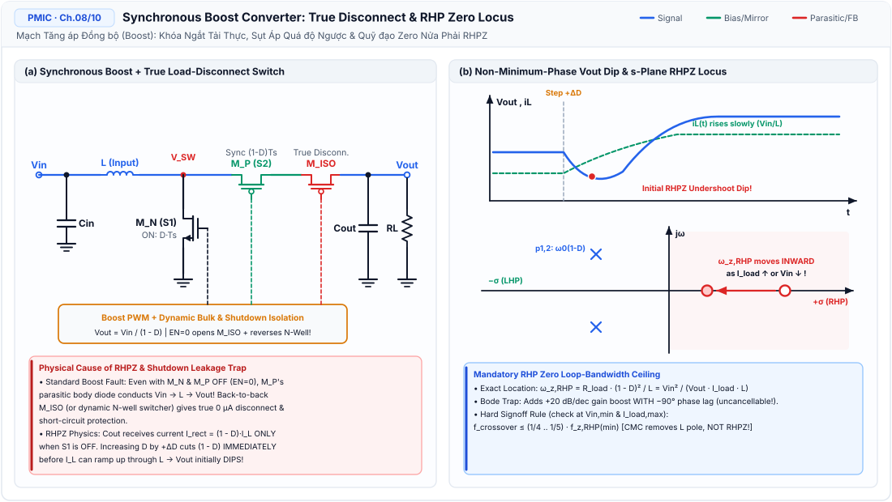

---
{
  "id": "law-boost-buckboost-rhp-zero-and-bandwidth-limit",
  "kind": "law",
  "domain": "power-management-ic",
  "title_vi": "Định luật Zero Nửa Mặt phẳng Phải (RHP Zero), Trần Băng thông Cắt & Sụp đổ Độ lợi Ký sinh trong Mạch Boost / Buck-Boost",
  "title_en": "Right-Half-Plane (RHP) Zero Physics, Crossover Bandwidth Ceiling, and Parasitic Gain Collapse in Boost and Buck-Boost Converters",
  "summary": "Định luật giới hạn động học bất khả kháng của mọi bộ biến đổi truyền năng lượng gián tiếp hai nhịp (Boost và Buck-Boost ở CCM): dẫn xuất vật lý và giải tích sự hình thành Zero Nửa Mặt phẳng Phải wz,RHP do sụt dòng trung bình diode/công tắc tức thời khi tăng hệ số lấp đầy D (gây sụt áp ngược chiều ban đầu kết hợp nâng biên độ +20 dB/dec nhưng kéo trễ pha -90 độ), định lý góc xấu nhất tại Vin,min & Iload,max, trần băng thông cắt bắt buộc fc <= fz,RHP,min / (3..5), và hiện tượng đảo dấu độ lợi làm chốt chết hồi tiếp dương khi D tiến gần 1 do điện trở ký sinh.",
  "diagram": "../../diagrams/boost-and-rhp-zero-locus.svg",
  "razavi_refs": [
    {
      "chapter": 6,
      "section": "6.2",
      "pages": "180-187",
      "equations": ["6.38", "6.40"]
    },
    {
      "chapter": 8,
      "section": "8.1, 8.8",
      "pages": "274-282, 332-336",
      "equations": ["8.1", "8.206"]
    },
    {
      "chapter": 10,
      "section": "10.3, 10.5, 10.8",
      "pages": "416-419, 426-433, 439-450",
      "equations": ["10.10", "10.28", "10.30", "10.57"]
    }
  ],
  "github_refs": [
    {
      "repo": "Arcadia-1/analog-design-bench",
      "url": "https://github.com/Arcadia-1/analog-design-bench/tree/972f7cd7c9",
      "use": "Tham chiếu bài toán kiểm chứng ổn định đa góc PVT và đáp ứng bước nhảy dòng tải cho các bộ chuyển đổi nguồn tích hợp CMOS"
    },
    {
      "repo": "westonb/open-pmic",
      "url": "https://github.com/westonb/open-pmic/tree/2ec3130e71",
      "use": "Đối chiếu hành vi tầng công suất có zero nửa mặt phẳng trái sạch (Buck) với tầng truyền năng lượng gián tiếp mang RHP zero (Boost / Buck-Boost)"
    },
    {
      "repo": "iic-jku/analog-circuit-design",
      "url": "https://github.com/iic-jku/analog-circuit-design/tree/6075ea0ebcf08f5c7f6033a84e9dd3c91450f5e1",
      "use": "Đối chiếu bản chất toán học trên mặt phẳng phức s giữa zero nửa mặt phẳng phải của đường truyền thẳng tụ Miller và zero phi cực tiểu pha của hệ thống hồi tiếp"
    }
  ],
  "glossary_codes": [
    "T042",
    "T051",
    "T063",
    "T088",
    "T112",
    "T874",
    "T1184",
    "T1215",
    "T1597",
    "T1608",
    "T1614",
    "T1618",
    "T1681",
    "T1702",
    "T1712",
    "T1973"
  ],
  "process_agnostic": true,
  "roles": {
    "two_step_inductor_shuttle": "Cuộn cảm L đóng vai trò kho trung chuyển hai nhịp: chỉ nạp từ nguồn Vin trong pha D*Ts (ngắt hoàn toàn khỏi tải) và chỉ xả năng lượng ra tải trong pha bù (1-D)*Ts",
    "modulated_rectifier_current_port": "Cổng dòng công tắc đồng bộ phía cao / diode iD(t) có giá trị trung bình <iD> = (1-d)*iL chịu tích nhân phi tuyến giữa biến điều khiển (1-d) và trạng thái cuộn cảm iL",
    "nonminimum_phase_rhp_zero": "Nghiệm tử số nằm bên phải trục ảo s = +wz,RHP > 0 vừa đẩy biên độ độ lợi vòng vọt lên +20 dB/dec vừa đánh cắp -90 độ dự trữ pha và cấm triệt tiêu cực-zero",
    "max_duty_cycle_hardware_clamp": "Mạch kẹp cứng hệ số lấp đầy cực đại D_limit < 1 - sqrt(Req / Rload,min) ngăn bộ biến đổi trượt sang sườn độ lợi vi phân âm gây chốt nguồn dương"
  },
  "symptoms_addressed": [
    "boost-or-buckboost-converter-oscillating-violently-only-at-minimum-battery-voltage-and-heavy-load",
    "initial-output-voltage-undershoot-dip-in-wrong-direction-when-duty-cycle-steps-up",
    "type3-compensator-failing-to-push-boost-crossover-bandwidth-above-tens-of-khz",
    "catastrophic-output-collapse-and-switch-latch-on-at-high-step-up-ratio-near-d-equals-1"
  ],
  "limitations": [
    "rhp-zero-cannot-be-cancelled-by-any-stable-left-half-plane-pole-or-nulling-resistor",
    "current-mode-control-eliminates-inductor-pole-but-still-retains-the-exact-same-ccm-rhp-zero",
    "closed-loop-bandwidth-is-fundamentally-capped-at-one-fifth-to-one-third-of-worst-case-fz-rhp",
    "effective-lc-resonant-frequency-also-shrinks-by-factor-1-minus-d-at-high-duty-ratios"
  ],
  "checklists": [
    "common-mos",
    "dcdc-switching-converter",
    "feedback-and-stb",
    "layout-and-matching"
  ]
}
---

## 1. Bản chất Nguyên lý, Sơ đồ Mạch & Vai trò Từng Nhánh Cấu trúc

Trong thiết kế Op-Amp CMOS hai tầng bù Miller (Razavi Chương 6 §6.2 & Chương 10 §10.5, Phương trình 6.40, 10.30), người thiết kế tương tự đã chạm trán kẻ thù nguy hiểm mang tên **zero ở nửa mặt phẳng phải (`T1702`, *right-half-plane zero — RHP zero*)** $\omega_{z,\text{Miller}} = +\frac{g_{m2}}{C_c}$ sinh ra do **đường truyền thẳng (`T1973`)** qua tụ bù $C_c$ bơm dòng ngược dấu với dòng khuếch đại chủ đạo ở tần số cao. Tuy nhiên, trong Op-Amp hai tầng, chúng ta dễ dàng tiêu diệt hoặc bẻ nó sang nửa mặt phẳng trái bằng một điện trở nối tiếp $R_z \ge \frac{1}{g_{m2}}$ hay bộ đệm cascode Ahuja (`tech-miller-rhp-zero-nulling-and-cascode-comp`). Bước sang thế giới vi mạch nguồn đóng cắt **Boost** (tăng áp) và **Buck-Boost** (hạ–tăng áp / đảo áp) làm việc ở chế độ dòng liên tục (**CCM**), một **RHP Zero hoàn toàn khác về nguồn gốc vật lý** xuất hiện — nhưng lần này nó gắn chặt vào định luật bảo toàn năng lượng hai nhịp nên **KHÔNG một mạch bù tuyến tính nào có thể triệt tiêu hay dịch chuyển nó**!



Để thấu triệt vì sao Buck converter tuyệt nhiên *không có* RHP Zero còn Boost và Buck-Boost ở CCM *bắt buộc phải gánh* RHP Zero, hãy nhìn thẳng vào cơ chế truyền dòng tới tụ lọc ngõ ra $C_{out}$:
1. **Trong mạch Buck (*Direct Energy Transfer*):** Cuộn cảm $L$ nối trực tiếp cố định vào nút ngõ ra $V_{out}$ trong **cả hai pha** $D T_s$ lẫn $(1-D)T_s$. Khi vòng hồi tiếp tăng hệ số lấp đầy $d \to D + \Delta d$, điện áp trung bình đặt lên đầu vào cuộn cảm tăng ngay lập tức, làm dòng $i_L(t)$ dốc lên và đổ thêm điện tích thẳng vào $C_{out}$ — điện áp $v_{out}(t)$ đi lên **cùng chiều ngay từ giây phút đầu tiên**!
2. **Trong mạch Boost và Buck-Boost (*Two-Step Indirect Energy Shuttle*):** Trong pha nạp $d T_s$, công tắc chính nối cuộn cảm với nguồn $V_{in}$ để tích từ năng, đồng thời **ngắt lìa hoàn toàn cuộn cảm khỏi tải ngõ ra** (lúc này $C_{out}$ phải tự mình gánh trọn dòng tải $I_{load}$ và bị sụt áp!). Cuộn cảm chỉ được phép nối vào ngõ ra thông qua diode / MOSFET đồng bộ phía cao trong pha xả còn lại $(1 - d)T_s$. Do đó, dòng trung bình bơm vào nút ngõ ra không phải là $i_L$, mà là tích điều chế:

$$
\langle i_{\text{rect}}(t) \rangle_{T_s} = \big(1 - d(t)\big)\,i_L(t)
$$

3. **Nghịch lý "Bước Lùi Trước Khi Tiến" (*Non-Minimum-Phase Initial Dip*):** Giả sử tải đột ngột tăng làm $V_{out}$ hơi tụt xuống; bộ điều khiển phản ứng đúng chiều bằng cách **tăng ngay $d$ thêm một lượng $+\Delta d > 0$** (tức kéo dài thời gian nạp cuộn cảm để lát nữa có nhiều năng lượng hơn). Nhưng vì dòng điện qua cuộn cảm $L$ là biến trạng thái liên tục **không thể nhảy bậc tức thời** ($\Delta i_L(0^+) = 0$), còn khoảng thời gian xả dòng ra tải $(1 - d)T_s$ lại **bị co hẹp lại ngay lập tức một lượng $-\Delta d \cdot T_s$**! Hệ quả tức thời trong những chu kỳ đầu tiên: tổng điện tích mỗi chu kỳ đổ vào tụ $C_{out}$ bị **HỤT ĐI** một lượng $\Delta\langle i_{\text{rect}}\rangle(0^+) = -I_L \Delta d < 0$, khiến **$V_{out}(t)$ sụt sâu hơn theo chiều NGƯỢC LẠI (*undershoot*)** trước khi cuộn cảm kịp tích đủ dòng $\Delta i_L(t) > \frac{I_L}{1-D}\Delta d$ để kéo $V_{out}$ đi lên! Mọi hệ động học có đáp ứng bước nhảy đi ngược chiều ban đầu đều bắt buộc mang số lẻ nghiệm zero thực dương ở **nửa mặt phẳng phải** $\text{Re}(s) > 0$!

---

## 2. Hệ Phương trình Cốt lõi & Tư duy "Nhìn Mạch Đọc Nhanh" (Analysis by Inspection)

### 2.1. Dẫn xuất Tường minh $G_{vd}(s)$ & Công thức Chính xác của $\omega_{z,\text{RHP}}$ cho Boost và Buck-Boost
Xét bộ biến đổi **Boost CCM lý tưởng** (xét thêm $R_{\text{ESR}}$ sau): trong chu kỳ trung bình, phương trình trạng thái của $\langle i_L \rangle$ và $\langle v_{out} \rangle$ là:

$$
L \frac{d i_L}{dt} = v_{in} - (1 - d)\,v_{out}, \qquad C \frac{d v_{out}}{dt} = (1 - d)\,i_L - \frac{v_{out}}{R_{load}}
$$

Đặt nhiễu loạn tín hiệu nhỏ $d = D + \hat{d}$, $i_L = I_L + \hat{i}_L$, $v_{out} = V_{out} + \hat{v}_{out}$ (với $\hat{v}_{in} = 0$, điểm tĩnh thỏa mãn $V_{out} = \frac{V_{in}}{1-D}$ và $I_L = \frac{I_{load}}{1-D} = \frac{V_{out}}{(1-D)R_{load}}$). Tuyến tính hóa bậc nhất cho hai phương trình ghép chéo:

$$
s L\,\hat{i}_L(s) = -(1 - D)\,\hat{v}_{out}(s) + V_{out}\,\hat{d}(s) \quad \Longrightarrow \quad \hat{i}_L(s) = \frac{V_{out}\,\hat{d}(s) - (1 - D)\,\hat{v}_{out}(s)}{s L}
$$

$$
s C\,\hat{v}_{out}(s) = (1 - D)\,\hat{i}_L(s) - \underbrace{I_L\,\hat{d}(s)}_{\text{Số hạng rút bớt thời gian xả gây RHP Zero!}} - \frac{\hat{v}_{out}(s)}{R_{load}}
$$

Thế $\hat{i}_L(s)$ từ phương trình đầu vào phương trình thứ hai (nhờ dấu trừ trước $I_L \hat{d}(s)$ nhân với $s L$ khi quy đồng mẫu số!), rồi đưa thêm zero của $R_{\text{ESR}}$ tụ lọc vào, ta thu được hàm truyền điều khiển–ngõ ra chính tắc của **Boost CCM**:

$$
G_{vd,\text{Boost}}(s) = \frac{\hat{v}_{out}(s)}{\hat{d}(s)} = \frac{V_{out}}{1 - D} \cdot \frac{\left(1 - \dfrac{s}{\omega_{z,\text{RHP}}}\right)\left(1 + \dfrac{s}{\omega_{z,\text{ESR}}}\right)}{1 + \dfrac{s}{Q_{\text{eff}}\,\omega_{0,\text{eff}}} + \dfrac{s^2}{\omega_{0,\text{eff}}^2}}
$$

Thực hiện phép biến đổi hoàn toàn tương tự cho **Buck-Boost đảo áp CCM lý tưởng** (và bộ 4 công tắc khi khóa chung một biến điều khiển $D_{\text{Buck}} = D_{\text{Boost}} = D$, nơi $V_{out} = \frac{D}{1-D}V_{in}$ và $I_L = \frac{I_{load}}{1-D} = \frac{V_{out}}{(1-D)R_{load}}$), ta lập được bảng đối chiếu giải tích dùng điện cảm hiệu dụng $L_e \equiv \dfrac{L}{(1 - D)^2}$:

| Đại lượng Động học Tín hiệu Nhỏ (CCM) | Mạch Tăng áp (**Boost**) | Mạch Hạ–Tăng áp Đảo áp (**Inverting Buck-Boost**) | Hệ quả Vật lý khi $V_{in}$ giảm ($D$ tăng!) |
|---|---|---|---|
| **Độ lợi DC điều khiển** $G_{d0}$ | $\dfrac{V_{out}}{1 - D} = \dfrac{V_{in}}{(1 - D)^2}$ | $\dfrac{V_{out}}{D(1 - D)} = \dfrac{V_{in}}{(1 - D)^2}$ | Tăng vọt tỉ lệ nghịch với $(1-D)^2$! |
| **Điện cảm hiệu dụng** $L_e(D)$ | $\dfrac{L}{(1 - D)^2}$ | $\dfrac{L}{(1 - D)^2}$ | Phóng đại gấp $\left(\frac{V_{out}}{V_{in}}\right)^2$ lần so với $L$ vật lý! |
| **Cực đôi cộng hưởng** $\omega_{0,\text{eff}}(D)$ | $\dfrac{1}{\sqrt{L_e C}} = \dfrac{1 - D}{\sqrt{L C}}$ | $\dfrac{1}{\sqrt{L_e C}} = \dfrac{1 - D}{\sqrt{L C}}$ | **Dịch chuyển tụt xuống tần số thấp** theo $(1-D)$! |
| **Hệ số phẩm chất** $Q_{\text{eff}}(D)$ *(khi $R_{eq}\to 0$)* | $R_{load}\sqrt{\dfrac{C}{L_e}} = (1 - D) R_{load}\sqrt{\dfrac{C}{L}}$ | $(1 - D) R_{load}\sqrt{\dfrac{C}{L}}$ | Phụ thuộc đồng thời vào cả $D$ lẫn tải $R_{load}$ |
| **Tần số góc RHP Zero** $\omega_{z,\text{RHP}}$ | $\dfrac{R_{load}(1 - D)^2}{L} = \dfrac{R_{load}}{L_e}$ | $\dfrac{R_{load}(1 - D)^2}{D L} = \dfrac{R_{load}}{D L_e}$ | **Sụt thê thảm** khi $D$ lớn và dòng tải $I_{load}$ nặng! |

- **Lưu ý bắt buộc cho Buck-Boost 4 công tắc không đảo áp chế độ phối hợp (*Blended Mode*, $M = \dfrac{D_{\text{Buck}}}{1 - D_{\text{Boost}}}$, $I_L = \dfrac{I_{load}}{1 - D_{\text{Boost}}}$):** Khi hai cầu công tắc điều khiển độc lập với nhiễu loạn tín hiệu nhỏ $\hat{d}_{\text{Buck}} = \alpha_1 \hat{u}$ và $\hat{d}_{\text{Boost}} = \alpha_2 \hat{u}$, KHÔNG được thay $D_{\text{Buck}}$ hay $D_{\text{Boost}}$ vào công thức một biến $M = D/(1-D)$ của mạch đảo áp! Mô hình trung bình hai biến cho tần số góc RHP zero chính xác:
  $$\omega_{z,\text{RHP}} = \frac{R_{load}(1 - D_{\text{Boost}})^2}{L} \left(1 + \frac{\alpha_1}{\alpha_2}\frac{1 - D_{\text{Boost}}}{D_{\text{Buck}}}\right)$$
  Tùy theo luật điều chế 3 vùng: (i) **chỉ điều chế nhánh Buck** ($\alpha_2 = 0$): **không có RHP zero hữu hạn**; (ii) **chỉ điều chế nhánh Boost** ($\alpha_1 = 0$): $\omega_{z,\text{RHP}} = \dfrac{R_{load}(1 - D_{\text{Boost}})^2}{L}$ (ví dụ $R_{load}=12\,\Omega, L=4{,}7\,\mu\text{H}, D_{\text{Boost}}=0{,}2 \implies f_{z,\text{RHP}} = 260{,}07\text{ kHz}$); (iii) **hai cầu điều chế cùng biên độ** ($\alpha_1 = \alpha_2$, tại $D_{\text{Buck}}=0{,}8, D_{\text{Boost}}=0{,}2 \implies M = 1$): thừa số trong ngoặc bằng $2 \implies f_{z,\text{RHP}} = 520{,}13\text{ kHz}$.

### 2.2. Ký hiệu Đại số & Tác động Kép Độc hại Trên Đồ thị Bode / Nyquist
Xét thừa số tử số $\left(1 - \frac{j\omega}{\omega_{z,\text{RHP}}}\right)$:
- **Biên độ:** $\left|1 - j\frac{\omega}{\omega_{z,\text{RHP}}}\right| = \sqrt{1 + \left(\frac{\omega}{\omega_{z,\text{RHP}}}\right)^2}$ $\implies$ nâng biên độ lên **hệt như một zero thông thường ($+20\text{ dB/dec}$)**, tức làm giảm độ dốc cắt của độ lợi vòng $|T(j\omega)|$ và kéo dãn tần số cắt $f_c$ ra xa hơn!
- **Pha:** $\angle\!\left(1 - j\frac{\omega}{\omega_{z,\text{RHP}}}\right) = -\arctan\!\left(\frac{\omega}{\omega_{z,\text{RHP}}}\right)$ $\implies$ gây **TRỄ PHA $-90^\circ$ hệt như một cực nửa mặt phẳng trái**!
- **Định luật Trần Băng thông Cắt (*Bandwidth Ceiling Law*):** Tại tần số cắt $f_c$, lượng dự trữ pha (`T063`) bị riêng RHP zero ăn cắp là $\Delta\phi_{\text{RHP}} = \arctan\!\left(\frac{f_c}{f_{z,\text{RHP}}}\right)$. Nếu liều lĩnh đặt $f_c = f_{z,\text{RHP}}$, bạn mất ngay $45^\circ$ pha đồng thời độ dốc $|T(j\omega)|$ bị là phẳng thêm $+20\text{ dB/dec}$ không cho vòng hồi tiếp cắt xuống dưới $0\text{ dB}$! Để bảo toàn $\text{PM} \ge 50^\circ\text{–}60^\circ$ trên mọi góc PVT, tần số cắt tối đa bị khóa cứng dưới trần:

$$
f_c \le \left(\frac{1}{5} \dots \frac{1}{3}\right) f_{z,\text{RHP},\min}, \qquad f_{z,\text{RHP},\min} = \begin{cases} \dfrac{R_{load,\min}(1 - D_{\max})^2}{2\pi L_{\max}} & \text{(Boost CCM)} \\[8pt] \dfrac{R_{load,\min}(1 - D_{\max})^2}{2\pi D_{\max} L_{\max}} & \text{(Inverting Buck-Boost CCM)} \end{cases}
$$

*(Ví dụ định lượng thực tế: Mạch Boost từ pin Li-ion cạn $V_{in,\min} = 2{,}7\text{ V}$ lên $V_{out} = 5{,}0\text{ V}$ $\implies 1 - D_{\max} = 0{,}54$, cấp dòng $I_{load,\max} = 1{,}0\text{ A} \implies R_{load,\min} = 5{,}0\,\Omega$, dùng cuộn cảm $L = 2{,}2\,\mu\text{H} \pm 20\% \implies L_{\max} = 2{,}64\,\mu\text{H}$: tần số RHP zero góc xấu nhất rơi xuống chỉ còn $f_{z,\text{RHP},\min} = \frac{5{,}0 \times 0{,}54^2}{2\pi \times 2{,}64\,\mu\text{H}} = 87{,}9\text{ kHz}$ — cho dù bạn chạy xung nhịp $f_{sw} = 2{,}5\text{ MHz}$, băng thông vòng kín $f_c$ **tuyệt đối không được phép vượt quá $18\text{–}28\text{ kHz}$**!)*

### 2.3. Định luật Sụp đổ Độ lợi & Đảo Cực tính Hồi tiếp Gần $D \to 1$ Do Điện trở Ký sinh $R_{eq}$
Phương trình lý tưởng $M(D) = \frac{1}{1-D}$ dự báo sai lầm rằng khi $D \to 1$, $V_{out} \to \infty$. Trên silicon thực, nhánh cuộn cảm luôn mang tổng điện trở tổn hao nối tiếp $R_{eq} = R_{\text{DCR}} + D R_{on,\text{LS}} + (1 - D) R_{on,\text{HS}}$. Viết lại cân bằng Volt-giây chính xác $\langle v_L \rangle = V_{in} - I_L R_{eq} - (1 - D)V_{out} = 0$ kết hợp $I_L = \frac{V_{out}}{(1-D)R_{load}}$ cho tỷ số biến đổi thực của Boost:

$$
M_{\text{real}}(D) = \frac{V_{out}}{V_{in}} = \frac{1}{1 - D} \cdot \frac{1}{1 + \dfrac{R_{eq}}{(1 - D)^2 R_{load}}} = \frac{1 - D}{(1 - D)^2 + \dfrac{R_{eq}}{R_{load}}}
$$

Lấy đạo hàm $\dfrac{\partial M_{\text{real}}}{\partial D} = \dfrac{(1 - D)^2 - R_{eq}/R_{load}}{\big[(1 - D)^2 + R_{eq}/R_{load}\big]^2} = 0$, ta phát hiện định luật cực trị sống còn:

$$
D_{\text{peak}} = 1 - \sqrt{\frac{R_{eq}}{R_{load}}}, \qquad M_{\max} = \frac{1}{2}\sqrt{\frac{R_{load}}{R_{eq}}}
$$

Ngay khi $D$ vượt quá $D_{\text{peak}}$, đạo hàm độ lợi tĩnh điều khiển **ĐẢO DẤU SANG ÂM ($\frac{\partial V_{out}}{\partial D} < 0$)**! Vòng hồi tiếp âm thông thường lập tức biến thành **hồi tiếp dương (`T1184`)**: áp ra hụt $\to$ bộ khuếch đại sai lệch tăng $D$ hơn nữa $\to$ dòng $I_L$ vọt lên đốt $I_L^2 R_{eq}$ càng làm $V_{out}$ sụp sâu hơn $\to$ công tắc thấp chốt cứng ở $D = 100\%$ kéo sập toàn bộ nguồn!

---

## 3. Bất biến Cấu trúc & Các Bẫy Lỗi Kinh điển (Structural Invariants & Traps)

- **[INV-RHPZ-01] Bất biến Cấm Triệt tiêu RHP Zero Bằng Cực Không Ổn định (*Forbidden Pole-Zero Cancellation*):** Một câu hỏi kinh điển khi học `T1712` (*pole-zero cancellation*, Razavi Ch.10): *"Tại sao không đặt một cực bù đúng tại $s = +\omega_{z,\text{RHP}}$ để khử thừa số $(1 - s/\omega_{z,\text{RHP}})$?"* Theo tiêu chuẩn ổn định Nyquist (`T1597`, §10.8), bất kỳ sai lệch $0{,}001\%$ nào giữa cực nửa mặt phẳng phải của bộ bù và $\omega_{z,\text{RHP}}$ (vốn lại dịch chuyển liên tục theo $V_{in}$ và $I_{load}$!) đều để lại một nghiệm cực dương $\text{Re}(p) > 0$ không kiểm soát được làm đầu ra bộ bù bão hòa mũ $e^{+\omega_{z,\text{RHP}} t}$! Nếu đặt cực nửa mặt phẳng trái $(1 + s/\omega_{z,\text{RHP}})^{-1}$, biên độ $+20\text{ dB/dec}$ được dập phẳng nhưng **pha bị cộng dồn thành $-90^\circ - 90^\circ = -180^\circ$** tại đúng $\omega_{z,\text{RHP}}$!
- **[INV-RHPZ-02] Bất biến Tổ hợp Góc Xấu Nhất Kép ($V_{in,\min} \cap I_{load,\max} \cap L_{\max} \cap C_{\max}$):** Khác với Buck converter có $\omega_0 = \frac{1}{\sqrt{LC}}$ bất biến theo $V_{in}$ và $I_{load}$, trong Boost/Buck-Boost khi pin yếu nhất ($V_{in,\min} \implies D_{\max}$) và tải ăn dòng cực đại ($I_{load,\max} \implies R_{load,\min}$), **cả hai thảm họa ập đến cùng một lúc**: $\omega_{z,\text{RHP}}$ rơi xuống đáy thấp nhất VÀ cặp cực đôi $\omega_{0,\text{eff}} = \frac{1-D_{\max}}{\sqrt{LC}}$ cũng trượt thấp lại gần gốc tọa độ! Mọi phép kiểm chứng ổn định `stb`/`pstb` của Boost/Buck-Boost nếu chỉ chạy ở $V_{in,\text{nom}}$ hoặc tải trung bình đều hoàn toàn vô giá trị!
- **[TRAP-RHPZ-01] Ngộ nhận Kinh điển: "Chuyển sang Điều khiển Chế độ Dòng (CMC) sẽ Xóa bỏ được RHP Zero!":** Rất nhiều kỹ sư nhầm tưởng vì Peak Current-Mode Control biến cuộn cảm thành nguồn dòng điều khiển nên sẽ xóa luôn RHP Zero của Boost! **Sai hoàn toàn ở chế độ CCM!** Ngay cả khi dòng cuộn cảm được điều khiển trực tiếp $i_L \approx i_{ctrl}$, dòng đổ ra tụ tải vẫn là $\langle i_{\text{rect}} \rangle = (1 - d) i_L$; để đẩy $i_L$ tăng lên một lượng $\hat{i}_{ctrl}$, vòng dòng trong vẫn bắt buộc phải tăng tạm thời $\hat{d} = \frac{s L \hat{i}_{ctrl} + (1-D)\hat{v}_{out}}{V_{out}}$! Thay biểu thức $\hat{d}$ này vào phương trình tụ $C_{out}$, tử số của hàm truyền điều khiển dòng–ngõ ra $\frac{\hat{v}_{out}(s)}{\hat{i}_{ctrl}(s)}$ trong Boost CMC vẫn giữ nguyên xi thừa số **$\left(1 - \frac{s}{\omega_{z,\text{RHP}}}\right)$ với $\omega_{z,\text{RHP}} = \frac{R_{load}(1-D)^2}{L}$ không xê dịch một hertz nào**! Ưu điểm thực sự của CMC đối với Boost là nó xóa bỏ cực thứ hai của cuộn cảm (hạ bậc mẫu số từ 2 xuống 1 cực tải $\omega_p \approx \frac{2}{R_{load}C}$), nhờ đó không còn vực pha $-180^\circ$ cộng dồn với $-90^\circ$ của RHP zero, cho phép bù dễ dàng bằng Type-II đơn giản!
- **[TRAP-RHPZ-02] Bẫy Chọn Cuộn cảm $L$ Quá Lớn Để Giảm Gợn Dòng Khiến Băng thông Bị Bóp Nghẹt:** Trong Buck, tăng $L$ chỉ làm giảm gợn dòng $\Delta i_L$. Trong Boost/Buck-Boost, tăng $L$ gấp đôi làm **$f_{z,\text{RHP}}$ sụt giảm một nửa**, ép trần băng thông $f_c$ tụt xuống một nửa, và đồng thời năng lượng thiếu hụt trong nhịp sụt ban đầu tăng gấp đôi khiến độ sụt áp bước nhảy tải $\Delta V_{\text{droop}}$ tệ đi gấp bội! Do đó cuộn cảm của mạch Boost luôn được thiết kế nhỏ hơn (cho phép tỷ lệ gợn $r_i \approx 0{,}4\text{–}0{,}7$, thậm chí đẩy sang DCM ở tải vừa) để đẩy $f_{z,\text{RHP}}$ lên cao!
- **[TRAP-RHPZ-03] Thiếu Mạch Kẹp Hệ số Lấp đầy Cực đại $D_{\text{clamp}}$ Khi Khởi động Hoặc Sụt Nguồn:** Khi mới cấp nguồn ($V_{out} < V_{in}$) hoặc pin sụt sâu dưới ngưỡng UVLO trong lúc tải nặng, bộ khuếch đại sai lệch bão hòa đẩy $V_{\text{comp}}$ lên kịch trần. Nếu bộ tạo PWM cho phép $D > D_{\text{peak}} = 1 - \sqrt{R_{eq}/R_{load}}$ (thường $D_{\text{clamp}}$ phải kẹp cứng ở $80\%\text{–}88\%$), mạch rơi thẳng vào vùng hồi tiếp dương Mục 2.3 và cháy công tắc NMOS phía thấp!

---

## 4. Lộ trình Nâng cấp Cấu trúc & Bát giác Đánh đổi (Upgrade Paths & Design Octagon)

| Điểm nghẽn do RHP Zero trong Boost / Buck-Boost CCM | Nâng cấp sang cấu trúc / kỹ thuật đích (Canonical Node) | Cơ chế đột phá | Đánh đổi trên Bát giác Thiết kế |
|---|---|---|---|
| Vừa gánh cặp cực phức $-180^\circ$ của $\omega_{0,\text{eff}}$ vừa gánh $-90^\circ$ của RHP Zero làm VMC gần như bất khả thi trên dải rộng $V_{in}$ | `tech-dcdc-cmc-subharmonic-slope-comp-and-cot` | Điều khiển chế độ dòng đỉnh (Peak CMC) khử một cực cuộn cảm, biến mẫu số thành hệ 1 cực đơn $\omega_p = \frac{2}{R_{load}C}$ dễ dàng đạt $\text{PM} > 60^\circ$ với bộ bù OTA Type-II | Cần cảm biến dòng tốc độ cao + bù độ dốc $m_a$ khi $D > 0{,}5$, và trần $f_c \le f_{z,\text{RHP},\min}/4$ vẫn giữ nguyên |
| Pin Li-ion ($2{,}7\text{–}4{,}4\text{ V}$) tạo ra $V_{out} = 3{,}3\text{ V}$: nếu dùng Buck-Boost đảo cực/2-công-tắc cổ điển thì phải gánh RHP Zero ở **mọi** mức $V_{in}$ kể cả khi $V_{in} > V_{out}$! | `topo-boost-inverting-and-4switch-buckboost` | Dùng **4-Switch Non-Inverting Buck-Boost** chạy thuần **Buck** khi $V_{in} > V_{out}$ (hoàn toàn sạch RHP Zero, hiệu suất cực cao!) và chỉ chịu RHP Zero khi pin tụt xuống vùng Boost | Tăng lên 4 MOSFET công suất, 2 mạch lái bootstrap phía cao và bộ điều chế chuyển vùng 3 chế độ liền mạch |
| Công suất tải nhỏ ($< 50\text{ mW}$) trên chip muốn nhân áp/hạ áp mà không chấp nhận cuộn cảm ngoài và RHP Zero cảm kháng | `topo-switched-capacitor-charge-pump-dcdc` | Truyền năng lượng bằng các tụ bay (*flying capacitors*) theo tỷ số điện dung cố định (2:1, 1:2, 3:2) không dùng cuộn cảm | Hiệu suất bị trần hóa theo tỷ số áp lý tưởng $V_{out}/(M \cdot V_{in})$ và chịu tổn hao tụ đáy ký sinh $\alpha C_{\text{fly}} V^2 f_{sw}$ |
| Đẩy mạch chạy cố ý trong DCM (hoặc Tri-State Pseudo-CCM) để nâng cao băng thông quá độ tải | `topo-dcdc-ramp-sensefet-dcr-and-zcd-blocks` | Trong DCM thuần túy, dòng $i_L$ đặt lại về 0 mỗi chu kỳ nên RHP Zero bị đẩy vọt lên vùng sát $f_{sw}$! | Dòng đỉnh $I_{\text{pk}}$ và dòng RMS tăng gấp $2\text{–}3$ lần gây gợn áp lớn và tổn hao dẫn cao ở tải nặng |

---

## 5. Thích ứng Đa Tiến trình (90nm / 65nm / 45nm) & Cách Kiểm chứng trong Cadence / Spectre

### 5.1. Quy trình 5 Bước Thiết kế Ngược từ Trần RHP Zero (*RHP-Zero-First Synthesis Procedure*)
Ngược hẳn với Buck converter (nơi bạn có thể chọn $f_c \approx f_{sw}/8$ trước rồi thiết kế bộ bù), khi thiết kế Boost hoặc 4-Switch Buck-Boost trên CMOS, **bước 1 luôn phải bắt đầu từ $f_{z,\text{RHP},\min}$**:
1. **Xác định góc vận hành khắc nghiệt nhất:** Lấy $V_{in,\min}$ (kể cả sụt áp dây nguồn $I_{in,\max} R_{\text{trace}}$), $I_{load,\max}$, ước lượng hiệu suất góc xấu nhất $\eta_{\min} \approx 0{,}85$ để tính hệ số lấp đầy thực tế $D_{\max} = 1 - \dfrac{\eta_{\min} V_{in,\min}}{V_{out}}$ (lớn hơn $D_{\text{ideal}}$ đáng kể!).
2. **Chọn $L$ nhỏ nhất có thể chấp nhận được** (theo giới hạn dòng đỉnh MOSFET $I_{\text{pk}} \le I_{\text{SOA}}$ và gợn dòng $r_i \approx 0{,}4\text{–}0{,}6$): tính $f_{z,\text{RHP},\min}$ với $L_{\max} = 1{,}2\,L_{\text{nom}}$ và $R_{load,\min} = \frac{V_{out}}{I_{load,\max}}$.
3. **Chốt tần số cắt mục tiêu $f_c$ tại góc xấu nhất:** Khóa cứng $f_c = 0{,}22\,f_{z,\text{RHP},\min}$ (chỉ mất $\arctan(0{,}22) = 12{,}4^\circ$ pha cho RHP zero!).
4. **Định cỡ tụ ngõ ra thực tế $C_{\text{eff}}$ bù cho băng thông thấp và nhịp sụt ban đầu:** Vì vòng điều khiển bị khóa băng thông ở $f_c$ thấp và còn mất thêm thời gian chờ dòng $i_L$ dốc lên đủ lượng $\Delta I_L = \frac{\Delta I_{load}}{1 - D_{\max}} = \frac{V_{out}\,\Delta I_{load}}{\eta_{\min} V_{in,\min}}$ (theo cân bằng điện tích qua chu kỳ với $1 - D_{\max} = \frac{\eta_{\min} V_{in,\min}}{V_{out}}$ đã bao hàm hiệu suất $\eta_{\min}$, không nhân lặp $\eta_{\min}$ thêm lần nữa), tụ lọc phải một mình gánh bước nhảy tải $\Delta I_{load}$ trong khoảng thời gian $\Delta t_{\text{resp}} \approx \frac{1}{2\pi f_c} + \Delta t_{\text{slew}}$ với $\Delta t_{\text{slew}} = \frac{L\,\Delta I_L}{V_{in,\min}} = \frac{L\,\Delta I_{load}}{(1 - D_{\max}) V_{in,\min}} = \frac{L\,\Delta I_{load}\,V_{out}}{\eta_{\min} V_{in,\min}^2} = \frac{\eta_{\min}\,L\,\Delta I_{load}}{(1 - D_{\max})^2 V_{out}}$, đòi hỏi:

$$
C_{\text{eff}}(V_{out}) \ge \frac{\Delta I_{load}}{\Delta V_{\text{droop,max}}} \left( \frac{1}{2\pi f_c} + \frac{L\,\Delta I_{load}}{\left(1 - D_{\max}\right) V_{in,\min}} \right) = \frac{\Delta I_{load}}{\Delta V_{\text{droop,max}}} \left( \frac{1}{2\pi f_c} + \frac{L\,\Delta I_{load}\,V_{out}}{\eta_{\min} V_{in,\min}^2} \right) = \frac{\Delta I_{load}}{\Delta V_{\text{droop,max}}} \left( \frac{1}{2\pi f_c} + \frac{\eta_{\min}\,L\,\Delta I_{load}}{\left(1 - D_{\max}\right)^2 V_{out}} \right)
$$

   *(Lưu ý nhất quán hiệu suất: cân bằng điện tích trên tụ ngõ ra cho chính xác $\Delta I_L = \frac{\Delta I_{load}}{1 - D_{\max}}$; vì $1 - D_{\max} = \frac{\eta_{\min} V_{in,\min}}{V_{out}}$ đã chứa $\eta_{\min}$ nên $V_{in,\min} = \frac{(1 - D_{\max}) V_{out}}{\eta_{\min}}$, suy ra trực tiếp $\frac{L\,\Delta I_{load}}{(1 - D_{\max}) V_{in,\min}} = \frac{L\,\Delta I_{load}\,V_{out}}{\eta_{\min} V_{in,\min}^2} = \frac{\eta_{\min}\,L\,\Delta I_{load}}{(1 - D_{\max})^2 V_{out}}$ mà không đếm trùng $\eta_{\min}$.)*

5. **Đặt ngưỡng kẹp cứng $D_{\text{clamp}}$ trong bộ điều chế PWM:** Tính $R_{eq,\max}$ ở góc `SS, 125°C` (khi $R_{on,\text{MOS}}$ tăng gấp $1{,}6\text{–}2{,}0\times$ so với `TT, 27°C`!), đảm bảo $D_{\text{clamp}} \le 0{,}85 \times \left(1 - \sqrt{\frac{R_{eq,\max}}{R_{load,\min}}}\right)$ và luôn chừa thời gian xả tối thiểu $t_{\text{off},\min} \ge 80\text{–}150\text{ ns}$ để xả từ cuộn cảm.

### 5.2. Kiểm chứng Hiện tượng Non-Minimum-Phase & Cực biên Ổn định trong Spectre
1. **Phép thử Bước nhảy Hệ số Lấp đầy Vòng hở (`tran` Open-Loop Duty Step):**
   - Cố định $d(t) = D_0$, chờ mạch Boost xác lập, sau đó cho bước nhảy nhỏ $\Delta d = +0{,}02$. Quan sát trên sóng $V_{out}(t)$: bạn sẽ nhìn thấy tận mắt **hố sụt áp âm ban đầu (*initial negative dip*)** kéo dài đúng cỡ $\tau_{\text{dip}} \approx \frac{L}{(1-D_0)^2 R_{load}} = \frac{1}{\omega_{z,\text{RHP}}}$ trước khi đường cong vượt qua mức cũ đi lên!
2. **Quét Ma trận Góc Ổn định `pss` + `pstb`:**
   - Bắt buộc chạy tại 4 đỉnh hộp $(V_{in,\min}, V_{in,\max}) \times (I_{load,\min,\text{CCM}}, I_{load,\max})$. Trên đồ thị Bode của `pstb`, xác nhận điểm cắt $0\text{ dB}$ nằm thấp hơn điểm gãy lên của RHP zero tối thiểu $3{,}5\times$, và kiểm tra **Dự trữ Độ lợi (*Gain Margin — GM*) $\ge 10\text{ dB}$** tại tần số pha cắt $-180^\circ$ (vì ngay phía trên $f_c$, RHP zero nâng biên độ lên lại nên nếu cực tần số cao đặt quá xa, đường cong $|T(j\omega)|$ sẽ không lặn đủ sâu tại $\angle T = -180^\circ$ gây vi phạm Gain Margin dù Phase Margin tại $f_c$ trông có vẻ đủ!).
3. **Bảng Kiểm Soát Nhanh 5 Ràng Buộc Sống Còn Cho Boost / Buck-Boost Trong ADE:**
   ```text
   [1] Trần tần số cắt RHP Zero:   f_c(Vin_min, Iload_max) <= 0.28 * f_z_RHP_min
   [2] Dự trữ pha & Dự trữ biên:   PM_pstb >= 50 deg  AND  GM_pstb >= 10 dB across all PVT
   [3] Chống đảo dấu độ lợi DC:    D_max_operating <= D_clamp <= 0.85 * (1 - sqrt(R_eq_SS125 / R_load_min))
   [4] Phục hồi sụt áp ngược pha:  Vout_min_during_load_step >= Vout_nom - V_droop_spec (với C_eff đã trừ DC-bias)
   [5] Chống bão hòa dòng vào:     I_in_pk = I_load_max / (1 - D_max) + dI_L/2 = V_out*I_load_max / (eta_min*V_in_min) + dI_L/2 <= 0.80 * I_sat_L
   ```

---

## 6. Mốc Đối chiếu Sách Razavi, Tài liệu Chuẩn Công nghiệp & Thuật ngữ CLB

### 6.1. Đối chiếu Sách Gốc Razavi (2nd Edition) & Giáo trình Điện tử Công suất Kinh điển
- **Razavi Chương 6 & Chương 10:** §6.2 *Common-Source Stage* (tr. 184–187, Phương trình 6.38–6.40) & §10.5 *Compensation of Two-Stage Op Amps* (tr. 428–432, Phương trình 10.28–10.30): phân tích toán học chính xác tác động kép nguy hiểm của **zero nửa mặt phẳng phải (`T1702`)** vừa nâng biên độ vừa gây trễ pha $-90^\circ$, làm cơ sở đối chiếu giữa RHP zero truyền thẳng điện dung (khử được bằng $R_z$) và RHP zero truyền năng lượng hai nhịp của Boost/Buck-Boost (bất khả khử).
- **Razavi Chương 8 & Chương 10:** §8.1 *Properties of Feedback* (tr. 274–282) & §10.8 *Nyquist's Stability Criterion* (tr. 439–455, Phương trình 10.57): giải thích chặt chẽ vì sao cấm triệt tiêu nghiệm nửa mặt phẳng phải và vì sao hệ có độ lợi vòng không đơn điệu bắt buộc phải kiểm tra đồng thời cả dự trữ pha lẫn dự trữ biên độ trên đồ thị cực Nyquist.
- **Tài liệu Chuẩn Mở rộng PMIC:** R. W. Erickson & D. Maksimović, *Fundamentals of Power Electronics* (3rd Ed., §3.3 *Practical Limit on Boost Conversion Ratio due to Parasitic Resistance*, §8.2.2 *Physical Origin of Right-Half-Plane Zeros in Converters*, §9.4); R. D. Middlebrook & S. Ćuk (PESC 1976); B. Wicht, *Design of Power Management Integrated Circuits* (Ch. 5, §5.2.3 & §5.4).

### 6.2. Bảng Thuật ngữ Chuẩn CLB Vi Mạch Sử dụng trong Thẻ
| Mã CLB | Thuật ngữ Tiếng Anh | Thuật ngữ Tiếng Việt Chuẩn | Ghi chú Ngữ cảnh trong Boost / Buck-Boost |
|---|---|---|---|
| `T1702` | right-half-plane zero | zero ở nửa mặt phẳng phải | Nghiệm $\omega_{z,\text{RHP}} = \frac{R_{load}(1-D)^2}{L}$ (Boost) hoặc chia thêm $D$ (Buck-Boost) |
| `T1614` / `T1618` | gain crossover frequency / worst-case stability | tần số cắt độ lợi / trường hợp bất lợi nhất về ổn định | Bị khóa trần $f_c \le f_{z,\text{RHP},\min}/(3\dots 5)$ tại góc $(V_{in,\min}, I_{load,\max})$ |
| `T1712` | pole-zero cancellation | triệt tiêu cực–zero | Nghiêm cấm áp dụng lên RHP zero do sinh cực dương mất ổn định nội |
| `T1184` / `T1681` | positive feedback / negative phase margin | hồi tiếp dương / dự trữ pha âm | Hậu quả khi $D$ vượt điểm đỉnh $1 - \sqrt{R_{eq}/R_{load}}$ hoặc $f_c$ chạm $f_{z,\text{RHP}}$ |
| `T1597` | Nyquist's stability criterion | tiêu chuẩn ổn định Nyquist | Tiêu chuẩn bắt buộc để kiểm định dự trữ độ lợi phía trên RHP zero |
