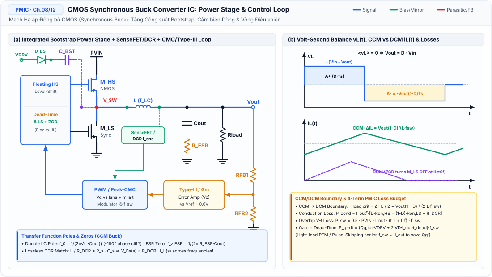

---
{
  "id": "law-dcdc-volt-second-ccm-dcm-and-state-space",
  "kind": "law",
  "domain": "power-management-ic",
  "title_vi": "Định luật Cân bằng Volt-Giây, Điện tích Tụ, Ranh giới CCM/DCM & Trung bình Không gian Trạng thái Bộ biến đổi DC-DC",
  "title_en": "Inductor Volt-Second & Capacitor Charge Balance, CCM/DCM Boundary, and State-Space Averaged Small-Signal Laws of DC-DC Converters",
  "summary": "Hệ tiên đề nền tảng của mọi bộ biến đổi nguồn đóng cắt DC-DC (Erickson & Maksimovic kết hợp vật lý công tắc/hồi tiếp CMOS của Razavi Ch.2, Ch.8, Ch.10): định luật cân bằng Volt-giây cuộn cảm <vL>=0 và cân bằng điện tích tụ lọc <iC>=0 ở xác lập tuần hoàn, phân rã độ gợn dòng/áp tam giác và bước nhảy ESR/ESL, tham số dẫn K so với Kcrit(D) phân định chế độ dòng liên tục (CCM) với dòng gián đoạn (DCM) kèm dao động chuông nút SW, và phép trung bình không gian trạng thái tuyến tính hóa tạo mô hình chuẩn tắc Gvd(s), Gvg(s), Zout(s) với cặp cực phức cộng hưởng LC và zero ESR.",
  "diagram": "../../diagrams/synchronous-buck-converter.svg",
  "razavi_refs": [
    {
      "chapter": 2,
      "section": "2.1.1, 2.2.2",
      "pages": "7-8, 12-19",
      "equations": ["2.9", "2.10"]
    },
    {
      "chapter": 8,
      "section": "8.1.1, 8.2.1",
      "pages": "275-282, 286-291",
      "equations": ["8.3", "8.36"]
    },
    {
      "chapter": 10,
      "section": "10.2-10.3",
      "pages": "414-419",
      "equations": ["10.5", "10.10", "10.15"]
    },
    {
      "chapter": 12,
      "section": "12.8",
      "pages": "533-535",
      "equations": ["12.76"]
    }
  ],
  "github_refs": [
    {
      "repo": "westonb/open-pmic",
      "url": "https://github.com/westonb/open-pmic/tree/2ec3130e71",
      "use": "Tham chiếu phân rã tầng công suất cuộn cảm - tụ lọc Buck CMOS trên SKY130, tính độ gợn dòng cuộn cảm và đáp ứng động học vòng điều chỉnh điện áp/dòng điện"
    },
    {
      "repo": "Arcadia-1/veriloga-skills",
      "url": "https://github.com/Arcadia-1/veriloga-skills",
      "use": "Phương pháp mô hình hóa phần tử đóng cắt trung bình hóa liên tục theo chu kỳ để chạy phân tích điểm làm việc DC và hàm truyền tín hiệu nhỏ AC/STB"
    },
    {
      "repo": "iic-jku/analog-circuit-design",
      "url": "https://github.com/iic-jku/analog-circuit-design/tree/6075ea0ebcf08f5c7f6033a84e9dd3c91450f5e1",
      "use": "Liên hệ hệ thống bậc hai cộng hưởng (tần số tự nhiên w0, hệ số phẩm chất Q, hệ số tắt dần zeta) với dự trữ pha vòng hồi tiếp Điện áp-Điện áp"
    }
  ],
  "glossary_codes": [
    "T042",
    "T051",
    "T063",
    "T066",
    "T088",
    "T109",
    "T112",
    "T188",
    "T197",
    "T1614",
    "T1635",
    "T1650",
    "T1678",
    "T2070",
    "T2093",
    "T2176"
  ],
  "process_agnostic": true,
  "roles": {
    "pwm_switching_network": "Mạng công tắc MOSFET vùng triode sâu (T188) đóng cắt ở tần số fsw = 1/Ts biến đổi điện áp một chiều thành chuỗi xung chữ nhật không tiêu tán công suất tĩnh lý tưởng",
    "energy_storage_inductor_L": "Cuộn cảm tích trữ từ năng (1/2)*L*iL^2 đóng vai trò nguồn dòng trung gian lọc bỏ thành phần đóng cắt và áp đặt cân bằng Volt-giây <vL> = 0 ở xác lập",
    "output_filter_capacitor_Cout": "Tụ lọc ngõ ra tích hợp điện tích gợn dòng cuộn cảm dưới dạng tam giác bậc hai, mang điện trở nối tiếp tương đương RESR tạo zero nửa mặt phẳng trái wz,ESR",
    "averaged_canonical_two_port": "Mô hình hai cửa tuyến tính hóa bất biến thời gian xung quanh điểm làm việc tĩnh (D, Vin, Iload) sinh bộ ba hàm truyền chuẩn tắc Gvd(s), Gvg(s) và Zout(s)"
  },
  "symptoms_addressed": [
    "linear-ldo-regulator-catastrophic-power-loss-when-vin-much-larger-than-vout",
    "excessive-output-voltage-ripple-dominated-by-capacitor-esr-and-esl-spikes",
    "abrupt-loop-gain-drop-and-transfer-function-order-reduction-at-ccm-to-dcm-transition",
    "violent-lc-double-pole-180-degree-phase-cliff-in-low-esr-ceramic-mlcc-buck-converters",
    "parasitic-switch-node-ringing-during-dcm-high-impedance-dead-interval"
  ],
  "limitations": [
    "state-space-averaging-breaks-down-above-half-switching-frequency-nyquist-wall",
    "small-ripple-approximation-fails-when-rc-filter-corner-approaches-switching-frequency",
    "dcm-operation-makes-steady-state-output-voltage-heavily-load-dependent-without-feedback",
    "inductor-core-saturation-causes-catastrophic-nonlinearity-and-di-dt-runaway"
  ],
  "checklists": [
    "common-mos",
    "dcdc-switching-converter",
    "feedback-and-stb",
    "layout-and-matching"
  ]
}
---

## 1. Bản chất Nguyên lý, Sơ đồ Mạch & Vai trò Từng Nhánh Cấu trúc

Trong `topo-cmos-ldo-regulator` (Razavi Chương 12, §12.8), transistor truyền công suất hoạt động liên tục trong vùng bão hòa như một điện trở biến thiên tiêu tán phần chênh áp $(V_{in} - V_{out}) I_{load}$ thành nhiệt năng, khóa cứng hiệu suất trần ở $\eta_{\text{LDO}} \le \frac{V_{out}}{V_{in}}$ (ví dụ hạ áp từ pin Li-ion $4{,}2\text{ V}$ xuống lõi số $0{,}84\text{ V}$ đốt bỏ tới **$80\%$ công suất nguồn**!). Để vượt qua bức tường nhiệt động lực học này trong vi mạch quản lý nguồn (**PMIC**), bộ biến đổi nguồn **chuyển mạch (`T088`, *switching*)** ép các **MOSFET hoạt động như một công tắc (`T109`)** chỉ tồn tại ở hai trạng thái biên: hoặc ngắt hoàn toàn ($I_D = 0$), hoặc dẫn trong **vùng triode sâu (`T188`, *deep triode region*)** với **điện trở dẫn (`T112`, $R_{on}$)** cực nhỏ (Razavi Chương 2, §2.1.1 & §2.2.2, Phương trình 2.9–2.10), sau đó dùng bộ lọc phản kháng không tổn hao lý tưởng $L\text{–}C$ để trích xuất giá trị trung bình một chiều của chuỗi xung.



Theo hệ thống lý thuyết kinh điển của Erickson & Maksimovic (*Fundamentals of Power Electronics*), toàn bộ hành vi tĩnh và động của mọi bộ biến đổi DC-DC cảm kháng (Buck, Boost, Buck-Boost, Ćuk, SEPIC) đứng trên **bốn trụ cột vật lý bất biến**:
1. **Xấp xỉ Độ gợn Nhỏ (*Small-Ripple / Linear-Ripple Approximation*):** Trong một bộ biến đổi thiết kế chuẩn xác, tần số góc tự nhiên của mắt lọc $\omega_0 = \frac{1}{\sqrt{LC}}$ phải nhỏ hơn rất nhiều so với tần số đóng cắt $\omega_{sw} = 2\pi f_{sw}$. Khi đó độ gợn áp ngõ ra $\Delta v_{out}$ nhỏ hơn nhiều phần trăm so với thành phần DC $V_{out}$, cho phép thay $v_{out}(t) \approx V_{out}$ khi tích phân sườn dòng cuộn cảm trong từng pha con $D T_s$ và $D' T_s = (1 - D) T_s$.
2. **Cặp Định luật Bảo toàn Trạng thái Xác lập Tuần hoàn (*Periodic Steady-State Balance Laws*):** Điện áp trung bình trên mọi cuộn cảm trong một chu kỳ đóng cắt $T_s$ bắt buộc bằng không (**Cân bằng Volt-giây**), và dòng điện trung bình đi vào mọi tụ điện trong một chu kỳ $T_s$ bắt buộc bằng không (**Cân bằng Điện tích / Amp-giây**).
3. **Sự Phân nhánh Cấu trúc Không gian Trạng thái giữa CCM và DCM:** Khi dòng tải $I_{load}$ lớn hơn nửa biên độ gợn $\frac{1}{2}\Delta i_L$, dòng cuộn cảm luôn dương ($i_L(t) > 0$) tạo nên **Chế độ Dẫn Liên tục (*Continuous Conduction Mode — CCM*)** gồm 2 pha cấu hình mạch mỗi chu kỳ. Khi $I_{load} < \frac{1}{2}\Delta i_L$ và công tắc phía thấp chặn dòng ngược (bằng diode hoặc bộ phát hiện dòng không **ZCD**), dòng cuộn cảm chạm $0\text{ A}$ trước khi hết chu kỳ, sinh thêm pha thứ ba trở kháng cao $D_3 T_s$ đưa mạch sang **Chế độ Dẫn Gián đoạn (*Discontinuous Conduction Mode — DCM*)** — nơi tỷ số biến đổi áp phụ thuộc tải và một cực năng lượng cuộn cảm biến mất khỏi hàm truyền tần số thấp!
4. **Phép Trung bình Không gian Trạng thái (*State-Space Averaging — SSA*):** Vì mạch chuyển mạch là hệ **tuyến tính từng khúc nhưng biến thiên theo thời gian (*piecewise-linear time-varying*)**, không thể áp dụng phép biến đổi Laplace trực tiếp lên mạch thô có xung nhịp. Phép trung bình trượt trên cửa sổ $T_s$ kết hợp nhiễu loạn tín hiệu nhỏ $d(t) = D + \hat{d}(t)$ biến đổi hệ đóng cắt thành hệ LTI hai cửa chuẩn tắc, phơi bày hiện tượng nguy hiểm bậc nhất của vòng điều áp (`T2070`): **cặp cực phức cộng hưởng $LC$ gây sụt pha đột ngột $-180^\circ$** và vai trò cứu nguy của **zero nửa mặt phẳng trái (`T1678`)** do điện trở nối tiếp tương đương $R_{\text{ESR}}$ của tụ lọc tạo ra!

---

## 2. Hệ Phương trình Cốt lõi & Tư duy "Nhìn Mạch Đọc Nhanh" (Analysis by Inspection)

### 2.1. Định luật Cân bằng Volt-Giây Cuộn cảm & Cân bằng Điện tích Tụ điện
Ở chế độ xác lập tuần hoàn với chu kỳ $T_s = \frac{1}{f_{sw}}$, trạng thái đầu và cuối mỗi chu kỳ phải trùng khít nhau: $i_L(t + T_s) = i_L(t)$ và $v_C(t + T_s) = v_C(t)$. Tích phân phương trình cấu thành phần tử $v_L(t) = L \frac{di_L}{dt}$ và $i_C(t) = C \frac{dv_C}{dt}$ trên một chu kỳ trọn vẹn $[0, T_s]$:

$$
\langle v_L \rangle_{T_s} = \frac{1}{T_s} \int_0^{T_s} v_L(t)\,dt = \frac{L}{T_s}\big[i_L(T_s) - i_L(0)\big] = 0, \qquad \langle i_C \rangle_{T_s} = \frac{1}{T_s} \int_0^{T_s} i_C(t)\,dt = \frac{C}{T_s}\big[v_C(T_s) - v_C(0)\big] = 0
$$

Áp dụng trực tiếp quy tắc "nhìn đồ thị diện tích chữ nhật Volt-giây dương $A_+ = v_{L,\text{on}} D T_s$ bằng diện tích Volt-giây âm $A_- = |v_{L,\text{off}}| (1-D) T_s$" ở chế độ CCM lý tưởng (với $D' \equiv 1 - D$):
- **Mạch Hạ áp (*Buck*):** Pha 1 ($D T_s$): $v_L = V_{in} - V_{out}$; Pha 2 ($D' T_s$): $v_L = -V_{out}$ $\implies (V_{in} - V_{out})D - V_{out}(1-D) = 0 \implies M_{\text{Buck}}(D) = \dfrac{V_{out}}{V_{in}} = D$. Cân bằng điện tích tụ $\langle i_C \rangle = \langle i_L \rangle - I_{load} = 0 \implies I_L = I_{load}$.
- **Mạch Tăng áp (*Boost*):** Pha 1 ($D T_s$): $v_L = V_{in}$; Pha 2 ($D' T_s$): $v_L = V_{in} - V_{out}$ $\implies V_{in} D + (V_{in} - V_{out})(1-D) = 0 \implies M_{\text{Boost}}(D) = \dfrac{1}{1 - D}$. Cân bằng điện tích tụ $\langle i_C \rangle = (1-D)I_L - I_{load} = 0 \implies I_L = \dfrac{I_{load}}{1 - D}$ (**dòng DC cuộn cảm lớn gấp $\frac{1}{1-D}$ lần dòng tải!**).
- **Mạch Đảo cực / Hạ–Tăng áp (*Inverting / 4-Switch Buck-Boost*):** Pha 1 ($D T_s$): $v_L = V_{in}$; Pha 2 ($D' T_s$): $v_L = -|V_{out}|$ $\implies |M_{\text{BB}}(D)| = \dfrac{D}{1 - D}$ và $I_L = \dfrac{I_{load}}{1 - D}$.

### 2.2. Giải phẫu Độ gợn Dòng Cuộn cảm $\Delta i_L$, Dòng Hiệu dụng $I_{L,\text{rms}}$ & Độ gợn Áp Ngõ ra Thực tế $\Delta v_{out,\text{pp}}$
Xét bộ biến đổi Buck chuẩn làm tham chiếu (các họ khác thay thế tương ứng sườn áp $v_{L,\text{on}}$):
1. **Độ gợn dòng đỉnh–đỉnh ($\Delta i_L = 2\Delta i_{L,\text{pk}}$) và Dòng hiệu dụng RMS:**

$$
\Delta i_L = \frac{V_{in} - V_{out}}{L}\,D T_s = \frac{V_{out}(1 - D)}{L f_{sw}}, \qquad I_{L,\text{rms}} = \sqrt{I_L^2 + \frac{\Delta i_L^2}{12}}
$$

*(Chú ý hệ số $\frac{1}{12}$ của sóng tam giác: ngay cả khi $\Delta i_L$ lớn bằng $60\%$ dòng tải $I_L$, thành phần hiệu dụng $I_{L,\text{rms}} = I_L\sqrt{1 + 0{,}36/12} = 1{,}0149\,I_L$ chỉ làm tăng tổn hao dẫn $I_{\text{rms}}^2 R$ thêm vỏn vẹn $3\%$!)*
2. **Ba thành phần vật lý cộng hợp trong Độ gợn áp ngõ ra $\Delta v_{out,\text{pp}}$:** Trong Buck converter, toàn bộ dòng gợn tam giác $\tilde{i}_L(t) = i_L(t) - I_{load}$ chảy trọn vào nhánh tụ lọc ngõ ra (vốn là mạch nối tiếp gồm điện dung thực $C$, điện trở nối tiếp tương đương $R_{\text{ESR}}$ và điện cảm ký sinh chân/vỏ $L_{\text{ESL}}$):
   - *Thành phần nạp điện tích thuần dung (dạng parabol nối tiếp, đạt đỉnh lệch pha $90^\circ$ so với đỉnh dòng):* Diện tích tam giác dương của $\tilde{i}_L(t)$ nằm trên trục không có đáy $\frac{T_s}{2}$ và chiều cao $\frac{\Delta i_L}{2}$, nên lượng điện tích bơm thêm vào tụ là $\Delta Q = \frac{1}{2}\left(\frac{T_s}{2}\right)\left(\frac{\Delta i_L}{2}\right) = \frac{\Delta i_L}{8 f_{sw}}$:

$$
\Delta v_{C,\text{cap}} = \frac{\Delta Q}{C} = \frac{\Delta i_L}{8 f_{sw} C} = \frac{V_{out}(1 - D)}{8 L C f_{sw}^2}
$$

   - *Thành phần sụt áp thuần trở qua $R_{\text{ESR}}$ (đồng pha hoàn toàn với $\tilde{i}_L(t)$) và gai $L_{\text{ESL}}$:*

$$
\Delta v_{C,\text{ESR}} = R_{\text{ESR}}\,\Delta i_L, \qquad \Delta v_{\text{ESL,step}} = L_{\text{ESL}}\left(\frac{V_{in} - V_{out}}{L} - \frac{-V_{out}}{L}\right) = \frac{L_{\text{ESL}}}{L}\,V_{in}
$$

   Vì $\tilde{v}_{\text{cap}}(t)$ có đạo hàm bằng không đúng tại thời điểm $\tilde{i}_L(t)$ đạt cực trị, tổng biên độ đỉnh–đỉnh của phần $C + R_{\text{ESR}}$ đối với sóng dòng tam giác đối xứng ($D = 0{,}5$) thỏa mãn tổng trực giao xấp xỉ, và cận trên an toàn cho mọi $D$ là $\Delta v_{out,\text{pp}} \le \frac{\Delta i_L}{8 f_{sw} C} + R_{\text{ESR}}\Delta i_L + \frac{L_{\text{ESL}}}{L}V_{in}$. Với tụ gốm MLCC nhiều lớp ($R_{\text{ESR}} \sim 2\text{–}10\text{ m}\Omega$), thành phần dung kháng và $L_{\text{ESL}}$ chiếm ưu thế; với tụ điện phân/tantalum hoặc tụ có điện trở bù nối tiếp, $R_{\text{ESR}}\Delta i_L$ áp đảo hoàn toàn!

### 2.3. Tham số Không Thứ nguyên $K$, Độ tự cảm Tới hạn $L_{\text{crit}}$ & Tỷ số Biến đổi Áp Chế độ DCM
Ranh giới chuyển tiếp giữa CCM và DCM (**BCM — Boundary Conduction Mode**) xảy ra đúng khi đáy sóng tam giác dòng cuộn cảm chạm $0\text{ A}$: $I_L = \frac{1}{2}\Delta i_L$. Định nghĩa **tham số dẫn không thứ nguyên Erickson** $K \equiv \dfrac{2 L}{R_{load} T_s} = \dfrac{2 L f_{sw}}{R_{load}}$, điều kiện để bộ biến đổi giữ vững CCM là **$K > K_{\text{crit}}(D)$**, hay tương đương $L > L_{\text{crit}}$:

| Họ Bộ biến đổi | Điều kiện tồn tại CCM: $K > K_{\text{crit}}(D)$ | Độ tự cảm tới hạn $L_{\text{crit}}$ | Tỷ số biến đổi áp $M(D, K) = \dfrac{V_{out}}{V_{in}}$ khi lọt vào DCM ($K < K_{\text{crit}}$) |
|---|---|---|---|
| **Buck** | $K > 1 - D$ | $\dfrac{(1 - D) R_{load}}{2 f_{sw}}$ | $\dfrac{2}{1 + \sqrt{1 + \dfrac{4 K}{D^2}}}$ |
| **Boost** | $K > D(1 - D)^2$ *(cực đại $\frac{4}{27}$ tại $D = \frac{1}{3}$)* | $\dfrac{D(1 - D)^2 R_{load}}{2 f_{sw}}$ | $\dfrac{1 + \sqrt{1 + \dfrac{4 D^2}{K}}}{2}$ |
| **Buck-Boost** | $K > (1 - D)^2$ | $\dfrac{(1 - D)^2 R_{load}}{2 f_{sw}}$ | $-\dfrac{D}{\sqrt{K}} = -D\sqrt{\dfrac{R_{load}}{2 L f_{sw}}}$ |

**Chứng minh vật lý nhanh cho DCM Buck:** Trong DCM, công tắc cao dẫn trong $D_1 T_s$ đẩy dòng lên đỉnh $i_{\text{pk}} = \frac{V_{in} - V_{out}}{L} D_1 T_s$; công tắc thấp/diode dẫn trong $D_2 T_s$ xả dòng về $0$ nên Volt-giây cho $D_2 = D_1 \frac{V_{in} - V_{out}}{V_{out}}$; khoảng còn lại $D_3 T_s = (1 - D_1 - D_2)T_s$ cả hai công tắc đều ngắt ($i_L = 0$). Dòng trung bình cuộn cảm bằng diện tích tam giác chia $T_s$: $\langle i_L \rangle = \frac{1}{2} i_{\text{pk}}(D_1 + D_2) = \frac{V_{out}}{R_{load}}$. Giải phương trình bậc hai cho $M = V_{out}/V_{in}$ thu ngay biểu thức trong bảng — cho thấy khi $R_{load} \to \infty$ ($K \to 0$), điện áp ngõ ra Buck tiến dần sát $V_{in}$ còn Boost/Buck-Boost **vọt lên vô cùng nếu hở tải mà không có vòng điều áp ghim lại**!

### 2.4. Trung bình Không gian Trạng thái (SSA) & Hàm Truyền Nhỏ Chuẩn tắc $G_{vd}(s), G_{vg}(s), Z_{out}(s)$
Chọn vector trạng thái $\mathbf{x} = \begin{bmatrix} i_L & v_C \end{bmatrix}^T$ và vector nguồn vào $\mathbf{u} = \begin{bmatrix} v_{in} & i_{load} \end{bmatrix}^T$. Trong pha 1 ($d T_s$), hệ tuân theo $\dot{\mathbf{x}} = \mathbf{A}_1 \mathbf{x} + \mathbf{B}_1 \mathbf{u}$; trong pha 2 ($d' T_s$, với $d' = 1 - d$ ở CCM), $\dot{\mathbf{x}} = \mathbf{A}_2 \mathbf{x} + \mathbf{B}_2 \mathbf{u}$. Trung bình hóa đạo hàm trên một chu kỳ và khai triển Taylor bậc nhất quanh điểm tĩnh $(\mathbf{X}, \mathbf{U}, D)$ với $\mathbf{x} = \mathbf{X} + \hat{\mathbf{x}}, \mathbf{u} = \mathbf{U} + \hat{\mathbf{u}}, d = D + \hat{d}$ (bỏ các tích vô cùng bé bậc hai $\hat{d}\hat{\mathbf{x}}, \hat{d}\hat{\mathbf{u}}$):

$$
\mathbf{0} = \mathbf{A}\mathbf{X} + \mathbf{B}\mathbf{U}, \qquad \frac{d\hat{\mathbf{x}}}{dt} = \mathbf{A}\hat{\mathbf{x}} + \mathbf{B}\hat{\mathbf{u}} + \big[(\mathbf{A}_1 - \mathbf{A}_2)\mathbf{X} + (\mathbf{B}_1 - \mathbf{B}_2)\mathbf{U}\big]\hat{d}
$$

trong đó $\mathbf{A} = D\mathbf{A}_1 + D'\mathbf{A}_2$ và $\mathbf{B} = D\mathbf{B}_1 + D'\mathbf{B}_2$. Áp dụng cho **mạch Buck thực tế** có điện trở tương đương nhánh cuộn cảm $R_{eq} = R_{\text{DCR}} + D R_{on,\text{HS}} + D' R_{on,\text{LS}}$ và điện trở nối tiếp tụ lọc $R_{\text{ESR}}$ (giả thiết $R_{\text{ESR}} \ll R_{load}$ và $R_{eq} \ll R_{load}$), giải hệ biến đổi Laplace thu được bộ ba hàm truyền chuẩn tắc quyết định toàn bộ vòng hồi tiếp Điện áp–Điện áp (Razavi Ch.8, §8.2.1):

$$
G_{vd}(s) = \left.\frac{\hat{v}_{out}(s)}{\hat{d}(s)}\right|_{\hat{v}_{in}=0,\,\hat{i}_{load}=0} = V_{in}\,\frac{1 + \dfrac{s}{\omega_{z,\text{ESR}}}}{1 + \dfrac{s}{Q\,\omega_0} + \dfrac{s^2}{\omega_0^2}}, \qquad G_{vg}(s) = \left.\frac{\hat{v}_{out}(s)}{\hat{v}_{in}(s)}\right|_{\hat{d}=0,\,\hat{i}_{load}=0} = D\,\frac{1 + \dfrac{s}{\omega_{z,\text{ESR}}}}{1 + \dfrac{s}{Q\,\omega_0} + \dfrac{s^2}{\omega_0^2}}
$$

$$
Z_{out,\text{open}}(s) = -\left.\frac{\hat{v}_{out}(s)}{\hat{i}_{load}(s)}\right|_{\hat{d}=0,\,\hat{v}_{in}=0} \approx R_{eq}\,\frac{\left(1 + \dfrac{s}{R_{eq}/L}\right)\left(1 + \dfrac{s}{\omega_{z,\text{ESR}}}\right)}{1 + \dfrac{s}{Q\,\omega_0} + \dfrac{s^2}{\omega_0^2}}
$$

với tần số góc cộng hưởng đôi $\omega_0$, zero nửa mặt phẳng trái $\omega_{z,\text{ESR}}$ và hệ số phẩm chất $Q = \frac{1}{2\zeta}$ (`T2176`):

$$
\omega_0 = \frac{1}{\sqrt{L C}}, \qquad \omega_{z,\text{ESR}} = \frac{1}{R_{\text{ESR}} C}, \qquad Q \approx \frac{1}{\omega_0\left(\dfrac{L}{R_{load}} + \left(R_{eq} + R_{\text{ESR}}\right)C\right)} = \frac{\sqrt{L/C}}{R_{eq} + R_{\text{ESR}} + \dfrac{L}{R_{load} C}}
$$

---

## 3. Bất biến Cấu trúc & Các Bẫy Lỗi Kinh điển (Structural Invariants & Traps)

- **[INV-DCDC-01] Bất biến Bậc Hệ thống Theo Chế độ Dẫn (2 Cực Phức ở CCM $\to$ 1 Cực Đơn ở DCM):** Trong CCM, $i_L(t)$ và $v_C(t)$ là hai biến trạng thái độc lập nên hàm truyền điều khiển–ngõ ra $G_{vd}(s)$ là **hệ bậc hai (`T1635`)** mang cặp cực cộng hưởng tại $\omega_0 = \frac{1}{\sqrt{LC}}$. Ngược lại, khi giảm dòng tải lọt sâu vào DCM, dòng cuộn cảm bắt đầu và kết thúc bằng $0\text{ A}$ trong từng chu kỳ riêng lẻ ($i_L(k T_s) \equiv 0$) — cuộn cảm đánh mất "trí nhớ động học" qua ranh giới các chu kỳ và thoái hóa thành nguồn dòng điều khiển bằng áp ở tần số thấp! Khi đó cực liên kết với $L$ bị đẩy vọt lên sát tần số đóng cắt $f_{sw}$, khiến $G_{vd,\text{DCM}}(s) \approx \frac{G_{d0,\text{DCM}}}{1 + s/\omega_{p,\text{DCM}}}$ chỉ còn **một cực trội duy nhất ở tần số thấp** $\omega_{p,\text{DCM}} = \frac{2 - M}{1 - M}\cdot\frac{1}{R_{load} C}$ (với Buck). Hệ quả: bộ bù Type-III vốn thiết kế hai zero để đỡ vực pha $-180^\circ$ của CCM sẽ bị dư pha hoặc tụt băng thông cắt $f_c$ hàng chục lần khi chuyển sang DCM!
- **[INV-DCDC-02] Bất biến Tường Nyquist Đóng cắt ($f_c \ll \frac{1}{2} f_{sw}$):** Phép trung bình không gian trạng thái bỏ qua các hài biên tần đóng cắt $k f_{sw} \pm f_m$. Mọi bộ điều chế xung PWM đều lấy mẫu tự nhiên mỗi chu kỳ một (hoặc hai) lần, sinh độ trễ pha lấy mẫu hiệu dụng và hiện tượng gập phổ (aliasing) nếu tần số cắt vòng kín $f_c$ tiến quá gần $\frac{f_{sw}}{2}$. Quy tắc sắt đá trong thiết kế IC nguồn là khóa tần số cắt độ lợi (`T1614`) ở **$f_c \le (0{,}1 \dots 0{,}2)\,f_{sw}$** cho Buck VMC/CMC!
- **[TRAP-DCDC-01] Bẫy "Vực Sập Pha $-180^\circ$ Tức thời" Khi Dùng Tụ Gốm MLCC $R_{\text{ESR}}$ Siêu Thấp ở Tải Nhẹ CCM:** Với tụ MLCC hiện đại ($C = 10\,\mu\text{F}, R_{\text{ESR}} = 3\text{ m}\Omega$) và cuộn cảm $L = 2{,}2\,\mu\text{H}$ ($R_{eq} = 60\text{ m}\Omega$) chạy ở chế độ **Forced-PWM (FPWM)** không tải ($R_{load} \to \infty$), hệ số phẩm chất vọt lên $Q \approx \frac{\sqrt{2{,}2/10}}{0{,}063} \approx 7{,}45$ ($+17{,}4\text{ dB}$ nhô đỉnh cộng hưởng tại $f_0 = 33{,}9\text{ kHz}$!), đồng thời zero cứu pha nằm tít ở $f_{z,\text{ESR}} = \frac{1}{2\pi \cdot 3\text{ m}\Omega \cdot 10\,\mu\text{F}} = 5{,}3\text{ MHz} > f_{sw}$! Chỉ trong dải hẹp quanh $f_0$, pha của $G_{vd}(j\omega)$ rơi thẳng đứng gần trọn $-180^\circ$ (Razavi Ch.10, §10.2–10.3). Nếu dùng bộ bù Type-I hoặc Type-II thông thường (chỉ cấp tối đa $+90^\circ$ nâng pha trên cực gốc $-90^\circ$), tổng pha rơi xuống $-270^\circ + 90^\circ = -180^\circ$ gây **dự trữ pha âm (`T1681`)** và dao động tự kích dữ dội (`tech-dcdc-vmc-type2-type3-compensator-synthesis`)!
- **[TRAP-DCDC-02] Bẫy Bão hòa Lõi Từ Cuộn cảm (*Inductor Core Saturation Runaway*) & Suy giảm Điện dung Hiệu dụng MLCC Theo Điện áp Phân cực DC (*DC-Bias Derating*):** Hai sai lầm vật lý chết người nhất khi chỉ mô phỏng phần tử $L, C$ tuyến tính lý tưởng trong SPICE:
  1. Khi dòng đỉnh $I_{\text{pk}} = I_{load,\max} + \frac{1}{2}\Delta i_L$ (hoặc dòng khởi động inrush) vượt ngưỡng từ thông bão hòa $I_{\text{sat}}$ của lõi ferrite, độ tự cảm vi phân $L_{\text{diff}}(i_L) = \frac{d\Psi}{di_L}$ sụp đổ $50\%\text{–}80\%$ chỉ trong vài trăm nano-giây $\implies \frac{di_L}{dt} = \frac{V_{in}-V_{out}}{L_{\text{diff}}(i_L)}$ tăng vọt theo hàm mũ đốt cháy MOSFET công suất trước khi bộ giới hạn dòng kịp phản ứng!
  2. Tụ gốm X5R/X7R kích thước nhỏ (0402/0603) bị mất **$40\%\text{–}65\%$ điện dung hiệu dụng** khi đặt áp DC $V_{out} = 1{,}8\text{–}3{,}3\text{ V}$! Nếu tính $\omega_0$ và mạng bù theo giá trị danh định in trên vỏ $10\,\mu\text{F}$ thay vì giá trị thực $C_{\text{eff}}(V_{out}) \approx 4{,}5\,\mu\text{F}$, $\omega_0$ thực tế dịch lên gấp $1{,}5\times$ và $\Delta v_{out}$ tăng gấp đôi!
- **[TRAP-DCDC-03] Dao động Chuông Nút Chuyển mạch $V_{\text{SW}}$ Trong Pha Trở kháng Cao $D_3 T_s$ Của DCM:** Nhiều người mới nhìn dạng sóng $V_{\text{SW}}(t)$ trong DCM thấy một chuỗi sin tắt dần quanh mức $V_{out}$ ở cuối chu kỳ liền tưởng vòng điều khiển bị mất ổn định! Thực chất trong khoảng $D_3 T_s$, cả MOSFET cao lẫn MOSFET thấp đều ngắt, cuộn cảm $L$ hở đầu nối với tổng tụ ký sinh nút chuyển mạch $C_{\text{SW}} = C_{oss,\text{HS}} + C_{oss,\text{LS}} + C_{\text{pad}}$ tạo mạch cộng hưởng tự do nối tiếp về $V_{out}$ ở tần số $f_{\text{ring}} = \frac{1}{2\pi\sqrt{L C_{\text{SW}}}} \sim 15\text{–}80\text{ MHz}$ (`T1650`, *ringing*). Tuy không phải mất ổn định vòng kín, dao động này bức xạ nhiễu điện từ EMI mạnh và có thể đánh lừa bộ so sánh dòng không ZCD nếu thiếu khoảng che mù (*blanking*)!

---

## 4. Lộ trình Nâng cấp Cấu trúc & Bát giác Đánh đổi (Upgrade Paths & Design Octagon)

| Điểm nghẽn của Mô hình & Vòng hở DC-DC Cơ bản | Nâng cấp sang cấu trúc / kỹ thuật đích (Canonical Node) | Cơ chế đột phá | Đánh đổi trên Bát giác Thiết kế |
|---|---|---|---|
| Cặp cực cộng hưởng đôi $\omega_0 = 1/\sqrt{LC}$ có $Q$ lớn gây sập pha $-180^\circ$ trong điều khiển chế độ áp (VMC) với tụ MLCC | `tech-dcdc-vmc-type2-type3-compensator-synthesis` | Tổng hợp bộ bù Type-III đặt cặp zero kép LHP quanh $\omega_0$ nâng pha $+180^\circ$ và cặp cực cao tần chặn nhiễu ESR/đóng cắt | Tốn 6 phần tử thụ động $R\text{–}C$ quanh Op-Amp/OTA và nhạy với độ trôi $L, C_{\text{eff}}$ theo góc PVT |
| Muốn khử trực tiếp cực năng lượng cuộn cảm ngay từ phần cứng để hạ bậc hàm truyền về 1 cực đơn dễ bù và tự bảo vệ dòng theo từng chu kỳ | `tech-dcdc-cmc-subharmonic-slope-comp-and-cot` | Đóng vòng dòng trong biến cuộn cảm thành nguồn dòng điều khiển, tách cực $LC$ thành 1 cực tải $\frac{1}{R_{load}C}$ và cực lấy mẫu cao tần | Xuất hiện dao động cận hài kỳ-chẵn-lẻ khi $D > 0{,}5$, bắt buộc thêm mạch cảm biến dòng `topo-dcdc-ramp-sensefet-dcr-and-zcd-blocks` và bù độ dốc $m_a$ |
| Tổn hao sụt áp rơi trên diode chỉnh lưu tự do $V_D \approx 0{,}5\text{–}0{,}7\text{ V}$ phá hủy hiệu suất khi $V_{out} \le 1{,}8\text{ V}$ | `topo-synchronous-buck-converter-architecture` | Thay diode bằng MOSFET đồng bộ phía thấp $R_{on,\text{LS}} \sim \text{vài chục m}\Omega$ kết hợp điều khiển thời gian chết và ZCD ngắt dòng ngược | Phải kiểm soát chống trùng dẫn xuyên nguồn (`topo-power-stage-hs-bootstrap-driver-deadtime`) và chống sập áp âm nút $V_{\text{SW}}$ kích hoạt Latch-Up |
| Không thể chạy phân tích `.ac` / `.stb` thông thường trực tiếp trên mạch công tắc đóng cắt thời gian thực trong Spectre | `skill-dcdc-spectre-pss-pstb-and-averaged-veriloga-tb` | Kết hợp mô hình công tắc PWM trung bình hóa `.va` (quét tức thời `.stb` 0,3 giây) với mô phỏng tuần hoàn chuẩn xác Spectre `pss` + `pstb` | `pss` shooting đòi hỏi nạp điều kiện đầu `ic` cho $V_{out}, I_L$ để vượt qua hằng số thời gian khởi động mềm dài |

---

## 5. Thích ứng Đa Tiến trình (90nm / 65nm / 45nm) & Cách Kiểm chứng trong Cadence / Spectre

### 5.1. Quy trình 5 Bước Định cỡ Mắt lọc Công suất $L\text{–}C$ & Kiểm tra Điểm Tĩnh Bất biến Tiến trình
Khi tích hợp bộ điều khiển và tầng công suất DC-DC trên các tiến trình CMOS 180nm/90nm/65nm/45nm (dùng linh kiện I/O dày cổng $3{,}3\text{ V}/5\text{ V}$ hoặc xếp chồng cascode cho pin Li-ion, hoặc linh kiện core $1{,}0\text{–}1{,}2\text{ V}$ cho Point-of-Load SoC tần số cao $2\text{–}10\text{ MHz}$):
1. **Chọn tần số đóng cắt $f_{sw}$ theo bài toán tối ưu thể tích thụ động – tổn hao chuyển mạch:** $f_{sw}$ cao ($2\text{–}5\text{ MHz}$) cho phép thu nhỏ $L$ xuống $0{,}47\text{–}1{,}5\,\mu\text{H}$ (thậm chí cuộn cảm gắn trên gói chip Package-Embedded) và $C$ xuống $2{,}2\text{–}10\,\mu\text{F}$, nhưng làm tổn hao lái cổng $Q_g V_{drv}^2 f_{sw}$ và tổn hao giao thoa $V\cdot I$ tăng tuyến tính theo $f_{sw}$.
2. **Định cỡ cuộn cảm $L$ theo tỷ lệ gợn dòng chuẩn công nghiệp $r_i = \frac{\Delta i_L}{I_{load,\max}} \in [0{,}25;\, 0{,}40]$:**
   - Tính tại góc $V_{in,\max}$ (nơi $\Delta i_L$ của Buck đạt cực đại!): $L = \dfrac{V_{out}\left(1 - \frac{V_{out}}{V_{in,\max}}\right)}{r_i\, I_{load,\max}\, f_{sw}}$.
   - Chọn $r_i \approx 0{,}30$ là điểm ngọt vàng: nếu chọn $r_i < 0{,}15$, $L$ quá to làm chậm tốc độ bám bước nhảy dòng tải $\frac{di_L}{dt} = \frac{V_{in}-V_{out}}{L}$ (gây sụt/vọt áp quá độ lớn); nếu chọn $r_i > 0{,}60$, tổn hao lõi từ AC, gợn áp ngõ ra và dòng đỉnh $I_{\text{pk}}$ đều tăng vọt. Kiểm tra bắt buộc $I_{\text{sat,core}} \ge 1{,}30 \times I_{\text{OCP,max}}$ ở $125\,^\circ\text{C}$!
3. **Định cỡ tụ lọc thực tế $C_{\text{eff}}$ không phải theo độ gợn tĩnh mà theo Bước nhảy Tải Nặng nhất $\Delta I_{\text{step}}$ (*Unloading Overshoot / Loading Droop*):**
   - Khi tải ngắt đột ngột từ $I_{load,\max} \to 0$, ngay cả khi bộ điều khiển phản ứng tức thời cắt $d \to 0$, toàn bộ năng lượng từ đang tích trong cuộn cảm $\frac{1}{2}L I_{\text{pk}}^2$ vẫn đổ thẳng vào tụ $C_{\text{eff}}$ qua MOSFET thấp làm áp vọt lên $\Delta V_{\text{overshoot},\min} = \frac{L I_{\text{pk}}^2}{2 V_{out} C_{\text{eff}}}$. Do đó $C_{\text{eff}}(V_{out}) \ge \max\!\left(\frac{L I_{\text{pk}}^2}{2 V_{out} \Delta V_{\text{max}}}, \frac{\Delta I_{\text{step}}}{2\pi f_c \Delta V_{\text{max}}}\right)$, sau đó nhân bù hệ số suy giảm áp DC của MLCC ($\times 1{,}8\text{–}2{,}2$)!
4. **Tính toán chính xác bản đồ $(\omega_0, Q, \omega_{z,\text{ESR}}, K_{\text{crit}})$ qua toàn miền $(V_{in,\min}\dots V_{in,\max}) \times (I_{\min}\dots I_{\max})$:** Phải kiểm tra cả góc tải nặng (xem sụt áp DC do $R_{eq}$) lẫn góc tải nhẹ FPWM (nơi $Q$ cao nhất gây nhô đỉnh cộng hưởng tệ nhất!).

### 5.2. Quy trình Kiểm chứng Định luật Bảo toàn & Hàm Truyền trên Cadence Spectre
1. **Kiểm tra Xác lập Tuần hoàn (`tran` hoặc `pss`) — Tuyệt đối không đo trung bình khi mạch chưa xác lập:**
   - Đo tích phân chu kỳ cuối bằng hàm máy tính ADE `average(clip(v("/SW") - v("/VOUT") t_end-Ts t_end))` — ở xác lập, trung bình điện áp trên phần cảm thuần $L$ phải hội tụ về $< 0{,}5\text{ mV}$ (phần chênh lệch $V(\text{"/SW"})_{\text{avg}} - V_{out}$ đúng bằng sụt áp DC $I_{load} R_{\text{DCR}}$!).
2. **Đối chiếu Mô hình Trung bình SSA với Mạch Đóng cắt Thực bằng Spectre `pss` + `pac` / `pstb`:**
   - Dựng song song một ô schematic `pwm_switch_avg` (hoặc Verilog-A trung bình CCM/DCM tự chuyển vùng theo $K$ vs $K_{\text{crit}}$) và mạch đóng cắt transistor đầy đủ. Quét tần số từ $10\text{ Hz}$ đến $0{,}49\,f_{sw}$: biên độ và pha của $G_{vd}(j2\pi f)$ trích xuất từ `pac` phải trùng khít với công thức giải tích Mục 2.4 tới tận $\sim 0{,}3\,f_{sw}$!
3. **Bảng Kiểm Soát Nhanh 5 Bất Biến Vật Lý Mắt Lọc DC-DC Trong ADE:**
   ```text
   [1] Cân bằng Volt-giây xác lập:  abs( average(v_L_ideal, last_Ts) ) <= 0.5 mV
   [2] Cân bằng điện tích tụ lọc:   abs( average(i(Cout), last_Ts) ) <= 0.001 * I_load_max
   [3] Biên an toàn bão hòa từ:     max(i(L))_across_PVT_OCP <= 0.80 * I_sat_inductor(125C)
   [4] Độ gợn áp tổng đỉnh-đỉnh:    pk2pk(clip(v("/VOUT") t_end-2*Ts t_end)) <= V_ripple_spec
   [5] Ranh giới Nyquist đóng cắt:  f_crossover_pstb <= 0.15 * f_sw  &  PM_pstb >= 50 deg
   ```

---

## 6. Mốc Đối chiếu Sách Razavi, Tài liệu Chuẩn Công nghiệp & Thuật ngữ CLB

### 6.1. Đối chiếu Sách Gốc Razavi (2nd Edition) & Giáo trình Điện tử Công suất Kinh điển
- **Razavi Chương 2:** §2.1.1 *MOSFET as a Switch* (tr. 7–8) & §2.2.2 *Derivation of I/V Characteristics* (tr. 12–19, Phương trình 2.9–2.10: điện trở dẫn vùng triode sâu $R_{on} = \frac{1}{\mu_n C_{ox}\frac{W}{L}(V_{GS}-V_{TH})}$ nền tảng cho công tắc công suất).
- **Razavi Chương 8 & Chương 10:** §8.1.1 & §8.2.1 *Voltage-Voltage Feedback* (tr. 275–291, Phương trình 8.3, 8.36 — nén trở kháng ra vòng kín $Z_{out,\text{closed}}(s) = \frac{Z_{out,\text{open}}(s)}{1 + T(s)}$); §10.2–10.3 *Multipole Systems & Phase Margin* (tr. 414–419, Phương trình 10.5–10.18 — quan hệ giữa hệ bậc hai có hệ số tắt dần $\zeta = \frac{1}{2Q}$ với sụt pha $-180^\circ$ và độ vọt lố bước nhảy).
- **Razavi Chương 12:** §12.8 *Case Study — Linear Regulator* (tr. 533–535, Phương trình 12.76 — mốc đối chiếu hiệu suất và điều áp tuyến tính so với điều áp đóng cắt).
- **Tài liệu Chuẩn Mở rộng PMIC:** R. W. Erickson & D. Maksimović, *Fundamentals of Power Electronics* (3rd Ed., Ch. 2 *Principles of Steady-State Converter Analysis*, Ch. 5 *Discontinuous Conduction Mode*, Ch. 7–8 *AC Equivalent Circuit Modeling & Converter Transfer Functions*); B. Wicht, *Design of Power Management Integrated Circuits* (Wiley-IEEE, Ch. 5 *Inductive DC-DC Converters*).

### 6.2. Bảng Thuật ngữ Chuẩn CLB Vi Mạch Sử dụng trong Thẻ
| Mã CLB | Thuật ngữ Tiếng Anh | Thuật ngữ Tiếng Việt Chuẩn | Ghi chú Ngữ cảnh trong DC-DC |
|---|---|---|---|
| `T088` / `T197` | switching / Switching operation | Chuyển mạch / Hoạt động đóng cắt | Nguyên lý truyền năng lượng không tổn hao tĩnh lý tưởng |
| `T109` / `T188` | MOSFET as a switch / Deep triode region | MOSFET hoạt động như một công tắc / Vùng triode sâu | Vùng làm việc khi dẫn của MOSFET công suất phía cao và phía thấp |
| `T112` | On-resistance | Điện trở dẫn | Thành phần gây tổn hao dẫn $I_{\text{rms}}^2 R_{on}$ và làm giảm $Q$ mắt lọc |
| `T1635` / `T2176` | two-pole system / damping factor, zeta | hệ thống hai cực / hệ số tắt dần | Đặc trưng cộng hưởng đôi $\omega_0 = 1/\sqrt{LC}$ của mắt lọc ở CCM |
| `T1678` | left-half-plane zero | zero ở nửa mặt phẳng trái | Zero $\omega_{z,\text{ESR}} = \frac{1}{R_{\text{ESR}} C}$ nâng pha $+90^\circ$ của tụ lọc ngõ ra |
| `T2070` / `T2093` | supply regulation / small-signal output impedance | điều áp nguồn cấp / trở kháng ngõ ra tín hiệu nhỏ | Mục tiêu ghim áp tĩnh và nén sụt áp quá độ theo $Z_{out,\text{open}}/(1+T)$ |
