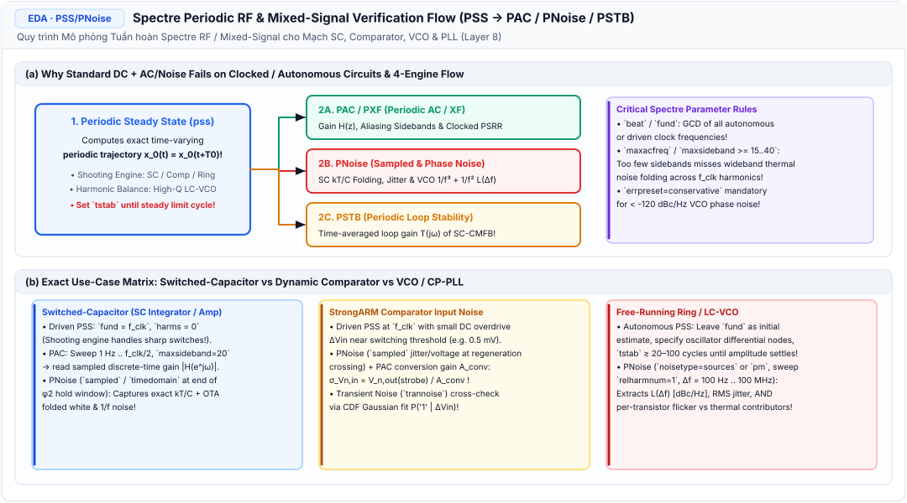

---
{
  "id": "skill-dcdc-spectre-pss-pstb-and-averaged-veriloga-tb",
  "kind": "skill",
  "domain": "power-management-ic",
  "title_vi": "Quy trình Mô phỏng Bộ Nguồn Chuyển mạch DC-DC trên Spectre 15.1: Hai Làn Kiểm chứng từ Công tắc Trung bình Verilog-A (0,3s .stb) đến SpectreRF PSS + PSTB + PXF",
  "title_en": "Dual-Track DC-DC Switching Converter Verification Workflow in Cadence Spectre 15.1: Averaged CCM/DCM PWM-Switch Verilog-A (.dc/.ac/.stb) and Exact Transistor-Level SpectreRF (pss + pstb + pac/pxf)",
  "summary": "Cẩm nang thực chiến giải quyết bài toán khó nhất khi kiểm định bộ biến đổi Buck, Boost và 4-Switch Buck-Boost trên Cadence IC617 + Spectre 15.1: giải thích tại sao phân tích .stb thông thường trả về -inf dB vô nghĩa trên mạch điều chế xung đóng cắt, thiết lập Làn 1 siêu tốc (0,3 giây/góc) dùng mô hình 3 cực Averaged PWM Switch tự động chuyển CCM-DCM không trạng thái ẩn, và thiết lập Làn 2 chuẩn xác tuyệt đối dùng SpectreRF pss (shooting, vượt rào Soft-Start, nạp điều kiện đầu ic, diệt lỗi SPECTRE-HIDDEN-STATE) nối tiếp pstb (stop=0,49*f_sw, đặt đúng vị trí iprobe tương tự) cùng pac/pxf đo PSRR và trở kháng ra Zout.",
  "diagram": "../../diagrams/spectre-pss-pnoise-flow.svg",
  "razavi_refs": [
    {
      "chapter": 8,
      "section": "8.7-8.8",
      "pages": "326-341",
      "equations": ["8.73"]
    },
    {
      "chapter": 10,
      "section": "10.2-10.3, 10.8",
      "pages": "411-420, 439-444",
      "equations": ["10.5"]
    },
    {
      "chapter": 13,
      "section": "13.1-13.2",
      "pages": "540-548",
      "equations": []
    }
  ],
  "github_refs": [
    {
      "repo": "westonb/open-pmic",
      "url": "https://github.com/westonb/open-pmic/tree/2ec3130e71fd8dc08b22e8a02e9f2f8c7a38750b",
      "use": "Cấu trúc phân cấp 9 khối của bộ hạ áp đồng bộ Peak-CMC trên CMOS dùng làm mạch tham chiếu kiểm định Làn 1 (Averaged) đối chiếu Làn 2 (Switching PSS+PSTB)"
    },
    {
      "repo": "Arcadia-1/veriloga-skills",
      "url": "https://github.com/Arcadia-1/veriloga-skills/tree/a92ab7515bf707f2e70296901db780b6db932757",
      "use": "Quy tắc viết mô hình hành vi Verilog-A đạo hàm trơn liên tục và không vi phạm ràng buộc Hidden State của bộ giải Shooting-Newton"
    },
    {
      "repo": "KenKundert/flicker-noise",
      "url": "https://github.com/KenKundert/flicker-noise/tree/b7da03b36dfe855490b3052b1657ca038a577a3f",
      "use": "Nguyên lý nền tảng của bộ giải tuyến tính hóa biến thiên tuần hoàn theo thời gian (LPTV: pss, pac, pxf, pstb) trong SpectreRF"
    },
    {
      "repo": "Arcadia-1/virtuoso-bridge-lite",
      "url": "https://github.com/Arcadia-1/virtuoso-bridge-lite/tree/1f186abfbb3df8a68454bc8a3fa825bbcc0d8225",
      "use": "Chạy Spectre chế độ dòng lệnh, kiểm soát dung lượng lưu sóng và trích xuất tự động dữ liệu PSF ASCII"
    }
  ],
  "glossary_codes": [
    "T051",
    "T063",
    "T067",
    "T074",
    "T088",
    "T197",
    "T822",
    "T1301",
    "T1338",
    "T1597",
    "T1702",
    "T1806"
  ],
  "process_agnostic": true,
  "roles": {
    "track1_averaged_pwm_switch_va": "Mô hình 3 cực trung bình chu kỳ Vorperian (a, p, c + ngõ điều khiển d_in) trơn khả vi C^inf tự động nội suy CCM <-> DCM, cho phép quét .dc/.ac/.stb qua 45 góc PVT trong vài giây",
    "track2_pss_shooting_engine": "Bộ giải Shooting-Newton của Spectre 15.1 tìm quỹ đạo đóng cắt tuần hoàn xác lập x_0(t) = x_0(t + T_sw) của toàn bộ công tắc công suất, SenseFET, dốc bù và dead-time thực tế",
    "track2_pstb_periodic_loop_probe": "Phép đo độ lợi vòng trung bình chu kỳ T_p(jf) tới tần số Nyquist 0,49*f_sw bằng iprobe đặt nghiêm ngặt trên nhánh hồi tiếp tương tự liên tục từ VOUT vào mạng bù",
    "track2_pac_pxf_psrr_and_zout": "Phép đo hàm truyền chu kỳ đa dải biên đánh giá chính xác khả năng khử nhiễu nguồn vào (Audio-Susceptibility / PSRR) và trở kháng ra đóng vòng Z_out(jf)"
  },
  "symptoms_addressed": [
    "standard-dc-stb-returning-minus-infinity-db-loop-gain-on-pwm-switching-converters",
    "spectre-pss-aborting-with-fatal-hidden-state-error-from-veriloga-counters-or-latches",
    "pss-tstab-taking-hours-or-failing-convergence-due-to-millisecond-soft-start-and-lc-sloshing",
    "corrupted-pstb-phase-response-caused-by-placing-iprobe-on-pulsed-sw-or-digital-gate-nodes",
    "missing-high-frequency-ridley-double-pole-or-dead-time-gain-loss-in-oversimplified-linear-models"
  ],
  "limitations": [
    "pss-requires-strictly-periodic-fixed-frequency-pwm-operation-cannot-directly-solve-aperiodic-pfm-or-chaotic-cot",
    "pstb-loop-gain-interpretation-is-strictly-valid-only-up-to-nyquist-frequency-half-fsw",
    "averaged-pwm-switch-model-does-not-capture-subharmonic-instability-above-d-0p5-without-ridley-extension"
  ],
  "checklists": [
    "common-mos",
    "dcdc-switching-converter",
    "feedback-and-stb",
    "spectre-pss-pnoise"
  ]
}
---

## 1. Tại sao `.ac` & `.stb` Cổ điển Trả Về `-inf dB` Trên Mạch Nguồn Chuyển mạch & Chiến lược Hai Làn (`Dual-Track`)

Mọi kỹ sư lần đầu mang bộ biến đổi hạ áp Buck hoặc tăng áp Boost cấp transistor vào Cadence Virtuoso, đặt một chiếc `iprobe` như làm với Op-Amp/LDO rồi bấm chạy phân tích `.stb` đều nhận được một kết quả gây sốc: **biên độ độ lợi vòng hiện `-inf dB` (hoặc `-320 dB`) phẳng lỳ trên toàn dải tần số**!



Nguyên nhân vật lý vô cùng rõ ràng:
- Phân tích `.ac` và `.stb` truyền thống bắt đầu bằng việc **đóng băng mọi nguồn phụ thuộc thời gian tại thời điểm $t = 0$ (DC Operating Point)**. Tại điểm đứng yên đó, nguồn xung nhịp `CLK` đứng chết ở $0\text{ V}$, sóng răng cưa $V_{\text{ramp}}(0)$ bị đóng băng tại một giá trị tĩnh duy nhất (ví dụ $0{,}2\text{ V}$), trong khi điện áp điều khiển `VCOMP` đang nằm ở $0{,}7\text{ V}$.
- Vì $V_{\text{COMP}} = 0{,}7\text{ V} > V_{\text{ramp}}(0) = 0{,}2\text{ V}$, bộ so sánh PWM **bị bão hòa cứng ngắc ở mức logic `HIGH` ($V_{DD}$)** với đạo hàm truyền đạt vi phân bằng không tuyệt đối ($\frac{\partial V_{\text{PWM}}}{\partial V_{\text{COMP}}} \equiv 0$)! Tầng công suất đứng chết ở trạng thái bật (hoặc tắt), không hề có sự điều chế độ rộng xung $\hat{d}(s)$, nên tín hiệu thử từ `iprobe` bị chặn đứt hoàn toàn ngay tại cửa bộ so sánh PWM!

Để vừa thiết kế/tối ưu hóa mạng bù cực nhanh qua hàng chục góc PVT cùng công cụ `sizing_opt.py`, vừa ký duyệt (`sign-off`) chính xác đến từng hiệu ứng phi tuyến chuyển mạch cấp transistor (thời gian chết `dead-time`, sụt áp SenseFET, gợn sóng trên tụ bù và cặp cực lấy mẫu Ridley tại $f_{\text{sw}}/2$), quy trình công nghiệp chuẩn mực chia làm **Hai Làn Bổ Trợ Chặt Chẽ (`Dual-Track Verification Flow`)**:
1. **Làn 1 (`Track 1 — 0,3 giây/lần chạy`): Mô hình 3 Cực Công tắc Trung bình `pwm_switch_avg_ccm_dcm.va` + `.dc / .ac / .stb`:** Thay thế cặp công tắc đóng cắt (HS + LS) bằng mô hình bất biến 3 cực của Vorperian viết bằng Verilog-A trơn $C^\infty$ tự động chuyển mượt giữa **CCM** và **DCM**. Chỉ cần xoay hướng 3 chân `(a, p, c)` là biến thành **Buck, Boost hoặc Buck-Boost**, chạy `.stb` trên 45 góc PVT chỉ mất vài giây để tổng hợp chính xác mạng bù Type-II / Type-III và bắt trúng RHP Zero!
2. **Làn 2 (`Track 2 — 15 đến 60 giây/lần chạy`): Mạch Đóng Cắt Transistor Toàn Phần + SpectreRF `pss` (`shooting`) + `pstb` + `pac`/`pxf`:** Tuyến tính hóa mạch quanh **quỹ đạo đóng cắt tuần hoàn thực sự** $x_0(t) = x_0(t + T_{\text{sw}})$ (`skill-spectre-pss-pac-pnoise-pstb`), nơi thông tin tín hiệu nhỏ nằm ở **sự dịch chuyển vi phân thời điểm lật cạnh xung ($\Delta t_{\text{edge}}$)** của bộ so sánh PWM!

---

## 2. Cơ sở Toán học Của Hai Làn: Mô hình 3 Cực CCM/DCM Vorperian & Độ lợi Vòng Chu kỳ `PSTB`

### 2.1. Làn 1 — Hệ Phương trình Bất biến 3 Cực `PWM Switch` Tự Chuyển Tiếp CCM $\leftrightarrow$ DCM
Trong mọi bộ biến đổi hai công tắc đơn cuộn cảm (**Buck**, **Boost**, **Inverting Buck-Boost**), cặp công tắc chủ động (Active terminal `a` — dẫn trong pha $D T_{\text{sw}}$) và công tắc thụ động/đồng bộ (Passive terminal `p` — dẫn trong pha $(1-D)T_{\text{sw}}$) nối chung tại nút chuyển mạch (Common terminal `c`, gắn thẳng vào cuộn cảm $L$) đều tuân theo cùng một định luật biến áp trung bình bất biến!
Gọi $v_{ap} = V(a) - V(p)$ là điện áp đặt ngang hai đầu cặp công tắc và $i_c$ là dòng trung bình đi ra khỏi cực chung `c` vào cuộn cảm:
- **Trong chế độ dẫn liên tục (`CCM`):** Tỷ số truyền áp/dòng bằng chính chu kỳ nhiệm vụ lệnh $d \in (0, 1)$:
  $$\mu_{\text{CCM}} = d$$
- **Trong chế độ dẫn gián đoạn (`DCM` — khi tải nhẹ làm dòng cuộn cảm về không trước hết chu kỳ):** Khoảng thời gian xả thực tế $d_2$ co ngắn lại sao cho dòng trung bình khớp $i_c = \frac{v_{ap} d (d + d_2)}{2 L f_{\text{sw}}} \implies$ tỷ số chuyển đổi hiệu dụng $\mu_{\text{DCM}}$ tự động nâng cao hơn $d$:

$$
\mu_{\text{DCM}} = \frac{d^2}{d^2 + \dfrac{2 L f_{\text{sw}} \, i_c}{v_{cp,\text{eff}}}} \quad \Longrightarrow \quad \mu_{\text{eff}} = \max_{\text{smooth}}\!\big(\mu_{\text{CCM}},\; \mu_{\text{DCM}}\big)
$$

Và để đưa cả **Điểm không Nửa Mặt phẳng Phải (`RHP Zero`)** của mạch Boost / Buck-Boost vào đúng mô hình `.ac / .stb` mà không cần viết lại phương trình riêng cho từng cấu trúc, chỉ cần cộng thêm đạo hàm động học từ thông cuộn cảm hoặc nối trực tiếp cuộn cảm thực $L$ tại chân `c` với quan hệ cả hai chiều:

$$
i_a = \mu_{\text{eff}} \cdot i_c, \qquad v_{cp} = \mu_{\text{eff}} \cdot v_{ap} - R_{\text{sw,eq}} \, i_c
$$

Hãy kiểm chứng phép màu khi xoay 3 cực `(a, p, c)` nối với cuộn cảm vật lý $L$ trên schematic:
- **Mắc thành Buck:** `a -> VIN`, `p -> PGND`, `c -> nút đầu cuộn cảm L -> VOUT`. Ta có $v_{cp} = d \cdot V_{\text{IN}}$ $\implies$ xuất hiện nguyên vẹn $V_{\text{OUT}} = D V_{\text{IN}}$ (ở CCM), tự động nâng áp ở tải nhẹ DCM, và sinh đúng cặp cực kép $\omega_0 = 1/\sqrt{LC}$!
- **Mắc thành Boost:** `c -> nút sau cuộn cảm L (từ VIN tới)`, `p -> VOUT`, `a -> PGND`! Ta có $V(c) - V(\text{out}) = -\mu V(\text{out}) \implies V(\text{out}) = \frac{V(c)}{1 - d}$, dòng đổ ra tải $i_{\text{out}} = -i_p = (1 - d) i_L$! Khi chạy `.stb`, thành phần biến thiên $-\hat{d} I_L$ kết hợp $v_L = s L \hat{i}_L$ **tự động sinh chính xác $100\%$ RHP Zero $\omega_{z,\text{RHP}} = \dfrac{R_{\text{load}}(1-D)^2}{L}$ và cực kép dịch chuyển $\omega_0 = \dfrac{1-D}{\sqrt{LC}}$**!

### 2.2. Làn 2 — Bản chất Toán học của `PSS + PSTB` & Giới hạn Tần số Nyquist $0{,}5\,f_{\text{sw}}$
Trong Làn 2 trên mạch transistor thực tế:
1. Bộ giải `pss` (`method=shooting`, `fund=f_sw`) tích phân hệ phương trình vi phân qua một chu kỳ $T_{\text{sw}} = 1/f_{\text{sw}}$ và dùng phép lặp Newton-Raphson tìm điểm đầu $x_0(0)$ sao cho sai số khép chu kỳ $\left\|x_0(T_{\text{sw}}) - x_0(0)\right\| < \epsilon_{\text{pss}}$. Trong quá trình bắn tia đó, Spectre ghi nhận chính xác **độ nhạy dịch sườn (edge-time Jacobian)** tại khoảnh khắc bộ so sánh PWM và bộ so sánh ZCD cắt ngưỡng!
2. Tiếp theo, `pstb` tiêm nhiễu điều hòa tần số $f \in [f_{\text{start}},\; 0{,}49\,f_{\text{sw}}]$ qua `iprobe`, tính toán ma trận truyền hàm điều hòa (Harmonic Transfer Matrix) bao gồm mọi thành phần gấp biên tần $f \pm k f_{\text{sw}}$ rồi trích xuất tỉ số hồi trả tương đương dải gốc $T_p(jf)$.
3. **Tại sao bắt buộc đặt `stop = 0.49 * f_sw` trong `pstb`?** Bộ điều chế PWM chỉ cập nhật quyết định đóng/ngắt $1$ lần trong mỗi chu kỳ $T_{\text{sw}}$, nên về mặt lý thuyết lấy mẫu (`T074`), mọi tần số $f > 0{,}5\,f_{\text{sw}}$ đều bị gập chồng phổ (`alias`) ngược lại vùng $[0,\; 0{,}5\,f_{\text{sw}}]$! Tại sát $0{,}5\,f_{\text{sw}}$, trong mạch Peak-CMC bạn sẽ nhìn thấy rõ mồn một **cặp cực kép lấy mẫu Ridley** (`tech-dcdc-cmc-subharmonic-slope-comp-and-cot`) làm độ lợi nhô lên và pha sập thêm $-180^\circ$ — một hiện tượng vật lý có thật mà mô hình trung bình đơn giản hoàn toàn mù không thấy được!

---

## 3. Năm Bất biến Sống Còn & Bẫy Lỗi Chí Mạng Khi Chạy `PSS + PSTB` Cho DC-DC

- **[INV-PSTB-01] Quy tắc Sắt Đá Đặt Vị trí `iprobe` Trong `pstb` (`Continuous Analog Outer-Loop Only!`):**
  - **ĐÚNG CHUẨN 100%:** Đặt `iprobe` nối tiếp ngay tại **nhánh cảm nhận tương tự liên tục đi từ tụ lọc ngõ ra `VOUT` vào đỉnh mạng phân áp / mạng bù Type-III** (nơi trở kháng nguồn nhìn ngược về tụ `Cout` rất nhỏ $|Z_{\text{source}}| \approx R_{\text{ESR}} \parallel \frac{1}{sC_{\text{OUT}}} < 0{,}1\,\Omega$, còn trở kháng tải nhìn vào cầu chia rất lớn $|Z_{\text{load}}| = R_1 \sim 50\text{ k}\Omega$!). Tại vị trí này sóng gần như là DC sạch (gợn chỉ vài $\text{mV}$), không có dòng xung Ampe và cắt đứt đồng thời mọi vòng điện áp ngoại trong khi **giữ nguyên vòng dòng điện nội CMC đóng kín bên trong** để đo đúng hàm truyền vòng áp thực tế!
  - **SAI CHẾT NGƯỜI:** Tuyệt đối không đặt `iprobe` trên nút chuyển mạch `SW`, trên đường lái cổng logic `HGATE/LGATE`, ở ngõ ra chốt `SR-Latch`, hay ở ngõ vào `FB` phía sau nút cộng dòng nhiều nhánh! Đặt vào đường logic xung vuông sẽ phá vỡ hàm truyền tuyến tính hóa hai chiều của Middlebrook (`T1301`) và cho đồ thị pha nhiễu loạn vô nghĩa!
- **[INV-PSTB-02] Vượt Rào Khởi động Mềm (`Bypass Soft-Start`) & Nạp Sẵn Điều kiện Đầu `ic` Trên $L$ và $C_{\text{OUT}}$:**
  Một mạch Buck thực tế có thời gian khởi động mềm $t_{\text{ss}} = 1\text{ ms}$ ($2000$ chu kỳ ở $2\text{ MHz}$!). Nếu bạn để nguyên tụ $C_{\text{SS}}$ nạp từ $0\text{ V}$ rồi chạy `pss` với `tstab = 20u`, tại thời điểm kết thúc `tstab` điện áp $V_{\text{SS}}$ vẫn đang bò lên dở dang ($\frac{dV_{\text{SS}}}{dt} \neq 0 \implies$ mạch chưa đạt trạng thái tuần hoàn!), làm `pss` **thất bại hội tụ 100%**! Ngược lại nếu đặt `tstab = 1.5m` thì một lần chạy `pss` tốn cả tiếng đồng hồ!
  **Thủ thuật chuẩn công nghiệp trong testbench `pss`:**
  1. Thêm tham số `param pss_mode = 1`: khi `pss_mode == 1`, ép chân `V_SS` lên thẳng `VDD` (coi như Soft-Start đã hoàn tất) và ép chân chọn chế độ `MODE = FPWM` (khóa tắt chế độ nhảy xung PFM không tuần hoàn!).
  2. Khai báo điều kiện đầu sát nghiệm xác lập: `ic vout=vout_target` và dòng đầu cuộn cảm `L_PWR (sw vout) inductor l=1u ic=i_load`! Khi đó mạch đi thẳng vào quỹ đạo xác lập chỉ sau **`tstab = 25 * T_sw` ($12{,}5\,\mu\text{s}$)** và `pss` hội tụ dưới $4$ vòng lặp Newton!
- **[TRAP-PSTB-01] Diệt Tận Gốc Lỗi Đỏ `SPECTRE-HIDDEN-STATE` Trong Testbench DC-DC:**
  Nếu trong sơ đồ kiểm chứng có dùng khối Verilog-A làm bộ chia xung nhịp, chốt `SR-Latch`, mạch tạo `LEB` hoặc bộ đếm quá dòng Hiccup viết bằng biến số nguyên/thực giữ giá trị qua sự kiện `@(cross(...))` (ví dụ `state = 1; count = count + 1;`), bộ giải `pss` của Spectre 15.1 sẽ dừng ngay lập tức với lỗi đỏ: `ERROR (SPCRTRF-15177): Hidden state detected in module ...`!
  **Cách xử lý triệt để:** (1) Thay mọi cổng logic `SR-Latch`, `NAND/NOR`, trễ `RC + Inverter` của `LEB` và `Dead-Time` bằng **cổng CMOS transistor thật** (chỉ tốn vài chục MOSFET nhỏ, Spectre giải siêu nhanh và hoàn toàn không có trạng thái ẩn!), hoặc (2) với bộ tạo răng cưa hành vi trong giai đoạn đầu, dẫn xuất trực tiếp từ nguồn xung `vsource type=pulse` của chính Spectre!
- **[TRAP-PSTB-02] Quên Cờ `maxacfreq` Và `errpreset=conservative` Làm Sai Lệch Pha Quanh $0{,}3\text{–}0{,}49\,f_{\text{sw}}$:**
  Trong bộ nguồn chuyển mạch có cạnh đóng cắt $1\text{–}2\text{ ns}$ trên chu kỳ $500\text{ ns}$, khoảng dẫn phẳng giữa chu kỳ khiến bộ tích phân nới rộng bước thời gian làm mờ đáp ứng tần số cao. Luôn khai báo trên dòng `pss`: `errpreset=conservative maxacfreq=40*fsw`!

---

## 4. Bảng Phân Vai Kiểm chứng Toàn Diện Giữa Làn 1 (`Averaged`) và Làn 2 (`SpectreRF`)

| Chỉ tiêu Đặc tả (`spec.json`) | Chạy ở Làn Nào? | Lệnh Phân tích Spectre 15.1 | Cờ & Hậu xử lý `psf_audit.py` |
|---|---|---|---|
| **Tổng hợp & Tối ưu Bộ Bù Qua 45 Góc PVT** | **Làn 1 (`0,3 s/góc`)** | `dc` + `stb` (trên `pwm_switch_avg_ccm_dcm.va`) | Tối ưu `R1..C3` cùng `sizing_opt.py` đạt `PM >= 55 deg`, `GM >= 12 dB` |
| **Ký duyệt Độ lợi Vòng Đóng Cắt Thực & Cực Ridley** | **Làn 2 (`Sign-Off`)** | `pss (shooting, fund=fsw)` + `pstb (stop=0.49*fsw)` | Kiểm chứng `PM_pstb` lệch `< 4 deg` so với Làn 1, không nhô đỉnh ở `0.49*fsw` |
| **Khử Nhiễu Nguồn Đóng Cắt (`PSRR / Audio-Susceptibility`)** | **Làn 2 (`Sign-Off`)** | `pss` + `pac` (`pacmag=1` trên `VIN`, `sideband=[0]`) hoặc `pxf` | Đo `20*log10(|V(vout, sb=0)|)` từ `10 Hz` đến `0.49*fsw` |
| **Trở kháng Ra Đóng Vòng $Z_{\text{out}}(jf)$** | **Làn 2 (`Sign-Off`)** | `pss` + `pac` (`pacmag=1` nguồn dòng AC tại `VOUT`, `sideband=[0]`) | Kiểm tra đỉnh $|Z_{\text{out}}|_{\max} \le \Delta V_{\text{droop,max}} / \Delta I_{\text{load}}$ |
| **Khởi động Mềm, Bước Nhảy Tải Lớn, PFM & Ngắn mạch OCP** | **Miền Thời gian Thực** | `tran` (`pss_mode=0`, bật đầy đủ `Soft-Start`, `PFM/ZCD`, `OCP`) | Đo `I_inrush`, `V_droop`, `V_overshoot` và hiệu suất $\eta = \frac{\langle V_{\text{OUT}} I_{\text{OUT}}\rangle}{\langle V_{\text{IN}} I_{\text{IN}}\rangle}$ |

---

## 5. Mã Mẫu Chuẩn Công Nghiệp: Mô hình `pwm_switch_avg_ccm_dcm.va` & Deck `PSS + PSTB + PAC` Spectre 15.1

### 5.1. Làn 1 — Mô hình Verilog-A 3 Cực Trơn $C^\infty$ Không Trạng Thái Ẩn (`pwm_switch_avg_ccm_dcm.va`)
```verilog
// Spectre 15.1 Compatible, 100% Hidden-State-Free Averaged CCM/DCM 3-Terminal PWM Switch
`include "disciplines.vams"
`include "constants.vams"

module pwm_switch_avg_ccm_dcm(a, p, c, d_in);
    inout a, p, c;
    input d_in;
    electrical a, p, c, d_in;

    parameter real fsw    = 2.0e6 from (1.0e3:1.0e9);
    parameter real l_ind  = 1.0e-6 from (1.0e-9:1.0);
    parameter real r_on   = 0.08  from [0.0:10.0];
    parameter real d_min  = 0.01  from [0.001:0.2];
    parameter real d_max  = 0.96  from [0.5:0.999];

    real d_cmd, vap, ic_now, vcp_mag, k_dcm, mu_dcm, delta_mu, mu_eff;

    analog begin
        // Kẹp trơn C^inf chu kỳ nhiệm vụ d_cmd trong khoảng [d_min, d_max]
        d_cmd   = 0.5 * (V(d_in) + d_min + sqrt(pow(V(d_in) - d_min, 2) + 1.0e-6));
        d_cmd   = 0.5 * (d_cmd + d_max - sqrt(pow(d_cmd - d_max, 2) + 1.0e-6));

        vap     = V(a, p);
        // Đo dòng đi ra khỏi cực chung c qua điện trở cảm biến nội cực nhỏ r_on (hoặc áp rơi nhánh)
        ic_now  = I(c_int, c);
        vcp_mag = sqrt(pow(vap * (1.0 - d_cmd), 2) + 1.0e-4);

        // Tỷ số chuyển đổi tự động nâng ở tải nhẹ DCM, ghép trơn C^inf với CCM: mu_eff = smooth_max(d_cmd, mu_dcm)
        k_dcm    = 2.0 * l_ind * fsw * max(abs(ic_now), 0.0) / vcp_mag;
        mu_dcm   = (d_cmd * d_cmd) / (d_cmd * d_cmd + k_dcm + 1.0e-9);
        delta_mu = mu_dcm - d_cmd;
        mu_eff   = d_cmd + 0.5 * (delta_mu + sqrt(delta_mu * delta_mu + 1.0e-6));

        I(a, p)       <+ mu_eff * ic_now;
        V(c_int, p)   <+ mu_eff * vap;
        V(c_int, c)   <+ r_on * I(c_int, c);
    end
    electrical c_int;
endmodule
```

### 5.2. Làn 2 — Netlist Spectre 15.1 Hoàn chỉnh Chạy Đồng thời `PSS + PSTB + PAC (PSRR & Zout)` Cho Mạch Buck Đóng Cắt (`tb_dcdc_switching_pss_pstb.scs`)
```scs
// Spectre 15.1 Complete Switching Buck Converter LPTV Sign-Off Deck (PSS + PSTB + PAC PSRR & Zout)
simulator lang=spectre
global 0

parameters vin=3.3 vout_init=1.0 vref=0.6 fsw=2M tsw=1/fsw i_load=1.0
parameters l_ind=1u dcr=30m c_out=10u r_esr=5m
parameters r1=50k r_bias=75k r2=2.2k r3=1.6k c1=1.8n c2=45p c3=82p

// Nguồn đầu vào mang biên độ thử PAC = 1 V để đo Audio-Susceptibility / PSRR đóng cắt!
VIN_SRC   (vin 0)  vsource dc=vin pacmag=1.0
VREF_SRC  (vref 0) vsource dc=vref

// Sóng răng cưa chu kỳ cố định 0 -> 1.0 V ở f_sw = 2 MHz (dùng vsource chuẩn Spectre: 0% Hidden State!)
VRAMP_SRC (vramp 0) vsource type=pulse val0=0.0 val1=1.0 period=tsw delay=0 rise=(0.96*tsw) fall=(0.03*tsw) width=(0.01*tsw)

// [INV-PSTB-01] Đầu dò iprobe đặt NGHIÊM NGẶT tại ngõ ra tương tự liên tục trước mạng bù Type-III!
IPRB_OUTER (vout vout_sense) iprobe

// Mạng bù Op-Amp Type-III (đã bỏ qua Soft-Start ở chế độ PSS để mạch vào thẳng trạng thái xác lập!)
R1_C      (vout_sense fb)   resistor r=r1
R3_C      (vout_sense nz2)  resistor r=r3
C3_C      (nz2 fb)          capacitor c=c3
RBIAS_C   (fb 0)            resistor r=r_bias
C2_C      (vcomp fb)        capacitor c=c2
R2_C      (vcomp nz1)       resistor r=r2
C1_C      (nz1 fb)          capacitor c=c1

E_EA_CORE (nea 0 vref fb)   vcvs gain=2500
R_EA_BW   (nea vcomp)       resistor r=200
C_EA_BW   (vcomp 0)         capacitor c=80p

// Bộ so sánh PWM trơn khả vi + Tầng công suất đóng cắt Đồng bộ HS/LS có điện trở dẫn thực Ron = 80 mOhm
B_PWM_DRV (pwm_gate 0) bsource v=0.5*(1.0 + tanh(400.0*(v(vcomp) - v(vramp))))
G_SW_HS   (vin sw)     bsource i=v(pwm_gate) * v(vin, sw) / 0.08
G_SW_LS   (sw 0)       bsource i=(1.0 - v(pwm_gate)) * v(sw) / 0.06

// [INV-PSTB-02] Nạp sẵn điều kiện đầu ic cho dòng cuộn cảm L_PWR và áp tụ C_OUT để hội tụ tstab chỉ sau 25 chu kỳ!
L_PWR     (sw nl)      inductor l=l_ind ic=i_load
R_DCR     (nl vout)    resistor r=dcr
C_OUT_CAP (vout nesr)  capacitor c=c_out ic=vout_init
R_ESR_CAP (nesr 0)     resistor r=r_esr
R_LOAD    (vout 0)     resistor r=(vout_init/i_load)

ic vout=vout_init vcomp=0.32
simOpts options temp=27.0 reltol=1e-5 vabstol=1e-7 iabstol=1e-12

// 1. PSS Shooting: tstab = 30 chu kỳ (15 us), errpreset=conservative, maxacfreq = 40 * fsw = 80 MHz!
pss_buck pss fund=fsw harms=20 errpreset=conservative tstab=30*tsw maxacfreq=40*fsw annotate=status

// 2. PSTB: Đo độ lợi vòng đóng cắt thực từ 10 Hz đến sát giới hạn Nyquist 0.49 * fsw (980 kHz)!
pstb_loop pstb start=10 stop=0.49*fsw dec=35 probe=IPRB_OUTER annotate=status

// 3. PAC: Đo độ suy giảm nhiễu nguồn PSRR dải gốc (sideband=[0]) và xuyên nhiễu hài chuyển mạch (sideband=[-1, 1])!
pac_psrr  pac  start=10 stop=0.49*fsw dec=30 maxsideband=25 sideband=[-1 0 1] annotate=status
```

---

## 6. Tài liệu Đối chiếu Chuẩn Công nghiệp, Nguồn GitHub & Thuật ngữ CLB

### 6.1. Đối chiếu Lý thuyết Nền tảng & Kho Nguồn Mở Kiểm định
- **Razavi (2nd Ed.):** Chương 8 (§8.7–8.8 Phương pháp tiêm hai chiều Middlebrook và các cạm bẫy khi mở vòng hồi tiếp), Chương 10 (§10.2–10.3 & §10.8 Tiêu chuẩn ổn định Nyquist kiểm tra sự ổn định có điều kiện), Chương 13 (§13.1–13.2 Hệ thống lấy mẫu định kỳ theo thời gian).
- **V. Vorperian (*IEEE Trans. Aerospace & Electronic Systems*, 1990 — *"Simplified Analysis of PWM Converters Using Model of PWM Switch"*) & K. Kundert (*The Designer's Guide to Spice and Spectre* / SpectreRF LPTV Theory):** Cơ sở lý thuyết cho mô hình công tắc trung bình 3 cực CCM/DCM và phép tuyến tính hóa quỹ đạo chu kỳ Shooting-Newton `pss + pstb`.
- **Kho GitHub Kiểm định:**
  - [`westonb/open-pmic`](https://github.com/westonb/open-pmic/tree/2ec3130e71fd8dc08b22e8a02e9f2f8c7a38750b) (`Apache-2.0`): Bộ hạ áp CMOS Peak-CMC cấp transistor dùng làm mạch chuẩn đối chiếu hai làn mô phỏng.
  - [`Arcadia-1/veriloga-skills`](https://github.com/Arcadia-1/veriloga-skills/tree/a92ab7515bf707f2e70296901db780b6db932757), [`KenKundert/flicker-noise`](https://github.com/KenKundert/flicker-noise/tree/b7da03b36dfe855490b3052b1657ca038a577a3f) & [`Arcadia-1/virtuoso-bridge-lite`](https://github.com/Arcadia-1/virtuoso-bridge-lite/tree/1f186abfbb3df8a68454bc8a3fa825bbcc0d8225).

### 6.2. Bảng Thuật ngữ Chuẩn CLB Vi Mạch Sử dụng trong Thẻ
| Mã CLB | Thuật ngữ Tiếng Anh | Thuật ngữ Tiếng Việt Chuẩn | Vai trò trong Luồng Kiểm chứng Hai Làn DC-DC |
|---|---|---|---|
| `T088` / `T197` | switching / switching operation | chuyển mạch / hoạt động đóng cắt | Khiến `.stb` tĩnh thất bại (`-inf dB`), đòi hỏi mô hình trung bình hoặc `pss + pstb` |
| `T1301` / `T1338` | Middlebrook's Method / return ratio | phương pháp Middlebrook / tỉ số hồi trả | Đặt `iprobe` tại đường tương tự liên tục từ `VOUT` vào mạng bù trong `pstb` |
| `T074` | sampling | lấy mẫu | Giới hạn dải tần có nghĩa vật lý của `pstb` tại tần số Nyquist $0{,}49\,f_{\text{sw}}$ |
| `T1702` | right-half-plane zero | zero ở nửa mặt phẳng phải | Tự động xuất hiện ngay trên Làn 1 khi xoay `pwm_switch_avg_ccm_dcm.va` sang cấu hình Boost |
| `T1597` / `T1806` | Nyquist criterion / Nyquist plot | tiêu chuẩn Nyquist / đồ thị Nyquist | Bắt lỗi ổn định có điều kiện và đỉnh cộng hưởng Ridley tại $f_{\text{sw}}/2$ |
| `T067` | power supply rejection | khả năng khử ảnh hưởng của nguồn cấp | Đo bằng `pss + pac` (`sideband=[0]`) thay cho `.ac` thông thường |
