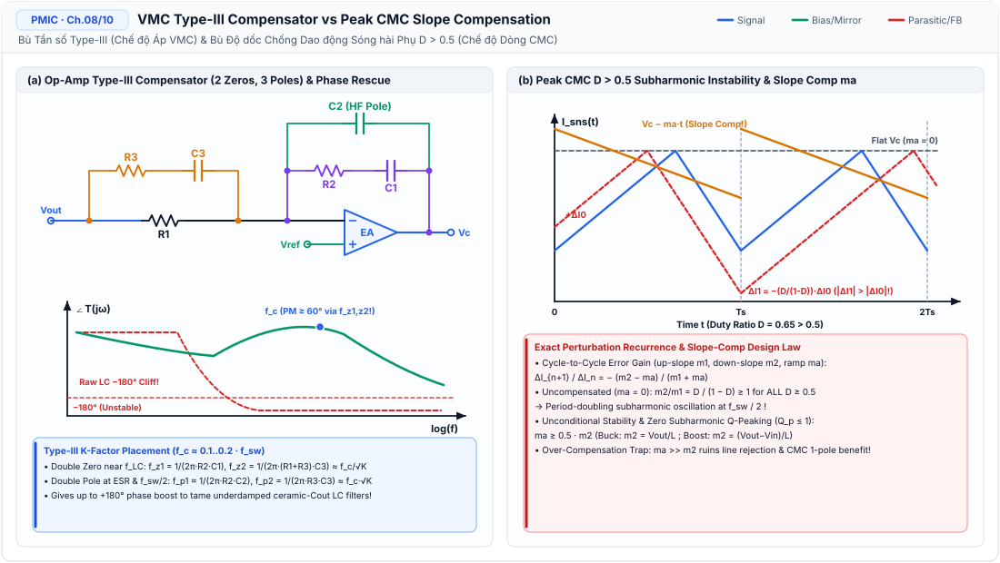

---
{
  "id": "tech-dcdc-cmc-subharmonic-slope-comp-and-cot",
  "kind": "technique",
  "domain": "power-management-ic",
  "title_vi": "Điều khiển Chế độ Dòng Đỉnh/Thung lũng (CMC), Dao động Phân hài D > 0,5, Bù Độ dốc Chính xác & Constant-On-Time (COT)",
  "title_en": "Peak & Valley Current-Mode Control (CMC), Subharmonic Instability Derivation, Exact Slope Compensation & Constant-On-Time (COT) Ripple Injection",
  "summary": "Hệ lý thuyết trụ cột của các bộ nguồn chuyển mạch công nghiệp hiện đại: biến cuộn cảm L thành nguồn dòng điều khiển từng chu kỳ để xóa sổ cực kép LC thành cực đơn tải R_load*C_out kèm cặp cực lấy mẫu Ridley tại f_sw/2, chứng minh hình học sự bùng nổ nhiễu loạn phân hài Delta_I[n+1] = -(D/(1-D))*Delta_I[n] khi D > 0,5, thiết lập bất đẳng thức bù độ dốc m_a >= 0,5*m_2 và điều kiện tắt dần một chu kỳ tối ưu m_a = m_2, cùng kiến trúc Constant-On-Time (COT) tiêm gợn nhân tạo cho tụ gốm MLCC.",
  "diagram": "../../diagrams/vmc-type3-and-cmc-slope-comp.svg",
  "razavi_refs": [
    {
      "chapter": 8,
      "section": "8.1.1, 8.1.3, 8.2.1, 8.2.3",
      "pages": "275-291, 294-297",
      "equations": ["8.14", "8.24"]
    },
    {
      "chapter": 10,
      "section": "10.2-10.4",
      "pages": "414-425",
      "equations": ["10.5", "10.14"]
    },
    {
      "chapter": 13,
      "section": "13.1-13.2",
      "pages": "539-554",
      "equations": []
    }
  ],
  "github_refs": [
    {
      "repo": "westonb/open-pmic",
      "url": "https://github.com/westonb/open-pmic/tree/2ec3130e71fd8dc08b22e8a02e9f2f8c7a38750b",
      "use": "Thiết kế cấp transistor hoàn chỉnh của bộ hạ áp Peak-Current-Mode Buck Converter gồm khối modulator cộng dốc bù slope compensation, current-sense và OTA Folded-Cascode"
    },
    {
      "repo": "Arcadia-1/analog-design-bench",
      "url": "https://github.com/Arcadia-1/analog-design-bench/tree/972f7cd7c937fd4b779b15f77f0bc9136723182a",
      "use": "Các bài toán chuẩn đánh giá đáp ứng quá độ bước nhảy tải tốc độ cao và độ ổn định đa góc PVT của mạch điều chỉnh nguồn"
    },
    {
      "repo": "Arcadia-1/veriloga-skills",
      "url": "https://github.com/Arcadia-1/veriloga-skills/tree/a92ab7515bf707f2e70296901db780b6db932757",
      "use": "Quy tắc mô hình hóa bộ điều chế xung lấy mẫu chu kỳ không sinh trạng thái ẩn trong mô phỏng Spectre"
    }
  ],
  "glossary_codes": [
    "T042",
    "T051",
    "T063",
    "T074",
    "T088",
    "T535",
    "T822",
    "T997",
    "T1548",
    "T1678",
    "T1702",
    "T1723",
    "T2175",
    "T2176"
  ],
  "process_agnostic": true,
  "roles": {
    "inner_current_control_loop": "Vòng dòng điện nội tốc độ từng chu kỳ so sánh tín hiệu dòng cuộn cảm R_i*i_L(t) với mức lệnh v_c(t) để biến cuộn cảm L thành nguồn dòng điều khiển bằng điện áp i_L ≈ v_c/R_i",
    "artificial_slope_compensator": "Nguồn tạo dốc tuyến tính m_a (cộng vào dòng cảm biến hoặc trừ khỏi lệnh v_c) dập tắt sự nhân bội nhiễu loạn phân hài tại f_sw/2 khi chu kỳ nhiệm vụ D vượt 0,5",
    "outer_voltage_type2_loop": "Vòng điện áp ngoại dùng OTA hỗ dẫn Gm + mạng bù Type-II đơn giản (R_c, C_c, C_p) điều chỉnh chính xác V_OUT trên một hệ thực vật đã rút gọn về bậc một R_load*C_out",
    "cot_on_time_and_ripple_injector": "Bộ định thời gian dẫn thích ứng t_on = K*V_OUT/V_IN kết hợp mạng tiêm gợn đồng pha R_r-C_r cho phép đáp ứng bước nhảy tải ngay trong 1 nhịp xung không cần bộ tạo xung nhịp cố định"
  },
  "symptoms_addressed": [
    "underdamped-lc-double-pole-making-voltage-mode-compensation-fragile-across-capacitors",
    "period-doubling-subharmonic-alternating-wide-narrow-pwm-pulses-when-duty-cycle-exceeds-50-percent",
    "slow-line-transient-response-in-buck-converters-without-feedforward",
    "inductor-current-runaway-during-overload-or-load-step-transients",
    "cot-converter-jitter-and-pulse-bunching-when-using-ultra-low-esr-ceramic-capacitors"
  ],
  "limitations": [
    "extreme-sensitivity-of-current-comparator-to-leading-edge-turn-on-current-spikes",
    "excessive-slope-compensation-degrades-cmc-back-toward-underdamped-voltage-mode-and-shifts-ocp-threshold",
    "cmc-does-not-eliminate-the-right-half-plane-zero-in-ccm-boost-or-buck-boost-converters",
    "peak-to-average-inductor-current-error-causes-line-dependent-current-limit-shift"
  ],
  "checklists": [
    "common-mos",
    "dcdc-switching-converter",
    "feedback-and-stb",
    "comparator-and-sar-adc",
    "layout-and-matching"
  ]
}
---

## 1. Triết lý Hai Vòng Lồng Nhau của Điều khiển Chế độ Dòng (CMC): Biến Cuộn cảm $L$ Thành Nguồn Dòng!

Tại sao trên $85\%$ các IC nguồn chuyển mạch công nghiệp (từ PMIC điện thoại, máy chủ, ô tô cho tới thiết kế mở chuẩn mực `westonb/open-pmic` của Stanford) đều từ bỏ VMC thuần túy để chọn **Điều khiển Chế độ Dòng (Current-Mode Control — CMC)** hoặc **Constant-On-Time (COT)**? Câu trả lời nằm ở một phép biến đổi cấu trúc bậc thầy: thay vì dùng $v_c(t)$ điều khiển trực tiếp độ rộng xung áp đặt lên bộ lọc $L\text{–}C_{\text{OUT}}$, CMC đóng thêm **một vòng hồi tiếp dòng điện nội tốc độ cực nhanh ngay bên trong mỗi chu kỳ chuyển mạch $T_{\text{sw}}$** để ép dòng cuộn cảm $i_L(t)$ bám trực tiếp theo lệnh điều khiển $v_c(t) / R_i$!



Hãy đối chiếu hai biến thể đối ngẫu của CMC trước khi đi vào phương trình:
1. **Điều khiển Chế độ Dòng Đỉnh (`Peak Current-Mode Control — PCMC`):**
   - Tại mỗi cạnh lên của đồng hồ hệ thống `CLK` ($t = n T_{\text{sw}}$), chốt `SR-Latch` được đặt (`SET`), bật công tắc chính High-Side $M_{\text{HS}}$ làm dòng cuộn cảm tăng tuyến tính với độ dốc dương $m_1$ (`T1723`).
   - Dòng cuộn cảm được chuyển thành điện áp $v_s(t) = R_i \, i_L(t)$ (nhờ SenseFET hoặc mạch lọc DCR — xem `topo-dcdc-ramp-sensefet-dcr-and-zcd-blocks`), cộng thêm dốc bù nhân tạo $v_a(t) = S_a t = R_i m_a t$, rồi so sánh với ngõ ra $v_c(t)$ của bộ khuếch đại lỗi điện áp. Ngay khoảnh khắc $R_i i_L(t) + R_i m_a t = v_c(t)$, bộ so sánh dòng lật trạng thái xóa chốt (`RESET`), tắt $M_{\text{HS}}$ và bật $M_{\text{LS}}$ cho hết phần còn lại $(1-D)T_{\text{sw}}$ của chu kỳ (nơi $i_L$ giảm xuống với độ lớn dốc $m_2$).
   - **Ưu điểm vàng:** Tự động tích hợp sẵn **bảo vệ quá dòng đỉnh từng chu kỳ (`Cycle-by-Cycle Peak OCP`)** chỉ bằng cách kẹp trần điện áp tối đa $v_{c,\max} = R_i I_{\text{peak,lim}}$! Phù hợp hoàn hảo khi chu kỳ nhiệm vụ không quá hẹp ($t_{\text{on}}$ đủ rộng hơn cửa sổ chắn gai `LEB` $20\text{–}35\text{ ns}$).
2. **Điều khiển Chế độ Dòng Thung lũng (`Valley Current-Mode Control — VCMC`):**
   - Đồng hồ `CLK` tắt $M_{\text{HS}}$ / bật $M_{\text{LS}}$; mạch đo dòng chảy xuống qua công tắc dưới $M_{\text{LS}}$ (nằm tham chiếu đất `PGND` nên mạch cảm biến dòng cực kỳ đơn giản, không cần dịch mức cao áp!). Khi dòng giảm chạm đáy thung lũng $v_c(t)/R_i$, bộ so sánh bật lại $M_{\text{HS}}$.
   - **Ưu điểm vàng:** Không bị giới hạn thời gian bật tối thiểu $t_{\text{on,min}}$ do gai bật công tắc trên, nên lý tưởng cho các mạch **hạ áp tỷ số lớn tần số cao** (ví dụ $12\text{ V} \to 0{,}8\text{ V}$ ở $3\text{ MHz}$, nơi $D = 0{,}067 \implies t_{\text{on}} \approx 22\text{ ns}$!). Điểm lưu ý đối ngẫu: Valley-CMC bị phân hài khi **$D < 0{,}5$** (ngược hoàn toàn với $D > 0{,}5$ của Peak-CMC!).

---

## 2. Dẫn xuất Hình học Dao động Phân hài, Bất đẳng thức Bù Độ dốc & Mô hình Lấy mẫu Ridley

### 2.1. Chứng minh Hình học Sự Nổ Tung Dao động Phân hài ($f_{\text{sw}}/2$) Khi $D > 0{,}5$
Xét bộ điều chế Peak-CMC ở trạng thái xác lập chu kỳ $T_{\text{sw}}$ với lệnh $I_c = v_c / R_i$ không đổi. Trong thời gian dẫn $D T_{\text{sw}}$, dòng cuộn cảm leo lên với độ dốc $m_1 > 0$; trong thời gian ngắt $D' T_{\text{sw}} = (1-D)T_{\text{sw}}$, dòng giảm với độ lớn dốc $m_2 > 0$:
- **Với Buck:** $m_1 = \dfrac{V_{\text{IN}} - V_{\text{OUT}}}{L}, \quad m_2 = \dfrac{V_{\text{OUT}}}{L}$.
- **Với Boost:** $m_1 = \dfrac{V_{\text{IN}}}{L}, \quad m_2 = \dfrac{V_{\text{OUT}} - V_{\text{IN}}}{L}$.
- **Với Buck-Boost:** $m_1 = \dfrac{V_{\text{IN}}}{L}, \quad m_2 = \dfrac{V_{\text{OUT}}}{L}$.

Do cân bằng Volt-giây xác lập trên MỌI cấu trúc trên (`law-dcdc-volt-second-ccm-dcm-and-state-space`), độ tăng dòng trong pha bật luôn bằng độ giảm dòng trong pha tắt:

$$
m_1 D T_{\text{sw}} = m_2 (1 - D) T_{\text{sw}} \implies \frac{m_2}{m_1} = \frac{D}{1 - D}
$$

**Trường hợp 1 — Chưa có bù độ dốc ($m_a = 0$):** Giả sử đầu chu kỳ thứ $n$, dòng cuộn cảm chịu một nhiễu loạn nhỏ $\Delta I_n$ so với quỹ đạo xác lập. Vì trần ngắt $I_c$ nằm ngang cố định, nhánh dòng bị lệch dương $+\Delta I_n$ sẽ chạm trần $I_c$ **sớm hơn** một khoảng thời gian $\Delta t_n = \dfrac{\Delta I_n}{m_1}$. Khoảng tắt sau đó bị kéo dài thêm đúng $\Delta t_n$, khiến vào cuối chu kỳ (đầu chu kỳ $n+1$), dòng cuộn cảm rơi tụt xuống thấp hơn mức xác lập một lượng:

$$
\Delta I_{n+1} = -m_2 \Delta t_n = -\left(\frac{m_2}{m_1}\right) \Delta I_n = -\left(\frac{D}{1 - D}\right) \Delta I_n \implies \Delta I_{n+k} = \left(-\frac{D}{1 - D}\right)^k \Delta I_n
$$

Nhìn vào hệ số nhân truy hồi $\alpha_0 = -\dfrac{D}{1 - D}$:
- Khi $D < 0{,}5 \implies \left|\alpha_0\right| < 1$: nhiễu loạn tắt dần nhanh chóng về $0$, vòng dòng nội tự ổn định tuyệt đối!
- **Ngay khi $D > 0{,}5 \implies \left|\alpha_0\right| = \dfrac{D}{1-D} > 1$:** nhiễu loạn vừa đảo dấu vừa phóng đại theo cấp số nhân sau mỗi chu kỳ (tạo chuỗi xung rộng – xung cực hẹp – xung rộng luân phiên ở đúng tần số phân hài **$f_{\text{sub}} = f_{\text{sw}}/2$**, được gọi là *Subharmonic Oscillation* hay *Period-Doubling Bifurcation*)!

**Trường hợp 2 — Có trừ dốc bù nhân tạo $m_a > 0$ khỏi trần điều khiển** (tức trần động hạ dần theo $I_c - m_a t$, hoàn toàn tương đương cộng dốc $+R_i m_a t$ vào tín hiệu dòng cảm biến!):
Đường dòng cuộn cảm leo lên với dốc $m_1$ tiến lại gần đường trần đang đi xuống với dốc $-m_a$ theo vận tốc tương đối $(m_1 + m_a)$, nên khoảng lệch thời gian thu hẹp còn $\Delta t_n = \dfrac{\Delta I_n}{m_1 + m_a}$. Tại điểm cắt mới này, bản thân trần dòng đã cao hơn điểm xác lập một lượng $m_a \Delta t_n$, rồi từ đó dòng cuộn cảm trượt xuống với dốc $-m_2$ thêm một thời gian dư $\Delta t_n$, cho phương trình truy hồi tổng quát tuyệt đẹp:

$$
\Delta I_{n+1} = -\left(m_2 - m_a\right) \Delta t_n = -\left(\frac{m_2 - m_a}{m_1 + m_a}\right) \Delta I_n \triangleq \alpha(m_a) \, \Delta I_n
$$

Từ hệ số truyền nhiễu $\alpha(m_a) = -\dfrac{m_2 - m_a}{m_1 + m_a}$, ta rút ra **ba mốc thiết kế kinh điển của Bù Độ Dốc (`Slope Compensation`)**:
1. **Biên Ổn định Tuyệt đối cho Mọi Chu kỳ Nhiệm vụ $D \in [0, 1)$:** Điều kiện $\left|\alpha(m_a)\right| < 1 \iff -1 < -\dfrac{m_2 - m_a}{m_1 + m_a} < 1 \iff m_2 - m_a < m_1 + m_a \iff m_a > \dfrac{m_2 - m_1}{2}$. Để đảm bảo ổn định ngay cả ở giới hạn xấu nhất $D \to 1$ ($m_1 \to 0$):

$$
m_a \ge \frac{1}{2} m_{2,\max} \qquad \left(\text{ví dụ với Buck: } m_a \ge \frac{V_{\text{OUT,\max}}}{2 \, L_{\min}}\right)
$$

2. **Điều kiện Tắt dần Chết Một Chu kỳ (`Dead-Beat One-Cycle Damping`):** Chọn đúng:

$$
m_a = m_2 \implies \alpha(m_a) = 0 \implies \Delta I_{n+1} \equiv 0 \quad \forall \, \Delta I_n!
$$

   Mọi nhiễu loạn dòng điện bị xóa sạch 100% chỉ sau đúng **một chu kỳ chuyển mạch duy nhất**! *(Trong thực tế vi mạch, ta thường chọn $m_a \in [0{,}75,\; 1{,}0] \cdot m_{2,\text{nom}}$ để vừa đảm bảo $> 0{,}5\,m_{2,\max}$ qua dung sai cuộn cảm $\pm 20\%$, vừa không bù lố quá đà).*
3. **Đối ngẫu cho Valley-CMC:** Hoán đổi vai trò $m_1 \leftrightarrow m_2 \implies \alpha_{\text{valley}} = -\dfrac{m_1 - m_a}{m_2 + m_a}$, đòi hỏi **$m_a \ge \dfrac{1}{2} m_{1,\max}$** (cần thiết khi $D < 0{,}5$, tức khi $V_{\text{IN}}$ cao!).

### 2.2. Hàm Truyền Tín hiệu Nhỏ Đầy Đủ của CMC & Cặp Cực Lấy mẫu Ridley tại $f_{\text{sw}}/2$
Khi vòng dòng nội đã khép lại với hệ số đo dòng $R_i$ ($\text{V/A}$), cuộn cảm biến thành nguồn dòng bơm vào tải $R_{\text{load}} \parallel C_{\text{OUT}}$, kéo sập bậc mẫu số thấp tần từ bậc 2 về **bậc 1 đơn cực**! Tuy nhiên, năm 1991 Ray Ridley chứng minh bằng lý thuyết dữ liệu lấy mẫu rằng bản chất rời rạc một-lần-mỗi-chu-kỳ của bộ so sánh dòng sinh ra thêm một **hàm truyền bậc hai cao tần $F_H(s)$ nằm cố định ngay tại tần số Nyquist $f_n = \dfrac{f_{\text{sw}}}{2}$** ($\omega_n = \pi f_{\text{sw}}$):

$$
G_{vc,\text{Buck}}(s) = \frac{\hat{v}_{\text{out}}(s)}{\hat{v}_c(s)} \approx \frac{R_{\text{load}}}{R_i \Big[1 + \dfrac{R_{\text{load}}}{f_{\text{sw}} L}\big(m_c D' - 0{,}5\big)\Big]} \cdot \frac{1 + \dfrac{s}{\omega_{z,\text{ESR}}}}{\left(1 + \dfrac{s}{\omega_{p,\text{load}}}\right) \underbrace{\left(1 + \dfrac{s}{\omega_n Q_p} + \dfrac{s^2}{\omega_n^2}\right)}_{F_H(s)^{-1}\text{ — Cực kép lấy mẫu Ridley}}}
$$

với bộ tham số bất biến:

$$
m_c = 1 + \frac{m_a}{m_1}, \qquad D' = 1 - D, \qquad \omega_{p,\text{load}} \approx \frac{1}{R_{\text{load}} C_{\text{OUT}}}, \qquad \omega_n = \pi f_{\text{sw}}, \qquad Q_p = \frac{1}{\pi \left(m_c D' - 0{,}5\right)}
$$

Hãy chiêm ngưỡng sự thống nhất tuyệt đối giữa miền thời gian (§2.1) và miền tần số Ridley (§2.2):
- Nếu $m_a = 0$ ($m_c = 1$) và tiến tới $D \to 0{,}5$ ($D' \to 0{,}5$): mẫu số $(m_c D' - 0{,}5) \to 0 \implies Q_p \to \infty$! Cặp cực tại $f_{\text{sw}}/2$ nhô vọt thành đỉnh cộng hưởng vô cực vượt qua $0\text{ dB}$ trên đồ thị `pstb`, và khi $D > 0{,}5$ thì $Q_p < 0$ (cặp cực nhảy sang Nửa Mặt phẳng Phải — dao động phân hài $f_{\text{sw}}/2$!).
- Khi chọn bù chết một chu kỳ $m_a = m_2 \implies m_c D' = \left(1 + \frac{D}{1-D}\right)(1-D) = 1$: hệ số phẩm chất neo cố định tại **$Q_p = \dfrac{1}{\pi(1 - 0{,}5)} = \dfrac{2}{\pi} \approx 0{,}637$** ($\zeta_p \approx 0{,}785$ — phẳng đẹp gần chuẩn Butterworth, không bao giờ nhô đỉnh ở bất kỳ $D$ nào!).
- **Cảnh báo RHP Zero cho Boost & Buck-Boost dùng CMC:** Trong mạch Boost chạy CCM với CMC, cực kép $LC$ cũng biến mất thành cực đơn $\omega_{p,\text{load}} \approx \dfrac{2}{R_{\text{load}} C_{\text{OUT}}}$, **NHƯNG điểm không Nửa Mặt phẳng Phải $\omega_{z,\text{RHP}} = \dfrac{R_{\text{load}}(1-D)^2}{L}$ VẪN CÒN NGUYÊN VẸN 100%** (`law-boost-buckboost-rhp-zero-and-bandwidth-limit`)! Vì cơ chế hai bước nạp/xả năng lượng của cuộn cảm không hề thay đổi: muốn tăng dòng trung bình ra tải, vòng dòng vẫn phải nới rộng $D$ trước làm co hẹp $(1-D)$ tức thời! Do đó Boost CMC dùng bộ bù Type-II rất dễ dàng, nhưng tần số cắt vẫn bắt buộc ghim $f_c \le \frac{1}{4} f_{z,\text{RHP},\min}$!

### 2.3. Điều khiển Thời gian Bật Không đổi (`Constant-On-Time — COT`) & Tiêm Gợn Cho Tụ MLCC
Để loại bỏ luôn cả bộ dao động xung nhịp, bộ khuếch đại lỗi băng rộng lẫn thời gian chờ xung đồng hồ khi tải nhảy đột ngột, kiến trúc **Adaptive Constant-On-Time (ACOT / RBCOT)** hoạt động theo luật điều khiển biên trễ siêu tốc:
1. Mỗi khi điện áp hồi tiếp $V_{\text{FB}}$ rơi chạm xuống dưới $V_{\text{REF}}$, bộ so sánh tốc độ cao kích ngay lập tức một bộ định thời một xung (`One-Shot On-Timer`) bật $M_{\text{HS}}$ trong khoảng thời gian thích ứng:

$$
t_{\text{on}} = K_{\text{ton}} \cdot \frac{V_{\text{OUT}}}{V_{\text{IN}}} \implies f_{\text{sw,CCM}} = \frac{D}{t_{\text{on}}} = \frac{V_{\text{OUT}}/V_{\text{IN}}}{K_{\text{ton}} V_{\text{OUT}}/V_{\text{IN}}} = \frac{1}{K_{\text{ton}}} = \text{const!}
$$

   Nhờ cho $t_{\text{on}}$ tỉ lệ thuận với $V_{\text{OUT}}$ và tỉ lệ nghịch với $V_{\text{IN}}$, COT đạt **tần số chuyển mạch gần như không đổi ở CCM**, tự động lùi mượt mà sang chế độ nhảy xung tiết kiệm năng lượng **PFM** khi tải nhẹ (không cần bộ chuyển chế độ phức tạp!), và nếu lõi CPU rút dòng đột ngột $0 \to 5\text{ A}$, nó bắn liền một chuỗi xung sát nhau (chỉ cách nhau thời gian tắt tối thiểu $t_{\text{off,min}} \sim 40\text{ ns}$) mà không phải đợi chu kỳ đồng hồ tiếp theo!
2. **Điều kiện Ổn định Pha Gợn của COT & Mạch Tiêm Gợn (`Ripple Injection`) cho Tụ MLCC:**
   COT dựa vào thành phần gợn tam giác **đồng pha với dòng cuộn cảm** ($\Delta v_{\text{ESR}} = \Delta i_L R_{\text{ESR}}$) để quyết định thời điểm ngắt/bật tiếp theo. Thành phần tích phân bậc hai trên bản thân điện dung $C_{\text{OUT}}$ ($\Delta v_C = \frac{1}{C_{\text{OUT}}}\int \Delta i_L dt$) bị **trễ pha $-90^\circ$** so với $\Delta i_L$! Phân tích rời rạc chứng minh COT thuần túy chỉ ổn định không phân hài khi hằng số thời gian tụ đủ lớn:

$$
R_{\text{ESR}} C_{\text{OUT}} > \frac{t_{\text{on}}}{2}
$$

   Với MLCC ($R_{\text{ESR}} = 4\text{ m}\Omega, C_{\text{OUT}} = 10\,\mu\text{F} \implies R_{\text{ESR}} C_{\text{OUT}} = 40\text{ ns}$), chỉ cần $t_{\text{on}} = 200\text{ ns}$ là bất đẳng thức trên vỡ tan, khiến COT gom chùm xung kép/ba (`pulse bunching`) dao động hỗn loạn! **Giải pháp chuẩn công nghiệp (`Virtual ESR Ripple Injection`):** Mắc mạng $R_r\text{–}C_r$ cảm nhận điện áp hai đầu cuộn cảm $v_L = L\frac{di_L}{dt}$ (hoặc tích phân dòng gương trên chip tạo sóng răng cưa tam giác đồng pha $\Delta v_{\text{inj}} = \frac{(V_{\text{IN}} - V_{\text{OUT}}) t_{\text{on}}}{R_r C_r}$) cộng vào chân `FB` thông qua tụ ghép $C_{\text{ac}}$, thỏa mãn điều kiện vàng:

$$
\frac{L}{R_r C_r} + R_{\text{ESR}} > \frac{t_{\text{on}}}{2 \, C_{\text{OUT}}} \quad \text{(điển hình chọn biên độ gợn tiêm } \Delta V_{\text{inj,pp}} \approx 15\text{–}30\text{ mV}\text{)}
$$

---

## 3. Bất biến Cấu trúc & Các Bẫy Lỗi Kinh điển (Structural Invariants & Traps)

- **[INV-CMC-01] Không Bù Lố Độ Dốc Quá $1{,}5\,m_2$ & Khử Độ Lệch Ngưỡng Quá Dòng (`OCP Slope Trim`):** Nếu sợ phân hài mà tăng $m_a \gg m_2$ (ví dụ $m_a = 4\,m_2$), trong công thức $m_c = 1 + m_a/m_1 \gg 1$, tín hiệu dốc nhân tạo lấn át hoàn toàn tín hiệu dòng thực $R_i i_L$, làm vòng dòng nội mất tác dụng, kéo hai cực của bộ lọc $LC$ xích lại tạo cực kép thiếu tắt dần y hệt VMC mà lúc này bộ bù bên ngoài lại chỉ là Type-II! Tệ hơn nữa, nếu trần quá dòng cố định tại $V_{c,\max}$, tại chu kỳ nhiệm vụ lớn $D_{\max}$, dốc bù ăn lẹm mất một lượng dòng giới hạn đỉnh $\Delta I_{\text{OCP,loss}} = m_a D_{\max} T_{\text{sw}}$, khiến bộ nguồn sập OCP non không cấp nổi dòng tải danh định ở $V_{\text{IN,\min}}$! Mạch công nghiệp cộng bù cùng một lượng $I_{\text{slope}}(t)$ lên chính ngưỡng kẹp $V_{\text{OCP}}(t)$ để ngưỡng quá dòng thực tế hoàn toàn phẳng theo $D$!
- **[TRAP-CMC-01] Bẫy Lệch Dòng Đỉnh so với Dòng Trung bình (`Peak-to-Average Current Error`):** Vòng trong của Peak-CMC điều chỉnh **dòng đỉnh** $I_{\text{peak}} = I_{L,\text{avg}} + \frac{\Delta i_L}{2}$, chứ không phải dòng tải trung bình $I_{L,\text{avg}}$! Ở tần số thấp, bộ khuếch đại lỗi vòng ngoài có độ lợi tích phân lớn nên tự động điều chỉnh $v_c$ bù sai số $\Delta i_L / 2$ để giữ $V_{\text{OUT}}$ chính xác; nhưng đối với giới hạn dòng ngắn mạch và khi nhảy sang chế độ gián đoạn DCM, sai số $\frac{\Delta i_L}{2} = \frac{V_{\text{OUT}}(1 - V_{\text{OUT}}/V_{\text{IN}})}{2 L f_{\text{sw}}}$ làm dòng giới hạn thực tế tăng vọt khi $V_{\text{IN}}$ thấp và giảm mạnh khi $V_{\text{IN}}$ cao!
- **[TRAP-CMC-02] Sai Số Áp Tĩnh (DC Offset) Trong COT Do Trái Tim So Sánh Ngưỡng Đáy (`Valley Offset`):** Trong mạch COT tiêm gợn lên chân `FB`, bộ so sánh kích xung bật tại **đáy thung lũng** của tổng $(V_{\text{FB}} + v_{\text{inj}})$ bằng $V_{\text{REF}}$, khiến giá trị trung bình xác lập của $V_{\text{FB}}$ bị đội cao hơn $V_{\text{REF}}$ một lượng $\Delta V_{\text{DC}} = +\frac{1}{2}\Delta V_{\text{inj,pp}}(V_{\text{IN}})$, làm hỏng Line Regulation! Khắc phục bằng cách tiêm gợn qua tụ ghép AC $C_{\text{ac}}$ chặn DC hoặc đặt thêm một vòng tích phân chậm (`Slow DC ServoOTA`) tinh chỉnh ngưỡng tham chiếu sao cho $\langle V_{\text{FB}} \rangle \equiv V_{\text{REF}}$!

---

## 4. Ma trận Đối chiếu 4 Phương pháp Điều khiển Bộ Nguồn Chuyển mạch

| Tiêu chí Kỹ thuật | Voltage-Mode (`VMC`) | Peak Current-Mode (`PCMC`) | Valley Current-Mode (`VCMC`) | Adaptive `COT` + Ripple Inj. |
|---|---|---|---|---|
| **Mạng bù vòng áp** | Type-III phức tạp ($3R+3C$) | **Type-II gọn nhẹ ($1R+2C$)** | **Type-II gọn nhẹ ($1R+2C$)** | **Không cần Error Amp!** |
| **Miền cần bù độ dốc** | Không bị phân hài | Bắt buộc khi **$D > 0{,}5$** ($m_a \ge 0{,}5\,m_2$) | Bắt buộc khi **$D < 0{,}5$** ($m_a \ge 0{,}5\,m_1$) | Bắt buộc tiêm gợn khi MLCC ESR nhỏ |
| **Giới hạn $t_{\text{on,min}}$ tỷ số hạ áp sâu** | Tốt (không bị mù LEB) | Kém ($t_{\text{on,min}} > t_{\text{LEB}} + t_{d,\text{comp}} \approx 35\text{ ns}$) | **Xuất sắc ($t_{\text{on,min}} < 12\text{ ns}$)** | **Xuất sắc** |
| **Đáp ứng bước nhảy tải $0 \to I_{\max}$** | Trung bình ($3\text{–}6$ chu kỳ $T_{\text{sw}}$) | Nhanh ($2\text{–}3$ chu kỳ $T_{\text{sw}}$) | Rất nhanh ($1\text{–}2$ chu kỳ $T_{\text{sw}}$) | **Nhanh nhất ($< 1$ chu kỳ, độ trễ ns!)** |
| **Độ chính xác tần số $f_{\text{sw}}$ (EMI)** | Cố định tuyệt đối theo PLL/CLK | Cố định tuyệt đối theo PLL/CLK | Cố định tuyệt đối theo PLL/CLK | Giả cố định (trôi $\pm 10\%$ khi quá độ) |

---

## 5. Quy trình Tổng hợp 5 Bước Cho Peak-CMC Buck & Kiểm chứng Quá độ / Phân hài Spectre 15.1

### 5.1. Quy trình Định cỡ Chuẩn Công nghiệp Cho Peak-CMC Buck ($5{,}0\text{ V} \dots 2{,}7\text{ V} \to 1{,}8\text{ V}$, $f_{\text{sw}} = 2\text{ MHz}$)
1. **Kiểm tra dải chu kỳ nhiệm vụ $D$:** $D_{\min} = \frac{1{,}8}{5{,}0} = 0{,}36$, $D_{\max} = \frac{1{,}8 + I_{\max}R_{\text{loss}}}{2{,}7} \approx 0{,}72 > 0{,}5 \implies$ **Bắt buộc có bù độ dốc!** Kiểm tra $t_{\text{on,min}} = \frac{0{,}36}{2\text{ MHz}} = 180\text{ ns} \gg t_{\text{LEB}} = 25\text{ ns}$ (thỏa mãn dư dả!).
2. **Chọn hệ số chuyển đổi cảm biến dòng $R_i$:** Với $I_{\text{load,max}} = 2\text{ A}$, gợn $\Delta i_L \approx 0{,}6\text{ A} \implies I_{\text{peak,max}} = 2{,}3\text{ A}$, đặt biên độ tín hiệu dòng đầy tải khoảng $0{,}5\text{–}0{,}7\text{ V}$ để tối ưu tỷ số tín hiệu trên nhiễu mà không tốn công suất $\implies$ chọn $R_i = 0{,}25\text{ V/A}$ (thực thi bằng SenseFET tỉ lệ $1:1000$ đổ vào $R_{\text{sense}} = 250\,\Omega$).
3. **Định cỡ dốc bù $m_a$:** Với $L = 1{,}0\,\mu\text{H}$ ($\pm 20\% \implies L_{\min} = 0{,}8\,\mu\text{H}$), độ dốc giảm cực đại $m_{2,\max} = \frac{1{,}8\text{ V}}{0{,}8\,\mu\text{H}} = 2{,}25\text{ A/}\mu\text{s}$. Chọn $m_a = 0{,}85 \times \frac{1{,}8}{1{,}0\,\mu\text{H}} = 1{,}53\text{ A/}\mu\text{s} > 0{,}5\,m_{2,\max} = 1{,}125\text{ A/}\mu\text{s}$. Quy sang tốc độ tăng áp dốc bù: $S_a = R_i m_a = 0{,}25 \times 1{,}53\text{ A/}\mu\text{s} = 0{,}383\text{ V/}\mu\text{s}$ (tức biên độ đỉnh răng cưa bù cuối chu kỳ $500\text{ ns}$ là $V_{a,\text{pk}} = 191\text{ mV}$).
4. **Tính $Q_p$ của cực kép Ridley tại $f_n = 1\text{ MHz}$:** Tại $V_{\text{IN,\min}} = 2{,}7\text{ V}$ ($D = 0{,}667, D' = 0{,}333$), $m_1 = 0{,}9\text{ A/}\mu\text{s} \implies m_c = 1 + \frac{1{,}53}{0{,}9} = 2{,}70 \implies Q_p = \frac{1}{\pi (2{,}70 \times 0{,}333 - 0{,}5)} = 0{,}796$ (tắt dần êm ái, không hề nhô đỉnh!).
5. **Tổng hợp bộ bù OTA Type-II vòng ngoài cho $f_c = 200\text{ kHz}$ ($C_{\text{OUT}} = 10\,\mu\text{F}, \beta = \frac{0{,}6}{1{,}8} = \frac{1}{3}, G_m = 200\,\mu\text{S}$):**
   - Tại tần số cắt $f_c = 200\text{ kHz} \gg f_{p,\text{load}}$, tổng trở tải bị thống trị bởi dung kháng $\frac{1}{2\pi f_c C_{\text{OUT}}}$, nên điều kiện cắt $0\text{ dB}$ rút gọn thành công thức vàng cực đẹp không phụ thuộc $R_{\text{load}}$:

$$
R_c = \frac{2\pi f_c \, C_{\text{OUT}} \, R_i}{\beta \, G_m} = \frac{2\pi \cdot 200\text{ kHz} \cdot 10\,\mu\text{F} \cdot 0{,}25}{(1/3) \cdot 200\,\mu\text{S}} = 47{,}1\text{ k}\Omega \;\;(\text{chọn } 47\text{ k}\Omega)
$$

   - Đặt zero $\omega_{z1} = \frac{1}{R_c C_c}$ tại $f_{z1} = \frac{f_c}{5} = 40\text{ kHz} \implies C_c = \frac{1}{2\pi \cdot 40\text{ kHz} \cdot 47\text{ k}\Omega} = 84{,}6\text{ pF}$ (tích hợp hoàn toàn được lên chip nếu hạ $G_m = 50\,\mu\text{S} \implies R_c = 188\text{ k}\Omega, C_c = 21\text{ pF}$!), và tụ dập nhiễu $C_p = \frac{1}{2\pi (0{,}5 f_{\text{sw}}) R_c} = 3{,}4\text{ pF}$!

### 5.2. Deck Mô phỏng Spectre 15.1 Đối chiếu Bật/Tắt Bù Độ Dốc tại $D = 0{,}70$ (`tb_pcmc_subharmonic_check.scs`)
```scs
// Spectre 15.1 Small-Signal Ridley CMC Model + Slope Compensation Parametric Sweep at D = 0.70
simulator lang=spectre
global 0

parameters vin=2.57 vout_nom=1.8 vref=0.6 fsw=2M l_ind=1u c_out=10u r_esr=5m r_load=0.9
parameters ri=0.25 ma_slope=1.53M gm_ota=50u ro_ota=20M rc=188k cc=21p cp=0.85p
parameters d_dc=vout_nom/vin d_prime=1-d_dc m1=(vin-vout_nom)/l_ind mc=1+(ma_slope/m1)
parameters wn=3.14159265*fsw qp=1/(3.14159265*(mc*d_prime - 0.5))
parameters k_dc=r_load/(ri*(1 + (r_load/(fsw*l_ind))*(mc*d_prime - 0.5)))

VREF_SRC  (vref 0) vsource dc=vref
IPRB_CMC  (vout vout_fb) iprobe

RFB1      (vout_fb fb) resistor r=200k
RFB2      (fb 0)       resistor r=100k

// Bộ khuếch đại lỗi Gm-OTA + Mạng bù Type-II siêu gọn trên chip (Cc = 21 pF, Cp = 0.85 pF!)
G_OTA     (0 vcomp vref fb) vccs gm=gm_ota
RO_OTA    (vcomp 0)         resistor r=ro_ota
RC_COMP   (vcomp n_cz)      resistor r=rc
CC_COMP   (n_cz 0)          capacitor c=cc
CP_COMP   (vcomp 0)         capacitor c=cp

// Tầng thực vật Ridley CMC: Cực đơn tải R_load*C_out nối tiếp Khối lọc bậc hai lấy mẫu f_sw/2 (wn, Qp)
E_PLANT0  (n_p0 0 vcomp 0)  vcvs gain=k_dc
R_LOAD_EQ (n_p0 n_esr_z)    resistor r=r_load
C_OUT_EQ  (n_esr_z n_esr_g) capacitor c=c_out
R_ESR_EQ  (n_esr_g 0)       resistor r=r_esr

// Bộ cộng hưởng bậc hai Ridley tại f_n = f_sw / 2 = 1 MHz (Thử quét ma_slope = 0.1M -> thấy Qp âm mất ổn định!)
L_RIDLEY  (n_esr_z n_rid)   inductor l=1/(wn*wn*1n)
R_RIDLEY  (n_rid vout)      resistor r=(1/(wn*1n))/qp
C_RIDLEY  (vout 0)          capacitor c=1n

stb_cmc stb start=10 stop=2M dec=50 probe=IPRB_CMC annotate=status
```

---

## 6. Tài liệu Đối chiếu Chuẩn Công nghiệp, Nguồn GitHub & Thuật ngữ CLB

### 6.1. Đối chiếu Sách Gốc Razavi, Ridley, Erickson & Nguồn Mở Kiểm định
- **Razavi (2nd Ed.):** Chương 8 (§8.1.3 & §8.2.1–8.2.3 Phân biệt cơ chế cảm nhận dòng điện so với điện áp trong các vòng hồi tiếp lồng nhau), Chương 10 (§10.2–10.4 Dự trữ pha và hệ số tắt dần của hệ hai cực), Chương 13 (§13.1–13.2 Bản chất rời rạc của hệ lấy mẫu chu kỳ).
- **R. B. Ridley (*IEEE Trans. Power Electronics*, 1991 — *"A New, Continuous-Time Model for Current-Mode Control"*) & R. W. Erickson (Ch. 12):** Chứng minh hàm truyền lấy mẫu $F_H(s)$ tại $\omega_n = \pi f_{\text{sw}}$ và điều kiện bù độ dốc $m_a \ge 0{,}5\,m_2$.
- **Kho GitHub Kiểm định:**
  - [`westonb/open-pmic`](https://github.com/westonb/open-pmic/tree/2ec3130e71fd8dc08b22e8a02e9f2f8c7a38750b) (`Apache-2.0`): Bản thiết kế hoàn chỉnh 9 khối con của bộ biến đổi hạ áp **Peak-Current-Mode Buck Converter** trên SKY130 (khối `modulator` cộng dốc bù + `current-sense` + `folded-cascode` OTA).
  - [`Arcadia-1/analog-design-bench`](https://github.com/Arcadia-1/analog-design-bench/tree/972f7cd7c937fd4b779b15f77f0bc9136723182a) & [`Arcadia-1/veriloga-skills`](https://github.com/Arcadia-1/veriloga-skills/tree/a92ab7515bf707f2e70296901db780b6db932757): Mẫu kiểm chứng quá độ tải và mô hình hóa hành vi không trạng thái ẩn.

### 6.2. Bảng Thuật ngữ Chuẩn CLB Vi Mạch Sử dụng trong Thẻ
| Mã CLB | Thuật ngữ Tiếng Anh | Thuật ngữ Tiếng Việt Chuẩn | Vai trò trong Kiến trúc CMC & COT |
|---|---|---|---|
| `T535` | negative-feedback loop | vòng hồi tiếp âm | Cấu trúc hai vòng lồng nhau: vòng dòng nội nhanh + vòng áp ngoại chính xác |
| `T1723` | slope of the ramp | độ dốc của đoạn tuyến tính | Ba độ dốc quyết định ổn định chu kỳ: dốc lên $m_1$, dốc xuống $m_2$ và dốc bù $m_a$ |
| `T074` | sampling | lấy mẫu | Bộ điều chế so sánh dòng 1 lần mỗi chu kỳ tạo cặp cực kép Ridley tại $f_{\text{sw}}/2$ |
| `T1702` | right-half-plane zero | zero ở nửa mặt phẳng phải | Vẫn tồn tại nguyên vẹn trong CCM Boost / Buck-Boost dù đã dùng CMC |
| `T2176` | damping factor, zeta | hệ số tắt dần | Đạt tối ưu $\zeta_p \approx 0{,}785$ ($Q_p = 2/\pi$) khi chọn bù chết một chu kỳ $m_a = m_2$ |
| `T997` | step response | đáp ứng bậc thang | Đạt tốc độ nhanh nhất ở kiến trúc COT nhờ phát xung tức thì không chờ đồng hồ |
