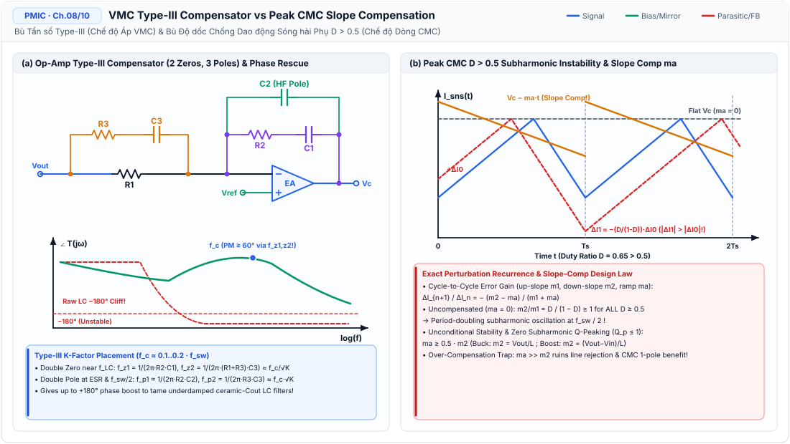

---
{
  "id": "tech-dcdc-vmc-type2-type3-compensator-synthesis",
  "kind": "technique",
  "domain": "power-management-ic",
  "title_vi": "Tổng hợp Bộ bù Loại II & Loại III (Op-Amp Active-RC & Gm-OTA) theo Hệ số K cho Điều khiển Chế độ Điện áp (VMC)",
  "title_en": "Voltage-Mode Control (VMC) Loop Dynamics and Exact K-Factor / Pole-Zero Synthesis of Op-Amp & Gm-OTA Type-II/Type-III Compensators",
  "summary": "Giải phẫu hoàn chỉnh hàm truyền vòng hở T(s) của bộ biến đổi DC-DC điều khiển chế độ điện áp (VMC): chứng minh tại sao cặp cực kép cộng hưởng LC gây vách đá sập pha -180 độ phá vỡ hoàn toàn bộ bù Loại I/II khi dùng tụ gốm MLCC ESR thấp, dẫn xuất tường minh thuật toán Hệ số K (K-Factor) và Đặt Cực-Zero cho cả hai kiến trúc Op-Amp Active-RC Type-III (6 phần tử R1, R2, R3, C1, C2, C3) lẫn OTA hỗ dẫn Gm Type-II/Type-III kèm bù tiền tiếp đường nguồn (Input Voltage Feedforward).",
  "diagram": "../../diagrams/vmc-type3-and-cmc-slope-comp.svg",
  "razavi_refs": [
    {
      "chapter": 8,
      "section": "8.2.1, 8.5.2, 8.7",
      "pages": "284-288, 305-312, 326-336",
      "equations": ["8.14", "8.36", "8.73"]
    },
    {
      "chapter": 9,
      "section": "9.2.4-9.3.1",
      "pages": "355-366",
      "equations": ["9.17", "9.24"]
    },
    {
      "chapter": 10,
      "section": "10.2-10.6",
      "pages": "411-435",
      "equations": ["10.5", "10.14", "10.30", "10.38"]
    }
  ],
  "github_refs": [
    {
      "repo": "westonb/open-pmic",
      "url": "https://github.com/westonb/open-pmic/tree/2ec3130e71fd8dc08b22e8a02e9f2f8c7a38750b",
      "use": "Kiến trúc bộ khuếch đại sai lệch Folded-Cascode, bộ điều chế so sánh sóng răng cưa PWM và khung kiểm tra đáp ứng tần số vòng lặp bộ nguồn chuyển mạch trên CMOS"
    },
    {
      "repo": "Arcadia-1/analog-design-bench",
      "url": "https://github.com/Arcadia-1/analog-design-bench/tree/972f7cd7c937fd4b779b15f77f0bc9136723182a",
      "use": "Quy chuẩn đánh giá dự trữ pha, dự trữ biên độ và độ sụt áp quá độ đa góc PVT cho các bộ điều chỉnh nguồn trên chip"
    },
    {
      "repo": "iic-jku/analog-circuit-design",
      "url": "https://github.com/iic-jku/analog-circuit-design/tree/6075ea0ebcf08f5c7f6033a84e9dd3c91450f5e1",
      "use": "Nền tảng thiết kế OTA/Op-Amp CMOS, phân tích hiệu ứng tải mạng hồi tiếp hai cửa và đo vòng kín Middlebrook STB"
    }
  ],
  "glossary_codes": [
    "T042",
    "T051",
    "T063",
    "T822",
    "T854",
    "T865",
    "T1301",
    "T1548",
    "T1575",
    "T1678",
    "T1684",
    "T1687",
    "T2175",
    "T2176"
  ],
  "process_agnostic": true,
  "roles": {
    "lc_power_stage_plant": "Hàm truyền điều khiển-tới-ngõ-ra G_vd(s) mang cặp cực kép cộng hưởng LC (w0 = 1/sqrt(L*Cout), hệ số phẩm chất Q tỉ lệ thuận R_load) và zero nối tiếp w_z,ESR = 1/(R_ESR*Cout)",
    "pwm_ramp_modulator_gain": "Bộ so sánh PWM đối chiếu điện áp điều khiển v_c với sóng răng cưa biên độ đỉnh-đỉnh V_M tạo độ lợi điều chế G_PWM = 1/V_M (nâng lên V_IN/V_M khi nhân với tầng công suất Buck)",
    "opamp_type3_active_rc_network": "Mạng bù tích cực quanh Op-Amp độ lợi cao gồm nhánh vào (R1, R3, C3) và nhánh hồi tiếp (R2, C1, C2) tạo 1 cực gốc s=0, 2 zero LHP nâng pha tới +160 độ và 2 cực cao tần dập nhiễu chuyển mạch",
    "gm_ota_type2_type3_network": "Kiến trúc bộ bù dùng OTA hỗ dẫn Gm nối mạng R_c-C_c || C_p tại ngõ ra VCOMP xuống đất tĩnh AGND kết hợp nhánh tụ vượt R_ff-C_ff trên điện trở phân áp đỉnh RFB1"
  },
  "symptoms_addressed": [
    "severe-sub-crossover-180-deg-phase-cliff-from-high-q-lc-filter-with-low-esr-mlcc",
    "type-ii-compensator-failing-to-stabilize-voltage-mode-buck-converter",
    "loop-crossover-frequency-drifting-wildly-across-wide-input-voltage-vin-range",
    "high-frequency-switching-ripple-saturating-error-amplifier-or-jittering-pwm-edges",
    "opamp-finite-gbw-causing-high-frequency-gain-rebound-above-0-db"
  ],
  "limitations": [
    "six-passive-components-in-type-iii-sensitive-to-lc-corner-shift-and-mlcc-dc-bias-derating",
    "conditional-stability-dip-below-minus-180-deg-at-light-load-high-q-resonance-if-zeros-placed-too-high",
    "gm-ota-feedforward-pole-zero-separation-coupled-to-vout-over-vref-divider-ratio-without-series-rff",
    "boost-and-buckboost-vmc-simultaneously-suffer-moving-lc-double-pole-and-moving-rhp-zero"
  ],
  "checklists": [
    "common-mos",
    "dcdc-switching-converter",
    "feedback-and-stb",
    "two-stage-miller",
    "layout-and-matching"
  ]
}
---

## 1. Cấu trúc Vòng Điều khiển Chế độ Điện áp (VMC) & Thảm họa "Vách Đá Pha $-180^\circ$" của Tụ MLCC

Trong lịch sử vi mạch quản lý nguồn (PMIC), **Điều khiển Chế độ Điện áp (Voltage-Mode Control — VMC)** là cấu trúc điều chế xung rộng (PWM) kinh điển nhất: chỉ dùng **một vòng hồi tiếp điện áp duy nhất** cảm nhận $V_{\text{OUT}}$ (hồi tiếp Điện áp–Điện áp theo phân loại bốn cấu trúc của Razavi Chương 8 §8.2.1), khuếch đại sai lệch so với $V_{\text{REF}}$ từ Bandgap (`topo-bandgap-reference-core`) thành điện áp điều khiển $v_c(t)$, rồi đem cắt trực tiếp với một sóng răng cưa chu kỳ cố định biên độ đỉnh-đỉnh $V_M$ để sinh chu kỳ nhiệm vụ $d(t) = v_c(t)/V_M$.



Mặc dù VMC sở hữu ưu điểm miễn nhiễm nhiễu dòng chuyển mạch rất tốt (nhờ sóng răng cưa biên độ lớn $V_M \approx 0{,}8\text{–}1{,}5\text{ V}$ và hoạt động êm ái ở chu kỳ nhiệm vụ cực hẹp), người thiết kế mới bắt tay vào làm Buck VMC hiện đại dùng **tụ gốm đa lớp gắn bề mặt (MLCC, $R_{\text{ESR}} \approx 2\text{–}10\text{ m}\Omega$)** gần như chắc chắn đâm sầm vào cái bẫy tự dao động dữ dội nếu bê nguyên bộ bù Miller / Type-I hoặc Type-II từ thiết kế LDO sang! Hãy mổ xẻ chuỗi nguyên nhân vật lý ngay trên đồ thị Bode:

1. **Hàm truyền tầng công suất và bộ điều chế $G_{\text{PWM}} \cdot G_{vd}(s)$ (xét bộ hạ áp Buck ở chế độ dẫn liên tục CCM, `law-dcdc-volt-second-ccm-dcm-and-state-space`):**
   - Bộ so sánh sóng răng cưa chuyển đổi biến thiên nhỏ $\hat{v}_c(s)$ thành biến thiên chu kỳ nhiệm vụ $\hat{d}(s) = \dfrac{\hat{v}_c(s)}{V_M}$.
   - Tầng công suất băm nguồn $V_{\text{IN}}$ đi qua bộ lọc thông thấp bậc hai $L\text{–}C_{\text{OUT}}$ (có điện trở tổng nối tiếp cuộn cảm/công tắc $R_{\text{loss}} = \text{DCR} + D R_{\text{on,HS}} + (1-D) R_{\text{on,LS}}$ và điện trở nối tiếp tụ $R_{\text{ESR}}$):

$$
G_{\text{stage}}(s) \triangleq G_{\text{PWM}} \cdot G_{vd}(s) = \frac{V_{\text{IN}}}{V_M} \cdot \frac{1 + \dfrac{s}{\omega_{z,\text{ESR}}}}{1 + \dfrac{s}{\omega_0 Q} + \dfrac{s^2}{\omega_0^2}}
$$

   trong đó tần số góc cộng hưởng kép $\omega_0$, zero của tụ $\omega_{z,\text{ESR}}$ và hệ số phẩm chất $Q$ được xác định bởi:

$$
\omega_0 = \frac{1}{\sqrt{L C_{\text{OUT}}}} \;\; \left(f_0 = \frac{1}{2\pi\sqrt{L C_{\text{OUT}}}}\right), \qquad \omega_{z,\text{ESR}} = \frac{1}{R_{\text{ESR}} C_{\text{OUT}}}, \qquad Q \approx \frac{1}{\dfrac{\sqrt{L/C_{\text{OUT}}}}{R_{\text{load}}} + \frac{R_{\text{loss}} + R_{\text{ESR}}}{\sqrt{L/C_{\text{OUT}}}}}
$$

2. **Tại sao Vách Đá Pha $-180^\circ$ Phá Vỡ Hoàn Toàn Bộ Bù Loại I và Loại II?**
   - Để sai số xác lập tĩnh bằng 0 (Load/Line Regulation cực chặt), bộ bù bắt buộc phải có **một cực tích phân tại gốc tọa độ ($1/s$)**, tiêu tốn sẵn **$-90^\circ$ pha** ngay từ tần số rất thấp!
   - Khi đi qua tần số cộng hưởng $f_0$ (thường $f_0 \approx 15\text{–}50\text{ kHz}$ với $L = 1\,\mu\text{H}, C_{\text{OUT}} = 10\text{–}47\,\mu\text{F}$), ở tải nhẹ hoặc trung bình ($R_{\text{load}}$ lớn) và $R_{\text{loss}} + R_{\text{ESR}}$ cực nhỏ, hệ số phẩm chất $Q$ vọt lên $5 \dots 20$ (`T2176`, $\zeta = \frac{1}{2Q} \ll 0{,}1$)! Cặp cực phức liên hợp tạo một đỉnh nhọn cộng hưởng $+20\log_{10} Q$ ($\text{dB}$) rồi lập tức lăn dốc **$-40\text{ dB/dec}$** kèm **một vách đá rơi thẳng đứng $-180^\circ$ pha** chỉ trong vòng chưa đầy nửa thập kỷ tần số quanh $f_0$!
   - Với tụ điện phân / Tantalum đời cũ ($R_{\text{ESR}} \approx 100\text{–}300\text{ m}\Omega$), $f_{z,\text{ESR}}$ rơi vào khoảng $20\text{–}50\text{ kHz}$ nên tự động nâng lại $+90^\circ$ pha và bẻ độ dốc từ $-40\text{ dB/dec}$ về $-20\text{ dB/dec}$, cho phép bộ bù **Loại II (Type-II, nâng tối đa $+90^\circ$)** làm việc êm ru.
   - Ngược lại, với **tụ gốm MLCC hiện đại ($C_{\text{OUT}} = 10\,\mu\text{F}, R_{\text{ESR}} = 4\text{ m}\Omega$)**, tần số zero vọt lên tận $f_{z,\text{ESR}} \approx 4\text{ MHz}$ — nằm cao hơn cả tần số chuyển mạch $f_{\text{sw}} = 2\text{ MHz}$! Trong suốt dải tần cắt mong muốn $f_c \approx (0{,}1 \dots 0{,}15)\,f_{\text{sw}} = 200\text{–}300\text{ kHz}$, tổng pha của cực tích phân ($-90^\circ$) cộng cặp cực kép $LC$ ($-180^\circ$) tụt chạm đáy **$-270^\circ$**!
   - Một bộ bù **Loại II** chỉ có duy nhất **1 zero LHP** nên kể cả lý tưởng tuyệt đối cũng chỉ kéo pha lên được tối đa $+90^\circ \implies -270^\circ + 90^\circ = -180^\circ$ (**Dự trữ pha $\text{PM} \le 0^\circ$ — mạch chắc chắn dao động!**). Bắt buộc phải huy động **Bộ bù Loại III (Type-III)** sở hữu **2 zero LHP** cung cấp lực đẩy pha dương lên tới **$+130^\circ \dots +160^\circ$** ngay tại $f_c$!

---

## 2. Dẫn xuất Giải tích & Tổng hợp Chính xác Bộ Bù Loại II / Loại III (Op-Amp Active-RC & $G_m$-OTA)

### 2.1. Ba Họ Hàm Truyền Chuẩn Tắc: Type-I, Type-II và Type-III
Viết dưới dạng chuẩn hóa nhân quả theo Erickson & Venable để nhìn xuyên thấu bậc nâng pha tối đa:
- **Bộ bù Loại I (Pure Integrator — 1 cực tại gốc, $0^\circ$ nâng pha):** $H_{\text{I}}(s) = -\dfrac{\omega_i}{s}$ (pha hằng số $-90^\circ$, chỉ dùng được nếu ép $f_c \ll f_0$, khiến băng thông vòng rùa bò vài trăm Hz và sụt áp bước nhảy tải thảm khốc!).
- **Bộ bù Loại II (1 cực gốc + 1 zero LHP $\omega_{z1}$ + 1 cực cao tần $\omega_{p1}$, nâng pha tối đa $< +90^\circ$):**
  $$H_{\text{II}}(s) = -\frac{\omega_i}{s} \cdot \frac{1 + s/\omega_{z1}}{1 + s/\omega_{p1}}$$
  Dành riêng cho: (1) **Điều khiển Chế độ Dòng (CMC)** nơi cuộn cảm đã biến thành nguồn dòng làm mất cực kép $LC$ (`tech-dcdc-cmc-subharmonic-slope-comp-and-cot`), hoặc (2) VMC dùng tụ POSCAP/Tantalum có $R_{\text{ESR}}$ cao kiểm soát chặt.
- **Bộ bù Loại III (1 cực gốc + 2 zero LHP $\omega_{z1}, \omega_{z2}$ + 2 cực cao tần $\omega_{p1}, \omega_{p2}$, nâng pha tối đa $< +180^\circ$):**

$$
H_{\text{III}}(s) = -\frac{\omega_i}{s} \cdot \frac{\left(1 + \dfrac{s}{\omega_{z1}}\right)\left(1 + \dfrac{s}{\omega_{z2}}\right)}{\left(1 + \dfrac{s}{\omega_{p1}}\right)\left(1 + \dfrac{s}{\omega_{p2}}\right)}
$$

### 2.2. Tổng hợp Bộ Bù Op-Amp Active-RC Loại III (6 Phần tử $R_1, R_2, R_3, C_1, C_2, C_3$)
Xét Op-Amp CMOS độ lợi cao có ngõ vào không đảo (`+`) nối $V_{\text{REF}}$, ngõ vào đảo (`-`, nút đất ảo $V_{\text{FB}} = V_{\text{REF}}$) nhận dòng từ $V_{\text{OUT}}$ qua $R_1$ song song với chuỗi nối tiếp $(R_3 + \frac{1}{sC_3})$ (kèm điện trở phân áp dưới $R_{\text{bias}}$ nối từ `FB` xuống `AGND` để thiết lập $V_{\text{OUT}} = V_{\text{REF}}\big(1 + \frac{R_1}{R_{\text{bias}}}\big)$ — tuyệt vời ở chỗ vì $V_{\text{FB}}$ bị ghim cứng bằng $V_{\text{REF}}$, **$R_{\text{bias}}$ hoàn toàn biến mất khỏi hàm truyền AC từ $V_{\text{OUT}}$ sang $V_{\text{COMP}}$**!). Nhánh hồi tiếp từ ngõ ra Op-Amp `VCOMP` về `FB` gồm tụ $C_2$ mắc song song với chuỗi $(R_2 + \frac{1}{sC_1})$.

Giải tổng trở phức $Z_f(s) = \dfrac{1}{sC_2} \parallel \left(R_2 + \dfrac{1}{sC_1}\right)$ và tổng dẫn vào $Y_{\text{in}}(s) = \dfrac{1}{R_1} + \dfrac{sC_3}{1 + sR_3 C_3}$ dưới điều kiện thực tế $C_1 \gg C_2$ và $R_1 \gg R_3$, ta thu được hàm truyền giải tích chính xác của **Op-Amp Type-III**:

$$
\frac{\hat{v}_c(s)}{\hat{v}_{\text{out}}(s)} = -\frac{Z_f(s)}{Z_{\text{in}}(s)} = -\frac{1}{s R_1 (C_1 + C_2)} \cdot \frac{\left(1 + s R_2 C_1\right)\big[1 + s (R_1 + R_3) C_3\big]}{\left(1 + s R_2 \dfrac{C_1 C_2}{C_1 + C_2}\right)\left(1 + s R_3 C_3\right)}
$$

Đọc trực tiếp 5 tọa độ tần số góc từ công thức đóng trên:

$$
\omega_i = \frac{1}{R_1 (C_1 + C_2)} \approx \frac{1}{R_1 C_1}, \quad \omega_{z1} = \frac{1}{R_2 C_1}, \quad \omega_{z2} = \frac{1}{(R_1 + R_3) C_3} \approx \frac{1}{R_1 C_3}, \quad \omega_{p1} \approx \frac{1}{R_2 C_2}, \quad \omega_{p2} = \frac{1}{R_3 C_3}
$$

#### Thuật toán Tổng hợp Hệ số $K$ (Venable K-Factor Method — Chuẩn Tối ưu Toàn cục Pha tại $f_c$):
Giả sử chọn tần số cắt mục tiêu $f_c \in [0{,}08\,f_{\text{sw}},\; 0{,}18\,f_{\text{sw}}]$ (với $f_c \ge 3\,f_0$) và dự trữ pha mục tiêu $\text{PM}_{\text{target}}$ (ví dụ $55^\circ\text{–}60^\circ$). Tính biên độ $G_p = \left|G_{\text{stage}}(j 2\pi f_c)\right|$ và góc pha thực của tầng công suất $\phi_p = \angle G_{\text{stage}}(j 2\pi f_c)$ (thường $\phi_p \approx -175^\circ \dots -180^\circ$ với MLCC!).
1. **Góc nâng pha bắt buộc $\phi_{\text{boost}}$ mà mạng bù phải bù đắp trên nền $-90^\circ$ của cực gốc:**

$$
\phi_{\text{boost}} = \text{PM}_{\text{target}} - \phi_p - 90^\circ \qquad \text{(ví dụ: } 60^\circ - (-176^\circ) - 90^\circ = +146^\circ\text{)}
$$

2. **Hệ số tách cực–zero đối xứng hình học $K$ quanh $f_c$:** Đặt cặp zero kép trùng nhau tại $f_{z1} = f_{z2} = \dfrac{f_c}{\sqrt{K}}$ và cặp cực kép cao tần tại $f_{p1} = f_{p2} = f_c \sqrt{K}$. Tại đúng $f = f_c$, góc nâng pha cực đại đạt $\phi_{\text{boost}} = 4\arctan(\sqrt{K}) - 180^\circ$, giải ngược ra công thức vàng của **Type-III K-Factor**:

$$
\sqrt{K_{\text{III}}} = \tan\!\left(\frac{\phi_{\text{boost}}}{4} + 45^\circ\right) \implies K_{\text{III}} = \left[\tan\!\left(\frac{\phi_{\text{boost}}}{4} + 45^\circ\right)\right]^2 \qquad \left(\text{so với Type-II: } K_{\text{II}} = \tan\!\left(\frac{\phi_{\text{boost}}}{2} + 45^\circ\right)\right)
$$

3. **Công thức đóng tính trọn gói 6 linh kiện từ $R_1$ chọn trước** (chọn $R_1 \in [20\text{ k}\Omega, 200\text{ k}\Omega]$ theo dòng phân áp tĩnh; suy ra $R_{\text{bias}} = \dfrac{R_1}{V_{\text{OUT}}/V_{\text{REF}} - 1}$):

$$
C_2 = \frac{G_p}{2\pi f_c \, K_{\text{III}} \, R_1}, \quad C_1 = C_2 (K_{\text{III}} - 1), \quad R_2 = \frac{\sqrt{K_{\text{III}}}}{2\pi f_c \, C_1}, \quad C_3 = \frac{K_{\text{III}} - 1}{2\pi f_c \sqrt{K_{\text{III}}} \, R_1}, \quad R_3 = \frac{R_1}{K_{\text{III}} - 1}
$$

*(Mẹo tinh chỉnh thực chiến — Pole-Zero Placement lai K-Factor: Khi $Q$ của bộ lọc $LC$ ở tải nhẹ rất cao $> 8$, thay vì đặt cả hai zero đối xứng tại $f_c/\sqrt{K}$ có thể nằm hơi cao hơn $f_0$ gây võng pha tạm thời dưới $-180^\circ$ tại $f_0$, hãy kẹp cứng $f_{z1} = 0{,}75\,f_0$, $f_{z2} = 1{,}0\,f_0$, đặt $f_{p1} = f_{z,\text{ESR}}$ (hoặc $0{,}5\,f_{\text{sw}}$ nếu MLCC) và $f_{p2} = 0{,}5\,f_{\text{sw}}$!)*

### 2.3. Tổng hợp Bộ Bù Hỗ dẫn $G_m$-OTA Loại II & Loại III Trên Vi mạch Tích hợp
Trong nhiều chip PMIC tích hợp mật độ cao, các kỹ sư thích thay Op-Amp bằng **OTA hỗ dẫn $G_m$** (như `topo-folded-cascode-ota` hoặc OTA gương dòng đối xứng có trở kháng ra rất cao $R_{o,\text{OTA}}$) vì mạng bù $(R_c + \frac{1}{sC_c}) \parallel \frac{1}{sC_p}$ nối từ ngõ ra `VCOMP` xuống đất tĩnh `AGND` — giúp cô lập hoàn toàn ngõ vào `FB` khỏi dòng điện dung hồi tiếp từ `VCOMP`!
- **$G_m$-OTA Loại II (chuẩn mực cho CMC):** Cầu chia $R_{\text{FB1}}$ (trên), $R_{\text{FB2}}$ (dưới) có $\beta = \frac{R_{\text{FB2}}}{R_{\text{FB1}} + R_{\text{FB2}}}$. Hàm truyền từ $V_{\text{OUT}}$ sang $V_{\text{COMP}}$:

$$
H_{\text{OTA,II}}(s) = -\beta \, G_m R_{o,\text{OTA}} \cdot \frac{1 + s R_c C_c}{\big[1 + s R_{o,\text{OTA}}(C_c + C_p)\big]\left(1 + s R_c \dfrac{C_c C_p}{C_c + C_p}\right)} \approx -\frac{\beta G_m}{s (C_c + C_p)} \cdot \frac{1 + s R_c C_c}{1 + s R_c C_p}
$$

  (khi tần số xét cao hơn cực nội siêu thấp $\omega_{p0} = \frac{1}{R_{o,\text{OTA}} C_c} \sim 10\text{–}100\text{ Hz}$).
- **$G_m$-OTA Loại III (thêm nhánh vượt pha Feedforward $R_{\text{ff}} + C_{\text{ff}}$ mắc song song với điện trở trên $R_{\text{FB1}}$):**
  Mạng phân áp từ $V_{\text{OUT}}$ vào chân `FB` của OTA tạo thêm **1 zero dẫn pha $\omega_{z2}$ và 1 cực đi kèm $\omega_{p2}$**:

$$
\omega_{z2} = \frac{1}{(R_{\text{FB1}} + R_{\text{ff}}) C_{\text{ff}}}, \qquad \omega_{p2} = \frac{1}{\big(R_{\text{ff}} + R_{\text{FB1}} \parallel R_{\text{FB2}}\big) C_{\text{ff}}}
$$

  Nhìn ngay vào tỷ số $\dfrac{\omega_{p2}}{\omega_{z2}}$: **nếu bạn bỏ quên điện trở nối tiếp $R_{\text{ff}}$ ($R_{\text{ff}} = 0$)** như nhiều sơ đồ sơ sài trên mạng, tỷ số tách cực–zero bị khóa chết cứng vào hệ số chia áp DC: $\dfrac{\omega_{p2}}{\omega_{z2}} = \dfrac{R_{\text{FB1}}}{R_{\text{FB1}} \parallel R_{\text{FB2}}} = \dfrac{1}{\beta} = \dfrac{V_{\text{OUT}}}{V_{\text{REF}}}$! Khi thiết kế nguồn cấp lõi số điện áp thấp $V_{\text{OUT}} = 0{,}8\text{ V}$ dùng Sub-1V Bandgap $V_{\text{REF}} = 0{,}6\text{ V}$ ($1/\beta = 1{,}33$), cặp $\omega_{z2}$ và $\omega_{p2}$ dính sát sạt nhau nên **mất sạch hoàn toàn tác dụng nâng pha Type-III** (góc nâng tối đa chỉ còn $8^\circ$)!

### 2.4. Bù Tiền tiếp Điện áp Nguồn Vào (Input-Voltage / Line Feedforward)
Trong công thức $G_{\text{stage}}(s) \propto \frac{V_{\text{IN}}}{V_M}$, nếu biên độ răng cưa $V_M$ cố định thì khi pin Li-Ion hoặc bus ô tô biến thiên $V_{\text{IN}} = 2{,}7\text{ V} \to 5{,}5\text{ V}$ (hoặc $6\text{ V} \to 36\text{ V}$), độ lợi vòng và tần số cắt $f_c$ trôi tuột gấp $2\text{–}6\times$! Giải pháp triệt để ngay trong bộ tạo răng cưa (`topo-dcdc-ramp-sensefet-dcr-and-zcd-blocks`): nạp tụ răng cưa $C_{\text{ramp}}$ bằng dòng tỉ lệ thuận với nguồn vào $I_{\text{ramp}} = \dfrac{V_{\text{IN}}}{R_{\text{FF}}}$, biến biên độ đỉnh $V_M = \dfrac{V_{\text{IN}}}{R_{\text{FF}} C_{\text{ramp}} f_{\text{sw}}} \propto V_{\text{IN}}$! Khi đó tỷ số $\dfrac{V_{\text{IN}}}{V_M} = R_{\text{FF}} C_{\text{ramp}} f_{\text{sw}}$ trở thành **hằng số hình học hoàn toàn độc lập với $V_{\text{IN}}$**, đồng thời cung cấp khả năng khử nhiễu nguồn tức thời ngay trong 1 chu kỳ xung nhịp mà không phải chờ vòng hồi tiếp phản ứng!

---

## 3. Bất biến Cấu trúc & Các Bẫy Lỗi Kinh điển trên Silicon (Invariants & Traps)

- **[INV-VMC-01] Bất biến Băng thông Bản thân Op-Amp/OTA ($\text{GBW}_{\text{EA}} \ge 8 \cdot f_c$):** Trong mạch Op-Amp Active-RC Type-III, ở tần số cao trên $\omega_{p1}, \omega_{p2}$, tụ $C_2$ và $R_3$ dẫn thẳng biến độ lợi đóng vòng của mạng bù về tỷ số hữu hạn $\left|H_{\text{III}}(\infty)\right| \approx \frac{R_2 \parallel (1/sC_2)}{R_1 \parallel R_3}$. Nếu Op-Amp bên trong có băng thông đơn vị $\text{GBW}_{\text{EA}}$ quá thấp (ví dụ chỉ gấp $2\text{–}3$ lần $f_c$), trở kháng ra vòng hở của Op-Amp mất khả năng ghim đất ảo tại nút `FB`: tín hiệu cao tần từ $V_{\text{OUT}}$ qua $C_3 + R_3$ phóng xuyên thẳng qua tụ hồi tiếp $C_2$ sang `VCOMP` mà không suy hao (**High-Frequency Feedthrough Rebound**), đẩy gợn sóng chuyển mạch $f_{\text{sw}}$ vào bộ so sánh gây jitter kép!
- **[INV-VMC-02] Bất biến Suy giảm Điện dung Thực tế của Tụ MLCC theo Áp Phân cực DC (`DC-Bias Derating`):** Một tụ gốm X5R/X7R kích thước nhỏ `0402` ghi nhãn $10\,\mu\text{F}$ trên bản vẽ thực chất **mất từ $40\%$ đến $65\%$ điện dung hiệu dụng** khi đặt áp DC $1{,}8\text{–}3{,}3\text{ V}$ (chỉ còn $C_{\text{eff}} \approx 4{,}5\,\mu\text{F}$)! Điều này đẩy tần số cộng hưởng thực tế $f_0 = \frac{1}{2\pi\sqrt{L C_{\text{eff}}}}$ vọt cao hơn tính toán lý thuyết $\sim 1{,}5\times$! Mọi phép tổng hợp K-Factor bắt buộc phải tính trên dải quét bao hàm cả $C_{\text{eff,min}}$ (áp cao, lạnh/nóng) lẫn $C_{\text{max}}$ (thêm tụ decoupling phía tải SoC).
- **[TRAP-VMC-01] Bẫy "Ổn định Có Điều kiện" (Conditional Stability) Khi Đặt Zero Type-III Cao Hơn $f_0$:** Nếu theo công thức K-Factor thuần túy với $f_c = 300\text{ kHz}, K = 16 \implies f_{z1,2} = 75\text{ kHz}$ trong khi $f_0 = 25\text{ kHz}$ có $Q = 12$ ở không tải, tại vùng $[25\text{ kHz}, 65\text{ kHz}]$ pha vòng hở sẽ **tụt sâu xuống $-230^\circ$ (thấp hơn $-180^\circ$)** trong khi biên độ $|T(jf)|$ vẫn dương $+15\text{ dB}$, trước khi được cặp zero kéo ngược lên $-120^\circ$ tại $f_c$! Trên đồ thị Bode nhìn thoáng tại $f_c$ tưởng có $\text{PM} = 60^\circ$, nhưng khi khởi động hoặc bước nhảy tải lớn làm khuếch đại sai lệch chạm bão hòa slewing (giảm độ lợi hiệu dụng theo hàm mô tả phi tuyến), điểm cắt $0\text{ dB}$ lùi thẳng vào đúng thung lũng $-230^\circ$ và mạch khóa cứng vào dao động biên độ lớn (`tech-nyquist-stability-criterion`)! Khắc phục: luôn kéo ít nhất một zero $f_{z1} \le (0{,}7\text{–}0{,}9)\,f_0$!
- **[TRAP-VMC-02] Bẫy Mất Khả năng Lái Điện dung Nhánh Hồi tiếp của $G_m$-OTA so với Op-Amp:** Nếu bạn lấy sơ đồ mạng 6 linh kiện Type-III nối từ `VOUT` về `FB` và từ `FB` sang `VCOMP` nhưng bên trong lại gắn một **Folded-Cascode 1 tầng trở kháng ra cao** thay vì Op-Amp 2 tầng có tầng đệm ngõ ra trở kháng thấp, nhánh hồi tiếp $R_2\text{–}C_1\text{–}C_2$ nối tắt trực tiếp nút ra trở kháng cao của OTA về ngõ vào đảo, biến OTA thành bộ khuếch đại Miller có RHP zero ký sinh và sụp đổ hoàn toàn độ lợi! Dùng mạng hồi tiếp `VCOMP -> FB` bắt buộc phải có tầng đệm trở kháng thấp ở ngõ ra Op-Amp ($R_{\text{out,OA}} \ll R_2 \parallel R_3$).

---

## 4. Ma trận Lựa chọn Kiến trúc Bộ Bù & Bát giác Đánh đổi (Compensator Selector)

| Cấu trúc Điều chế & Tải | Bộ Bù Chuẩn Mực | Số Phần tử Thụ động | Băng thông Đạt được $f_c$ | Ưu điểm Cốt lõi & Cái giá Đánh đổi |
|---|---|---|---|---|
| **Buck VMC + Tụ MLCC ($R_{\text{ESR}} < 10\text{ m}\Omega$)** | **Op-Amp Active-RC Type-III** (kèm Line Feedforward) | $3R + 3C$ (+ $R_{\text{bias}}$) | $(0{,}10 \dots 0{,}18)\,f_{\text{sw}}$ | Tách cực–zero hoàn toàn độc lập với tỉ số $V_{\text{OUT}}/V_{\text{REF}}$; tốn 1 chân/đường cảm nhận riêng vào nhánh $R_3 C_3$ và cần Op-Amp có tầng đệm ra trở kháng thấp |
| **Buck VMC ($V_{\text{OUT}} \ge 2{,}5\,V_{\text{REF}}$) Tích hợp Gọn** | **$G_m$-OTA Type-III** ($R_c C_c \parallel C_p$ + $R_{\text{ff}} C_{\text{ff}}$ trên $R_{\text{FB1}}$) | $2R + 3C$ (+ cầu chia) | $(0{,}08 \dots 0{,}14)\,f_{\text{sw}}$ | OTA 1 tầng tiêu thụ ít dòng tĩnh $I_Q$, mạng chính nằm tại `VCOMP` xuống đất; bắt buộc $V_{\text{OUT}}/V_{\text{REF}}$ đủ lớn để mở rộng khoảng tách $\omega_{p2}/\omega_{z2}$ |
| **Buck / Boost Peak-CMC hoặc Valley-CMC** | **$G_m$-OTA Type-II** ($R_c C_c \parallel C_p$) | $1R + 2C$ (+ cầu chia) | Buck: $\le 0{,}15\,f_{\text{sw}}$; Boost: $\le f_{z,\text{RHP},\min}/4$ | Mạch cực gọn (tích hợp trọn $C_c \sim 10\text{–}30\text{ pF}$ lên silicon!), không sợ sập pha $LC$; đổi lại phải thêm mạch cảm biến dòng + bù độ dốc (`tech-dcdc-cmc-subharmonic-slope-comp-and-cot`) |
| **Boost / Buck-Boost VMC ở CCM** | **Op-Amp Type-III Băng hẹp** ($f_c \ll f_0$ hoặc $f_c \le f_{z,\text{RHP}}/5$) | $3R + 3C$ | Bị khóa trần thấp bởi $f_{z,\text{RHP},\min}$ | Cực kỳ khó bền vững qua dải tải/nguồn rộng vì cả $f_0 = \frac{1-D}{2\pi\sqrt{LC}}$ lẫn $f_{z,\text{RHP}} = \frac{R(1-D)^2}{2\pi L}$ cùng trôi theo $(1-D)$; **khuyến nghị chuyển sang CMC!** |

---

## 5. Ví dụ Tính Toán Số Hoàn chỉnh & Deck Kiểm chứng Spectre 15.1 (`0.3 s` `.stb`)

### 5.1. Ví dụ Thiết kế Định lượng Từng Bước (Buck VMC $3{,}3\text{ V} \to 1{,}0\text{ V}$, $f_{\text{sw}} = 2\text{ MHz}$)
- **Thông số bài toán:** $V_{\text{IN}} = 3{,}3\text{ V}$, $V_{\text{OUT}} = 1{,}0\text{ V}$, $V_{\text{REF}} = 0{,}60\text{ V}$, $f_{\text{sw}} = 2\text{ MHz}$, biên độ răng cưa $V_M = 1{,}0\text{ V}$, $L = 1{,}0\,\mu\text{H}$ ($\text{DCR} = 30\text{ m}\Omega$), tụ MLCC hiệu dụng sau suy giảm áp DC $C_{\text{OUT}} = 10\,\mu\text{F}$ ($R_{\text{ESR}} = 5\text{ m}\Omega$), dòng tải $I_{\text{load}} \in [0{,}05\text{ A},\; 2{,}0\text{ A}]$ ($R_{\text{load,min}} = 0{,}5\,\Omega$).
- **Bước 1 — Tọa độ tầng công suất:**
  $$f_0 = \frac{1}{2\pi\sqrt{1\,\mu\text{H} \times 10\,\mu\text{F}}} = 50{,}33\text{ kHz}, \qquad f_{z,\text{ESR}} = \frac{1}{2\pi \times 5\text{ m}\Omega \times 10\,\mu\text{F}} = 3{,}18\text{ MHz} \gg f_{\text{sw}}$$
- **Bước 2 — Chọn tần số cắt $f_c$ & Tính độ lợi/pha tầng công suất tại $f_c$:** Chọn $f_c = 250\text{ kHz} = \frac{f_{\text{sw}}}{8} \approx 4{,}97\,f_0$. Tại $f_c = 250\text{ kHz}$:
  $$G_p(f_c) = \left|G_{\text{stage}}(j 2\pi f_c)\right| \approx \frac{V_{\text{IN}}}{V_M} \cdot \frac{1}{(f_c/f_0)^2 - 1} = \frac{3{,}3}{1{,}0} \cdot \frac{1}{4{,}967^2 - 1} = \frac{3{,}3}{23{,}67} = 0{,}1394\text{ V/V}\;\;(-17{,}1\text{ dB}), \qquad \phi_p(f_c) \approx -176^\circ$$
- **Bước 3 — Đặt Cực-Zero Lai K-Factor Chống Võng Pha Có Điều kiện:**
  - Đặt mục tiêu $\text{PM}_{\text{target}} = 58^\circ \implies \phi_{\text{boost}} = 58^\circ - (-176^\circ) - 90^\circ = 144^\circ \implies \sqrt{K_{\text{III}}} = \tan(36^\circ + 45^\circ) = \tan(81^\circ) = 6{,}314 \implies K_{\text{III}} = 39{,}86$.
  - Kiểm tra vị trí zero: $f_z = \frac{250\text{ kHz}}{6{,}314} = 39{,}6\text{ kHz} \approx 0{,}79\,f_0$ (**Nằm ngay dưới $f_0 = 50{,}3\text{ kHz}$ — triệt tiêu hoàn toàn bẫy ổn định có điều kiện `[TRAP-VMC-01]`!**), và cực cao tần $f_p = 250\text{ kHz} \times 6{,}314 = 1{,}58\text{ MHz}$ (ta kẹp nhẹ $f_{p1,2} = 1{,}2\text{ MHz} = 0{,}6\,f_{\text{sw}}$ để nén mạnh gợn chuyển mạch $2\text{ MHz}$).
- **Bước 4 — Giải giá trị linh kiện chuẩn (chọn $R_1 = 50\text{ k}\Omega \implies R_{\text{bias}} = \frac{50\text{ k}\Omega}{1{,}0/0{,}6 - 1} = 75\text{ k}\Omega$):**
  - $C_2 = \dfrac{0{,}1394}{2\pi \cdot 250\text{ kHz} \cdot 39{,}86 \cdot 50\text{ k}\Omega} = 44{,}5\text{ pF}$ (chọn **$45\text{ pF}$** tụ MIM trên chip!).
  - $C_1 = 44{,}5\text{ pF} \times (39{,}86 - 1) = 1{,}73\text{ nF}$ (chọn **$1{,}8\text{ nF}$**).
  - $R_2 = \dfrac{1}{2\pi \cdot 39{,}6\text{ kHz} \cdot 1{,}8\text{ nF}} = 2{,}23\text{ k}\Omega$ (chọn **$2{,}2\text{ k}\Omega$**).
  - $C_3 = \dfrac{1}{2\pi \cdot 39{,}6\text{ kHz} \cdot 50\text{ k}\Omega} = 80{,}4\text{ pF}$ (chọn **$82\text{ pF}$** tụ MIM!).
  - $R_3 = \dfrac{1}{2\pi \cdot 1{,}2\text{ MHz} \cdot 82\text{ pF}} = 1{,}62\text{ k}\Omega$ (chọn **$1{,}6\text{ k}\Omega$**).
  - Yêu cầu Op-Amp bên trong: $A_{0,\text{EA}} \ge 65\text{ dB}$, $\text{GBW}_{\text{EA}} \ge 10 \times 250\text{ kHz} = 2{,}5\text{ MHz}$ (dư dả chọn $8\text{ MHz}$).

### 5.2. Netlist Spectre 15.1 Kiểm chứng Nhanh Hàm Truyền Vòng Kín Type-III Buck (`tb_vmc_type3_stb.scs`)
```scs
// Spectre 15.1 Averaged VMC Buck + Op-Amp Type-III Compensator Loop Stability Deck
simulator lang=spectre
global 0

parameters vin=3.3 vref=0.6 vm=1.0 fsw=2M
parameters l_ind=1u dcr=30m c_out=10u r_esr=5m r_load=0.5
parameters r1=50k r_bias=75k r2=2.2k r3=1.6k c1=1.8n c2=45p c3=82p
parameters a0_ea=3162 gbw_ea=10M r_out_ea=80

VIN_SRC  (vin 0)  vsource dc=vin mag=1
VREF_SRC (vref 0) vsource dc=vref

// Đầu dò Middlebrook STB đặt ngay trên đường cảm nhận tương tự từ VOUT vào mạng bù Type-III
IPRB_LOOP (vout vout_sense) iprobe

// Mạng vào Type-III: R1 // (R3 + C3) và điện trở thiết lập mức DC R_bias
R1_COMP   (vout_sense fb)   resistor r=r1
R3_COMP   (vout_sense n_z2) resistor r=r3
C3_COMP   (n_z2 fb)         capacitor c=c3
RBIAS_DC  (fb 0)            resistor r=r_bias

// Mạng hồi tiếp Type-III: C2 // (R2 + C1) nối từ ngõ ra Op-Amp VCOMP về nút đất ảo FB
C2_COMP   (vcomp fb)        capacitor c=c2
R2_COMP   (vcomp n_z1)      resistor r=r2
C1_COMP   (n_z1 fb)         capacitor c=c1

// Mô hình Op-Amp 1 cực hữu hạn GBW = 10 MHz kèm điện trở ra R_out_ea kiểm tra hiệu ứng Feedthrough!
E_EA_INT  (n_ea 0 vref fb)  vcvs gain=a0_ea
R_EA_POLE (n_ea n_ea_bw)    resistor r=10k
C_EA_POLE (n_ea_bw 0)       capacitor c=a0_ea/(2*3.14159265*gbw_ea*10k)
E_EA_BUF  (n_buf 0 n_ea_bw 0) vcvs gain=1.0
R_EA_OUT  (n_buf vcomp)     resistor r=r_out_ea

// Bộ điều chế PWM tuyến tính hóa + Công tắc trung bình Buck CCM (d = vcomp / vm, V_sw_avg = d * vin)
B_SW_AVG  (sw_avg 0) bsource v=min(max(v(vcomp)/vm, 0.02), 0.95) * v(vin)

// Bộ lọc công suất LC bậc hai kèm DCR và ESR tụ gốm MLCC
L_PWR     (sw_avg n_l)      inductor l=l_ind
R_DCR     (n_l vout)        resistor r=dcr
C_MLCC    (vout n_esr)      capacitor c=c_out
R_ESR_CAP (n_esr 0)         resistor r=r_esr
R_LOAD    (vout 0)          resistor r=r_load

dcOp dc write="spectre.dc" print=yes
stb_loop stb start=10 stop=10M dec=40 probe=IPRB_LOOP annotate=status
ac_psrr  ac  start=10 stop=10M dec=40 annotate=status
```

---

## 6. Tài liệu Đối chiếu Chuẩn Công nghiệp, Nguồn GitHub & Thuật ngữ CLB

### 6.1. Đối chiếu Sách Gốc Razavi, Erickson & Nguồn Mở Kiểm định
- **Razavi (2nd Ed.):** Chương 8 (§8.2.1 Hồi tiếp Điện áp–Điện áp, §8.5.2 Hiệu ứng tải cầu điện trở, §8.7 Phương pháp Middlebrook đo độ lợi vòng hai chiều), Chương 9 (§9.2.4–9.3.1 Thiết kế OTA/Op-Amp làm lõi Error Amplifier), Chương 10 (§10.2–10.6 Liên hệ tách cực–zero, dự trữ pha $\text{PM}$ với hệ số tắt dần vòng kín $\zeta$ và độ vọt lố bước nhảy).
- **R. W. Erickson & D. Maksimović (*Fundamentals of Power Electronics*, 3rd Ed., Ch. 8 & Ch. 9) & H. Dean Venable (1983):** Dẫn xuất hàm truyền chuẩn tắc tầng công suất $G_{vd}(s)$ và phương pháp tổng hợp hệ số $K$ cho mạng bù Type-II / Type-III.
- **Kho GitHub Kiểm định:**
  - [`westonb/open-pmic`](https://github.com/westonb/open-pmic/tree/2ec3130e71fd8dc08b22e8a02e9f2f8c7a38750b) (`Apache-2.0`): Sơ đồ transistor đầy đủ của Error Amplifier Folded-Cascode, bộ tạo xung răng cưa và bộ điều chế PWM trên CMOS.
  - [`Arcadia-1/analog-design-bench`](https://github.com/Arcadia-1/analog-design-bench/tree/972f7cd7c937fd4b779b15f77f0bc9136723182a) (`Apache-2.0`): Khung chấm điểm tự động dự trữ pha, độ lợi vòng và đáp ứng bước nhảy tải qua các góc PVT.
  - [`iic-jku/analog-circuit-design`](https://github.com/iic-jku/analog-circuit-design/tree/6075ea0ebcf08f5c7f6033a84e9dd3c91450f5e1): Phân tích vòng lặp STB và thiết kế tầng khuếch đại CMOS.

### 6.2. Bảng Thuật ngữ Chuẩn CLB Vi Mạch Sử dụng trong Thẻ
| Mã CLB | Thuật ngữ Tiếng Anh | Thuật ngữ Tiếng Việt Chuẩn | Vai trò trong Mạng Bù VMC Type-II / Type-III |
|---|---|---|---|
| `T051` / `T1338` | loop gain / return ratio | độ lợi vòng / tỉ số hồi trả | Tích $T(s) = G_{\text{PWM}} G_{vd}(s) H_{\text{comp}}(s)$ quyết định sai số tĩnh và độ ổn định |
| `T063` / `T1684` | phase margin / phase margin of 60° | dự trữ pha / dự trữ pha 60° | Mục tiêu thiết kế $\text{PM} \in [52^\circ, 65^\circ]$ tại tần số cắt $f_c$ |
| `T2176` | damping factor, zeta | hệ số tắt dần | Cực nhỏ ($\zeta = 1/(2Q) \ll 0{,}1$) ở bộ lọc $LC$ dùng MLCC gây vách đá pha $-180^\circ$ |
| `T1678` | left-half-plane zero | zero ở nửa mặt phẳng trái | Hai điểm không $\omega_{z1}, \omega_{z2}$ của Type-III cung cấp lực nâng pha dương tới $+150^\circ$ |
| `T1548` | ramp | dạng điện áp biến thiên tuyến tính | Sóng răng cưa biên độ $V_M \propto V_{\text{IN}}$ thực hiện điều chế PWM và bù tiền tiếp nguồn |
| `T1301` | Middlebrook's Method | phương pháp Middlebrook | Đặt `iprobe` tại ngõ vào mạng bù để đo chính xác cả tải thuận lẫn truyền ngược |
