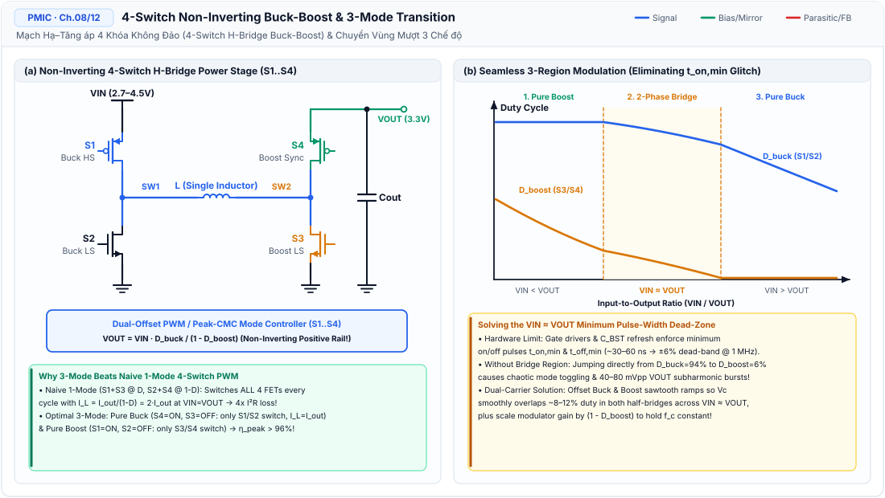

---
{
  "id": "topo-boost-inverting-and-4switch-buckboost",
  "kind": "topology",
  "domain": "power-management-ic",
  "title_vi": "Kiến trúc Mạch Tăng áp Đồng bộ (Boost), Đảo Áp Âm & Hạ-Tăng áp 4 Công tắc Không Đảo Chuyển vùng 3 Chế độ",
  "title_en": "Synchronous Boost (True Load Disconnect), Inverting Negative-Rail Buck-Boost, and 4-Switch Non-Inverting Multi-Mode Buck-Boost Topologies",
  "summary": "Hệ thống ba cấu trúc bộ biến đổi cảm kháng mở rộng ngoài miền hạ áp trên vi mạch PMIC: (1) Synchronous Boost giải quyết tử huyệt đường dẫn thẳng Vin -> Vout khi tắt nguồn bằng công tắc chọn thân giếng N động max(VSW, VOUT) và ngắt tải thực sự (True Load Disconnect); (2) Inverting Buck-Boost tạo nguồn âm sạch (-Vout) với kỹ thuật cách ly giếng N sâu ba lớp (Deep N-Well) và dịch mức dòng cảm biến hồi tiếp; và (3) 4-Switch Non-Inverting Buck-Boost cho pin Li-ion / USB-PD sử dụng bộ điều chế hai răng cưa lệch mức chuyển vùng trơn tru 3 chế độ (Buck -> Buck-Boost quá độ xóa vùng chết ton,min/toff,min -> Boost).",
  "diagram": "../../diagrams/four-switch-buck-boost.svg",
  "razavi_refs": [
    {
      "chapter": 2,
      "section": "2.1.2, 2.2.3, 2.3",
      "pages": "8-9, 20-26",
      "equations": ["2.21", "2.23"]
    },
    {
      "chapter": 5,
      "section": "5.1-5.2",
      "pages": "134-146",
      "equations": ["5.8"]
    },
    {
      "chapter": 8,
      "section": "8.2.1",
      "pages": "286-291",
      "equations": ["8.36"]
    },
    {
      "chapter": 18,
      "section": "18.7.1, 18.8",
      "pages": "718-721, 730-731",
      "equations": []
    }
  ],
  "github_refs": [
    {
      "repo": "westonb/open-pmic",
      "url": "https://github.com/westonb/open-pmic/tree/2ec3130e71",
      "use": "Tham chiếu kiến trúc phân khối tầng công suất, kiểm soát thời gian chết và cảm biến dòng để mở rộng từ cầu bán phần Buck sang cầu H 4 công tắc Buck-Boost"
    },
    {
      "repo": "Arcadia-1/analog-design-bench",
      "url": "https://github.com/Arcadia-1/analog-design-bench/tree/972f7cd7c9",
      "use": "Tham chiếu thiết kế cầu công suất hiệu suất cao, mạch lái bootstrap phía cao và khung kiểm chứng đa góc PVT"
    },
    {
      "repo": "efabless/cace",
      "url": "https://github.com/efabless/cace/tree/d71c8da5f8d8a5bfb4cfb2640714bdd374a9b84a",
      "use": "Đặc tả kịch bản kiểm tra quét liên tục điện áp nguồn Vin cắt ngang qua Vout (Line Sweep Across Vin = Vout) và kiểm tra dòng rò ngắt tải khi EN = 0"
    }
  ],
  "glossary_codes": [
    "T042",
    "T066",
    "T084",
    "T088",
    "T107",
    "T109",
    "T112",
    "T113",
    "T130",
    "T131",
    "T132",
    "T239",
    "T247",
    "T1702",
    "T2172",
    "T2188",
    "T2190"
  ],
  "process_agnostic": true,
  "roles": {
    "synchronous_boost_rectifier_with_bulk_switch": "Công tắc chỉnh lưu đồng bộ phía cao của mạch Boost đi kèm mạch chọn thế cực thân giếng N tự động max(VSW, VOUT) để khóa cả hai chiều diode thân khi tắt máy hoặc ngắn mạch tải",
    "inverting_dnw_negative_rail_stage": "Tầng công suất đảo cực dùng giếng p cục bộ bọc trong giếng n sâu (Deep N-Well, T132) chịu điện áp tổng Vin + |Vout| và mạch gương dòng dịch mức phản hồi từ nguồn âm về VREF dương",
    "hbridge_four_switch_power_core": "Cầu H không đảo gồm nhánh hạ áp đầu vào (M1-M2 tại nút SW1) và nhánh tăng áp đầu ra (M3-M4 tại nút SW2) kẹp hai đầu cuộn cảm duy nhất L",
    "dual_ramp_3mode_transition_modulator": "Bộ điều chế hai sóng răng cưa lệch áp tự động phân bổ xung giữa chế độ thuần Buck, chế độ cầu nối Buck-Boost giảm tần/pha lệch tại Vin ~ Vout và chế độ thuần Boost"
  },
  "symptoms_addressed": [
    "boost-converter-cannot-shut-down-vout-to-zero-or-survive-output-short-circuit-due-to-forward-diode-path",
    "single-cell-li-ion-battery-2p7v-to-4p4v-crossing-regulated-3p3v-system-rail",
    "severe-output-voltage-subharmonic-ripple-in-4switch-buckboost-dead-zone-when-vin-equals-vout",
    "amoled-or-bipolar-afe-requiring-clean-negative-supply-rail-from-single-positive-battery",
    "forward-biased-substrate-junction-latchup-when-generating-negative-voltage-on-p-substrate"
  ],
  "limitations": [
    "boost-and-buckboost-modes-suffer-from-fundamental-ccm-rhp-zero-bandwidth-ceiling",
    "pulsed-discontinuous-output-current-in-boost-and-buckboost-demands-larger-low-esr-cout",
    "inverting-buckboost-subjects-both-power-switches-to-summed-voltage-stress-vin-plus-abs-vout",
    "four-switch-buckboost-places-two-series-mosfet-ron-resistances-in-the-conduction-path-at-all-times"
  ],
  "checklists": [
    "common-mos",
    "dcdc-switching-converter",
    "feedback-and-stb",
    "esd-pad-and-substrate",
    "layout-and-matching"
  ]
}
---

## 1. Bản chất Nguyên lý, Sơ đồ Mạch & Vai trò Từng Nhánh Cấu trúc

Mạch hạ áp `topo-synchronous-buck-converter-architecture` bị khóa chặt bởi giới hạn vật lý $V_{out} < V_{in}$. Trong thế giới thực của thiết bị di động dùng pin Li-ion đơn (dải xả rộng $4{,}45\text{ V} \to 2{,}70\text{ V}$, thậm chí pin Li-Si cực âm silicon xuống tới $2{,}50\text{ V}$!), giao tiếp USB Type-C / OTG ($5{,}0\text{ V}\text{–}20\text{ V}$), màn hình AMOLED cần cặp nguồn đối xứng $+4{,}6\text{ V} / -4{,}0\text{ V}$, và cảm biến y sinh cần đường nguồn cố định $3{,}3\text{ V}$, người thiết kế PMIC bắt buộc phải làm chủ **ba cấu trúc biến đổi cảm kháng mở rộng**: **Synchronous Boost** ($V_{out} > V_{in}$), **Inverting Buck-Boost** ($V_{out} < 0$), và **4-Switch Non-Inverting Buck-Boost** ($V_{out}$ dương bất kỳ lớn hơn, bằng, hoặc nhỏ hơn $V_{in}$!).



Mỗi cấu trúc trong bộ ba này mang trong mình những **cạm bẫy vật lý bán dẫn cấp độ mặt cắt CMOS** (Razavi Chương 2 §2.1.2 & Chương 18 §18.7–18.8) mà sách điện tử công suất rời rạc không bao giờ nhắc tới:
1. **Tử huyệt "Không Thể Ngắt Tải" của Mạch Synchronous Boost Cổ điển & Giải pháp Chuyển Mạch Cực Thân Động (*True Load Disconnect*):**
   - Trong mạch Boost gồm cuộn cảm $L$ nối từ $V_{in}$ vào nút `SW`, công tắc chính NMOS $M_{\text{LS}}$ nối `SW` xuống `PGND`, và công tắc chỉnh lưu đồng bộ PMOS $M_{\text{HS}}$ nối `SW` ra $V_{out}$: khi bình thường $V_{out} > V_{in}$, giếng N (`T130`, *N-well*) của $M_{\text{HS}}$ được nối vào điện thế cao nhất là $V_{out}$ để giữ các **tiếp giáp $p\text{–}n$ phân cực ngược (`T247`)**.
   - **Thảm họa xảy ra khi tắt máy (`EN = 0`) hoặc ngắn mạch ngõ ra ($V_{out} = 0\text{ V}$):** Lúc này $V_{\text{SW}} = V_{in} > V_{out} = 0\text{ V}$! Tiếp giáp $p^+$ (cực tại nút `SW`) sang giếng N (`N-well` đang nối $V_{out} = 0\text{ V}$) lập tức **phân cực thuận**! Dòng điện từ pin $V_{in}$ chảy tự do xuyên qua $L$ và diode thân của $M_{\text{HS}}$ ra thẳng tải ($V_{out} = V_{in} - 0{,}65\text{ V}$ khi tắt máy, hoặc dòng ngắn mạch hàng chục Ampe không một mạch bảo vệ cực cổng nào cản nổi làm nổ tung chip!).
   - **Giải pháp CMOS chuẩn công nghiệp:** Thả nổi cực thân giếng N (`V_NW`) của $M_{\text{HS}}$ và dùng cặp PMOS phụ ghép chéo (**Dynamic Bulk Switcher**) tự động ghim $V_{\text{NW}} = \max(V_{\text{SW}}, V_{out})$ (hoặc $\max(V_{in}, V_{out})$), đồng thời lái cổng $M_{\text{HS}}$ lên đúng $V_{\text{NW}}$ khi tắt máy — khóa chết cả hai diode thân nối tiếp lưng-đối-lưng, đạt **Ngắt Tải Tuyệt Đối (*True Load Disconnect*, $I_{\text{shutdown}} < 100\text{ nA}$)** và cho phép khởi động mềm tuyến tính ngay từ $V_{out} = 0\text{ V}$!
2. **Mạch Đảo Áp Âm (*Inverting Buck-Boost*) & Bài toán Giếng Ba Lớp + Dịch Mức Hồi tiếp:**
   - Công tắc phía cao $M_{\text{HS}}$ nối `PVDD` ($+V_{in}$) vào `SW`; cuộn cảm $L$ nối từ `SW` thẳng xuống `PGND` ($0\text{ V}$); công tắc đồng bộ phía thấp $M_{\text{LS}}$ nối `SW` sang ngõ ra âm $V_{out} = -|V_{out}| < 0\text{ V}$!
   - Vì nút `SW` dao động từ $+V_{in}$ xuống tận $-|V_{out}|$, **cả hai công tắc đều phải chịu tổng điện áp $V_{DS,\max} = V_{in} + |V_{out}|$**! Đặc biệt, cực nguồn của $M_{\text{LS}}$ nằm ở thế âm $-|V_{out}|$ thấp hơn đất đế p chung (`0 V`, `T084`): nếu dùng NMOS thường trên đế p chung, tiếp giáp $n^+/p\text{-sub}$ phân cực thuận cực mạnh gây chốt nguồn **Latch-Up (`T2190`)** tức khắc! Bắt buộc bọc toàn bộ $M_{\text{LS}}$ và mạch lái cổng âm của nó trong **giếng p cục bộ (`T131`) nằm lọt lòng trong giếng n sâu (`T132`, *Deep N-Well*, `T2188`)**!
3. **Mạch Hạ–Tăng áp 4 Công tắc Không Đảo (*4-Switch Non-Inverting Buck-Boost*) — Chuyển Vùng 3 Chế độ Không Vùng Chết:**
   - Ghép nối tiếp một nửa cầu Buck ($M_1\text{–}M_2$ bên trái cuộn cảm $L$, nút `SW1`) với một nửa cầu Boost ($M_3\text{–}M_4$ bên phải cuộn cảm $L$, nút `SW2`). Thay vì đóng cắt thô bạo cả 4 công tắc cùng lúc (gây gấp đôi tổn hao chuyển mạch và gánh RHP Zero vô ích ở vùng hạ áp), bộ điều chế hiện đại chia mặt phẳng làm việc thành **3 vùng liền mạch**: **Thuần Buck** ($V_{in} > V_{out}$) $\longleftrightarrow$ **Vùng Cầu nối Buck-Boost xóa điểm mù $t_{\text{on},\min}/t_{\text{off},\min}$** ($V_{in} \approx V_{out}$) $\longleftrightarrow$ **Thuần Boost** ($V_{in} < V_{out}$)!

---

## 2. Hệ Phương trình Cốt lõi & Tư duy "Nhìn Mạch Đọc Nhanh" (Analysis by Inspection)

### 2.1. Bảng Đối chiếu Ứng suất Điện áp – Dòng điện & Dòng Gợn Tụ Lọc Giữa Ba Cấu trúc (CCM)
Một khác biệt cốt tử so với mạch Buck là trong cả Boost, Inverting Buck-Boost và pha Boost của cầu 4 công tắc, **dòng đổ ra tụ lọc ngõ ra $C_{out}$ KHÔNG còn là sóng tam giác êm của cuộn cảm nữa, mà là chuỗi xung hình thang băm đứt quãng** biên độ đỉnh $I_L + \frac{1}{2}\Delta i_L$!

| Thông số Thiết kế Vật lý (CCM) | **Synchronous Boost** ($V_{out} > V_{in}$) | **Inverting Buck-Boost** ($V_{out} = -|V_{out}| < 0$) | **4-Switch Buck-Boost** (Chế độ 3 vùng tối ưu) |
|---|---|---|---|
| **Tỷ số áp lý tưởng** $M = \frac{V_{out}}{V_{in}}$ | $\dfrac{1}{1 - D} > 1$ | $-\dfrac{D}{1 - D}$ | $D_{\text{Buck}}$ *(Vùng I)* $\;\to\;$ $\dfrac{D_{\text{Buck}}}{1 - D_{\text{Boost}}}$ *(Vùng II)* $\;\to\;$ $\dfrac{1}{1 - D_{\text{Boost}}}$ *(Vùng III)* |
| **Áp chịu đựng công tắc** $V_{DS,\max}$ | $V_{out}$ *(trên cả $M_{\text{LS}}, M_{\text{HS}}$)* | **$V_{in} + |V_{out}|$** *(trên cả 2 FET!)* | $M_{1,2}$ chịu $V_{in}$; $M_{3,4}$ chịu $V_{out}$ *(rất lợi về linh kiện!)* |
| **Dòng trung bình cuộn cảm** $I_L$ | $\dfrac{I_{load}}{1 - D} = \dfrac{V_{out}}{V_{in}}\,I_{load}$ | $\dfrac{I_{load}}{1 - D} = \left(1 + \dfrac{|V_{out}|}{V_{in}}\right)I_{load}$ | $I_{load}$ *(ở Buck)*; $\dfrac{I_{load}}{1 - D_{\text{Boost}}}$ *(ở Buck-Boost & Boost)* |
| **Dòng hiệu dụng tụ ra** $I_{C_{out},\text{rms}}$ | $\approx I_{load}\sqrt{\dfrac{D}{1 - D}}$ | $\approx I_{load}\sqrt{\dfrac{D}{1 - D}}$ | $\dfrac{\Delta i_L}{\sqrt{12}}$ *(ở Buck)* $\;\to\;$ $I_{load}\sqrt{\dfrac{D_{\text{Boost}}}{1 - D_{\text{Boost}}}}$ *(ở Boost)* |
| **Độ gợn áp thuần dung** $\Delta v_{C,\text{cap}}$ | $\dfrac{I_{load}\,D}{C_{out}\,f_{sw}}$ *(bậc 1 theo $f_{sw}$!)* | $\dfrac{I_{load}\,D}{C_{out}\,f_{sw}}$ | $\dfrac{\Delta i_L}{8 C_{out} f_{sw}}$ *(Buck)* $\;\to\;$ $\dfrac{I_{load}\,D_{\text{Boost}}}{C_{out}\,f_{sw}}$ *(Boost)* |

*(Nhìn ngay dòng cuối bảng: trong Buck $\Delta v_{C,\text{cap}} \propto \frac{1}{L C f_{sw}^2}$, còn trong Boost và Inverting Buck-Boost tụ $C_{out}$ phải tự nuôi toàn bộ tải $I_{load}$ suốt khoảng $D T_s$ nên $\Delta v_{C,\text{cap}} = \frac{I_{load} D}{C_{out} f_{sw}}$ lớn hơn mạch Buck từ **$5\text{–}15$ lần** ở cùng giá trị $C_{out}$ — cộng thêm bước nhảy áp sườn dựng đứng $\Delta v_{\text{ESR,step}} = I_{L,\text{pk}} R_{\text{ESR}}$ ngay khoảnh khắc $M_{\text{HS}}$ bật/tắt!)*

### 2.2. Giải phẫu Toán học Bẫy "Vùng Chết $V_{in} \approx V_{out}$" & Cơ chế Bộ Điều chế Hai Răng Cưa (*Dual-Ramp Buck-Boost Modulator*)
Trong mạch **4-Switch Non-Inverting Buck-Boost**, cân bằng Volt-giây tổng quát trên cuộn cảm $L$ khi nhánh trái chạy hệ số lấp đầy $d_{\text{Buck}} \in [0, 1]$ và nhánh phải chạy độc lập hệ số lấp đầy $d_{\text{Boost}} \in [0, 1]$ là:

$$
\langle v_L \rangle_{T_s} = d_{\text{Buck}}\,V_{in} - \left(1 - d_{\text{Boost}}\right) V_{out} = 0 \quad \Longrightarrow \quad \frac{V_{out}}{V_{in}} = \frac{d_{\text{Buck}}}{1 - d_{\text{Boost}}}
$$

**Tại sao chuyển vùng cứng 2 chế độ chắc chắn thất bại quanh $V_{in} = V_{out}$?**
Trên phần cứng CMOS thực tế, mọi bộ lái cổng công suất và tụ bootstrap đều có **độ rộng xung bật tối thiểu** $t_{\text{on},\min} \sim 40\text{–}80\text{ ns}$ và **độ rộng xung tắt tối thiểu** $t_{\text{off},\min} \sim 50\text{–}100\text{ ns}$ (để nạp làm tươi tụ $C_{\text{BST}}$!). Ví dụ ở $f_{sw} = 2\text{ MHz}$ ($T_s = 500\text{ ns}$, với $t_{\text{off},\min} = 100\text{ ns}$ và $t_{\text{on},\min} = 75\text{ ns}$):
- Chế độ thuần Buck ($d_{\text{Boost}} = 0$) bị kẹp trần ở $d_{\text{Buck},\max} = 1 - t_{\text{off},\min} f_{sw} = 1 - 0{,}20 = 0{,}80$ (trừ khi nhồi thẳng lên $100\%$ LDO mode, tức nhảy cóc một khoảng trống $20\%$ chu kỳ nhiệm vụ!).
- Chế độ thuần Boost ($d_{\text{Buck}} = 1$) không thể sinh xung $M_3$ hẹp hơn $d_{\text{Boost},\min} = t_{\text{on},\min} f_{sw} = 0{,}15$, tức tỷ số áp nhảy vọt tối thiểu lên $\frac{1}{1 - 0{,}15} = 1{,}176$!
- Nếu chỉ có 2 chế độ, khi $V_{in}$ nằm trong dải $0{,}85\,V_{out} \le V_{in} \le 1{,}20\,V_{out}$ (đúng ngay vùng danh định lâu nhất $3{,}6\text{–}3{,}8\text{ V}$ của pin Li-ion khi tạo ra $3{,}3\text{ V}$!), điện áp điều khiển $V_{\text{comp}}$ bị rơi vào **vùng chết phi tuyến (`T2172`)**, ép bộ biến đổi nảy qua nảy lại điên cuồng giữa Buck và Boost tạo sóng gợn cận hài khổng lồ $50\text{–}150\text{ mV}_{\text{pp}}$!

**Kiến trúc Giải cứu Chuẩn Công nghiệp (3-Phase Dual-Ramp / Clamped-Buck Transition Zone):**
1. Xếp chồng hai sóng răng cưa: $V_{\text{ramp,Buck}}(t) \in [V_L, V_L + V_M]$ và $V_{\text{ramp,Boost}}(t) \in [V_L + V_M - \Delta V_{\text{ov}},\, V_L + 2V_M - \Delta V_{\text{ov}}]$ có một dải chồng lấp nhỏ $\Delta V_{\text{ov}}$ (hoặc dùng kỹ thuật dịch xung xen chu kỳ):
   - Khi $V_{\text{comp}} < V_L + V_M - \Delta V_{\text{ov}}$: chỉ cắt răng cưa dưới $\implies d_{\text{Boost}} = 0$, thuần **Buck**.
   - Khi $V_{\text{comp}}$ đi vào vùng cầu nối trung tâm ($V_{in} \approx V_{out}$): khóa $d_{\text{Buck}}$ ở một mức an toàn cố định thỏa mãn $D_{\text{Buck,clamp}} \le 1 - t_{\text{off},\min} f_{sw}$ (chọn **$D_{\text{Buck,clamp}} = 0{,}80$** khớp đúng $t_{\text{off},\min} f_{sw} = 0{,}20$ để giữ $t_{\text{off}} \ge 100\text{ ns}$ tại $2\text{ MHz}$, hoặc cho $M_1/M_2$ đóng cắt nửa tần số $f_{sw}/2$!), đồng thời điều chỉnh mượt $d_{\text{Boost}} = 1 - 0{,}80\frac{V_{in}}{V_{out}} = 0{,}20 \ge d_{\text{Boost},\min} = 0{,}15$ tại $V_{in} = V_{out}$! Trong một chu kỳ ở vùng này, cuộn cảm đi qua **3 trạng thái áp êm ái**: Pha A ($M_1, M_3$ dẫn): $v_L = +V_{in}$; Pha B ($M_1, M_4$ dẫn — **truyền thẳng trực tiếp năng lượng từ $V_{in}$ sang $V_{out}$!**): $v_L = V_{in} - V_{out} \approx 0\text{ V}$ (**gợn dòng $\Delta i_L$ gần như bằng không!**); Pha C ($M_2, M_4$ dẫn): $v_L = -V_{out}$!
   - Khi $V_{\text{comp}} > V_L + V_M$: $d_{\text{Buck}} \equiv 1$ ($M_1$ dẫn liên tục bằng bơm điện tích phụ giữ áp cổng!), chỉ còn $M_3/M_4$ đóng cắt ở chế độ thuần **Boost**!

### 2.3. Mạch Dịch mức Dòng Cảm biến Hồi tiếp Cho Nguồn Âm Inverting Buck-Boost
Để điều chỉnh $V_{out} < 0\text{ V}$ bằng Bandgap dương $+V_{REF}$ (Razavi Ch.5 & Ch.8) mà không cần Op-Amp ăn nguồn âm: đặt một transistor **NMOS** dịch mức $M_{N,\text{lvl}}$ (cực cổng được điều khiển bởi OTA phụ sao cho cực nguồn $S$ của $M_{N,\text{lvl}}$ bị ghim cứng ở đất ảo `0 V`, hoặc đặt cổng nối `AGND` còn cực nguồn có thể dịch về $+V_{\text{REF}}$ nếu dùng thêm OTA ghim; lưu ý **không** dùng PMOS có cực nguồn quay xuống $V_{out} < 0$ vì nguồn âm sẽ làm tắt PMOS!), nối điện trở chuẩn $R_{FB1}$ từ cực nguồn của $M_{N,\text{lvl}}$ (tại `0 V`) xuống $V_{out} < 0\text{ V}$. Khi $V_{out} < 0$, dòng $I_{\text{sense}} = \frac{|V_{out}|}{R_{FB1}}$ chảy từ cực máng $D$ xuống cực nguồn $S$ của $M_{N,\text{lvl}}$ qua $R_{FB1}$ xuống $V_{out}$; dòng kéo từ cực máng $M_{N,\text{lvl}}$ được phản chiếu qua gương dòng **PMOS** tỉ lệ $1:1$ treo trên `AVDD` rồi đổ xuống điện trở $R_{FB2}$ nối `AGND`, tạo điện áp dương $V_{FB} = \frac{R_{FB2}}{R_{FB1}} |V_{out}|$ đưa thẳng vào bộ khuếch đại sai lệch chuẩn so sánh với $+V_{REF}$! *(Cách tương đương dùng PMOS: cực nguồn nối `AVDD` hoặc nút cao hơn, cực máng tiêm dòng xuống nút đất ảo `0 V` được OTA ghim; tuy nhiên cấu hình NMOS $M_{N,\text{lvl}}$ + gương PMOS $1:1$ cho băng thông và độ tuyến tính ghim `0 V` tối ưu nhất).*

---

## 3. Bất biến Cấu trúc & Các Bẫy Lỗi Kinh điển (Structural Invariants & Traps)

- **[INV-BB-01] Bất biến Cực Thân Động $\max(V_{\text{SW}}, V_{out})$ Của PMOS Phía Cao Trong Mạch Boost & Chân Phải Cầu 4 Công Tắc:** Bất cứ công tắc PMOS nào nối giữa một nút chuyển mạch `SW` và tụ ngõ ra $V_{out}$ trong bộ biến đổi có khả năng gặp trạng thái $V_{out} < V_{\text{SW}}$ (khi khởi động từ $0\text{ V}$, khi tắt máy ngắt tải, hoặc khi chế độ Buck có $V_{out} < V_{in}$) **TUYỆT ĐỐI KHÔNG ĐƯỢC nối cứng N-well vào $V_{out}$ hay $V_{in}$**! Phải có mạch chọn áp cực đại liên tục nuôi giếng N và cung cấp đường nguồn cao nhất `V_HIGH = max(PVDD, VOUT)` cho tầng lái cổng tắt PMOS ($V_{SG} = 0\text{ V}$ mới khóa kín kênh dẫn!).
- **[INV-BB-02] Bất biến Giếng Ba Lớp (Deep N-Well) Bắt buộc Cho Nhánh Âm Inverting Buck-Boost:** Trên wafer nền $p\text{-sub}$ nối `0 V` (`PGND`), mọi linh kiện NMOS có cực nguồn hoặc cực máng chạm thế âm $-|V_{out}|$ (gồm công tắc chính phía âm $M_{\text{LS}}$, chuỗi đảo lái cổng âm và mạch bảo vệ ZCD/OCP nhánh âm) bắt buộc đặt trong hòn đảo `Isolated P-Well` nối về $-|V_{out}|$, bao bọc kín bên ngoài bởi `Deep N-Well` nối lên `+PVDD` (hoặc `0 V`) kèm vòng bảo vệ kép thu hạt tải (`law-cmos-wells-and-latchup-guard-rings`, Razavi Ch.18 §18.8). Quên nối `Isolated P-Well` hoặc dùng nhầm cell chuẩn số `0 V` cho driver nhánh âm sẽ đốt nổ silicon ngay lần đóng xung đầu tiên!
- **[TRAP-BB-01] Bẫy Đột biến Độ lợi Điều chế $G_{vd}(s)$ Gấp $2\text{–}3\times$ Khi Chuyển Giữa Vùng Buck và Vùng Boost Trong Cầu 4 Công tắc:** Ở vùng Buck, độ lợi DC của tầng công suất là $G_{d0,\text{Buck}} = V_{in}$ và không có RHP Zero; bước sang vùng Boost, độ lợi DC vọt lên $G_{d0,\text{Boost}} = \frac{V_{in}}{(1-D_{\text{Boost}})^2} = \frac{V_{out}^2}{V_{in}}$ đồng thời xuất hiện RHP Zero $\omega_{z,\text{RHP}}$! Nếu dùng điều khiển chế độ áp (VMC) với độ dốc răng cưa cố định, tần số cắt vòng kín $f_c$ bị nhảy vọt đúng lúc dự trữ pha bị RHP Zero cắt xén! **Cách khắc phục chuẩn mực:** (1) Dùng điều chế răng cưa tỉ lệ thuận điện áp nguồn (**Input-Voltage Feedforward Ramp** $V_M \propto V_{in}$ cho Buck và $V_M \propto V_{out}^2/V_{in}$ ở Boost), hoặc tốt hơn hết là dùng **Điều khiển Chế độ Dòng Đỉnh / Thung lũng Trung bình (*Peak/Valley Current-Mode Control*)** trên dòng cuộn cảm chung $i_L$ để liên tục hóa trạng thái năng lượng khi băng qua ranh giới $V_{in} = V_{out}$!
- **[TRAP-BB-02] Bẫy Mất Nguồn Nuôi Tụ Bootstrap Khi Công tắc Phía Cao $M_1$ Dẫn Liên Tục $100\%$ Ở Chế độ Boost Của Cầu 4 Công tắc:** Trong nửa cầu trái ($M_1\text{–}M_2$), khi mạch chạy sang chế độ thuần Boost ($V_{in} < V_{out}$), công tắc NMOS phía cao $M_1$ phải **BẬT LIÊN TỤC 100% thời gian** để nối thẳng $V_{in}$ vào đầu trái cuộn cảm `SW1`, còn $M_2$ tắt hoàn toàn! Nếu tụ bootstrap $C_{\text{BST1}}$ của $M_1$ chỉ trông chờ vào việc nút `SW1` kéo xuống `0 V` để nạp lại, chỉ sau $50\text{–}200\,\mu\text{s}$ dòng rò sẽ xả cạn $C_{\text{BST1}}$ làm $M_1$ rơi vào vùng triode yếu gây sụt áp nóng rực! Bắt buộc tích hợp một **bơm điện tích phụ mini dòng micro-ampe (*Auxiliary Trickle Charge Pump*, $f_{\text{cp}} \sim 1\text{ MHz}$, $C_{\text{cp}} \sim 5\text{ pF}$)** duy trì áp cổng $V_{G1} = V_{in} + V_{\text{drv}}$ vô thời hạn ở $D_{\text{Buck}} = 100\%$!

---

## 4. Lộ trình Nâng cấp Cấu trúc & Bát giác Đánh đổi (Upgrade Paths & Design Octagon)

| Điểm nghẽn của Ba Cấu trúc Boost / Inverting / 4-Switch | Nâng cấp sang cấu trúc / kỹ thuật đích (Canonical Node) | Cơ chế đột phá | Đánh đổi trên Bát giác Thiết kế |
|---|---|---|---|
| Dòng xung đứt quãng biên độ lớn đổ ra $V_{out}$ ở chế độ Boost gây gợn cao tần lớn cho tải nhạy nhiễu (PA RF / AMOLED / Audio) | Ghép tầng **Boost / 4-Switch Buck-Boost $\to$ Post-LDO** (`topo-capless-ldo-fvf-ahuja-dfc-and-sre`) + Điều chỉnh đầu ra động (**DVS**) | Giữ đầu ra bộ biến đổi bám sát trên $V_{\text{LDO,out}} + 180\text{ mV}$ để LDO dập sạch gai chuyển mạch $\Delta v_{\text{ESR}}$ với tổn hao tối thiểu | Cần giao tiếp điều khiển mức tham chiếu số I2C/SPMI đồng bộ giữa hai tầng |
| Luôn có **2 MOSFET mắc nối tiếp** trên đường dòng mỗi pha của cầu H 4 công tắc ($M_1+M_4$, $M_1+M_3$, hoặc $M_2+M_4$) làm tăng gấp đôi $R_{on}$ dẫn | `topo-power-stage-hs-bootstrap-driver-deadtime` (Cầu H toàn NMOS nâng áp cổng + Bơm phụ $100\%$ Duty) | Dùng hoàn toàn 4 NMOS trở kháng đặc trưng $R_{on,\text{sp}}$ thấp nhất thay vì 2 NMOS + 2 PMOS cồng kềnh | Đòi hỏi 2 chân tụ bootstrap ngoài $C_{\text{BST1}}, C_{\text{BST2}}$ và bơm phụ duy trì dẫn tĩnh cho $M_1$ và $M_4$ |
| Cần tạo nguồn âm $-V_{DD}$ hoặc nhân đôi áp $+2 V_{DD}$ dòng nhỏ ($< 30\text{ mA}$) nuôi cổng công tắc/RS-232 mà không được phép tốn chân gắn cuộn cảm ngoài | `topo-switched-capacitor-charge-pump-dcdc` | Đảo cực hoặc nhân đôi điện áp thuần bằng tụ bay tích hợp hoặc tụ gốm 0201 ngoài chip, miễn nhiễm hoàn toàn với nhiễu từ trường EMI cuộn cảm | Khả năng điều chỉnh áp liên tục kém hiệu suất hơn cấu trúc cảm kháng khi $V_{in}$ biến thiên rộng |
| Nguy cơ dòng xung khởi động cực lớn qua cuộn cảm khi bật mạch Boost (vì $V_{out}$ phải nạp từ $0 \to V_{in}$ trước khi Boost bắt đầu chạy!) | `topo-pmic-protections-por-uvlo-softstart-ocp-tsd` (*Two-Stage Pre-Charge Linear + PWM Soft-Start*) | Giai đoạn 1 điều khiển $M_{\text{HS}}$ làm nguồn dòng tuyến tính nạp êm $C_{out}$ từ $0\text{ V}$ lên $V_{in}$; chỉ khi $V_{out} \ge V_{in}$ mới mở khóa xung đóng cắt Giai đoạn 2! | Thêm mạch điều chỉnh tuyến tính chế độ tiền nạp (*linear pre-charge current limit*) trên công tắc $M_{\text{HS}}$ |

---

## 5. Thích ứng Đa Tiến trình (90nm / 65nm / 45nm) & Cách Kiểm chứng trong Cadence / Spectre

### 5.1. Quy trình Chọn Cấp Điện áp Linh kiện & Thiết kế Vùng Quá độ Cho Cầu 4 Công tắc
1. **Lợi thế Vượt trội Về Cấp Điện áp Linh kiện Của 4-Switch Buck-Boost So Với Inverting / SEPIC:**
   - Giả sử hệ thống pin Li-ion / USB chạy $V_{in} \in [2{,}7\text{ V};\, 5{,}5\text{ V}]$ tạo ra $V_{out} = 3{,}3\text{ V}$: nếu dùng Inverting Buck-Boost (hoặc SEPIC/Ćuk một công tắc), MOSFET phải chịu $V_{in,\max} + V_{out} = 8{,}8\text{ V}$ — bắt buộc tốn thêm mặt nạ công nghệ cao áp **12V/20V BCD LDMOS** đắt đỏ!
   - Ngược lại, trong **4-Switch Non-Inverting Buck-Boost**, nửa cầu trái ($M_1, M_2$) chỉ bao giờ nhìn thấy $V_{in,\max} = 5{,}5\text{ V}$, còn nửa cầu phải ($M_3, M_4$) chỉ nhìn thấy $V_{out} = 3{,}3\text{ V}$! Nhờ vậy bạn chế tạo trọn vẹn con chip ngay trên công nghệ **CMOS tiêu chuẩn có sẵn cổng dày 5V (hoặc xếp chồng hai linh kiện 2.5V/3.3V)** tiết kiệm hàng chục phần trăm giá thành wafer!
2. **Định cỡ Bất đối xứng 4 Công tắc $M_1, M_2, M_3, M_4$ Theo Thời gian Dẫn Thực Tế:**
   - Nhìn kỹ đường dòng trong hai chế độ chính: **$M_1$ dẫn gần $100\%$ thời gian ở Boost và dẫn $D$ ở Buck; $M_4$ dẫn $100\%$ thời gian ở Buck và dẫn $(1-D)$ ở Boost!** Trong khi đó $M_2$ chỉ dẫn $(1-D)$ ở Buck (tắt hẳn ở Boost), và $M_3$ chỉ dẫn $D_{\text{Boost}}$ ở Boost (tắt hẳn ở Buck)!
   - **Quy tắc Vàng Phân bổ Diện tích Silicon:** Đầu tư **$65\%\text{–}70\%$ tổng ngân sách diện tích kim loại và silicon công suất cho cặp công tắc truyền dọc $M_1$ và $M_4$** để hạ $R_{on,1}, R_{on,4}$ xuống cực thấp ($\sim 15\text{–}30\text{ m}\Omega$), và chỉ cấp $30\%\text{–}35\%$ diện tích cho cặp công tắc nối đất $M_2, M_3$!

### 5.2. Quy trình Kiểm chứng Đặc thù Trên Cadence Virtuoso / Spectre
1. **Phép thử Quét Chậm Điện áp Nguồn Cắt Ngang $V_{out}$ (`tran` Triangle Line Sweep Across $V_{in} = V_{out}$):**
   - Đặt tải nặng $I_{load,\max}$, dùng nguồn `vpwl` quét $V_{in}(t)$ đi xuống chậm từ $4{,}5\text{ V} \to 2{,}7\text{ V}$ rồi quét ngược lên $2{,}7\text{ V} \to 4{,}5\text{ V}$ (tốc độ $\sim 1\text{ V/ms}$ để đi xuyên qua toàn bộ vùng cầu nối $3{,}1\text{ V}\text{–}3{,}5\text{ V}$). Phóng đại đồ thị $V_{out}(t)$ và $i_L(t)$ đúng tại $V_{in} = 3{,}3\text{ V}$: không được phép xuất hiện gai chuyển vùng (*mode-switch glitch*) quá $\pm 1{,}5\%\,V_{out}$ hay dao động chu kỳ lặp (*limit-cycle toggling*)!
2. **Phép thử Ngắt Tải `EN = 0` & Ngắn mạch Ngõ ra Cho Mạch Boost (`dc` & `tran`):**
   - Với `EN = 0` và $V_{in} = 4{,}2\text{ V}$, kéo tải $R_{load} = 10\,\Omega$ xuống đất: xác nhận $V_{out} < 5\text{ mV}$, dòng rò từ `PVDD` $< 1\,\mu\text{A}$, và kiểm tra trên bộ lọc OP Spectre rằng không có bất kỳ diode thân ký sinh `ibulk` nào dẫn dòng $> 10\text{ nA}$!
3. **Bảng Kiểm Soát Nhanh 5 Chỉ Tiêu Nghiệm Thu Boost / Inverting / 4-Switch Trong ADE:**
   ```text
   [1] True Load Disconnect (Boost):  I(PVDD) <= 1 uA & V(VOUT) <= 10 mV khi EN = 0, Vin = Vin_max
   [2] Chống phân cực thuận giếng N:  max( I_bulk_diode(M_HS_PMOS) ) <= 100 nA trong cả Startup, Shutdown & Short
   [3] Cách ly giếng âm (Inverting):  V(DNW) - V(PWELL_ISO) >= +0.5 V & V(PWELL_ISO) <= min(V_SW, V_OUT_NEG)
   [4] Xóa vùng chết cầu 4 công tắc:  pk2pk(V(VOUT)) <= 30 mV throughout slow Vin sweep across [0.85*Vout, 1.15*Vout]
   [5] Ổn định góc RHP Zero tệ nhất:  PM_pstb(Vin = Vin_min, Iload = Iload_max) >= 50 deg  &  GM_pstb >= 10 dB
   ```

---

## 6. Mốc Đối chiếu Sách Razavi, Tài liệu Chuẩn Công nghiệp & Thuật ngữ CLB

### 6.1. Đối chiếu Sách Gốc Razavi (2nd Edition) & Giáo trình Thiết kế PMIC
- **Razavi Chương 2 & Chương 18:** §2.1.2 *MOSFET Structure* (tr. 8–9), §2.3 *Body Effect* (tr. 20–26 — tiếp giáp nguồn/máng với thân p/n-well), §18.7.1 *Active Devices — Twin-Well & Deep N-Well* (tr. 718–721) & §18.8 *Latch-Up* (tr. 730–731 — cơ chế kích hoạt SCR ký sinh khi tiếp giáp giếng/đế bị phân cực thuận vượt $0{,}6\text{ V}$).
- **Razavi Chương 5 & Chương 8:** §5.1–5.2 *Current Mirrors* (tr. 135–146 — gương dòng dịch mức cảm biến điện áp từ đường nguồn âm về tham chiếu dương) & §8.2.1 *Voltage-Voltage Feedback* (tr. 286–291).
- **Tài liệu Chuẩn Mở rộng PMIC:** B. Wicht, *Design of Power Management Integrated Circuits* (Wiley-IEEE, §5.5 *Boost Converter — True Shutdown & Bulk Switching*, §5.6 *Inverting Buck-Boost Level Shifting*, §5.7 *Non-Inverting Four-Switch Buck-Boost Multi-Mode Control*); R. W. Erickson & D. Maksimović, *Fundamentals of Power Electronics* (Ch. 2–3, Ch. 6); Sahu & Rincón-Mora, *"A Low Voltage, Dynamic, Noninverting, Synchronous Buck-Boost Converter for Portable Applications"*, IEEE TPEL 2004.

### 6.2. Bảng Thuật ngữ Chuẩn CLB Vi Mạch Sử dụng trong Thẻ
| Mã CLB | Thuật ngữ Tiếng Anh | Thuật ngữ Tiếng Việt Chuẩn | Ghi chú Ngữ cảnh trong Boost / Buck-Boost |
|---|---|---|---|
| `T113` / `T130` | Bulk / body / N-well | Thân / Giếng n | Phải chuyển mạch động tới $\max(V_{\text{SW}}, V_{out})$ để ngắt tải thực sự trong Boost |
| `T132` / `T2188` | Deep n-well / N-well / twin-well / deep N-well process | Giếng n sâu / quy trình giếng N sâu | Bắt buộc để bọc giếng p âm $-|V_{out}|$ trên đế p nối đất trong Inverting Buck-Boost |
| `T107` / `T247` | pn junction / Reverse-biased junctions | Tiếp giáp p–n / Các tiếp giáp được phân cực ngược | Điều kiện sống còn ngăn rò dòng tắt máy và chặn chốt nguồn Latch-Up (`T2190`) |
| `T2172` | dead zone | vùng chết | Khoảng mù chuyển vùng quanh $V_{in} = V_{out}$ do giới hạn $t_{\text{on},\min}$ và $t_{\text{off},\min}$ |
| `T1702` | right-half-plane zero | zero ở nửa mặt phẳng phải | Xuất hiện ở vùng Boost và vùng cầu nối Buck-Boost, vắng mặt ở vùng thuần Buck |
