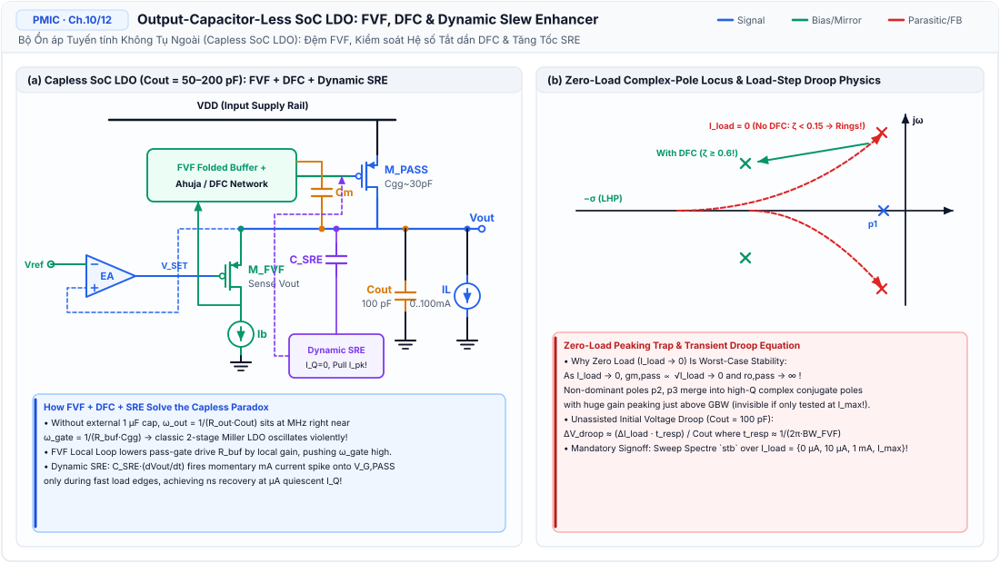

---
{
  "id": "topo-capless-ldo-fvf-ahuja-dfc-and-sre",
  "kind": "topology",
  "domain": "power-management-ic",
  "title_vi": "Bộ Ổn áp Tích hợp Không Tụ Ngoài (Capless SoC LDO): Kiến trúc FVF, Bù Cascode Ahuja, Kiểm soát Hệ số Tắt dần (DFC) & Tăng tốc Động SRE",
  "title_en": "Output-Capacitor-Less (Capless) SoC LDO Architectures: Flipped Voltage Follower (FVF), Ahuja Compensation, Damping-Factor-Control (DFC) & Dynamic Slew-Rate Enhancer (SRE)",
  "summary": "Toàn tập thiết kế bộ ổn áp LDO tích hợp hoàn toàn trên silicon (Cout = 50-200 pF, không tốn chân và tụ gốm ngoài) cấp nguồn cục bộ cho các lõi SoC/PLL/ADC: giải quyết nghịch lý cực di động từ 0 đến 50 mA bằng bộ theo điện áp lật (Flipped Voltage Follower — FVF), bù dòng Cascode Ahuja, khối kiểm soát hệ số tắt dần DFC dập tắt cặp cực phức liên hợp Q cao ở chế độ không tải, mạch tăng tốc sườn động ghép tụ SRE kèm kẹp hút dòng chống vọt lố nhả tải, và hàm truyền khử nhiễu nguồn PSRR 3 miền tần số.",
  "diagram": "../../diagrams/capless-fvf-dfc-ldo.svg",
  "razavi_refs": [
    {
      "chapter": 8,
      "section": "8.2.1, 8.3, 8.5",
      "pages": "286-291, 298-299, 303-312",
      "equations": [
        "8.14",
        "8.36"
      ]
    },
    {
      "chapter": 9,
      "section": "9.10-9.11",
      "pages": "396-402",
      "equations": [
        "9.81",
        "9.85"
      ]
    },
    {
      "chapter": 10,
      "section": "10.5, 10.7, 10.8",
      "pages": "426-439, 444-455",
      "equations": [
        "10.30",
        "10.49",
        "10.50",
        "10.51"
      ]
    },
    {
      "chapter": 12,
      "section": "12.6, 12.8",
      "pages": "525-528, 534-535",
      "equations": [
        "12.60"
      ]
    }
  ],
  "github_refs": [
    {
      "repo": "vyges/sg13cmos5l_vyges_ip__ldo_capless",
      "url": "https://github.com/vyges/sg13cmos5l_vyges_ip__ldo_capless/tree/4f3b40e3a1f74b4e8d44f0854e2bc587a228ca4e",
      "use": "IP Capless LDO đã kiểm chứng silicon có mạch tăng tốc động quá độ (boost/SRE), tinh chỉnh số và kịch bản đo PSRR/Load-Step đa góc PVT"
    },
    {
      "repo": "ChrisZonghaoLi/sky130_ldo_rl",
      "url": "https://github.com/ChrisZonghaoLi/sky130_ldo_rl/tree/95adf17fc5e34d0166eb89a45ca15636463db789",
      "use": "Bộ testbench định lượng toàn diện cho CMOS LDO (Loop Gain/PM theo tải, PSRR, Line/Load Regulation và đáp ứng quá độ nhảy tải)"
    },
    {
      "repo": "Arcadia-1/analog-design-bench",
      "url": "https://github.com/Arcadia-1/analog-design-bench/tree/972f7cd7c937fd4b779b15f77f0bc9136723182a",
      "use": "Bài chuẩn sky130-capless-ldo-1v0-20ma-pvt và sky130-ahuja-compensated-two-stage-load-range-pvt kiểm định dự trữ pha toàn dải tải"
    },
    {
      "repo": "idea-fasoc/OpenFASOC",
      "url": "https://github.com/idea-fasoc/OpenFASOC/tree/426c17025ca7647ee0a3f9749621a9bc6df8ab41",
      "use": "Kiến trúc máy phát LDO tích hợp trên chip (ldo-gen) và khuôn mẫu kiểm chứng hồi quy trước/sau trích xuất ký sinh PEX"
    }
  ],
  "glossary_codes": [
    "T051",
    "T063",
    "T067",
    "T079",
    "T499",
    "T500",
    "T874",
    "T1574",
    "T1575",
    "T1698",
    "T1702",
    "T1812",
    "T1994",
    "T2176",
    "T2199",
    "T2200"
  ],
  "process_agnostic": true,
  "roles": {
    "fvf_local_shunt_cell": "Vòng hồi tiếp cục bộ siêu nhanh kiểu Bộ theo Điện áp Lật (Flipped Voltage Follower) dùng transistor cảm biến cổng chung M_FVF đẩy cực cổng M_pass vọt lên hàng trăm MHz",
    "ahuja_cascode_miller_network": "Tụ bù Miller C_c trả dòng hồi tiếp về nút cực nguồn trở kháng thấp của tầng cascode thay vì cổng M_pass, triệt tiêu hoàn toàn RHP zero và nhân cao cực ngõ ra",
    "damping_factor_control_dfc": "Khối trở kháng tích cực dẫn xuất đạo hàm (A_DFC + C_DFC + R_DFC) khống chế hệ số tắt dần zeta >= 0,5 cho cặp cực phức không trội khi dòng tải sụt về 0 A",
    "dynamic_sre_and_overshoot_sink": "Mạch phát hiện cạnh sụt/vọt áp ghép tụ C_SRE (tiêu thụ 0 A tĩnh) bơm xung dòng lớn nạp/xả C_G,pass và mở công tắc NMOS hút điện tích dư trên VOUT khi nhả tải đột ngột"
  },
  "symptoms_addressed": [
    "eliminating-external-microfarad-mlcc-capacitors-and-package-pins-for-soc-point-of-load-ldos",
    "severe-zero-load-oscillation-from-high-q-complex-conjugate-poles-in-multistage-capless-ldos",
    "massive-voltage-undershoot-and-overshoot-with-only-100-pf-on-chip-decoupling-capacitance",
    "slow-millisecond-recovery-tail-after-abrupt-full-load-to-zero-load-release",
    "mid-frequency-psrr-valley-corrupting-local-pll-vco-or-sar-adc-supply-rails"
  ],
  "limitations": [
    "single-loop-basic-fvf-suffers-modest-dc-load-regulation-unless-assisted-by-cascoded-or-outer-replica-loop",
    "ultra-small-cout-requires-wide-loop-bandwidth-or-sub-nanosecond-fvf-sre-reaction-to-contain-droop",
    "capacitive-sre-with-excessive-gain-can-re-trigger-on-its-own-recovery-edge-causing-limit-cycle-ringing",
    "high-frequency-psrr-above-10-mhz-bounded-by-cgd-plus-csd-to-cout-capacitive-divider"
  ],
  "checklists": [
    "common-mos",
    "ldo-regulator",
    "feedback-and-stb",
    "two-stage-miller",
    "layout-and-matching"
  ]
}
---

## 1. Cuộc Cách mạng Capless SoC LDO & Nghịch lý "Cực Nội – Cực Tải" Khi $C_{\text{OUT}} = 50\text{–}200\text{ pF}$

Trong một vi mạch Hệ thống trên Chip (SoC) hiện đại chứa hàng chục miền nguồn độc lập (cho lõi số, VCO/PLL, bộ thu phát SerDes, SAR/$\Delta\Sigma$ ADC và SRAM), việc dành riêng 1 chân vỏ chip (pin/bump) kèm 1 tụ gốm ngoài $1\,\mu\text{F}$ cho mỗi bộ ổn áp LDO (`topo-cmos-ldo-regulator`) là điều bất khả thi về cả chi phí chân vỏ lẫn diện tích bo mạch! Từ đó ra đời bài toán thiết kế **Bộ ổn áp LDO Tích hợp Không Tụ Ngoài (`Output-Capacitor-Less / Capless LDO`)**, nơi toàn bộ điện dung ngõ ra chỉ còn lại tụ decoupling trên chip $C_{\text{OUT}} = 50\text{–}200\text{ pF}$ (nhỏ hơn tụ ngoài **$10.000 \dots 50.000$ lần**!) và $R_{\text{ESR}} \approx 0$!



Sự sụt giảm $4{,}5$ bậc độ lớn của $C_{\text{OUT}}$ lật ngược toàn bộ vật lý thiết kế LDO truyền thống trên hai mặt trận khốc liệt:
1. **Nghịch lý Ổn định Quét Dòng Tải $I_{\text{load}} = 0 \to 50\text{ mA}$:**
   - Vì $C_{\text{OUT}} = 100\text{ pF}$ quá nhỏ để đặt cực trội ở ngõ ra ở dòng tải $50\text{ mA}$ ($\omega_{p,\text{out}} = \frac{1}{r_{O,\text{pass}} C_{\text{OUT}}}$ vọt lên hàng chục MHz!), đa số Capless LDO độ lợi cao đặt **cực trội $\omega_{p1}$ ở nút nội** bằng cách tách cực Miller $C_c$, đẩy $\omega_{p,\text{out}}$ làm cực không trội $\omega_{p2} \propto \frac{g_{m,\text{pass}}}{C_{\text{OUT}}}$.
   - Nhưng ở **chế độ ngủ / không tải ($I_{\text{load}} \to 0$)** với ngân sách dòng tĩnh cực thấp ($I_Q \le 15\text{–}30\,\mu\text{A}$), $g_{m,\text{pass}}$ tụt hàng trăm lần trong khi $r_{O,\text{pass}}$ phình lên hàng trăm $\text{k}\Omega$! Nếu có thêm tầng đệm lái cổng tạo thành hệ 3 tầng, hai cực không trội hợp nhất thành **cặp cực phức liên hợp thiếu tắt dần cực nặng ($\zeta < 0{,}1$)** tạo gai cộng hưởng nhọn hoắt đâm xuyên trở lại trên $0\text{ dB}$ gây dao động!
2. **Nghịch lý Sụt/Vọt Áp Quá Độ Tức Thời ($\Delta V_{\text{droop}}$ & $\Delta V_{\text{overshoot}}$):**
   - Với $C_{\text{OUT}} = 100\text{ pF}$, khi khối số thức dậy rút $\Delta I_{\text{load}} = 50\text{ mA}$ trong $1\text{ ns}$, tốc độ sụt áp ban đầu của tụ là $\dfrac{dV_{\text{OUT}}}{dt} = \dfrac{50\text{ mA}}{100\text{ pF}} = 500\text{ mV/ns}$! Nếu vòng lặp và tầng lái cổng $M_{\text{pass}}$ phản ứng chậm chỉ $2\text{ ns}$ thôi, $V_{\text{OUT}}$ đã sập mất $1{,}0\text{ V}$ (chết đứng toàn bộ hệ thống số!). Ngược lại khi nhả tải $50\text{ mA} \to 0$, $M_{\text{pass}}$ là PMOS chỉ cấp dòng một chiều nên không thể hút điện tích dư ra khỏi $C_{\text{OUT}}$!

Để chinh phục đồng thời hai nghịch lý trên với dòng tĩnh $\mu\text{A}$, công nghiệp bán dẫn kết tinh **hai họ kiến trúc chủ lực** kết hợp **tăng tốc động phi tuyến**: (1) **Kiến trúc Flipped Voltage Follower (`FVF-LDO`)** cho đáp ứng dưới nano-giây, và (2) **Kiến trúc Đa tầng Độ lợi Cao Bù Ahuja + Damping-Factor-Control (`DFC-LDO`) + Dynamic `SRE`** cho độ chính xác tĩnh & PSRR tối thượng!

---

## 2. Giải phẫu Hai Kiến trúc Hạt nhân & Hệ Phương trình Động học Cốt lõi

### 2.1. Kiến trúc 1 — Bộ Ổn áp Theo Điện áp Lật (`Flipped Voltage Follower — FVF Capless LDO`)
Khởi nguồn từ công trình nổi tiếng của Hazucha et al. (Intel, *IEEE JSSC* 2005) cho nguồn cấp vi xử lý trên chip, **FVF-LDO** biến tầng cảm biến ngõ ra thành một vòng hồi tiếp dòng–áp cục bộ chỉ gồm **2 transistor trên đường tín hiệu cao tần**!
- **Cấu trúc lõi:** Transistor truyền công suất PMOS $M_{\text{pass}}$ cấp dòng xuống $V_{\text{OUT}}$. Thay vì đưa $V_{\text{OUT}}$ qua cầu điện trở chậm chạp vào cặp vi sai, cực nguồn của một transistor PMOS cổng chung $M_{\text{FVF}}$ nối **trực tiếp vào $V_{\text{OUT}}$**, cực cổng của $M_{\text{FVF}}$ được ghim vào điện áp đặt chuẩn $V_{\text{SET}} = V_{\text{OUT,target}} - |V_{SG,\text{FVF}}|$ (tạo bởi một nhánh sao chép *Replica Bias* được khóa chính xác với $V_{\text{REF}}$ qua một OTA chậm tiêu thụ chỉ $1\text{–}2\,\mu\text{A}$!). Cực máng của $M_{\text{FVF}}$ (nuôi bởi nguồn dòng tĩnh $I_{B1}$) lái thẳng (hoặc qua 1 gương dòng gập / bộ đệm SF nhanh) vào cực cổng của $M_{\text{pass}}$!
- **Phân tích nhìn nhanh cực–zero của FVF-LDO:**
  - Khi $V_{\text{OUT}}$ chớm sụt xuống $-\Delta v_{\text{out}}$, vì cổng $M_{\text{FVF}}$ đứng yên tại $V_{\text{SET}}$, điện áp nguồn-cổng $|V_{SG,\text{FVF}}|$ giảm ngay lập tức không qua bất kỳ nút trung gian nào, làm dòng cực máng $M_{\text{FVF}}$ giảm $-g_{m,\text{FVF}} \Delta v_{\text{out}}$ kéo tụt điện áp cổng $M_{\text{pass}}$ xuống để bơm dòng bù tức thì!
  - Độ lợi vòng cục bộ $T_{0,\text{FVF}} = g_{m,\text{FVF}} R_{o,\text{fold}} \cdot g_{m,\text{pass}} R_{\text{out,open}}$, trở kháng ra đóng vòng ở trung tần hạ thấp còn $R_{\text{out,closed}} \approx \dfrac{1}{g_{m,\text{FVF}} \cdot g_{m,\text{pass}} R_{o,\text{fold}}} \sim 0{,}05\text{–}0{,}3\,\Omega$!
  - Bằng cách chèn một bộ đệm theo nguồn trở kháng thấp (hoặc cascode gập dòng lớn vừa phải) lái cổng $M_{\text{pass}}$, cực nội tại cổng $\omega_{p,\text{gate}} = \dfrac{1}{R_{\text{drv}} C_{G,\text{pass}}}$ được đẩy vọt lên $200\text{–}600\text{ MHz}$, biến **cực tại $V_{\text{OUT}}$ (gắn với tụ trên chip $C_{\text{OUT}} = 100\text{–}200\text{ pF}$) trở lại làm cực trội $\omega_{p1}$**! Nhờ đó FVF-LDO đạt tần số cắt $f_u \sim 40\text{–}150\text{ MHz}$ và thời gian phản ứng vòng $\tau_{\text{resp}} < 1{,}5\text{ ns}$!
  - **Đánh đổi & Cách nâng cấp (`Cascoded / Dual-Loop FVF`):** Vòng FVF cơ bản chỉ có 1 tầng khuếch đại dòng nên $T_{0,\text{FVF}} \approx 35\text{–}50\text{ dB}$ (Load Regulation khoảng vài $\text{mV}$). Để vừa giữ tốc độ $1\text{ ns}$ của FVF vừa đạt DC Load Regulation $< 0{,}2\text{ mV}$, ta dùng **Cấu trúc Hai Vòng Song Song**: vòng FVF nhanh giữ quá độ cao tần, còn OTA ngoại độ lợi $70\text{ dB}$ điều chỉnh chậm $V_{\text{SET}}$ để khóa $V_{\text{FB}} \equiv V_{\text{REF}}$ ở DC!

### 2.2. Kiến trúc 2 — Bù Cascode Ahuja & Khối Kiểm soát Hệ số Tắt dần (`Damping-Factor-Control — DFC`)
Khi ứng dụng đòi hỏi cầu chia điện trở linh hoạt ($V_{\text{OUT}} = V_{\text{REF}}/\beta$), độ lợi vòng DC rất cao ($> 80\text{ dB}$) và dòng tĩnh siêu thấp ($I_Q < 20\,\mu\text{A}$) trên tụ $C_{\text{OUT}} = 50\text{–}100\text{ pF}$, kiến trúc 3 tầng gồm **Tầng 1 OTA ($G_{m1}, R_{o1}$) $\to$ Tầng 2 Đệm/Khuếch đại lái cổng ($G_{m2}, R_{o2}$) $\to$ Tầng 3 PMOS Pass ($g_{m,\text{pass}}, R_L \parallel r_{O,\text{pass}}$)** được sử dụng (Leung & Mok, *IEEE JSSC* 2003).
1. **Tại sao Bù Miller Đơn Thuần & Bù Ahuja Đơn Thuần Vẫn Gặp Nguy Hiểm Ở $I_{\text{load}} = 0$ trong Cấu trúc 3 Tầng?**
   - Nếu nối tụ Miller $C_c$ từ $V_{\text{OUT}}$ quay về cực nguồn cascode của Tầng 1 (`tech-miller-rhp-zero-nulling-and-cascode-comp`, Razavi §10.7 Phương trình 10.49), đường truyền thuận gây RHP zero bị chặn hoàn toàn, sinh cực trội rất thấp $\omega_{p1} \approx \dfrac{1}{G_{m2} R_{o2} g_{m,\text{pass}} R_{\text{out}} R_{o1} C_c}$ giữ tần số cắt ổn định $\omega_u = \dfrac{\beta G_{m1}}{C_c}$.
   - Tuy nhiên, vì có mặt nút cổng $C_{G,\text{pass}}$ (tụ lớn $5\text{–}20\text{ pF}$ lái bởi $R_{o2}$) nằm giữa Tầng 1 và $V_{\text{OUT}}$, mẫu số cao tần sau khi rút cực trội $\omega_{p1}$ là một **đa thức bậc hai có hệ số giảm chấn phụ thuộc trực tiếp vào $g_{m,\text{pass}}(I_{\text{load}})$**:

$$
T_{\text{3-stage}}(s) \approx \frac{T_0}{\left(1 + \dfrac{s}{\omega_{p1}}\right)\left(1 + \dfrac{2 \zeta(I_{\text{load}})}{\omega_n(I_{\text{load}})} s + \dfrac{s^2}{\omega_n^2(I_{\text{load}})}\right)}
$$

   - Ở **tải vừa và nặng ($I_{\text{load}} \ge 1\text{ mA}$):** $g_{m,\text{pass}}$ lớn đẩy cả tần số tự nhiên $\omega_n \gg \omega_u$ lẫn hệ số tắt dần $\zeta > 1$ (tách thành hai cực thực nằm xa trên $\omega_u$, mạch ổn định tuyệt đối!).
   - Ở **không tải ($I_{\text{load}} = 0$, chỉ còn dòng rỉ cầu chia vài $\mu\text{A}$):** $g_{m,\text{pass}}$ sụt cực nhỏ trong khi $R_{\text{out}} = r_{O,\text{pass}} \parallel R_{\text{FB}}$ cực lớn làm $\zeta_0 \approx \frac{1}{2}\sqrt{\frac{C_{G,\text{pass}}}{g_{m,\text{pass}} R_{o2}^2 G_{m2} C_{\text{OUT}}}}$ rơi thảm hại xuống **$\zeta_0 \approx 0{,}05 \dots 0{,}18$**! Tại tần số $\omega_n > \omega_u$, biên độ $|T(j\omega_n)|$ đột ngột vọt nhọn lên một đỉnh cộng hưởng $+20\log_{10}\!\left(\frac{1}{2\zeta_0}\right) \approx +15\text{ dB} \dots +20\text{ dB}$, **đâm ngược từ dưới mức âm xuyên vọt qua mốc $0\text{ dB}$ ở góc pha $-180^\circ$**!
2. **Cơ chế Cứu Mạng của Khối `DFC` (`Damping-Factor-Control`):**
   Khối DFC mắc một bộ khuếch đại đảo phụ nhỏ $A_{\text{DFC}} = -g_{m,d} R_{o,d}$ phối hợp với tụ $C_{\text{DFC}}$ nối tại nút trung gian (giữa Tầng 1 và Tầng 2) hoặc nối tiếp điện trở giảm chấn $R_{\text{DFC}}$ trong nhánh hồi tiếp phụ từ cổng $M_{\text{pass}}$. Khối này bơm một thành phần dẫn nạp tỉ lệ với đạo hàm bậc nhất $s$ vào hệ số bậc một $\dfrac{2\zeta}{\omega_n}$ của mẫu số mà không tiêu tốn dòng tĩnh ở tải nặng, ép hệ số tắt dần tối thiểu tại $I_{\text{load}} = 0$ luôn thỏa mãn:

$$
\zeta_{\text{DFC}}(I_{\text{load}} = 0) \ge \frac{1}{\sqrt{2}} \approx 0{,}707 \implies \text{Xóa sạch 100\% gai cộng hưởng trên đồ thị Bode \& bước nhảy không rung!}
$$

   Đồng thời nó còn sinh một zero LHP khử bớt trễ pha quanh $\omega_u$, cho phép dùng tụ bù trên chip cực gọn ($C_c + C_{\text{DFC}} \le 8\text{–}15\text{ pF}$)!

### 2.3. Mạch Tăng tốc Sườn Động Ghép Tụ (`Dynamic SRE`) & Kẹp Hút Dòng Chống Vọt Lố Nhả Tải
Để giải bài toán $\Delta V_{\text{droop}}$ và $\Delta V_{\text{overshoot}}$ trên $C_{\text{OUT}} = 100\text{ pF}$ mà không tốn thêm dòng tĩnh $I_Q$ ở trạng thái nghỉ (`vyges/sg13cmos5l_vyges_ip__ldo_capless`):
1. **Nhánh Sụt Áp Khi Đóng Tải (`Undershoot Dynamic Slew-Rate Enhancer`):**
   Một tụ nhỏ trên chip $C_{\text{SRE}} \approx 1\text{–}3\text{ pF}$ nối từ $V_{\text{OUT}}$ vào cực cổng/nguồn của một transistor phát hiện quá độ phân cực sát ngưỡng tắt (`Class-B / Push-Pull Edge Detector`, dòng tĩnh $\le 0{,}2\,\mu\text{A}$). Ở xác lập $\frac{dV_{\text{OUT}}}{dt} = 0$, nhánh SRE ngủ hoàn toàn. Ngay khoảnh khắc tải nhảy $0 \to 50\text{ mA}$ kéo $V_{\text{OUT}}$ sụt dốc âm $-\frac{dV_{\text{OUT}}}{dt}$, tụ $C_{\text{SRE}}$ truyền thẳng xung dòng $i_{\text{det}} = C_{\text{SRE}} \left|\frac{dV_{\text{OUT}}}{dt}\right|$ kích mở gương dòng xung kéo mạnh cổng $M_{\text{pass}}$ xuống đất với dòng $I_{\text{SRE,pull}} = K_{\text{SRE}} i_{\text{det}} \approx 0{,}5\text{–}2{,}0\text{ mA}$ (gấp **$100\times$** dòng tĩnh của tầng lái cổng!), rút ngắn thời gian nạp cổng $C_{G,\text{pass}}$ từ $200\text{ ns}$ xuống dưới $4\text{ ns}$!
2. **Nhánh Hút Dòng Chủ Động Khi Nhả Tải (`Active Load-Release Overshoot Pull-Down Clamp`):**
   Khi tải ngắt đột ngột $50\text{ mA} \to 0$, đồng thời với việc SRE bơm dòng đẩy cổng $M_{\text{pass}}$ lên $V_{\text{IN}}$ để khóa $M_{\text{pass}}$, một transistor hút dòng NMOS $M_{\text{sink}}$ đặt ngay tại chân $V_{\text{OUT}}$ xuống `VSS` (bình thường bị khóa chặt ở $V_{GS,\text{sink}} = V_{\text{bias}} - \Delta V_{\text{margin}} < V_{THN}$ nên dòng rò $< 10\text{ nA}$!) được kích mở tức thời qua tụ ghép hoặc qua nhánh so sánh lệch ngưỡng $V_{\text{OUT}} > V_{\text{OUT,nom}} + 40\text{ mV}$. $M_{\text{sink}}$ lập tức nuốt gọn toàn bộ điện tích dư trên $C_{\text{OUT}}$, kẹp cứng đỉnh vọt lố $\Delta V_{\text{overshoot}} \le 50\text{–}70\text{ mV}$ và đưa $V_{\text{OUT}}$ về xác lập trong $< 300\text{ ns}$ (thay vì đuôi xả dài $50\,\mu\text{s}$ qua cầu điện trở!).

### 2.4. Hàm Truyền Khử Nhiễu Nguồn `PSRR(s)` Ba Miền Tần số Của Capless PMOS LDO
Viết tỉ số truyền nhiễu từ $\hat{v}_{\text{in}}(s)$ xuống $\hat{v}_{\text{out}}(s)$ (theo quy ước $\text{PSRR}_{\text{dB}} = 20\log_{10}\left|\frac{\hat{v}_{\text{in}}}{\hat{v}_{\text{out}}}\right| > 0$, Razavi §9.11):
- **Miền I — Tần số thấp ($f < f_{p1}$):** Được nén bởi toàn bộ độ lợi vòng $T_0$, bị chặn trần bởi độ sạch của $V_{\text{REF}}$ và sai lệch đối xứng của EA:
  $$\frac{\hat{v}_{\text{out}}}{\hat{v}_{\text{in}}}(0) \approx \frac{1}{T_0} \left(\frac{R_{\text{out,open}}}{r_{O,\text{pass}}} + g_{m,\text{pass}} R_{\text{out,open}} \big(1 - A_{g,\text{sup}}\big)\right) + \frac{1}{\beta}\frac{\Delta V_{\text{REF}}}{\Delta V_{\text{IN}}}$$
  trong đó $A_{g,\text{sup}} = \frac{\partial V_{G,\text{pass}}}{\partial V_{\text{IN}}}$ là hệ số bám nguồn của nút cổng $M_{\text{pass}}$! **Muốn PSRR cao, bắt buộc tầng lái cổng $M_{\text{pass}}$ phải tham chiếu lên chính $V_{\text{IN}}$ để $A_{g,\text{sup}} \to 1$ (`CHK-LDO-04`), biến $\hat{v}_{sg,\text{pass}} = \hat{v}_{\text{in}} - \hat{v}_g \approx 0$!**
- **Miền II — Trung tần ($f_{p1} < f < f_u$):** $|T(jf)|$ giảm $-20\text{ dB/dec}$ làm trở kháng ra đóng vòng tăng lên như một cuộn cảm ảo $Z_{\text{out,cl}}(jf) \approx \frac{R_{\text{out,open}}}{|T(jf)|} \propto f$, tạo **thung lũng suy giảm PSRR (`PSRR Valley`)** chạm đáy quanh $f_u$! Đẩy rộng $f_u$ (như trong FVF-LDO hoặc Ahuja-LDO) trực tiếp nâng sâu khả năng khử nhiễu chuyển mạch $1\text{–}10\text{ MHz}$ từ bộ nguồn Buck đứng trước!
- **Miền III — Siêu cao tần ($f \gg f_u$):** Vòng hồi tiếp mở hoàn toàn ($|T| \ll 1$), nhiễu từ $V_{\text{IN}}$ truyền thẳng qua điện dung ký sinh cực nguồn-máng và cổng-máng của $M_{\text{pass}}$ chia áp với tụ trên chip $C_{\text{OUT}}$:

$$
\left.\frac{\hat{v}_{\text{out}}}{\hat{v}_{\text{in}}}\right|_{f \gg f_u} \approx \frac{C_{SD,\text{pass}} + (1 - A_{g,\text{sup}}) C_{GD,\text{pass}}}{C_{\text{OUT}} + C_{SD,\text{pass}} + C_{GD,\text{pass}}}
$$

  Công thức này giải thích tại sao ở $f > 50\text{ MHz}$, nếu không định cỡ $W_{\text{pass}}$ vừa đủ gọn (tránh thừa diện tích khuếch tán cực máng làm phình $C_{SD,\text{pass}}$) trên nền $C_{\text{OUT}} = 100\text{ pF}$, PSRR cao tần có thể tụt về chỉ còn $12\text{–}18\text{ dB}$!

---

## 3. Bất biến Cấu trúc & Các Bẫy Lỗi Kinh điển trên Silicon (Invariants & Traps)

- **[INV-CLDO-01] Kiểm Toán Bắt Buộc Đồ Thị Nyquist & `Gain Margin` Tại $I_{\text{load}} = 0\text{ A}$ (`CHK-LDO-07`):** Trong trình tính toán của ADE/Spectre, hàm `phaseMargin()` mặc định chỉ tìm tần số cắt $0\text{ dB}$ **đầu tiên** ($\omega_{u1}$) và đọc pha tại đó! Trong Capless LDO 3 tầng thiếu DFC ở không tải, tại $\omega_{u1} = 1\text{ MHz}$ pha vẫn ở $-120^\circ$ nên hàm tự động báo xanh giả tạo `PM = +60 deg`, nhưng ở $\omega_n = 8\text{ MHz}$ đỉnh cộng hưởng cặp cực phức nhô vọt qua $+6\text{ dB}$ tại pha $-185^\circ$ làm chip **dao động điên cuồng ngay khi vừa nhả tải**! Bắt buộc kiểm tra đồng thời `gainMargin() >= 10 dB` VÀ kiểm tra cực đại hàm truyền vòng kín `ymax(dB20(VF("/vout")/VF("/vref_ac"))) <= 2.5 dB`!
- **[INV-CLDO-02] Cấm Tuyệt Đối Gắn Tụ Lọc Từ Cực Cổng `G_PASS` Của PMOS Xuống Đất `VSS` (`CHK-LDO-04`):** Nhiều người thấy nút cổng $M_{\text{pass}}$ có nhiễu hoặc muốn hạ cực liền mắc một tụ $C_g$ từ `G_PASS` xuống `VSS`. Việc này khóa cứng $A_{g,\text{sup}}(jf) \to 0$ ở cao tần, biến toàn bộ gợn sóng từ bộ Buck phía trước trên $V_{\text{IN}}$ thành điện áp điều khiển cổng–nguồn $\hat{v}_{sg} = \hat{v}_{\text{in}}$, khiến $M_{\text{pass}}$ khuếch đại nhiễu nguồn bơm thẳng xuống tải ($\text{PSRR}$ sụp về $< 0\text{ dB}$)! Mọi tụ Miller/lọc cổng của PMOS pass chỉ được phép nối tới `VIN` hoặc `VOUT` (qua nhánh bù)!
- **[TRAP-CLDO-01] Dao động Chu kỳ Giới hạn (`Limit-Cycle Ringing`) Do Mạch Động `SRE` Quá Nhạy:** Nếu đặt ngưỡng kích của SRE và $M_{\text{sink}}$ quá sát điểm cân bằng ($\pm 5\text{ mV}$) với độ lợi dòng xung quá lớn, cú giật kéo cổng của SRE làm $V_{\text{OUT}}$ vọt ngược qua ngưỡng dương, kích nổ tiếp nhánh $M_{\text{sink}}$ kéo sập $V_{\text{OUT}}$ xuống ngưỡng âm, tạo thành vòng tự kích qua lại không bao giờ tắt! Quy tắc an toàn: đặt vùng chết tĩnh (dead-zone) tối thiểu $\pm 25\text{–}40\text{ mV}$ quanh điểm cân bằng cho nhánh kẹp mạnh và giới hạn hằng số thời gian cao thông $\tau_{\text{SRE}} = R_{\text{SRE}} C_{\text{SRE}}$ nhỏ hơn $\dfrac{1}{3 \cdot 2\pi f_u}$!

---

## 4. Ma trận Lựa chọn Kiến trúc Capless LDO Theo Khối Tải SoC

| Khối Tải Mục tiêu Trên SoC | Kiến trúc Capless LDO Đề xuất | $C_{\text{OUT}}$ Trên Chip | Băng thông $f_u$ & PSRR @ $1\text{ MHz}$ | Đặc tính Nổi bật & Đánh đổi |
|---|---|---|---|---|
| **Lõi Số Tốc độ Cao / SRAM Burst (`Digital Core`)** | **Dual-Loop Replica-Biased FVF LDO + Active Sink** | $100\text{–}250\text{ pF}$ | $f_u \sim 50\text{–}120\text{ MHz}$; PSRR $\sim 35\text{ dB}$ | Thời gian phản ứng $< 1{,}5\text{ ns}$ chặn đứng sụt áp xung nhịp GHz; tốn thêm nhánh replica bias $\sim 20\text{–}50\,\mu\text{A}$ |
| **SAR / $\Delta\Sigma$ ADC, AFE Cảm biến (`Precision Analog`)** | **Folded-Cascode + Bù Ahuja + DFC + Dynamic SRE** | $80\text{–}150\text{ pF}$ | $f_u \sim 5\text{–}15\text{ MHz}$; PSRR $\sim 55\text{–}68\text{ dB}$ | Độ lợi DC $> 85\text{ dB}$, nhiễu nền cực thấp, dòng tĩnh $I_Q < 15\,\mu\text{A}$ và ổn định tuyệt đối ở $I_{\text{load}} = 0$ |
| **LC-VCO / PLL / SerDes (`Ultra-Clean RF Rail`)** | **NMOS Source-Follower Pass LDO + Charge-Pump Gate Rail** (hoặc **PMOS Cascode-Shielded LDO**) | $100\text{–}200\text{ pF}$ | $f_u \sim 20\text{–}40\text{ MHz}$; **PSRR $> 65\text{ dB}$ tới $10\text{ MHz}$!** | Cực máng NMOS cách ly hoàn toàn $V_{\text{OUT}}$ khỏi $V_{\text{IN}}$, trở kháng ra tự nhiên $1/g_{m,\text{pass}}$ cực thấp; tốn áp rơi $V_{DO} \ge 0{,}4\text{ V}$ hoặc bơm điện tích |

---

## 5. Quy trình Định cỡ 5 Bước Cho Capless Ahuja-DFC LDO & Testbench Spectre 15.1

### 5.1. Quy trình Định cỡ Thiết kế ($V_{\text{IN}} = 1{,}2\text{ V} \to V_{\text{OUT}} = 1{,}0\text{ V}$, $I_{\max} = 50\text{ mA}$, $C_{\text{OUT}} = 100\text{ pF}$, $I_Q = 20\,\mu\text{A}$)
1. **Định cỡ PMOS truyền $M_{\text{pass}}$ tại góc chậm nhất (`SS, 125 °C`):** Ngân sách dropout $V_{\text{DO}} = 200\text{ mV}$. Dành $30\text{ mV}$ cho sụt áp kim loại định tuyến $\implies |V_{DS,\text{sat,pass}}| \le 170\text{ mV}$ ($\implies g_m/I_D \approx 11\text{–}12\text{ V}^{-1}$). Tra LUT `gmid_lut.py` tại $L = 100\text{ nm}$ (trên $90\text{ nm}$ CMOS) thu được $W_{\text{pass}} \approx 3{,}6\text{ mm}$ (chia $nf = 720$ ngón chẵn $5\,\mu\text{m}$ để giảm một nửa $C_{SD,\text{pass}} \approx 2{,}8\text{ pF}$, tổng $C_{G,\text{pass}} \approx 6{,}2\text{ pF}$).
2. **Đặt dòng rỉ cầu chia tối thiểu (`Bleeder Floor`):** Chọn $R_{\text{FB1}} = 66{,}7\text{ k}\Omega, R_{\text{FB2}} = 100\text{ k}\Omega$ ($V_{\text{REF}} = 0{,}6\text{ V}$) tạo dòng rỉ nền cố định $I_{\text{bleed}} = \frac{1{,}0\text{ V}}{166{,}7\text{ k}\Omega} = 6{,}0\,\mu\text{A}$. Ở $I_{\text{load}} = 0$, $M_{\text{pass}}$ vẫn dẫn $6\,\mu\text{A}$ vùng dưới ngưỡng ($g_{m,\text{pass,min}} = \frac{6\,\mu\text{A}}{1{,}35 \times 26\text{ mV}} \approx 170\,\mu\text{S}$ — không bao giờ tụt về $0$, và vượt xa dòng rò tắt $I_{\text{off}} \approx 0{,}4\,\mu\text{A}$ ở `FF, 125 °C` theo `CHK-LDO-05`!).
3. **Định cỡ Tầng 1 Folded-Cascode + Bù Ahuja $C_c$:** Chọn $C_c = 6\text{ pF}$ trả dòng về cực nguồn cascode NMOS ($g_{m,\text{cas}} = 220\,\mu\text{S}$). Để đạt tần số cắt $f_u = \frac{\beta G_{m1}}{2\pi C_c} = 4{,}5\text{ MHz}$ (với $\beta = 0{,}6$), suy ra $G_{m1} = \frac{2\pi \cdot 4{,}5\text{ MHz} \cdot 6\text{ pF}}{0{,}6} = 283\,\mu\text{S}$ (tốn $I_{\text{tail}} \approx 28\,\mu\text{A}$ hoặc $16\,\mu\text{A}$ với cặp vi sai dưới ngưỡng $g_m/I_D = 18\text{ V}^{-1}$!).
4. **Định cỡ Tầng Đệm Cổng Tham chiếu `VIN` & Nhánh `DFC`:** Dùng bộ đệm Super Source Follower PMOS tham chiếu lên `VIN` ($R_{\text{buf}} \approx 600\,\Omega$) kèm nhánh giảm chấn $C_{\text{DFC}} = 2{,}5\text{ pF} + R_{\text{DFC}} = 12\text{ k}\Omega$ đảm bảo tại $I_{\text{load}} = 0$: $\zeta \approx 0{,}68$, $\text{PM} = 61^\circ$, $\text{GM} = 15\text{ dB}$!
5. **Định cỡ Mạch Động `SRE` + Kẹp Hút `M_sink`:** Chọn $C_{\text{SRE}} = 1{,}5\text{ pF}$, hệ số gương dòng xung $K_{\text{SRE}} = 12$; transistor hút vọt lố NMOS $M_{\text{sink}}$ ($W/L = 40\,\mu\text{m}/100\text{ nm}$) đặt lệch ngưỡng $+45\text{ mV}$ giữ cả sụt áp lẫn vọt lố dưới $\pm 65\text{ mV}$ cho bước nhảy $0 \leftrightarrow 50\text{ mA}$ cạnh $1\text{ ns}$!

### 5.2. Deck Kiểm chứng Spectre 15.1 Quét Nền Tải $0 \to 50\text{ mA}$ (`STB + XF PSRR + 1ns Load-Step/Release`)
```scs
// Spectre 15.1 Capless SoC LDO (Cout = 100 pF) Zero-Load Damping, PSRR & 1ns SRE Transient Suite
simulator lang=spectre
global 0

parameters vin=1.2 vref=0.6 iload=0 c_out_soc=100p
parameters gm1=280u ro1=2.5M gm_cas=240u r_buf=600 c_gpass=6.2p
parameters c_ahuja=6p c_dfc=2.5p r_dfc=12k c_sre=1.5p

VIN_SRC  (vin 0)  vsource dc=vin mag=1
VREF_SRC (vref 0) vsource dc=vref

// Đầu dò STB kiểm định đồng thời Phase Margin, Gain Margin & Đỉnh cộng hưởng cực phức ở iload = 0!
IPRB_CLDO (vout vout_fb) iprobe
RFB1      (vout_fb fb) resistor r=66.7k
RFB2      (fb 0)       resistor r=100k

// Tầng 1 OTA + Nút nguồn Cascode nhận dòng bù Ahuja C_c từ VOUT (chặn 100% đường RHP zero!)
G_IN1     (0 n_cas fb vref) vccs gm=gm1
R_CAS_IN  (n_cas 0)         resistor r=1/gm_cas
G_CAS_UP  (0 n_o1 n_cas 0)  vccs gm=gm_cas
R_O1      (n_o1 vin)        resistor r=ro1
C_AHUJA   (vout n_cas)      capacitor c=c_ahuja

// Tầng đệm lái cổng tham chiếu VIN (bảo vệ PSRR: delta_Vg bám sát delta_Vin!) + Mạng giảm chấn DFC
E_BUF_VIN (n_buf_src vin n_o1 vin) vcvs gain=1.0
R_BUF_OUT (n_buf_src g_pass)       resistor r=r_buf
C_G_PASS  (g_pass vin)             capacitor c=c_gpass
R_DFC_NET (g_pass n_dfc)           resistor r=r_dfc
C_DFC_NET (n_dfc vout)             capacitor c=c_dfc

// Phần tử truyền PMOS M_pass (hỗ dẫn phụ thuộc dòng thực từ vùng dưới ngưỡng 6uA lên 50mA) + Ký sinh C_SD
B_MPASS   (vin vout) bsource i=max(0.0, 22m*pow(max(v(vin, g_pass) - 0.32, 0.0) + 0.035*ln(1 + exp((v(vin, g_pass)-0.32)/0.035)), 1.6)) * tanh(8*v(vin, vout))
R_RO_PASS (vin vout) resistor r=400/(iload + 6u + 0.1m)
C_SD_PASS (vin vout) capacitor c=2.8p

// Mạch Tăng tốc Động Ghép Tụ SRE (0 A tĩnh) & Công tắc Hút Dòng Chống Vọt Lố Nhả Tải M_sink
C_SRE_DET (vout n_sre) capacitor c=c_sre
R_SRE_HPF (n_sre vref) resistor r=15k
B_SRE_PUL (g_pass 0)   bsource i=(v(n_sre, vref) < -0.025) ? 18m*( -0.025 - v(n_sre, vref) ) : 0
B_MSINK   (vout 0)     bsource i=(v(vout) > 1.045) ? 35m*(v(vout) - 1.045) : 0

// Tụ trên chip 100 pF + Nguồn dòng tải tĩnh & Xung bước nhảy 0 <-> 50 mA sườn 1 ns!
C_ONCHIP  (vout 0) capacitor c=c_out_soc
I_DC_LOAD (vout 0) isource dc=iload
I_STEP    (vout 0) isource type=pulse val0=0 val1=50m delay=500n rise=1n fall=1n width=1.5u

stb_zero_load stb start=100 stop=500M dec=50 probe=IPRB_CLDO annotate=status
ac_psrr_3band ac  start=100 stop=500M dec=50 annotate=status
tran_loadstep tran stop=3.5u maxstep=500p errpreset=conservative annotate=status
```

---

## 6. Tài liệu Đối chiếu Chuẩn Công nghiệp, Nguồn GitHub & Thuật ngữ CLB

### 6.1. Đối chiếu Sách Gốc Razavi, Các Công trình Nền tảng JSSC & Nguồn Mở
- **Razavi (2nd Ed.):** Chương 8 (§8.2.1 & §8.5 Hồi tiếp Điện áp–Điện áp và trở kháng ra đóng vòng), Chương 9 (§9.10–9.11 Tốc độ biến thiên Slew Rate và phân tích PSRR hai đường truyền), Chương 10 (§10.5, §10.7 Phương trình 10.49–10.51 về **Bù Cascode / Ahuja** & Bù đa tầng Nested Miller, §10.8 Tiêu chuẩn ổn định Nyquist), Chương 12 (§12.6, §12.8 Ổn áp tuyến tính cấp nguồn sạch).
- **Công trình Nền tảng IEEE JSSC:** K. N. Leung & P. K. T. Mok (*JSSC* 2003 — *A Capacitor-Free CMOS Low-Dropout Regulator With Damping-Factor-Control Frequency Compensation*), P. Hazucha et al. (*JSSC* 2005 — *Area-Efficient Linear Regulator With Ultra-Fast Load Regulation / FVF LDO*), R. J. Milliken, J. Silva-Martínez & E. Sánchez-Sinencio (*TCAS-I* 2007).
- **Kho GitHub Kiểm định:**
  - [`vyges/sg13cmos5l_vyges_ip__ldo_capless`](https://github.com/vyges/sg13cmos5l_vyges_ip__ldo_capless/tree/4f3b40e3a1f74b4e8d44f0854e2bc587a228ca4e) (`Apache-2.0`): IP Capless LDO thực tế kèm mạch tăng tốc động `tb_ldo_boost.spice` và kiểm chứng đa góc PVT.
  - [`ChrisZonghaoLi/sky130_ldo_rl`](https://github.com/ChrisZonghaoLi/sky130_ldo_rl/tree/95adf17fc5e34d0166eb89a45ca15636463db789) (`Apache-2.0`), [`Arcadia-1/analog-design-bench`](https://github.com/Arcadia-1/analog-design-bench/tree/972f7cd7c937fd4b779b15f77f0bc9136723182a) (`sky130-capless-ldo-1v0-20ma-pvt`) & [`idea-fasoc/OpenFASOC`](https://github.com/idea-fasoc/OpenFASOC/tree/426c17025ca7647ee0a3f9749621a9bc6df8ab41).

### 6.2. Bảng Thuật ngữ Chuẩn CLB Vi Mạch Sử dụng trong Thẻ
| Mã CLB | Thuật ngữ Tiếng Anh | Thuật ngữ Tiếng Việt Chuẩn | Vai trò trong Thiết kế Capless SoC LDO |
|---|---|---|---|
| `T2199` / `T2200` | low-dropout regulator / dropout & load pole | bộ ổn áp sụt áp thấp / cực ngõ ra phụ thuộc tải | Cực tải dịch chuyển cực đoan trên nền tụ trên chip $C_{\text{OUT}} = 50\text{–}200\text{ pF}$ |
| `T1994` | cascode compensation | bù cascode (Ahuja) | Hồi trả dòng $C_c$ qua cực nguồn cascode xóa bỏ RHP zero và nhân vọt cực ngõ ra |
| `T2176` | damping factor, zeta | hệ số tắt dần | Khối DFC giữ $\zeta \ge 0{,}5$ cho cặp cực phức khi $I_{\text{load}} \to 0\text{ A}$ |
| `T1574` | slew enhancement | tăng cường tốc độ biến thiên | Nhánh ghép tụ $C_{\text{SRE}}$ phát hiện sườn dốc bơm dòng xung lớn nạp/xả $C_{G,\text{pass}}$ |
| `T1812` | overshoot | độ vọt lố | Bị dập tắt bởi transistor hút dòng chủ động $M_{\text{sink}}$ khi tải ngắt đột ngột |
| `T067` | power supply rejection | khả năng khử ảnh hưởng của nguồn cấp | Bảo toàn ở trung tần nhờ cổng $M_{\text{pass}}$ tham chiếu `VIN` và giới hạn cao tần bởi $C_{SD}/C_{\text{OUT}}$ |
