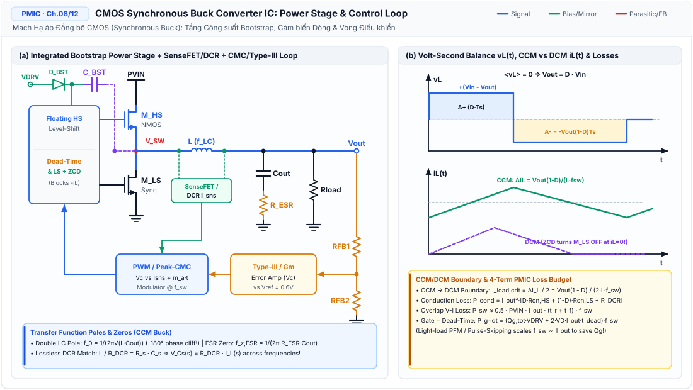

---
{
  "id": "topo-dcdc-ramp-sensefet-dcr-and-zcd-blocks",
  "kind": "topology",
  "domain": "power-management-ic",
  "title_vi": "Mạch Tạo Răng cưa + Bù Độ dốc, Cảm biến Dòng SenseFET Kẹp Máng Ảo + LEB, Lọc Khớp L/DCR & Bộ So sánh Dòng Không (ZCD)",
  "title_en": "Precision CMOS Sawtooth/Slope-DAC Generator, Lossless SenseFET with Virtual-Drain Equalizer & LEB, Inductor L/DCR Filter & Predictive Zero-Current Detection (ZCD)",
  "summary": "Giải phẫu cấp transistor 4 khối cảm biến và điều chế lõi quyết định độ chính xác, độ tin cậy và hiệu suất tải nhẹ của bộ biến đổi DC-DC tích hợp CMOS: (1) Mạch tạo sóng răng cưa và cộng dòng bù độ dốc không gây tải lên ngõ ra VCOMP, (2) Khối cảm biến dòng không tổn hao SenseFET tỉ lệ 1:N kèm vòng cascode kẹp bằng áp máng vùng triode sâu và mặt nạ chắn gai cạnh lên LEB, (3) Mạng lọc khớp hằng số thời gian L/DCR = R_s*C_s bù hệ số nhiệt đồng, và (4) Bộ so sánh phát hiện dòng không ZCD tốc độ cao có hiệu chỉnh trễ dự đoán chống dòng ngược.",
  "diagram": "../../diagrams/synchronous-buck-converter.svg",
  "razavi_refs": [
    {
      "chapter": 2,
      "section": "2.1.1, 2.2.2",
      "pages": "7-8, 12-19",
      "equations": ["2.7", "2.10", "2.11"]
    },
    {
      "chapter": 5,
      "section": "5.1-5.2",
      "pages": "134-146",
      "equations": ["5.10"]
    },
    {
      "chapter": 14,
      "section": "14.2-14.2.2",
      "pages": "593-602",
      "equations": ["14.68", "14.78"]
    },
    {
      "chapter": 19,
      "section": "19.2.1-19.2.2, 19.2.7",
      "pages": "737-741, 753-757",
      "equations": ["19.14"]
    }
  ],
  "github_refs": [
    {
      "repo": "westonb/open-pmic",
      "url": "https://github.com/westonb/open-pmic/tree/2ec3130e71fd8dc08b22e8a02e9f2f8c7a38750b",
      "use": "Thiết kế cấp transistor thực tế của khối active current-sense (SenseFET + OTA kẹp máng), oscillator răng cưa và modulator cộng dốc bù trên tiến trình SKY130"
    },
    {
      "repo": "Arcadia-1/sar-adc-skills",
      "url": "https://github.com/Arcadia-1/sar-adc-skills/tree/27de09a34ea3ec6feb2ee2797d32dc673d35d1ad",
      "use": "Thiết kế bộ so sánh tốc độ cao độ lệch thấp, cách ly nhiễu giật ngược kickback và tự hiệu chuẩn offset"
    },
    {
      "repo": "iic-jku/Circuit-Designers-Etiquette",
      "url": "https://github.com/iic-jku/Circuit-Designers-Etiquette/tree/28f96edbb002793c068c744ab03923ce0bf7cf1a",
      "use": "Quy chuẩn vẽ sơ đồ nguyên lý các nhánh gương dòng, đấu nối cảm nhận 4 dây Kelvin và phân tách đất nhiễu"
    }
  ],
  "glossary_codes": [
    "T026",
    "T109",
    "T185",
    "T188",
    "T499",
    "T500",
    "T620",
    "T788",
    "T822",
    "T1548",
    "T1723",
    "T2153",
    "T2193",
    "T2194",
    "T2197"
  ],
  "process_agnostic": true,
  "roles": {
    "sawtooth_and_slope_summer": "Tạo sóng răng cưa biên độ khóa cứng với tần số xung nhịp và tổng hợp dòng dốc bù I_slope(t) trên điện trở cộng R_sum mà không làm sụt trở kháng nút bù VCOMP",
    "lossless_sensefet_and_leb": "Trích mẫu 1/N dòng công suất tức thời bằng ngón transistor khớp tâm chung nằm trong vùng triode sâu, được kẹp VDS bởi vòng khuếch đại độ lợi cao và lọc sạch gai chuyển mạch bằng cửa sổ mù LEB",
    "inductor_dcr_matched_rc": "Mạng lọc thụ động R_s-C_s mắc song song cuộn cảm khử cực cảm kháng sL/DCR để tái tạo điện áp tỉ lệ trực tiếp với dòng cuộn cảm i_L(t)*DCR mà không tốn điện trở shunt",
    "predictive_zcd_comparator": "Phát hiện thời điểm dòng qua công tắc đồng bộ dưới tiến về 0 (dựa trên sụt áp âm mV tại nút SW) kèm bù trễ tự thích ứng để ngắt M_LS đúng đỉnh điểm chuyển sang DCM"
  },
  "symptoms_addressed": [
    "shunt-sense-resistor-burning-hundreds-of-milliwatts-and-degrading-converter-efficiency",
    "sensefet-ratio-collapsing-at-light-or-medium-load-due-to-amplifier-input-offset-vos",
    "false-premature-pwm-or-ocp-tripping-from-coss-and-reverse-recovery-turn-on-current-spikes",
    "dcr-current-sense-over-reporting-inductor-current-at-125c-or-ringing-on-load-steps",
    "negative-inductor-current-draining-output-capacitor-in-light-load-dcm-due-to-zcd-propagation-delay"
  ],
  "limitations": [
    "sensefet-requires-minimum-on-time-exceeding-leb-plus-virtual-drain-settling-time",
    "sub-millivolt-vos-requirement-on-sensefet-and-zcd-amplifiers-demands-large-area-or-autozeroing",
    "dcr-sensing-inherits-plus-minus-8-to-10-percent-manufacturing-tolerance-of-inductor-winding-resistance",
    "zcd-input-connected-to-sw-node-must-withstand-full-vin-plus-ringing-voltage-via-hv-isolation-fet"
  ],
  "checklists": [
    "common-mos",
    "dcdc-switching-converter",
    "current-mirror",
    "comparator-and-sar-adc",
    "layout-and-matching"
  ]
}
---

## 1. Bốn Khối Tương tự Nội vi Quyết định Sự Sống Còn của Bộ Biến đổi DC-DC Tích hợp

Trên các giáo trình điện tử công suất mức hệ thống, mạch điều khiển Buck/Boost thường được vẽ giản lược bằng một điện trở cảm biến dòng lý tưởng $R_{\text{shunt}}$, một nguồn sóng răng cưa hoàn hảo và một diode lý tưởng tự ngắt khi dòng về không. Nhưng khi bước vào thiết kế **vi mạch quản lý nguồn CMOS thực thụ** (như dự án mở Stanford `westonb/open-pmic` hay các chip PMIC $180\text{ nm}/90\text{ nm}/65\text{ nm}$ công nghiệp), chèn một điện trở $R_{\text{shunt}} = 50\text{ m}\Omega$ nối tiếp với dòng tải $3\text{ A}$ sẽ đốt bay $P_{\text{shunt}} = I^2 R_{\text{shunt}} = 450\text{ mW}$ nhiệt lượng vô ích (giết chết $4{,}5\%$ hiệu suất chuyển đổi!), còn một bộ so sánh phát hiện dòng không chậm trễ vỏn vẹn $15\text{ ns}$ trên cuộn cảm $0{,}47\,\mu\text{H}$ đã đủ làm dòng cuộn cảm đảo chiều rút ngược $-120\text{ mA}$ từ tụ tải!



Thẻ cấu trúc này giải phẫu trọn vẹn nguyên lý mạch cấp transistor, phương trình sai số Pelgrom và quy tắc bảo vệ điện áp cao cho **4 khối cảm biến – điều chế lõi** bên trong mọi chip DC-DC hiện đại:
1. **Khối 1 — Bộ Tạo Răng Cưa Chuẩn Hóa Tần số & Cộng Dòng Bù Độ Dốc (`Sawtooth + Current-Mode Slope Summer`):** Giữ biên độ đỉnh răng cưa $V_M$ bất biến theo góc công nghệ và trộn dốc bù $m_a$ bằng dòng điện để không bao giờ kéo sập nút bù trở kháng cao `VCOMP`.
2. **Khối 2 — Cảm biến Dòng Trên Chip Không Tổn Hao `SenseFET` + Mặt nạ Chắn Gai `LEB` (`Lossless Active Current Mirror in Deep Triode`):** Tách $1$ phần tử mẫu từ ma trận $N \approx 1000$ ngón công suất, ép hai cực máng bằng nhau đến từng trăm micro-volt bằng OTA cascode và che chắn gai nạp tụ đầu chu kỳ.
3. **Khối 3 — Mạng Lọc Khớp Hằng Số Thời Gian Cuộn Cảm $L/\text{DCR} = R_s C_s$ (`Lossless Inductor DCR Sensing`):** Giải pháp đo dòng liên tục cả chu kỳ cho dòng tải lớn nhiều Ampe và điều khiển Valley/COT.
4. **Khối 4 — Bộ So Sánh Phát Hiện Dòng Không `ZCD` Có Cách Ly Cao Áp & Tự Chỉnh Trễ Dự Đoán (`Predictive Zero-Current Detector`):** Biến công tắc đồng bộ dưới $M_{\text{LS}}$ thành một "siêu diode lý tưởng" sụt áp bằng 0 nhưng khóa ngược chính xác tại $I_L = 0\text{ A}$!

---

## 2. Phân tích Mạch Cấp Transistor & Hệ Phương trình Thiết kế Của Từng Khối

### 2.1. Khối 1 — Tạo Răng Cưa Khóa Tỉ Số Tụ & Cộng Dòng Bù Độ Dốc (`Slope-Summing Modulator`)
Giả sử bộ dao động xung nhịp chủ của PMIC nạp tụ $C_{\text{osc}}$ bằng dòng chuẩn không đổi theo nhiệt độ $I_{\text{ZTC}}$ (`T2185`) tới ngưỡng $\Delta V_{\text{osc}}$, sinh tần số chuyển mạch $f_{\text{sw}} = \dfrac{I_{\text{ZTC}}}{C_{\text{osc}} \Delta V_{\text{osc}}}$. Để tạo sóng răng cưa PWM $V_{\text{ramp}}(t)$ hoặc dốc bù $I_{\text{slope}}(t)$ trong suốt chu kỳ $T_{\text{sw}} = 1/f_{\text{sw}}$:
- Nhân bản dòng $I_{\text{ramp}} = K_I I_{\text{ZTC}}$ nạp vào tụ răng cưa $C_{\text{ramp}}$ (cùng loại tụ MIM/MOM ghép tâm chung với $C_{\text{osc}}$!) từ mức đáy $V_{\text{valley}}$ (thường đặt $V_{\text{valley}} \approx 0{,}25\text{ V}$ để tránh vùng chết sát đất của ngõ vào bộ so sánh PWM!), xả nhanh ở cuối chu kỳ bằng xung hẹp `RST_PULSE` ($8\text{–}15\text{ ns}$). Biên độ đỉnh-đỉnh của sóng răng cưa tự động triệt tiêu hoàn toàn cả $I_{\text{ZTC}}$ lẫn dung sai tuyệt đối của tụ:

$$
V_M = \frac{I_{\text{ramp}} \cdot T_{\text{sw}}}{C_{\text{ramp}}} = \frac{K_I I_{\text{ZTC}}}{C_{\text{ramp}}} \cdot \frac{C_{\text{osc}} \Delta V_{\text{osc}}}{I_{\text{ZTC}}} = K_I \left(\frac{C_{\text{osc}}}{C_{\text{ramp}}}\right) \Delta V_{\text{osc}}
$$

  Nhờ phương trình bất biến hình học này, dù $R$ và $C$ trên chip có trôi $\pm 25\%$ qua các góc PVT khiến $f_{\text{sw}}$ dịch nhẹ, **biên độ điều chế $V_M$ vẫn đứng im tuyệt đối đến $< \pm 1\%$**! (Và nếu cần bù tiền tiếp đường nguồn *Line Feedforward* cho VMC, chỉ cần thay $I_{\text{ramp}}$ trong nhánh răng cưa bằng $I_{\text{FF}} = V_{\text{IN}}/R_{\text{FF}}$!).
- **Cơ chế Cộng Dòng Bù Độ Dốc (`Current-Summing Slope Compensation` cho Peak-CMC):** Tuyệt đối không nối tụ hay nguồn răng cưa trực tiếp vào nút `VCOMP` của OTA lỗi! Thay vào đó, đưa điện áp răng cưa $V_{\text{ramp}}(t) - V_{\text{valley}}$ qua bộ biến đổi điện áp-sang-dòng tuyến tính ($G_{m,\text{slope}} = 1/R_{\text{slp}}$, dùng cặp vi sai suy biến cực nguồn mạnh hoặc Op-Amp + MOSFET kẹp trên điện trở $R_{\text{slp}}$ theo Razavi Chương 3 §3.3) tạo dòng răng cưa $I_{\text{slope}}(t) = \dfrac{V_{\text{ramp}}(t) - V_{\text{valley}}}{R_{\text{slp}}}$. Đổ chung $I_{\text{slope}}(t)$ cùng với dòng gương cảm biến $I_{\text{sense}}(t) = \dfrac{i_L(t)}{N}$ xuống một điện trở tổng duy nhất $R_{\text{sum}}$ nối đất tĩnh `AGND`:

$$
V_{\Sigma}(t) = R_{\text{sum}} \left[ \frac{i_L(t)}{N} + I_{\text{slope}}(t) \right] = \underbrace{\left(\frac{R_{\text{sum}}}{N}\right)}_{R_i} i_L(t) \;+\; \underbrace{\left(\frac{R_{\text{sum}} \, I_{\text{ramp}}}{R_{\text{slp}} \, C_{\text{ramp}}}\right)}_{S_a = R_i m_a} t
$$

  Chỉ bằng một nút cộng dòng điện trở thấp $R_{\text{sum}} \sim 2\text{–}10\text{ k}\Omega$ rất nhanh, ta thu được tổng $(R_i i_L + R_i m_a t)$ đưa thẳng vào ngõ vào dương (`+`) của bộ so sánh tốc độ cao, trong khi ngõ vào âm (`-`) nối trực tiếp vào `VCOMP` với trở kháng vào vô cùng lớn!

### 2.2. Khối 2 — Cảm Biến Dòng Không Tổn Hao `SenseFET` ($1:N$) & Mặt Nạ Chắn Gai `LEB`
Xét công tắc công suất High-Side PMOS $M_{\text{P,main}}$ được ghép song song từ $N$ ô ngón đơn vị hoàn toàn giống nhau ($N \in [500,\; 2500]$, ví dụ $N = 1000$). Tách riêng $1$ ô đơn vị đặt ngay tại **tâm hình học và tâm nhiệt độ** của mảng công suất làm transistor mẫu $M_{\text{P,sense}}$ (`T2194`). Cả $M_{\text{P,main}}$ và $M_{\text{P,sense}}$ đều được lái chung cực cổng `HGATE` và nối chung cực nguồn lên `VIN`, nên khi bật dẫn cả hai cùng nằm sâu trong **vùng tuyến tính / triode sâu (`T188`)** với điện áp vượt ngưỡng $|V_{SG} - |V_{THP}|| \gg |V_{SD}|$ (Razavi Chương 2 §2.2.2, Phương trình 2.10):

$$
I_{D,\text{main}} \approx N \mu_p C_{\text{ox}} \left(\frac{W_u}{L}\right)\left(V_{SG} - |V_{THP}|\right) V_{SD,\text{main}}, \qquad I_{D,\text{sense}} \approx \mu_p C_{\text{ox}} \left(\frac{W_u}{L}\right)\left(V_{SG} - |V_{THP}|\right) V_{SD,\text{sense}}
$$

Tỷ số dòng $\dfrac{I_{D,\text{sense}}}{I_{D,\text{main}}}$ chỉ thực sự bằng $\dfrac{1}{N}$ **KHI VÀ CHỈ KHI $V_{SD,\text{sense}} \equiv V_{SD,\text{main}}$** (tức điện thế cực máng `VSENSE_D` phải bám sát điện thế nút chuyển mạch `SW` đến từng phần mười milivolt!).
- **Vòng Kẹp Máng Ảo Độ lợi Cao (`Virtual-Drain Equalizer Loop`):** Dùng một OTA độ lợi cao, điện áp lệch cực thấp $A_{\text{eq}}$ (có ICMR vươn tới sát `VIN` khi đo High-Side, tức dùng **cặp vi sai đầu vào NMOS hoặc cascode gập NMOS-in** theo `topo-folded-cascode-ota`!) có ngõ vào nối Kelvin (`T2197`) ngay tại khu vực cực máng `SW_KELVIN` và `VSENSE_D`, điều khiển cổng của một transistor cascode $M_{\text{cas}}$ rút dòng $I_{\text{sense}}$ đổ xuống điện trở đo $R_{\text{sum}}$ dưới đất!
- **Phương trình Sai số Tỷ số Dòng Do Điện áp Lệch $V_{OS,\text{eq}}$ (Định luật Sống Còn của SenseFET):**
  Giả sử OTA kẹp máng có điện áp lệch ngõ vào quy đổi (`T788`) là $V_{OS,\text{eq}}$ (bao gồm Pelgrom mismatch + sai số độ lợi hữu hạn $\frac{V_{\text{IN}} - V_{\text{clamp}}}{A_{\text{eq}}}$). Khi đó $V_{SD,\text{sense}} = V_{SD,\text{main}} + V_{OS,\text{eq}} = I_L R_{\text{on,HS}} + V_{OS,\text{eq}}$, sinh sai số tỉ đối khổng lồ ở dòng tải nhỏ:

$$
\frac{\Delta I_{\text{sense}}}{I_{\text{sense,ideal}}} = \frac{V_{OS,\text{eq}}}{I_L \cdot R_{\text{on,HS}}} + \frac{\Delta \beta_{1:N}}{\beta}
$$

  **Ví dụ cảnh tỉnh:** Nếu $R_{\text{on,HS}} = 100\text{ m}\Omega$, tại dòng tải trung bình $I_L = 200\text{ mA}$, tổng sụt áp trên công tắc chính chỉ vỏn vẹn **$V_{SD,\text{main}} = 20\text{ mV}$**! Nếu bạn thiết kế ẩu một 5T-OTA nhỏ có $3\sigma(V_{OS,\text{eq}}) = 8\text{ mV}$, sai số đo dòng nổ tung lên tới **$\pm 40\%$** (thậm chí tại $I_L = 50\text{ mA}$ khi $V_{SD} = 5\text{ mV}$, một $V_{OS} = -6\text{ mV}$ làm $V_{SD,\text{sense}} < 0$ tắt sập hoàn toàn nhánh SenseFET về $0\text{ A}$!). Do đó, OTA của SenseFET bắt buộc định cỡ diện tích cặp đầu vào $W \cdot L$ lớn ở vùng nghịch đảo yếu ($g_m/I_D \approx 18\text{–}22\text{ V}^{-1}$, `law-pelgrom-mismatch-and-sizing-duality`) kết hợp cascode để giữ **$3\sigma(V_{OS,\text{eq}}) \le 0{,}8\text{–}1{,}5\text{ mV}$**!
- **Giữ Phân cực Chờ Khi Công tắc Tắt (`Off-Phase Pre-Bias Parking`) & Mặt nạ `LEB`:**
  Trong nửa chu kỳ $(1-D)T_{\text{sw}}$ khi $M_{\text{HS}}$ tắt và nút `SW` sập xuống $0\text{ V}$, nếu để OTA SenseFET nối trực tiếp vào `SW = 0V` trong khi `VSENSE_D` gần `VIN`, OTA sẽ bão hòa cứng chạm biên và mất $80\text{–}150\text{ ns}$ để hồi phục khi $M_{\text{HS}}$ bật lại (vượt quá cả độ rộng xung $t_{\text{on}}$!). Mạch thực chiến dùng cặp công tắc chuyển tiếp: khi `HS_ON = 0`, ngắt ngõ vào OTA khỏi `SW` và nối tắt hai ngõ vào OTA cùng về `VIN` (giữ OTA cân bằng sẵn ở vùng tuyến tính với dòng rỉ giữ ấm $I_{\text{keep}} \sim 1\,\mu\text{A}$)! Đồng thời ngay khi `HS_ON` chuyển lên `1`, khối tạo trễ một xung **Leading-Edge Blanking (`LEB`, $t_{\text{LEB}} = 20\text{–}35\text{ ns}$)** khóa ngõ ra bộ so sánh PWM/OCP ở mức `0` cho tới khi gai nạp tụ $C_{\text{oss}}$ và hồi phục ngược diode tắt hẳn!

### 2.3. Khối 3 — Cảm biến Dòng Qua Điện trở Đồng Cuộn Cảm Không Tổn Hao (`Lossless Inductor DCR Filter`)
Khi dòng tải lớn ($3\text{–}20\text{ A}$) hoặc cần đo dòng cuộn cảm **liên tục suốt cả hai pha bật và tắt** (cho Valley-CMC, COT, hoặc cân bằng dòng đa pha), mắc một mạng lọc nối tiếp $R_s\text{–}C_s$ song song trực tiếp hai đầu cuộn cảm thực tế (vốn gồm $L$ nối tiếp điện trở dây quấn đồng $\text{DCR}$). Điện áp rơi giữa hai bản tụ $C_s$ trong miền Laplace là:

$$
V_{C_s}(s) = \frac{1}{1 + s R_s C_s} \cdot V_L(s) = I_L(s) \cdot \text{DCR} \cdot \left(\frac{1 + s \dfrac{L}{\text{DCR}}}{1 + s R_s C_s}\right)
$$

Khi thiết lập điều kiện **Khớp Hằng Số Thời Gian (`Matched Pole-Zero Condition`)**:

$$
R_s C_s = \frac{L}{\text{DCR}} \implies V_{C_s}(t) \equiv \text{DCR} \cdot i_L(t) \quad \forall \, t!
$$

Cực và zero khử nhau hoàn hảo trên mọi tần số từ DC đến hàng chục MHz, biến bản thân dây đồng cuộn cảm thành điện trở đo dòng miễn phí $100\%$ công suất! Hai quy tắc sống còn khi dùng lọc DCR:
1. **Sai lệch hằng số thời gian $\kappa = \dfrac{L/\text{DCR}}{R_s C_s}$:** Nếu chọn $R_s C_s < L/\text{DCR}$ ($\kappa > 1$), biên độ gợn xoay chiều và bước nhảy bậc thang của $V_{C_s}$ bị **phóng đại lên $\kappa$ lần** so với DC (gây vọt đỉnh giả làm cắt OCP sớm khi nhảy tải, nhưng trong COT người ta lại cố tình chọn $\kappa \approx 1{,}5\text{–}3$ để khuếch đại gợn tam giác chống jitter!). Ngược lại nếu $R_s C_s > L/\text{DCR}$ ($\kappa < 1$), cảm biến bị trễ pha làm giảm biên độ gợn dòng đo được và làm suy yếu nghiêm trọng dự trữ ổn định vòng dòng!
2. **Hệ số nhiệt dương rất lớn của dây đồng ($\alpha_{\text{Cu}} \approx +3930\text{ ppm/}^\circ\text{C}$):** Khi cuộn cảm nóng từ $25\,^\circ\text{C}$ lên $125\,^\circ\text{C}$, $\text{DCR}(125\,^\circ\text{C}) = \text{DCR}(25\,^\circ\text{C}) \times [1 + 0{,}00393 \times 100] \approx 1{,}393\,\text{DCR}(25\,^\circ\text{C})$ — tăng gần **$+40\%$**! Nếu ngưỡng kẹp $V_{\text{OCP}}$ giữ cố định theo $V_{\text{BG}}$, ngưỡng dòng bảo vệ ở $125\,^\circ\text{C}$ sẽ bị tụt mất $28\%$! Trên chip PMIC, người ta tạo ngưỡng $V_{\text{OCP}}(T) = V_{\text{ZTC}} + K_{\text{Cu}} V_{\text{PTAT}}(T)$ dùng dòng `I_PTAT` có độ dốc $+3300\text{ ppm/}^\circ\text{C}$ (`tech-ptat-current-and-constant-gm`) để tự động bù khử gần trọn độ trôi nhiệt đồng!

### 2.4. Khối 4 — Bộ So sánh Phát hiện Dòng Không (`ZCD`) Tốc độ Cao & Hiệu chỉnh Trễ Dự đoán
Ở chế độ tải nhẹ (`Diode-Emulation / DCM / PFM`), trong pha xả $(1-D)T_{\text{sw}}$ khi công tắc đồng bộ dưới NMOS $M_{\text{LS}}$ đang dẫn dòng từ đất `PGND` lên nút `SW` đổ ra cuộn cảm, điện áp tại nút `SW` âm nhẹ so với `PGND`:

$$
V_{\text{SW}}(t) = -i_L(t) \cdot R_{\text{on,LS}} \qquad \text{(ví dụ: tại } i_L = 40\text{ mA}, R_{\text{on,LS}} = 100\text{ m}\Omega \implies V_{\text{SW}} = -4{,}0\text{ mV}\text{)}
$$

Khi $i_L(t)$ giảm tuyến tính với dốc $-m_2 = -V_{\text{OUT}}/L$ tiến về $0$, $V_{\text{SW}}(t)$ tăng từ âm lên cắt mốc $0\text{ V}$ (`PGND`). Giả sử bộ so sánh `ZCD` cộng tầng lái cổng tắt $M_{\text{LS}}$ mất tổng thời gian trễ truyền $t_{d,\text{ZCD}}$ (ví dụ $12\text{ ns}$). Nếu `ZCD` đặt ngưỡng cắt đúng tại $0\text{ V}$, đến khi $M_{\text{LS}}$ thực sự ngắt xong thì dòng cuộn cảm đã vọt qua không sang miền âm:

$$
I_{L,\text{rev}} = -m_2 \cdot t_{d,\text{ZCD}} - \frac{V_{OS,\text{ZCD}}}{R_{\text{on,LS}}} \qquad \left(\text{ví dụ: } L=0{,}47\,\mu\text{H}, V_{\text{OUT}}=1{,}8\text{ V}, t_d=12\text{ ns} \implies I_{L,\text{rev}} = -46\text{ mA!}\right)
$$

**Hai lớp kiến trúc giải quyết triệt để bài toán `ZCD` trên silicon:**
1. **Công tắc Cách ly Cao Áp Ở Đầu vào `ZCD` (`HV Isolation Pass-Gate`):** Nút `SW` trong pha bật bay vọt lên $V_{\text{IN}} + V_{\text{ring}} \approx 5{,}5\text{ V}$ (hoặc $24\text{ V}$)! Không bao giờ được nối thẳng cực cổng mỏng $1{,}2\text{ V}/1{,}8\text{ V}$ của cặp đầu vào `ZCD` vào `SW`! Phải đặt một transistor NMOS chịu áp cao $M_{\text{iso}}$ (LDMOS hoặc thick-oxide IO NMOS) điều khiển bởi tín hiệu `LS_ON_DELAYED` nối tiếp với công tắc kẹp đất: chỉ mở cho `ZCD` nhìn vào `SW` sau khi $M_{\text{LS}}$ đã bật ổn định xong $15\text{ ns}$!
2. **Ngưỡng Dịch Sớm & Vòng Tự Hiệu Chuẩn Trễ Dự Đoán Số (`Auto-Zero / Predictive Up-Down Delay Trim`):** Thay vì so sánh tại $0\text{ mV}$, đặt một ngưỡng bù sớm âm nhẹ $V_{\text{th,ZCD}} = -I_{\text{trim}} R_{\text{trim}} \approx -3\text{ mV} \dots -8\text{ mV}$ để kích lệnh tắt trước khi $i_L$ chạm không. Hơn thế nữa, mạch thông minh lấy mẫu nhanh trạng thái phân cực của nút `SW` bằng một D-Flip-Flop ngay $2\text{ ns}$ sau khi $M_{\text{LS}}$ vừa khóa cổng:
   - Nếu lúc $M_{\text{LS}}$ vừa khóa mà $V_{\text{SW}}$ lao vọt xuống **$-0{,}7\text{ V}$** (diode thân $M_{\text{LS}}$ buộc phải dẫn tiếp): nghĩa là dòng cuộn cảm vẫn còn dương (`ZCD` tắt **QUÁ SỚM**) $\implies$ bộ đếm `UP/DN` giảm bớt ngưỡng dịch sớm $1\text{ LSB}$!
   - Nếu lúc $M_{\text{LS}}$ vừa khóa mà $V_{\text{SW}}$ bay vọt lên **$+V_{\text{IN}}$** (dòng âm trong cuộn cảm nạp ngược $C_{\text{oss}}$ đẩy `SW` lên đỉnh): nghĩa là dòng đã bị âm (`ZCD` tắt **QUÁ MUỘN**) $\implies$ bộ đếm `UP/DN` tăng thêm ngưỡng dịch sớm $1\text{ LSB}$!
   Vòng phản hồi số 4–5 bit này tự động hội tụ khóa cứng thời điểm tắt $M_{\text{LS}}$ trúng phóc $i_L = 0\text{ A}$ bất chấp mọi biến thiên của $L$, $V_{\text{OUT}}$, $R_{\text{on,LS}}$ và $V_{OS,\text{ZCD}}$ qua PVT!

---

## 3. Bất biến Cấu trúc & Các Bẫy Lỗi Kinh điển (Structural Invariants & Traps)

- **[INV-SNS-01] Đấu nối Kelvin 4 Dây Bắt Buộc Cho Cả `SenseFET` Lẫn `ZCD` (`T2197`):** Trên mặt bằng layout công suất mang dòng $2\text{–}5\text{ A}$, riêng một đoạn đường kim loại nhôm/đồng dài $200\,\mu\text{m}$ đã có điện trở $15\text{–}30\text{ m}\Omega$ — lớn ngang ngửa hoặc gấp nửa lần $R_{\text{on}}$ của toàn bộ transistor công suất (`tech-interconnect-rc-electromigration-and-ir-drop`)! Nếu lấy điểm cảm nhận `SW_SENSE` ở đầu dây hàn pad thay vì lấy trực tiếp từ dải kim loại M1/M2 ngay trên cực máng của ngón trung tâm cạnh $M_{\text{sense}}$, điện áp rơi kim loại $I_L R_{\text{metal}}$ sẽ làm lệch tỷ số gương $1:N$ tới $30\text{–}50\%$! Tương tự, ngõ vào tham chiếu đất của `ZCD` phải nối Kelvin tới đúng chân cực nguồn thực tế của $M_{\text{LS}}$, tuyệt đối không lấy ở `AGND` từ xa!
- **[INV-SNS-02] Tương thích Dải Chế độ Chung Ngõ vào (`ICMR`) Tại Biên Nguồn Cho OTA SenseFET:**
  - Đo dòng công tắc trên (`High-Side SenseFET` quanh mức $V_{\text{IN}}$): cực máng và nguồn nằm tại $V_{\text{IN}} - 20\text{ mV} \dots V_{\text{IN}}$, bắt buộc dùng **cặp đầu vào NMOS gập xuống PMOS cascode** (hoặc cặp BJT NPN / MOSFET mức dịch xuống qua bộ theo nguồn khớp đôi) có ICMR bao trùm toàn vẹn mức $V_{\text{IN}}$! Nếu dùng nhầm cặp đầu vào PMOS, nguồn dòng đuôi và $V_{SG}$ ép cặp đầu vào tắt ngúm ngay lập tức!
  - Đo dòng công tắc dưới (`Low-Side SenseFET` hoặc `ZCD` quanh mức `PGND` $\pm 30\text{ mV}$): bắt buộc dùng **cặp đầu vào PMOS gập lên NMOS cascode** có ICMR bao phủ mức $0\text{ V}$ và âm nhẹ tới $-100\text{ mV}$!
- **[TRAP-SNS-01] Bẫy Điện trở Công tắc Nối tiếp Làm Sai Lệch Tỷ số `SenseFET`:** Khi chèn công tắc chọn chế độ hoặc transistor cascode nối tiếp cực máng $M_{\text{sense}}$, mọi điện trở nối tiếp nằm **trước** điểm lấy mẫu hồi tiếp của OTA đều cộng trực tiếp vào $R_{\text{on,sense}}$ làm giảm giả tạo dòng đo! Điểm phản hồi vào OTA bắt buộc lấy **sát ngay cực máng vật lý của $M_{\text{sense}}$** (trước mọi transistor cascode hay công tắc ngắt nhánh!).

---

## 4. Ma trận Đối chiếu 4 Kỹ thuật Cảm biến Dòng Điện Cho PMIC

| Kỹ thuật Cảm biến Dòng | Tổn hao Công suất | Độ chính xác Toàn dải PVT | Pha Đo Được | Trường hợp Ứng dụng Tối ưu Nhất |
|---|---|---|---|---|
| **Điện trở Shunt Nối tiếp ($R_{\text{shunt}}$)** | Rất xấu ($I_{\text{rms}}^2 R_{\text{shunt}}$) | Rất cao ($\pm 1\text{–}2\%$) | Liên tục $100\%$ chu kỳ (nếu đặt nối tiếp $L$) | Chỉ dùng cho mạch dòng nhỏ $< 100\text{ mA}$ hoặc đo kiểm phòng thí nghiệm ngoài chip |
| **On-Chip High-Side `SenseFET` ($1:N$)** | **Gần bằng 0 ($\sim I_L/1000$)** | Tốt ở tải vừa/nặng ($\pm 4\text{–}7\%$ nếu $V_{OS} < 1\text{ mV}$) | Chỉ trong pha `HS_ON` (sau cửa sổ `LEB`) | **Chuẩn vàng cho IC Buck tích hợp Peak-CMC & Cycle-by-Cycle Peak OCP** (`westonb/open-pmic`) |
| **On-Chip Low-Side `SenseFET` ($1:N$)** | **Gần bằng 0** | Tốt ($\pm 4\text{–}6\%$, không cần dịch mức cao áp!) | Chỉ trong pha `LS_ON` | **Chuẩn vàng cho Valley-CMC hạ áp sâu $12\text{ V} \to 0{,}8\text{ V}$** và Boost Low-Side Switch |
| **Mạng Lọc Khớp Cuộn cảm $L/\text{DCR} = R_s C_s$** | **$0\text{ W}$ tuyệt đối!** | Trung bình ($\pm 8\text{–}12\%$ do dung sai DCR, cần bù PTAT) | **Liên tục cả chu kỳ $100\%$** | Bộ điều khiển nhiều pha dòng lớn ($10\text{–}100\text{ A}$ CPU/GPU VRM) và COT cần sóng tam giác liên tục |

---

## 5. Thiết kế Cấp Transistor Khối `SenseFET + LEB + Slope Summer` & Netlist Kiểm chứng Spectre 15.1

### 5.1. Quy trình Định cỡ Nhanh Cho Khối High-Side PMOS SenseFET ($N = 1000$, $I_{\max} = 2\text{ A}$)
1. **Định cỡ ma trận công suất và ô mẫu:** Tổng chiều rộng PMOS công suất $W_{\text{main}} = 20\text{ mm}$ ($1000$ ngón đơn vị $W_u = 20\,\mu\text{m}, L = 180\text{ nm}$, đạt $R_{\text{on,HS}} \approx 95\text{ m}\Omega$ tại $V_{\text{IN}} = 3{,}3\text{ V}$). Ô mẫu $M_{\text{sense}}$ dùng đúng $1$ ngón đơn vị $W_u = 20\,\mu\text{m}, L = 180\text{ nm}$ đặt tại trung tâm ma trận kèm các ngón thuộc $M_{\text{main}}$ bao bọc tứ phía (`A B A` đối xứng, `T2194`). Tại $I_L = 2\text{ A} \implies I_{\text{sense}} = 2\text{ mA}$.
2. **Định cỡ OTA Kẹp Máng Ảo (NMOS-in Folded-Cascode):** Để sai số dòng ở $I_L = 0{,}2\text{ A}$ ($V_{SD} = 19\text{ mV}$) nhỏ hơn $5\%$, yêu cầu $3\sigma(V_{OS}) < 0{,}95\text{ mV} \implies \sigma(V_{OS}) \le 0{,}31\text{ mV}$. Theo định luật Pelgrom (Razavi Chương 14, Phương trình 14.68 & 14.70: $\sigma(\Delta V_{TH}) = \frac{A_{VTH}}{\sqrt{W_1 L_1}}$), với $A_{VTH} = 5\text{ mV}\cdot\mu\text{m}$, diện tích cổng mỗi transistor cặp đầu vào phải đạt $W_1 L_1 \ge \left(\frac{5}{0{,}31}\right)^2 \approx 260\,\mu\text{m}^2$ (chọn $W_1 = 290\,\mu\text{m}, L_1 = 0{,}9\,\mu\text{m}$, ghép tâm chung chữ thập 8 phần tử!). Đặt băng thông vòng kẹp máng $f_{u,\text{eq}} \ge 25\text{–}40\text{ MHz}$ để xác lập xong dưới $15\text{–}20\text{ ns}$ ngay trong cửa sổ `LEB`!
3. **Định cỡ Điện trở Cộng $R_{\text{sum}}$:** Với $I_{\text{sense,max}} = 2\text{ mA}$ (hoặc chia gương xuống lần hai $1:10$ còn $200\,\mu\text{A}$ để tiết kiệm dòng tĩnh!), chọn nhánh chia lần hai $1:10$ đổ $200\,\mu\text{A}$ vào $R_{\text{sum}} = 2{,}5\text{ k}\Omega \implies$ hệ số đo dòng $R_i = \frac{2500}{1000 \times 10} = 0{,}25\text{ V/A}$ ($V_{\Sigma} = 0{,}50\text{ V}$ ở $2\text{ A}$), chỉ tiêu tốn trung bình $< 100\,\mu\text{A}$ dòng cảm biến!

### 5.2. Netlist Spectre 15.1 Mô phỏng Quá độ Khối `SenseFET + Virtual-Drain Loop + LEB + Slope Summer` (`tb_sensefet_leb.scs`)
```scs
// Spectre 15.1 Transient Accuracy & Turn-On Spike Rejection Testbench for 1:1000 SenseFET + LEB
simulator lang=spectre
global 0

parameters vin=3.3 fsw=2M tsw=1/fsw d_duty=0.45 i_load=1.2 delta_il=0.4
parameters r_on_unit=95.0 n_ratio=1000 vos_err=0.5m r_sum=250

VIN_SRC (vin 0) vsource dc=vin

// Xung điều khiển cổng High-Side PMOS (0 V = Bật, VIN = Tắt)
V_HGATE (hgate 0) vsource type=pulse val0=vin val1=0 period=tsw delay=20n rise=1.5n fall=1.5n width=(d_duty*tsw)

// Mô hình hóa ngón công suất chính (1000x -> Ron = 95 mOhm) và ngón mẫu SenseFET (1x -> Ron = 95 Ohm)
G_MAIN  (vin sw)       bsource i=(v(hgate) < 0.5*vin) ? (v(vin, sw)/(r_on_unit/n_ratio)) : 0
G_SENSE (vin vsense_d) bsource i=(v(hgate) < 0.5*vin) ? (v(vin, vsense_d)/r_on_unit) : 0

// Dòng tải cuộn cảm hình thang + Gai dòng nạp Coss 1.5 A rộng 8 ns ngay lúc vừa bật công tắc!
I_IND   (sw 0) isource dc=i_load
I_SPIKE (sw 0) isource type=pulse val0=0 val1=1.5 period=tsw delay=20n rise=1n fall=3n width=4n
D_LS_BD (0 sw) diode is=1e-12 rs=0.05

// Công tắc giữ ấm điểm làm việc OTA khi HS tắt (HS_ON = 1 khi v(hgate) thấp)
R_PARK   (vin vsense_d) resistor r=20k
V_PARK   (v_park 0)     vsource dc=(vin - 0.6)
B_SW_MUX (v_target 0)   bsource v=(v(hgate) < 0.4*vin) ? (v(sw) + vos_err) : v(vin)

// OTA Kẹp Máng Ảo hồi tiếp âm (A0 = 60 dB, fu_loop ≈ 40 MHz) lái cổng PMOS Cascode M_CAS đổ dòng xuống R_SUM
E_EQ_RAW (n_eq v_park v_target vsense_d) vcvs gain=1000
R_EQ_BW  (n_eq g_cas)   resistor r=1k
C_EQ_BW  (g_cas v_park) capacitor c=1.9n
G_MCAS   (vsense_d vsig) bsource i=max(0.0, 5m*(vin - 0.6 - v(g_cas)))

// Dòng bù độ dốc răng cưa I_slope(t) (0 -> 0.76 mA trong chu kỳ 500 ns) cộng trực tiếp trên R_SUM!
I_SLOPE  (0 vsig) isource type=pulse val0=0 val1=0.76m period=tsw delay=20n rise=(0.92*tsw) fall=5n width=5n
R_SUM_ND (vsig 0) resistor r=r_sum

// Khối mặt nạ chắn gai cạnh lên LEB (khóa 25 ns đầu mỗi lần bật cổng HS!)
V_LEB_MASK (leb_ok 0) vsource type=pulse val0=0 val1=1.0 period=tsw delay=(20n + 25n) rise=0.5n fall=0.5n width=(d_duty*tsw - 25n)
B_PWM_CMP_IN (vsig_clean 0) bsource v=v(leb_ok) * v(vsig)

tran_sns tran stop=3*tsw maxstep=200p errpreset=conservative annotate=status
```

---

## 6. Tài liệu Đối chiếu Chuẩn Công nghiệp, Nguồn GitHub & Thuật ngữ CLB

### 6.1. Đối chiếu Sách Gốc Razavi, Bài báo JSSC & Nguồn Mở Kiểm định
- **Razavi (2nd Ed.):** Chương 2 (§2.1.1 & §2.2.2 Công thức MOSFET vùng triode sâu làm công tắc và phần tử tỉ lệ điện trở), Chương 5 (§5.1–5.2 Gương dòng cascode khử sai số điều biến chiều dài kênh), Chương 14 (§14.2.1–14.2.2 Định luật Pelgrom tính sai lệch điện áp ngưỡng và kỹ thuật tự động khử lệch Auto-Zeroing), Chương 19 (§19.2.1–19.2.2, §19.2.7 Chia ngón chẵn, ghép tâm chung và đấu nối 4 dây Kelvin).
- **C. F. Lee & P. K. T. Mok (*IEEE JSSC*, 2004 — *"A Monolithic Current-Mode CMOS DC-DC Converter With On-Chip Current-Sensing Technique"*):** Kiến trúc kinh điển về On-Chip SenseFET kẹp máng ảo cho bộ hạ áp CMOS tần số MHz.
- **Kho GitHub Kiểm định:**
  - [`westonb/open-pmic`](https://github.com/westonb/open-pmic/tree/2ec3130e71fd8dc08b22e8a02e9f2f8c7a38750b) (`Apache-2.0`): Thư mục `current-sense/`, `oscillator/` và `modulator/` hiện thực hóa trọn vẹn chuỗi SenseFET + OTA + răng cưa bù độ dốc trên SKY130.
  - [`Arcadia-1/sar-adc-skills`](https://github.com/Arcadia-1/sar-adc-skills/tree/27de09a34ea3ec6feb2ee2797d32dc673d35d1ad) & [`iic-jku/Circuit-Designers-Etiquette`](https://github.com/iic-jku/Circuit-Designers-Etiquette/tree/28f96edbb002793c068c744ab03923ce0bf7cf1a): Thiết kế bộ so sánh độ lệch thấp và quy tắc nối dây Kelvin.

### 6.2. Bảng Thuật ngữ Chuẩn CLB Vi Mạch Sử dụng trong Thẻ
| Mã CLB | Thuật ngữ Tiếng Anh | Thuật ngữ Tiếng Việt Chuẩn | Vai trò trong Khối SenseFET, DCR & ZCD |
|---|---|---|---|
| `T188` | Deep triode region | Vùng triode sâu | Vùng làm việc khi bật của cả $M_{\text{main}}$ lẫn $M_{\text{sense}}$ ($|V_{DS}| \ll V_{OV}$) |
| `T788` | input-referred offset voltage | điện áp lệch quy về ngõ vào | Thủ phạm số 1 làm lệch tỷ số SenseFET $\Delta I/I = V_{OS}/(I_L R_{\text{on}})$ và lệch ngưỡng ZCD |
| `T2153` | Pelgrom's law | định luật Pelgrom | Định cỡ diện tích $W \cdot L$ cho cặp vi sai OTA kẹp máng đạt $3\sigma(V_{OS}) < 1\text{ mV}$ |
| `T2194` | interdigitated and common-centroid layout | bố trí cài răng lược và đồng tâm chung | Nhúng ngón mẫu $M_{\text{sense}}$ vào chính tâm nhiệt và tâm ứng suất của mảng công suất |
| `T2197` | Kelvin connection and star ground routing | đấu nối bốn dây Kelvin và đi đất hình sao | Lấy áp trực tiếp trên cực máng/nguồn vật lý để loại bỏ điện trở đường dây kim loại |
| `T1548` | ramp | dạng điện áp biến thiên tuyến tính | Chuẩn hóa biên độ theo tỷ số tụ $C_{\text{osc}}/C_{\text{ramp}}$ và chuyển sang dòng cộng bù độ dốc |
