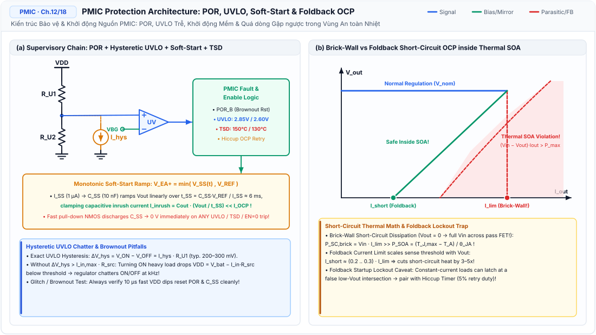

---
{
  "id": "topo-pmic-protections-por-uvlo-softstart-ocp-tsd",
  "kind": "topology",
  "domain": "power-management-ic",
  "title_vi": "Tổ hợp Mạch Bảo vệ & Quản trị Khởi động PMIC: POR Sập nguồn Nhanh, UVLO Trễ, Khởi động Mềm, Quá dòng Foldback OCP, OVP, Khóa Nhiệt TSD & Giếng N Động",
  "title_en": "Industrial PMIC Protection & Housekeeping Suite: Brownout-Safe POR, Bandgap Hysteretic UVLO, Soft-Start, Constant/Foldback OCP, OVP, BJT Thermal Shutdown & Dynamic N-Well Selector",
  "summary": "Hệ thống giáp bảo vệ bắt buộc biến một lõi ổn áp phòng thí nghiệm thành vi mạch PMIC thương mại sống sót qua mọi sự cố thực địa: (1) Power-On Reset (POR) dưới micro-ampe có nhánh xả tức thời chống sập nguồn ngắn brownout, (2) Khóa thấp áp có trễ UVLO tham chiếu Bandgap chống rung bật-tắt nguồn tải nặng, (3) Dốc khởi động mềm Soft-Start khống chế dòng xung kích I_inrush và khởi động an toàn trên tải có áp sẵn, (4) Bảo vệ quá dòng hằng dòng & gập lùi Foldback OCP nằm gọn trong vùng an toàn nhiệt SOA, (5) Bảo vệ quá áp OVP & khóa quá nhiệt BJT TSD (ngắt 150 °C / mở lại 130 °C), và (6) Mạch chọn cực thân giếng N động max(VIN, VOUT) chống dòng ngược & chốt SCR Latch-up.",
  "diagram": "../../diagrams/pmic-por-uvlo-ocp-foldback.svg",
  "razavi_refs": [
    {
      "chapter": 12,
      "section": "12.2-12.4",
      "pages": "509-524",
      "equations": [
        "12.14",
        "12.18",
        "12.26",
        "12.37"
      ]
    },
    {
      "chapter": 17,
      "section": "17.3.7-17.4",
      "pages": "707-710",
      "equations": [
        "17.51",
        "17.52"
      ]
    },
    {
      "chapter": 18,
      "section": "18.8",
      "pages": "730-731",
      "equations": []
    },
    {
      "chapter": 19,
      "section": "19.2.7-19.2.8",
      "pages": "753-760",
      "equations": [
        "19.14"
      ]
    }
  ],
  "github_refs": [
    {
      "repo": "efabless/sky130_ef_ip__power_on_reset",
      "url": "https://github.com/efabless/sky130_ef_ip__power_on_reset/tree/de7a9fd892ab2aa4173c02b60bc446f4f0e818a9",
      "use": "Phân hệ giám sát nguồn khởi động đã kiểm chứng silicon (POR + CMOS Vref + LDO) kèm CACE testbench quét tốc độ dốc nguồn VDD từ nhanh tới siêu chậm"
    },
    {
      "repo": "westonb/open-pmic",
      "url": "https://github.com/westonb/open-pmic/tree/2ec3130e71fd8dc08b22e8a02e9f2f8c7a38750b",
      "use": "Phối hợp các khối điều khiển công tắc, giới hạn dòng công suất và trình tự bảo vệ cho IC nguồn chuyển mạch trên CMOS"
    },
    {
      "repo": "efabless/cace",
      "url": "https://github.com/efabless/cace/tree/d71c8da5f8d8a5bfb4cfb2640714bdd374a9b84a",
      "use": "Đặc tả hợp đồng tự động hóa đo ngưỡng lật V_ON / V_OFF, độ trễ nhiệt độ TSD và dòng rò bảo vệ qua đa góc PVT"
    }
  ],
  "glossary_codes": [
    "T011",
    "T066",
    "T084",
    "T125",
    "T134",
    "T270",
    "T276",
    "T1548",
    "T2026",
    "T2041",
    "T2075",
    "T2188",
    "T2190",
    "T2191",
    "T2199"
  ],
  "process_agnostic": true,
  "roles": {
    "por_and_brownout_detector": "Giữ tín hiệu đặt lại toàn chip RST_N = 0 cho tới khi nguồn vượt ngưỡng sống tối thiểu và ổn định đủ thời gian hẹn giờ t_POR, đồng thời xả tụ hẹn giờ trong vài nano-giây ngay khi nguồn sụt thoáng qua",
    "bandgap_hysteretic_uvlo": "Cổng gác chính xác so sánh VIN phân áp với V_BG kèm dòng trễ I_hys tách bạch V_ON > V_OFF để cấm mở công tắc công suất khi áp nuôi tầng lái cổng chưa đủ cao",
    "monotonic_soft_start_engine": "Tạo đường dốc tham chiếu tăng chậm tuyến tính V_SS(t) kết hợp cặp vi sai chọn cực tiểu min(V_REF, V_SS) khống chế dòng nạp tụ Cout ban đầu và tránh vọt lố VOUT",
    "ocp_foldback_ovp_tsd_and_bulk": " Vòng kẹp dòng hằng số / gập lùi Foldback giữ transistor công suất trong vùng an toàn nhiệt SOA khi chập tải, khóa quá nhiệt BJT 150 °C và chuyển mạch giếng N động max(VIN, VOUT)"
  },
  "symptoms_addressed": [
    "naive-rc-por-failing-to-reset-digital-fsm-during-slow-battery-ramp-or-microsecond-brownout-glitch",
    "violent-on-off-motorboating-oscillation-at-startup-when-load-current-drops-vin-through-cable-resistance",
    "huge-capacitive-inrush-current-saturating-inductor-core-or-collapsing-upstream-supply-rail",
    "short-circuit-on-vout-melting-pass-transistor-due-to-excessive-vin-times-ilim-power-dissipation",
    "reverse-current-from-vout-into-vin-forward-biasing-pmos-body-diode-and-triggering-cmos-scr-latchup"
  ],
  "limitations": [
    "aggressive-foldback-current-limit-can-latch-off-at-low-vout-when-driving-constant-current-loads",
    "por-operating-below-1v-relies-on-vth-before-bandgap-settles-causing-wider-pvt-threshold-spread",
    "thermal-shutdown-sensor-placed-far-from-power-fet-suffers-millisecond-thermal-diffusion-lag",
    "dynamic-nwell-bulk-selector-must-avoid-dead-zone-near-vin-equals-vout-where-nwell-temporarily-floats"
  ],
  "checklists": [
    "common-mos",
    "ldo-regulator",
    "dcdc-switching-converter",
    "bandgap-and-bias",
    "esd-pad-and-substrate",
    "layout-and-matching"
  ]
}
---

## 1. Kiến trúc Phân Tầng Bảo Vệ & Trình tự Khởi động Xác định Của Một PMIC Công nghiệp

Một bộ ổn áp LDO hay bộ biến đổi Buck/Boost dù có dự trữ pha $65^\circ$ và hiệu suất $95\%$ trên bàn mô phỏng vẫn sẽ **chết cháy ngay trong tích tắc đầu tiên ngoài thực tế** nếu thiếu hệ thống quản trị khởi động và bảo vệ sự cố (`Housekeeping & Protection Suite`): cắm pin chậm làm máy trạng thái số khởi động loạn xạ, tải chập đất nung chảy kim loại, cuộn cảm bão hòa từ lúc vừa bật nguồn làm nổ công tắc trên, hay rút nguồn đầu vào trước làm diode thân PMOS phóng ngược dòng kích nổ chốt ký sinh SCR (`T2190`)!



Trên một chip PMIC chuẩn thương mại, **6 khối bảo vệ không hoạt động rời rạc mà kết nối thành một chuỗi khóa liên động có thứ tự nghiêm ngặt (`Deterministic Power-Up & Fault State Machine`)**:

$$
\texttt{VDD Ramp} \;\xrightarrow{\text{1}}\; \texttt{Sub-}\mu\text{A POR} \;\xrightarrow{\text{2}}\; \texttt{BGR + Bias Hub} \;\xrightarrow{\text{3}}\; \texttt{Hysteretic UVLO} \;\xrightarrow{\text{4}}\; \texttt{Soft-Start } V_{\text{SS}}(t) \;\xrightarrow{\text{5}}\; \texttt{Normal Reg. (guarded by OCP / OVP / TSD / Bulk-Max)}
$$

---

## 2. Giải phẫu Mạch Cấp Transistor & Hệ Phương trình Thiết kế Của 6 Khối Bảo vệ

### 2.1. Khối 1 — `Power-On Reset (POR)` Dưới $\mu\text{A}$ Có Nhánh Xả Nhanh Chống Sập Nguồn (`Brownout-Safe POR`)
Tại sao **cấm tuyệt đối** dùng mạch $R\text{–}C$ nối tiếp cộng cổng đảo đơn giản làm mạch POR trên chip (`efabless/sky130_ef_ip__power_on_reset`)?
- *Thất bại 1 (Nguồn lên siêu chậm — Slow Ramp $100\text{ ms}$):* Hằng số thời gian trên chip chỉ đạt tối đa $R C \approx 10\text{ M}\Omega \times 10\text{ pF} = 100\,\mu\text{s}$. Khi lắp pin chậm mất $50\text{ ms}$, điện áp tụ $V_C(t)$ bám sát sạt $V_{DD}(t)$ ngay từ $0\text{ V}$, khiến ngõ ra **chưa bao giờ tạo được xung Reset hợp lệ** lúc $V_{DD}$ vượt ngưỡng sống của Flip-Flop số!
- *Thất bại 2 (Sập nguồn chớp nhoáng — Brownout Glitch $5\,\mu\text{s}$):* Khi $V_{DD}$ đang ở $3{,}3\text{ V}$ đột ngột sập xuống $0{,}7\text{ V}$ trong $5\,\mu\text{s}$ (làm bộ nhớ SRAM/thanh ghi bị đảo bit loạn xạ!) rồi vọt lại lên $3{,}3\text{ V}$, điện tích trên tụ $C$ chưa kịp xả qua điện trở $10\text{ M}\Omega$ nên mạch POR câm lặng bỏ lọt hoàn toàn sự cố!

**Kiến trúc POR Hai Tầng Chuẩn Công nghiệp (Dòng tĩnh $I_Q < 300\text{ nA}$):**
1. **Tầng Phát hiện Ngưỡng Điện áp Độc lập Thời gian (`DC Supply Threshold Detector`):** Dùng bộ chia dòng dưới ngưỡng (`T270`) giữa một chuỗi diode PMOS/điện trở lớn kéo lên `VDD` với một gương dòng suy biến nguồn NMOS dưới ngưỡng kéo xuống `VSS` sao cho nút phát hiện chỉ lật trạng thái khi $V_{DD} > V_{\text{POR,th}} = V_{THP} + V_{THN} + \Delta V_{\text{ov}} \approx 1{,}1\text{–}1{,}5\text{ V}$ **bất chấp tốc độ tăng nguồn $\frac{dV_{DD}}{dt}$ chậm tới $10\text{ giây}$ hay nhanh $1\,\mu\text{s}$**!
2. **Tầng Định thời Hẹn giờ Kèm Công tắc Kéo Xả Tức thời (`Delay Timer + Fast Brownout Crowbar`):**
   - Khi $V_{DD} < V_{\text{POR,th}}$ (hoặc vừa sụt xuống dưới $V_{\text{brownout}}$): một transistor NMOS kích thước khỏe $M_{\text{rst}}$ ($W/L = 10\,\mu\text{m}/0{,}18\,\mu\text{m}$) được bật cứng kéo tụ hẹn giờ $C_{\text{POR}}$ về **$0\text{ V}$ chỉ trong $< 3\text{ ns}$** và ép ngay lập tức `POR_RST_N = 0`!
   - Chỉ sau khi $V_{DD} > V_{\text{POR,th}}$ liên tục, $M_{\text{rst}}$ mới nhả ra để nguồn dòng siêu nhỏ $I_{\text{chg}} \approx 50\text{ nA}$ nạp tuyến tính tụ $C_{\text{POR}} = 5\text{ pF}$ qua bộ Schmitt Trigger ngưỡng $V_{\text{ST}+}$, giữ `POR_RST_N = 0` thêm đúng một khoảng thời gian an toàn:

$$
t_{\text{POR,hold}} = \frac{C_{\text{POR}} \cdot V_{\text{ST}+}}{I_{\text{chg}}} \qquad \text{(ví dụ: } \frac{5\text{ pF} \times 0{,}8\text{ V}}{50\text{ nA}} = 80\,\mu\text{s}\text{ — đủ cho Bandgap ổn định xong!)}
$$

### 2.2. Khối 2 — Khóa Thấp Áp Có Trễ Tham chiếu Bandgap (`Bandgap-Referenced Hysteretic UVLO`)
POR chỉ đảm bảo mức áp tối thiểu cho các cổng logic sống ($\sim 1{,}2\text{ V}$), nhưng nếu cho phép bộ Buck hoặc LDO công suất bật dẫn ở $V_{\text{IN}} = 1{,}4\text{ V}$ khi MOSFET công suất cần tối thiểu $2{,}5\text{ V}$ lái cổng, $R_{\text{on}}$ của công tắc sẽ cao gấp $20$ lần gây phát nhiệt cháy nổ! Khối **UVLO (`Under-Voltage Lockout`)** so sánh điện áp nguồn $V_{\text{IN}}$ với điện áp chuẩn chính xác $V_{\text{BG}} \approx 1{,}20\text{ V}$ (`T011`) kèm **độ trễ hai ngưỡng bắt buộc ($V_{\text{ON}} > V_{\text{OFF}}$)**.
- **Phương trình tổng hợp cầu điện trở kèm nguồn dòng trễ $I_{\text{hys}}$ (chính xác và linh hoạt hơn phản hồi điện trở thuần túy):**
  Dùng cầu phân áp $R_1$ (nối từ `VIN` xuống nút `V_SNS`) và $R_2$ (từ `V_SNS` xuống `AGND`), so sánh `V_SNS` với $V_{\text{BG}}$ qua bộ so sánh xuất cờ `UVLO_OK`. Khi `UVLO_OK = 0` (chưa bật), một nguồn dòng chuẩn $I_{\text{hys}}$ được bật rút dòng từ nút `V_SNS` xuống đất; ngay khi `UVLO_OK` lật lên `1`, công tắc ngắt $I_{\text{hys}} = 0$! Áp dụng KCL tại nút `V_SNS`:

$$
V_{\text{OFF}} = V_{\text{BG}} \left(1 + \frac{R_1}{R_2}\right), \qquad V_{\text{ON}} = V_{\text{BG}} \left(1 + \frac{R_1}{R_2}\right) + I_{\text{hys}} R_1 \implies \Delta V_{\text{hys}} = V_{\text{ON}} - V_{\text{OFF}} = I_{\text{hys}} R_1
$$

  Đẹp tuyệt vời ở chỗ: **tỉ số $R_1/R_2$ định nghĩa độc lập $V_{\text{OFF}}$, còn tích $I_{\text{hys}} R_1$ định nghĩa độc lập độ rộng trễ $\Delta V_{\text{hys}}$**!
- **Quy tắc định cỡ $\Delta V_{\text{hys}}$ chống dao động bật-tắt (`Motorboating Chatter`):** Gọi $R_{\text{src}}$ là tổng nội trở pin Li-Ion cũ (ở $-20\,^\circ\text{C}$ có thể lên tới $250\text{ m}\Omega$!) cộng điện trở dây cáp/vệt đồng PCB đầu vào. Ngay khoảnh khắc `UVLO_OK = 1` cho phép bộ nguồn rút dòng tải $I_{\text{in,max}}$, điện áp chân `VIN` lập tức sụt một bậc $\Delta V_{\text{drop}} = I_{\text{in,max}} R_{\text{src}}$. Bắt buộc thiết kế:

$$
\Delta V_{\text{hys}} = I_{\text{hys}} R_1 \ge 1{,}5 \times I_{\text{in,max}} R_{\text{src,max}} \qquad \text{(điển hình } \Delta V_{\text{hys}} \in [150\text{ mV},\; 400\text{ mV}]\text{)}
$$

### 2.3. Khối 3 — Khởi động Mềm Đơn điệu (`Monotonic Soft-Start`) & Cặp Vi sai Ba Cực Chọn Cực Tiểu
Khi `UVLO_OK` chuyển từ `0 -> 1`, lúc này $V_{\text{OUT}} = 0\text{ V}$ trong khi $V_{\text{REF}} = 0{,}6\text{ V}$ (hoặc $1{,}2\text{ V}$). Nếu đưa trực tiếp $V_{\text{REF}}$ vào bộ khuếch đại lỗi, sai lệch khổng lồ ép phần tử công suất mở tối đa nạp tụ tải $C_{\text{OUT}}$ (hàng chục $\mu\text{F}$), sinh dòng xung kích khổng lồ $I_{\text{inrush}}$ làm sập nguồn tổng hoặc bão hòa lõi từ cuộn cảm (`CHK-DCDC-07`)!
- **Mạch tạo dốc & Công thức giới hạn dòng nạp tụ:** Nguồn dòng chuẩn nhỏ $I_{\text{SS}} \approx 1\,\mu\text{A}$ nạp tuyến tính vào tụ $C_{\text{SS}} \approx 0{,}5\text{–}2\text{ nF}$ (hoặc dùng bộ đếm số 8-bit + R-string DAC không cần tụ lớn trên chip!) tạo đường dốc $V_{\text{SS}}(t) = \dfrac{I_{\text{SS}}}{C_{\text{SS}}} t$, đạt tới mức $V_{\text{REF}}$ sau thời gian khởi động mềm $t_{\text{ss}} = \dfrac{C_{\text{SS}} V_{\text{REF}}}{I_{\text{SS}}}$ (thường $t_{\text{ss}} = 0{,}2\text{–}2{,}0\text{ ms}$). Khi $V_{\text{FB}}$ bám sát $V_{\text{SS}}(t)$, dòng xung kích đầu ra bị kẹp cứng êm ái tại:

$$
I_{\text{inrush}} = C_{\text{OUT}} \frac{dV_{\text{OUT}}}{dt} + I_{\text{load}} = C_{\text{OUT}} \left(\frac{V_{\text{OUT,nom}}}{t_{\text{ss}}}\right) + I_{\text{load}} \qquad \text{(ví dụ: } 22\,\mu\text{F} \times \frac{1{,}8\text{ V}}{0{,}5\text{ ms}} = 79{,}2\text{ mA!}\text{)}
$$

- **Cấu trúc Cặp Vi sai Tách Đôi Chọn Cực Tiểu (`Split-Input Minimum-Selector Error Amplifier`):** Làm sao chuyển quyền điều khiển từ $V_{\text{SS}}(t)$ sang $V_{\text{REF}}$ mà không cần công tắc analog gây xung giật tại thời điểm $V_{\text{SS}}(t) = V_{\text{REF}}$? Với Error Amplifier dùng **cặp đầu vào PMOS** ($M_1$ nhận `VFB`), ta tách transistor đối diện thành **hai transistor PMOS mắc song song nửa chiều rộng (hoặc toàn chiều rộng) $M_{2A}$ (cổng nối `V_SS`) và $M_{2B}$ (cổng nối `V_REF`)** chung cực nguồn và cực máng! Trong cặp PMOS chung cực nguồn, transistor nào có **điện áp cổng THẤP HƠN** sẽ chiếm trọn quyền dẫn dòng và áp đặt thế nút đuôi khóa tắt hoàn toàn transistor có cổng cao hơn! Do đó:
  - Lúc đầu $V_{\text{SS}}(t) < V_{\text{REF}} - 3 V_T$: $M_{2B}$ tự động tắt, vòng lặp bám mượt theo $V_{\text{SS}}(t)$.
  - Khi $V_{\text{SS}}(t)$ leo vượt quá $V_{\text{REF}} + 3 V_T$ (lên tận `VDD`): $M_{2A}$ tự động tắt êm ru như lụa mà không sinh ra dù chỉ $1\text{ mV}$ gai chuyển mạch, trao $100\%$ quyền điều khiển vĩnh viễn cho $V_{\text{REF}}$!
  *(Lưu ý khởi động trên tải có áp sẵn `Pre-Biased Startup`: Trong bộ Buck đồng bộ, trong suốt giai đoạn `Soft-Start`, bắt buộc bật chế độ giả lập diode `ZCD` trên công tắc dưới $M_{\text{LS}}$ để nếu $V_{\text{OUT}}$ đã có sẵn $1{,}0\text{ V}$ trước khi bật, bộ Buck không kéo xả ngược tụ tải về $0\text{ V}$!).*

### 2.4. Khối 4 — Bảo vệ Quá dòng Hằng dòng (`Constant-Current`) & Gập lùi (`Foldback OCP`) Trong Vùng An toàn Nhiệt `SOA`
Xét một LDO cấp $V_{\text{OUT}} = 1{,}2\text{ V}, I_{\max} = 300\text{ mA}$ từ nguồn $V_{\text{IN}} = 5{,}0\text{ V}$ trong vỏ gói QFN có đế tản nhiệt ($R_{\theta JA} = 40\,^\circ\text{C/W}$) làm việc ở môi trường $T_A = 85\,^\circ\text{C}$ (trần công suất an toàn nhiệt liên tục $P_{\text{SOA,max}} = \frac{150 - 85}{40} = 1{,}625\text{ W}$).
- **Nếu chỉ dùng Giới hạn Hằng dòng (`Brick-Wall Constant-Current Limit` tại $I_{\text{lim}} = 400\text{ mA}$):** Khi tải ngoài bị chập đất ($V_{\text{OUT}} = 0\text{ V}$), công suất tiêu tán trên PMOS truyền vọt lên $P_{\text{short}} = V_{\text{IN}} \cdot I_{\text{lim}} = 5{,}0\text{ V} \times 0{,}4\text{ A} = 2{,}0\text{ W} > P_{\text{SOA,max}}$ (`T066`), đẩy nhiệt độ tiếp giáp vượt ngưỡng khóa nhiệt lên $T_J = 85 + 40 \times 2{,}0 = 165\,^\circ\text{C}$ (thậm chí trên gói SOT-23 nhỏ $R_{\theta JA} = 80\,^\circ\text{C/W}$ sẽ vọt lên $245\,^\circ\text{C}$ nướng cháy silicon!).
- **Cơ chế Quá dòng Gập lùi Tuyến tính (`Foldback Current Limiting`):** Cho ngưỡng dòng giới hạn giảm tuyến tính theo chính $V_{\text{OUT}}$ khi $V_{\text{OUT}}$ sập xuống dưới mức danh định (bằng cách lấy một phần áp tỉ lệ với $V_{\text{OUT}}$ cộng vào tham chiếu của vòng kẹp SenseFET):

$$
I_{\text{lim}}(V_{\text{OUT}}) = I_{\text{short}} + \left(I_{\text{lim,max}} - I_{\text{short}}\right) \frac{V_{\text{OUT}}}{V_{\text{OUT,nom}}} \qquad \left(\text{với } 0 < I_{\text{short}} < I_{\text{lim,max}}\right)
$$

  Công suất tiêu tán trên phần tử truyền dọc theo đường gập lùi là hàm bậc hai theo $V_{\text{OUT}}$:

$$
P_D(V_{\text{OUT}}) = \left(V_{\text{IN}} - V_{\text{OUT}}\right) \left[ I_{\text{short}} + \alpha_{\text{fb}} V_{\text{OUT}} \right], \qquad \alpha_{\text{fb}} = \frac{I_{\text{lim,max}} - I_{\text{short}}}{V_{\text{OUT,nom}}}
$$

  Khi chọn $I_{\text{short}} = 90\text{ mA}$ (giảm $4{,}4$ lần so với $400\text{ mA}$!), toàn bộ đường cong gập lùi trên miền $V_{\text{OUT}} \in [0,\; 1{,}2\text{ V}]$ đều nằm gọn dưới trần SOA ($\max P_D = P_D(1{,}2\text{ V}) = 1{,}52\text{ W} \implies T_J \le 145{,}8\,^\circ\text{C} < 150\,^\circ\text{C}$), và riêng khi chập cứng đất công suất hạ xuống chỉ còn $P_D(0) = 5{,}0\text{ V} \times 90\text{ mA} = 0{,}45\text{ W}$ ($\Delta T_J = +18\,^\circ\text{C} \implies T_J = 103\,^\circ\text{C}$, hoặc $121\,^\circ\text{C}$ ngay cả trên gói $80\,^\circ\text{C/W}$ — chip sống bền bỉ vô thời hạn dù chập chân ra suốt nhiều giờ!). *(Với bộ biến đổi chuyển mạch DC-DC: ngoài kẹp dòng đỉnh/thung lũng từng chu kỳ, nếu `VFB < 0.5 * VREF` kéo dài quá $64$ chu kỳ, máy trạng thái kích hoạt chế độ **Nấc cụt `Hiccup Mode`**: tắt hẳn cả hai công tắc nghỉ nguội $10\text{ ms}$ rồi mới thử khởi động mềm lại $0{,}5\text{ ms}$, giảm công suất chập mạch trung bình đi $20$ lần!).*

### 2.5. Khối 5 — Bảo vệ Quá Áp (`OVP`) & Khóa Quá Nhiệt BJT `TSD` ($150\,^\circ\text{C}$ Ngắt / $130\,^\circ\text{C}$ Phục hồi)
- **Bảo vệ Quá áp (`Over-Voltage Protection — OVP`):** Một bộ so sánh giám sát độc lập $V_{\text{FB}}$ (dùng cầu phân áp tách riêng khỏi cầu hồi tiếp chính để phòng đứt điện trở hồi tiếp dưới!). Nếu $V_{\text{FB}} > 1{,}10\,V_{\text{REF}}$, cờ `OVP_FAULT` khóa tức thì công tắc trên $M_{\text{HS}}$ (và trong bộ Buck VRM máy chủ, có thể đóng công tắc dưới $M_{\text{LS}}$ bảo vệ CPU, nhưng có kẹp dòng âm tránh nổ $M_{\text{LS}}$!).
- **Khóa Quá Nhiệt Chính xác Cao Dựa Trên Giao điểm `PTAT` – `CTAT` (`Thermal Shutdown — TSD`):**
  Tận dụng trực tiếp dòng $I_{\text{PTAT}} = \dfrac{k T}{q R_0} \ln N$ (`T2075`, Razavi §12.4) từ lõi Bandgap đổ qua một điện trở cùng loại vật liệu $R_{\text{TSD}}$ tạo điện áp tăng tuyến tính theo nhiệt độ tuyệt đối $V_{\text{PTAT}}(T) = \left(\frac{R_{\text{TSD}}}{R_0} \ln N\right) \frac{k T}{q}$, đem so sánh trực tiếp với điện áp tiếp giáp BJT đế $V_{BE}(T) \approx V_{BG0} - \alpha_{BE} T$ (giảm khoảng $-1{,}8\text{ mV/K}$ với $V_{BG0} \approx 1{,}22\text{ V}$ tại $0\text{ K}$)! Hai đường thẳng ngược chiều cắt nhau với độ dốc tương đối sắc bén cố định $\frac{V_{BG0}}{T_{\text{trip}}} \approx 2{,}88\text{ mV/}^\circ\text{C}$ tại nhiệt độ tuyệt đối chỉ phụ thuộc vào **tỷ số điện trở hình học và hằng số vật lý bất biến**:

$$
V_{\text{PTAT}}(T_{\text{trip}}) = V_{BE}(T_{\text{trip}}) \implies T_{\text{trip}} = \frac{V_{BG0}}{\alpha_{BE} + \left(\dfrac{R_{\text{TSD}}}{R_0} \ln N\right)\dfrac{k}{q}}
$$

  Thiết lập tỉ số $R_{\text{TSD}}/R_0$ để ngắt công suất tại **$T_{\text{trip}} = 423\text{ K}$ ($150\,^\circ\text{C}$)**, đồng thời khi cờ `TSD = 1` thì ngắt bớt một phần nhánh điện trở giảm hệ số nhân PTAT để hạ ngưỡng phục hồi xuống **$T_{\text{release}} = 403\text{ K}$ ($130\,^\circ\text{C}$, độ trễ nhiệt $20\,^\circ\text{C}$)** ngăn mạch bật–tắt liên hồi quanh $150\,^\circ\text{C}$!

### 2.6. Khối 6 — Mạch Chọn Cực Thân Giếng N Động `max(VIN, VOUT)` (`Dynamic N-Well Bulk Switch`)
Trên quy trình CMOS giếng N tiêu chuẩn (`T2188`, Razavi §18.8), phần tử truyền PMOS lớn $M_{\text{pass}}$ (trong LDO, công tắc trên của Boost đồng bộ, hay công tắc cách ly tải) nằm trong một giếng N (`N-Well`). Giữa cực nguồn (`VIN` hoặc `SW`) với giếng N và giữa cực máng (`VOUT`) với giếng N tồn tại hai diode tiếp giáp $p^+/n$ khổng lồ! Nếu nối cứng giếng N vào `VIN`, ngay khi `VIN` tắt sập về $0\text{ V}$ trong khi tụ tải giữ `VOUT = 1.8 V`, diode `VOUT -> N-Well -> VIN` phân cực thuận xả dòng nhiều Ampe và kích hoạt transistor ký sinh dọc PNP bơm hạt tải xuống đế gây **Latch-up SCR** (`T2190`)!
- **Mạch thực thi chuẩn (`Cross-Coupled + Active Bulk Selector`):** Dùng cặp PMOS nhỏ $M_{B1}$ (nguồn nối `VIN`, máng nối `V_NW`, cổng nối `VOUT`) và $M_{B2}$ (nguồn nối `VOUT`, máng nối `V_NW`, cổng nối `VIN`), bổ trợ bởi một bộ so sánh dòng cực nhỏ tránh vùng mù khi $|V_{\text{IN}} - V_{\text{OUT}}| < |V_{THP}|$! Nút giếng `V_NW` luôn bị khóa cứng vào **$\max(V_{\text{IN}}, V_{\text{OUT}})$**, giữ cả hai diode thân phân cực ngược trong mọi kịch bản!

---

## 3. Bất biến Cấu trúc & Các Bẫy Lỗi Kinh điển (Structural Invariants & Traps)

- **[INV-PROT-01] Khóa Liên động `BGR_OK` Trước Khi Tin Tưởng `UVLO`, `OCP` và `TSD`:** Trong quá trình nguồn vừa nhú từ $0{,}4\text{ V} \to 1{,}1\text{ V}$, lõi Bandgap chưa thoát hoàn toàn khỏi trạng thái khởi động nên $V_{\text{BG}}$ có thể vọt lố tạm thời hoặc lơ lửng ở $0\text{ V}$! Nếu bộ so sánh `UVLO` so sánh `V_SNS > V_BG` lúc `V_BG = 0.05 V`, nó sẽ **báo sai `UVLO_OK = 1` ngay ở $V_{\text{IN}} = 0{,}5\text{ V}$** (`False Early Turn-On`, `T2027`)! Bắt buộc `AND` ngõ ra `UVLO` với tín hiệu `POR_RST_N` và cờ `BGR_READY` (kiểm tra nhánh dòng PTAT đã đạt ngưỡng phân cực chuẩn)!
- **[TRAP-PROT-01] Bẫy Khóa Kẹt Vĩnh Viễn (`Foldback Latch-Off Trap`) Với Tải Hút Dòng Không Đổi:** Nếu hệ thống phía sau LDO có một khối tải rút dòng gần như không đổi $I_{\text{sink}} = 120\text{ mA}$ ngay từ $V_{\text{OUT}} = 0{,}3\text{ V}$, mà bạn thiết kế đường Foldback gập quá sâu xuống $I_{\text{short}}(0) = 60\text{ mA}$, đường đặc tuyến nguồn cấp $I_{\text{lim}}(V_{\text{OUT}})$ sẽ cắt đường tải tại một điểm cân bằng ổn định giả ở $V_{\text{OUT}} \approx 0{,}3\text{ V}$ — khiến LDO **mắc kẹt chết dí ở $0{,}3\text{ V}$ mãi mãi dù không hề bị chập mạch**! Bất biến thiết kế: luôn giữ $I_{\text{short}}(0) \ge 1{,}3 \times I_{\text{load,startup\_max}}$!
- **[TRAP-PROT-02] Vị Trí Đặt Cảm Biến Nhiệt BJT `TSD` Trên Mặt Bằng Layout:** Hằng số thời gian khuếch tán nhiệt qua đế silicon dày $300\,\mu\text{m}$ cách xa $1\text{ mm}$ mất tới hàng chục mili-giây! Nếu đặt BJT cảm biến nhiệt của khối `TSD` ở góc xa cùng khối Bandgap trong khi mảng công suất $M_{\text{pass}}$ bị chập cứng dòng cao, tâm của $M_{\text{pass}}$ đã bốc hơi ở $300\,^\circ\text{C}$ trước khi góc xa kịp ấm lên $110\,^\circ\text{C}$! Bắt buộc đặt cặp BJT cảm biến của `TSD` **sát ngay biên ma trận transistor công suất** (nhưng cách ngăn bởi vòng bảo vệ kép `Guard Ring` `T2191` để không bị nhiễu hạt tải thiểu số làm sai $V_{BE}$!), trong khi BJT của Bandgap chính vẫn đặt ở vùng mát tĩnh xa nguồn nhiệt!

---

## 4. Ma trận Tổng hợp Đặc tả Các Khối Bảo vệ PMIC Điển hình

| Khối Bảo vệ | Đại lượng Giám sát | Ngưỡng Kích Điển hình | Ngưỡng Phục hồi / Độ trễ | Thời gian Phản ứng Yêu cầu |
|---|---|---|---|---|
| **`POR + Brownout`** | $V_{DD,\text{dig/ana}}$ | $1{,}15\text{–}1{,}45\text{ V}$ (sập nguồn: $< 1{,}05\text{ V}$) | Giữ thêm hẹn giờ $t_{\text{POR}} = 50\text{–}200\,\mu\text{s}$ | Kéo xả $< 5\text{ ns}$ khi sập nguồn! |
| **`Hysteretic UVLO`** | $V_{\text{IN}}$ (so với $V_{\text{BG}}$) | $V_{\text{ON}} = 2{,}65\text{ V}$ (cho hệ $3{,}3\text{ V}/5\text{ V}$) | $V_{\text{OFF}} = 2{,}35\text{ V}$ ($\Delta V_{\text{hys}} = 300\text{ mV}$) | Lọc nhiễu $1\text{–}5\,\mu\text{s}$ tránh gai nhỏ |
| **`Soft-Start`** | Tham chiếu $V_{\text{SS}}(t)$ | Bắt đầu từ $0\text{ V} \to V_{\text{REF}}$ | Xả về $0\text{ V}$ ngay khi `EN=0 / UVLO / TSD` | Dốc êm $t_{\text{ss}} = 0{,}25\text{–}2{,}0\text{ ms}$ |
| **`OCP (Peak / Foldback)`** | $I_{\text{pass}}$ hoặc $I_{L,\text{peak}}$ | $I_{\text{lim}} = (1{,}25\text{–}1{,}40)\,I_{\max}$ | Gập về $I_{\text{short}} \approx 0{,}3\,I_{\text{lim}}$ (hoặc Hiccup) | $< 30\text{ ns}$ (từng chu kỳ sau `LEB`) |
| **`OVP`** | $V_{\text{FB,ovp}}$ / $V_{\text{IN}}$ | $1{,}08\text{–}1{,}15 \times V_{\text{OUT,nom}}$ | $1{,}03 \times V_{\text{OUT,nom}}$ | $< 50\text{ ns}$ khóa cứng công tắc trên |
| **`Thermal Shutdown (TSD)`** | Nhiệt độ tiếp giáp $T_J$ | **$T_{\text{trip}} = 150\,^\circ\text{C} \pm 5\,^\circ\text{C}$** | **$T_{\text{release}} = 130\,^\circ\text{C}$** ($20\,^\circ\text{C}$ trễ) | $2\text{–}10\,\mu\text{s}$ (lọc chống nhiễu xung) |

---

## 5. Kịch bản Kiểm chứng Chuỗi Khởi động – Ngắn mạch – Quá nhiệt trên Spectre 15.1

### 5.1. Ma trận 4 Bài Đo Bắt Buộc Khi Ký Duyệt Khối Bảo vệ (`Sign-Off Verification`)
1. **Bài đo POR Đa Độ Dốc & Brownout:** Quét `tran` nguồn `VDD` dạng hình thang với 4 tốc độ sườn lên (`1 us`, `100 us`, `10 ms`, `500 ms`), xen giữa bằng một hố sụt áp brownout rộng `2 us` xuống `0.8 V`: xác nhận `V(por_rst_n)` luôn giữ mức `0` cho tới khi `VDD >= V_POR_th` cộng đúng `t_POR`, và lập tức kéo sập về `0` ngay trong hố `2 us`!
2. **Bài đo UVLO Có Nội Trở Dây Nguồn $R_{\text{src}} = 0{,}3\,\Omega$:** Nối tiếp $0{,}3\,\Omega$ giữa nguồn lý tưởng và chân `VIN` khi tải đầy đang chờ sẵn; quét `VIN` tăng chậm qua $V_{\text{ON}}$ để chắc chắn bậc sụt áp $I_{\text{in}} R_{\text{src}}$ không chạm $V_{\text{OFF}}$ gây dao động bật-tắt!
3. **Bài đo Đặc tuyến Quét Ngắn mạch `Foldback SOA`:** Chạy `dc` quét nguồn áp thử gắn ở `VOUT` từ `VOUT_nom` lùi về `0 V` tại `VIN_max`, vẽ trực tiếp công suất `P_pass(VOUT) = (VIN_max - VOUT) * I(M_pass)` so với đường giới hạn nhiệt `P_SOA_max = (150 - T_amb_max) / R_theta_JA`!
4. **Bài đo Quét Nhiệt độ Hai Chiều Cho `TSD`:** Quét biến `temp` tăng từ `25 °C -> 165 °C` rồi giảm ngược `165 °C -> 100 °C` (bằng hai lệnh `dc` hoặc `tran` biến nhiệt độ động) kiểm chứng đúng cửa sổ trễ `150 °C / 130 °C`.

### 5.2. Deck Spectre 15.1 Mô phỏng Liên hoàn `UVLO + Soft-Start + Foldback OCP + Dynamic Bulk` (`tb_pmic_protection_suite.scs`)
```scs
// Spectre 15.1 Complete PMIC Protection Verification Deck: Hysteretic UVLO, Soft-Start & Foldback OCP
simulator lang=spectre
global 0

parameters vbg=1.20 vref=0.60 vout_nom=1.80 r_src=0.25
parameters r_uv1=110k r_uv2=100k i_hys=2.8u
parameters c_ss=2n i_ss=1.2u c_out=4.7u
parameters i_lim_max=0.40 i_short_min=0.10

// Nguồn ngoài tăng chậm -> sụt nhẹ -> cấp ổn định 5.0 V qua điện trở dây cáp R_SRC = 0.25 Ohm
V_BATT  (vbatt 0) vsource type=pwl wave=[0 0  400u 3.2  800u 5.0  2.2m 5.0  2.25m 0.2  2.6m 0.2]
R_CABLE (vbatt vin) resistor r=r_src
VBG_REF (vbg 0)   vsource dc=vbg
VREF_DC (vref 0)  vsource dc=vref

// 1. Khối Hysteretic UVLO: V_OFF = 1.2*(1 + 1.1) = 2.52 V; V_ON = 2.52 + 2.8u*110k = 2.828 V (Hys = 308 mV!)
R_UV_TOP (vin vsns_uv) resistor r=r_uv1
R_UV_BOT (vsns_uv 0)   resistor r=r_uv2
B_IHYS   (vsns_uv 0)   bsource i=(v(uvlo_ok) < 0.5) ? i_hys : 0.0
B_UV_CMP (n_uv 0)      bsource v=(v(vin) > 1.3 && v(vsns_uv) > v(vbg)) ? 1.0 : 0.0
R_UV_FLT (n_uv uvlo_ok) resistor r=1k
C_UV_FLT (uvlo_ok 0)   capacitor c=20p

// 2. Khối Soft-Start đơn điệu: xả nhanh về 0 V khi UVLO_OK = 0, leo dốc V_SS(t) = (1.2u / 2n)*t = 0.6 V/ms
I_SS_CHG (0 vss_ramp)  bsource i=(v(uvlo_ok) > 0.5 && v(vss_ramp) < 1.2) ? i_ss : 0.0
G_SS_RST (vss_ramp 0)  bsource i=(v(uvlo_ok) < 0.5) ? v(vss_ramp)/20.0 : 0.0
C_SS_CAP (vss_ramp 0)  capacitor c=c_ss

// 3. Khối LDO có Cặp vào Chọn Cực tiểu min(VREF, VSS) + Giới hạn Dòng Gập Lùi Foldback OCP!
RFB1     (vout fb) resistor r=200k
RFB2     (fb 0)    resistor r=100k
B_I_CMD  (n_cmd 0) bsource v=max(0.0, min(500.0*(min(v(vref), v(vss_ramp)) - v(fb)), i_short_min + (i_lim_max - i_short_min)*min(max(v(vout)/vout_nom, 0.0), 1.0)))
G_PASS   (vin vout) bsource i=(v(uvlo_ok) > 0.5 && v(vin) > v(vout)) ? v(n_cmd)*tanh(15*v(vin, vout)) : 0.0

// 4. Nút chọn Giếng N Động V_NWELL = max(VIN, VOUT) ngăn dòng ngược khi VIN sập về 0.2 V ở t = 2.25 ms!
B_NWELL  (v_nwell 0) bsource v=0.5*(v(vin) + v(vout) + sqrt(pow(v(vin) - v(vout), 2) + 1e-4))

// Tụ tải 4.7 uF + Sự cố chập tải 0.15 Ohm đóng vào lúc t = 1.6 ms .. 2.0 ms kiểm tra Foldback SOA!
C_LOAD   (vout 0)  capacitor c=c_out
I_NOM    (vout 0)  isource dc=0.15
V_SHORT  (flt_en 0) vsource type=pulse val0=0 val1=1 delay=1.6m rise=1u fall=1u width=400u
G_SHORT  (vout 0)  bsource i=(v(flt_en) > 0.5) ? v(vout)/0.15 : 0.0

tran_prot tran stop=2.6m maxstep=1u errpreset=moderate annotate=status
```

---

## 6. Tài liệu Đối chiếu Chuẩn Công nghiệp, Nguồn GitHub & Thuật ngữ CLB

### 6.1. Đối chiếu Sách Gốc Razavi & Nguồn Mở Silicon-Proven
- **Razavi (2nd Ed.):** Chương 12 (§12.2–12.4 Mạch khởi động thoát điểm suy biến $I=0$, tổng hợp dòng PTAT và điện áp CTAT $V_{BE}$), Chương 17 (§17.3.7–17.4 Sự phụ thuộc nhiệt độ của ngưỡng $V_{TH}(T)$ và độ linh động $\mu(T)$), Chương 18 (§18.8 Cơ chế kích hoạt thyristor ký sinh SCR gây Latch-up khi tiếp giáp trong giếng N bị phân cực thuận), Chương 19 (§19.2.7–19.2.8 Vòng bảo vệ Guard Rings, đi dây dòng lớn và bảo vệ chân ESD).
- **Kho GitHub Đã Kiểm chứng Silicon:**
  - [`efabless/sky130_ef_ip__power_on_reset`](https://github.com/efabless/sky130_ef_ip__power_on_reset/tree/de7a9fd892ab2aa4173c02b60bc446f4f0e818a9) (`Apache-2.0`): Khối POR + Vref + LDO hoàn chỉnh với kịch bản kiểm chứng CACE `powerup_tb.sch` đa tốc độ lên nguồn.
  - [`westonb/open-pmic`](https://github.com/westonb/open-pmic/tree/2ec3130e71fd8dc08b22e8a02e9f2f8c7a38750b) (`Apache-2.0`) & [`efabless/cace`](https://github.com/efabless/cace/tree/d71c8da5f8d8a5bfb4cfb2640714bdd374a9b84a): Kiến trúc điều khiển bảo vệ PMIC và khung đặc tả kiểm định PVT tự động.

### 6.2. Bảng Thuật ngữ Chuẩn CLB Vi Mạch Sử dụng trong Thẻ
| Mã CLB | Thuật ngữ Tiếng Anh | Thuật ngữ Tiếng Việt Chuẩn | Vai trò trong Hệ thống Bảo vệ PMIC |
|---|---|---|---|
| `T2026` | start-up circuit | mạch khởi động | Khởi tạo dòng cho BGR và phối hợp khóa liên động cùng POR & UVLO |
| `T011` / `T2075` | bandgap reference / PTAT current | tham chiếu vùng cấm / dòng PTAT | Làm mốc so sánh bất biến cho UVLO và tạo đường dốc nhiệt cắt $V_{BE}$ cho TSD $150\,^\circ\text{C}$ |
| `T1548` | ramp | dạng điện áp biến thiên tuyến tính | Đường dốc khởi động mềm $V_{\text{SS}}(t)$ khống chế $I_{\text{inrush}} = C_{\text{OUT}} dV/dt$ |
| `T066` | power dissipation | công suất tiêu tán | Bị kẹp dưới trần nhiệt SOA nhờ cơ chế gập lùi dòng ngắn mạch Foldback OCP |
| `T2188` / `T134` | N-well process / Substrate connection | quy trình giếng N / kết nối đế | Đòi hỏi mạch chọn cực thân động `max(VIN, VOUT)` cho PMOS truyền công suất |
| `T2190` / `T2191` | latch-up / guard ring | chốt ký sinh SCR / vòng bảo vệ | Ngăn chặn dòng ngược diode thân tiêm hạt tải thiểu số kích nổ toàn bộ chip |
