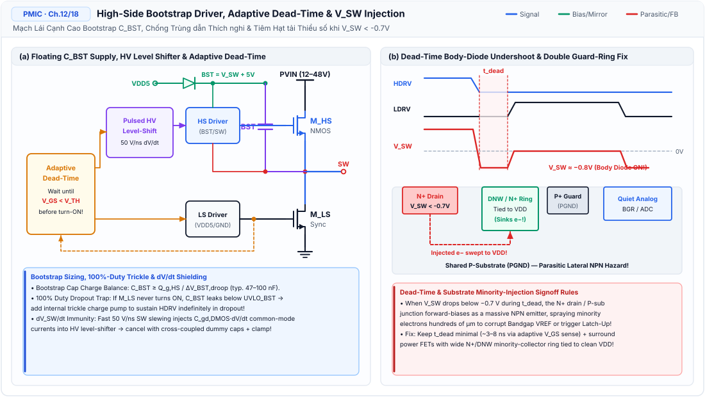

---
{
  "id": "topo-power-stage-hs-bootstrap-driver-deadtime",
  "kind": "topology",
  "domain": "power-management-ic",
  "title_vi": "Tầng Công suất Bán cầu: Định cỡ Tối ưu W_opt, Chuỗi Lái Cổng Tăng dần, Mạch Bootstrap NMOS Phía Cao, Dead-Time Thích nghi & Vòng Bảo vệ Sập Áp Âm SW",
  "title_en": "Half-Bridge Power Stage Engineering: Optimal FET Sizing W_opt, Tapered Gate Buffers, High-Side NMOS Bootstrap & dV/dt Level-Shifter, Adaptive Dead-Time, and Negative-SW Substrate Guard Rings",
  "summary": "Kỹ thuật thiết kế mạch cứng lõi công suất CMOS/BCD quyết định sự sống còn trên silicon của mọi bộ biến đổi đóng cắt (kết hợp vật lý MOSFET, truyền dẫn xung và chống chốt SCR Latch-Up của Razavi Ch.2, Ch.18, Ch.19): dẫn xuất đóng W_opt cân bằng tổn hao dẫn Ron/W với tổn hao cổng cgg*W*Vdrv^2*fsw và chia đoạn công tắc theo tải; tối ưu hệ số nở chuỗi đảo lái cổng u_opt ~ 3.2..4.5 có tách cổng PDRV/NDRV; mạch nâng áp tự cấp C_BST với diode đồng bộ + bộ dịch mức vi sai xung miễn nhiễm dV/dt > 50 V/ns; vòng khóa thời gian chết thích nghi; và quy tắc vòng bảo vệ kép thu hạt tải thiểu số khi nút SW sập âm dưới -0.7 V.",
  "diagram": "../../diagrams/hs-bootstrap-driver-deadtime.svg",
  "razavi_refs": [
    {
      "chapter": 2,
      "section": "2.2.2, 2.4.1-2.4.2, 2.4.5",
      "pages": "12-19, 26-31, 35",
      "equations": ["2.9", "2.10", "2.40"]
    },
    {
      "chapter": 13,
      "section": "13.2.1, 13.2.3",
      "pages": "543-547, 549-553",
      "equations": ["13.7", "13.25"]
    },
    {
      "chapter": 18,
      "section": "18.7.3, 18.8",
      "pages": "727-731",
      "equations": ["18.5", "18.10"]
    },
    {
      "chapter": 19,
      "section": "19.2.1, 19.2.7, 19.3-19.4",
      "pages": "737-739, 753-757, 760-772",
      "equations": ["19.1", "19.14", "19.19"]
    }
  ],
  "github_refs": [
    {
      "repo": "westonb/open-pmic",
      "url": "https://github.com/westonb/open-pmic/tree/2ec3130e71",
      "use": "Tham chiếu trực tiếp khối power-stage và khối switch-control (tạo dead-time không chồng lấp + chuỗi inverter lái cổng công suất) trên tiến trình CMOS 130nm"
    },
    {
      "repo": "Arcadia-1/analog-design-bench",
      "url": "https://github.com/Arcadia-1/analog-design-bench/tree/972f7cd7c9",
      "use": "Tham chiếu trực tiếp hai bài đo chuẩn công nghiệp sky130-bootstrap-driver-pt và sky130-class-d-halfbridge-eff95-tt đánh giá mạch lái cổng nâng áp và cầu bán phần"
    },
    {
      "repo": "iic-jku/Circuit-Designers-Etiquette",
      "url": "https://github.com/iic-jku/Circuit-Designers-Etiquette",
      "use": "Quy tắc thực hành kiểm chứng dòng xuyên nguồn, quá áp cổng oxit, ký sinh chân vỏ và bảo vệ chốt nguồn trên silicon"
    }
  ],
  "glossary_codes": [
    "T066",
    "T084",
    "T107",
    "T109",
    "T112",
    "T130",
    "T188",
    "T363",
    "T1184",
    "T2052",
    "T2056",
    "T2126",
    "T2139",
    "T2147",
    "T2190",
    "T2191",
    "T2193",
    "T2198"
  ],
  "process_agnostic": true,
  "roles": {
    "pareto_sized_segmented_power_fets": "Cặp MOSFET công suất được định cỡ tại điểm cực tiểu tổn hao W_opt và chia thành nhiều phân đoạn bật/tắt số theo dòng tải (Width-Switching)",
    "tapered_split_gate_driver_chain": "Chuỗi cổng đảo hệ số nở u ~ 3.5..4.2 kết thúc bằng tầng tiền lái tách rời đường cổng PMOS (PDRV) và NMOS (NDRV) để xóa dòng xuyên ngay trong bản thân bộ đệm",
    "floating_bootstrap_rail_and_sync_diode": "Tụ nâng áp tự cấp C_BST đặt trên nút SW cùng công tắc nạp làm tươi đồng bộ thay thế diode Schottky để cấp áp cổng nổi VBST = VSW + Vdrv cho NMOS phía cao",
    "pulsed_dvdt_immune_hv_level_shifter": "Bộ dịch mức vi sai xung dòng ngắn có màn chắn triệt dòng điện dung chế độ chung dVSW/dt truyền lệnh điều khiển từ miền đất lên miền nổi VBST-VSW",
    "adaptive_deadtime_and_double_guard_ring": "Vòng hồi tiếp cảm nhận ngưỡng cổng thực tế thu hẹp thời gian chết về 1-3 ns, phối hợp vòng bảo vệ kép n-well/p+ chặn đứng điện tử thiểu số khi VSW < -0.7 V"
  },
  "symptoms_addressed": [
    "catastrophic-pvdd-to-pgnd-shoot-through-current-destroying-half-bridge-fets",
    "oversized-power-mosfet-degrading-overall-converter-efficiency-due-to-massive-gate-charge",
    "false-high-side-turn-on-or-latch-corruption-during-50v-per-ns-switch-node-slew",
    "bootstrap-capacitor-starvation-droop-or-overvoltage-oxide-rupture-from-negative-sw-undershoot",
    "minority-electron-substrate-injection-from-negative-sw-node-triggering-chip-wide-scr-latchup"
  ],
  "limitations": [
    "bootstrapped-nmos-high-side-requires-periodic-sw-low-pulses-or-auxiliary-charge-pump-for-100-percent-duty",
    "external-bootstrap-capacitor-consumes-an-extra-package-pin-and-adds-esl-loop-area",
    "double-guard-rings-around-low-side-power-nmos-consume-significant-perimeter-silicon-area"
  ],
  "checklists": [
    "common-mos",
    "dcdc-switching-converter",
    "esd-pad-and-substrate",
    "layout-and-matching"
  ]
}
---

## 1. Bản chất Nguyên lý, Sơ đồ Mạch & Vai trò Từng Nhánh Cấu trúc

Trên lý thuyết sách vở, tầng công suất của bộ biến đổi DC-DC hay khuếch đại Class-D chỉ vẻn vẹn là hai hình vẽ công tắc lý tưởng đóng mở luân phiên. Thế nhưng trong lịch sử tape-out PMIC công nghiệp, **hơn $70\%$ các ca "chết silicon ngay lần cấp nguồn đầu tiên" (*first-silicon catastrophic burnout / latch-up*) đều nổ ra ngay tại khối Tầng Công suất & Mạch Lái Cổng Bán cầu (*Half-Bridge Power Stage & Gate Driver*)**! Nơi đây hội tụ cùng lúc những điều kiện vật lý khắc nghiệt nhất trên một đế CMOS: dòng đỉnh hàng Ampe đóng cắt trong $1\text{–}3\text{ ns}$, điện áp nút `SW` quăng quật với tốc độ sườn $\frac{dV_{\text{SW}}}{dt} = 10\text{–}50\text{ V/ns}$, điện dung cực cổng khổng lồ hàng trăm pico-farad, và hiện tượng nút `SW` sập âm dưới mức đất $-0{,}8\text{ V}$ bơm hàng chục mili-ampe hạt tải thiểu số xuyên thẳng vào đế bán dẫn p chung!



Để chinh phục trọn vẹn khối mạch này từ tiến trình $180\text{nm}$ BCD cao áp xuống $90\text{nm}/65\text{nm}/45\text{nm}$ CMOS tốc độ cao, kiến trúc sư phần cứng phải giải quyết đồng bộ **năm bài toán cốt tử**:
1. **Định cỡ Tối ưu Pareto cho Bề rộng MOSFET Công suất ($W_{\text{opt}}$) & Băm Phân đoạn Công tắc (*Segmented FET*):** Tăng bề rộng $W$ giúp hạ **điện trở dẫn (`T112`)** $R_{on} \propto 1/W$, nhưng lại làm tăng tuyến tính điện dung cổng $C_{gg} \propto W$ và tụ ngõ ra $C_{oss} \propto W$. Tồn tại một bề rộng tối ưu giải tích duy nhất $W_{\text{opt}}(I_{\text{rms}})$ cân bằng hai nhánh tổn hao này!
2. **Tổng hợp Chuỗi Cổng Đảo Tăng dần Hệ số Nở (*Tapered Buffer*) Có Tách Cổng Chống Trùng Dẫn Nội:** Một cổng logic nhỏ ở lõi số ($W = 1\,\mu\text{m}$) không thể lái trực tiếp MOSFET công suất $W = 30.000\,\mu\text{m}$; phải thiết kế chuỗi $N$ tầng đệm nở dần kích thước theo tỉ số tối ưu thực tế $u \approx 3{,}5\text{–}4{,}2$, đồng thời ngăn chặn dòng xuyên nguồn khổng lồ xảy ra ngay bên trong tầng đệm cuối cùng!
3. **Mạch Nâng áp Tự cấp Cực Cổng Phía Cao (*High-Side NMOS Bootstrap*, họ hàng công suất của `T2139`):** Như Razavi nhấn mạnh ở Chương 2 (§2.4.5, tr. 35) và Chương 13 (§13.2.1), NMOS có độ linh động điện tử cao gấp $\sim 3$ lần lỗ trống của PMOS nên đạt tích số phẩm chất đặc trưng $\text{FoM}_{\text{FET}} = R_{on} \cdot Q_g$ vượt trội tuyệt đối. Nhưng khi NMOS phía cao $M_{\text{HS}}$ dẫn đầy đủ kéo cực nguồn `SW` của nó chạm `PVDD`, cực cổng `HG` bắt buộc phải được đẩy vọt lên **cao hơn cả điện áp nguồn cấp đầu vào**: $V_{\text{HG}} = V_{\text{PVDD}} + V_{\text{drv}}$! Tụ bay ngoại vi $C_{\text{BST}}$ đặt tựa chân trên nút `SW` kết hợp **công tắc nạp bootstrap đồng bộ** tạo ra một **nguồn cấp cục bộ nổi (`T2126`)** `VBST - SW = Vdrv` đi tàu lượn lên xuống cùng `SW` mỗi chu kỳ!
4. **Bộ Dịch Mức Vi sai Xung Cao áp Miễn Nhiễm $dV_{\text{SW}}/dt$ (*Pulsed HV Level-Shifter*):** Chuyển tiếp tín hiệu logic điều khiển từ miền đất tĩnh (`0..AVDD`) nhảy vọt lên miền ray nổi (`SW..VBST`) mà không tiêu tốn dòng tĩnh DC và không bị kích lật nhầm bởi dòng nạp tụ ký sinh $C_{GD}\frac{dV_{\text{SW}}}{dt}$.
5. **Vòng Khóa Thời gian Chết Thích nghi (*Adaptive Dead-Time*) & Vòng Bảo vệ Kép Thu Hạt tải Thiểu số Khi $V_{\text{SW}} < -0{,}7\text{ V}$:** Rút ngắn thời gian nghỉ chống trùng dẫn xuống sát $1\text{–}3\text{ ns}$ trên mọi góc PVT, đồng thời xây "hào thu điện tử" N-well nối `PVDD` bao quanh công tắc $M_{\text{LS}}$ để ngăn hiện tượng chốt cháy **SCR Latch-Up (`T2190`)** toàn chip!

---

## 2. Hệ Phương trình Cốt lõi & Tư duy "Nhìn Mạch Đọc Nhanh" (Analysis by Inspection)

### 2.1. Định luật Bề rộng Công tắc Tối ưu $W_{\text{opt}}$ & Cực tiểu Tổn hao Tích Phẩm chất $\sqrt{R_{on\cdot W}\,c_{gg\cdot W}}$
Với một loại linh kiện MOSFET và chiều dài kênh $L$ cố định (thường chọn $L = L_{\min}$ của cấp điện áp chịu đựng đó để cực tiểu hóa cả $R_{on}$ lẫn $C_{gg}$!), ta định nghĩa hai hằng số công nghệ bất biến theo bề rộng: **điện trở dẫn chuẩn hóa trên đơn vị bề rộng** $R_{on\cdot W} \equiv R_{on} \cdot W$ ($\Omega\cdot\mu\text{m}$) và **điện dung cổng chuẩn hóa trên đơn vị bề rộng** $c_{gg\cdot W} \equiv \frac{Q_g}{V_{\text{drv}} W}$ ($\text{F}/\mu\text{m}$, nếu xét thêm tụ máng thì gộp hiệu dụng vào $c_{\text{sw}\cdot W}$). Tổng công suất tiêu tán (`T066`) phụ thuộc vào $W$ của một công tắc mang dòng hiệu dụng $I_{\text{rms}}$ là:

$$
P_{\text{FET}}(W) = \frac{I_{\text{rms}}^2\,R_{on\cdot W}}{W} + c_{gg\cdot W}\,W\,V_{\text{drv}}^2\,f_{sw}
$$

Theo bất đẳng thức Cauchy (AM–GM) hoặc giải $\dfrac{\partial P_{\text{FET}}}{\partial W} = -\dfrac{I_{\text{rms}}^2 R_{on\cdot W}}{W^2} + c_{gg\cdot W} V_{\text{drv}}^2 f_{sw} = 0$, tổng tổn hao đạt cực tiểu toàn cục đúng khi **tổn hao dẫn bằng chính xác tổn hao đóng cắt cổng** ($P_{\text{cond}} = P_{\text{gate}}$):

$$
W_{\text{opt}}(I_{\text{rms}}) = \frac{I_{\text{rms}}}{V_{\text{drv}}}\sqrt{\frac{R_{on\cdot W}}{c_{gg\cdot W}\,f_{sw}}}, \qquad P_{\text{FET},\min} = 2\,I_{\text{rms}}\,V_{\text{drv}}\sqrt{R_{on\cdot W}\,c_{gg\cdot W}\,f_{sw}}
$$

**Hai Bài học Thiết kế Sâu sắc Từ Phương trình $W_{\text{opt}}$:**
1. **Tích số Phẩm chất Linh kiện Công suất ($\text{FoM}_{\text{sw}} = R_{on\cdot W} \cdot c_{gg\cdot W} = \frac{R_{on} Q_g}{V_{\text{drv}}}$):** Nhìn vào $P_{\text{FET},\min}$, giới hạn vật lý của tổn hao tỷ lệ với $\sqrt{R_{on\cdot W}\,c_{gg\cdot W}} \propto \frac{L}{\sqrt{\mu\,C_{ox}(V_{\text{drv}}-V_{TH})}}$. Đây là lý do đanh thép giải thích vì sao thay một transistor I/O cổng dày $5\text{ V}$ ($L_{\min} = 0{,}5\,\mu\text{m}$) bằng cặp xếp chồng Cascode hai transistor core $1{,}8\text{ V}$ ($L_{\min} = 0{,}18\,\mu\text{m}$) hoặc dùng All-NMOS thay vì HS-PMOS có thể cắt giảm một nửa tổn hao chuyển đổi ở tần số vài MHz!
2. **Tại sao Công tắc Băm Phân đoạn (*Width-Switching / Segmented Power Stage*) nâng mạnh hiệu suất tải trung bình?** Nếu cố định $W$ theo dòng cực đại $I_{\max} = 3\text{ A}$, khi dòng tải giảm xuống $I_{load} = 0{,}3\text{ A}$ (giảm $10\times$), tổn hao dẫn giảm $100\times$ nhưng tổn hao lái cổng $P_{\text{gate}}$ vẫn giữ nguyên to khổng lồ! Bằng cách chia MOSFET công suất thành 3–4 lát nhị phân độc lập (ví dụ $0{,}25 W_{\text{tot}} + 0{,}25 W_{\text{tot}} + 0{,}50 W_{\text{tot}}$) và chỉ bật lát $0{,}25 W_{\text{tot}}$ khi $I_{load} < 0{,}7\text{ A}$, bề rộng hiệu dụng bám theo đường thẳng $W_{\text{opt}} \propto I_{\text{rms}}$ giúp đẩy đỉnh đường cong hiệu suất rộng ra toàn miền tải!

### 2.2. Định luật Chuỗi Cổng Đảo Tăng Dần (*Tapered Buffer*) & Tách Cổng Chống Trùng Dẫn Tiền Lái
Để lái điện dung cổng công suất $C_{L,\text{gate}}$ từ cổng logic đầu vào điện dung nhỏ $C_0$ (tổng hệ số khuếch đại điện dung $F = \frac{C_{L,\text{gate}}}{C_0} \sim 2.000 \dots 20.000$) qua $N$ tầng cổng đảo với hệ số nở hình học đồng đều $u = F^{1/N}$:
- Tổng trễ truyền lan gồm cả tụ tự tải cực máng nội tại ($\gamma = \frac{C_{\text{drain},0}}{C_0} \approx 1$) là $t_{p,\text{tot}} = N\,\tau_{\text{inv},0}\,(\gamma + u) = \tau_{\text{inv},0}\ln(F)\frac{\gamma + u}{\ln u}$. Nếu $\gamma = 0$ lý tưởng, đạo hàm cho nghiệm sách giáo khoa nổi tiếng $u_{\text{ideal}} = e \approx 2{,}718$; nhưng trên silicon thực với $\gamma \approx 1$, nghiệm cực tiểu trễ dịch lên $u_{t,\min} \approx 3{,}6$, và vì đường cong trễ rất phẳng quanh cực tiểu trong khi tổng diện tích và năng lượng chuỗi đệm tỉ lệ với $\frac{1}{u - 1}$, **điểm ngọt chuẩn công nghiệp PMIC là chọn $u_{\text{opt}} \in [3{,}5;\, 4{,}5]$** (chỉ cần $N = 5\text{–}6$ tầng cho $F = 5.000$!).
- **Tách Cổng `PDRV` / `NDRV` Ở Hai Tầng Đệm Cuối (*Split-Gate Non-Overlapping Pre-Driver*):** Tầng inverter cuối cùng lái trực tiếp cổng MOSFET công suất bản thân nó đã có bề rộng hàng ngàn micromet (dòng đỉnh $1\text{–}2\text{ A}$)! Nếu nối chung cổng PMOS và NMOS của tầng inverter cuối này như cổng logic thường, trong khoảng $400\text{ ps}$ sườn xung đi qua vùng giữa, chính bản thân bộ đệm lái cổng sẽ bị trùng dẫn tiêu tốn hàng mili-watt! Phải tách riêng cổng kéo lên `PDRV` và cổng kéo xuống `NDRV` điều khiển bởi cặp logic `NAND`/`NOR` đảm bảo *tắt hẳn nhánh kéo lên của driver rồi mới bật nhánh kéo xuống*!

### 2.3. Định cỡ Tụ Nâng Áp $C_{\text{BST}}$, Công tắc Nạp Đồng bộ & Điện trở Cổng Phân bố $R_G$
Trong pha $M_{\text{LS}}$ dẫn (`SW` $\approx 0\text{ V}$), tụ $C_{\text{BST}}$ được nạp lên $V_{C,\text{BST}}(0) = V_{\text{drv}} - V_{\text{drop,bst}}$. Khi chuyển sang pha $M_{\text{HS}}$ bật, điện tích từ $C_{\text{BST}}$ san sẻ sang tổng điện dung cổng tương đương của $M_{\text{HS}}$ ($Q_{g,\text{HS}}$) và nuôi dòng rỉ tĩnh của bộ dịch mức/UVLO nổi ($I_{Q,\text{BST}}$) suốt thời gian $D_{\max} T_s$. Để sụt áp trên $C_{\text{BST}}$ không vượt quá $\Delta V_{\text{BST,max}}$ (thường $\le 0{,}15\text{ V}$ để giữ $R_{on,\text{HS}}$ thấp):

$$
C_{\text{BST}} \ge \frac{Q_{g,\text{HS}} + I_{Q,\text{BST}}\,\dfrac{D_{\max}}{f_{sw}}}{\Delta V_{\text{BST,max}}}
$$

Đồng thời trên layout đa ngón (`T2193`), phải kiểm soát chặt **điện trở phân bố cực cổng polysilicon (`T363`, Razavi Ch.2 §2.4.3 & Ch.19 §19.2.1, Phương trình 19.1–19.3)**: nối tiếp điểm kim loại hai đầu ngón cổng giảm $R_G$ đi **4 lần** ($R_{G,\text{2-side}} = \frac{R_{\text{sq,poly}}}{12}\frac{W_f}{L\,n_f}$), đảm bảo hằng số thời gian nội cổng $R_G C_{gg} \ll 200\text{ ps}$ để các ngón ở giữa và hai biên bật/tắt đồng thời không gây tập trung dòng cục bộ!

---

## 3. Bất biến Cấu trúc & Các Bẫy Lỗi Kinh điển (Structural Invariants & Traps)

- **[INV-DRV-01] Bất biến Cấm Dùng Diode Bootstrap Thường Ở Nguồn Lái Thấp & Chống Nạp Quá Áp Oxit Cổng Khi `SW` Sập Âm:**
  1. Ở các PMIC tiến trình 65nm/45nm dùng nguồn lái cổng $V_{\text{drv}} = 1{,}8\text{ V}$ (hoặc $1{,}2\text{ V}$), nếu nạp $C_{\text{BST}}$ qua một diode PN/Schottky thông thường mất $V_D = 0{,}55\text{ V}$, áp lái thực tế đặt lên cổng $M_{\text{HS}}$ chỉ còn $1{,}25\text{ V}$ làm $R_{on,\text{HS}}$ tăng vọt gấp đôi! Bắt buộc dùng **Công tắc Nạp Bootstrap Đồng bộ (*Synchronous Bootstrap PMOS/NMOS Switch*)** chỉ bật đúng khi `LS_ON == 1` VÀ `V(SW) < 0.2 V`, giảm sụt áp nạp xuống $< 20\text{ mV}$!
  2. **Bẫy Nổ Oxit Cổng Do Sập Áp Âm `SW` (*Bootstrap Overcharging Oxide Rupture*):** Trong thời gian chết hoặc do điện cảm chân vỏ $L_{\text{PGND}}\frac{di}{dt}$, nút `SW` thường sập âm xuống $-1{,}0\text{ V}\dots -1{,}5\text{ V}$! Nếu lúc đó diode bootstrap dẫn tự do từ nguồn $V_{\text{drv}} = 5{,}0\text{ V}$ (cho linh kiện chịu áp cổng tối đa $5{,}5\text{ V}$), tụ $C_{\text{BST}}$ bị nạp vọt lên hiệu điện thế **$V_{\text{BST}} - V_{\text{SW}} = 5{,}0\text{ V} - (-1{,}5\text{ V}) = 6{,}5\text{ V} > V_{GS,\text{max}}$** — đánh thủng lớp oxit cổng $M_{\text{HS}}$! Công tắc bootstrap đồng bộ kèm bộ kẹp Zener/LDO nổi giữa `VBST` và `SW` triệt tiêu hoàn toàn tai nạn này!
- **[INV-DRV-02] Bất biến Vòng Bảo vệ Kép Thu Hạt tải Thiểu số Quanh $M_{\text{LS}}$ Khi $V_{\text{SW}} < -0{,}7\text{ V}$ (*Minority-Carrier Collector Guard Ring*, Razavi Ch.18 §18.8 & Ch.19 §19.3):**
  - Đây là quy tắc sống còn số 1 của Layout PMIC! Cực máng của NMOS phía thấp $M_{\text{LS}}$ là một vùng khuếch tán $n^+$ diện tích khổng lồ nối trực tiếp vào nút `SW`, nằm ngay trên **đế bán dẫn loại p chung (`T2056`)**. Trong mỗi chu kỳ đóng cắt, vào đúng hai khoảng thời gian chết ($t_{\text{dead}}$), dòng cuộn cảm kéo nút `SW` âm xuống $-0{,}7\text{ V}\dots -1{,}0\text{ V}$ làm tiếp giáp $n^+\text{-drain (`SW`)} / p\text{-substrate (`0 V`)}$ **PHÂN CỰC THUẬN**!
  - Cực máng $M_{\text{LS}}$ lập tức hóa thân thành **cực phát (emitter) khổng lồ của một transistor lưỡng cực NPN ngang ký sinh**, phun hàng chục mili-ampe **điện tử thiểu số** tỏa ra xa hàng trăm micromet khắp đế p! Nếu các điện tử này trôi dạt tới bất kỳ giếng N (`T130`) nào của khối Bandgap (`T2052`), bộ tạo dao động, hoặc khối logic CMOS bên cạnh, chúng bị hút vào giếng N tạo sụt áp kích hoạt vòng hồi tiếp dương (`T1184`) của thyristor SCR ký sinh — gây **chốt cháy nguồn Latch-Up (`T2190`) toàn chip** hoặc làm trôi sai hoàn toàn điện áp chuẩn $V_{REF}$!
  - **Cấu trúc Vòng Bảo vệ Kép Bắt buộc (`T2191`, *Double Guard Ring*):** Không bao giờ chỉ đặt một vòng $p^+$ nối đất quanh $M_{\text{LS}}$ (vòng $p^+$ là tiếp xúc hạt tải đa số lỗ trống, hiệu suất hút điện tử thiểu số rất kém!). Phải bao bọc sát quanh $M_{\text{LS}}$ bằng: **(Vòng 1 bên trong / xen kẽ)** dải **Giếng N sâu rộng có tiếp xúc $n^+$ dày đặc nối riêng về chân nguồn công suất dương `PVDD`** (đóng vai trò cực góp NPN phụ phân cực ngược mạnh thu gom $> 98\%$ điện tử thiểu số ngay tại biên!), rồi bọc ra ngoài bởi **(Vòng 2 bên ngoài)** dải rộng **tiếp xúc đế $p^+$ nối cứng về `PGND`**, cách xa mọi mạch nhạy cảm tối thiểu $50\text{–}100\,\mu\text{m}$!
- **[TRAP-DRV-01] Bẫy Lật Chốt Sai Trong Bộ Dịch Mức Cao Áp Khi `SW` Quăng Quật $50\text{ V/ns}$:** Trong bộ dịch mức dùng chốt PMOS ghép chéo nổi giữa `VBST` và `SW` được kéo bởi cặp transistor cao áp LDMOS dưới đất (`M_SET`, `M_RST`), hai tụ ký sinh $C_{GD}$ của cặp LDMOS cao áp nối thẳng từ nút nổi cao áp xuống đất. Khi `SW` nhảy vọt $+20\text{ V}$ trong $0{,}5\text{ ns}$, cả hai nhánh cùng bị dòng dịch chuyển chế độ chung $I_{\text{CM}} = C_{GD}\frac{dV_{\text{SW}}}{dt}$ kéo mạnh xuống đất! Bất kỳ sai lệch bất đối xứng nhỏ nào trên layout giữa nhánh `SET` và nhánh `RST` sẽ chuyển dòng đồng pha đó thành áp vi sai lật nhầm trạng thái chốt làm $M_{\text{HS}}$ tắt/bật loạn xạ! Bắt buộc dùng: (1) cấu trúc đối xứng tâm chung tuyệt đối cho cặp HV-NMOS, (2) cặp điện trở/diode kẹp biên độ sụt áp trên tải chốt $\Delta V_{\text{latch}} \le 1{,}2\text{ V}$, và (3) tụ bù chéo trung hòa $C_{GD}$ kèm khóa `UVLO_BST` (cưỡng bức tắt $M_{\text{HS}}$ nếu $V_{\text{BST}} - V_{\text{SW}} < V_{\text{UVLO,drv}}$)!
- **[TRAP-DRV-02] Sự Đánh Đổi Chết Người Của Thời Gian Chết Cố Định (*Fixed RC Dead-Time Dilemma*):** Trễ của cổng đảo và $M_{\text{HS}}/M_{\text{LS}}$ thay đổi gấp $2{,}5\text{–}3\times$ từ góc nhanh lạnh (`FF, -40°C`) sang góc chậm nóng (`SS, 125°C`). Nếu thiết kế trễ cố định đủ rộng cho góc `SS` ($25\text{ ns}$), ở góc danh định `TT` và `FF` thời gian chết thừa mứa làm diode thân dẫn lâu đốt mất $3\%\text{–}5\%$ hiệu suất và bơm gấp $5$ lần điện tích hạt tải thiểu số xuống đế! **Vòng Dead-Time Thích nghi (*Adaptive / Predictive Gate-Sense Loop*)** lấy mẫu trực tiếp điện áp thực trên chân cổng $V_{GS,\text{LS}}$ (qua bộ chia/cổng ngưỡng thấp) và sườn xuống của $V_{\text{SW}}$ để chỉ bật công tắc đối diện ngay sau khi $V_{GS} < V_{TH,\min}$, ép thời gian chết thực tế xuống chỉ còn $1{,}5\text{–}3\text{ ns}$ bất chấp góc công nghệ!

---

## 4. Lộ trình Nâng cấp Cấu trúc & Bát giác Đánh đổi (Upgrade Paths & Design Octagon)

| Điểm nghẽn của Tầng Công suất & Lái Cổng Tiêu chuẩn | Nâng cấp sang cấu trúc / kỹ thuật đích (Canonical Node) | Cơ chế đột phá | Đánh đổi trên Bát giác Thiết kế |
|---|---|---|---|
| Tổn hao đóng cắt cứng $V \cdot I$ và $Q_{gd}$ trên $M_{\text{HS}}$ vẫn quá lớn ở tần số cao $> 5\text{ MHz}$ | *Split-Slope / Two-Speed Slew-Rate Controlled Gate Driver* (hoặc Cascode Stacked Core FETs) | Bơm dòng cực mạnh qua vùng thềm Miller $Q_{gd}$ để rút ngắn $t_{\text{sw}}$, nhưng tự động hãm dòng ngay cuối sườn để giảm vọt áp chuông EMI $L_{\text{pkg}}\frac{di}{dt}$ | Cần mạch cảm nhận vùng thềm cổng $V_{GS,\text{plateau}}$ điều khiển các ngón driver song song |
| Mất dòng cảm biến hoặc tốn diện tích điện trở $R_{\text{sense}}$ nối tiếp làm giảm hiệu suất tầng công suất | `topo-dcdc-ramp-sensefet-dcr-and-zcd-blocks` | Nhúng trực tiếp các ô đơn vị **SenseFET** khớp đồng tâm ngay giữa lòng ma trận $M_{\text{HS}}$ / $M_{\text{LS}}$ để đo dòng không tốn $1\text{ mW}$ tổn hao nối tiếp nào! | Đòi hỏi khuếch đại thuật toán ghim bằng nhau điện áp cực máng và tạo trễ che gai chuyển mạch **LEB** |
| Chập tải ngoài làm dòng vọt lên trước khi vòng điều khiển chậm kịp phản ứng gây nổ tầng công suất | `topo-pmic-protections-por-uvlo-softstart-ocp-tsd` | Bộ so sánh quá dòng tức thời trên $V_{DS,\text{on}}$ (*Desat / $R_{DS,\text{on}}$ Cycle-by-Cycle OCP*) cắt xung cổng trong $< 15\text{ ns}$ kèm gập dòng Foldback | Ngưỡng $V_{DS,\text{on}}$ trôi theo nhiệt độ $\sim +0{,}5\%/^\circ\text{C}$ cần dòng tham chiếu bù PTAT |
| Dây hàn vàng (*wirebond*) dài $1{,}5\text{ mm}$ ($1{,}5\text{ nH}$) gây nảy nguồn/đất và điện trở gói lớn hơn cả $R_{on}$ của MOSFET | Đóng gói Lật Chip Cột Đồng (**Flip-Chip Cu-Pillar Bump**, `tech-esd-protection-padring-and-package-parasitics`) | Đặt hàng chục cột đồng tiếp xúc thẳng ngay trên đỉnh ma trận $M_{\text{HS}}/M_{\text{LS}}$, hạ $L_{\text{pkg}}$ từ $1{,}5\text{ nH}$ xuống $< 50\text{ pH}$ và $R_{\text{pkg}} < 2\text{ m}\Omega$! | Tăng chi phí đóng gói wafer bumping và đòi hỏi thiết kế ESD chịu tải trực tiếp trên pad công suất |

---

## 5. Thích ứng Đa Tiến trình (90nm / 65nm / 45nm) & Cách Kiểm chứng trong Cadence / Spectre

### 5.1. Quy trình 5 Bước Thiết kế Tầng Công suất & Mạch Lái Bootstrap Chuẩn Silicon
1. **Trích xuất cặp hằng số $(R_{on\cdot W}, c_{gg\cdot W})$ ở góc nhiệt độ làm việc thực tế ($85\,^\circ\text{C}$):** Chạy một phép quét DC/AC nhanh trên ô đơn vị $W_0 = 10\,\mu\text{m}, nf = 1$ ở $V_{GS} = V_{\text{drv}}, V_{DS} = 50\text{ mV}$ để đo $R_{on\cdot W}$, và tích phân dòng cổng trong phép thử bật xung quá độ (có đặt tải $V_{DS} = V_{in}$ để tính trọn hiệu ứng Miller $Q_{gd}$!) lấy $Q_{g\cdot W,\text{eff}}$.
2. **Tính $W_{\text{opt,HS}}$ và $W_{\text{opt,LS}}$ riêng rẽ theo dòng hiệu dụng từng nhánh:**
   - Nhánh cao mang $I_{\text{HS,rms}} \approx I_{load,\text{nom}}\sqrt{D}$ cộng hệ số phạt đóng cắt Miller $\implies$ chọn $W_{\text{HS}}$ hơi nhỏ hơn $W_{\text{opt}}$ thuần cổng khoảng $20\%\text{–}30\%$ để hạ mạnh $Q_{gd,\text{HS}}$!
   - Nhánh thấp mang $I_{\text{LS,rms}} \approx I_{load,\text{nom}}\sqrt{1-D}$ và hưởng chuyển mạch êm Quasi-ZVS ($V_{DS} \approx 0{,}7\text{ V}$, gần như không bị nhân Miller $Q_{gd}$!) $\implies$ chọn $W_{\text{LS}}$ đúng bằng $W_{\text{opt,LS}}$ (thường rộng gấp $1{,}8\text{–}2{,}8\times$ $W_{\text{HS}}$ cho mạch hạ áp).
3. **Tổng hợp chuỗi đệm lái cổng & Kẹp Miller Chủ động:** Tính $C_{\text{in,power}} = Q_{g,\text{eff}}/V_{\text{drv}}$, chia ngược theo hệ số nở $u = 4{,}0$ về kích thước cổng logic chuẩn; tách `PDRV`/`NDRV` ở tầng cuối; đặt thêm một NMOS phụ nhỏ kẹp thẳng cực cổng `LG` xuống `PGND` ngay khi `LG < 0.25 V` để chống bật giả $C_{GD}\frac{dV_{\text{SW}}}{dt}$.
4. **Thiết kế Bộ dịch mức xung & Khóa `UVLO_BST`:** Dòng xung `SET`/`RST` rộng $2\text{–}4\text{ ns}$ biên độ đủ lật chốt trong $< 500\text{ ps}$ nhưng tự ngắt về $0\,\mu\text{A}$ sau sườn cạnh; kèm một đường làm tươi xung giữ trạng thái mỗi chu kỳ và mạch `UVLO_BST` kéo cứng `HG` về `SW` nếu $V(\text{VBST}) - V(\text{SW}) < 0{,}70\,V_{\text{drv}}$.
5. **Quy hoạch mặt bằng Layout & Guard Rings:** Đặt $M_{\text{HS}}$ và $M_{\text{LS}}$ sát cạnh nhau dọc theo dãy pad `PVDD` – `SW` – `PGND`; bao bọc kín toàn bộ khối $M_{\text{LS}}$ bằng **Vòng N-well nối `PVDD` bên trong + Vòng $p^+$ nối `PGND` bên ngoài** rộng $\ge 4\text{–}8\,\mu\text{m}$ mỗi vòng liên tục không đứt đoạn!

### 5.2. Kịch bản Đánh Phá Kiểm chứng Độ Bền Cực Đoan (`Corner + dV/dt + Package`) Trong Spectre
1. **Phép thử Bắn Sườn Cực đoan $dV_{\text{SW}}/dt = 50\text{ V/ns}$ Lên Bộ Dịch Mức (`tran` Standalone Stress):**
   - Giữ lệnh đầu vào ở mức cố định (`HS_CMD = 0` rồi `HS_CMD = 1`), dùng nguồn áp xung lý tưởng giật nút `SW` lên xuống biên độ $0 \leftrightarrow V_{in,\max}$ với sườn lên/xuống $150\text{ ps}$ qua toàn bộ 5 góc (`FF -40°C`, `SS 125°C`, `FS`, `SF`) kèm nhiễu lệch Monte Carlo $3\sigma$: chốt nổi trên đầu `VBST-SW` **tuyệt đối không được lật sai dù chỉ 1 lần**!
2. **Phép thử Đồ thị X chồng Lấn Dòng & Áp Cổng (`tran` Cross-Conduction Audit):**
   - Vẽ đồng thời `I_D(M_HS)` và `I_D(M_LS)` cùng `V(HG)-V(SW)` và `V(LG)-V(PGND)` khi có chèn đầy đủ $L_{\text{bondwire}} = 1{,}5\text{ nH}$ trên cả 3 chân `PVDD`, `SW`, `PGND`: xác nhận hai đường cong $V_{GS}$ cắt nhau ở mức sâu **dưới $0{,}2\text{ V}$** (thấp hơn nhiều $V_{TH}(125\,^\circ\text{C})$) và kiểm tra áp chịu đựng tức thời $|V_{GS}(t)| \le V_{\text{ox,max}}$ kể cả lúc `SW` rung chuông âm!
3. **Bảng Kiểm Soát Nhanh 5 Ràng Buộc Ký Sinh & Độ Tin Cậy Tầng Công Suất Trong ADE:**
   ```text
   [1] Không trùng dẫn mọi góc PVT:   max_t( min(Vgs_HS - Vth_HS, Vgs_LS - Vth_LS) ) <= -150 mV
   [2] Miễn nhiễm sườn dV/dt 50V/ns:  0 false state flips on HV level-shifter under +/-50 V/ns SW slew (3-sigma MC)
   [3] An toàn điện môi tụ C_BST:     0.80 * V_drv <= (V(VBST) - V(SW))_steady <= 1.05 * V_drv (kể cả khi SW = -1.2V)
   [4] Kẹp thời gian chết thích nghi: 1.0 ns <= t_dead_actual <= 5.0 ns across {FF -40C .. SS +125C}
   [5] Quy tắc DRC/LVS chống LatchUp: Continuous closed N-well(PVDD) + P+(PGND) double guard ring around M_LS
   ```

---

## 6. Mốc Đối chiếu Sách Razavi, Tài liệu Chuẩn Công nghiệp & Thuật ngữ CLB

### 6.1. Đối chiếu Sách Gốc Razavi (2nd Edition) & Chuyên khảo Thiết kế Mạch Lái Công suất
- **Razavi Chương 2 & Chương 13:** §2.2.2 & §2.4.5 (tr. 12–19, 35 — đối chiếu độ linh động điện tử/lỗ trống giải thích ưu thế vượt trội của NMOS công suất phía cao), §2.4.1–2.4.2 (tr. 26–31 — diện tích/chu vi tiếp giáp nguồn–máng khi gấp ngón) & §13.2.1 (tr. 543–547 — giới hạn dẫn của công tắc NMOS khi áp nguồn tiến sát nguồn cấp dẫn tới kỹ thuật nâng áp cổng bootstrap).
- **Razavi Chương 18 & Chương 19:** §18.8 *Latch-Up* (tr. 730–731 — cơ chế cặp BJT ký sinh PNP/NPN chốt cháy nguồn khi có dòng tiêm vào đế/giếng), §19.2.1 *Multifinger Transistors* (tr. 737–739, Phương trình 19.1–19.5 — hạ điện trở cổng polysilicon $R_G$ đi 4 lần bằng tiếp xúc hai đầu), §19.3 *Substrate Coupling* (tr. 760–764 — truyền nhiễu qua đế và vòng bảo vệ) & §19.4 *Packaging* (tr. 764–772, Phương trình 19.19 — vọt áp cảm ứng dây hàn $L_b \frac{di}{dt}$).
- **Tài liệu Chuẩn Mở rộng PMIC:** B. Wicht, *Design of Power Management Integrated Circuits* (Wiley-IEEE, Ch. 3 *Power Transistors, Gate Drivers, Level Shifters & Substrate Current Protection* — tài liệu chuẩn mực số 1 thế giới về vòng bảo vệ thu hạt tải thiểu số khi $V_{\text{SW}} < 0$!); J. M. Rabaey, A. Chandrakasan & B. Nikolić, *Digital Integrated Circuits* (Ch. 5 & Ch. 9 — lý thuyết hệ số nở chuỗi cổng đảo Tapered Buffer có tự tải $\gamma$).

### 6.2. Bảng Thuật ngữ Chuẩn CLB Vi Mạch Sử dụng trong Thẻ
| Mã CLB | Thuật ngữ Tiếng Anh | Thuật ngữ Tiếng Việt Chuẩn | Ghi chú Ngữ cảnh trong Tầng Công suất & Lái Cổng |
|---|---|---|---|
| `T2139` / `T2126` | bootstrapped switch / local supply | công tắc nâng áp cực cổng / nguồn cấp cục bộ | Nguồn nổi `VBST - SW` dùng tụ $C_{\text{BST}}$ giữ $V_{GS,\text{HS}} = V_{\text{drv}}$ cố định |
| `T2190` / `T2191` | latch-up / guard ring | hiện tượng chốt ký sinh SCR / vòng bảo vệ | Vòng kép N-well(`PVDD`) + $p^+$(`PGND`) hút sạch điện tử khi `SW` sập âm $< -0{,}7\text{ V}$ |
| `T2056` / `T130` | p-type substrate / N-well | đế bán dẫn loại p / Giếng n | Nền bán dẫn tạo NPN ngang ký sinh từ cực máng $n^+$ của $M_{\text{LS}}$ sang các giếng N lân cận |
| `T363` / `T2193` | Gate resistance (RG) / multi-finger transistor | Điện trở cực cổng / transistor chia nhiều ngón | Bắt buộc nối kim loại hai đầu ngón cổng để các ngón công suất đóng/ngắt đồng bộ |
| `T2198` | bondwire inductance and ground bounce | điện cảm dây hàn chân vỏ và nảy đất $L\cdot di/dt$ | Thủ phạm gây sập áp âm/vọt áp dương trên nút `SW` và bật giả Miller |
