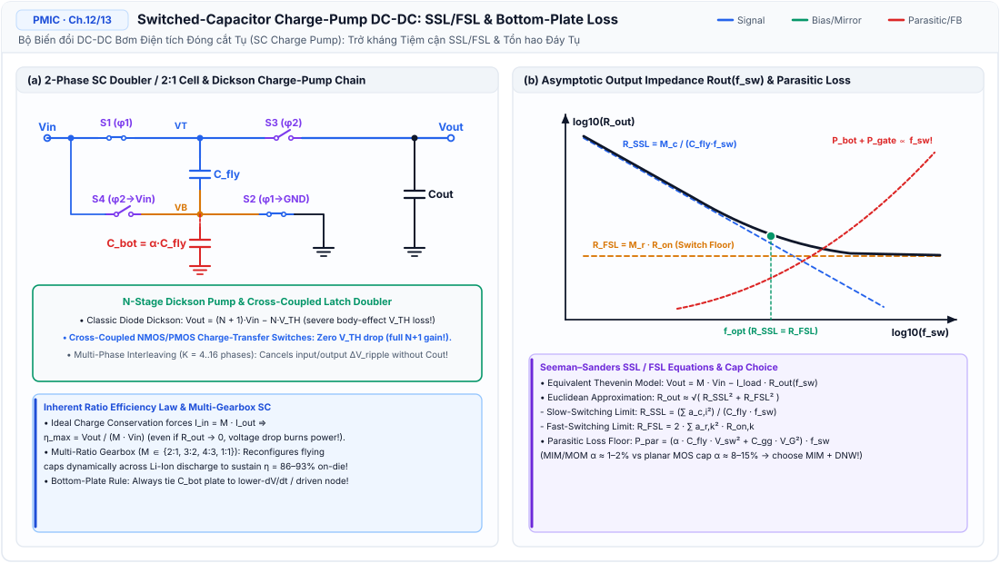

---
{
  "id": "topo-switched-capacitor-charge-pump-dcdc",
  "kind": "topology",
  "domain": "power-management-ic",
  "title_vi": "Bộ Biến đổi Nguồn Tụ Chuyển mạch & Bơm Điện tích CMOS (Switched-Capacitor Charge-Pump DC-DC — Giới hạn SSL/FSL, Đa Tỷ số & Ký sinh Tấm Đáy)",
  "title_en": "CMOS Switched-Capacitor (SC) and Charge-Pump DC-DC Converters: Dickson, Cross-Coupled, Multi-Ratio Gearbox, SSL/FSL Impedance Laws & Bottom-Plate Ceiling",
  "summary": "Lý thuyết tổng hợp và định cỡ tối ưu cho các bộ biến đổi DC-DC không cuộn cảm trên chip (kết nối Razavi Ch.13 §13.1-13.3 & Ch.18 §18.7.2 với khuôn khổ vector nhân điện tích Seeman-Sanders và bộ sinh dcdc-gen của OpenFASOC): giải phẫu bơm điện tích Dickson, nhân đôi áp ghép chéo Favrat/Pelliconi khử sụt VTH, mạng nối tiếp-song song phân số (2:1, 1:2, 3:2, 2:3); dẫn xuất trở kháng ra giới hạn đóng cắt chậm R_SSL và giới hạn đóng cắt nhanh R_FSL hợp nhất qua chuẩn Euclid Rout = sqrt(R_SSL^2 + R_FSL^2); cùng trần hiệu suất nội tại Vout/(M*Vin), hộp số đa tỷ số (Gearbox) và trần tổn hao tụ ký sinh tấm đáy alpha*Cfly*V^2*fsw.",
  "diagram": "../../diagrams/switched-cap-charge-pump-dcdc.svg",
  "razavi_refs": [
    {
      "chapter": 2,
      "section": "2.3, 2.4.2, 2.6",
      "pages": "20-31, 37-38",
      "equations": ["2.23", "2.40"]
    },
    {
      "chapter": 13,
      "section": "13.1-13.3.3",
      "pages": "539-568",
      "equations": ["13.1", "13.5", "13.7", "13.23"]
    },
    {
      "chapter": 18,
      "section": "18.7.2",
      "pages": "721-727",
      "equations": ["18.3", "18.4"]
    },
    {
      "chapter": 19,
      "section": "19.2.6",
      "pages": "746-753",
      "equations": ["19.10", "19.12"]
    }
  ],
  "github_refs": [
    {
      "repo": "idea-fasoc/OpenFASOC",
      "url": "https://github.com/idea-fasoc/OpenFASOC/tree/426c17025c/openfasoc/generators",
      "use": "Tham chiếu trực tiếp bộ sinh tự động mạch biến đổi nguồn tụ chuyển mạch đa cấu hình dcdc-gen / dcdc-config-gen và quy trình đối chiếu hiệu suất Pre-PEX với Post-PEX"
    },
    {
      "repo": "Arcadia-1/analog-design-bench",
      "url": "https://github.com/Arcadia-1/analog-design-bench/tree/972f7cd7c9",
      "use": "Tham chiếu hai bài toán chuẩn công nghiệp sky130-switched-capacitor-2to1-converter-pvt và sky130-regulated-charge-pump-10mhz-pvt qua đa góc PVT"
    },
    {
      "repo": "iic-jku/analog-circuit-design",
      "url": "https://github.com/iic-jku/analog-circuit-design/tree/6075ea0ebcf08f5c7f6033a84e9dd3c91450f5e1",
      "use": "Nền tảng điện trở tương đương tụ chuyển mạch Req = 1/(fsw*C), xung nhịp hai pha không chồng lấp và tối ưu kích thước công tắc CMOS"
    }
  ],
  "glossary_codes": [
    "T016",
    "T066",
    "T087",
    "T103",
    "T109",
    "T112",
    "T142",
    "T239",
    "T319",
    "T2070",
    "T2093",
    "T2113",
    "T2133",
    "T2138",
    "T2147",
    "T2149"
  ],
  "process_agnostic": true,
  "roles": {
    "flying_energy_transfer_capacitors": "Các tụ bay Cfly (MIM/MOM/MOS trên chip hoặc gốm MLCC ngoài chip) chuyển giao các gói điện tích rời rạc giữa nguồn Vin và tải Vout theo chu trình hai pha không chồng lấp",
    "phase_reconfiguring_switch_matrix": "Ma trận công tắc MOSFET điều khiển bởi xung nhịp bù không chồng lấp (T2147) hoán đổi cấu trúc đấu nối nối tiếp - song song của Cfly tạo tỷ số áp không tải cố định M = Vtarget/Vin",
    "two_port_thevenin_sc_equivalent": "Mô hình máy biến áp một chiều lý tưởng tỷ số 1:M ghép nối tiếp với điện trở ra tương đương Rout(fsw, Ron) hội tụ từ giới hạn chậm R_SSL và giới hạn nhanh R_FSL",
    "multiphase_interleaved_gearbox": "Hệ nhiều ô SC nhỏ chạy lệch pha đều 360/N độ kèm bộ chọn tỷ số hộp số M_k để xóa tụ lọc ra và giữ hiệu suất cao khi Vin biến thiên"
  },
  "symptoms_addressed": [
    "inductor-prohibited-in-fully-integrated-monolithic-soc-or-mems-high-voltage-bias-generator",
    "dickson-diode-charge-pump-losing-voltage-headroom-from-cumulative-vth-and-body-effect-drops",
    "switched-capacitor-converter-efficiency-plummeting-when-fsw-is-pushed-too-high-due-to-bottom-plate-loss",
    "fixed-ratio-2to1-sc-converter-wasting-power-like-an-ldo-when-vout-is-regulated-far-below-half-vin"
  ],
  "limitations": [
    "conduction-efficiency-is-strictly-bounded-by-vout-divided-by-no-load-target-m-times-vin",
    "on-chip-capacitors-incur-unavoidable-bottom-plate-parasitic-switching-loss-alpha-cfly-v2-fsw",
    "large-inrush-and-pulsed-charging-currents-require-multiphase-interleaving-for-low-emi"
  ],
  "checklists": [
    "common-mos",
    "dcdc-switching-converter",
    "switched-capacitor",
    "layout-and-matching"
  ]
}
---

## 1. Bản chất Nguyên lý, Sơ đồ Mạch & Vai trò Từng Nhánh Cấu trúc

Tại sao cuộn cảm trên chip silicon luôn là nỗi ám ảnh của kỹ sư thiết kế vi mạch? Ở tần số vài chục megahertz trở xuống, một cuộn cảm tích hợp phẳng trên các lớp kim loại CMOS chỉ đạt vài nano-henry với hệ số phẩm chất $Q < 5$ và điện trở dây dẫn khổng lồ, trong khi mật độ năng lượng tích trữ tĩnh điện của tụ điện tích hợp $\frac{1}{2}\varepsilon E_{\text{max}}^2$ trên chip **cao hơn mật độ từ năng của cuộn cảm tích hợp từ $100$ đến $1.000$ lần**! Chính vì quy luật vật lý bất đối xứng này, khi cần tích hợp hoàn toàn bộ biến đổi nguồn lên cùng một đế silicon (**Fully-Integrated Monolithic DC-DC** nuôi lõi SoC, tạo áp cao $12\text{–}20\text{ V}$ lập trình bộ nhớ Flash/OTP/MEMS, nâng áp cổng công tắc `topo-bootstrapped-sampling-switch`, hoặc đảo nguồn âm dòng nhỏ), **mạch tụ chuyển mạch (`T087`) / bơm điện tích (`T016`, *Switched-Capacitor Charge-Pump DC-DC*)** trở thành lựa chọn độc tôn.



Mở rộng trực tiếp nguyên lý điện trở tương đương tụ chuyển mạch $R_{eq} = \frac{1}{f_{sw} C}$ trong Razavi Chương 13 (§13.1, Phương trình 13.5) từ miền xử lý tín hiệu sang miền truyền tải công suất, gia đình cấu trúc SC DC-DC chia thành **bốn họ kinh điển** điều khiển bởi **xung nhịp hai pha không chồng lấp (`T2147`)** $\Phi_1, \Phi_2$:
1. **Họ Hạ áp / Nhân đôi / Đảo áp Một Tụ Bay Cơ bản ($2:1$, $1:2$, $-1:1$):**
   - *Bộ hạ áp $2:1$ ($M = \frac{1}{2}$, có 4 công tắc xếp chồng $S_1\dots S_4$ và 1 tụ bay $C_{\text{fly}}$):* Pha $\Phi_1$: nối $C_{\text{fly}}$ từ $V_{in}$ xuống $V_{out}$ ($S_1, S_3$ đóng $\implies V_{C,\text{fly}} \approx V_{in} - V_{out}$); Pha $\Phi_2$: lật nối $C_{\text{fly}}$ song song trực tiếp với $V_{out}$ xuống đất ($S_2, S_4$ đóng $\implies V_{C,\text{fly}} \approx V_{out}$). Cân bằng áp không tải cho ngay $V_{in} - V_{out} = V_{out} \implies V_{\text{target}} = \frac{1}{2} V_{in}$! Đáng chú ý: **mỗi công tắc chỉ chịu điện áp $\frac{1}{2}V_{in}$**, cho phép dùng transistor mỏng tốc độ cao chịu áp nửa nguồn!
   - *Bộ nhân đôi điện áp ghép chéo (**Favrat / Nakagome Cross-Coupled Voltage Doubler**, $M = 2$, ứng dụng nguyên lý `T2149`):* Dùng 2 tụ bay $C_1, C_2$ bơm ngược pha qua cặp NMOS ghép chéo ở phía $V_{in}$ (nạp tụ lên trọn $V_{in}$ mà **không mất áp ngưỡng $V_{TH}$!**) và cặp PMOS ghép chéo (hoặc công tắc truyền dẫn `T2138`) đẩy đỉnh tụ đang ở $2 V_{in}$ ra thẳng $V_{out}$!
2. **Họ Bơm Điện tích Đa Tầng Nhân Áp Cao (**Dickson Charge Pump**, $M = N + 1$):**
   - Gồm chuỗi $N$ tụ ghép tầng nhận hai xung nhịp ngược pha $\Phi_1, \Phi_2$ biên độ $V_{\text{clk}} = V_{DD}$ ở tấm dưới và chuỗi phần tử truyền một chiều nối tiếp. Ở bản gốc năm 1976 dùng **transistor NMOS mắc diode (`T2113`)**, mỗi tầng bị rơi mất một lượng $V_{TH,k}$ ngày càng phình to ở các tầng cuối do **hiệu ứng thân (`T239`)** ($V_{SB,k}$ tăng tới hàng chục Volt làm $V_{TH}$ vọt lên $> 1{,}2\text{ V}$!), khiến áp ra bão hòa sớm: $V_{out,\text{Dickson}} = (N + 1)V_{DD} - \sum_{k=1}^{N+1} V_{TH}(V_{SB,k})$. Các thiết kế CMOS hiện đại thay diode bằng **Công tắc Truyền Điện tích Nâng cổng 4 pha (*CTS — Charge-Transfer Switches*)** hoặc chuỗi ô ghép chéo **Pelliconi Cascade** đặt trong giếng sâu ba lớp (`Deep N-Well`) để xóa sạch sụt áp $V_{TH}$!
3. **Họ Nối tiếp – Song song Đa Tỷ số Phân số (**Series-Parallel / Fractional Ladder**, $M \in \left\{\frac{1}{3}, \frac{1}{2}, \frac{2}{3}, \frac{3}{4}, \frac{3}{2}, \frac{4}{3}\right\}$):**
   - Ví dụ tỷ số **$3:2$ ($M = \frac{2}{3}$)** dùng 2 tụ bay $C_1, C_2$: ở $\Phi_1$, mắc $C_1$ nối tiếp $C_2$ giữa $V_{in}$ và $V_{out}$ ($V_{C1} + V_{C2} = V_{in} - V_{out}$); ở $\Phi_2$, tách $C_1$ và $C_2$ mắc song song giữa $V_{out}$ và `GND` ($V_{C1} = V_{C2} = V_{out}$) $\implies 2 V_{out} = V_{in} - V_{out} \implies V_{\text{target}} = \frac{2}{3} V_{in}$! Như hiện thực hóa trong bộ sinh `dcdc-gen` của `idea-fasoc/OpenFASOC`, tổ hợp lại ma trận công tắc cho phép **cùng một dàn tụ bay biến hình thành "hộp số đa tỷ số" (*Multi-Ratio Gearbox*)** bám sát $V_{out}$ khi pin xả!

---

## 2. Hệ Phương trình Cốt lõi & Tư duy "Nhìn Mạch Đọc Nhanh" (Analysis by Inspection)

### 2.1. Mô hình Tương đương Hai Cửa Chuẩn tắc & Định luật Bảo toàn Điện tích Cấp 1 (Trần Hiệu suất Tuyến tính!)
Mọi bộ biến đổi SC DC-DC có tỷ số cấu hình không tải $M$ đều tương đương chính xác ở trạng thái xác lập trung bình với một **máy biến áp một chiều lý tưởng tỷ số $1 : M$** có ngõ thứ cấp mắc nối tiếp với **trở kháng ngõ ra tương đương thuần trở $R_{out}(f_{sw}, R_{on})$**:

$$
V_{out} = M\,V_{in} - I_{load}\,R_{out}, \qquad I_{in,\text{ideal}} = M\,I_{load}
$$

Từ phương trình cân bằng điện tích $I_{in,\text{ideal}} = M I_{load}$ (khi bỏ qua dòng rò xuống đất và tổn hao lái cổng/tấm đáy), chúng ta rút ra ngay **Định luật Trần Hiệu suất Dẫn Nội tại**:

$$
\eta_{\text{cond}} = \frac{V_{out}\,I_{load}}{V_{in}\,\left(M\,I_{load}\right)} = \frac{V_{out}}{M\,V_{in}} = 1 - \frac{I_{load}\,R_{out}}{M\,V_{in}}
$$

**Hệ quả Chấn động Tư duy Thiết kế:** Khi người thiết kế cố tình điều chỉnh giảm $V_{out}$ thấp hơn áp mục tiêu tự nhiên $M V_{in}$ (bằng cách giảm $f_{sw}$ hoặc tăng $R_{on}$ công tắc để làm tăng độ sụt áp $I_{load} R_{out}$, gọi là *Regulated Charge Pump*), phần năng lượng chênh lệch $\left(M V_{in} - V_{out}\right) I_{load}$ **bị đốt cháy 100% thành nhiệt trên các công tắc hệt như một LDO tuyến tính có nguồn đầu vào ảo bằng $M V_{in}$**! Bạn *không thể* vượt qua trần $\frac{V_{out}}{M V_{in}}$ bằng cách tăng kích thước tụ bay hay giảm $R_{on}$; cách duy nhất để giữ hiệu suất $> 85\%$ trên dải rộng $V_{in}$ là **chuyển số tỷ lệ $M_k$ (*Gearbox Reconfiguration*)** sao cho $M_k V_{in}$ luôn chỉ nhỉnh hơn $V_{out}$ khoảng $8\%\text{–}15\%$!

### 2.2. Định luật Vector Nhân Điện tích Seeman–Sanders: Giới hạn Đóng cắt Chậm ($R_{\text{SSL}}$) & Nhanh ($R_{\text{FSL}}$)
Làm thế nào tính $R_{out}$ cho một cấu trúc SC phức tạp gồm nhiều tụ $C_i$ và nhiều công tắc $R_{on,k}$ bất kỳ chỉ trong 30 giây mà không cần giải phương trình vi phân từng pha? Phương pháp **Vector Nhân Điện tích (*Charge Multiplier Vectors*, Seeman & Sanders, IEEE TPEL 2008)** giải bài toán tuyệt đẹp ở hai miền tiệm cận:
- Giả sử trong mỗi chu kỳ $T_s$, tải rút ra gói điện tích tổng $q_{out} = I_{load} T_s$. Theo định luật Kirchhoff điện tích nút ở hai pha $\Phi_1$ và $\Phi_2$ (chu kỳ nhiệm vụ mỗi pha $D_1 = D_2 = 0{,}5$), mỗi tụ bay $i$ trao đổi một lượng điện tích $\pm q_{c,i} = a_{c,i}\,q_{out}$, và mỗi công tắc $k$ dẫn gói điện tích $q_{r,k} = a_{r,k}\,q_{out}$ khi đóng.
1. **Giới hạn Đóng cắt Chậm — SSL (*Slow-Switching Limit*, khi $f_{sw} \ll \frac{1}{R_{on} C_{\text{fly}}}$):** Thời gian mỗi pha dài hơn rất nhiều hằng số thời gian $RC$, nên dòng nạp xả tụ tắt hẳn về $0$ trước cuối pha (trao đổi điện tích trọn vẹn). Tổn hao năng lượng $\frac{1}{2}\Delta C (\Delta V)^2$ chỉ phụ thuộc vào dung lượng $C_i$ và $f_{sw}$ (hoàn toàn độc lập với $R_{on}$!):

$$
R_{\text{SSL}} = \frac{1}{f_{sw}} \sum_{i \in \text{caps}} \frac{a_{c,i}^2}{C_i}
$$

2. **Giới hạn Đóng cắt Nhanh — FSL (*Fast-Switching Limit*, khi $f_{sw} \gg \frac{1}{R_{on} C_{\text{fly}}}$):** Tần số đóng cắt nhanh đến mức điện áp trên các tụ bay gần như đông cứng không đổi, dòng qua mỗi công tắc đang đóng trở thành dòng phẳng không đổi $i_{r,k} = \frac{q_{r,k}}{D_k T_s} = \frac{a_{r,k}}{D_k} I_{load}$. Tính tổng tổn hao $I_{\text{rms}}^2 R_{on,k} = D_k \left(\frac{a_{r,k}}{D_k} I_{load}\right)^2 R_{on,k}$ chia cho $I_{load}^2$ cho ngay trở kháng tiệm cận ngang (độc lập hoàn toàn với $f_{sw}$ và $C_i$, với $D_k = \frac{1}{2}$):

$$
R_{\text{FSL}} = \sum_{k \in \text{switches}} \frac{a_{r,k}^2}{D_k}\,R_{on,k} \;\xrightarrow{D_k = 0{,}5}\; 2 \sum_{k \in \text{switches}} a_{r,k}^2\,R_{on,k}
$$

3. **Công thức Hợp nhất Chuẩn Euclid Trên Toàn Dải Tần số:**

$$
R_{out}(f_{sw}, W_{\text{sw}}) \approx \sqrt{R_{\text{SSL}}^2(f_{sw}) + R_{\text{FSL}}^2(W_{\text{sw}})}
$$

Bảng tra cứu nhanh hệ số $(a_{c,i}, a_{r,k})$ và $(R_{\text{SSL}}, R_{\text{FSL}})$ cho các cấu trúc chuẩn (giả sử tổng điện dung bay bằng $C_{\text{tot}}$ chia đều và mỗi công tắc có điện trở dẫn $R_{on}$ ở $D = 0{,}5$):

| Cấu trúc SC DC-DC | Tỷ số $M$ | Số Tụ Bay / Số Công tắc | Vector $a_{c,i}$ & $a_{r,k}$ | $R_{\text{SSL}}$ (theo tổng $C_{\text{tot}}$) | $R_{\text{FSL}}$ (với mỗi FET là $R_{on}$) |
|---|---|---|---|---|---|
| **2:1 Step-Down** | $1/2$ | $1$ tụ ($C_{\text{tot}}$), $4$ FET | $a_c = \frac{1}{2}$;\; $a_{r,1..4} = \frac{1}{2}$ | $\dfrac{1}{4\,f_{sw}\,C_{\text{tot}}}$ | $2 \times 4 \times \left(\frac{1}{2}\right)^2 R_{on} = 2\,R_{on}$ |
| **1:2 Voltage Doubler** | $2$ | $1$ tụ ($C_{\text{tot}}$), $4$ FET | $a_c = 1$;\; $a_{r,1..4} = 1$ | $\dfrac{1}{f_{sw}\,C_{\text{tot}}}$ | $2 \times 4 \times 1^2 R_{on} = 8\,R_{on}$ |
| **Inverting $-1\times$** | $-1$ | $1$ tụ ($C_{\text{tot}}$), $4$ FET | $a_c = 1$;\; $a_{r,1..4} = 1$ | $\dfrac{1}{f_{sw}\,C_{\text{tot}}}$ | $8\,R_{on}$ |
| **3:2 Step-Down** ($C_1=C_2=\frac{C_{\text{tot}}}{2}$) | $2/3$ | $2$ tụ, $7$ FET | $a_{c1}=a_{c2}=\frac{1}{3}$;\; $\sum a_{r,k}^2 = \frac{7}{9}$ | $\dfrac{4}{9\,f_{sw}\,C_{\text{tot}}}$ | $\dfrac{14}{9}\,R_{on}$ |

### 2.3. Trần Tổn hao Ký sinh Tấm Đáy Trên Chip ($\alpha C_{\text{fly}} \Delta V_{\text{bot}}^2 f_{sw}$) & Tối ưu Hóa Đa Chiều $(f_{sw,\text{opt}}, W_{\text{opt}})$
Trên silicon thực (Razavi Ch.18 §18.7.2 & Ch.19 §19.2.6), mọi tụ tích hợp $C_{\text{fly}}$ đều mang **điện dung ký sinh đáy xuống đế (`T319`)** $C_{\text{bot}} = \alpha\,C_{\text{fly}}$ (tụ MIM có $\alpha \approx 1\%\text{–}2{,}5\%$; tụ kim loại đan ngón MOM có $\alpha \approx 3\%\text{–}7\%$; tụ cổng MOS trong giếng sâu có $\alpha \approx 5\%\text{–}12\%$). Trong mỗi chu kỳ đóng cắt, nút dưới của tụ bay bị lắc qua lắc lại một biên độ $\Delta V_{\text{bot}}$ (ví dụ trong mạch 2:1, tấm đáy lắc giữa `0 V` và $V_{out} = \frac{1}{2}V_{in} \implies \Delta V_{\text{bot}} = V_{out}$!), đốt công suất vô ích xuống đất bất kể tải nặng hay nhẹ:

$$
P_{\text{total,loss}}(f_{sw}, W_{\text{sw}}) = I_{load}^2 \sqrt{\left(\frac{K_c}{C_{\text{tot}} f_{sw}}\right)^2 + \left(\frac{K_r R_{on\cdot W}}{W_{\text{sw}}}\right)^2} + \underbrace{\alpha\,C_{\text{tot}}\left(\Delta V_{\text{bot}}\right)^2 f_{sw}}_{\text{Tổn hao tụ tấm đáy } P_{\text{bot}}} + \underbrace{c_{gg\cdot W} W_{\text{sw}} V_{\text{drv}}^2 f_{sw}}_{\text{Tổn hao lái cổng } P_{\text{gate}}}
$$

Cực tiểu hóa hàm tổng tổn hao theo cả $f_{sw}$ lẫn $W_{\text{sw}}$ chứng minh rằng:
1. Điểm làm việc tối ưu Pareto luôn nằm ngay **vùng khuỷu chuyển tiếp (*knee corner*) nơi $R_{\text{FSL}} \approx (0{,}6 \dots 1{,}0)\,R_{\text{SSL}}$** (nếu tăng $f_{sw}$ vượt quá điểm khuỷu vào sâu vùng FSL, $R_{out}$ không giảm thêm được bao nhiêu mà $P_{\text{bot}} + P_{\text{gate}}$ tăng vọt tuyến tính theo $f_{sw}$ giết chết hiệu suất!).
2. Hiệu suất tối đa tuyệt đối có thể đạt được trên một công nghệ tụ tích hợp (bỏ qua $R_{on}$ công tắc, xét bộ 2:1 lý tưởng nơi $K_c = \frac{1}{4}$ và $\Delta V_{\text{bot}} = V_{out}$) chỉ phụ thuộc duy nhất vào **tỷ số ký sinh đáy $\alpha = \frac{C_{\text{bot}}}{C_{\text{fly}}}$**:

$$
\left(\frac{P_{\text{loss}}}{P_{out}}\right)_{\min, 2:1} = \min_{f_{sw}}\!\left(\frac{I_{load}}{4 C_{\text{tot}} f_{sw} V_{out}} + \frac{\alpha C_{\text{tot}} V_{out} f_{sw}}{I_{load}}\right) = \sqrt{\alpha} \quad \Longrightarrow \quad \eta_{\max, 2:1} = \frac{1}{1 + \sqrt{\alpha}}
$$

*(Công thức vàng kiểm tra thực tế tức thời: nếu dùng tụ MOM có $\alpha = 4\%$ ($\sqrt{\alpha} = 0{,}20$), hiệu suất đỉnh trần vật lý của bộ 2:1 tích hợp chưa tính tổn hao công tắc chỉ đạt tối đa $\frac{1}{1 + 0{,}20} = 83{,}3\%$; dùng tụ MIM/Deep-Trench $\alpha = 1\%$ đẩy trần lên $\frac{1}{1 + 0{,}10} = 90{,}9\%$!)*

---

## 3. Bất biến Cấu trúc & Các Bẫy Lỗi Kinh điển (Structural Invariants & Traps)

- **[INV-SCDC-01] Bất biến Cực Đấu Tấm Đáy Bất Đối xứng Của Tụ Bay (*Bottom-Plate Orientation Rule*):** Không bao giờ đấu ngẫu nhiên hai cực của $C_{\text{fly}}$ trên schematic/layout! Tụ MIM/MOM/MOS luôn bất đối xứng ($C_{\text{bot,plate}} \gg C_{\text{top,plate}}$). Trong cấu trúc 1:2 Voltage Doubler hoặc chuỗi Dickson, một đầu tụ bay được lái bởi bộ đệm xung nhịp cứng từ nguồn (`0 -> Vin`), còn đầu kia là nút truyền điện tích lên ngõ ra (`Vin -> 2*Vin`): **bắt buộc nối TẤM ĐÁY (có ký sinh lớn $\alpha C_{\text{fly}}$) về phía nút bộ đệm xung nhịp nguồn cứng**, để điện dung ký sinh không ăn cắp điện tích chia áp tại nút truyền năng lượng phía trên (nếu đấu ngược trong Dickson pump, mỗi tầng bị suy giảm biên độ xung đi $\frac{C_{\text{fly}}}{C_{\text{fly}} + C_{\text{bot}}}$, làm sập áp đầu ra nghiêm trọng)!
- **[INV-SCDC-02] Bất biến Đan Pha Đa Nhánh (*$N$-Phase Interleaving*) Để Xóa Tụ Lọc Ngõ Ra Trên Chip:** Một nhánh SC đơn lẻ rút dòng xung nhọn hoắt từ $V_{in}$ và nhả xung nhọn ra $V_{out}$, gây gợn áp khổng lồ đòi hỏi $C_{out} \gg C_{\text{fly}}$ (chiếm diện tích vô nghĩa không tham gia truyền năng lượng!). Nếu chia cùng tổng diện tích $C_{\text{tot}}$ và tổng bề rộng công tắc $W_{\text{tot}}$ thành **$N = 8$ hoặc $16$ ô con giống hệt nhau** chạy lệch pha đều $\Delta\phi = \frac{360^\circ}{N}$ (điều khiển bởi các đầu ra của bộ dao động vòng `topo-ring-oscillator`), các xung dòng chồng khít lên nhau biến thành dòng DC gần như phẳng lỳ — giảm độ gợn áp ngõ ra đi hơn $N$ lần mà **không cần tốn thêm $1\,\mu\text{m}^2$ tụ $C_{out}$ tĩnh nào**!
- **[TRAP-SCDC-01] Bẫy Trùng Dẫn Xuyên Tụ Bay (*Flying-Cap Charge-Shorting Shoot-Through*) Khi Thiếu Xung Không Chồng Lấp:** Nếu $\Phi_1$ và $\Phi_2$ chồng lấn nhau chỉ $300\text{ ps}$, các công tắc của hai pha đóng đồng thời tạo vòng ngắn mạch trực tiếp nối tắt $V_{in} \to V_{out} \to \text{GND}$ hoặc xả sạch điện tích trên $C_{\text{fly}}$ với dòng đỉnh hàng Ampe! Mọi ma trận công tắc SC công suất bắt buộc đi qua bộ tạo xung hai pha không chồng lấp có hồi tiếp xác nhận cổng tắt trước khi mở pha kế tiếp.
- **[TRAP-SCDC-02] Bẫy Dòng Rò Đế Khi Nút Nội Tụ Bay Vượt $V_{DD}$ Hoặc Lặn Dưới $0\text{ V}$ Trong Giai đoạn Khởi động:** Trong mạch nhân đôi áp 1:2 hoặc đảo áp $-1\times$, khi mới cấp điện $V_{out} = 0\text{ V} < V_{in}$, các PMOS công tắc phía ra có giếng N nối vào $V_{out}$ sẽ bị phân cực thuận tiếp giáp $p^+/N\text{-well}$ ngay khi tấm trên tụ bay nhảy lên $+V_{in}$! Giống hệt mạch Boost, các PMOS công tắc bơm điện tích bắt buộc nối giếng N vào đường thế cao nhất (`V_WELL = max(Vin, V_fly_top, Vout)`) và khởi động từ từ bằng giới hạn dòng nạp!

---

## 4. Lộ trình Nâng cấp Cấu trúc & Bát giác Đánh đổi (Upgrade Paths & Design Octagon)

| Điểm nghẽn của Bơm Điện tích / SC DC-DC Cơ bản | Nâng cấp sang cấu trúc / kỹ thuật đích (Canonical Node) | Cơ chế đột phá | Đánh đổi trên Bát giác Thiết kế |
|---|---|---|---|
| Bơm Dickson dùng NMOS mắc diode mất $N \cdot V_{TH}(V_{SB})$ không lên nổi áp cao khi nguồn $V_{DD} \le 1{,}0\text{ V}$ | Chuỗi Ghép chéo Bốn Pha (**Pelliconi / Favrat Cross-Coupled Cascade** trong `Deep N-Well`) | Khử hoàn toàn sụt áp ngưỡng $V_{TH}$ bằng cách dùng chính pha đối diện nâng áp cổng công tắc vượt ngưỡng dẫn triode sâu | Đòi hỏi quy trình giếng sâu ba lớp (`T132`) để cách ly thế thân từng tầng tăng dần |
| Hiệu suất cố định tỷ số 2:1 sụt dốc theo đường thẳng $\frac{V_{out}}{0{,}5 V_{in}}$ khi pin xả từ $4{,}2\text{ V}$ về $2{,}8\text{ V}$ | **Multi-Ratio Gearbox SC + PFM Frequency Modulation** (`idea-fasoc/OpenFASOC` `dcdc-gen`) | Bộ so sánh cửa sổ tự động nhảy tỷ số $M: \frac{1}{3} \to \frac{1}{2} \to \frac{2}{3} \to \frac{1}{1}$ kết hợp điều chỉnh tần số $f_{sw} \propto I_{load}$ (PFM) | Ma trận công tắc tăng lên $9\text{–}12$ FET và xuất hiện bước gợn nhỏ tại điểm chuyển hộp số |
| Công suất tải vượt quá $200\text{ mW}\text{–}5\text{ W}$ hoặc cần điều chỉnh áp liên tục chính xác trên dải nguồn cực rộng với hiệu suất $> 93\%$ | `topo-synchronous-buck-converter-architecture` hoặc `topo-boost-inverting-and-4switch-buckboost` | Chuyển sang phần tử tích trữ từ năng cuộn cảm ngoài có khả năng đổi tỷ số áp liên tục theo chu kỳ nhiệm vụ $D$ không chịu trần $V_{out}/(M V_{in})$ | Tốn linh kiện từ tính ngoài chip dày $0{,}8\text{–}2\text{ mm}$ và chịu nhiễu từ trường bức xạ |
| Dùng bơm điện tích dòng nhỏ nuôi riêng cực cổng NMOS cho LDO sụt áp cực thấp hoặc công tắc lấy mẫu ADC | `topo-bootstrapped-sampling-switch` / NMOS-Pass LDO (`skill-ldo-stability-load-line-psrr-tb`) | Tách đường công suất lớn cho NMOS gánh, còn bơm điện tích chỉ cấp vài chục $\mu\text{A}$ nâng áp cổng $+V_{DD}$ tốn diện tích cực nhỏ | Phải lọc sạch vạch nhiễu đóng cắt $f_{\text{cp}}$ của bơm điện tích trước khi đưa vào cổng NMOS truyền |

---

## 5. Thích ứng Đa Tiến trình (90nm / 65nm / 45nm) & Cách Kiểm chứng trong Cadence / Spectre

### 5.1. Chiến lược Ghép Song song Đa Tầng Vật Liệu Tụ Trên Chip (*Hybrid MIM + MOM + MOS Stack*)
Trên các công nghệ CMOS 90nm/65nm/45nm, mật độ điện dung trên đơn vị diện tích quyết định trực tiếp công suất đầu ra trên mỗi $\text{mm}^2$ silicon:
- **Tụ cổng MOS dày/mỏng trong N-well (*Accumulation MOS Cap*):** Đạt mật độ cao nhất ($5\text{–}12\text{ fF}/\mu\text{m}^2$), nhưng có điện trở kênh nối tiếp cao hơn và $\alpha_{\text{bot}} \approx 7\%\text{–}10\%$ xuống đế, lại đòi hỏi phân cực một chiều dương ổn định trên oxit cổng.
- **Tụ Kim loại Đan ngón (*MOM*) + Tụ Kim loại–Điện môi–Kim loại (*MIM*):** Đặt chồng trực tiếp trên các lớp kim loại $M_2\dots M_7$ ngay phía trên trần của ma trận công tắc MOSFET bên dưới (**100% tái sử dụng diện tích sàn silicon!**), tuyến tính tuyệt đối, chịu áp hai chiều và $\alpha_{\text{MIM}} \approx 1{,}5\%$ cực thấp.
- **Mẹo Vàng Giảm Nửa Tổn Hao Ký Sinh Đáy (*Charge Recycling / Shielded Well*):** Trong cấu trúc đa pha đối xứng (như 2 nhánh ngược pha $0^\circ$ và $180^\circ$), vào đúng khoảnh khắc chuyển pha, cho nối tắt ngắn hạn (qua một công tắc tái sinh điện tích nhỏ *charge-share switch*) hai tấm đáy của hai nhánh đối pha để cân bằng thế về mức giữa $\frac{1}{2}\Delta V_{\text{bot}}$ trước khi kéo về nguồn/đất — **cắt giảm ngay lập tức $50\%$ công suất tổn hao ký sinh đáy $P_{\text{bot}}$**!

### 5.2. Quy trình Trích xuất Đường Cong $R_{out}(f_{sw})$ & Đối chiếu Pre-PEX vs Post-PEX trong Spectre
1. **Quét Tần số Tìm Điểm Khuỷu SSL–FSL Bằng Spectre `pss` + `pxf` / `pac` (hoặc Quét Tham số `tran`):**
   - Đặt tải dòng cố định $I_{load}$, quét logarit biến `f_sw` từ $100\text{ kHz}$ lên $200\text{ MHz}$. Tính $R_{out,\text{sim}}(f_{sw}) = \frac{M V_{in} - V_{out,\text{avg}}(f_{sw})}{I_{load}}$ và $\eta(f_{sw}) = \frac{V_{out,\text{avg}} I_{load}}{V_{in} I_{in,\text{avg}}}$. Trên đồ thị log-log, $R_{out}(f_{sw})$ phải trượt dốc $-20\text{ dB/dec}$ đúng bằng $R_{\text{SSL}}$ ở tần số thấp và đi ngang đúng bằng $R_{\text{FSL}}$ ở tần số cao; đỉnh của đường cong $\eta(f_{sw})$ chỉ ra chính xác tần số thiết kế tối ưu $f_{sw,\text{opt}}$!
2. **Cảnh báo Bắt buộc Đối chiếu Post-PEX (`Calibre xRC / QRC`, học từ `OpenFASOC`):** Trên sơ đồ nguyên lý Pre-layout, các tụ MOM/MIM lý tưởng trong PDK thường chưa bao gồm đầy đủ tụ ghép viền kim loại xuống lưới đất bên dưới, làm hiệu suất Pre-layout báo ảo $88\%$ rồi **rơi tự do xuống $74\%$ sau khi trích xuất ký sinh RC (`Post-PEX`)**! Bắt buộc gắn tụ mẫu $\alpha_{\text{est}} C_{\text{fly}}$ ngay từ giai đoạn schematic sizing!
3. **Bảng Kiểm Soát Nhanh 5 Thông Số Thiết Kế SC Charge-Pump Trong ADE:**
   ```text
   [1] Kiểm tra áp không tải:       abs( Vout(Iload=0) - M * Vin ) <= 5 mV (xác nhận 0 mất VTH & 0 trùng dẫn)
   [2] Vị trí điểm khuỷu tối ưu:    0.55 * R_SSL(f_sw_nom) <= R_FSL(TT, 27C) <= 1.05 * R_SSL(f_sw_nom)
   [3] Khoảng hở xung chống chập:   t_nonoverlap(Phi1, Phi2) >= 2.5 * t_fall_gate across PVT corners
   [4] An toàn oxit cổng công tắc:  max_{all FETs}( |VGS|, |VGD|, |VDS| ) <= 1.05 * VDD_rating_tech
   [5] Sai lệch hiệu suất sau PEX:  eta_pre_PEX(with_alpha_model) - eta_post_PEX <= 2.5%
   ```

---

## 6. Mốc Đối chiếu Sách Razavi, Tài liệu Chuẩn Công nghiệp & Thuật ngữ CLB

### 6.1. Đối chiếu Sách Gốc Razavi (2nd Edition) & Công trình Nền tảng SC DC-DC
- **Razavi Chương 13:** §13.1 *General Considerations* (tr. 539–543, Phương trình 13.1–13.5 — dẫn xuất truyền điện tích rời rạc và điện trở tương đương tụ chuyển mạch $R_{eq} = \frac{1}{f_{sw}C}$), §13.2.1 *MOSFETs as Switches* (tr. 543–547 — $R_{on}$ của NMOS, PMOS và cổng truyền dẫn CMOS) & §13.3.3 *Precision Multiply-by-Two Circuit* (tr. 567–568).
- **Razavi Chương 2, 18 & 19:** §2.3 (tr. 20–26 — hiệu ứng thân làm tăng $V_{TH}$), §18.7.2 *Passive Devices* (tr. 724–727, Phương trình 18.3–18.4 — cấu trúc vật lý tụ MOS/MIM/MOM) & §19.2.6 (tr. 750–753, Phương trình 19.10–19.13 — tỷ lệ điện dung ký sinh đáy tấm dưới).
- **Tài liệu Kinh điển Chuyên ngành:** M. D. Seeman & S. R. Sanders, *"Analysis and Optimization of Switched-Capacitor DC–DC Converters"*, IEEE Trans. Power Electronics, 2008; J. F. Dickson, IEEE JSSC 1976; P. Favrat, P. Deval & M. Declercq, IEEE JSSC 1998 (*Cross-Coupled Voltage Doubler*); H.-P. Le, S. R. Sanders & E. Alon, IEEE JSSC 2011 (*Fully Integrated Monolithic Multiphase SC DC-DC*).

### 6.2. Bảng Thuật ngữ Chuẩn CLB Vi Mạch Sử dụng trong Thẻ
| Mã CLB | Thuật ngữ Tiếng Anh | Thuật ngữ Tiếng Việt Chuẩn | Ghi chú Ngữ cảnh trong SC DC-DC / Charge Pump |
|---|---|---|---|
| `T016` / `T087` | charge pump / switched-capacitor circuit | Bơm điện tích / Mạch tụ chuyển mạch | Hệ biến đổi DC-DC truyền năng lượng thuần bằng điện trường tụ bay |
| `T2147` | non-overlapping two-phase clocks | xung nhịp hai pha không chồng lấp | Bắt buộc để ngăn dòng chập xả tụ bay khi chuyển trạng thái |
| `T319` | Bottom-plate capacitance | Điện dung đáy tiếp giáp | Nguồn tổn hao ký sinh $\alpha C_{\text{fly}} \Delta V_{\text{bot}}^2 f_{sw}$ đặt trần hiệu suất trên chip |
| `T2113` / `T239` | diode-connected NMOS / Body effect | transistor NMOS mắc diode / Hiệu ứng thân | Nguyên nhân làm sụt áp chuỗi bơm Dickson truyền thống ở số tầng lớn |
| `T2138` / `T2149` | transmission gate / multiply-by-two circuit | cổng truyền dẫn CMOS / mạch nhân đôi điện áp | Khử sụt áp ngưỡng $V_{TH}$ trong cấu trúc nhân đôi áp ghép chéo |
