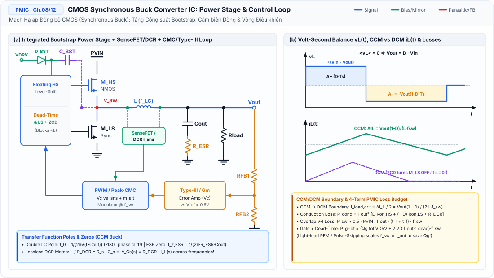

---
{
  "id": "topo-synchronous-buck-converter-architecture",
  "kind": "topology",
  "domain": "power-management-ic",
  "title_vi": "Kiến trúc Toàn diện Bộ Biến đổi Hạ áp Đồng bộ CMOS (Synchronous Buck Converter IC — 9 Khối Chức năng, Ngân sách Tổn hao & PFM Tải Nhẹ)",
  "title_en": "CMOS Synchronous Buck Converter IC Architecture: 9-Block Decomposition, Complete Power-Loss Budget, and Light-Load DCM/PFM Optimization",
  "summary": "Giải phẫu cấp transistor toàn bộ vi mạch biến đổi hạ áp đồng bộ (Synchronous Buck PMIC, đối chiếu trực tiếp với kiến trúc chuẩn silicon westonb/open-pmic và Erickson): phân rã 9 khối chức năng nội vi, hệ phương trình định lượng 7 thành phần tổn hao công suất (dẫn triode HS/LS, DCR+ESR gồm dòng xung tụ vào Cin, giao thoa cứng V-I thềm Miller, dẫn & phục hồi ngược diode thân Qrr trong thời gian chết, nạp cổng Qg, xả tụ ngõ ra Coss, và dòng tĩnh IQ), cùng máy trạng thái chuyển vùng liền mạch sang DCM/PFM bỏ xung giữ hiệu suất > 85% ở tải micro-ampe.",
  "diagram": "../../diagrams/synchronous-buck-converter.svg",
  "razavi_refs": [
    {
      "chapter": 2,
      "section": "2.1.1, 2.2.2, 2.4.2",
      "pages": "7-8, 12-19, 27-31",
      "equations": ["2.9", "2.10", "2.40"]
    },
    {
      "chapter": 8,
      "section": "8.2.1, 8.5.2",
      "pages": "286-291, 304-308",
      "equations": ["8.36", "8.73"]
    },
    {
      "chapter": 9,
      "section": "9.2.4-9.2.6",
      "pages": "355-361",
      "equations": ["9.17"]
    },
    {
      "chapter": 12,
      "section": "12.3.3, 12.8",
      "pages": "515-522, 533-535",
      "equations": ["12.30", "12.76"]
    },
    {
      "chapter": 19,
      "section": "19.2.1, 19.2.7, 19.4",
      "pages": "737-739, 753-757, 764-772",
      "equations": ["19.14", "19.19"]
    }
  ],
  "github_refs": [
    {
      "repo": "westonb/open-pmic",
      "url": "https://github.com/westonb/open-pmic/tree/2ec3130e71",
      "use": "Kiến trúc tham chiếu mã nguồn mở hoàn chỉnh cấp transistor của bộ biến đổi Buck đồng bộ chế độ dòng đỉnh trên SKY130 gồm đủ 9 khối con, bảng quét góc PVT và kịch bản vẽ đường cong hiệu suất eff_plot.py"
    },
    {
      "repo": "Arcadia-1/analog-design-bench",
      "url": "https://github.com/Arcadia-1/analog-design-bench/tree/972f7cd7c9",
      "use": "Chuẩn đánh giá hiệu suất cầu bán phần công suất > 95% (half-bridge power stage), mạch lái cổng và kiểm chứng đa góc PVT"
    },
    {
      "repo": "efabless/cace",
      "url": "https://github.com/efabless/cace/tree/d71c8da5f8d8a5bfb4cfb2640714bdd374a9b84a",
      "use": "Khung đặc tả hợp đồng đo kiểm tự động hiệu suất chuyển đổi, Line/Load Regulation, gợn áp ngõ ra và dòng tĩnh nghỉ"
    }
  ],
  "glossary_codes": [
    "T011",
    "T042",
    "T051",
    "T065",
    "T066",
    "T088",
    "T103",
    "T107",
    "T109",
    "T112",
    "T188",
    "T195",
    "T196",
    "T327",
    "T2070",
    "T2193",
    "T2197",
    "T2198"
  ],
  "process_agnostic": true,
  "roles": {
    "half_bridge_power_stage": "Cầu bán phần công suất gồm MOSFET phía cao (HS PMOS hoặc HS NMOS + Bootstrap) và MOSFET chỉnh lưu đồng bộ phía thấp (LS NMOS) đóng cắt nút SW giữa PVDD và PGND",
    "nonoverlapping_gate_driver": "Khối tạo thời gian chết không chồng lấp và chuỗi đệm đảo tăng dần kích thước cung cấp dòng đỉnh nạp/xả cực cổng trong vài nano-giây mà không gây dòng xuyên nguồn",
    "current_sense_and_zcd": "Mạch cảm biến dòng cuộn cảm (SenseFET hoặc lọc khớp RC = L/DCR) cấp tín hiệu vòng dòng/OCP, đi kèm bộ so sánh dòng không ZCD ngắt LS NMOS chặn dòng chảy ngược ở DCM",
    "error_amp_and_pwm_modulator": "Bộ khuếch đại sai lệch OTA/Folded-Cascode so sánh cầu chia Kelvin VFB với VREF Bandgap, kết hợp bộ cộng răng cưa/bù độ dốc và bộ so sánh PWM chốt chu kỳ nhiệm vụ",
    "pfm_light_load_controller": "Máy trạng thái tiết kiệm năng lượng (T195) tự động đưa mạch vào chế độ ngủ bỏ xung PFM/Burst khi tải nhẹ, làm tần số đóng cắt tỉ lệ thuận với Iload"
  },
  "symptoms_addressed": [
    "asynchronous-schottky-diode-forward-drop-destroying-low-voltage-buck-efficiency",
    "light-load-efficiency-collapsing-below-20-percent-in-fixed-frequency-forced-pwm-mode",
    "high-frequency-pvdd-pgnd-switching-ringing-due-to-input-loop-parasitic-inductance",
    "reverse-inductor-current-sinking-energy-from-output-cap-back-to-ground-at-light-load",
    "excessive-hs-switching-loss-from-slow-miller-plateau-transition"
  ],
  "limitations": [
    "strictly-step-down-conversion-vout-less-than-dmax-times-vin",
    "pulsed-chopped-input-current-generates-severe-conducted-emi-requiring-tight-local-cin",
    "pfm-pulse-skipping-mode-increases-output-voltage-ripple-and-creates-load-dependent-variable-tones"
  ],
  "checklists": [
    "common-mos",
    "dcdc-switching-converter",
    "feedback-and-stb",
    "esd-pad-and-substrate",
    "layout-and-matching"
  ]
}
---

## 1. Bản chất Nguyên lý, Sơ đồ Mạch & Vai trò Từng Nhánh Cấu trúc

Nếu Op-Amp Folded-Cascode là "trái tim tín hiệu nhỏ" thì **Bộ biến đổi Hạ áp Đồng bộ CMOS (*Synchronous Buck Converter*)** chính là "cột sống năng lượng" nuôi gần như mọi lõi vi xử lý, bộ nhớ DDR, RF transceiver và cảm biến trên các SoC hiện đại ($0{,}6\text{ V}\text{–}1{,}8\text{ V}$ từ pin $2{,}7\text{–}5{,}5\text{ V}$ với hiệu suất đỉnh $92\%\text{–}97\%$). Trong kiến trúc bất đồng bộ thế hệ cũ, nhánh hoàn lưu dòng cuộn cảm dùng diode Schottky ngoài chip có sụt áp thuận $V_D \approx 0{,}45\text{ V}$; khi hạ áp xuống $V_{out} = 0{,}9\text{ V}$ ở $D = 0{,}2$, riêng tổn hao trên diode $(1-D) V_D I_{load}$ đã chiếm tới **$\approx 28{,}6\%$ tổng công suất nguồn vào lý tưởng** (đẩy tổn hao tổng lên $\ge 28{,}6\%$, khóa trần hiệu suất $\eta \le 71{,}4\%$, tương đương **$40\%$ công suất tải ra $P_{out}$**)! Kiến trúc **chỉnh lưu đồng bộ** thay thế hoàn toàn diode bằng **MOSFET công suất phía thấp $M_{\text{LS}}$** làm việc trong **vùng triode sâu (`T188`)** có sụt áp $I_{load} R_{on,\text{LS}} \le 20\text{–}50\text{ mV}$, mở toang cánh cửa đạt hiệu suất $> 95\%$ ở điện áp cực thấp.



Đối chiếu trực tiếp với thiết kế silicon mã nguồn mở chuẩn mực `westonb/open-pmic` (Stanford EE272B trên tiến trình 130nm) và quy chuẩn PMIC công nghiệp, một vi mạch Synchronous Buck hoàn chỉnh không chỉ có 2 công tắc và mắt lọc $L\text{–}C$, mà bắt buộc là sự phối hợp nhịp nhàng của **9 khối chức năng phân cấp** trên hai miền nguồn tách biệt (`PVDD`/`PGND` công suất nhiễu lớn và `AVDD`/`AGND` tương tự sạch):
1. **Cầu Bán phần Công suất (`power-stage` — $M_{\text{HS}}$ & $M_{\text{LS}}$):**
   - *Phương án PMOS-HS + NMOS-LS (`V_in <= 5 V`, dòng $< 2\text{ A}$, như trong `open-pmic`):* Cực cổng $M_{\text{HS}}$ PMOS chỉ cần kéo về `PGND` để bật và kéo lên `PVDD` để tắt — **không cần tụ bootstrap ngoài chip** và cho phép chu kỳ nhiệm vụ đạt **$D = 100\%$ (*Low-Dropout 100% Duty Mode*)** khi pin sụt sát $V_{out}$! Đổi lại, do độ linh động lỗ trống $\mu_p \approx \frac{1}{3}\mu_n$ (Razavi Ch.2 §2.4.5), diện tích $M_{\text{HS}}$ và điện tích cổng $Q_{g,\text{HS}}$ lớn gấp $\sim 2{,}5\text{–}3$ lần NMOS có cùng $R_{on}$.
   - *Phương án All-NMOS (`M_HS` NMOS + $C_{\text{BST}}$ Bootstrap, dòng $\ge 2\text{–}20\text{ A}$):* Dùng NMOS cho cả phía cao lẫn phía thấp đạt tích phẩm chất $R_{on} \cdot Q_g$ nhỏ nhất, đi kèm mạch nâng áp cực cổng bootstrap (`topo-power-stage-hs-bootstrap-driver-deadtime`).
2. **Khối Điều khiển Thời gian Chết & Lái Cổng (`switch-control`):** Sinh cặp xung không chồng lấp (`T2147`) chèn khoảng nghỉ nano-giây $t_{\text{dead}}$ giữa lúc tắt công tắc này và bật công tắc kia để triệt tiêu dòng bắn xuyên nguồn (*shoot-through*) từ `PVDD` thẳng xuống `PGND`.
3. **Khối Cảm biến Dòng Cuộn cảm & Phát hiện Dòng Không (`current-sense` + `ZCD`):** Dùng nhánh ngón gương không tổn hao **SenseFET** (tỉ lệ $1:1000$) hoặc mạng lọc $R_s C_s = L/\text{DCR}$ trích xuất bản sao dòng cuộn cảm cho vòng điều khiển dòng / bảo vệ quá dòng **OCP**, đồng thời dùng bộ so sánh **ZCD (*Zero-Current Detector*)** canh đúng khoảnh khắc $i_L(t)$ lùi về $0\text{ A}$ để ngắt $M_{\text{LS}}$, ngăn dòng chảy ngược rút cạn tụ tải ở chế độ tải nhẹ (`topo-dcdc-ramp-sensefet-dcr-and-zcd-blocks`).
4. **Bộ Khuếch đại Sai lệch & Mạng Bù Tần số (`folded-cascode` EA + Compensator):** Cầu chia điện trở chính xác lấy mẫu áp tải qua **đường dây cảm nhận bốn dây Kelvin (`T2197`)** đưa về OTA/Op-Amp (`topo-folded-cascode-ota` trong `open-pmic`) để khuếch đại sai số $V_{FB} - V_{REF}$ qua mạng bù Type-II (cho CMC) hoặc Type-III (cho VMC).
5. **Bộ Điều chế Xung & Cộng Bù Độ dốc (`modulator`):** Cộng tín hiệu dòng cảm biến với răng cưa bù độ dốc $m_a$ (hoặc so sánh thẳng $V_{\text{comp}}$ với răng cưa điện áp), đưa vào bộ so sánh tốc độ cao và chốt `SR-Latch` định hình độ rộng xung từng chu kỳ.
6. **Bộ Tạo Xung nhịp & Răng cưa Chuẩn (`oscillator` — `T196`):** Khối dao động tích thoát $RC$ bù nhiệt tạo xung nhịp $f_{sw}$ cố định và sườn dốc tuyến tính đồng bộ pha.
7. **Tham chiếu Bandgap, Phân cực Trung tâm & LDO Nội (`bias-circuit` — `T011`):** Sinh $V_{REF}$ bất biến nhiệt độ (`topo-bandgap-reference-core`), các nhánh dòng chuẩn `I_PTAT`/`I_ZTC` và nguồn sạch nội `AVDD` cách ly khỏi gợn đóng cắt trên `PVDD`.
8. **Tổ hợp Khởi động & Bảo vệ Toàn diện (`POR` + `UVLO` + `Soft-Start` + `OCP` + `TSD`):** Khóa cổng công suất khi nguồn chưa đủ cao, dốc dần tham chiếu khởi động mềm để chặn dòng nạp vọt tụ lọc làm bão hòa cuộn cảm, và ngắt nhiệt ở $150\,^\circ\text{C}$ (`topo-pmic-protections-por-uvlo-softstart-ocp-tsd`).
9. **Bộ Điều phối Chế độ Tiết kiệm Năng lượng Tải Nhẹ (`PFM / PSM Mode Controller` — `T195`):** Chuyển đổi trơn tru từ PWM tần số cố định ở tải trung bình/nặng sang điều chế tần số xung (**PFM** / *Burst Mode*) khi dòng tải hạ xuống vùng $\text{mA}\text{–}\mu\text{A}$.

---

## 2. Hệ Phương trình Cốt lõi & Tư duy "Nhìn Mạch Đọc Nhanh" (Analysis by Inspection)

### 2.1. Phương trình Ngân sách 7 Thành phần Tổn hao Công suất Thực tế ($P_{\text{loss,tot}}$)
Để đạt hiệu suất thực tế $\eta = \dfrac{V_{out} I_{load}}{V_{out} I_{load} + P_{\text{loss,tot}}}$ vượt $90\%$ trên toàn dải tải, người thiết kế IC tuyệt đối không được chỉ tính $I^2 R_{on}$ mà phải lập bảng hạch toán chính xác **7 cơ chế tiêu tán năng lượng (`T066`)** trong một chu kỳ đóng cắt:

1. **Tổn hao Dẫn Vùng Triode của Hai Công tắc Công suất ($P_{\text{cond,MOS}}$):** Áp dụng định lý trực giao giữa thành phần DC $I_{load}$ và thành phần tam giác $\Delta i_L$ trên từng khoảng dẫn $D$ và $(1-D)$:

$$
P_{\text{cond,MOS}} = I_{\text{HS,rms}}^2 R_{on,\text{HS}} + I_{\text{LS,rms}}^2 R_{on,\text{LS}} = \left(I_{load}^2 + \frac{\Delta i_L^2}{12}\right)\Big[D\,R_{on,\text{HS}}(T_J) + (1 - D)\,R_{on,\text{LS}}(T_J)\Big]
$$

*(Lưu ý bắt buộc nhân hệ số nhiệt dương của độ linh động hạt tải: $R_{on}(125\,^\circ\text{C}) \approx (1{,}5 \dots 1{,}8)\,R_{on}(27\,^\circ\text{C})$ — tự ổn định phân bố dòng giữa các ngón song song nhưng làm sụt hiệu suất tải nặng!)*
2. **Tổn hao Thuần trở Phần tử Thụ động Ngoài — Đừng bao giờ quên Tụ Ngõ vào $C_{in}$! ($P_{\text{passive}}$):** Trong mạch Buck, dòng ngõ ra qua cuộn cảm là dòng liên tục êm ái, nhưng **dòng hút từ nguồn vào qua $M_{\text{HS}}$ là chuỗi xung chữ nhật băm đứt quãng biên độ $I_{load}$**! Tụ lọc ngõ vào $C_{in}$ phải cung cấp toàn bộ thành phần xoay chiều của chuỗi xung đó với dòng hiệu dụng $I_{C_{in},\text{rms}} = I_{load}\sqrt{D(1 - D) + \frac{D}{12}\left(\frac{\Delta i_L}{I_{load}}\right)^2}$ (đạt đỉnh khắc nghiệt nhất $0{,}5\,I_{load}$ tại $D = 0{,}5$!):

$$
P_{\text{passive}} = \left(I_{load}^2 + \frac{\Delta i_L^2}{12}\right) R_{\text{DCR}} + \frac{\Delta i_L^2}{12} R_{\text{ESR,out}} + I_{C_{in},\text{rms}}^2 R_{\text{ESR,in}}
$$

3. **Tổn hao Giao thoa Đóng cắt Cứng $V \cdot I$ Trên Thềm Miller của $M_{\text{HS}}$ ($P_{\text{sw,HS}}$):**
   - **Sự bất đối xứng sống còn giữa $M_{\text{HS}}$ và $M_{\text{LS}}$:** Khi $M_{\text{LS}}$ chuyển trạng thái (bật lên sau khi $M_{\text{HS}}$ đã ngắt và dòng $i_L$ đã kéo nút `SW` kẹp xuống $-V_{D,\text{body}} \approx -0{,}7\text{ V}$, hoặc tắt đi trước khi $M_{\text{HS}}$ bật), điện áp $V_{DS,\text{LS}}$ đặt trên $M_{\text{LS}}$ chỉ vỏn vẹn $0{,}7\text{ V}$ — nghĩa là **$M_{\text{LS}}$ tự nhiên hưởng chuyển mạch áp gần không (*Quasi-ZVS*)**! Ngược lại, **$M_{\text{HS}}$ gánh trọn điện áp nguồn $V_{in}$ đồng thời với dòng cuộn cảm** suốt thời gian nạp/xả điện tích thềm Miller $Q_{gd,\text{HS}}$ (Razavi Ch.2 §2.4.2 & `T874`):

$$
P_{\text{sw,HS}} \approx \frac{1}{2} V_{in} f_{sw} \left[ \left(I_{load} - \frac{\Delta i_L}{2}\right) t_{\text{sw,on}} + \left(I_{load} + \frac{\Delta i_L}{2}\right) t_{\text{sw,off}} \right], \qquad t_{\text{sw,on/off}} \approx \frac{Q_{gd,\text{HS}} + Q_{gs,\text{th}\to\text{pl}}}{I_{\text{drv,on/off}}}
$$

4. **Tổn hao Dẫn Diode Thân Trong Thời gian Chết & Điện tích Phục hồi Ngược $Q_{rr}$ ($P_{\text{dead}}$):** Trong hai khoảng nghỉ chống trùng dẫn $t_{d,\text{LH}}$ (trước khi $M_{\text{HS}}$ bật, mang dòng đáy $I_{\text{valley}} = I_{load} - \Delta i_L/2$) và $t_{d,\text{HL}}$ (sau khi $M_{\text{HS}}$ tắt, mang dòng đỉnh $I_{\text{pk}} = I_{load} + \Delta i_L/2$), diode tiếp giáp $p\text{–}n$ thân–máng (`T107`) của $M_{\text{LS}}$ bị ép dẫn thuận. Nguy hiểm hơn, khi $M_{\text{HS}}$ bật lên giật nút `SW` lên $V_{in}$, toàn bộ hạt tải thiểu số lưu trữ trong diode thân $M_{\text{LS}}$ phải quét sạch tạo gai dòng phục hồi ngược $Q_{rr}$:

$$
P_{\text{dead}} = V_{D,\text{body}} f_{sw} \Big[ \left(I_{load} - \tfrac{1}{2}\Delta i_L\right) t_{d,\text{LH}} + \left(I_{load} + \tfrac{1}{2}\Delta i_L\right) t_{d,\text{HL}} \Big] + Q_{rr} V_{in} f_{sw}
$$

5. **Tổn hao Lái Cổng ($P_{\text{gate}}$), Tổn hao Tụ Ngõ ra Nút SW ($P_{C_{oss}}$) & Công suất Tĩnh Điều khiển ($P_Q$):**

$$
P_{\text{gate}} = \left(Q_{g,\text{HS}} + Q_{g,\text{LS}}\right) V_{\text{drv}} f_{sw} \cdot \left(\frac{V_{in}}{V_{\text{drv}}}\right)_{\text{nếu cấp từ LDO}}, \qquad P_{C_{oss}} \approx \frac{1}{2} C_{\text{oss,eff}} V_{in}^2 f_{sw}, \qquad P_Q = V_{in} I_{Q,\text{ctrl}}
$$

*(Chú ý bẫy tính toán: nếu nguồn lái cổng $V_{\text{drv}} = 1{,}8\text{ V}$ được hạ xuống từ $V_{in} = 5{,}0\text{ V}$ bằng một LDO tuyến tính nội, dòng trung bình rút từ $V_{in}$ vẫn là $I_{\text{drv}} = Q_g f_{sw}$ nên tổng công suất tiêu tốn lấy từ pin là **$Q_g V_{in} f_{sw}$** chứ không phải $Q_g V_{\text{drv}} f_{sw}$!)*

### 2.2. Định luật Sụp đổ Hiệu suất Tải Nhẹ ở FPWM & Cơ chế Tối ưu Hóa DCM/PFM (Pulse-Skipping / Burst Mode)
Nhìn vào 7 số hạng trên khi dòng tải tiến về $0$ ($I_{load} \to 100\,\mu\text{A}$):
- Nếu giữ nguyên chế độ **Forced-PWM (FPWM)** (không dùng ZCD, cho phép dòng cuộn cảm đảo chiều âm-dương tự do ở tần số cố định $f_{sw}$): mạch phải trả **thuế cố định độc lập với tải** $P_{\text{fixed}}(f_{sw}) = P_{\text{gate}} + P_{C_{oss}} + \frac{\Delta i_L^2}{12}(R_{on} + R_{\text{DCR}}) + P_Q \sim 5\text{–}30\text{ mW}$. Tại $P_{out} = 1\text{ V} \times 100\,\mu\text{A} = 0{,}1\text{ mW}$, hiệu suất sụp đổ thảm hại xuống $\eta < 1\%$!
- **Giải pháp Tầng 1 — Bật ZCD chuyển sang DCM tần số cố định:** Cắt bỏ dòng tuần hoàn ngược $\Delta i_L^2/12$ và giảm độ rộng xung $D_1 \propto \sqrt{I_{load}}$, nhưng vẫn đóng cắt đủ $f_{sw}$ lần mỗi giây nên vẫn mất trắng $P_{\text{gate}} + P_{C_{oss}}$.
- **Giải pháp Tầng 2 — Điều chế Tần số Xung PFM / Constant-Peak-Current Burst Mode:** Khi $I_{load} < I_{\text{PFM,th}}$, IC tắt hoàn toàn bộ dao động chính và hầu hết các OTA băng rộng (hạ $I_Q$ xuống $1\text{–}10\,\mu\text{A}$), chỉ giữ một bộ so sánh ngủ trễ thấp canh $V_{FB}$. Mỗi khi $V_{out}$ tụt nhẹ chạm ngưỡng dưới, IC thức dậy bắn **đúng một xung (hoặc chùm xung)** bơm cuộn cảm lên dòng đỉnh cố định tối ưu $I_{\text{pk,PFM}}$ (gói năng lượng cố định mỗi xung $E_{\text{out,pulse}} = \frac{1}{2} L I_{\text{pk,PFM}}^2 \cdot \frac{V_{in}}{V_{in} - V_{out}}$), sau đó ngủ tiếp! Tần số đóng cắt hiệu dụng tự động co giãn tuyến tính theo dòng tải:

$$
f_{\text{PFM}}(I_{load}) = \frac{V_{out}\,I_{load}}{E_{\text{out,pulse}}} = \frac{2\left(V_{in} - V_{out}\right) V_{out}}{L\,V_{in}\,I_{\text{pk,PFM}}^2}\,I_{load} \propto I_{load}
$$

Vì cả công suất ra $V_{out} I_{load}$ lẫn tổng tổn hao đóng cắt $E_{\text{loss,pulse}} \cdot f_{\text{PFM}}$ đều tỉ lệ thuận cùng bậc với $I_{load}$ (miễn là $f_{\text{PFM}} E_{\text{loss,pulse}} \gg V_{in} I_{Q,\text{sleep}}$), đường cong hiệu suất $\eta_{\text{PFM}} \approx \dfrac{E_{\text{out,pulse}}}{E_{\text{out,pulse}} + E_{\text{loss,pulse}}}$ **giữ phẳng ở mức $82\%\text{–}90\%$ trải dài suốt 4–5 thập kỷ dòng tải** từ vài Ampe xuống tận $10\,\mu\text{A}$!

---

## 3. Bất biến Cấu trúc & Các Bẫy Lỗi Kinh điển (Structural Invariants & Traps)

- **[INV-BUCK-01] Bất biến Vòng Dòng Nóng Đóng cắt Tần số Cao (*The Critical `PVDD`–$C_{in}$–$M_{\text{HS}}$–$M_{\text{LS}}$–`PGND` Hot Loop*):** Sai lầm phổ biến nhất của người mới vẽ PCB/Layout cho mạch Buck là tưởng đường qua cuộn cảm $L$ là đường nhiễu nhất nên dồn ưu tiên thu ngắn dây nối `SW`–$L$–$C_{out}$! **Ngược lại hoàn toàn về mặt vật lý $di/dt$!** Dòng qua cuộn cảm $L$ biến thiên êm với độ dốc hữu hạn $\frac{V_{in}-V_{out}}{L} \sim 1\text{ A}/\mu\text{s}$; trong khi đó, tại sườn chuyển mạch $2\text{ ns}$, dòng $I_{load}$ chuyển giao tức thời từ nhánh $M_{\text{LS}}$ sang nhánh $C_{in}\text{–}M_{\text{HS}}$ tạo tốc độ biến thiên **$\frac{di_{\text{hot}}}{dt} \sim \frac{2\text{ A}}{2\text{ ns}} = 1000\text{ A}/\mu\text{s}$** (lớn gấp **1.000 lần** cuộn cảm $L$)! Theo Razavi Ch.19 §19.4 (Phương trình 19.19, `T2198`), chỉ cần tổng điện cảm ký sinh dây hàn chân vỏ (*bondwire*) + đường mạch của vòng kín `C_in(+) -> PVDD pad -> M_HS -> M_LS -> PGND pad -> C_in(-)` bằng $L_{\text{loop}} = 3\text{ nH}$, nút `SW` sẽ vọt áp quá độ $\Delta V_{\text{spike}} = L_{\text{loop}}\frac{di}{dt} = 3\text{ V}$ cộng thẳng lên $V_{in}$ đánh thủng oxit cổng/máng MOSFET! Do đó tụ gốm nhỏ $C_{in,\text{HF}}$ ($0{,}1\text{–}1\,\mu\text{F}$) bắt buộc đặt sát chân `PVDD`/`PGND` nhất kèm đa dây hàn song song hoặc chip lật (*flip-chip bump*)!
- **[INV-BUCK-02] Bất biến Cô lập Miền Đất Công suất (`PGND`) và Miền Đất Tương tự (`AGND`) + Lấy mẫu Kelvin:** Đỉnh dòng bạc Ampe chảy trên kim loại `PGND` gây sụt áp $I R + L\frac{di}{dt}$ hàng chục đến hàng trăm $\text{mV}$. Nếu nối chung đất của Bandgap $V_{REF}$, bộ tạo răng cưa và chân dưới cầu chia $R_{FB2}$ thẳng vào đường kim loại `PGND` ngay dưới chân nguồn $M_{\text{LS}}$, xung nảy đất sẽ tiêm trực tiếp vào ngõ vào bộ khuếch đại sai lệch gây jitter chu kỳ nhiệm vụ dữ dội và sai lệch áp ra theo tải (*poor load regulation*). Bắt buộc tách riêng chân/hòn đảo `AGND` nối về điểm tham chiếu êm tại cực âm tụ tải theo cấu trúc **hình sao (`T2197`)**!
- **[TRAP-BUCK-01] Bẫy Bật Lại Tự Phát Do Cảm ứng Điện dung Miller $C_{GD,\text{LS}}$ (*$dV/dt$-Induced Parasitic Turn-On / Shoot-Through*):** Ngay khoảnh khắc $M_{\text{HS}}$ bật kéo nút `SW` vọt tuyến tính một biên độ $\Delta V_{\text{SW}} \approx V_{in}$ trong thời gian cạnh lên $t_r$ ($\frac{dV_{\text{SW}}}{dt} = \frac{\Delta V_{\text{SW}}}{t_r} \sim 5\text{–}15\text{ V/ns}$), tụ chồng lấp cổng–máng $C_{GD,\text{LS}}$ của transistor phía thấp $M_{\text{LS}}$ (lúc này đang phải giữ trạng thái TẮT!) bơm một dòng dịch chuyển chữ nhật $i_{\text{Miller}} = C_{GD,\text{LS}} \frac{\Delta V_{\text{SW}}}{t_r}$ thẳng vào cực cổng $G_{\text{LS}}$. Giải phương trình vi phân $C_\Sigma \frac{dV_{GS,\text{LS}}}{dt} + \frac{V_{GS,\text{LS}}}{R_{\text{pd}}} = C_{GD,\text{LS}}\frac{\Delta V_{\text{SW}}}{t_r}$ trên khoảng $[0, t_r]$ với tổng điện dung nút cổng $C_\Sigma = C_{GS,\text{LS}} + C_{GD,\text{LS}}$ và hằng số thời gian xả cổng $\tau = R_{\text{pd}} C_\Sigma$, điện áp nảy cổng đạt đỉnh đúng tại $t = t_r$:

$$
V_{GS,\text{LS,peak}} = \frac{C_{GD,\text{LS}}}{C_\Sigma}\,\Delta V_{\text{SW}}\,\left(\frac{\tau}{t_r}\right)\left(1 - e^{-t_r / \tau}\right), \qquad C_\Sigma = C_{GS,\text{LS}} + C_{GD,\text{LS}}, \quad \tau = R_{\text{pd}}\,C_\Sigma
$$

Kiểm tra hai giới hạn vật lý cốt tử: khi sườn đóng cắt cực nhanh hoặc driver kéo xuống yếu ($t_r \ll \tau$), thừa số suy giảm $\left(\frac{\tau}{t_r}\right)\!\left(1 - e^{-t_r/\tau}\right) \to 1$ (ví dụ tại $t_r = 0{,}1\tau$, hệ số này bằng **$0{,}952$** chứ tuyệt đối không phải $0{,}095$!), đưa đỉnh nảy cổng chạm trần bộ chia điện dung thuần $\frac{C_{GD,\text{LS}}}{C_\Sigma}\Delta V_{\text{SW}}$; ngược lại khi kéo xuống rất khỏe ($\tau \ll t_r$), đỉnh nảy hạ về $R_{\text{pd}} C_{GD,\text{LS}} \frac{\Delta V_{\text{SW}}}{t_r}$. *Ví dụ định lượng:* Với $\Delta V_{\text{SW}} = 5{,}0\text{ V}$, $C_{GD,\text{LS}} = 4\text{ pF}$, $C_{GS,\text{LS}} = 36\text{ pF}$ ($C_\Sigma = 40\text{ pF}$) và sườn $t_r = 0{,}5\text{ ns}$: nếu $R_{\text{pd}} = 25\,\Omega$ ($\tau = 1{,}0\text{ ns} \implies t_r/\tau = 0{,}5$), ta có $V_{GS,\text{LS,peak}} = 0{,}10 \times 5{,}0\text{ V} \times 2{,}0 \times (1 - e^{-0{,}5}) = \mathbf{0{,}393\text{ V}} > V_{THN}(125\,^\circ\text{C}) \approx 0{,}30\text{ V}$ ở góc nóng `FF, 125 °C` — làm **$M_{\text{LS}}$ tự bật ngược gây trùng dẫn xuyên nguồn dù logic dead-time hoàn toàn đúng**! Bắt buộc thiết kế $R_{\text{pd,LS}} \ll R_{\text{pu,LS}}$ kèm **kẹp Miller chủ động (*Active Miller Clamp*)** hạ $R_{\text{pd}} \le 2{,}5\,\Omega$ ($\tau = 0{,}10\text{ ns} \implies V_{GS,\text{LS,peak}} = 0{,}099\text{ V} \ll V_{THN}$) khi $V_{GS,\text{LS}} < 0{,}2\text{ V}$!
- **[TRAP-BUCK-02] Bẫy Nhiễu Âm Thanh (*Audible Ceramic Buzz*) & Nhiễu Băng Tần RF Khi Chuyển Sang Chế độ PFM:** Khi tải nhẹ cố định sao cho $f_{\text{PFM}}(I_{load})$ rơi đúng vào dải tai người nghe $20\text{ Hz}\text{–}20\text{ kHz}$, hiệu ứng áp điện (*piezoelectric effect*) của tụ gốm MLCC BaTiO$_3$ rung cơ học theo gợn áp $\Delta V_{\text{PFM}}$ phát ra tiếng rít khó chịu trên bo mạch điện thoại/laptop, hoặc rơi trúng băng tần nhạy của LNA/ADC! Các PMIC cao cấp phải cung cấp chân `MODE` (`FPWM = 1` cưỡng bức tần số cố định khi cấp nguồn cho RF/Audio AFE, và `AUTO_PFM = 0` khi hệ thống ở chế độ chờ)!

---

## 4. Lộ trình Nâng cấp Cấu trúc & Bát giác Đánh đổi (Upgrade Paths & Design Octagon)

| Điểm nghẽn của Kiến trúc Synchronous Buck Tiêu chuẩn | Nâng cấp sang cấu trúc / kỹ thuật đích (Canonical Node) | Cơ chế đột phá | Đánh đổi trên Bát giác Thiết kế |
|---|---|---|---|
| HS PMOS ở dòng $> 2\text{ A}$ chiếm diện tích silicon khổng lồ và $Q_{g,\text{HS}}$ lớn đốt hiệu suất tần số cao | `topo-power-stage-hs-bootstrap-driver-deadtime` | Thay HS PMOS bằng **HS NMOS** có $\mu_n \approx 3\mu_p$, dùng tụ bay $C_{\text{BST}}$ nâng áp cổng lên $V_{\text{SW}} + V_{\text{drv}}$ và dịch mức vi sai xung cao áp | Không thể giữ $D = 100\%$ tĩnh vô hạn nếu không có bơm điện tích phụ làm tươi $C_{\text{BST}}$ |
| Cần cấp nguồn ra $V_{out} = 3{,}3\text{ V}$ không gián đoạn khi pin Li-ion xả từ $4{,}4\text{ V}$ tụt xuống $2{,}7\text{ V}$ ($V_{in}$ cắt ngang $V_{out}$) | `topo-boost-inverting-and-4switch-buckboost` | Nâng cấp cầu bán phần 2 công tắc thành cầu H 4 công tắc (**4-Switch Buck-Boost**) tự động chuyển tiếp Buck $\to$ Buck-Boost $\to$ Boost | Tăng gấp đôi số công tắc trên đường dòng chính và xuất hiện RHP Zero khi sang vùng Boost |
| Ngõ ra Buck vẫn còn gợn đóng cắt $5\text{–}15\text{ mV}_{\text{pp}}$ tại $f_{sw}$ không thể cấp trực tiếp cho VCO/PLL hay $\Delta\Sigma$ ADC | Chuỗi ghép lai **Buck Pre-Regulator $\to$ Capless / Low-Noise LDO** (`topo-capless-ldo-fvf-ahuja-dfc-and-sre`) | Buck hạ áp từ $4{,}2\text{ V} \to 1{,}35\text{ V}$ với $\eta = 93\%$, sau đó LDO hạ từ $1{,}35\text{ V} \to 1{,}20\text{ V}$ lọc sạch $> 50\text{ dB}$ gợn $f_{sw}$ mà vẫn đạt tổng hiệu suất $\eta_{\text{tot}} \approx 82{,}7\%$ (so với $28{,}6\%$ của LDO đơn độc!) | Tốn thêm khoảng dự trữ dropout $150\text{ mV}$ và phải thiết kế PSRR của LDO cao đúng tại $f_{sw}$ của Buck |
| Dòng tải lõi CPU/GPU lên tới $20\text{–}100\text{ A}$ với tốc độ nhảy bậc $100\text{ A}/\mu\text{s}$ | *Multiphase Interleaved Synchronous Buck* ($N$ pha lệch góc $360^\circ / N$) | Chia dòng mỗi pha còn $I_{load}/N$, triệt tiêu gợn dòng tổng trên $C_{in}$ và $C_{out}$ tại các điểm $D = k/N$, nhân tần số gợn hiệu dụng lên $N \cdot f_{sw}$ | Phải thêm vòng cân bằng dòng giữa các pha (*current sharing loop*) để tránh lệch nhiệt |

---

## 5. Thích ứng Đa Tiến trình (90nm / 65nm / 45nm) & Cách Kiểm chứng trong Cadence / Spectre

### 5.1. Quy hoạch Linh kiện Đa Điện áp Oxit Cổng & Bố cục Layout Công suất Trên CMOS Nanomet
1. **Phân vùng loại transistor theo miền điện áp (*Multi-Oxide Partitioning*):** Trên tiến trình 90nm/65nm/45nm (nơi transistor core mỏng chỉ chịu được $1{,}0\text{–}1{,}2\text{ V}$), nếu $V_{in} = 3{,}3\text{–}5{,}0\text{ V}$, hai công tắc công suất $M_{\text{HS}}, M_{\text{LS}}$ bắt buộc dùng **linh kiện I/O dày cổng $3{,}3\text{ V}/5\text{ V}$ hoặc LDMOS bất đối xứng** (hoặc xếp chồng **Cascode Power Stage** gồm 2 transistor mỏng $1{,}2\text{ V}$ nối tiếp cho bộ biến đổi $2{,}4\text{ V} \to 1{,}0\text{ V}$ siêu tốc $10\text{ MHz}$!). Ngược lại, toàn bộ lõi điều khiển (`EA`, `Modulator`, `Oscillator`, `PFM logic`) chạy trên nguồn nội `AVDD = 1.2V / 1.8V` bằng transistor core nhanh, diện tích nhỏ và điện tích chuyển mạch thấp.
2. **Bố cục Ma trận Chia Ngón Răng lược Đường Kim loại Đỉnh Dày (*Top-Metal Waffle / Interdigitated Power Matrix*, Razavi Ch.19 §19.2.1 & §19.2.7):** Một MOSFET công suất có tổng bề rộng $W_{\text{tot}} = 40.000\,\mu\text{m}$ ($40\text{ mm}$!) được băm thành hàng ngàn ngón song song (`nf = 2000..4000`, mỗi ngón $W_f = 10\text{–}20\,\mu\text{m}$). Nếu đi dây kim loại mỏng thông thường, điện trở phân bố kim loại nối nguồn/máng và hiện tượng di cư điện tử (`tech-interconnect-rc-electromigration-and-ir-drop`) sẽ lớn hơn cả $R_{on}$ của kênh silicon! Bắt buộc lát lưới kim loại dày trên cùng (**Ultra-Thick Top Metal / RDL** dày $2\text{–}3\,\mu\text{m}$) đan chéo $45^\circ$ hoặc xen kẽ dọc–ngang trực tiếp phía trên vùng hoạt động để sụt áp kim loại $< 15\%\,R_{on,\text{ch}}$.
3. **Điểm cân bằng kích thước HS vs LS theo chu kỳ nhiệm vụ danh định $D_{\text{nom}}$:** Vì $M_{\text{HS}}$ chỉ dẫn trong tỷ lệ $D$ còn $M_{\text{LS}}$ dẫn trong $(1-D)$, với ứng dụng hạ áp sâu (ví dụ $V_{in} = 5\text{ V} \to V_{out} = 1{,}0\text{ V} \implies D = 0{,}20$, $(1-D) = 0{,}80$), $M_{\text{LS}}$ gánh công suất dẫn gấp 4 lần $M_{\text{HS}}$ trong khi $M_{\text{HS}}$ lại gánh toàn bộ tổn hao đóng cắt $V\cdot I$ và $Q_{gd}$! Do đó **bất đối xứng tối ưu** luôn chọn $R_{on,\text{LS}} \approx (0{,}35 \dots 0{,}55)\,R_{on,\text{HS}}$ ($M_{\text{LS}}$ rộng hơn để giảm tổn hao dẫn, $M_{\text{HS}}$ gọn hơn để giảm $Q_{gd,\text{HS}}$ và $P_{\text{sw}}$!).

### 5.2. Kịch bản Đo Hiệu suất Toàn diện & Kiểm định Chuyển vùng PFM–PWM trong Spectre
1. **Cách đo Hiệu suất $\eta$ Chính xác Tuyệt đối trong Mô phỏng Quá độ (`tran` / `pss`):**
   - Sai lầm sơ đẳng là lấy tích $V_{out,\text{avg}} \cdot I_{out,\text{avg}}$ chia cho $V_{in} \cdot I_{in,\text{avg}}$ khi điện áp trên tụ $C_{out}$ và dòng trong cuộn cảm $L$ vẫn còn đang trôi nhẹ $\Delta V_{out} = 1\text{ mV}$ giữa đầu và cuối cửa sổ đo! Với $C_{out} = 22\,\mu\text{F}$ và cửa sổ $10\,\mu\text{s}$, chỉ riêng năng lượng tích thêm vào tụ $\frac{\Delta(\frac{1}{2}CV^2)}{\Delta t} \approx \frac{22\,\mu\text{F} \cdot 1{,}8\text{ V} \cdot 1\text{ mV}}{10\,\mu\text{s}} = 3{,}96\text{ mW}$ đã làm **hiệu suất đo ở tải nhẹ vọt giả tạo lên $> 105\%$ hoặc tụt sai $20\%$**!
   - **Quy tắc bất di bất dịch:** Chỉ tích phân trên số nguyên lần chu kỳ $N \cdot T_s$ (hoặc trọn 1 chu kỳ PFM từ đỉnh áp này sang đỉnh áp kế tiếp) sau khi $\left|v_{out}(t_2) - v_{out}(t_1)\right| < 10\,\mu\text{V}$, hoặc trừ tường minh phần biến thiên năng lượng kho chứa $\Delta E_{\text{stored}} = \frac{1}{2}C\big(v_C^2(t_2)-v_C^2(t_1)\big) + \frac{1}{2}L\big(i_L^2(t_2)-i_L^2(t_1)\big)$!
2. **Kiểm tra Bao gồm Mô hình Vỏ Gói Chip (*Package Bondwire $L_{\text{pkg}} = 1\text{–}2\text{ nH}$*):** Luôn chèn cuộn cảm ký sinh nối tiếp vào chân `PVDD`, `PGND`, `SW` khi chạy `tran` góc `FF, -40°C` (sườn đóng cắt nhanh nhất!) để bắt lỗi vọt áp `SW` và bật giả Miller trên $G_{\text{LS}}$.
3. **Bảng Kiểm Soát Nhanh 5 Tiêu Chí Nghiệm Thu Synchronous Buck IC Trong ADE:**
   ```text
   [1] Không trùng dẫn mọi góc PVT:   max( I_D(M_HS) * I_D(M_LS) )_steady == 0 (ngoài dòng xả C_oss)
   [2] Chống bật giả Miller LS:       max( V(G_LS) - V(PGND) ) during SW rising edge <= 0.65 * V_THN(125C)
   [3] Chặn dòng ngược ZCD ở tải nhẹ: min( i(L) )_in_DCM >= -15 mA across VOS_comparator Monte Carlo
   [4] Chuyển vùng PFM <-> PWM êm:    pk2pk( V(VOUT) ) during slow Iload ramp (0.1mA -> 1A -> 0.1mA) <= 2.5% Vout
   [5] Ngân sách hiệu suất toàn dải:  eta_peak >= 92%  AND  eta(Iload = 100 uA, PFM) >= 80%
   ```

---

## 6. Mốc Đối chiếu Sách Razavi, Tài liệu Chuẩn Công nghiệp & Thuật ngữ CLB

### 6.1. Đối chiếu Sách Gốc Razavi (2nd Edition) & Kho Tham chiếu Silicon Mở
- **Razavi Chương 2 & Chương 19:** §2.1.1 & §2.2.2 (tr. 7–19 — công tắc vùng triode sâu), §2.4.2 (tr. 27–31 — điện dung tiếp giáp và cổng phi tuyến theo vùng làm việc), §19.2.1 *Multifinger Transistors* (tr. 737–739), §19.2.7 *Interconnects* (tr. 753–757, đi dây Kelvin và kháng điện dây dẫn) & §19.4 *Packaging* (tr. 764–772, điện cảm dây hàn gây nảy nguồn/đất `L*di/dt`).
- **Razavi Chương 8, 9 & 12:** §8.2.1 (tr. 286–291 — vòng hồi tiếp Điện áp–Điện áp), §9.2.4 (tr. 355–361 — Folded-Cascode EA dùng trong bộ điều khiển), §12.3.3 & §12.8 (tr. 515–522, 533–535 — tham chiếu Bandgap và so sánh ổn áp tuyến tính).
- **Tham chiếu Thiết kế Mã nguồn Mở & Chuyên khảo PMIC:** Weston Braun & Aparna Tumkur, `westonb/open-pmic` (*SKY130 Peak-Current-Mode Buck Converter*, Stanford EE272B — phân rã 9 khối mạch); R. W. Erickson & D. Maksimović, *Fundamentals of Power Electronics* (Ch. 4 *Switch Realization & Switching Loss*); B. Wicht, *Design of Power Management Integrated Circuits* (Ch. 5 & Ch. 6 — ngân sách tổn hao và kiến trúc điều khiển tải nhẹ PFM/PWM).

### 6.2. Bảng Thuật ngữ Chuẩn CLB Vi Mạch Sử dụng trong Thẻ
| Mã CLB | Thuật ngữ Tiếng Anh | Thuật ngữ Tiếng Việt Chuẩn | Ghi chú Ngữ cảnh trong Synchronous Buck |
|---|---|---|---|
| `T065` / `T066` | power consumption / power dissipation | Công suất tiêu thụ / Công suất tiêu tán | Hạch toán 7 thành phần tổn hao quyết định đường cong hiệu suất $\eta(I_{load})$ |
| `T195` | Power-saving mode | Chế độ tiết kiệm năng lượng | Chế độ ngủ bỏ xung PFM / Burst Mode kéo hiệu suất tải nhẹ $> 80\%$ |
| `T327` / `T103` | Drain junction capacitance / Parasitic capacitances | Điện dung tiếp giáp máng / Các điện dung ký sinh | Sinh tổn hao $C_{\text{oss}} V_{in}^2 f_{sw}/2$ và ghép ngược Miller $C_{GD,\text{LS}}$ |
| `T2193` | multi-finger transistor | transistor chia nhiều ngón cực cổng | Cấu trúc bắt buộc cho MOSFET công suất hàng chục milimét bề rộng |
| `T2197` / `T2198` | Kelvin connection and star ground / bondwire inductance and ground bounce | đấu nối bốn dây Kelvin và đi đất hình sao / điện cảm dây hàn chân vỏ và nảy đất | Tách `PGND`/`AGND` và tối thiểu hóa vòng dòng nóng $C_{in}\text{–}M_{\text{HS}}\text{–}M_{\text{LS}}$ |
